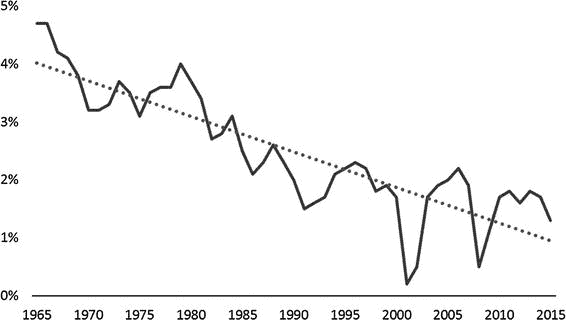
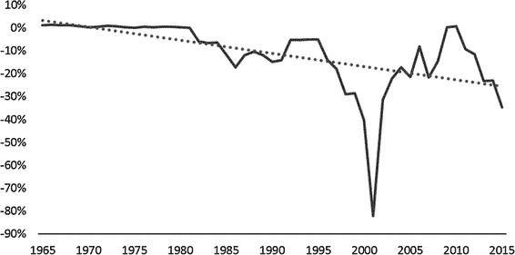
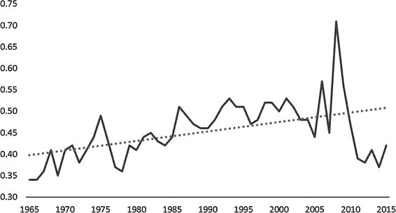
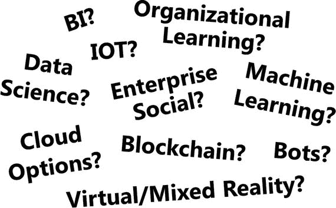

# 1. 行动的理由

更准确地说，本章全部是关于数据-学习-行动的理由！我们在引言中已经触及了“为何是现在”这个问题——在这里，我们将更深入地探讨这个主题。变革管理的一个基本准则是，除非组织内部对现状存在真正的不满，否则组织不会采取新的方向或采用新的方法。本章提供了大量理由，说明为何应对当前状况感到担忧，并应有助于在您的组织中启动优化数据-学习-行动的方法。

以下是推动超越当前“一切照旧”状态的激励因素，我们将在本章详细探讨：

* 对过去几十年来企业（尤其是美国企业）经济结果的长期趋势进行仔细审视，会发现一幅并不美好的图景，而且这幅图景似乎总体上正在恶化。
* 信息技术的飞速发展，虽然最终有望带来巨大的好处，但也造成了日益加剧的复杂性和混乱，常常导致组织瘫痪或浪费性支出。
* 除了技术快速进步带来的基本复杂性和混乱之外，那些鼓吹特定技术或基于技术的角色的参与者所倡导的自身议程，进一步加剧了混乱程度，从而阻碍了对商业价值的清晰思考。
* 旨在改善业务绩效的传统管理技术工具箱仍然有价值，但未能有效解决在当今环境中运营的组织所面临的关键绩效改进问题。

## 经济层面的紧迫性

德勤边缘研究中心在过去七年左右进行了一项引人注目的研究，该研究清晰地揭示了企业在当代经济和技术环境下面临的经济问题。这项研究包含一套定期发布的指标及配套评论，德勤称之为“转型指数”。¹

“转型指数”表明，一方面，美国某些经济表现指标（如生产率增长和整体 GDP 增长）一直在上升，这些积极指标似乎为整体经济表现提供了慰藉。另一方面，深入观察则会发现与企业绩效相关的、令人不安的系统性问题——而“从数据到学习再到行动”的优化方法正是旨在帮助解决这些问题。

或许最令人警醒的是自 20 世纪 60 年代中期以来美国企业资产回报率（`ROA`）的长期趋势，如图 1-1 及其相关线性趋势线所示。几十年来 `ROA` 的持续恶化，既显而易见，又令人担忧。资产回报率在会计术语中定义为净利润除以资产。基本上，它可以被视为衡量公司资产被有效利用以产生经济效益的指标。这些资产可以是硬资产，如厂房和设备，也可以是无形资产，如软件甚至现金持有量。从许多方面来看，资产回报率的下降尤其令人惊讶，因为随着服务业在经济结构中所占比例的增加（以牺牲硬资产为代价），人们原本预期 `ROA` 指标会受益。硬资产的比例本应相对缩小，因此其附加值应该因服务水平的不断提高而增加——这些服务不属于基于资产的分母，但确实有助于增加分子中的净利润。

但事实上，尽管 `ROA` 本应从这种“服务对资产组合”的优势中获益，但它仍在持续下降。`ROA` 是判断企业整体经济绩效的基本方法——或许是最基本的方法——因此，尽管其他不那么基本的指标所体现的看似良性的经济新闻掩盖了问题，但我们必须非常严肃地对待这种恶化趋势。²

那么，`ROA` 恶化的根本原因是什么？最根本的是，总资产回报率持续下降的唯一原因是，与资产投资和运营相关的决策相对历史上而言较为低劣。事情就这么简单（也这么复杂！），因为我们知道财务绩效与决策有效性高度相关。³ 事实上，尤其令人费解的是，在企业经济绩效下滑的同时，商学院、管理类出版物以及整个管理咨询领域却出现了爆炸式增长和普及！这怎么可能呢？不可避免的答案是，尽管管理相关的教育和建议在同步增长，但总体而言，商业决策在某种程度上必然比历史上更糟糕。



图 1-1.

1965-2015 年美国企业资产回报率。基于德勤/Compustat 数据。

或许，解开这个悖论的一些线索隐藏在一个看似完全不同的谜题中——医学诊断领域。过去几年里，关于癌症筛查（尤其是前列腺癌和乳腺癌筛查）存在重大争议。⁴ 一方面，传统上鼓励此类筛查似乎是合理的，尽管筛查并非完全可靠。也就是说，它们容易出现一定程度的假阳性和假阴性。然而，筛查似乎至少提供了有用的线索，可以据此进行后续跟进，而决策科学的一个基本准则是：信息，即使不完美，也不可能比完全没有信息更糟糕。真的是这样吗？当比较接受筛查人群与未接受筛查人群的全因死亡率时，发现接受筛查的人群平均结果比未接受筛查的人群更差！⁵ 这怎么可能？更多的信息怎么会比更少的信息更糟糕呢？唯一可能的情况是，这些信息在某种程度上被系统性地误用了。也就是说，虽然筛查信息理论上应该有助于做出更好的决策，但实际上，它却导致了比未进行筛查时更糟糕的决策。具体来说，显然发生了过度治疗，而治疗总是带有自身风险，即使风险相对较小。

换句话说，如果运用复杂的决策方法，筛查信息本可以促成更好的治疗决策，从而带来相对更好的全因死亡率结果；但运用不成熟或完全糟糕的决策，却将本应具有正面价值的东西变成了具有负面价值的东西。不幸的是，各种医学组织非但没有解决问题的根本原因——即筛查之后发生的决策过程——反而基本上束手无策，并建议在大多数情况下干脆不要进行筛查！

从这个不幸的情况中得到的教训是：即使是积极的进步，如果伴随着复杂性和不确定性，并且相关的决策过程无法胜任，那么它可能导致价值破坏而非价值创造。从整体经济的角度来看，当前决策所处的环境特点是：比以往任何时候都更复杂、变化更快、新的不确定性更多。这使得决策极具挑战性，如果这些进步要带来商业价值创造而非价值破坏，就必须采用更具深思熟虑的方法。

分解图 1-1 中的总资产回报率，值得注意的是，即使是排名前四分之一的公司，其 `ROA` 也至少在适度下降，这意味着即使是这些表现最好的公司，其决策过程也需要改进。如图 1-2 所示，对于排名后四分之一的公司而言，欠佳的决策导致其 `ROA` 水平容易变为负值，并且在整体经济压力时期会急剧下跌。



图 1-2.

1965-2015 年美国企业资产回报率后四分之一。基于德勤/Compustat 数据。

资产回报率长期低迷，其影响远不止于难看的会计图表。在压力时期，这会导致竞争格局发生剧变，甚至可能引发企业灭绝事件。图 1-3 很好地说明了这一点，该图描绘了“颠覆率”——一项衡量年收入超过 1 亿美元公司排名变化的指标。⁶ 与长期趋势相悖，近期排名更迭率的上升势头出现了暂停。然而，颠覆率的长期趋势表明，在这方面，我们可能只是处于暴风雨前的宁静期。例如，正如我们在图 1-2 中看到的，在同一近期阶段，资产回报率持续下降。因此，一个合理的推测是，一旦过去几年相对温和的经济时期不可避免地结束，我们很可能会迎来另一波颠覆浪潮。



图 1-3.

1965–2015 年美国公司颠覆率。基于德勤/Compustat 数据。⁷

与颠覆指数相关的其他指标，与资产回报率和颠覆率的不幸趋势大体一致。以对企业所有者最终最重要的财务指标——股东价值回报率——为例。虽然表现最好的前四分之一公司维持了该比率，但对于后四分之一的公司而言，股东价值正在被摧毁，而且速度似乎越来越快。

只有当企业决策过程欠佳，或者在最坏的情况下，持续存在根本性错误时，才会出现持续的资产回报率不足和股东价值被摧毁的情况，因为“归根结底，一家公司的价值就是其做出并执行的决策的总和。”⁸ 当然，决策之所以欠佳或错误，往往是因为学习过程欠佳或错误。这再次引导我们得出一个不可避免的结论：优化从数据到学习再到行动的流程，是摆脱企业绩效不佳困境的途径，也是唯一可持续的途径。

## 颠覆性技术

与自然界的情况一样，颠覆性力量及其带来的压力是企业界灭绝事件的驱动因素。经济衰退是典型的压力源，它有助于清除企业中的老弱病残，这一现实反映在我们刚刚回顾的企业绩效图表中那些突兀的峰值和深谷里。但有时，即使是那些看似总体有利的力量也可能成为压力源，因为它们可能意味着需要重大变革。而变革，即使看似注定会带来积极结果，也绝对是一种组织压力源。

我们当前正在经历的快速技术进步，代表着这种表面上诱人的机遇，但也可能成为组织的致命压力源。企业如今需要成功应对的颠覆性技术及相关进展的清单既庞大又不断增长。这可能会像图 1-4 所示的那样，形成一片巨大而嘈杂的混乱。



图 1-4.

IT 驱动的机遇与混乱

当存在嘈杂的混乱时，决策不可避免地会变得欠佳。恐惧、不确定性和从众心理都会破坏逻辑思维。当关于信息技术、数据和分析的随意决策成为呆伯特漫画持续热衷的话题时，你就知道确实存在问题了！

以下简要介绍几种可能正在深刻影响当今组织（无论好坏）的颠覆性技术及相关趋势。

### 云计算

向云计算模式的必然转变带来了显著的效率提升。固定成本转化为可变成本。升级到新功能的过程更加顺畅。访问和共享信息的摩擦更少。新功能可以更快地交付给用户。

```
if (condVar > someVal) {console.log("xxx")}
```

# 云计算与技术趋势

云计算已经颠覆了整个经济领域。信息技术公司本身受到的影响尤其显著。这种模式使新进入者能够迅速在市场上获得立足点，而牺牲了传统的本地部署供应商的利益。现有软件公司不得不应对这一竞争威胁，承担起将其产品线从本地部署模式转变为云优先模式的艰巨任务，同时还要应对收入模式从前期许可费向订阅模式的转变。因此，在经济某些领域，基于云计算的决策日益成为竞争定位决策的基础——而决策失误可能是致命的。

但总体而言，云计算也是大多数企业内部信息技术决策的核心。如今，这些决策是任何首席信息官工作的基本组成部分。迁移到云端为组织带来了上述所有巨大优势：升级到新功能更加容易，新功能可以更快地交付给用户——并且用户无需信息技术组织参与即可更轻松地访问（当然，这既有积极的一面，也有消极的一面）。

尽管这些是显著优势，但它们也可能成为组织压力源。必须仔细思考如何在实践中应用新的云交付功能。如果这些功能被随意应用，或者没有充分考虑它们将如何与当前的技术或流程环境集成、如何在云平台之间集成，以及相关变化将如何影响用户群体，那么它们很可能带来负面而非正面的价值。云计算是其他技术所承诺优势的放大器，但也是伴随所有新技术选择而来的嘈杂混乱的放大器。

### 物联网

物联网（`IoT`）描绘了一个万物互联的深度网络化世界：除了已无处不在的智能手机，时钟、冰箱、车辆、工业传感器、医疗植入物等设备均接入网络。这是一个充斥着所有设备所产生数据的汪洋世界。

物联网现象影响着每一家向市场交付“产品”的公司。产品必须日益智能化和互联化。在某些情况下，它们可能具备自主移动能力，并以机器人装置的形式呈现。企业必须在传统产品与这些基于物联网的新产品之间做出艰难抉择。正如 IT 供应商面对云计算时的处境一样，对于产品公司而言，正确完成这一转型是一个关乎生死存亡的决策过程。

而对于作为产品消费者的企业来说，确定何时从传统设备转向智能互联设备同样困难重重。这不仅涉及时机选择，还需考虑集成问题，当然，安全与隐私问题也需纳入考量。仅仅实现联网只是故事的一半。例如，新设备如何融入组织的整体流程和 IT 基础设施？跨供应商兼容性始终是个难题。新设备是拥有专用应用程序编程接口（`API`），还是遵循行业标准 `API`？而该标准又能预期维持多久？

总而言之，物联网为企业带来了绝佳的新机遇。但它也加剧了喧嚣混乱的局面，使得决策更加困难：它制造了关于何时才是转向新设备恰当时机的不确定性，带来了潜在的标准与兼容性复杂性和混乱，并强力助推了我们列表中的下一个巨大机遇——同时也是决策威胁——“大数据”。

### 大数据与商业智能

过去几年里，还有什么比大数据更被热炒的吗？或者它的近亲——数据科学？当然，大数据本身并非真正意义上的技术，但这一概念与技术相关的压力因素相契合，因此我在此也会提及它，以及通常用于指代促进所有数据分析的技术总称——商业智能。

在本书中，我们将反复强调一个观点：真正重要的是决策——数据只有在至少具备影响决策的潜力时才有价值。而数据只能通过影响学习来影响决策（这种学习以及由此产生的受影响决策，现在很可能由机器而非人类做出，这将在下一节讨论）。

尽管如此，当前生成的数据量确实比以往任何时候都多，生成速度也在不断加快，这种数据的极大丰富能够带来惊人的益处。例如，营销流程正因捕捉各种消费者行为所产生的大量数据而发生变革。互联设备生成的实时数据正在彻底改变制造业、供应链和医疗流程等。数据本身确实已成为一种颠覆性力量！

但在每一种情况下，都必须追问一个根本性问题：“哪些决策可以通过这些数据得到改进？”回答这个问题，就能确定优先获取哪些数据、数据需要达到多好的质量、针对数据的学习目标应是什么、应运用哪些数据科学、知识管理（`KM`）和/或商业智能工具与技术来支持组织学习目标等等。没有这种视角，就很容易因只见树木不见森林而迷失方向。这会导致对真正重要之事失去判断，或陷入分析瘫痪，进而造成价值破坏而非价值创造。

### 机器学习/人工智能

我们这个时代最重要的技术趋势无疑是`机器学习`的兴起，以及与之相关的更广泛概念——`人工智能`。大约八年前，我写了一本关于机器学习在企业中的前景与必要性的书，当时描述的未来如今已确然到来。⁹ 但这只是冰山一角。首先，即便就在那几年前，通过更有效地应用`神经网络`（尤其是基于`深度学习`的`神经网络`）所引发的机器学习革命，甚至都尚未真正开始。而现在，我们不仅拥有`深度学习``神经网络`，还有能够自我学习的基于`神经网络`的系统——至少在特定领域——能迅速获得超越任何人类的能力！¹⁰

本质上，机器学习是我们从数据到学习再到行动的通用流程的自动化。正是由于这种通用性，基于机器的学习有望成为一种无处不在的能力。它将嵌入几乎每一台设备。物联网实际上必将成为自动学习型物联网。

但机器学习，以及广义上的人工智能，是这类技术的典型例子：在决策方面，其危险在于短期内容易过度乐观，而从长远来看，对可能性的艺术又缺乏足够的乐观和考量。¹¹ 炒作会营造出容易做出错误决策的环境。另一方面，面对不可避免的趋势自满懈怠，则会导致竞争力落后甚至更糟。因此，对于涉及机器学习能力的艰难决策而言，时机就是一切——必须把握准确。

而且，这不仅仅是关于是否应用机器学习能力的决策。更重要的是，以何种方式应用机器学习。机器学习在商业应用中有两个总体目标：1）通过从与人的互动中学习，使人们更高效，从而更智能地个性化交互，包括让人们更清楚地意识到自我提升的机会，以提高生产力；2）通过机器活动，比人类当前执行得更好、更快或更便宜。直白地说，这归结为：是将机器学习能力定位为辅助人类，还是取代人类。随着时间的推移，在许多应用领域，后者将不可避免地吞噬前者，这使得投资和部署决策变得更加棘手。

### 企业协作

组织中人们的工作方式正在发生变革。就在短短几年前，电子邮件和面对面会议还是主要的互动方式。消费级社交网络和聊天工具在企业中的适配正在迅速改变这一现状，使人们能够更有效地在项目（例如应用`敏捷方法`）和特定工作成果上进行协作，能够借助可能并不熟悉的同事的专业知识（例如通过`实践社区`），能够更快地做出集体决策，并在组织成员之间促进更强的归属感、联系感以及合作精神。

另一方面，这种从以电子邮件为中心的世界向新工作方式的转变，会给那些适应能力较弱或意愿不强的人带来压力，甚至可能导致生产力下降。而且，鉴于可用的众多不同选项和变体，企业协作领域的进步也必然引发一些疑问：究竟应该使用哪些应用程序，以及在何时用于各种沟通和协作目的。这种困惑可能导致决策摇摆不定和碎片化，从而破坏这些新技术本应带来的益处。

### 组合效应

我们仅仅触及了少数能够带来巨大益处、但也可能引发困惑，并且如果采购、部署和管理不当反而会适得其反的有益技术。就在短短几年前，这些技术中的大多数甚至都不在首席信息官和其他高管的议程上。有鉴于此，我们可以预见，未来几年内还会有更多令人兴奋的技术涌现，从而增加复杂性和颠覆性。一个明显的例子是基于`区块链`的技术和流程。`虚拟现实`和“`混合现实`”技术，以及 `3D 打印`，是另外的例子。即使在我们已经讨论过的一些领域，例如`人工智能`/`机器学习`，其子领域也在迅速涌现，需要独立考量，比如就在过去一年左右兴起的智能聊天机器人，它们正开始改变我们与计算系统交互的默认方式。

在组织中，往往是现有技术与新兴技术的结合才能带来最大的益处和变革。我们这个时代多种快速进步和演进的技术，必将融合成难以预测但无疑会产生重大商业影响的整合机遇。例如，商业智能与高级`机器学习`相结合所带来的机遇。或者`混合现实`技术与电子商务的整合。技术的组合效应，尤其是由那个通用的组合剂——机器学习所驱动的组合效应，将确保在未来十年内，企业几乎没有任何部门能够免受变革压力。

### 困惑

“前所未有”这个词经常被滥用，但我认为，用它来形容当前 IT 进步、更迭和剧变的时期，显然是恰当的。正如我们已简要回顾的那样，仅以`图 1-4`所示的样本为例，多种具有潜在变革性的新技术正摆在商业决策者面前。但我是否过于关注 IT 了？我不这么认为，因为正如你将在后续章节中看到的，一个组织的 IT 基础设施对于实现从数据到学习再到行动的高性能流程至关重要。是的，人和流程无疑更为重要，但一个无法回避的事实是，随着技术的进步，它在绩效改进方程中所占的比重越来越大。尤其是在基于机器的学习影响日益增强的情况下。

我是否过于关注颠覆性技术的困惑方面，而牺牲了这些技术最终必将带来的所有积极面？也许我对此有罪，但问题在于，如果没有一个合适的框架来梳理混乱，困惑就会导致瘫痪或鲁莽。当然，经济数据（例如资产回报率下降趋势）所反映的现实也是不容否认的，这进一步加剧了这些担忧。

此外，由多种、并行且快速的技术进步所带来的复杂性和困惑，不仅因刚才概述的组合效应而被放大，也因寻求提供这些技术的各类参与者之间的激烈竞争而被放大。现实情况是，竞争对手之间的动态以及由此产生的竞争结果难以预测，尤其是因为竞争往往具有`博弈论`特征，不存在长期稳定的均衡。这是一场`竞合`游戏，参与者有时会在某些方面合作（例如在标准方面），但在其他领域竞争。而且，竞争与合作姿态可以迅速转换。此外，众所周知，为公众消费和营销目的而说的话可能并不完全反映现实。当今的技术市场代表着一个`创造性破坏`的过程，这无疑会让`熊彼特`感到敬畏。

因此，在当今环境下做出技术决策是艰难的。但不做决策不是一个可行的选择，仅仅“跟随供应商的脚步”也不是一个可行的选择。确保在信息技术方面做出最佳决策，是优化从数据到学习再到行动流程所要解决的一个重要方面。当别人感到困惑时，这恰恰为你提供了机会。不要让你的组织成为《呆伯特》漫画中的角色！

## 为何传统方法未能奏效？

企业绩效长期低迷，并非因为缺乏试图改进的组织。随便翻翻机场书店的商业区，或浏览亚马逊上更丰富的书目，就能看到大量关于提升企业绩效的处方：例如，关于商业战略、卓越运营、质量改进、组织设计、领导力等观点。这些观点大多非常有价值，并且理应被付诸实践。但它们显然还不够。为什么？

坦率地说，因为它们通常没有直接触及所有企业的核心流程：学习，以及基于学习做出决策。诚然，确实存在关于组织学习的宝贵观点。但它们往往过于笼统，未必能结合最关键的具体环境中的特定决策类型。它们也通常未能对“学习”进行足够稳健和严谨的定义，从而无法实现普遍应用和真正可衡量所需的泛化与量化。同样也存在关于决策科学与分析的合理观点。但决策分析领域一直未被充分利用，部分原因或许在于它历来侧重于规模极大、频率极低的决策，而非那些构成组织日常决策主体、因而对绩效改进具有最大杠杆作用的决策类型。关于流程改进，也有卓越的观点。但历史上，业务流程改进一直侧重于组织的交易型流程，而非那些日益成为大多数企业核心价值驱动力的、以学习和决策为核心的流程。

一直以来所缺失的，是一个关于改进那个通用流程——从数据到学习，再到决策，最后到行动——的整合且严谨的视角。这个流程支撑着组织的所有其他流程、活动和方向。在下一章中，我们将深入探讨如何从本文强调的前期观点中借鉴这一缺失的视角，并将其整合成一种方法，该方法拥有足够的力量和灵活性，能够帮助当今企业在当前动态且艰难的环境中取得更好的成果。

## 数据到学习再到行动的理由

鉴于我们迄今所总结的当前商业现实——资产回报率下降、企业更迭率高企、一波波令人兴奋但也具有颠覆性的技术浪潮冲击、数据日益泛滥，以及学习不再仅与人类相关，也与机器相关的世界——显然，是时候寻求新的方法，来实现传统方法未能达成的可持续绩效改进了。

本书旨在证明，优化“数据到学习再到行动”正是能够确保当今企业持续改进绩效的范式及相关方法。它能够为当代组织的核心——即基于知识和学习的活动与流程——做到一二十年前流程再造革命为交易型流程所做到的事情。

优化“数据到学习再到行动”的方法旨在整体优化从数据到学习、决策再到行动的活动链条，这是在当今动态且竞争激烈的商业环境中取得卓越绩效的必要条件。通过借鉴并整合决策科学、约束理论和流程改进的见解，优化“数据到学习再到行动”成为一种清晰有效的方法，可应用于几乎所有的业务职能和领域。其特点在于系统性地从决策回溯到数据，评估链条中学习流量的价值，并识别出不可避免的价值瓶颈。此外，它还提供了量化成功解决瓶颈所能获得价值的技术，为高管在正确的地点、正确的时间进行正确水平的投资提供了可信的支持，同时也为组织内部发生的所有其他日常决策提供了更强有力的支持。

重要的是，在当今动态的技术环境中，决策者必须持续考虑和重新考虑层出不穷的新技术选项，优化“数据到学习再到行动”方法提供了在特定组织环境中对这些技术做出持续有效决策的手段，这些决策以整体业务战略和可信的量化价值为基础。尽管技术市场的动态性往往占据头条，但优化“数据到学习再到行动”远不止关乎技术。它关乎在“数据到学习再到行动”链条上整体优化人员、流程和技术这三个方面，并且是持续不断地进行优化。

总而言之，本书介绍的优化“数据到学习再到行动”方法将为您的组织带来以下益处：

*   一种清晰有效、可广泛应用的通用方法，确保在当今充满挑战的环境中运营的组织实现持续绩效改进

*   一种识别、量化并解决“数据到学习再到行动”流程中限制绩效的瓶颈的方法，这是整体业务绩效的关键

*   一种从人员、流程和技术投资中获取最大价值，并持续做到这一点的途径

## 总结

本章要点总结如下：我们回顾的数据表明，企业的基本经济绩效一直在恶化。与此同时，多个领域（尤其是信息技术领域）出现了前所未有的技术快速进步，这带来了巨大的上行潜力，但也导致决策环境变得更加复杂和混乱。从经济数据中可以清楚地看出，传统的企业绩效改进工具包目前无法充分应对当今商业环境的现实，而且实际上已经有一段时间无法做到这一点了。优化“数据-学习-行动”流程正是为了完成传统工具包所不能做到的事情——应对挑战，为当今企业实现持续的业务绩效改进。

脚注 1

[`https://dupress.deloitte.com/dup-us-en/topics/strategy/shift-index.html`](https://dupress.deloitte.com/dup-us-en/topics/strategy/shift-index.html) ; [`https://www.forbes.com/sites/stevedenning/2016/12/15/shift-index-2016-shows-continuing-decline-in-performance-of-us-firms/#f2233b3386cc`](https://www.forbes.com/sites/stevedenning/2016/12/15/shift-index-2016-shows-continuing-decline-in-performance-of-us-firms/%23f2233b3386cc)

  2

[`https://www.forbes.com/sites/stevedenning/2011/10/19/the-big-shift-or-shifty-statistics/#5c394f85674e`](https://www.forbes.com/sites/stevedenning/2011/10/19/the-big-shift-or-shifty-statistics/%235c394f85674e)

  3

布伦科，玛西娅，迈克尔·曼金斯，保罗·罗杰斯，“决策驱动型组织”，《哈佛商业评论》，2010 年 6 月。[`https://hbr.org/2010/06/the-decision-driven-organization`](https://hbr.org/2010/06/the-decision-driven-organization)

  4

例如，参见：[`http://www.health.harvard.edu/mens-health/the-new-psa-report-understand-the-controversy`](http://www.health.harvard.edu/mens-health/the-new-psa-report-understand-the-controversy)

  5

[`http://ascopubs.org/doi/full/10.1200/jco.2015.61.6532`](http://ascopubs.org/doi/full/10.1200/jco.2015.61.6532)

  6

有关颠覆率的更多信息，请参见：[`https://hbr.org/2005/03/the-faster-they-fall`](https://hbr.org/2005/03/the-faster-they-fall)

  7

德勤的分析进一步基于托马斯·C·鲍威尔和英戈·莱因哈特的“排名摩擦：一种关于持续盈利能力的序数方法”，《战略管理》31(11)，2010 年 11 月，1244–55 页。

  8

布伦科，玛西娅，迈克尔·曼金斯，保罗·罗杰斯，“决策驱动型组织”，《哈佛商业评论》，2010 年 6 月。[`https://hbr.org/2010/06/the-decision-driven-organization`](https://hbr.org/2010/06/the-decision-driven-organization)

  9

《学习层：在组织中构建更高层次的智慧》（帕尔格雷夫·麦克米伦出版社，2010 年）

  10

[`https://www.technologyreview.com/s/609141/alphago-zero-shows-machines-can-become-superhuman-without-any-help/`](https://www.technologyreview.com/s/609141/alphago-zero-shows-machines-can-become-superhuman-without-any-help/)

  11

参见阿马拉定律：苏珊·拉特克利夫主编（2016 年）。[“罗伊·阿马拉 1925–2007，美国未来学家”，](http://www.oxfordreference.com/view/10.1093/acref/9780191826719.001.0001/q-oro-ed4-00018679)《牛津基本语录》（第 4 版），牛津大学出版社。