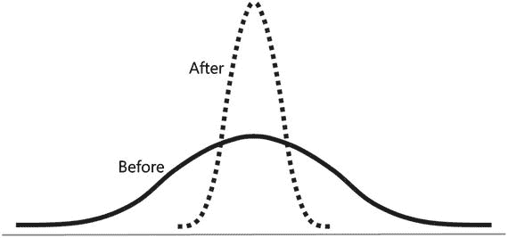
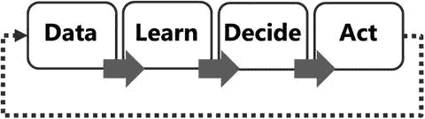

# 2. 新方法的根源

新思想总是根植于先前的概念——通常是先前概念的组合。为了发展出协同组合，往往需要首先对先前概念进行概括或扩展，以便它们能够灵活地重新组合成整体大于部分之和的新事物。优化“数据-学习-行动”的方法正是如此。就它而言，它主要根植于管理科学的三个领域：

*   流程改进
*   约束理论
*   决策科学

在每个领域中，通往我们新方法的路径都是首先概括关键概念，然后以协同的方式将这些概念结合起来。

## 根源一：流程改进

一场以流程为中心的、关于改进企业绩效的思维革命兴起于 20 世纪 80 年代，并在 90 年代达到全盛。这种对流程的重视源于质量改进运动，该运动（尤其是在美国）是对当时日本制造的产品被认为质量高于美国制造产品的一种反应。尽管事后看来这似乎有些反应过度，但除了产品质量优势之外，那个时代还有一个重大的担忧，即日本准备在更广泛的经济领域超越美国。这种感知到的外部威胁极大地增强了改进西方企业绩效的动力，而重新设计流程成为实现所需绩效改进的主要方法。

流程革命在 20 世纪 90 年代加速发展，很大程度上归功于迈克尔·哈默的推广，以及他在“再造”这一总旗帜下对其应用领域的扩展。¹ 这对大型组织产生了重大影响，在 20 世纪 90 年代及进入新世纪后的很长一段时间里，许多组织在任何特定时间都有一项或多项流程改进或再造计划在进行中。虽然从未完全消亡，但再造在过去十年中逐渐趋于平缓，部分原因可能是它感觉有点过时了，部分原因可能是它在许多组织的自然目标领域已经达到了饱和程度。

关于最后一点，我将在本书中详细阐述，但应该指出的是，流程改进在历史上主要侧重于组织中更具事务性的部分；例如，制造、采购和客户服务。很少关注例如研发等领域。这种偏向性体现在流程再造计划中应用的主要信息技术类型——企业资源规划（ERP）系统上，这些系统最初至少主要关注与供应链相关的功能。从流程范式本身的角度来看，并没有令人信服的理由偏向于更具事务性的功能。这似乎更像是一种传统，可能再次源于其与质量改进的联系，而质量改进自然更多地与制造和组织的基于事务的功能相关联。哈默和其他人几乎没有改变这种关注点，尽管哈默确实试图将再造扩展到一般管理领域。但那时，最初的流程再造概念也已经有了很大的稀释。

那么，为什么在研发等职能领域对流程改进的兴趣和应用如此有限呢？我提出一些假设，按“复杂性”、“学习与适应”以及“除了我以外的所有人”等主题分类如下：

*   **复杂性**。在应用任何新方法时，自然会优先处理较为简单的领域。对于组织中事务性较强的部分，勾勒出通常相当线性的流程步骤相对容易。但对于组织中那些更“混乱”的职能领域所特有的复杂且非线性的步骤，要做到这一点则困难得多。例如，在那些“创造力”、“创新”和“纯粹学习”等词汇司空见惯的职能领域，流程步骤很可能并不简单。
*   **学习与适应**。传统上，以再造范式为指导的流程改进，在处理学习与适应方面普遍存在困难。它更擅长处理那些流程被重新设计，然后新设计被半永久性确立的情况。诚然，这种传统的流程再造容纳了流程中个体参与者的学习，但它并未真正直接解决贯穿整个流程的持续学习问题，并使这种学习在流程中制度化。
*   **除了我以外的所有人**。人们（包括企业高管）有一种自然倾向，即更乐意看到他人经历变革，而非自身做出改变。因此，当确定绩效改进目标时，这些目标自然倾向于组织中那些离权力中心最远的领域。这意味着被确定的领域不太可能是公司的真正核心，而真正的核心领域是公司中决策更密集的区域，以及那些尤其富含对财务影响最大的决策类型的区域。

所以，总而言之，流程范式未能在组织的许多部分“扎根”，而且大多毫无道理可言！然而，经典流程再造在妥善容纳学习方面的挣扎是一个更根本的问题，这将在我们构建新方法时明确加以解决。

让我们回顾一下流程的基本概念。流程只是一系列导向结果的活动，因此代表了业务的基本结构，即使这种结构不一定在某张图表上被明确标识出来。亚当·斯密著名的经济运作实例——他的制针厂——本质上就是对生产流程的描述。因此，要改进业务绩效，就必须处理业务的流程。这样做可能不足以实现业务绩效的改进，这也是为什么通常需要应用其他绩效改进方法，但改进流程无疑是必要的。

业务流程的基本法则是，所有业务功能都可以分解为流程步骤。只是有些步骤比其他步骤复杂得多，通常有更多的反馈回路增加了复杂性。从根本上说，所有流程都包含一个或多个行动（即活动）。并且，从根本上说，所有由像人这样的智能体执行行动的流程都包含一个或多个决策（如果智能体被浪费在不需要决策的流程中，那显然有问题！）。而这些由智能体做出的决策是基于数据或信息的。因此，所有基于人的流程都由一系列“数据-决策-行动”步骤或子流程组成。这个简单的见解很有用，因为它使我们能够处理组织中甚至最复杂的流程领域。

但这里缺少了一些东西——我们“数据-学习-决策-行动”链条中的学习部分。这正是经典流程改进中未能充分处理的部分，但我们将在此处处理它，同时将“学习”的整体概念置于更坚实的概念基础上。当我们这样做时，我们会发现我们的通用流程在组织内具有普遍的绩效改进应用。

## 根源二：约束理论

约束理论虽有先驱，但主要由艾利·高德拉特发展而来。他于 1984 年以故事形式出版了关于约束理论的畅销管理书籍《目标》，随后又就此主题出版了一系列其他书籍。² 约束理论的核心概念是，实现期望的结果或目标不可避免地受到一个限制性约束或瓶颈的支配。具体来说，这个约束因素限制了目标所依赖的某种流的吞吐量。例如，制造环境中组装零件的流，或销售产生的资金流。最一般地，系统的吞吐量是一个速率指标，即与目标相关的单位在时间度量（如每小时组装的零件数）内的流量或产出。

约束理论的基本法则是，任何系统中总存在一个限制因素，这意味着解决一个约束总会导致另一个约束的出现！那么，这何时是个尽头？当解决一个约束的边际成本超过该约束的解决对系统整体目标所带来的吞吐量增加的收益时，便到了尽头。与所有基于经济的决策一样，我们会持续采取行动，直到下一个行动的边际成本超过该行动的边际收益。

如何解决约束？这取决于系统的确切性质，通常首先需要一些扎实的分析来理解系统的整体动态。例如，如果系统在流程各阶段之间有非常可靠的流动，那么或许可以通过简单地在瓶颈处增加产能来解决限制性约束；例如，采用两台机器并行工作，而不是仅用原来的一台。然而，在许多系统中，由于多种因素，可能存在显著的流量变化。在这种情况下，库存——或者更一般地说，缓冲——可能是比增加产能更有效的解决约束的方法。同样，对于复杂的、基于随机性的系统，要准确找出真正的限制因素所在以及应该采取什么措施，可能需要大量的分析。

现在，约束理论是一个非常广泛适用的概念。高德拉特及其先驱们，至少在最初，倾向于关注制造流程，因为该方法在该领域非常直观。但它可以（而且应该！）应用于任何类型的流程。在我们的案例中，我们希望将其应用于我们的通用流程，即“数据-学习-行动”流程。我们希望能够识别该流程中的瓶颈，然后确定解决它们的最佳方法。

但只有一个问题。要做到这一点，我们需要一种方法来理解“数据-学习-行动”流程中的瓶颈正在让我们付出什么代价，这反过来会告诉我们解决该瓶颈的价值所在。但要理解瓶颈的代价，我们需要理解“数据-学习-行动”流程的吞吐量究竟是什么，以及不同吞吐量水平对应的价值是什么。为此，我们需要的不仅仅是流程范式和约束理论。我们需要转向决策科学。

## 根基之三：决策科学

决策分析领域（可被视为决策科学的一个主要分支）在很大程度上由斯坦福大学的罗纳德·霍华德开创，作者有幸在斯坦福大学工程经济系统系师从于他。³ 该领域旨在帮助决策者以一致且理性的方式做出决策。因此，它是决策科学的一个规范性领域——即，涉及决策*应当*如何做出（即规范性的），而非研究人类决策*实际*如何做出（即描述性的）。人类决策者之所以需要这种规范性帮助，是因为有两个因素往往会给人们带来问题，尤其是在做出与商业相关的决策时：**复杂性和不确定性**。

第一个问题直观上很清楚——对于涉及大量变动因素或中间选择的大型复杂决策，人们需要一种结构化的方式来思考该决策或决策序列。当然，许多商业决策都属于这一类。试图仅通过与同事进行自由形式的讨论来处理复杂决策，其效果可能不亚于在不了解国际象棋开局如何布局、残局位置已知会导致何种结果等情况下的对弈表现。在这方面，决策分析类似于我们的其他基础根基——流程范式和约束范式——它们都是帮助人们在复杂环境中实现预期目标的结构化方法。

对人类决策造成问题的第二个因素——不确定性——是决策科学的核心。当然，我们通常使用的“决策”一词是以存在某种不确定性为前提的。如果没有不确定性，那么它在我们通常的人类意义上几乎算不上一个决策。当然，可能存在没有不确定性的行动，但这些行动是预先确定的，例如，就像计算机程序的简单自动化方式：“如果条件 x 发生，则执行动作 Y。”

在概率推理方面，人们存在一系列众所周知的偏见和不一致性。⁴ 简化的决策启发式方法得以进化，这些方法在我们祖先的狩猎采集环境中可能是最优的，但对于复杂的商业决策则并非如此。决策分析提供了一种逻辑一致的结构，可用于应对在不确定性面前做出的决策。

决策分析可能是一项相当重大的工程，对于大型决策而言，这种投入和花费是完全合理的。但由于在时间、费用和专业知识方面的巨大投入，决策分析通常仅应用于非常重大的决策；例如，是否投资新的制造设施、是否收购另一家公司、或者是否推出新产品线。决策分析也常被视为“一次性”项目，仅对特定决策进行分析，同时将组织整体的人员、流程和技术基础设施视为既定条件，以支持一般性决策。

但是，组织中每天做出的所有其他决策呢？特别是那些与基于人员、流程和技术的决策支持基础设施相关的持续性决策呢？如果它们远非最优，那显然代表着巨大的价值损失。然而，将经典的决策分析应用于所有这些决策可能根本不具备成本效益和/或时间效率。是否存在另一种方法，能够普遍地带来更好的决策，同时又具有成本效益？答案是肯定的，但我们需要创造性地将决策分析的概念与其他根基结合起来。

决策分析的一个关键概念是“信息价值”。这个概念基于一个事实——尽管并非直观——即信息只有在能够影响决策改变时才有价值。换句话说，如果无论额外信息如何，决策结果已成定局，那么这些额外信息就毫无价值。仔细思考一下，这似乎很清楚，但令人惊讶的是，当决策已经预先确定时，组织却经常花钱收集额外信息！

诚然，事情并非如此非黑即白，因为现实是，如果信息不会潜在地改变决策，它就毫无价值。正是“潜在”这个方面让事情变得棘手，因为它可能适用于影响当前已知的决策，也可能适用于与决策相关的行动，甚至适用于当前尚未确定的某种决策类型。因此，我们在应用这种思维时必须小心谨慎，不能应用得过于狭隘，以至于排除了从信息中获取可能导向全新价值领域和相关决策的洞见。

如果额外信息能够潜在地改变决策，那么它确实有价值。并且，至少在原则上，可以通过比较原始决策预期产生的行动或行动的价值，与利用额外信息做出的不同决策所产生的行动或行动的预期价值，来计算该价值。

能够潜在地改变决策的信息具有切实的价值。

因此，信息价值的概念可以为是否值得收集额外信息这一子决策提供依据。具体而言，正如经济型决策中一贯的情况，如果额外信息的边际价值超过收集该信息的边际成本，那么收集额外信息就是值得的。

额外信息能够影响决策，是因为该信息有助于减少决策所依赖的不确定性。在某些情况下，这种不确定性可能会基于新信息完全消失，但更常见的是，新信息有助于减少不确定性，但并不能完全消除它。医学诊断测试是明显的例子——它们通常有用，但绝非万无一失，通常会产生一定程度的假阳性和假阴性。但这并不意味着它们没用！只是说，如果它们更准确，价值会更高。

出于一般目的，特别是我们这里的目的，“信息价值”这个概念虽然非常有用，但用词不当。原始信息本身并不具有价值——有价值的是将这些信息转化为对不确定性的修正看法，或者更正式地说，转化为概率的变化。在经典的决策分析项目中，这种转化是在各种类型的模型中明确执行的，这些模型经过专门选择和定制，以适应手头的决策。在这些特殊项目之外，在一般的商业环境中，将信息转化为对不确定性的调整看法通常由一人或多人以更非正式的方式进行，并辅以各种信息技术。对于这种通用的转化过程，我们已有一个常用术语：**学习**。

从根本上说，学习可以被视为将信息转化为降低不确定性的过程，从而提升预测能力。这对人类、任何拥有神经元的生物体，以及日益发展的机器而言都是如此。若要更精确地表述，任何特定的学习实例都与调整一个或多个用于体现不确定性的概率分布有关。通常情况下，这会导致概率分布变窄，这与对潜在结果的工作假设拥有更严格的边界是一致的；但如果获得的新信息与当前的工作假设相悖，也可能出现概率分布变宽的情况。认知科学领域众所周知的一点是，人们倾向于吸收与自身当前对世界的假设相一致的确认性信息，而不是主动寻找和/或吸收证伪性信息，因此应当主动寻求证伪性信息。尽管如此，从长期来看，如图 2-1 所示，学习本质上是概率分布的收缩。⁵

学习是降低不确定性的过程。

也许这种观点听起来有些局限，但请思考一下——我们学习还有其他原因吗？我们想了解更多自己尚不了解或不理解的事物。在学习之后，我们对某个主题是什么或其运作方式的不确定性会变得更加受限。我们比之前更加确定，这通常会转化为对该主题更强的信心。

图 2-1.

学习是概率分布的收缩

现在，对于个人学习而言，这种不确定性的降低不一定非要潜在地改变决策——我们可能纯粹为了学习的乐趣而学习，因此可能不会赋予学习某种价值。但在商业环境中，影响决策的不确定性降低是有价值的，因此在这种背景下，学习无疑具有切实的价值。

还要注意，由于学习可以被定义为改变概率分布的过程，那么学习必然是在时间维度上定义的，而非一个时间点，这与信息或知识等可以在理论上于某个给定时间点进行衡量的概念截然不同。因此，与数据、信息甚至知识不同，学习代表了一种流动。

## 新方法的出现

因此，决策分析领域提供了相关概念，使我们能够将学习的理念建立在坚实的基础上，其好处之一就是能够支持量化学习的价值。而从过程范式中，我们知道从数据到学习再到行动的过程必须具有流动性。这种流动性是什么？就是学习。具体来说，是可行动的学习；也就是说，具有改变决策潜力的学习。这意味着学习具有切实的、可量化的价值。

可行动的学习具有切实的、可量化的价值。

约束理论提供了一个与学习以及我们的通用过程相关的有力视角：如果学习是从数据到学习再到行动过程的流动，那么单位时间内可行动学习的数量可以被视为该过程的吞吐量。也就是说，我们试图针对从数据到学习再到行动的链条进行优化的，是学习的速率。再次强调，并非任何学习，而是真正可量化价值的学习，或者我们可以简称为可行动的学习。

这种可行动的学习沿着从数据到学习再到行动过程的流动，包括将前馈的信息流、知识流以及相关的预测模型（无论是在人脑中还是在机器中）持续转化为降低的不确定性。无论我们将学习称为降低不确定性，还是称为从数据到学习再到行动过程的流动，指的都是同一现象。只是学习流代表了在过程的多个连续步骤（在某些情况下是并行步骤）中降低不确定性的一个聚合视角。

我们不一定会在整个流程中看到如图 2-1 所描绘的那种特定形式的概率收缩。有许多不同的表示形式和结构可以体现不确定性的降低。例如，如果我们检查人脑，我们看不到任何像图 2-1 的东西，只有一个由神经元和突触连接组成的巨大网络结构。然而，人脑能够进行概率评估。事实上，我们现在已经很清楚大脑的哪个区域使我们能够感知不同程度的不确定性以及不确定性水平的变化。⁶ 类似地，在一个组织中，学习及其结果——对不确定性更新的看法——可以以多种不同的形式体现，这些形式不一定看起来像图 2-1。它们可能以基于计算机的形式体现，例如条件数据集、文档、电子表格模型等，也可能存在于组织成员的大脑中。只有极少数情况下（但如果本书能有所影响，这种情况会更常见！），不确定性才会以图 2-1 这样的形式来表示。

约束理论还告诉我们另一件事：在从数据到学习再到行动的过程中，不可避免地存在一个学习约束或瓶颈，就像任何其他类型过程中的任何其他类型的吞吐量一样。因此，我们可以通过识别主要约束、解决它、确定下一个约束、再解决它，以此类推，来改进从数据到学习再到行动的过程。这个过程会持续到什么时候？是的，直到解决约束的价值不再超过解决它的成本为止。

在从数据到学习再到行动的过程中，始终存在一个学习约束。

由此可见，除非我们至少能对学习的价值做出粗略估计，否则我们无法有效执行这种逻辑上的迭代方法。没有这样的估计，我们基本上就是在盲目飞行，不了解瓶颈的真正成本，因此要么犹豫不决、无所作为，要么把时间和金钱浪费在错误的事情上。换句话说，这往往就是现状！

我们的“从数据到学习再到行动”的过程，与经典的生产小部件过程相比，一个重要的区别在于，我们这一通用过程的“链条”可以是一个循环。这是因为，如图 2-2 所示，作为该过程结果而发生的行动，很可能会产生新的数据，而这些新数据又会成为学习的输入，进而影响导致新行动的决策，如此循环往复。在本书中，我常将“从数据到学习再到行动”的过程称为一个“链条”，但应理解，该过程实际上可以是一个链条加上一个反馈回路。事实上，有些行动可能仅仅是为了生成额外的数据，以便从中获益性地学习。我们给这类行动起了一个常见的名字：实验。

图 2-2.

从数据到学习再到行动的循环

“从数据到学习再到行动”过程的另一个重要方面是，它们可能是嵌套的。也就是说，一个“从数据到学习再到行动”的过程内部可能包含子级的“从数据到学习再到行动”过程。例如，正如我们将看到的，确定如何解决“从数据到学习再到行动”链条中的一个瓶颈，其本身就是一个“从数据到学习再到行动”的链条。

因此，“从数据到学习再到行动”的过程既可以是递归的闭环，也可以是嵌套的，这带来了相当大的复杂性！这就是为什么我们需要一种结构化但灵活的方法，以便能够持续优化此类过程，同时始终牢记，应用估算和近似值通常就足以显著改善现状。

## 总结

总而言之，优化“从数据到学习再到行动”的过程，其根源在于业务流程、约束理论和决策分析这些管理科学领域。“从数据到学习再到行动”是一个过程。事实上，它是通用过程，并且因为它是一个过程，所以它具有流程。这个流程就是可操作的学习，即将信息流、知识流以及相关的模型（无论是在人脑中还是在机器中）转化为不确定性的降低。这种可操作的学习是能够潜在地影响决策的学习，这意味着它具有可量化的价值。约束理论告诉我们，任何流程都存在一个限制性约束，这意味着在可操作的学习方面总是存在一个限制因素。有了这些基本概念，我们现在就可以继续探讨优化“从数据到学习再到行动”的所有细节了。

脚注 1

Hammer, Michael, and James Champy, Reengineering the Corporation: A Manifesto for Business Revolution (HarperBusiness, 1993).

  2

Goldratt, Eliyahu, and Jeff Cox, The Goal: A Process of Ongoing Improvement (North River, 1984).

  3

关于决策分析的全面综述，请参见 Howard, Ronald, and Ali Abbas, Foundations of Decision Analysis (Pearson Education Ltd, 2016).

  4

例如，参见 Bang, Dan, and Chris Frith, “Making better decisions in groups”, Royal Society Open Science, August 2017\. [`http://rsos.royalsocietypublishing.org/content/4/8/170193`](http://rsos.royalsocietypublishing.org/content/4/8/170193)

  5

图 2-1 更正式地表示了一个概率密度函数。然而，在本书中，当我们想区分概率密度或质量函数与其相关的累积概率分布时，我们简单地从术语“累积概率分布”中省略“累积”一词。

  6

“Two Distinct Brain Regions Have Independent Influence on Decision-Making”, [Neuroscience News](http://neurosciencenews.com/author/neurosciencenew/) , September 2017, [`http://neurosciencenews.com/decision-making-brain-regions-7390/`](http://neurosciencenews.com/decision-making-brain-regions-7390/) `.`

