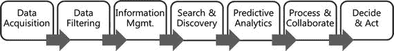
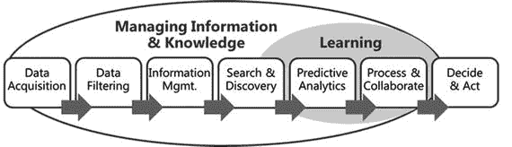
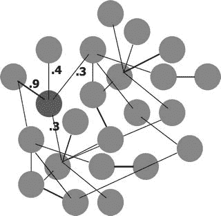
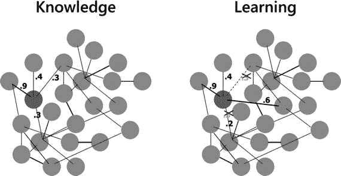
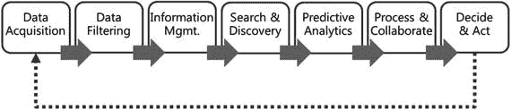

# 3. 从数据到学习再到行动

既然我们已经定义了“从数据到学习再到行动”过程的基础，现在是时候深入探讨其各个中间步骤的细节了。虽然鸟儿这样做，我们这样做，甚至受过教育的机器现在也能这样做，但我们的重点当然会放在这个通用过程中与在组织内执行特别相关的那些要素上。

## 链条的要素

图 3-1 描绘了组织内“数据-学习-行动”链条的主要要素。我之所以说“链条”，是因为一个组织中会存在许多不同的“数据-学习-行动”链条。例如，与人力资源相关的“数据-学习-行动”链条、与市场营销相关的链条、与研发相关的链条，等等。虽然图 3-1 中描绘的要素具有普遍适用性，但应当承认，对于不同的应用和职能领域，各个要素的侧重点可能有所不同。当然，也必须指出，为链条要素所选择的标签可能存在一定程度的模糊性和重叠。人们可能会对某些地方的命名提出不同意见，并且对于某些应用，可能还需要更细粒度的要素。

然而，当我们逐一审视这些要素时，我认为你会逐渐发现，它们能够相当有效地对任何“数据-学习-行动”链条进行建模，至少在第一轮分析中是如此，从而能够清晰地阐明现实世界中“数据-学习-行动”流程的哪个活动对应图 3-1 中的哪个要素。事实上，通过将每个要素置于其在整体流程链中的特定角色背景下进行审视，而不仅仅是将其视为一个孤立的概念，可以促进对要素本质的更清晰思考。

图 3-1.

“数据-学习-行动”链条的要素

我们将逐一探讨这些要素，但首先，你可能会想：“上一章中我们基本的‘数据-学习-行动’循环里的‘学习’去哪儿了？”学习仍然存在——它只是贯穿了整个链条，包含了沿着“数据-学习-行动”链条向前流动的不确定性减少过程，正如箭头所表示的那样。

学习可以类比于其他一些本质相同但似乎具有两种不同性质的现象。例如，在物理学中：它是粒子吗？是的。它是波吗？是的。或者，在神经科学中：它是放电神经元的集群吗？是的。它是一种精神状态吗？是的。学习也是如此。它是减少不确定性的过程吗？从根本上说，是的。它是一种流动吗？也是的。在后面的章节中，我们将看到如何交替表示学习的这两种性质；例如，通过图 3-1 所例证的流动形式，或者通过一种我们称之为学习价值图的基于不确定性的形式。

为了承认更传统、更狭义的学习概念，图 3-2 大致描绘了学习和信息与知识管理的标准观点如何映射到该链条上，其中学习映射到“下游”要素，而信息与知识管理映射到“上游”要素。但正如我们将在本章后面看到的，与学习沿着整个链条向前流动的观点（如图 3-2 中向前流动的箭头所示）相一致，学习正越来越多地被直接嵌入到传统上被认为是链条上游要素的较低层级信息流程和结构中。

图 3-2.

映射到“数据-学习-行动”链条的传统学习概念

在本章中，我们将沿着链条的学习流向前推进，从数据采集要素开始。但在开始之前，需要强调一个关于链条要素的总体要点：“数据-学习-行动”流程的要素可以应用于人类、计算机系统，或两者的结合。试图根据这些要素是否自动化来区分它们，或者甚至简单地普遍假设，例如，当使用“知识”或“学习”这些术语时，它们必然指的是属于人类领域的活动或能力，或者“数据采集”这个术语明确暗示是基于计算机的活动，这些都是可能阻碍优化当代业务绩效的“旧思维”。这种旧思维根本不符合认知科学领域的当前观点，也不符合技术世界的必然趋势，而技术世界在许多方面正在重演基于生物的过程。因此，在接下来的探讨和后续章节中，我将经常从心智和机器，以及人与系统集成系统的角度来讨论“数据-学习-行动”流程的要素。

### 数据采集

数据指的是原始的、未经处理的信息，当然，它有许多不同的形式。例如，它可能包含对物理现象的测量值，可能以文本形式存在，可能以语音形式存在，可能是图像，或者本质上是数字。它可能构成与人员相关的行为信息。数据的采集可以通过传感器或摄像头等仪器设备进行，通过带有键盘和/或麦克风的标准计算设备进行，或者直接由人员利用其各种感官进行。数据可能作为有目的的数据收集过程的一部分而产生，也可能是其他活动的副产品。

当然，正如我们已经讨论过的，可供后续处理的数据量正在爆炸式增长，导致了“大数据”。物联网是数据爆炸的主要推手之一，而这一现象才刚刚开始真正兴起，因此我们注定会拥有持续“更大”的数据。

另一方面，即使在当今数据过剩的情况下，仍然经常出现这样的情况：某些目的最需要的数据不可用，或者数量不足。这可能是因为其相关性之前未被认识到而根本没有被捕获，或者数据存在但从未可用于预期的应用，或者当前可用数据的质量对于预期应用来说太差。

因此，通常有必要专门识别那些对整个“数据-学习-行动”流程有价值但缺失的数据，并确定获取这些数据的方法。这可能需要一些创造性思维。而且，正如我们将在后续章节中看到的，能够作为改进对影响决策的不确定因素预测基础的数据是有价值的数据，而数据越能使我们对行动结果做出完美预测，该数据通常就越有价值。对更好可预测性的追求意味着，即使可用数据量不断增加，也永远不够——总会有我们目前没有但对我们有价值的数据，因此我们将不断努力去获取它。

### 数据过滤

在许多情况下，必须对数据进行过滤，使其适合后续处理。例如，我们的大脑就一直在执行这种过滤。从感官涌入的信息会经过一系列过滤器，这样我们的意识体验就不会持续被那些不太相关的信息所淹没。当然，即使是这些用于从背景噪声中辨别信号的、精妙进化而来的功能，在现代工作场所中，面对每天数百封紧急邮件，也会感到力不从心！

数据通常需要经过处理，才能应用于“数据-学习-行动”流程的下游环节。例如，可能需要移除虚假或异常数据。这通常是数据科学的一个关键应用领域，也是数据科学家的一项重要活动，他们需要数据具有足够高的质量，才能作为后续步骤的输入，而这些步骤旨在从数据中推导出预测性见解。人们常说，在推导预测性见解方面，更多的数据胜过更好的算法。虽然这并非总是绝对正确，但这一数据科学的“行话”中确实蕴含着几分真理。然而，获取更多数据通常意味着获取的数据质量比已有数据更差，因此，这些额外增加的数据量需要额外的处理，以充分提升其质量，从而完全挖掘其潜力。

关于数据及数据科学的一个普遍警示：如果你参与讨论或阅读一篇文章，其中“数据”一词被多次提及，但从未提到“决策”一词，或者“数据”与“决策”的出现比例悬殊，那么这就是一个危险信号，表明可能出现了本末倒置的情况。更重要的是，这可能表明人们对所讨论数据的价值（或缺乏价值）缺乏恰当的理解，从而无法就与获取和处理数据相关的投资做出明智的决策。

《呆伯特》漫画警示：只提“数据”，不提“决策”！

最普遍而言，“数据-学习-行动”流程中的数据过滤步骤，其核心在于识别并从数据中移除“噪声”，正如我们的大脑持续所做的那样。我们可能尚未达到确定“信号”的阶段（这通常出现在“数据-学习-行动”流程的后期），但数据过滤是从数据所体现的背景噪声中检测信号或洞察的整个过程的**第一步**。因此，它也可以被视为该流程学习流的初始阶段，通过消除或至少减少数据集中的噪声来降低不确定性。鉴于该环节执行的数据过滤和转换，我们通常将其输出称为**信息**，以区别于其输入——未经处理的原始数据。

### 信息管理

经过过滤的数据，即信息，会被恰当地组织起来，并通常被持久化存储，以供“数据-学习-行动”流程的后续步骤使用，这正是该流程中“信息管理”环节的职责所在。该环节所包含的能力一直在快速发展，其中一个特别重要的趋势是信息结构与学习之间日益紧密的结合（一种更符合我们大脑工作方式的整体架构），因此，在本次探讨中，我们将花更多时间在这个环节上。

信息管理环节涵盖了整体信息组织和治理方面的考量，包括关于信息物理存储位置、信息组织方式以及为实现所需组织而应用的相关结构等方面的决策和相应实施，还包括存储前对信息进行预处理的要求。这也是“数据-学习-行动”流程中涉及基本安全和隐私考量的环节，例如，哪些人、哪些系统可以访问哪些信息。这些安全和隐私考量会影响信息是存储在云端还是存储在私有防火墙内的本地设施中的决策。在确定信息的存储方式以及谁有权访问信息时，可能还需要考虑法律取证问题。

组织和构建信息最根本地涉及分类和归类的形式，包括考虑和实施多级抽象。例如，在较高的抽象层级上，正式的**分类法**和非正式的**大众分类法**，或者更通用的**本体论**，可能会影响存储信息的组织方式，可能需要应用分类法和本体论方面的专业知识来确定最适合预期用例的结构。这些本体结构可以是特定于某个组织的，并且越来越多地包含通用知识库，这些知识库可以提供一定程度的关于世界的常识或语义理解，并将这种理解传递给与“数据-学习-行动”链后续环节相关的应用程序。

在较低的抽象层级上，数据库架构师可能会根据高层抽象和预期用例的自顶向下需求，考虑替代的数据库架构，例如关系型或“NoSQL”数据库或结构。其他信息结构可能用于特殊目的；例如，专门为支持基于分析的用例而构建的数据仓库，以及搜索索引。特定信息结构的选择可能会受到信息主要是由人直接访问还是由系统直接访问的影响，也取决于预期将对信息执行的搜索、发现和处理类型。

#### 学习架构

将学习能力及其产生的推理直接嵌入信息结构的趋势，正在彻底改变企业计算。而企业计算在许多方面又再次通过技术复现了我们大脑的工作方式。支撑这一革命的核心结构，便是我在《学习层》一书中提出的“学习架构”，如图 3-3 所示。这一结构体现了学习能力日益直接嵌入到传统上被视为底层结构中的普遍趋势。换句话说，图 3-2 中代表传统学习观的阴影区域，正不可避免地沿着链条向后延伸，强化了“数据-学习-行动”这一优化视角，即学习最好被视为贯穿整个链条的流动过程。

图 3-3.

学习架构

学习架构是一种基于网络的结构，由节点组成。这些节点可以是，例如，包含内容或引用内容项的对象，也可以是代表网络用户的对象。该网络还包含节点之间的加权关系。这些加权关系本质上可以是有方向的。这是人脑、人工神经网络，以及更普遍地，能够通过添加节点和/或改变节点间关系权重来编码学习的基于系统的结构的基本结构。

尽管对于生物神经网络、人工神经网络以及支持通用企业机器学习应用的更基础网络架构而言，调整这些关系权重（即构成实际学习过程）的过程可能大相径庭，但支撑此类学习过程的底层网络结构是相似的。

学习架构可以被视为一种“模糊网络”，这反映了节点之间的关系是程度上的，而不仅仅是二元关系。¹ 或者，按照现在更流行的说法，依据图论这一数学领域，图 3-3 中的学习架构通常被描述为一个“图”，节点之间的关系则被称为“边”。

#### 预期计算

将代表人的对象网络与引用内容或主题领域的对象整合在一个共同的网络范式内，是现代计算系统核心能力以及人类学习加速器——预期计算——的关键前提。预期计算是一种系统功能，它能够预测用户会发现什么内容相关，而无需用户直接指示。预期计算的另一个前提是，图中至少部分连接或边的值，会根据对个体用户使用行为的处理而进行调整。这种持续的调整构成了一种学习形式，它再次与我们大脑中神经元连接因应我们处理的外部信息而进行的调整大致相似。

这类网络的一个常见例子是社交图，它描述了社交网络中人与人之间的联系。这个术语最初由 Facebook 引入，但它适用于任何人们相互连接的系统，并且这些连接可以是对称的（例如“加好友”）或非对称的（例如“关注”）。即使在其最初的形式中，节点仅代表人而不代表内容，通过“数据-学习-行动”流程的下游环节（搜索与发现、预测分析），也能从社交图中推导出有用的洞察和预期性推理。

例如，可以识别出两个或更多人之间的共同联系，并且能够计算任意两人之间的分离度。尽管可以从社交图中推导出更复杂的网络特征，但即使是这些简单的结构也能得到非常有效的应用。例如，系统可以利用社交图向你建议，与那些和你有一个或多个共同联系人的人建立联系。这是你在 Facebook、LinkedIn 和 Twitter 以及许多企业社交平台上收到“可能认识的人”建议背后的基本方法，也是预期计算的一个简单例子。

更多推理和预期能力可以从整合了人与内容的图中获得，这种图能够捕捉用户之间以及用户与内容之间的行为。这种方法在消费级和企业级应用中正日益成为趋势。² 人与其他对象（无论这些其他对象代表其他人还是内容项）之间的关系，可以如图 3-4 所示，以“主体-边-客体”三元组的形式进行编码。其中，边表示一种行为或关系类型，客体可以代表另一个人或一个内容项。因此，例如，用户 Jane 查看了一份文档，可以表示为基于行为的三元组：Jane-Viewed-Document1。再比如，Jane 可能关注 Tom 以接收 Tom 的社交网络帖子，这可以编码为 Jane-Follows-Tom（Tom 是这个特定“主体-边-客体”三元组中的“客体”，但在其他三元组中也可能成为“主体”）。组织内部的协作会产生大量此类“主体-边-客体”三元组（以及与之相关的辅助信息，如时间戳），这些三元组构成了为预期计算提供燃料的信息原材料。

图 3-4.

主体-边-客体三元组

刚刚描述的两个“行动者-边-对象”三元组示例中，边代表由人明确执行的动作或关系，例如“查看”和“关注”。但边也可以编码关于人与人、人与其他对象之间关系的推断。虽然执行推断严格来说是数据-学习-行动链中后续“搜索与发现”或“预测分析”要素的活动，而非“信息管理”要素的职责，但我将在此讨论一些重要的推断类型，因为推断结果与信息管理结构紧密相连。

例如，可以为每个用户生成一个兴趣图谱。兴趣图谱包含一个人与其他事物（例如某个主题领域）之间基于兴趣的关系集合。这些兴趣可以由用户明确表示，但更常见的是从编码了各种用户行为（如内容发布与修改、查看、点赞、关注、地理位置信息等）的其他“行动者-边-对象”三元组中推断出来。推断算法会对这些行为赋予不同的权重，并相应调整图谱中的边。例如，用户查看一篇与某个主题领域相关的文档，这本身只是对该主题兴趣的一个微弱信号。然而，贡献与该主题相关的内容则是一个相对较强的兴趣信号，因为这需要用户付出额外的努力。另一方面，如果用户对与该主题相关的文档进行了数百次查看，那么这些信号的数量可以弥补单个行为在推断上的相对不足。

因此，总的来说，兴趣图谱是基于每种行为类型的相对推断价值以及每种行为类型的数量来构建和调整的。无论是明确表示还是隐式推断，兴趣通常都是一个程度问题，因此兴趣关系被表示为连续谱，而非二元的“是”或“否”关系。

兴趣图谱通常与社交图谱结合使用，能够实现一系列预测性功能。例如，可以根据用户对与内容项相关的主题领域的具体兴趣程度，来推荐一项内容。或者，向用户推荐另一个人时，不仅基于用户的社交图谱，还可以考虑用户与对方之间推断出的兴趣相似性。最根本的是，兴趣图谱提供了自动、细粒度个性化的能力，这种个性化会随着用户兴趣和偏好的变化而自动适应。高质量的个性化能够增强学习，这自然会对决策产生积极影响。

人与主题领域之间另一种与组织应用特别相关的关系是“专长”。与兴趣的情况类似，一个人在某主题上的专长水平可以由其本人（例如在结构化档案中）或他人（例如通过背书）明确表示，也可以从该人的行为以及/或者他人与该人贡献内容的互动中推断出来。虽然专长的推断可以基于与推断兴趣相同的大部分行为信息，但推断方法有所不同。例如，用户查看一篇与某主题相关的文档，这能表明用户对该主题的一些兴趣，但对其专长毫无说明（除非我们碰巧知道该文档的专长水平，这有时是可能的，并且可能通过推断手段实现）。但如果用户发布了与同一主题相关的内容，并且得到了其他用户的积极互动（例如点赞或高评分），这很可能告诉我们该人在该主题上的专长情况，并且对于那些已被推断具有较高专长水平的用户的积极互动，可能会赋予更高的权重。

正如社交图谱会随着人们添加或修改连接而持续更新一样，兴趣图谱和专长图谱也会基于对人们行为的推断而持续更新。总而言之，这些社交图谱、兴趣图谱和专长图谱正是预测性系统的核心所在——无论我们是作为消费者还是在组织内部，都可以预期未来将与这些系统打交道。这些系统会自动且持续地学习并适应我们，从而通过在我们需要时预测并提供所需的知识和专长，来加速我们的学习。

事实上，预测性计算是一个强大能力的例子，它得益于几乎贯穿整个数据-学习-行动链的创新。首先，它依赖于对以前通常被忽视的数据源（尤其是在企业环境中）的获取和过滤：即偶然的用户行为。其次，学习架构是管理信息的方法，它的出现正是为了促进预测性计算。第三，生成关于用户兴趣和专长推断的预测分析也是一项近期创新。最后，在与用户的交互界面上，搜索与发现变得更加个性化，并且越来越多地以对话形式呈现。

#### 神经网络

基于神经网络的技术，尤其是具有多层结构的神经网络（即深度学习），在过去几年中在多种应用领域取得了显著进展，最突出的是图像识别，但也涵盖了语言翻译和技能类游戏（如扑克和围棋）等不同领域。它们的多功能性和快速进步表明，它们无疑将在广泛的企业应用中扮演越来越重要的角色。

然而，我们本章迄今讨论的基于图的结构不应与神经网络混淆。神经网络虽然具有类似的通用结构，但其运行模式以及通常的应用领域却大相径庭。神经网络还需要特殊类型的信息结构作为训练输入，神经网络通过监督或非监督模式从中自动学习。这些神经网络训练结构应被视为数据-学习-行动过程中“信息管理”要素的一部分，而神经网络的实际运行则更接近于“预测分析”要素。例如，对于学习识别图像中物体的神经网络，需要带有标签的图像训练集——这是信息管理要素中的一种专门结构。

值得注意的是，随着神经网络训练集的出现，我们正在见证数据-学习-行动过程中“信息管理”要素的转变：从仅服务于人类学习的信息结构，转向也服务于机器学习的信息结构。虽然这些结构目前在本质上通常不同，但似乎不可避免的是，随着神经网络技术的持续发展，面向人类的信息结构也将足以支持基于神经网络的学习。

#### 信息、知识与学习

在结束信息管理要素的讨论之前，我们应当解决一个常被提及的问题：信息与知识之间的区别。在日常用语以及更正式的文献中，知识与信息究竟有何不同，其定义颇为模糊。因此，我更倾向于将信息管理与知识管理描述为相互重叠的过程，共同作用于数据-学习-行动链条中的多个环节，如图 3-2 所示。这与现实情况相符——那些通常被视为知识管理系统的系统往往包含广泛的功能特性，我们将在下一章详细讨论这些系统的实例，届时会将各类 IT 应用映射到数据-学习-行动链条中。

当然，有一种自然的理解认为，知识是信息的一种更有序的形态，或许处于更高的抽象层次，更接近可用的、可操作的形式，以支持决策制定。具有特别高价值的知识通常被称为洞见或智慧。请注意，虽然这些术语难以清晰区分，但显而易见的是，从数据到信息、知识、洞见再到智慧这一转化链条中的所有术语都是名词。而"学习"则是动词，它负责沿着这条链条将名词相互转化。

数据、信息、知识、洞见和智慧是名词。"学习"是动词，它沿着数据-学习-行动链条将这些名词相互转化。

### 搜索与发现

数据-学习-行动过程中的搜索与发现要素，涉及对先前信息管理要素中已管理信息的访问。这种访问可以通过有意为之的方法（通常由人类用户执行，即搜索），也可以通过信息的自动呈现（即发现）来实现。请注意，此处的"发现"一词意指计算机生成的建议或推荐，不应与法律程序中的"证据开示"相混淆，后者更符合数据-学习-行动过程中信息管理要素的功能。

搜索与发现的区别在于：搜索功能需要明确的输入（例如单词、短语或图像）来引导信息的呈现，而发现功能则不需要。因此，搜索可以被视为一种特殊类型的发现系统，其中向发现系统提供了更明确的意图信号。从根本上说，在这两种情况下，系统都会根据信息进行推理，并以此为基础向用户提供信息。搜索和发现系统提供的信息可能包括文档、音乐、图像、应用程序以及其他人员。无论是搜索还是发现，所应用的推理可能嵌入在某种学习型结构的架构中，正如本章信息管理部分所讨论的那样。这些推理还可以通过利用"常识"知识库（即关于世界的事实，或通常所说的语义理解）得到进一步增强；例如，理解诸如"棒球是一项运动"、"球员在棒球中挥动球棒"、"球棒通常由木头制成"、"木头来自树木"等关系。有了足够多的事实以及将这些事实串联起来的能力，系统就能进行复杂的演绎推理，从而比仅依靠用户行为信息实现更微妙、更间接的推理。

推荐引擎是一种发现系统的实例，它通过推断用户的偏好或兴趣，并基于这些推断提供推荐。推荐系统通常根据行为信息（例如推荐接收者和/或其他用户与内容互动的历史模式）进行推理。此外，推荐系统还可能根据用户当前活动的上下文进行推荐——例如，用户当前正在网上查看什么内容、用户当前所处的物理位置、用户当前物理上接近什么物体或什么人等。

搜索和发现系统运用多种算法来进行推理。这些算法可能包括复杂的评分系统，例如：根据文档文本与输入搜索词的匹配程度进行评分；根据与用户直接相关的行为或系统推断与用户具有相似特征的其他用户的行为（即"协同过滤"技术）进行评分；根据文档和推荐接收者各自被推断的专业水平进行评分；根据用户是否被推断已熟悉文档内容进行评分，等等。这些推理可以由搜索和发现系统实时执行，也可以利用嵌入在图结构中的推理，并辅以基于语义的能力。如今，越来越多的现代神经网络技术（如深度学习）被应用于匹配搜索词或查询与候选内容，以及从行为信息中进行推理。

一定程度的个性化——即根据用户的具体情境和行为历史调整推断结果——如今已成为搜索与发现的标配。如前所述，个性化搜索与发现可被视为**预期计算**这一整体领域的一部分，系统会持续推断并预测用户的偏好、兴趣乃至当前的专业水平。总体而言，现代搜索与发现旨在呈现与用户相关的内容，同时屏蔽不相关的内容，从而应对日益严重的信息过载问题。换言之，其目标是从本质上充满噪声的环境中提取有效信号，从而实现更高效的学习。

然而，这其中存在一个权衡：个性化虽然确实能提升人类的学习效率与生产力，但若走向极端，则可能催生适得其反的“过滤气泡”问题。³ 过滤气泡指的是一种自我强化的个性化机制，它会使视角不断加深，但也日益狭窄。这可能会对创新产生不利影响，因为创新通常需要融合来自不同领域和视角的概念。因此，搜索与发现功能的一个重要方向是把握好这一权衡：既要保留有用的个性化，又要具备提供有益“意外发现”的能力，即识别用户典型兴趣模式之外的信息和视角，并将其纳入搜索结果与推荐中。

搜索与发现应用的用户界面也正变得日益复杂。基于自然语言的数字助手（如聊天机器人）正迅速取代用户手动输入关键词的传统方式，而基于对话的系统界面显然注定将成为标准。将自然语言对话能力、对世界的常识性理解以及基于用户行为历史的个性化相结合，是不可避免的趋势。搜索与发现能力似乎注定将主要内嵌于这类智能自适应的对话代理之中。

人们越来越希望搜索与发现应用还能解释系统为何提供特定信息，这能为信息接收者提供额外的洞见，并增强对原本相当不透明的过程的信任。事实上，为了克服基于推断的搜索与发现系统的不透明性，在某些司法管辖区，用户有权获得系统决策的解释已成为一项法律要求。⁴ 鉴于搜索与发现系统中应用的算法复杂性，提供简洁而有意义的解释是一项挑战，而深度学习更广泛的应用则使这一挑战变得更为艰巨。尽管如此，解释能力极具价值，甚至在某些应用中可能是必需的，因此它必将成为未来搜索与发现的一个重要方面。

### 预测分析

预测分析是学习的本质。无论是人脑还是机器，学习从根本上说都是一个减少不确定性的过程，换言之，即提高预测准确性。这种预测准确性可以从量化角度（如概率）来理解，也可以从更日常的角度（如对将要发生的事情有更深刻的洞察）来理解。与搜索与发现相比，预测分析元素更直接地关乎从数据和信息噪声中确定有效信号。无论是人脑还是机器，在面对不确定性做出决策时，在采取行动之前，都必须做出一个预测，无论这个预测是隐性的还是显性的。

这是从数据到学习再到行动这一流程中的阶段，数据科学家尤其关注于此，他们通过各种分析工具和技术来解读数据、推断因果关系并预测未来事件。统计和概率技术是典型的方法。数据聚类通常是识别模式和生成洞见的重要技术。这也是人工神经网络被训练并应用于识别和揭示模式的阶段。

正如我们之前所讨论的，这也是与信息管理元素相关的结构（如企业图谱）可能被更新的阶段。例如，节点可能被添加或删除，关系权重可能根据预测性推断进行调整。这些预测性推断可能源于对用户行为信息的分析，但也可能通过应用基于语义的能力来更好地“理解”内容而得到补充。

无论是在基于计算的结构中，还是在我们大脑的结构中，这种推断式学习都是一个持续的过程，因为通过持续处理不断涌入的额外输入，推断可以变得越来越好（即不确定性降低，预测准确性提高）。图 3-5 概念性地勾勒了这种学习在行动中的过程，其中，表示为节点间加权边的现有推断通过学习过程得到调整。这与知识形成对比，知识既是学习过程的基础，也是学习过程的结果。

图 3-5.

学习在行动

为了更精确地阐述这一区别，数据、信息和知识都是存量——也就是说，至少在理论上，它们可以在某个时间点被衡量。再次强调，学习是不同的；它是一个动词，而非名词，可以被视为一种流量，代表着知识随时间的变化，更具体地说，代表着受新增知识影响的概率分布的变化。正如我在《学习层》中所做的类比，在财务会计术语中，知识就像某个时间点的资产负债表，而学习就像特定时期的损益表。该时期的损益结果决定了下一时期期初的资产负债表。或者，用微积分的类比来说，对学习函数进行积分，就会得到知识。

在许多情况下，如图 3-5 概念性表示的学习系统也是递归的，即在一段时间内发生的学习会产生后续的知识库，而该知识库又会反过来影响后续的学习。举例来说，一个被学习过程改变了的图结构，可以影响后续的用户行为，而这些行为又反过来被用作新推断的基础，从而再次改变该结构，如此循环往复。

尽管关于预测分析元素的这段简短讨论主要聚焦于算法和基于机器的预测能力与方法，但我们应该牢记，在现实世界中，日常商业情境中应用并将继续应用的许多预测分析，都基于那项神奇的非硅基神经网络技术——人脑！

### 流程与协作

流程与协作是“数据-学习-行动”流程中的一个阶段，在此阶段，人们从先前阶段提供的信息和知识中创造额外意义——换言之，即从中学习。流程与协作是一个更偏向于人类决策的要素；对于自动化的“数据-学习-行动”链条而言，学习流程可能直接从“预测分析”阶段进入“决策与行动”阶段。

该要素的“流程”部分包括为同事使用而开发模型和/或打包信息，以促进决策。因此，例如，基于电子表格的建模、准备文档和演示材料、以及准备和操作仪表板，都是该要素流程方面的活动示例。

该要素的“协作”方面涉及具有共同目标的个体之间的集体互动和学习，为做出群体决策奠定基础。协作可以通过电子邮件、社交网络、音频和/或视频会议、在线聊天或面对面会议和现场活动（便利贴仍然可能价值连城！）等功能进行。协作活动可以以明确的项目管理流程形式组织。展望未来，基于人工智能的对话代理无疑将在“数据-学习-行动”流程的这个阶段变得重要，因为流程与协作将不再是人类的专属领域。

然而，无论应用何种技术，流程与协作要素正是人类判断力发挥最大作用的地方，包括群体审议和决策的特殊动态。虽然人脑是一个奇妙的决策系统，但它确实存在有据可查的认知偏见和缺陷。⁵ 危险在于，即使在“数据-学习-行动”流程的上游要素中应用了极其复杂、领先的实践方法，决策也可能在这个后期阶段因人类决策的反复无常而搞砸。好消息是：充分理解的问题是可以改进的！⁶

### 决策与行动

我们终于到了“数据-学习-行动”流程中，对潜在行动做出决策的阶段！这些决策可以是个人决策，也可以是集体决策。我们通常认为决策是由人做出的，当然，这是事实，但决策也可能直接由系统做出，并且随着技术的进步，这种情况会越来越多。

决策是针对潜在行动做出的，但具体是哪些行动呢？理解可能被决策的全部行动范围至关重要，以确保考虑到最具潜在价值的行动，而这很可能是一组与先前为某个决策所考虑的行动不同的行动。因此，在思考替代行动时，应运用一定的创造力。此外，我们说决策是针对潜在行动做出的，但我们需要小心，确保“决策”一词的含义足够宽泛，能够涵盖选择不采取任何行动或推迟采取行动的情况。

行动可以包括行动者直接影响外部世界的行为，以及那些指向行动者自身的行为。有些行动明确旨在生成有用的数据，正如前面提到的，这些行动我们通常称之为实验。与“数据-学习-行动”流程的其他要素一样，行动可以由人或机器执行。

考虑替代行动是创造价值和从创新思维中获益的重要机会。

如图 3-6 所示，行动，无论是否明确为实验性质，都可能产生新数据，这些数据随后可以被“数据-学习-行动”流程的其他要素获取并进一步处理。在这种情况下，“数据-学习-行动”链条可以被视为递归、闭环流程的一部分——一个反馈循环，它会产生强大的自我强化学习效应。

图 3-6.

数据-学习-行动循环

行动具有净值，该净值可以是负值，也可以是正值。行动净值的部分或全部可能归因于学习价值（学习价值必然始终为正），并且，正如我们将在后续章节中看到的，我们可以用财务术语（即货币价值）来量化行动的价值。如果一项行动产生了可能影响后续决策的新知识，那么该行动就具有学习价值。正如我一直强调的，这个通用的学习过程，无论是否递归，都适用于人和系统，也适用于在“数据-学习-行动”流程各要素中协同运作的人与系统的组合。

“数据-学习-行动”链条也可以嵌套。也就是说，在一个“数据-学习-行动”链条的一个或多个要素内部，可以存在子级的“数据-学习-行动”链条。以产品营销决策为例。在与产品营销决策相关的整体“数据-学习-行动”流程的“数据获取”要素中，很可能存在一个关于应获取哪些消费者偏好数据源的子级决策，以及与该子级决策相关的“数据-学习-行动”流程。这些嵌套的“数据-学习-行动”链条（其中一些可能是自我强化的循环），以及思维与机器的组合，其结果正是导致现代组织复杂性的原因，但同时也是其活力与动力的源泉！

## 摘要

在本章中，我们简要回顾了组织从数据到学习再到行动链中的各个环节：数据采集、数据过滤、信息管理、搜索与发现、预测分析、流程与协作，以及决策与行动。概述部分涉及了各环节的现状和趋势，所有环节的一个首要趋势是加速向更具自适应性的智能系统过渡。我们指出，传统上认为学习更接近于链条中下游的环节，但学习能力正逐渐向链条上游渗透；例如，直接嵌入信息结构中。这一趋势进一步强化了“数据-学习-行动”的视角，即学习应被视为贯穿整个链条的流动。

脚注 1

自适应模糊网络及其应用在 Flinn, Steven 和 Naomi Moneypenny 的《自适应重组系统》中有详细描述。世界知识产权组织，公开号 WO/2005/054982（2005 年 6 月 16 日）。

  2

Microsoft Graph 是目前一个著名的企业实例：[`https://developer.microsoft.com/en-us/graph/docs/concepts/overview`](https://developer.microsoft.com/en-us/graph/docs/concepts/overview)

  3

Pariser, Eli. 《过滤气泡：互联网向你隐藏了什么》，Penguin Press（纽约，2011 年 5 月）。

  4

[`http://www.slate.com/articles/technology/future_tense/2017/05/why_artificial_intelligences_should_have_to_explain_their_actions.html`](http://www.slate.com/articles/technology/future_tense/2017/05/why_artificial_intelligences_should_have_to_explain_their_actions.html)

  5

[`https://betterhumans.coach.me/cognitive-bias-cheat-sheet-55a472476b18`](https://betterhumans.coach.me/cognitive-bias-cheat-sheet-55a472476b18)

  6

Bang, Dan, 和 Chris Frith, “群体中做出更好的决策”，《皇家学会开放科学》，2017 年 8 月。[`http://rsos.royalsocietypublishing.org/content/4/8/170193`](http://rsos.royalsocietypublishing.org/content/4/8/170193)

