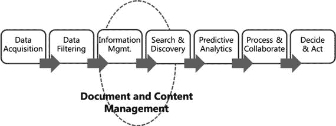
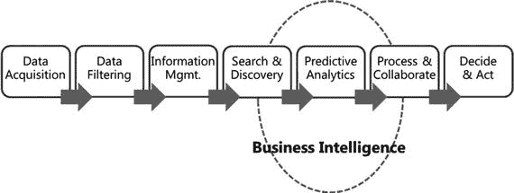
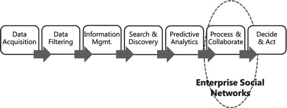
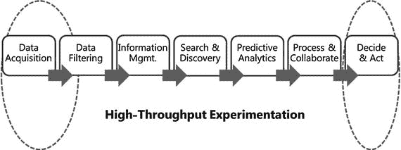
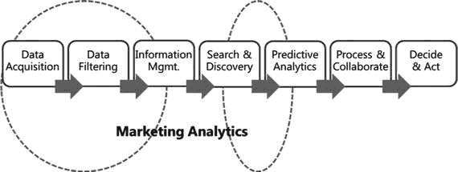
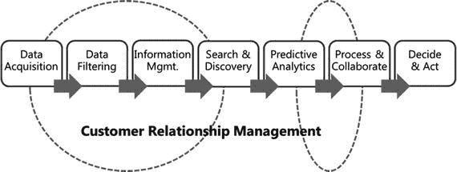
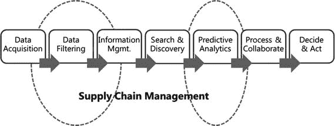
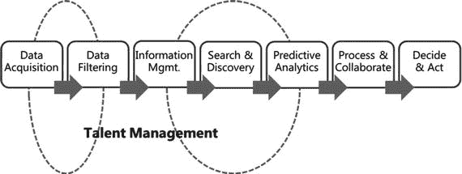

# 4. 技术及其适用场景

我一直并将继续强调，优化从数据到学习再到行动的过程绝不仅仅是技术问题——它关乎人员、流程和技术。尽管如此，技术对任何组织而言都是一个巨大的投资领域。其快速演变的动态性极强，以至于技术必然给任何组织带来持续的决策挑战，并且它不仅能颠覆单个流程，还能颠覆整个商业模式。因此，它必然需要得到持续且全面的关注。

此外，企业 IT（当我提及企业 IT 或应用时，同样适用于其他类型的组织，如非营利组织和政府机构）的一个可悲现实是，它似乎特别容易导致不稳定的决策。这或许至少部分归因于第一章中讨论的那些令人困惑的复杂性和混乱因素。在某些情况下，这可能是组织结构、IT 决策的普遍方式，或是对实施新技术时变革管理方面的低估所导致的结果。无论因素为何，结果往往是企业应用被购买后，要么只部署到预期目标领域的一小部分，要么被完全搁置而没有任何部署。另一方面，原本可以带来显著价值的 IT 系统要么根本未被采购，要么在错失最大积极影响之后才被采购，这种情况也并不罕见。传统 IT 决策方式屡屡导致这些破坏价值的结果，这一事实强化了我们在本书中关注此问题的必要性（请记住，软件被记为资产；如果它不能增加足够价值，就会加剧资产回报率低下的问题）。

因此，在本章中，我们将简要探讨选定的信息技术类别如何映射到“数据-学习-行动”流程中。这有两个目的。首先，它将为我们超越上一章的概述，提供关于“数据-学习-行动”链各环节的一些额外视角。其次，它将快速介绍各种 IT 应用领域，这些领域在我们后续章节深入探讨“数据-学习-行动”价值的约束模式及其潜在解决方案时将会相关。

当然，我们只能触及流行技术的一小部分，以及它们与“数据-学习-行动”流程各环节的对应关系。我们涉及的一些技术本质上是通用的，而另一些则更特定于人力资源、研发等功能领域。重点也将更多地放在“IT 堆栈”中处于较高抽象层次的 IT 系统上——通常是人们直接交互并直接支持其决策的应用——而不是较低层次的结构和技术，例如我们上一章讨论的基础信息结构、通信基础设施、通用云计算基础设施等。

当然，还有大量更聚焦、通常也更前沿的应用领域，我们无法在此简要概述中涵盖。这些领域尤其得益于基于云的计算，以及能够与大型成熟应用及其他更聚焦的应用集成的应用程序编程接口（API）。

理解这一点很重要，并且在我们接下来的概述中会强调：许多常见技术，尤其是企业软件应用，其本质自然会变得相当庞大，横跨“数据-学习-行动”流程的多个环节。但优化“数据-学习-行动”流程最终重要的是那些映射到流程特定环节的具体功能。对“数据-学习-行动”流程中价值约束的考察，必须首先在基于功能的粒度层面进行，这样才能有意义地量化价值。只有这样，才能正确评估特定的技术选项（通常包含功能组合），将其作为解决价值瓶颈的潜在手段。

在接下来的概述中，仅针对“数据-学习-行动”链突出显示所选技术的核心功能；在实践中，这些技术领域的市场解决方案可能至少在一定程度上也包含跨越其他环节的功能。这反映了刚才提到的“膨胀”因素，这是成熟应用寻求根据其战略（即抢占更大份额的技术预算）来扩展其功能范围的结果。另一个明显在起作用的动态因素是智能的、基于机器学习的能力的非凡崛起，使其成为许多应用领域日益不可或缺的功能增强点。其结果是，“数据-学习-行动”流程中的“预测分析”环节，至少在某种程度上，越来越多地体现在那些几年前还完全没有此类能力的应用领域中。

我们将从适用于几乎所有组织的几个通用应用开始我们的概述，然后转向一些更特定于不同功能领域的主要应用。

## 通用型应用

在我们将要介绍的以下应用中，文档与内容管理以及商业智能目前几乎存在于每个组织。我们将讨论的第三个跨职能应用——企业社交网络——虽然尚未如此普及，但正迅速成为企业协作的标准组成部分。

### 文档与内容管理

文档管理系统能够实现文档的发布与检索，通常配备权限设置、版本控制和审计功能。如今，文档管理越来越多地作为一系列功能，嵌入到包含协作和流程管理等其他功能的、功能更广泛的产品中。文档管理的核心功能聚焦于“数据-学习-行动”流程中的信息管理环节，通常内置搜索能力，并且越来越多地提供自动建议功能，因此也与“搜索与发现”环节存在部分重叠，如图 4-1 所示。

图 4-1. 文档与内容管理系统

更广泛地说，内容管理系统提供与文档管理系统类似的功能，但其能力得到扩展，除了文档之外，还包含其他类型的内容，如图像、视频、音频，甚至软件应用程序（应用）。文档与内容管理系统构成了通常所说的知识管理系统的核心。

### 商业智能

商业智能系统组织并打包信息，以协助人们进行决策。这些系统通常包含促进数据挖掘、创建模型和执行分析的功能，并以报告和/或图形格式展示结果信息，供决策者使用。过去，不起眼的电子表格承担了大多数组织商业智能需求的重担。如今，更复杂的系统通常包含高级数据查询方法、统计建模和图形展示功能。因此，这些技术与“数据-学习-行动”流程中的“搜索与发现”、“预测性分析”以及“流程与协作”环节最为契合，如图 4-2 所示。

图 4-2. 商业智能系统

随着各类企业应用软件包内置了更多预测性分析和通用决策支持功能，商业智能与其他企业应用软件包之间的界限正日益模糊。

### 企业社交网络

企业社交网络是一项关键的协作技术，它已从消费环境（例如 Facebook）迁移到企业环境中，支持协作型企业社区。与电子邮件等相比，其优势在于它基于网络、以人为中心，并支持“拉取”而非“推送”模式——即用户可以订阅与个人用户和主题领域相关的内容。这些功能增强了同事之间在项目和单个内容项上进行有效且高效协作的能力，并有助于发现具备所需专业知识的专家。

企业社交网络对应于“数据-学习-行动”流程中的“流程与协作”环节，如图 4-3 所示。其订阅感兴趣活动流的基本功能，正越来越多地与实时消息传递和视频会议等其他协作功能捆绑在一起，从而提供增强的企业协作功能，并且正逐渐成为与文档和内容管理功能合并或紧密耦合的一项能力。

图 4-3. 企业社交网络系统

## 职能特定型应用

在本节中，我们将简要介绍一些适用于研发、销售与营销、供应与制造以及人力资源等职能领域的大型应用。

你可能已经注意到，前面讨论的通用型应用往往更侧重于“数据-学习-行动”链条的下游环节。这是因为相对更接近决策的功能，如知识管理、分析能力和协作平台，通常可以有效地跨职能利用。另一方面，数据往往特定于各个职能领域，因此以下职能特定型应用更倾向于映射到上游环节。

但是，由于智能分析（尤其是基于机器学习的分析）的兴起，加上扩大商业软件包范围的经济压力，许多主要的职能特定型应用都映射到了“数据-学习-行动”链条上游和下游环节的相当大一部分。

### 研发：高通量实验技术

在制药和材料科学领域，自动化实验方法（其单位时间内可执行的实验数量比手动方法高出数个数量级）正越来越多地被用于加速学习。这些通常是基于机器人技术，生成的数据随后可由“数据-学习-行动”流程的后续阶段进行处理（见图 4-4）。通常情况下，以这种自动化方式生成的任何单个数据点的价值，都低于由老式手动配置实验产生的数据点，这是因为自动化方法存在“散弹枪”效应。但庞大的数据量可以弥补高比例的“废弃”结果，从而加速学习过程，最终促成有用的发现。这种“尽早且频繁地失败”的方法颠覆了“欲速则不达”的古老告诫。实际上，鉴于这些自动化方法能够提供的极低单位实验成本和加速的结果获取时间，如今现实的观点是：“浪费反而加速！”

图 4-4. 高通量实验系统

这种正在改变实体产品开发的低实验成本现象，同样也在其他环境中发挥作用，并代表了一种普遍的经济趋势。例如，对于在线系统而言，功能和界面选项的 A/B 测试（它正在彻底改变计算界面决策的制定方式）可以被视为一种高通量实验技术。

更广泛地说，在我们的下一个概述中，我们将讨论营销分析，这是一个正在被轻松、低成本地获取海量消费者数据（通常实时获取，源自消费者与在线资产的互动）的能力所改变的领域。

### 销售与市场营销：营销分析

营销分析系统从针对电子邮件、社交网络和移动设备等渠道的营销活动中收集数据，进而从这些数据中推导出预测性洞察，以支持与营销和战略相关的决策。这一应用领域曾经主要侧重于数据收集，然后依赖劳动密集型的数据解读工作，或者将数据分析交由其他工具处理。如今，它正遵循着与其他应用领域相同的模式：向高度集成的系统发展，这些系统内置了机器学习和复杂的统计功能，使得现代营销分析系统在“数据-学习-行动”流程中覆盖了更广泛的环节，如图 4-5 所示。

图 4-5. 营销分析系统

### 销售与市场营销：客户关系管理

客户关系管理（CRM）系统帮助组织决策如何以最佳方式向潜在客户和现有客户进行营销和销售，同时也涉及与客户留存相关的决策。总体而言，CRM 功能可大致分为营销相关和销售相关两类。客户关系管理系统的典型能力包括：捕获和管理客户及潜在客户的信息，跟踪针对客户和潜在客户的营销与销售流程步骤，以及提供支持决策的报告和分析功能。除了跟踪与客户相关的财务预期和结果外，还会追踪客户对供应商关系的满意度指标。图 4-6 展示了 CRM 系统在“`数据-学习-行动`”链条中的大致映射关系。

图 4-6. 客户关系管理系统

在实践中，CRM 系统与之前描述的营销分析和商业智能应用存在显著重叠。与其他主要企业应用领域一样，随着供应商试图扩展其产品的功能范围，这种重叠趋势往往会持续增加。

### 供应与制造：供应链管理

供应链管理系统涵盖广泛的功能，例如供应商管理、采购、物流、库存管理、生产工作流管理和需求管理。这些功能支持以下决策：应从哪些供应商采购何种产品和服务，如何以最佳方式将这些产品和服务运输到需要的地方，应采购多少产品和服务，以及应维持多少材料库存水平。最根本的是，供应链管理旨在在产品或服务的供应和需求均存在不确定性的情况下，促进最优运营决策。降低这些不确定性的能力构成了高杠杆的学习机会，因为其益处会波及业务的多个方面。

尽管建模和优化方法在该领域一直扮演着重要角色，但与其他应用领域一样，供应链管理系统也在不断演进，变得更加注重预测性分析，并采用日益复杂的模型。除此之外，系统还需处理管理大量供应链相关数据和信息等更基础的功能，如图 4-7 所示。

图 4-7. 供应链管理系统

### 人力资源：人才管理

人才管理系统帮助管理组织的人力资源。它们包括招聘（或更广义的人才获取）、技能与专长发展以及绩效管理等功能，并支持与人力资本获取、发展和留存相关的各种决策。技能与专长发展功能可能包含传统上在独立学习管理系统中才有的能力。与本章概述的许多其他系统一样，包括基于机器学习功能在内的增强型分析能力，正不可避免地持续被纳入人才管理系统。

仅举一例，专长水平开始根据人们的实际行为来衡量，而不仅仅是他们对自己的描述。正如我们在上一章讨论的，一个人的专长水平可以通过那些与其创作内容进行积极互动的人的专长水平来推断得出。

图 4-8 描绘了人才管理系统在“`数据-学习-行动`”流程中的大致映射关系。招聘方面，如候选人面试和简历搜索，更贴近数据获取和筛选环节；而技能与专长管理则更贴近信息管理和基于分析的元素。当然，绩效管理本身就包含一定程度的协作，这在图中并未明确显示。在实践中，那些专门为协作互动而设计的跨职能系统，更有可能作为持续、详细的绩效反馈平台。

图 4-8. 人才管理系统

如前所述，这次对企业 IT 的简要巡礼仅触及了组织中最常应用的几个主要领域。还有无数其他应用，它们是更细化的“点解决方案”，或者倾向于落在大型应用领域之间的空白地带；例如，创意管理系统通过将流程系统化、促进基层参与以及鼓励有益的偶然互动，来帮助组织培养创造力和创新。

再比如，人力资源分析，它是营销分析的新兴对应物，但关注点在于组织的员工而非消费者，从而能更好地理解组织中的员工，并促进针对他们做出更优决策。我们之前讨论过的专长推断就是此类分析的一个例子。推断员工对其他员工的影响力水平（即应用专长）是员工分析的另一个例子，员工情绪分析也是如此。

但无论应用的功能是宽泛还是狭窄，其特性都可以映射到“`数据-学习-行动`”链条上！正是这些特性层面与解决学习约束相关，并且可以确定实施该特性所带来的预期价值，我们将在后续章节中概述这一点。然后，这些特定于特性的价值可以适当汇总，以确定实施包含这些特性的整体应用包的预期净价值。

## 摘要

以下是我们对常见企业技术及其与“`数据-学习-行动`”流程粗略映射的简要总结：

*   人员、流程和技术，按此顺序，是提升业务绩效的关键，但企业应用及其相关投资水平的飞速发展，要求我们必须高度重视技术。

*   现实情况是，企业信息技术的投资决策常常不尽如人意，导致要么采购的系统从未使用或利用率低下，要么未能及时采购和实施那些本可带来显著成效的系统。这一现实也再次证明，信息技术必须成为几乎所有“`数据-学习-行动`”优化工作的重点关注对象。

*   随着应用供应商试图扩展其产品范围，主要应用类别之间的功能重叠日益增多。然而，与此同时，尽管我们无法在此次简要回顾中涵盖，但更专注、更领先的实践解决方案也在不断涌现，这些方案通常通过与其他新兴应用以及更大规模、更成熟的应用集成来实现。

*   智能分析，包括基于机器学习的功能，正迅速与几乎所有主要的企业应用领域相融合。

*   我们的映射工作再次强调，技术决策必须从“`数据-学习-行动`”流程中更细粒度的元素层面出发，并置于人员、流程以及技术的背景下进行，而不能停留在商业产品层面。商业产品层面的决策，必须基于更细粒度的视角来做出。

接下来，我们将探讨如何判断这些技术及其他技术，在优化“`数据-学习-行动`”流程时，究竟是问题的一部分，还是解决方案的一部分！