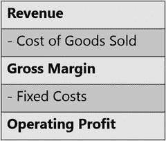
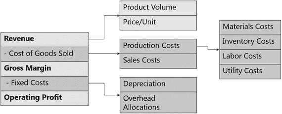
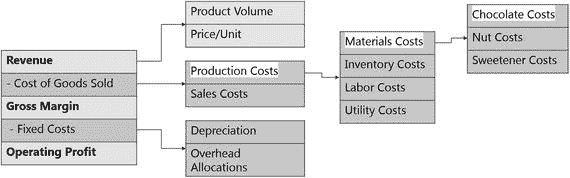
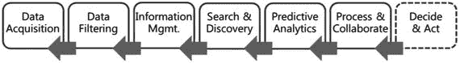
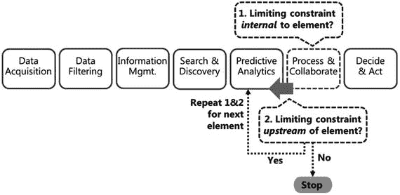

# 5. 逆向流动：从决策到数据

正如我们所看到的，学习可以被视为沿着“数据-学习-行动”流程流动，因为随着流程的推进，那些最终以概率形式（隐式或显式）体现的不确定性会不断被调整。因此，学习为何是业务绩效的关键就显而易见了，因为学习是一个通过减少不确定性来不断提高预测有效性的过程，而从业务绩效的角度来看，所有真正重要的事情都围绕着更好的、可操作的预测。不存在不确定性的决策，可以遵循死板的规则。例如：如果小部件是 X 类型，则执行 Y 操作。组织中可能随时都会发生许多此类决策，但它们中的大多数只是嵌入到自动化流程中，而这些流程本身对比较性业务绩效几乎没有可持续的影响。另一方面，关于何时以及如何自动化这些类型决策的决策，则会影响比较性业务绩效，当然，这些决策确实需要学习并应用“数据-学习-行动”这一通用流程，因为存在影响这些决策的不确定性。

我们还知道，既然学习可以被视为一种流动，那么应用我们基于约束理论的思维就意味着，必然会出现限制学习流动的瓶颈。更重要的是，对“数据-学习-行动”流程的学习产出价值也会存在约束。因此，消除对“数据-学习-行动”流程产出价值的约束，显然是提升业务绩效的良方。

但现实情况是，任何组织都会同时运行许多“数据-学习-行动”流程。有些流程特定于职能领域，例如制造、财务、人力资源等。甚至会有“数据-学习-行动”流程嵌套在其他“数据-学习-行动”流程内部。一旦我们选择了一个要优化的“数据-学习-行动”流程，我们就有了一套方法来指导我们，我们将在本章后面更详细地阐述这些方法。但首先，我们如何选择要瞄准的“数据-学习-行动”流程呢？

在某些情况下，这可能显而易见；例如，当大家普遍认为某个重要的流程或职能领域明显存在缺陷，并且普遍认同需要采取行动时，即使可能不清楚具体该怎么做。在这种情况下，立即开始检查相关的决策，然后应用本章及后续章节中介绍的方法，可能是合理的。但我之所以说“可能”合理，是因为应该执行下文讨论的那种量化价值检查，以便适当地调整投入到该问题上的关注度和精力。

更一般地，对于需要提升整体组织绩效，并且存在许多可能的目标来实现这种提升的情况，必须应用结构化的方法来对目标进行优先级排序。为此，我们需要理解组织的价值驱动因素。

## 价值驱动因素

归根结底，对于优先级排序而言，重要的是对组织长期财务绩效的预期影响。¹ 毕竟，优化“数据-学习-行动”方法的一个重要动机，是企业以资产回报率等指标衡量的绩效不佳。而这些仅仅是跨公司的总体绩效指标——有些组织的状况会更糟，即便是那些优于平均水平的组织，也几乎肯定会有某些部门或职能领域表现不佳。因此，我们有责任以整体财务绩效的各个方面为指导，来确定我们首先要处理哪些“数据-学习-行动”流程。而应用价值驱动因素正是实现这一目标的方法。

我们所说的价值驱动因素，是指那些直接映射到组织绩效（通常以其财务报表衡量）并对其具有最大杠杆作用的关键活动。映射到财务报表通常很直接，但确定杠杆作用的程度可能需要进行一些敏感性分析。

价值驱动因素是对组织财务绩效具有最大杠杆作用的活动。

价值驱动因素分析通常以损益表作为基本起点。损益表在高层面上可能类似于图 5-1 的某种变体。

图 5-1. 基本损益表

作为识别价值驱动因素的第一步，我们要做的是系统地将财务报表的关键要素分解到下一级细节，如图 5-2 所示。因此，对于收入，我们分解出下一级组成部分，例如制造企业的产品销量和单价。对于销售成本，制造企业的下一级组成部分可能包括各种与产品相关的成本要素，如生产成本和销售成本。固定成本组成部分则包括直接固定成本（如生产该产品的制造设备的折旧）以及分摊的固定成本（如各职能领域（人力资源、法务、财务等）和管理层的间接费用）。对于服务型企业，同样适用这种财务报表分解方式，但组成部分当然会有所不同。总的来说，与作业成本法一致的财务报表在此过程中对我们最有帮助，因为它们试图尽可能现实地将成本与其所贡献的收入流联系起来，而不是采用更随意的分摊方法。

图 5-2. 分解损益表

仅仅这样分解财务报表就可能极具启发性——通常，仅根据各个数字的相对大小，就能很快看出最大的改进机会在哪里。例如，如果生产成本远超人力资源的分摊成本，那么哪个是显著改善绩效的更明显杠杆？当然是生产成本。这看起来很简单，但高管们常常将绩效改进的注意力和资源投入到最方便的地方，而不是真正重要的事情上！

这种对财务报表要素的分解可以持续到所需的任何精细程度，并检查财务报表分解中每个分支对最终利润（例如，营业利润）的相对贡献。例如，生产成本可以进一步分解为材料成本（如原料）、库存成本、人工成本和公用事业成本，如图 5-2 所示。原料成本可以进一步分解为用于制造产品的各种材料——例如，对于糖果产品，包括巧克力、坚果、甜味剂等的成本。分解遵循“跟踪资金”原则——如果对财务报表的影响显著，则该项目应进一步分解以确定其组成部分的相对大小。

为了更加严谨，通常会进行敏感性分析。这可以通过为各组成部分设定范围，然后确定当我们在该组成部分的范围一端移动到另一端时，对最终利润结果的影响范围来实现。为了使这些范围代表合理的“可能性的艺术”，可以通过例如对标同行业甚至行业外其他组织的结果来确定或校准这些范围。评估这些范围对例如营业利润的影响，可以合理地了解某个组成部分对整体业务绩效的杠杆作用。

那些似乎对整体业务绩效具有最大杠杆作用的组成部分集合，就是我们所说的价值驱动因素。随着分析沿着基础财务报表的各种价值分支进行，我们对应该关注哪些价值驱动因素的看法很可能会发生变化。例如，生产成本可能被识别为具有显著的价值杠杆作用，但进一步分析可能确定材料成本是产品成本的主要组成部分，因此它是关键的价值驱动因素。但可能巧克力成本是材料成本的主要成本组成部分，而材料成本又是生产成本的主要组成部分，因此巧克力成本才是我们真正想要关注的价值驱动因素，如图 5-3 所示。正如我们将要讨论的，因此我们将特别关注影响该最终价值驱动因素的决策。

图 5-3. 确定价值驱动因素

我们将在后续示例中提到的其他常见价值驱动因素包括产品定价和人才获取。这些示例性的价值驱动因素代表了相当传统的财务相关项目。但影响业务绩效的非传统方面也可能成为价值驱动因素，因此应仔细考虑；例如，员工士气。这是一个通常不会出现在传统财务报表上的项目，但它对业务绩效的影响很可能使其成为一个价值驱动因素，因为员工敬业度已被确定为生产力的关键因素。² 因此，我们的流程不应忽视它。我们的流程要求能够将价值驱动因素（例如员工士气）的影响定量地转化为企业的财务数据。这通常需要一些工作，并且可能包含一些主观性（主观性不应被视为一个贬义词——它仅仅意味着应用基于人类经验的预测模型！），但这绝对必须完成，否则我们就有可能把精力用错地方。

这种确定价值驱动因素并将其作为指导业务绩效改进工作重点的方法并非新鲜事物，尽管它可能未被充分利用。新颖之处在于，在我们的方法中，我们不仅仅是应用各种临时方法来改进组织的价值驱动因素，而是通过识别和改进决策——以及决策所依赖的学习——来系统性地解决这些价值驱动因素的改进问题，从而直击绩效改进的核心。

## 决策，决策

每个价值驱动因素都关联着一个或多个影响它的决策。在识别价值驱动因素的过程中，我们曾将财务报表分解为更详细的组成部分，与此类似，接下来我们必须识别与每个价值驱动因素相关的主要决策。然后，这些主要决策可能需要进一步分解为次级决策，依此类推。例如，如果识别出的价值驱动因素是产品价格，那么确定该产品价格的决策就是该价值驱动因素显而易见的主要决策。再举一个涉及多个主要决策的例子：如果识别出的价值驱动因素是潜在客户到成交客户的转化率，那么主要决策可能包括：销售团队应将精力集中在哪些潜在客户上的决策、针对所选潜在客户采用何种具体销售流程的决策，以及与具体客户交易相关的基于谈判的决策。

这些主要决策随后可能被进一步分解。例如，对于客户交易中基于谈判的决策，可能涉及由法务部门做出的关于交易条款和条件的次级决策，以及由销售部门或管理层做出的与定价相关的决策。

为了确定我们的注意力和资源应聚焦于何处，我们应始终遵循以下两点指导：1）改进决策所带来的潜在长期财务杠杆效应；2）我们能够改进决策的可能性有多大。在我们的例子中，我们可能知道整体上基于谈判的决策至关重要，因为它们与某个价值驱动因素相关联。但如果条款和条件很少成为达成交易的障碍，而定价问题则更常成为障碍，那么定价决策显然具有更大的财务杠杆效应，因此我们的重点应放在分析定价决策以及相关的“数据-学习-行动”流程上。另一方面，如果条款和条件经常成为交易障碍，因而具有显著的财务杠杆效应，但障碍产生的原因是由于某些条款由公司政策设定，且在我们的改进计划范围内无法更改，那么试图解决相关决策就毫无意义（尽管在这种情况下，我们当然应该尝试将关于条款和条件的决策纳入改进计划的范围）。

## 逆向工作

现在，我们准备着手改进一项关键决策，这项决策与某个价值驱动因素相关联（或经共识认为需要立即关注），并且对该价值驱动因素具有显著影响。我们该如何进行？我们沿着“数据-学习-行动”链条，从决策出发系统地逆向工作，如图 5-4 所示。从某种意义上说，我们是在逆转学习流程，通过从决策出发逐步逆向工作，来更深入地了解相关的“数据-学习-行动”流程及其学习流。

我们将分两轮进行。第一轮，我们从决策出发逆向工作，目标仅仅是理解整个“数据-学习-行动”链条，以及链条中每个环节相关的操作和学习流。我们进行这第一轮工作，是为了获得基本理解，以便在第二轮中提出有针对性的、更详细的问题，从而聚焦于链条中限制价值的瓶颈因素。

*图 5-4. 沿“数据-学习-行动”链条逆向工作*

我们还利用这个机会与参与链条中各个环节的人员建立工作关系。这一点至关重要，因为第二轮工作所需的大部分内容将是这些参与者的深思熟虑的评估，我们希望他们能够自在地坦诚分享自己的观点和评估。建立这种信任关系通常并不困难，因为通常情况下，从未有人真正征求过他们对相关主题的坦诚意见和评估，因此他们往往非常珍惜这个机会，并且通常非常渴望分享他们可能已经持有了一段时间、但从未找到合适渠道表达的观点。

让我们通过一些例子来了解这第一轮工作。紧邻决策上游的环节是“数据-学习-行动”链条中的“处理与协作”环节。因此，我们首先分析在该环节的背景下决策是如何做出的。以我们的定价例子来说，我们可能会发现定价决策是由包括客户账户销售负责人和几位管理层成员在内的多人协商一致做出的，并且决策是通过电子邮件沟通来确定的。

在对定价决策背景下的“处理与协作”环节有了这种基本理解之后，我们接着逆向移动到链条的下一个环节：“预测分析”。在这里，我们审视决策的每个参与者所持有的预测假设。这些预测假设可能基于伴随多年经验而来的人类直觉，也可能基于显式模型，例如客户价格弹性或竞争对手投标模式，我们希望对这些预测假设以及这些假设所依赖的隐式或显式模型有一个基本的了解。

然后，我们逆向移动到“搜索与发现”和“信息管理”环节。在这里，我们可能会审视以下问题：对于在“预测分析”环节中应用的人类直觉或推理，能否将其编码，以便其他人可以获取和搜索？并且，这些直觉能否以某种方式得到验证？对于基于计算机的预测分析，例如价格弹性模型和竞争对手投标模式模型，我们可能会审视为模型提供信息的数据、信息的质量和时效性，等等。

最后，我们审视决策的“数据-学习-行动”流程中的数据采集与数据过滤环节。对于基于人类直觉的决策，我们可能需要探究直觉所依据的数据是什么。我们是否拥有获取所需洞察所需的正确数据来源？如果是历史数据，这些数据在当前环境下是否仍然有效？鉴于众所周知的人类数据过滤启发式方法（例如确认偏误），我们需要了解历史数据是否可能因选择偏误等认知偏差而被误解或扭曲。对于为基于模型的预测分析提供信息的数据，我们希望了解支撑这些信息的数据的数量、质量和时效性，以及这些数据是如何被隐式或显式过滤的。当我们完成对数据采集环节的初步理解后，就能对定价决策的“数据-学习-行动”流程有一个良好的整体把握，然后可以进入第二轮更系统的分析，我们将在简要完成另外几个首轮示例后再进行。

### 第一个首轮示例：编程人才获取

作为第二个首轮示例，假设一家科技公司的价值驱动因素是计算机编程人才的获取。这是一个价值驱动因素，因为该公司发现，程序员之间的编程产出数量和质量差异可能高达一个数量级，而编程产出和质量最终会对公司的财务业绩产生重大影响。因此，我们希望改进的决策是关于获取编程人才的决策。

从决策出发逆向推导，我们首先审视“数据-学习-行动”流程中的流程与协作环节，确定谁在做出人才获取决策以及决策是如何做出的。是否存在可辨别的模式，表明某些个人或群体在做出更好的程序员获取决策方面优于其他人？某些决策流程是否看起来比其他流程更有效？例如，在招聘决策中，参与意见的人越多，结果会更好，还是实际上更差？

然后，回到预测分析环节，我们希望了解应用了哪些类型的模型或启发式方法来尝试预测候选程序员的绩效。这主要是依靠人类直觉，还是存在一些模型，它们将简历和面试结果等各种信息源作为输入，并利用这些信息进行预测？我们可能会问，如果有的话，哪些信息纳入预测模型会是有用的，以及为什么。

再回溯到搜索与发现以及信息管理环节，我们可能会询问决策者对简历信息的可访问性。我们可能还想知道历史面试信息是否已被捕获和存储，以便能够在预测分析环节的背景下进行分析。如果在预测分析环节中发现了有益的信息，但当前并未包含在预测模型中，我们想知道这些信息是否已经在信息管理环节中可用。

然后，在数据采集与数据过滤环节，我们可能想知道候选人的面试信息是否可以被捕获（如果尚未捕获），以及具体如何操作。如果预测分析环节识别出当前模型中不存在的某些信息（例如，示例编程代码），而这些信息无法从信息管理和搜索与发现环节获取，那么我们需要了解这些数据是否可以被采集和/或过滤，以及成本是多少。

### 第二个首轮示例：专利决策

让我们再看最后一个简短的首轮示例，其中价值驱动因素是研发组织产生的专利发明数量，与此价值驱动因素相关的主要决策是关于哪些想法应该申请专利，哪些应该作为商业秘密保留。同样，我们首先查看流程与协作环节，以确定决策是如何做出的。我们可能会发现，决策是由一个定期审议候选发明披露的委员会做出的。我们想知道决策是如何做出的——例如，谁参与其中，是多数决还是需要全体一致同意？决策是在现场会议中做出还是离线做出？决策参与者在做出决策时，还有哪些他们目前没有的其他信息会是有用的？

然后，我们查看预测分析环节，并确定是否存在提供关于是否将某个想法作为专利进行申请的指导的预测模型。这些预测模型可以存在于人脑中或机器中，或两者兼有。模型可能会考虑产品方向（例如，“该主题不是我们的长期方向，所以我们不会在该领域花钱申请专利”），和/或可能包括诸如专利的预期许可价值等因素。正如该环节的典型情况，我们希望了解哪些信息可能对纳入预测模型有用，但目前尚未纳入。例如，关于在特定国家/地区针对特定技术类别获得专利的成功概率的详细信息可能很重要。

回溯到信息管理与搜索与发现环节，如果存在决策者希望拥有但目前没有的信息，和/或对纳入预测模型有用但目前尚未纳入的信息，我们想知道这些信息是否已经在信息管理环节中。如果是，我们希望探索将其提供给模型或直接提供给决策者的可能性（在这种情况下，重要的是我们要采取这样的视角：建模确实在发生——只是它恰好纯粹是心智层面的）。

最后，如果存在对预测建模和决策目的有用的信息，但在信息管理环节中不可用，例如，关于在特定国家/地区针对特定技术类别获得专利的成功概率的历史数据，我们希望探索获取这些数据的可能性以及预期的成本。

### 第一轮工作的总结与局限

这些只是组织做出的无数决策中的几个例子，这些决策都可以在“数据-学习-行动”流程的背景下进行审视。正如前面提到的，即使是那些传统上被认为与财务报表无关的领域的决策，例如员工士气，也可以用同样的方式处理，但前提是它们必须与财务结果明确关联并对其产生显著杠杆作用，这当然是成为候选价值驱动因素的前提条件。

以这种方式逆向推导，可以让我们对促成目标决策的学习流程有一个基本的理解。这是一个有用的首轮分析，有助于“摸清情况”，并与“数据-学习-行动”流程的参与者建立融洽关系。但请注意，我们目前还没有太多关于我们正在分析的“数据-学习-行动”流程的学习流程的价值或限制该流程的因素的信息。在这一点上，我们可能有一个大致的感知和一些工作假设，但仅凭大致的感知可能会让我们误入歧途，所以我们还有更多工作要做。

### 价值的制约因素

让我们回到定价决策的示例。既然我们已经通过第一轮分析对其“数据-学习-行动”流程有了基本了解，我们将从定价决策出发进行第二轮逆向分析，但这次会采用更结构化的方式，从而揭示流程中的限制因素。

在第一轮分析中我们发现，在流程链的“流程与协作”阶段，定价决策是由包括销售主管和管理层在内的多人通过电子邮件沟通达成共识后做出的。现在我们希望了解该环节的两个基本问题：1）就价值而言，“流程与协作”环节内的活动和操作在多大程度上导致了盈利交易的失败，解决这些内部制约因素预期能带来多少价值；2）“流程与协作”环节的活动和操作依赖于流程链上游环节（如预测分析）的哪些输入，改善这些输入预期能带来多少价值？

针对第一个问题，即“流程与协作”环节内部操作所导致的价值制约因素，我们可能会发现，例如，有时原本预期能赢得的交易最终却流失了，原因在于需要四方通过电子邮件反复沟通才能达成决策所需的时间。如果该问题完全不依赖于上游环节的任何输入，我们可以立即断定这是一个价值限制因素。

接下来我们要计算这个限制因素相关的成本，但棘手之处在于，“原本预期能赢得的交易却流失了”这一因素可能需要最了解情况的人做出一些主观判断。但这完全没问题——这总比完全不对问题进行量化要好！因为不量化通常意味着不采取任何行动，或采取错误行动，因为缺乏量化就只能依赖轶事，而轶事是远远不够的。在本书概述的整个方法中，我们力求在一切可能的情况下进行量化，正是出于这个原因，但很多时候这些量化必然依赖于人们头脑中的见解。好消息是，这些见解中总有大量内容从未被充分挖掘！

因此，在估算出与“流程与协作”环节内部操作相关的限制因素成本后，我们转向第二个问题，即“流程与协作”环节所依赖的上游环节（如预测分析环节）的输入。具体来说，我们想了解的是获得更好或不同输入的价值。（同时我们也想了解，当前从上游环节流向“流程与协作”环节的输入中，是否有该环节不需要的，因此对该环节毫无价值。）于是，我们向“流程与协作”环节的参与者提问：“你们目前没有掌握哪些信息，能让你们赢得更多交易？”如果得到的答案是确实存在能促成更多交易的信息，我们立即知道还存在另一个限制因素，这次出现在“流程与协作”环节上游的某个位置。

接着我们会跟进了解这第二个价值限制因素的成本：“如果你们掌握了这些信息，那些额外赢得的交易预期能带来多少价值？”同样，提出这些问题时，我们寻求的是主观估算。我们或许可以基于这些主观估算构建计算机化的`价值模型`，但估算本身是基础。为了让基础尽可能牢固，我们必须向正确的人提出正确的问题。我们将在后续章节更详细地介绍如何做到这一点——这里我们只关心走通一个通用示例。

假设“流程与协作”环节的参与者表示，更好地了解竞争对手的投标情况是最重要的信息增强。虽然我们也了解到，更好地理解客户的价格弹性也会有所帮助，但事实证明，大多数流失的交易都是输给了竞争对手，因此了解他们可能的投标是主导性的价值制约因素。我们还需要进一步了解，在不同准确度水平下（从完美洞察——可能无法实现，至少在法律上如此！——到仅比当前略好）更好地预测竞争对手投标的价值。同样，这些很可能都是主观估算，但我们现在有了可以着手处理的内容。

现在，正如预测分析环节的常见情况，对于这个定价示例，该环节的操作可能体现在“流程与协作”环节参与者的头脑中，或组织内其他人的头脑中，也可能体现在基于计算机的`模型`中。但无论显式还是隐式，预测`模型`肯定存在，我们想知道它们所依赖的“数据-学习-行动”流程链中具体有哪些学习流。假设至少存在一个基于计算机的简单`模型`来预测竞争对手的投标，但根据该`模型`输出结果的使用者（即“流程与协作”环节的决策者）的反馈，该`模型`并不十分准确。因此我们向负责该`模型`的人提问：“哪些信息能让`模型`更准确？能准确多少？”他们回答，了解与竞争对手解决方案相关的`可变成本`是最重要的信息，因为竞争对手不会低于其`可变成本`投标。

现在我们转向“搜索与发现”和“信息管理”环节。组织内部是否有关于竞争对手`可变成本`的信息？竞争投标建模者能否获取这些信息？如果能，我们就找到了与定价决策相关的“数据-学习-行动”流程中另一个价值限制因素的所在位置。信息是存在的；只是与“搜索与发现”环节和/或“信息管理”环节相关的某些因素导致了这一制约。

但假设组织内部任何地方都不存在这些信息。我们转向“数据采集与过滤”环节，以确定是否有办法获取所需数据。这时往往需要创新思维，因为很可能从未有人考虑过获取此类数据（因为从未有人进行过我们刚才所做的这类分析！）。或者以前可能考虑过，但从未解决，因为缺乏对拥有此类数据好处的量化——如果唯一能获取的相关数据并不完美，这种情况尤其常见。

那么，我们接下来要问的问题是：“我们能获取竞争对手的变动成本数据吗？”答案是否定的。“好吧，有没有其他可以获取的数据，能让我们至少估算出变动成本？”我们发现，答案是竞争对手的变动成本主要由其解决方案中所包含的材料成本决定，而这些`材料成本`是可以估算的。换句话说，我们找到了一种方法，通过更深入地了解竞争对手的`材料成本`，来减少我们在竞争对手变动成本方面的不确定性。

因此，我们确定了该流程的另一个限制性约束——关于竞争对手变动成本的不确定性。并且，我们找到了一个有助于解决部分不确定性的方案：如果我们能获取数据，从而能够相当准确地估算出竞争对手在某个特定解决方案中的`材料成本`，那么我们就可以估算出相应的竞争对手变动成本。这将有助于做出更优的定价决策，从而显著提升我们“数据-学习-行动”流程的价值，而这种提升的价值将不可避免地直接体现在财务业绩中。

通常，对于限制性因素，很难找到完美的解决方案，至少在短期内是这样。但即使是一点小小的改进，也能产生深远的影响。这里的一个关键点是，在“数据-学习-行动”流程中，当存在一系列直接依赖关系时，对限制性约束的微小改进，其价值也超过对其他约束的重大改进！这或许是本书的核心要点，因为这条规则在实践中经常被违反。在处理那些真正最重要的事情时，做到大致正确，要好过在那些与最终绩效目标最不相关的事情上，把所有细节都搞对，却精确地犯错。³

即使是对限制性价值约束的微小改进，其价值也超过对其他约束的重大改进。

另一方面，有时会存在独立的学习流程及其相关的约束，就像本例中的情况一样，如果资源允许，这些流程可以并行处理。例如，除了高杠杆的竞争对手投标预测机会之外，还可以针对规模较小的、基于电子邮件的限制性约束进行改进，因为它们之间没有直接的依赖关系。然而，重要的前提是“如果资源允许”。很多时候，那些上行空间小得多的改进机会反而被选中，仅仅是因为它们更容易被识别和处理。无论目标是大是小，量化旨在解决约束的不同方案的预期价值，以及相应量化每个潜在方案的预期成本，都是势在必行的。

当我们从所处理的决策出发，逆向推导时，我们对“数据-学习-行动”流程中的每个要素都提出了以下基本问题：

*   在我们当前审视的要素中，哪些内部活动和操作正在限制价值？解决这些内部约束的价值是什么？

*   来自上游要素的哪些输入（或缺乏输入）正在限制我们当前审视的要素的价值？解决这些输入约束的价值是什么？

从决策出发逆向推导并提出这些基本问题，是确定价值限制性约束的通用程序，如图 5-5 所示，我们可以将其应用于任何想要优化的“数据-学习-行动”流程。

图 5-5.

确定价值限制性约束的通用程序

### 解决约束

在我们的例子中，我们确定了一个价值限制性约束，其原因是关于竞争对手`变动成本`的不确定性太大，这导致了对竞争对手投标的不确定性，从而抑制了我们为客户自身解决方案设定最优价格的能力，进而导致我们失去本可以赢得的宝贵交易（或者出价过低）。而我们之所以对竞争对手的`变动成本`不确定，是因为我们对变动成本的主要组成部分——竞争对手解决方案中的`材料成本`——不确定。因此，如果我们能减少对竞争对手解决方案中`材料成本`的不确定性，我们就学到了某些最终会对我们的价值驱动因素产生积极影响的东西。

在某些情况下，解决一个约束可能比预期的更直接，因为这个约束以前从未被如此识别过，所以没有人认真对待它。这种情况发生的频率可能比人们想象的要高，因为如果没有系统地运用我们这里的方法，重要的约束就很容易被忽视。解决学习和价值方面的约束需要组织的精力和创造力，如果约束的成本没有被量化，那么这些创造性资源就不太可能被分配。即使是显而易见的约束也可能未被解决的另一个原因是“完美准确性诅咒”：如果我们无法达到完美的预测准确性，我们就根本懒得去获取任何额外的准确性，因为我们干脆忽略了那个不确定的变量。这是一种“因噎废食”的综合症。

在我们的例子中，也许对购买了竞争对手解决方案的`客户进行访谈`可以让我们更好地了解竞争对手在其解决方案中使用的`产品品牌`，再结合`品牌供应商的报价`，就能对竞争对手解决方案的`材料成本`做出相当不错的估算。这些数据可能远非完美，但仍然有望在一定程度上减少我们对竞争对手`变动成本`的不确定性，而这很可能会带来改变。

在一个学习流程中，对于任何给定的约束，可能存在一系列解决方案，每个方案在减少导致约束的不确定性方面都有不同的预期效果，因此每个方案都能带来不同水平的价值。这些方案中的每一个都需要在人员、流程或技术上从当前状态进行一定程度的改变，并且每个方案都有预期的实施成本。我们如何决定实施哪个方案？作为初步近似，其方法与组织进行任何其他类型的潜在投资相同——通常，选择与每个方案相关的预期现金流净现值最大的那个方案。我之所以说“初步近似”，是因为正如我们稍后将讨论的，如果我们进行前瞻性约束分析，我们可能会发现，解决约束的程度（减少更多不确定性）可能比单纯采用一次只解决一个约束的方法所证明的合理性要更高。

仅本章所描述的方法，就能为几乎任何组织带来显著的好处。但我们还可以更进一步，既要收紧因限制性约束而损失的价值的估算，也要收紧实施解决方案以至少部分解决这些约束所带来的价值的估算。我们将在下一章深入探讨量化这些估算的详细方法。

## 总结

在本章中，我们讨论了如何决定组织中众多决策中哪些应成为我们关注和资源的焦点，而价值驱动因素正是这些优先级决策的恰当指引。一旦识别出高杠杆决策，我们就沿着“数据-学习-行动”链条从决策反向推导，以识别价值约束。在“数据-学习-行动”链条的每个环节，我们判断限制价值的约束（若存在多个独立约束，则指所有约束）是由于该环节自身运营的缺陷，还是由于上游环节输入不足所致。我们沿着链条持续进行这种反向推导，直至识别出所有限制性约束。同时，我们探索解决已识别限制性约束的可能性，并力求理解每种可能性对应的预期价值。

脚注 1

这是假设传统营利性组织的情况。其他类型的组织可能拥有非财务性的基本目标。而营利性组织除了财务目标外，也可能有其他目标。如果存在或能够开发出可量化的指标来衡量目标实现程度，本书中的方法同样适用于此类非财务目标。这些指标仅需替代货币价值，作为通过相关学习与决策实现效用最大化的代理变量。

  2

[Baldoni](https://hbr.org/search%3Fterm=john+baldoni)，约翰。“员工敬业度不仅提升生产力”，2013 年 7 月 4 日，[`hbr.org/2013/07/employee-engagement-does-more`](https://hbr.org/2013/07/employee-engagement-does-more)

3

贯穿本书的一个重要观点。常被归功于经济学家约翰·梅纳德·凯恩斯，但最初由哲学家兼逻辑学家卡维斯·里德阐述：“模糊的正确远胜于精确的错误”。卡维斯·里德，《逻辑学：演绎与归纳》（1898 年），第 351 页。