# 6. 量化价值

在上一章中，我们回顾了一些从决策反向推导的案例，以理解解决可操作学习瓶颈的价值。例如，在定价案例中，我们需要了解若能更准确地预估竞争对手的投标，预期能增加多少利润。更具体地说，我们想知道在预测竞争对手投标的不同准确度水平下，预期能增加多少利润。掌握这些信息后，我们就能以直接的方式反向推导，识别出导致当前竞争对手投标预测不完美的约束因素，并确定解决这些约束的价值——从当前“数据-学习-行动”链条中最主要的限制因素开始。

但我们并未详细说明如何估算在预测竞争对手投标的不同准确度水平下预期能增加多少利润。在本章中，我们将回顾实现这一目标的方法，从而为解除“数据-学习-行动”流程的瓶颈估算出预期学习价值。这样做能提供一种量化依据，作为决定学习投资的基础，使其能够与组织中其他投资和资源需求进行有效竞争。

本章是本书的核心章节，其中讨论的量化方法将超越基础算术。即便如此，我们不会进行详细计算，仅概述执行这些计算的过程。如果你希望大致了解如何量化学习价值，但将建模和计算细节留给组织中的其他人，只需略读本章，重点关注“学习价值建模”部分及章末总结。你将获得阅读本书其余部分所需的所有背景知识。

## 学习的价值

学习的价值源于其影响一个或多个决策的潜力。正如我们在前几章中讨论的那样，这是决策分析领域中信息价值概念的衍生，有时也被称为预知价值——即，能够获得关于某个不确定变量结果额外预见力的价值，这种预见力有可能改变原本会做出的决策。现在，我们假设的这位预知者可以是绝对可靠的类型，在这种情况下，我们称其提供的信息价值为完美信息价值；或者，如果我们的预知者有时预测错误，那么所提供信息的价值就是不完美信息价值，当然，其价值必然低于（或至少不超过）完美信息。¹

现实情况是，现实世界中可获得的大多数信息，在为预测不确定结果提供依据方面都并非完美。此外，信息本身仅仅为真正重要的环节提供了基础，这个环节就是将信息输入转化为对不确定变量结果的改进预测。这种转化需要某种建模能力——或者更广义地说，学习能力——无论这种能力存在于人脑还是机器中。在经典的决策分析中，这种学习隐含地体现在为特定决策所执行的具体分析中，这种分析通常由第三方专家进行，因此“信息价值”这个标签往往暗示着这种大规模、一次性决策的范式，并伴随着相关的专业知识和技术的应用。

然而，更一般地说，这种专门的分析——以及任何其他类型的过程，无论是由人脑还是机器执行，只要其结果是根据信息输入调整对不确定性的表征——都是一种学习形式。具有潜在价值的是这种学习的结果，而不是原始的信息输入本身。而且，当信息转化为预测洞察成为一个持续的过程，并在组织内制度化时，这种价值就会被放大。

信息本身没有价值。将信息转化为能够影响决策的改进预测（即可行动的学习）才具有价值。

因此，就我们的目的而言，“学习的价值”是比“信息的价值”更有意义的术语。是的，你可能已经注意到，这意味着在计算数据到学习再到行动过程的学习价值时，必然有一个数据到学习再到行动的过程在起作用，所以这就像“层层嵌套，无穷无尽”！²

在我们深入探讨学习价值的量化细节之前，有必要回顾一下决策分析领域中一些普遍适用的基本原则和见解。首先，对于任何特定的决策，我们需要了解可以决定采取的潜在行动。对于之前已经做出过的重复性决策，这可能会很简单，因为潜在的选择很可能已经确立。但有价值的创新往往是广泛考虑以前未曾考虑过的新选项的结果。因此，创造性地确定额外的选项是优化数据到学习再到行动过程的一个重要方面。好消息是，由于我们有更结构化、更有效的方法来评估替代行动的价值，我们理应考虑尽可能多的选项，即使其中一些可能感觉像是“勉强的选择”。虽然这意味着许多选项在更深入分析后会被舍弃，但那些通过价值筛选的一个或相对较少的选项可能会带来天壤之别。

而对那些未被选中的可能行动进行分析，可能会提供一些见解，了解在什么条件下被舍弃的行动可能会被优先考虑，因为它可能为组织带来相对于当前决策选择之外的额外价值。例如，当一项适用的技术足够成熟时，也许一项依赖该技术的行动就会成为首选。识别那些可能改变所选行动的事件和条件，为后续跟踪这些感兴趣的事件或条件提供了基础。

其次，由于我们方法的重点是针对企业，行动结果的价值通常可以直接用货币来衡量，这避免了在决策结果中进行“苹果和橙子”的比较。此外，虽然决策分析通常可以处理决策的各种结果存在风险规避倾向的情况，但在这里我们可以假设风险中性，这对于大多数企业决策来说是现实的，并且简化了量化过程。换句话说，如果第一个行动的预期结果价值 100 万美元，而第二个行动的预期结果价值 1000 万美元，那么第二个行动的价值正好是第一个的十倍，或者用决策分析的术语来说，对决策者的效用正好是十倍。而损失 1000 万美元所带来的效用减少，与获得 1000 万美元所带来的效用增加，其幅度是相同的。在放松风险中性假设是适当的不典型情况下，学习价值的量化会稍微复杂一些（需要应用显式的效用函数），但整体程序与我们这里将重点讨论的风险中性方法是相同的。

第三，适用于我们方法的决策分析的一个关键准则是：决策的质量不能由其结果来判断。这是因为不确定性会影响决策的结果，好的决策也总是可能遭遇坏运气。决策质量必须基于先验原则来判断。也就是说，给定决策时的信息输入，或者更广义地说，信息状态，所做出的决策是否是最佳决策？这是经典决策分析提出的决策质量问题。然而，决策质量是信息与决策之间那个必要中介——学习——的函数。那么，更贴切的问题是：“给定决策时可用的信息，基于该信息并为一个或多个决策提供依据的学习，是否已经尽可能好了？”换句话说，决策质量实际上是学习质量的一个子集。

决策的质量不能根据决策的结果来判断。应该评估的是，在决策时的信息状态下，与之相关的学习质量。

### 计算学习价值

现在，让我们回到投标定价的示例，继续探讨量化学习价值的过程。在该示例中，我们发现制约价值的一个关键因素是对竞争对手投标价格的不确定性，因此我们希望探索降低这种不确定性的解决方案。为此，我们需要了解针对竞争对手投标价格的不同预测精度水平所对应的预期价值，以便将这些价值与提供相应预测精度水平的解决方案的成本进行比较。

从根本上说，我们的投标可能产生两种需要考量的结果。第一种情况是我们输掉交易，因为我们的出价高于竞争对手的出价（或者，如果存在多个竞争性投标，我们的出价高于竞争对手中的最低出价），如图 6-1 所示。在这种情况下，与我们对竞争对手出价具有完美预测能力时相比，我们的利润损失等于竞争对手的出价与我们对该项目的盈亏平衡成本之间的差额。换句话说，如果我们能够完美预测竞争对手的出价，我们只需将解决方案的定价略低于竞争对手的价格，并且如果除了价格之外没有其他因素影响客户决策，我们就能赢得交易。

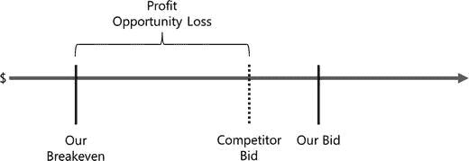

`图 6-1.`

我们输掉交易的情况

另一种情况是我们赢得交易，因为我们的出价低于竞争对手的出价，如图 6-2 所示。在这种情况下，好消息是我们将获得预期利润，即我们的出价与盈亏平衡金额之间的差额。坏消息是，与我们对竞争对手出价具有完美预见能力的情况相比，我们留下了本可获得的利润——即竞争对手的出价与我们（获胜）出价之间的差额。

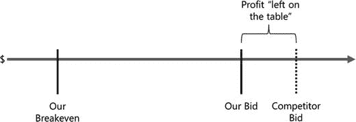

`图 6-2.`

我们赢得交易的情况

因此，从根本上说，我们想要做的是：在赢得投标时，尽量减少因出价相对于竞争对手过低而留下的利润；同时，尽量减少因出价相对于竞争对手过高而导致的交易失败概率以及相关的利润机会损失。显然，这两个目标之间存在矛盾，而我们对竞争对手出价的不确定性越大，与完美预测竞争对手出价的情况相比，我们预期的利润损失就越大。

#### 编码不确定性

基于历史竞争对手出价（可能如此），我们目前对竞争对手投标价格的不确定性有一个看法，大致由图 6-3 所示的概率函数表示。这个概率函数看起来有点像钟形——在实践中，它可能具有显著不同的形状，函数的具体轮廓取决于对竞争对手投标行为的已知信息。例如，如果我们对竞争对手投标知之甚少，概率函数可能是一个均匀概率函数，表现为一条横跨大范围出价区间的水平线。这个概率函数意味着我们认为在该范围内，任何竞争对手的出价可能性都是相等的。然而，图 6-3 的钟形表明我们并非完全不确定竞争对手的出价。钟形概率函数意味着竞争对手的出价更可能位于钟形中心附近，而非尾部。尽管如此，钟形仍有显著的跨度，这体现了我们目前对竞争对手出价存在相当大的不确定性。

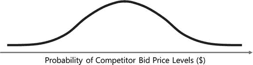

`图 6-3.`

当前对竞争对手投标价格的概率评估

我们如何创建像图 6-3 所示的当前概率评估呢？通常，我们通过编码最了解该主题的专家的专业知识来实现。这可以通过与他们进行结构化讨论来完成。或者，图 6-3 中的概率函数也可以直接通过基于计算机的建模生成，例如，分析历史竞争对手投标模式，并基于该分析生成概率函数。当然，这类建模是数据科学家可以做出重大贡献的领域，而且他们可用的工具在将历史数据转化为概率函数方面正变得越来越有效。

# 不确定性编码与学习的价值

无论概率是如何生成的，都需要强调关于概率的一个重要观点：事件和对象本身并不具有内在概率；相反，概率是一种基于特定信息状态和相关学习的外部评估。概率的这一基本特性始终成立，无论概率是由人直接评估，还是通过基于计算机的建模生成。

概率是基于信息状态和学习对不确定性的一种评估，而非事件或对象的内在属性。

如果通过采访人类专家来编码，不确定性通常被编码为累积概率分布，如图 6-4 所示。这种格式更便于直接编码和交叉校准受访者对诸如“您认为竞争对手出价高于价格 A 的可能性有多大？”以及“您认为竞争对手出价低于价格 B 的可能性有多大？”等问题的回答。对一系列此类问题的回答会得出如图 6-4 所示的概率分布函数；具体来说，是一个累积函数。这个累积概率函数看起来是连续的，而不仅仅由离散点组成，这可能是对采访中获得的点进行插值的结果。无论如何，本章概述的基本程序同样适用于连续或离散的概率分布。

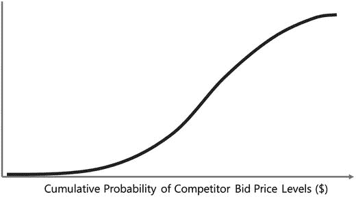

图 6-4.

当前竞争对手投标价格的累积概率分布

图 6-3 所描绘的函数是同一概率评估的另一种表示形式，正式名称为`概率密度函数`。从微积分角度而言，密度函数是累积分布函数的导数；或者换个视角，对密度函数进行积分或累积，即可得到分布函数。虽然累积分布函数在编码专家知识时通常更易使用，但密度函数往往能让人一眼看出不确定性轮廓的差异，因此本书将更常用它来展示不确定变量。

现在，你或许会觉得，从具备相关专业知识的专家那里提取概率分布的方法相当“主观”。你可能会更倾向于相信，比如通过复杂的神经网络推导出的概率。好消息是，这些方法确实如此！“主观”只是我们用来描述基于神经网络模型输出的另一个词。它们恰好是运行在生物基质上的模型！这并非轻率的评论，而是优化“数据-学习-行动”方法的关键点。许多组织损失了大量价值，因为对某些人来说，“主观”是一个不光彩的词。他们往往忽视或忽略通过结构化技术仔细确定并编码相关的主观见解，而不是将其捕捉下来。结果，本应为组织所用的宝贵见解未能得到应用，导致“数据-学习-行动”流程的表现不如预期。

许多人（不仅仅是工程类人员）都有一种心理：如果数字来自机器，它们似乎比来自人脑更可信。有时情况确实如此，但也可能恰恰相反。例如，人脑对某个主题的近似正确，远比一个因未能考虑所有相关复杂性而精确错误的计算机模型更有价值。人脑在处理某些类型的不确定性时固然有其已知的怪癖和弱点，但在许多高度复杂的情境中——这些情境自动化系统仍难以应对——人脑往往能相当接近正确答案。因此，关键在于始终找到人脑与机器学习的正确组合，为特定情境提供最佳的学习和预测结果。

在本章中，我们只能非常简要地介绍编码不确定性（无论来源是人脑还是机器）的机制与艺术。对于来自人脑的编码，我们将涉及基本的访谈技巧以及受访者之间的交叉校准。还有许多其他工具和技术可以增强这些基础方法。例如，系统思考技巧有助于思考涉及大量交互部分的系统动态中的不确定性。运用角色模型和同理心地图来理解不同视角，可能有助于考虑与人类行为相关的不确定性。情景分析也可能有所帮助。除了这些技巧之外，重要的是要明确努力克服人们容易产生的各种偏见，例如回忆历史信息时的选择偏差、对预测能力的过度自信，以及群体思维。例如，“黑天鹅”事件可能被低估，至少部分原因是我们普遍对准确预测能力过度自信。³ 另一方面，选择偏差和情感共鸣可能使异常事件更令人难忘，从而在概率评估中比更普通的事件产生不当影响。同样，讲故事是目前一种流行的技巧，能引起许多人的共鸣，并帮助他们学习和记忆信息。但故事的力量有时可能是在利用思维的缺陷而非优势，因为故事必然是选择性的轶事，可能无法代表我们想要支撑编码不确定性的现实。因此，在应用任何特定方法来促进不确定性量化时，都需要格外谨慎。

显然，提出正确的问题以获得尽可能最佳的不确定性编码也至关重要，这既是科学也是艺术。在这方面，正如我们将在后续章节中讨论的那样，让一位不一定对所询问主题有深入了解的访谈者来提问可能会很有用，这样就能提出“天真”的问题，从而引出比通常可能浮现的更广泛视角。

但无论采用何种技术来尽可能最佳地理解所关注的不确定性，我们都必须将不确定性编码为明确的概率分布。相关的问题应该是：基于各种考量，概率分布应该是什么样子，而不是是否要费心将不确定性编码为概率分布。因此，例如，考虑到黑天鹅式的思维，在其他条件相同的情况下，我们可能会加厚分布的尾部，而不是简单地摊手放弃。另一方面，确保异常事件的选择偏差不会不当影响概率评估，可能会促使我们在分布中心增加更多质量，而不是在未明确考虑选择偏差效应的情况下。

将不确定性编码为概率分布，始终是一个“如何做”的问题，而不是“是否要做”的问题！

通过将不确定性编码为概率分布，我们只是将任何情况下都会默认发生的过程变得更加明确和严谨，并且这使我们能够有效量化学习的价值。它还有助于强化一种思维纪律，促进对导致所考虑不确定性的因素进行更清晰的思考。

#### 完全可预测性学习的价值

根据图 6-3 和图 6-4 的概率函数所体现的当前不确定性水平，我们可以确定能够优化利润的预期出价。通常，我们会通过基于计算机的模拟来完成这一工作，因为一般而言，我们的概率函数可能无法推导出教科书示例中常见的“封闭形式”解，而且随着我们添加更多建模细节（例如更多不确定变量），这种情况更有可能发生。在模拟中，我们选择一系列假设的投标价格，然后针对每个投标价格，从图 6-3 所表示的概率函数中进行足够大量的抽样，以模拟竞争对手的投标。对于每次模拟的投标和相应的竞争对手投标，记录预期利润。平均利润最高的模拟投标价格，就是我们应在实际投标中使用的价格。通过足够的模拟运行次数和粒度，我们可以在寻找最优投标及其相关预期利润方面达到任意高的置信水平。

在根据当前对竞争对手投标不确定性的评估计算出最优投标后，接下来我们可以计算完全可预测竞争对手投标的价值。这仅仅是比较在完全预见的情况下我们所能获得的预期利润，与在当前不确定性状态下（即我们刚刚通过模拟计算出的）预期利润的问题。

学习的预期价值始终等于学习发生后的预期价值减去未受益于学习时的预期价值。

当然，在这个简单的例子中，如果竞争对手的投标完全可预测，我们知道我们总是会出价略低于竞争对手的预测投标价格（只要它高于我们的盈亏平衡点）。但我们如何知道预言家会预测什么呢？嗯，预言家只能预测未来，不能改变未来（在决策分析术语中，能够改变未来的假设实体被称为巫师，其能力远强于预言）。预言家的预测必须遵循我们目前对未来唯一的看法，即图 6-3 的概率函数。也就是说，预言家的预测必然以我们当前的概率评估为条件。因此，我们可以通过将竞争对手投标价格概率函数离散化为多个切片，然后依次选择每个可能的投标价格水平及其发生的相关概率，来模拟预言家预期会做出的预测，如图 6-5 所示。这代表了预言家可能做出的预测范围以及每个预测的相关可能性（即每个离散切片下的曲线面积）。

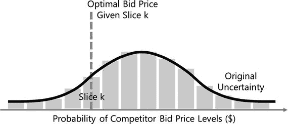

图 6-5.

确定完全可预测性学习价值的过程示意图

因此，再次强调，仍然存在先验不确定性，因为帮助我们的是预言家，而不是巫师。但在这种情况下，我们（或我们的模型）在收到竞争对手投标的预测后做出投标价格决策，并且该预测保证准确。因此，最优策略始终是出价略低于预言家预测的竞争对手投标，如图 6-5 中给定的预测切片 k 所示。与原始情况不同，在完全可预测的情况下，我们的最优投标现在总能赢得交易并带来利润，尽管在某些情况下，由于预测的竞争对手投标价格较低，利润可能相对较小。在这种完全可预测的情况下（这里的“学习”是指拥有预言家的服务），学习的总体预期价值就是所有这些单个利润的总和（按竞争对手投标价格的概率函数加权，预言家的预测必然遵循该函数）减去原始情况下的预期利润。或者，用公式表示，如果我们有 n 个预测切片：

```
学习后的预期利润
      = Σ (i=1 to n) 最优投标切片(i)的预期利润 * 切片(i)的概率
```

```
预期学习价值
      = 学习后的预期利润
      - 学习前的预期利润
```

虽然完全可预测性的假设可能非常不现实，但它为任何旨在提高竞争对手投标可预测性的额外信息和分析技术（即学习）组合的价值提供了一个上限。这在执行合理性检查时非常有用，可以节省时间和金钱，避免因试图追求成本超过任何潜在收益的解决方案而造成损失。

假设不确定变量完全可预测来计算学习的预期价值，通常比针对不完全可预测的情况要容易，并且为筛选出成本超过其所能带来的任何潜在收益的解决方案提供了一个有用的过滤手段。

#### 在不完美可预测性下学习的价值

### 学习价值建模

更可能出现的现实情况是，我们或许有机会在一定程度上提高可预测性，但远未达到完美的程度。在我们的投标案例中，正如上一章所见，了解竞争对手的材料成本能够让我们更好地理解其可变成本，从而比当前更准确地预测客户的投标价格。换句话说，对竞争对手材料成本进行建模的能力，应能使`概率密度函数`从`图 6-3`所示的状态收缩。

那么，我们如何基于对竞争对手材料成本的学习，来实现当前概率函数的这种收缩呢？我们可以开发一种新的、以先验分布为条件的预测概率分布，如`图 6-6`中的虚线函数所示。该分布代表了我们对竞争对手投标价格预测的最新不确定性，由于我们对竞争对手材料成本进行了分析，这种不确定性相比最初有所降低。我们可能会预期这个新的概率函数是非对称的，如图所示，因为我们对竞争对手可变成本的建模，很可能为竞争对手的投标价格提供更严格的下限，而非上限。

那么，我们如何获得这种基于对竞争对手材料成本更深入理解的投标价格预测概率函数呢？很可能与我们最初获得`钟形概率分布函数`的方式相同。通常情况下，我们会从人类专家那里编码此类概率评估，或许还会结合计算机建模的应用。我们通过向最具相关专业知识和经验的人员提出一系列问题来执行这种编码，以了解体现不确定性的概率分布的形状。同样，这通常是通过将专家观点编码为`累积概率分布`（如`图 6-4`所示）来实现的，而不是`概率密度函数`形式（如`图 6-6`所示）。如果有多位人类专家持有不同意见，我们会采用相关程序来尝试达成共识。这种共识可以通过与专家对话来实现，以确定是否存在不同的假设、知识基础等，如果这些信息得以共享，将有助于推动共识的形成。或者，根据基于群体智慧的思维，专家观点可能只是简单地取平均值。

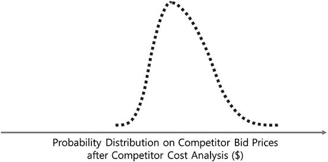

**图 6-6.** 竞争对手投标的条件预测分布

那么，下一个问题是：“`图 6-6`中所示的、经过竞争对手成本分析后的概率函数所代表的学习的期望价值是多少？”我们已经知道上一节中计算出的竞争对手投标的完美可预测性的期望价值，这为我们通过不完美预见所能获得的价值提供了一个上限。完美预见相当于`图 6-6`中竞争对手成本分析后的概率函数收缩成一条垂直线。并且，有了这种完美预见，我们知道最优的投标策略显然是将我们的价格设定在略低于竞争对手预测价格的水平。但仅仅更深入地了解竞争对手的材料成本，显然远未达到这种完美预见，这一点通过简单查看`图 6-6`即可看出。

那么，现在让我们逐步探讨如何确定与这种不完美但优于我们现有水平的竞争对手投标可预测性相关的学习价值。与完美可预测性的情况一样，我们通过比较基于当前对竞争对手投标不确定性水平的交易的期望价值，与如果我们进行材料成本分析（这能使我们在一定程度上降低不确定性）后的交易的期望价值，来计算学习价值。

我们已经讨论了如何确定我们计划投标的交易的当前期望价值（很可能通过基于计算机的模拟）。我们还讨论了如何确定竞争对手投标的完美可预测性的期望利润。在这种情况下，一旦我们收到一个预测（一个符合我们当前学习状态的预测，即`图 6-3`中的原始钟形曲线），我们只需将投标价格设定在略低于竞争对手投标价格的水平。因此，我们保证总能赢得交易，并通过略低于竞争对手投标价格的方式获得尽可能多的利润。

但这种情况略有不同。有了完美预见，我们可以在收到预测后直接应用一个简单的规则——投标价格略低于预测的竞争对手投标价格。而在这里，即使收到预测后，我们仍然面临不确定性，尽管这种不确定性比收到预测前要小。我们可以使用与完美预见情况相同的基本程序，但需要额外进行一次模拟，以处理收到预测后仍然存在的残余不确定性。

因此，在这种情况下，我们通过从`图 6-6`所示的新概率函数中采样，针对我们可能的每个投标价格进行模拟，从而找到针对给定竞争对手价格预测的最优投标价格。与计算完美可预测性价值的情况一样，这些给定的竞争对手价格预测仍然必须服从我们当前对未来唯一的看法，即`图 6-3`中的概率函数。也就是说，任何新的预测方法，无论是完美的还是不完美的，都必然以我们当前对所预测事物的概率评估为条件。因此，我们在模拟中使用的预测价格符合`图 6-3`中的概率函数。

这个过程如`图 6-7`所示。对于原始分布中的给定离散切片 `k`，我们找到最优投标价格。而在完美可预测性的情况下，针对给定预测的最优投标价格是略低于预测的竞争对手价格，但在这里情况很可能并非如此，因为存在残余不确定性及其非对称性质，如`图 6-7`所示。我们以这种方式沿着整个原始分布移动，为每个预测切片找到我们的最优投标价格。

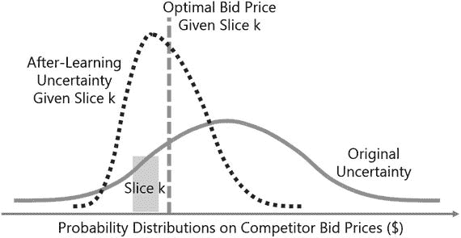

**图 6-7.** 确定不完美可预测性下学习价值的过程示意图

接着，如同我们在完全预见情况下所做的那样，我们选取每个可能的竞争对手出价水平（预测切片）及其发生概率（即每个切片原始分布曲线下的面积），并确定每个由此新确定的最优出价所产生的相关预期利润。将所有切片的预期利润按每个切片的相关概率加权求和，就是通过获取和分析竞争对手材料成本信息来降低不确定性所能实现的预期利润。换句话说，上一节中用于确定完全可预测情况下学习后预期利润的公式，同样适用于不完全可预测的情况——唯一的区别在于每个预测切片的最优出价确定方式不同。

在基于我们对竞争对手出价预测的新降低不确定性水平下，最优出价的预期利润，与基于原始不确定性水平下最优出价的预期利润之间的差额，就是通过材料成本分析部分解决竞争对手出价定价限制约束的预期学习价值。但需要注意的是，这一预期学习价值仅针对单一的未来出价情境。

#### 模型优化

如果我们预期此类出价会重复出现，那么该预期学习价值将低估竞争对手成本分析的完整预期学习价值，因为它仅针对一个未来交易情境计算。要量化完整的预期学习价值，我们只需将所有预期的未来相关出价情境的价值（其本身可能是一个不确定变量）相加，并根据情况用货币时间价值因子进行折现。这样，我们就能对竞争对手成本分析的预期价值做出可信的估算，该分析将部分解决限制约束（后续会讨论注意事项）。然后，我们可以将这个预期学习价值与获取相关数据并进行成本分析的成本进行比较。如果（且仅当！）收益超过成本，我们就应该进行投资——重要的是，我们现在有了可信的量化数据来获得高管的支持！

当然，模型必然只是现实世界的近似，在估算学习价值时，始终存在需要多少精度的问题。一如既往的通用规则是，如果提高预测精度的预期边际收益大于边际成本，我们就应该继续优化模型。话虽如此，现实情况是，由于涉及固有的复杂性，判断“何时足够”通常需要一定的艺术性。但我们应始终遵循“近似正确优于精确错误”的格言。粗略估算总比忽略要好。

某些经验法则或启发式方法有助于考虑模型优化决策。例如，任何模型中需要考虑的一个关键问题是，所考虑的不确定变量是否依赖于他人的行为。如果是这样，忽略这些人会根据你的行动调整自身行为、改变其行为模式并影响你之前用于确定行动的概率分布的可能性，通常是一个重大错误。例如，在我们的出价示例中，如果我们根据迄今为止所做的分析改变出价行为，那么可以合理假设竞争对手最终会察觉到我们的行动并相应调整其出价。这种调整可能需要多长时间可能是不确定的，我们应该将这种不确定性编码到概率分布中，并将其纳入模型，以免严重高估预期学习价值。换句话说，在我们的示例中，简单地累加长期内预期的相关出价机会数量，再乘以我们将应用新定价策略的第一次出价机会的预期学习价值，几乎肯定是错误的。相反，随着竞争对手的适应，每次机会相关的预期学习价值可能会随时间递减，从而缓和与更好预测竞争对手材料成本相关的总预期学习价值。

总的来说，在考虑与智能主体行为相关的不确定性时，我们必须考虑到它们会适应，因此我们还应进一步考虑模型中是否需要包含博弈论叠加。这个问题经常出现，并且对学习价值计算的影响可能很大，因此，在随时间建模不确定性时，区分基于适应性的不确定性和非适应性的不确定性至关重要，这一点怎么强调都不为过。再次强调，通过考虑情境中的所有动态因素进行近似正确的估算，总比不这样做而得到精确错误的结果要好。

对于能够增强对适应性主体行为预测的学习，计算多个行动实例上的预期学习价值时，必须考虑到随时间推移行动被适应的可能性。

但考虑到我们关注了各种重要的建模细节，这里概述的程序将有助于很好地理解解决我们定价示例中那个最重要的价值瓶颈的价值，并且同样的程序可用于优化任何其他“数据-学习-行动”流程。虽然并非总是如此，但许多决策（例如这个出价示例）都明确地以优化形式描述；例如，在需求和其他因素不确定的情况下确定最优库存水平。通常，在这种情况下，优化模型已经存在，可以在当前不确定性评估下最大化预期价值。这些模型通常可以用来确定旨在减少不确定性的各种潜在解决方案的预期学习价值。换句话说，我们的学习价值方法在这种情况下可以简单地视为对现有模型的扩展。

在完成一个示例后，我们现在将转向一些描述学习和决策情境的通用方法，这些方法有助于更清晰地思考复杂的决策情境，识别组织内常见的学习模式和决策间的协同效应，以及就学习和决策模型进行沟通与协作。

描述基于决策情境的一种通用方法是使用决策图，有时也称为影响图。虽然决策图看起来简单，但它们能够编码任意复杂的决策情境，为促进关于决策模型的沟通与协作提供了绝佳手段，并且随着对“数据-学习-行动”流程理解的加深，也便于纳入更多细节。决策图是一种特殊类型的有向图，包含以下元素：

*   `决策节点`：代表针对备选行动的决策，通常用矩形或正方形表示。

*   `不确定性节点`：代表不确定性，用椭圆形或圆形表示。

*   `价值节点`：代表需要最大化的价值衡量指标，用八边形表示。

*   终止于决策节点的有向线表示，在做出决策之前，所有通过有向线连接到该决策节点的节点信息都是可用的。

*   终止于不确定性节点的有向线表示，该不确定性以所有通过有向线连接到该不确定性节点的节点为条件。

*   终止于价值节点的有向线表示，该价值是所有通过有向线连接到该价值节点的节点的函数。

当然，我们的定价示例是一个基于决策的情境，因此可以用决策图来描述，如图 6-8 所示。八边形价值节点代表利润（如果有的话），即从与客户的交易中获得的收益。价值节点有有向线将其连接到图中的另外两个节点，表明交易利润是这两个节点的函数。第一个节点是我们的投标价格，这是我们将要做出的决策，因此用矩形表示。交易利润所依赖的第二个节点是竞争对手的投标价格，这是一个不确定性因素，因此用圆形表示。

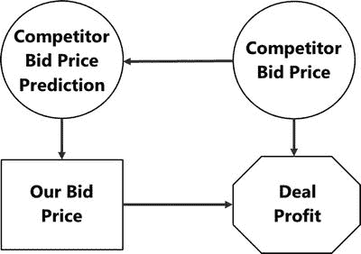

图 6-8. 定价示例的决策图

我们的投标价格决策是在利用对竞争对手投标价格预测的基础上做出的，如图中从竞争对手投标价格预测节点到我们投标价格决策节点的有向线所示。投标价格预测是一个不确定性因素，因此用圆形表示。最后，竞争对手投标价格预测以实际的竞争对手投标价格为条件，而实际的竞争对手投标价格当然也是一个不确定性因素，因此也用圆形表示。

我们只有在就自己的投标价格做出决策之后，才能知道竞争对手的实际投标价格，这就是为什么没有直接从竞争对手投标价格指向我们决策节点的有向线。如果有一条直接连接竞争对手投标价格和我们决策节点的有向线，那就相当于对竞争对手的投标价格有了完美的预见性，从而提供了完美学习的价值。但现实情况下，我们最多能做到的是对竞争对手的投标进行预测，并在决定我们的投标价格时使用该信息，如图所示。基于增强的预测能力来调整我们先前对竞争对手投标价格的不确定性，这代表了学习，因为根据定义，更新包含不确定性的概率分布就是学习。因此，我们可以将这个预测节点称为该决策情境下的`学习变量`，并且正如我们所看到的，与这个学习变量相关的学习价值是可以量化的。对传统决策图的一项增强将在后续的图（图 6-10）中展示，其中这些学习变量在图形上与其他不确定变量区分开来。

我们可以轻松地为决策模型添加更多细节。例如，如图 6-9 所示，我们可以添加与竞争对手材料成本相关的不确定变量，该变量将同时影响竞争对手的投标价格以及我们对竞争对手投标价格的预测。竞争对手材料成本预测是另一个学习变量，因为它提供的预测减少了我们对竞争对手材料成本的总体不确定性，从而有助于做出更好的竞争对手投标价格预测。

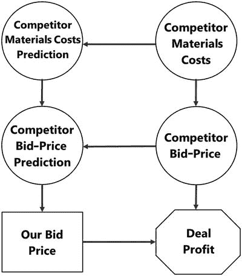

图 6-9. 定价示例的扩展决策图

正如这个简单示例所示，在任何给定的决策情境中都可能存在多个学习变量，并且它们共同——与决策模型本身相结合——代表着对决策有潜在影响的学习。正如我们之前讨论过的，确定能够减少与价值限制约束相关的不确定性的潜在解决方案（这些潜在解决方案可以在决策图中表示为学习变量），是一项有益于创造性思维的工作。

然后，我们可以在图中添加一些超越标准决策图的其他特征，这些特征有助于优化“数据-学习-行动”流程。首先，我们可以通过为表示学习变量的不确定性节点添加阴影，来明确标识图中直接代表我们学习的部分。这很有用，因为我们特别希望关注通过学习创造价值的机会，而这些节点正是代表这些机会的节点。其次，由于我们经常关注决策会重复发生的“数据-学习-行动”流程，我们希望识别可能受我们先前决策影响的不确定性。当不确定性涉及自适应主体（例如我们定价示例中的竞争对手）的行为时，通常会出现这种情况。这种识别有助于确保当我们汇总与学习变量更新相关的学习价值时，我们考虑到了这种适应性，并相应地调整学习价值的规模。我们可以简单地在这些不确定节点上应用一个星号。图 6-10 展示了这种修改后的决策图，我们可以称之为`学习价值图`。与其前身决策图一样，这个学习价值图可以根据需要通过添加额外的节点和连接轻松增强。

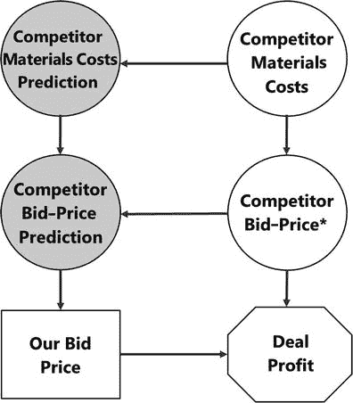

图 6-10. 学习价值图

尽管在学习价值图上没有明确显示，但在思维和/或机器中存在着支撑连接节点的有向线的模型。例如，将关于竞争对手材料成本的评估转化为投标价格预测需要一个模型。它可以是一个简单的电子表格模型，也可以是更复杂的模型。根据我们并不完美的投标价格预测来决定我们的最优投标价格也需要一个模型。这些模型与其信息输入一样，都是与“数据-学习-行动”流程相关的学习的一部分，因此也必然是学习价值方程中的一个贡献部分。

事实上，在确定学习期望值的过程中，常常会发现，根据现有信息，当前的决策并非最优。将现有信息转化为行动的决策模型可能根本不够完善。因此，或许有机会将一些基础的建模方法应用于当前决策，以确保其最优性，并在考虑额外的学习改进之前，提供一个恰当的基准。正如我们定价示例中的情况，这可能意味着应用模拟技术来确定最优出价，而不是，例如，依赖人类直觉。

显而易见，随着数据分析到学习再到行动过程的推进，学习价值图可以轻松扩展，根据需要纳入越来越精细的细节。并且，在存在共同学习变量的情况下，学习价值图能够整合那些原本相互独立的数据-学习-行动链条。将学习价值图制度化、扩展并保持其常新，对组织本身具有极高的价值。

### 替代建模视角

我们的学习价值图是一种简洁的方式来描述决策及相关学习情境，它是决策图的一种衍生形式。另一种经典的决策描述与建模方法是决策树，这是一种你可能至少有所了解的技术。在这种表示法中，待做出的决策位于左侧，树状结构向右扩展，分支由不确定变量决定，每个分支的末端都有相应的价值。每个决策选项的期望值是通过将各分支的概率与相应的终端价值相乘，然后对与每个决策选项对应的所有分支的结果进行求和来确定的。图 6-11 展示了一个可应用于我们定价决策的决策树草图。根据草图中的粗略数值，我们应该出“中等”价格，因为它提供了最大的期望值。

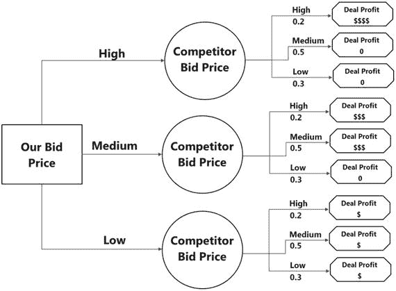

图 6-11. 定价决策树

虽然决策树始终是有效的决策建模选项，并且可用于计算期望学习价值，但在实践中它们存在一些缺点。在我们的案例中，一个明显的缺点是，我们的竞争对手和我们可能做出的潜在出价数量巨大，如果我们试图在决策树中展示所有选项，其规模将急剧膨胀。

但从根本上说，在应用决策树结构时，我们本质上使用了与之前讨论的相同技术来计算学习的期望值。我们根据当前的学习情况确定应采取的行动及其相应的期望值（即与“中等”出价相关的期望利润），然后将其与增强学习后最优决策的期望值进行比较。两者的差值就是学习的期望值，如果额外的学习有可能改变我们的决策，那么这个差值将不为零。

在决策树格式中，我们将额外学习的结果（相当于我们学习价值图中的学习变量）置于出价决策的左侧，因为我们在做出决策之前将受益于这次学习。这个过程被称为反转决策树。如果学习提供了完美的可预测性，那么在给定预测的情况下，我们可以轻松地从决策树中“择优选取”来做出决策。但即使是一位拥有完美预见力的先知，正如我们已经讨论过的，其预测也必须服从先验分布（如果先知实际上能够改变结果，而不仅仅是预测结果，那她就是巫师了，我们会请她解决问题，让我们的竞争对手总是出高价！），因此，先知有 20% 的概率会（无误地）预测竞争对手将出高价，50% 的概率预测竞争对手将出中等价格，30% 的概率预测竞争对手将出低价。

如图 6-12 所示的反转决策树中，之前我们被迫总是出中等价，而现在，当先知指出竞争对手将出高价时，我们就出高价；当先知指出竞争对手将出低价时，我们就出低价，如图中阴影部分的结果所示。因此，在这个例子中，完美的可预测性显然是有价值的，因为我们的决策可以改变。

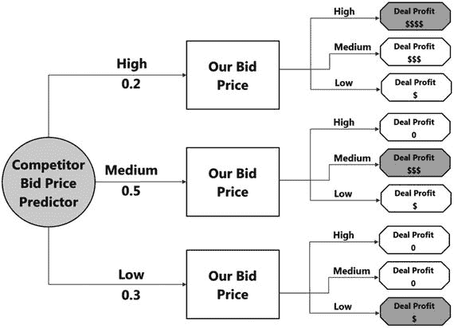

图 6-12. 反转后的定价决策树及完美可预测性

在预测精度不完美的情况下，采用类似的过程，只是当竞争对手实际会出高价时（预计有 20% 的概率），预测有时会出错。例如，当竞争对手确实会出高价时，预测器有 80% 的概率正确指出，但有 15% 的概率会错误地预测为中等价，5% 的概率会预测为低价。对于预测器预测竞争对手实际出中等价和低价的情况，也存在类似的不完美预见性。我们可以计算出所有九对这样的概率，例如，20% 乘以 80% 这对概率，表示在竞争对手确实出高价的情况下，我们的预测器指出竞争对手将出高价的概率；以及 20% 乘以 15% 这对概率，表示我们的预测器指出竞争对手将出中等价，但竞争对手实际出高价的概率。

但是，为了计算学习价值，我们真正需要知道的是预测器将指出高价、中等价和低价的概率。这可以通过从九组概率中选出与预测器指出每个竞争对手出价水平相对应的概率来实现。因此，对于“高价”的指示，它将包括 20% 乘以 80% 等于 16% 的概率，但还要加上竞争对手价格实际为中等价但预测器指出高价的情况的概率，以及竞争对手价格实际为低价但预测器指出高价的情况的概率。这个计算得出的结果是在我们做出决策之前，收到每种可能预测的概率。这被称为`预事后概率`。它代表了在预测结果出来之前，每种可能预测出现的概率。

此外，我们可以计算在给定预测器对竞争对手价格的预测下，竞争对手出价的后验概率。这些概率是通过将每个给定预测下实际竞争对手出价出现的概率除以相应的`预事后概率`来计算的。然后，我们可以反转决策树，将我们出价决策的位置移动到树中我们获得预测之后的位置（位于预测器预测的右侧）。接着，我们根据每个分支的后验概率以及每个最优决策相关的期望货币价值，计算出最优的出价决策。将这些货币价值相加，并减去没有额外（尽管不完美）学习收益的原始决策的期望值，就得到了与该预测器相关的学习期望值。这只是描述我们之前使用模拟执行的相同类型过程的另一种方式。

### 贝叶斯方法

许多读者会意识到，这种确定学习价值的方法基于`贝叶斯方法`，这是一种通用方法，用于在已知给定 y 时 x 的概率的情况下，确定给定 y 的概率时 x 的概率。在我们的案例中，我们已知预测器的预期准确度。也就是说，我们已知正确预测竞争对手出价会很高（80%）的概率，即在实际竞争对手出价很高的情况下，预测竞争对手出价很高的概率。我们需要做的是，根据预测器的指示，将该概率关系转化为每个实际竞争对手出价水平的概率。这正是`贝叶斯方法`使我们能够做到的。

`贝叶斯方法`是学习过程的基础，无论是否以决策树的方式明确计算。先验概率分布被更新为后验概率分布，而后验概率分布又随着新学习的发生而充当新的先验分布，这是我们“数据-学习-行动”通用过程的基础。

基于`贝叶斯`的技术可以应用于处理比本章简单示例更复杂的情况。例如，通常会有两个或更多不同的学习变量影响我们对不确定变量的预测。将决策编码到学习价值图中并应用`贝叶斯建模方法`的相同技术，可以处理这些以及其他可能任意复杂的情况。

在本书中，我们不遗余力地讨论学习及其在“数据-学习-行动”过程中的应用，无论是对于人类思维还是机器，因为它们既可以互补，也可以竞争各种学习应用和活动。因此，一个自然的问题是：“人类的认知和决策是否符合`贝叶斯方法`？”答案似乎是，在有限程度上是符合的，但在更高层次的认知上存在各种启发式叠加，其中一些不幸地可能会破坏纯粹`贝叶斯观点`的应用。⁴ 这就是为什么在优化企业“数据-学习-行动”过程时，通常需要采用本章介绍的结构化方法来增强人类天生的学习和决策能力。

## 总结

本章我们涵盖了不少内容；让我们回顾一些关键点：

*   尽管我们有倾向性，但不能根据结果来判断决策。只能根据决策所依据的学习质量来判断决策，而学习又依赖于决策时存在的信息状态。

*   不确定性不是事件或对象的内在属性。它是基于信息和学习的评估，无论该评估是由人类直接做出，还是通过基于计算机的模型进行。

*   与能够完美预测不确定变量的学习相关的期望值，虽然通常难以实现，但它为任何旨在更好预测不确定变量的可能解决方案的期望值提供了一个有用的上限。

*   与更典型的学习情况（即对不确定变量的预测并非完美）相关的期望值也可以计算出来。然后可以将该值与学习的预期成本进行比较。

*   `学习价值图`可以编码当前决策的相关方面，包括决策所依赖的不确定性，其中一些可能代表我们并非完美的预测能力。我们将此类不确定变量称为`学习变量`，因为它们有可能通过增强信息和学习来改进。

*   正是针对`学习变量`，我们可以量化其相关的学习价值。量化需要比较在给定当前学习状态下的默认行动价值，与在增强现有`学习变量`或应用新`学习变量`时预期会产生的价值。

*   如果与`学习变量`相关的预期学习价值大于实施该`学习变量`所代表能力的成本，那么该能力就值得实施。

*   对于相同类型的重复决策，与该能力相关的全部学习价值是每次决策相关学习价值的总和。

*   如果`学习变量`代表与适应性行为者相关的行为预测，则在求和价值时必须小心谨慎。

现在我们已经有了计算学习价值的过程，在下一章中，我们将讨论如何就替代学习机会以及学习与传统投资机会的混合组合做出决策。

脚注 1

关于决策分析的全面回顾，包括信息价值相关概念以及比本章讨论的更复杂的示例，请参见 Howard 和 Abbas 合著的《决策分析基础》，Pearson Education Ltd (2016)。

  2

[`http://lithub.com/turtles-all-the-way-down-stephen-hawkings-a-brief-history-of-time/`](http://lithub.com/turtles-all-the-way-down-stephen-hawkings-a-brief-history-of-time/)

  3

塔勒布，纳西姆·尼古拉斯。[《黑天鹅：如何应对不可预知的未来》](https://books.google.com/books%3Fid=tXiBZwEACAAJ%26dq=isbn:9780141034591)（第二版）（伦敦：企鹅出版社，2010 年）。

  4

[例如，请参见以下研究，这些研究表明在较低认知层次存在有限的贝叶斯处理：​德夫卡](http://jov.arvojournals.org/solr/searchresults.aspx%3Fauthor=Deepna+Devkar)，迪普娜，[安东尼·A.​赖特](http://jov.arvojournals.org/solr/searchresults.aspx%3Fauthor=Anthony+A.+Wright)，以及[魏吉马](http://jov.arvojournals.org/solr/searchresults.aspx%3Fauthor=Wei+Ji+Ma)，“猴子和人类在定位变化时会考虑局部不确定性”，《视觉杂志》17（2017 年 9 月）：4。doi:[10.​1167/​17.​11.​4](https://doi.org/10.1167/17.11.4)