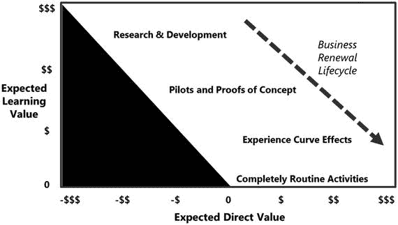
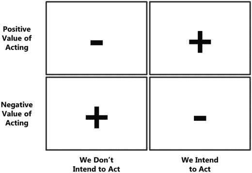
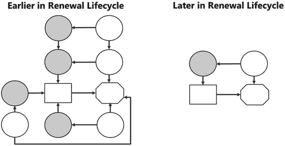
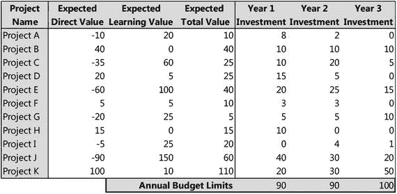
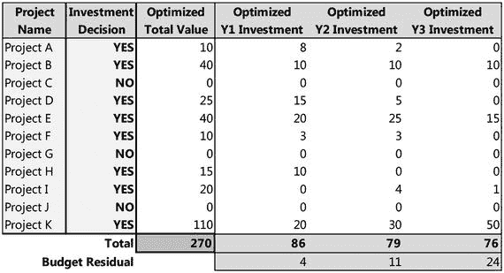

# 7. 总价值

在上一章中，我们回顾了如何量化在“数据-学习-行动”过程中影响决策的学习的期望价值。本章将介绍总价值的概念，它包含了学习价值，并描述了如何通过优化组织投资机会组合的预期总价值，来优化组织的长期绩效。

## 总价值

诸如建造新工厂或招聘人员之类的项目和活动，都是预期能为组织创造价值的投资。这种预期价值最终取决于投资预期产生的净现金流。这些未来现金流通常存在不确定性，因此必须针对这种不确定性进行适当调整，故称之为现金流的预期价值。该预期价值可通过将现金流（或现金流的组成部分）乘以其发生的概率来计算。

这些预期净现金流的现值（按组织的资本成本折现）可称为项目或活动的预期直接价值。这是使用标准经济模型为潜在投资计算出的价值，这些模型嵌入在典型组织的众多电子表格模型中。这些对潜在投资预期价值的计算，为是否投资每个机会的决策提供支持，并可用于对投资机会组合的相对吸引力进行排序。

这些标准类型的投资机会与我们迄今为止讨论的投资（即旨在降低不确定性的学习投资）有所不同。相比之下，在标准投资模型中，这些不确定性通常被视为既定事实。这些给定的不确定性会（或至少应该）反映在计算项目或活动预期直接价值时所应用的概率中。如果经过概率调整后的现金流净现值为负，则不应开展该项目或活动。那些可能改变这些概率，从而使决策可能不同于当前默认的“不追求该机会”（即预期直接价值变为正值）的学习，当然具有价值，这就是我们在上一章讨论的预期学习价值。换句话说，在学习发生且相关概率更新后，这些更新后的概率就会被计算预期直接价值的标准投资模型视为既定事实。从某种意义上说，预期学习价值在学习发生后会转化为预期直接价值。

可行动的学习是指有可能改变当前默认决策的学习，因此具有价值；即预期学习价值。这种预期学习价值在学习发生后会转化为预期直接价值。

再次强调，关键的一点是，由于这种学习的价值可以通过严格的方式量化（如上一章所述），因此对改进且可行动的学习的投资，其价值与为标准类型投资计算出的价值一样真实。重要的是，这意味着学习的价值可以合法地与其它投资机会的价值进行“苹果对苹果”的比较。

一些项目和活动同时具有预期学习价值和预期直接价值（除了我们归入直接价值类别的学习投资本身之外）。这是因为项目中可能嵌入了学习，即使当前项目本身的主要决策是预先确定的，这些学习也可能影响后续决策。例如，如果招聘了持有某种大学学位但学历背景与以往招聘人员不同的人，那么这次招聘将产生一个预期直接价值，该价值可能与以往招聘人员的价值相似，但由于存在招聘效果不如以往招聘标准的风险，可能会略低一些。但同时也会产生预期学习价值，因为这位非传统招聘人员的学历差异将提供可能影响后续招聘决策的新信息。例如，这可能是因为向这位实验性招聘人员提供的薪资可能因其持有的学位而略低，因此如果该人员的长期表现与以往招聘人员一样好，那么组织将创造价值，因为后续的招聘决策将受到相应影响。

顺便提一下，这个具体例子代表了价值创造的常见路径，无论是在证券市场还是为企业采购资产——即收购那些在某种程度上被整个市场低估的资产。识别此类被低估的资产需要学习市场中的其他人（或至少大多数人）所不具备的知识，而这种可行动的学习当然是有价值的。

这个基于人力资源的例子也说明了一个事实：许多项目和活动可以包含本质上被视为嵌入式实验的内容，而这些实验可以具有可量化的学习价值。事实上，通常应鼓励这类嵌入式实验，并将其精心设计到项目和活动中，而量化这些预期嵌入式实验的预期学习价值的能力，为证明那些预期具有最大价值杠杆作用的实验提供了依据。

由于我们对预期直接价值和预期学习价值进行了“苹果对苹果”的价值量化，我们不仅可以比较各自的价值，还可以合法地将它们结合起来。一个项目或活动的预期直接价值与预期学习价值之和，构成了该项目或活动的预期总价值。对于给定的项目或活动，预期直接价值和预期学习价值的组合可以从预期学习价值可忽略不计的极端情况，到预期学习价值几乎构成预期总价值全部的另一极端情况。因此，预期总价值代表了一个项目或活动的真实、完整的价值，因此应被用于对组织所有潜在项目和活动做出投资决策。与当前大多数实践相比，这是一个重大且更好的改变！

```
预期总价值 = 预期直接价值 + 预期学习价值
```

## 业务更新生命周期

项目与活动的预期直接价值与预期学习价值的相对组合，往往会随着其在组织更新生命周期中所处位置的变化而变化。业务更新是指组织中所有与开发新工作方式、新业务方法、新市场、新产品和服务，以及淘汰旧方法、旧市场、旧产品等相关的项目、流程和活动。换言之，它涵盖了与持续适应当前及预期环境相关的所有项目和活动。简而言之，就是更新业务，如同你身体中的细胞不断更新一样。它包含了除常规业务活动之外的一切，因此有效的业务更新是实现可持续卓越业务绩效的关键。你无疑已经预料到，其核心要点在于：业务更新本质上就是学习。

组织中的业务更新相关项目与活动遵循一个独特的生命周期，如图 7-1 所示。该图的横轴代表预期直接价值，纵轴代表预期学习价值。在这两种情况下，这些价值均以预期现金流的现值来衡量。预期直接价值可能为负，而预期学习价值只能为零或正数。这是因为信息及相关的学习不会破坏价值（假设学习过程是有效的），并且我们将所有类型的投资（包括那些直接或作为副产品产生学习的投资）都归入预期直接价值类别。



图 7-1. 业务更新生命周期

图中阴影部分代表预期总价值为负的项目和活动；也就是说，相关的预期学习价值不足以弥补预期的负直接价值（其中可能包括学习的预期成本）。当然，这些是不应开展的项目和活动。或者，如果它们正在进行中，是因为最初预期总价值为正，但现在展望未来，预期总价值为负，那么就应该停止（沉没成本就是沉没成本！）。

业务更新生命周期始于那些主要关乎学习的项目和活动，因此预期学习价值是主导价值。我们之前讨论过，对于所有价值均为学习价值的活动，我们通常使用的标签是：实验。而在组织中，由执行实验主导的活动所构成的职能，其通用的商业术语是研发，它位于图 7-1 的左上角。我们常常自动将研发与新产品的方向联系起来，但研发可以应用于任何职能或流程领域。例如，之前讨论过的关于招聘不符合典型特征和资历背景的员工这一概念的研究，就是基于人力资源的研发案例。通常，对于本质上是研发的活动，除了学习价值之外，并不期望产生其他价值——“预期直接价值”仅仅是资助研发所需的投资，因此预期直接价值为负。所以，在更新生命周期的这个初始阶段，预期总价值就是学习的预期净值。但这个预期总价值仍然必须为正！

业务更新生命周期的轨迹是从图 7-1 的左上角到右下角，随着学习的完成和生命周期的推进，预期学习价值转化为正的预期直接价值，其在总价值中所占的比例自然会越来越小。沿着业务更新生命周期，在研发之后的是试点、演示和概念验证（我将其统称为“试点”）。这些类型的举措通常基于早期研发活动的结果，这些研发活动通过相关学习降低了对潜在新方法的不确定性，但在完全投入实施新方法之前，仍有一些残余不确定性需要解决。试点是一种方式，可以潜在地充分降低这种残余不确定性，从而能够决定是否继续更大规模地实施新方法；或者，试点也可能揭示出不可预见的问题，如果继续更大规模地实施新方法，这些问题将会破坏价值。

在某些情况下，试点除了具有预期学习价值外，还可能具有正的预期直接价值。换句话说，试点（特别是如果事先假定它很可能成功）可能具有正的预期直接价值。在这种情况下，试点的宝贵预期学习价值将在于揭示任何潜在的“致命问题”，这些问题会改变继续扩大规模实施的默认决策。相比之下，如果试点，比如说，是最终生产流程的一个比例模型，在测试完成后将被销毁，那么该试点将具有负的直接价值。

我们的人力资源案例可以包含一个试点阶段。假设该组织传统上一直招聘计算机科学专业的毕业生，但最初进行的研发（包括调查和分析其他组织的招聘实践）表明，某些人文学科专业，特别是哲学专业，在长期工作表现方面与计算机科学专业相比毫不逊色。研究进一步表明，这类专业的候选人可以以更低的成本获得，因为他们目前对软件相关工作的需求较低。招聘几名哲学专业毕业生就是一个试点案例，假设这些受雇员工预计至少能提供超过其相关薪资和福利的价值水平，那么该试点除了具有预期学习价值外，还具有正的预期直接价值。

在这个人力资源案例中，研发与试点之间的关系是一种常见情况：通过初始的、相对成本较低的行动（例如调查和分析）降低了不确定性，但仍有显著的残余不确定性，这促使尝试通过应用其他通常成本更高的行动来进一步降低不确定性。鉴于初始研发后的残余不确定性，与其完全承诺，比如说，招聘几十名哲学专业毕业生，不如采取另一项行动，即进行试点，期望能进一步降低不确定性，同时比直接跳到全面承诺所承担的价值风险更小。

这种逐步降低不确定性的序列构成了实验设计的范例，无论是否被正式认定为如此，整个更新生命周期都可以被视为遵循实验设计的轨迹。随着我们在更新生命周期中推进，存在一个自然的决策序列：在生命周期早期，不确定性被降低但未被消除，随后在每个后续阶段，不确定性被进一步降低，但同样未被完全消除。例如，在研发阶段获得的学习成果，能够为是否开展试点项目提供更明智的决策依据；而在试点阶段获得的学习成果，则能为是否推进全面实施提供更明智的决策依据。

从本质上讲，更新生命周期每个阶段所发生的是：通过学习来减少相当于后续阶段中的假阳性与假阴性，或者你在统计学课程中可能记得的 **I 类错误**和 **II 类错误**，如图 7-2 所示。



**图 7-2. 行动意图矩阵**

在业务更新中，假阳性或 `I 类错误`的等价情况是：我们本应在生命周期的下一阶段采取某项行动（即采取行动是默认决策），但实际上不应该采取，因此该行动产生负价值（图 7-2 的右下象限）。而假阴性或 `II 类错误`的等价情况是：我们本不打算在生命周期的下一阶段采取某项行动（即不采取行动是默认决策），但实际上应该采取，这导致了机会损失，从而产生负价值（图 7-2 的左上象限）。虽然我们通常不会用这些与实验设计相关的术语来思考基于更新的流程和活动，但这实际上完全是同一个概念，只是在整体更新生命周期的背景下被放大了。

沿着更新生命周期推进，试点阶段之后的更新阶段由那些存在经验曲线效应的项目、流程和活动组成。这些是完全的生产活动，但可付诸行动的学习仍在继续。预期的直接价值主导着这些活动的总价值，但也存在一些预期的学习价值。这些构成了大多数企业项目和活动的主体。

正如“经验曲线”这个术语所暗示的，这些领域的学习价值往往会导致基于经验的改进，而非全新的方向。在经典的经验曲线概念中，效率随着产品累计产量的增加而提高。¹ 当然，更广泛地说，经验曲线概念通常也适用于服务和流程，以及产品生产。

与其他管理相关概念一样，我们优化的“数据-学习-行动”方法以及更稳健的学习视角，为经典的经验曲线概念提供了基础性的见解。基于经验的改进显然是持续学习的结果，这种学习影响着整体活动中的子决策。例如，在通过更新生命周期的研发和试点阶段后，可能会决定继续推进并将新产品推向市场。然而，该产品有众多来自不同供应商的独立部件。即使在这些产品生产和销售之后，仍会有无数与具体使用的部件以及所选供应商相关的持续决策，而能够改进这些子决策的可付诸行动的学习将产生价值。同样，关于具体制造技术（如自动化选项、营销方法等）的持续子决策也必然存在，而可能改变这些决策的可付诸行动的学习将具有切实的价值。经验曲线的积极经济效应，实际上正是源于经验的可付诸行动的学习所带来的效应。

鉴于这些基于经验效应的流程和活动构成了大多数组织流程和活动的主体，因此存在显著的学习价值上升空间。不幸的是，从历史上看，这种上升空间往往未被充分认识。在正式指定的研发组织内的活动中，很自然地会思考还能从哪些方面进行有益的学习。但在企业中更成熟的生产领域，“自动驾驶”模式可能被开启，从而导致学习机会被错过。即使在成熟的流程中，开展微型研发和试点活动也几乎总是有价值的。

再次强调，我们的人力资源场景就是这样一个嵌入式试点的例子，其目标是获得可付诸行动的学习。招聘对于大多数组织来说是一个成熟的流程。在我们的例子中，一直招聘计算机科学专业的学生。这种情况可能已经持续多年。但在这个成熟流程中，通过招聘一两位哲学专业的学生来运行一个微型试点，可以从相关的学习中获得洞察，这些洞察有可能带来显著的价值。

即使在成熟流程中，也要有意识地设计学习机会，这是创造商业价值的重要机遇。

除了“自动驾驶”心态之外，在那些未被明确认定为研发的领域之外，有意识的学习机会通常执行不足的另一个原因是残酷的现实：如果一项活动的预期价值无法被可信地量化，它很可能难以获得批准。或者，即使最初获得批准，也可能难以维持下去。当然，本书旨在帮助解决这个问题！

在图 7-1 所描绘的更新生命周期的末端，是完全常规的流程和活动。这些流程几乎不存在会影响子决策结果的不确定性。这类决策基本上可以以自动化方式运行。如果这些机械流程中涉及人员，那么取决于你的视角，流行语“机器人来了”所呈现的机会或威胁，将是不可避免的。

然而，任何流程都很难完全免疫不确定性，因此我们不应草率地将某个流程归入“无学习区”。例如，虽然常规流程当前的运营决策可能被认为从额外学习中获益甚微，但关于流程本身整体方向的决策可能仍在持续进行。换言之，即使成熟流程的“如何执行”已完全常规化，关于流程的“做什么”和“为什么做”仍可能存在决策和宝贵的持续学习空间。

回顾上一章，我们可以使用学习价值图来模拟与决策相关的不确定性及关联学习变量。图 7-3 以概念性学习价值图的形式，展示了更新生命周期中的不同阶段。在生命周期早期，学习价值图会包含更多与不确定性（非阴影圆圈）相关联的学习变量（图 7-3 中的阴影圆圈）。到了生命周期后期，不确定性和学习变量会减少，但极少会完全消失。



**图 7-3. 业务更新生命周期不同阶段的概念性学习价值图对比**

无论处于更新生命周期的哪个阶段，关于是否采取行动以减少剩余不确定性的问题始终如一：“学习可能减少不确定性并因此影响当前默认决策的预期价值，是否超过学习成本？”或者换种说法：“该行动的预期净现值总价值是否为正？”

## 优化总价值

一个组织会拥有许多跨越更新生命周期的不同投资机会。其中一些机会的价值主要归因于可行动的学习，而另一些则几乎全部是预期直接价值，当然也存在介于两者之间的情况。幸运的是，将预期学习价值量化为预期总价值的一个组成部分，使得预期总价值能够成为组织内任何潜在投资机会的一致价值仲裁者。如果某个投资机会的预期净现值总价值为正，那么就应该抓住这个机会。所有实际工作在于可信地量化该机会的预期学习价值和预期直接价值。一旦完成，决策是否推进就变得非常直接。

如果某个投资机会的预期总价值为正，就应该抓住这个机会。

然而，必须认识到，考虑到预算限制的现实，决策并不总是如此直接。也就是说，预算约束可能迫使组织对预期总价值为正的机会进行分诊，以使其符合预算范围——这些机会如果被推进，理论上都应能创造股东价值。这很遗憾，但预算管理不会消失，因此我们至少需要基于预期总价值进行优先级排序，从而尽力而为。

执行此类机会优先级排序的一种近似方法是应用众所周知的投资回报率（ROI）概念，即用机会的预期价值除以获取该价值所需的投资。然后按 ROI 对机会进行排序，并累计选择，直到预算耗尽。在我们的案例中，我们只需使用预期总价值，从而得到一个预期总价值投资回报率（`TROI`），作为机会优先级排序和选择的工具。

但这种方法仅能近似优化机会组合以符合预算约束，尤其对于投资机会及关联预算限制跨越多年度的现实情况，会带来显著问题。通过建立一个简单的机会组合优化模型，可以更精确地处理现实中的投资和预算情况——该模型可通过基本的电子表格优化器轻松设置和执行。

图 7-4 概念性地展示了一系列项目的投资机会组合。图中显示了每个项目的预期直接价值和预期学习价值，以及它们的总和——预期总价值。每个项目在三年内都有投资需求概况，并且每一年都有投资预算限制。



**图 7-4. 示例项目组合与预算限制**

图 7-5 展示了在机会组合经过优化以最大化预期总价值、同时遵守年度预算限制后的单个项目投资决策，并显示了每年的相关预算剩余。



**图 7-5. 给定预算约束下的最优项目决策**

此类建模方法的变体能够确保在预算管理不可避免造成经济扭曲的情况下，组织实现最佳资本配置。而未能量化学习价值则会导致更严重的经济扭曲。近似正确优于精确错误——在投资组合优化中忽视学习价值（正如当前常见的情况）正是精确错误的典型例子！

## 回顾性价值

我通常很谨慎，甚至可能到了有些别扭的程度，坚持在提及学习价值、直接价值和总价值时使用“预期”一词，以确保这些概念被理解为前瞻性的。因此，对于预期学习价值，其价值是指我们如果进行学习所预期能获得的收益。但是，如果我们想在学习已经完成、学习结果已经产生之后，回顾性地确定学习的价值，又该如何呢？

计算回顾性学习价值是一项有价值的练习，它有助于你理解学习所交付的价值，并作为一种有效的方式向他人传达这种对价值的理解。这种对学习的回顾性量化，可以通过再次遵循决策分析的那条格言来执行：学习只有在能够改变决策时才具有价值。在回顾性案例中，我们不再像预期学习价值那样，面临决策的潜在改变。回顾来看，学习要么是可执行的，要么是不可执行的；也就是说，它要么导致了行动的改变（而这些行动在没有学习收益的情况下本不会发生），要么没有。

因此，要回顾性地确定学习的价值，我们首先要确定哪些行动已经改变，或者必将改变，这是由于已经发生的学习所导致的。然后，我们将这些新行动的价值，与如果没有发生学习本会采取的行动的价值进行比较。通常，量化学习的回顾性价值比量化预期学习价值的过程更简单，因为我们无需担心概率分布等问题。但这确实需要诚实地评估，哪些决策真正基于学习而发生了改变，而如果之前已经对学习价值进行了前瞻性建模，这一点会更有保障。当然，我们也不应该仅仅从这种回顾性学习价值中推断出该学习主题的持续价值，而不进行适当的前瞻性分析。

然而，在计算学习的回顾性价值时，一个主要的注意事项是要牢记决策分析的另一条格言：决策的正确性不能根据其结果来评估。好的决策可能导致坏的结果，反之亦然。不确定性总会发生。不过，平均而言，在足够多的个体学习机会中，我们得到的结果应该与最初的预期相当一致。如果不是这样，我们就需要学习——我们需要审视是我们的预期出了问题，还是我们只是非常倒霉（当然，运气也可能朝另一个方向发展，但那时通常很少有人会质疑！）。

传统上，学习的预期价值并未被量化，而量化这一价值是本书的核心焦点，因为正如我所论证的，未能量化这一价值是业务绩效不佳的根本原因。然而，在大多数组织中，学习的回顾性价值也好不到哪里去，至少在任何严格的形式上是如此。因此，组织很少能从财务角度理解学习所交付的价值。不幸的是，管理学的一条基本法则是：管理层不理解的东西，不可避免地会被缩小，以便减少需要理解的内容。因此，在许多组织中，学习长期被低估且资金不足。无论是前瞻性地还是回顾性地量化学习，都是摆脱这种管理陷阱的出路。

## 总结

总结本章，我们讨论了预期总价值的概念，它由预期直接价值和预期学习价值组成。预期学习价值可以从占预期总价值的全部（在实验和研发的情况下）到占非常常规项目和活动的总价值中微不足道的一部分。我们回顾了业务更新生命周期的概念，在该周期中，项目、流程和活动自然地遵循一条轨迹：从学习价值构成总价值的主体，到学习价值成为整体价值中占比小得多的部分。应追求预期总价值为正的投资机会。如果存在预算约束，以至于必须对预期总价值为正的机会进行优先级排序，则可以应用一个优化模型，该模型在预算约束下最大化机会组合的总价值。我们还讨论了学习价值可以前瞻性地和回顾性地计算，并且这两种量化方式在确保对学习进行并维持最优投资方面都发挥着重要作用。

脚注 1

Ghemawat, P., “Building Strategy on the Experience Curve”, *Harvard Business Review*, 1985 年 3–4 月。