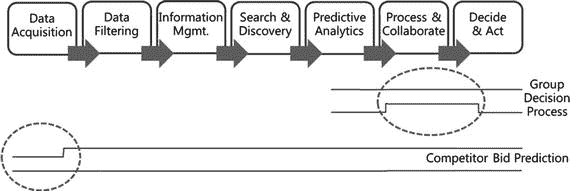
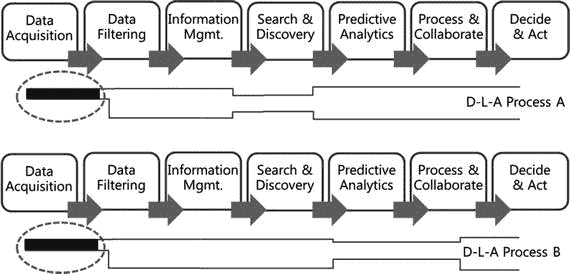
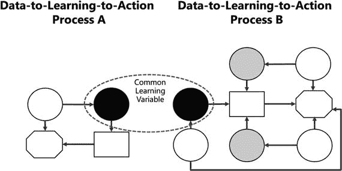
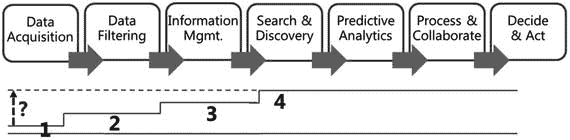
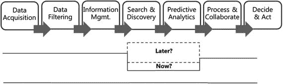
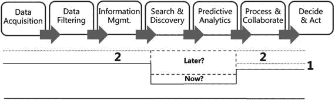
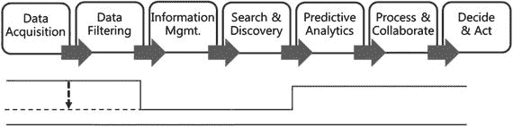

# 8. 优化学习吞吐量

我们现在已经涵盖了优化从数据到学习再到行动流程所需的基本概念，但在我们的方法完善之前，还有一些事情需要考虑。在转向这些收尾工作之前，让我们先回顾一下我们已经涵盖的内容：

*   我们回顾了从数据到学习再到行动的流程及其在组织中应用的主要元素：数据采集、数据过滤、信息管理、搜索与发现、预测分析、流程与协作、决策与行动。我们还简要讨论了常见的企业技术如何映射到这些元素链上。
*   我们讨论了如何从价值驱动因素逆向推导至相关的主要决策，以确定对价值具有最高杠杆作用的学习增强机会。然后，我们介绍了如何沿着从数据到学习再到行动的链条，从每个主要决策逆向推导，以识别学习的限制性约束，解决这些约束将能交付价值。
*   我们回顾了如何用财务术语量化在数据到学习再到行动流程中完全或部分解决学习约束的预期价值，以及如何通常使用学习价值图对学习增强机会进行建模。
*   我们还强调了一个事实，即由于我们对预期学习价值的量化与其他任何投资机会的量化一样严谨，因此这个预期学习价值可以直接与任何其他此类机会的计算价值进行比较，并且可以相加。因此，预期总价值（对于任何给定的投资机会，它可以部分或全部由预期学习价值构成）是优化组织投资机会组合的恰当指标。

有了这些概念，我们就拥有了基本工具，能够优化从数据到学习再到行动的流程，对这些优化机会进行优先级排序，并有效地相对于所有其他投资机会进行优先级排序。

## 附加策略

然而，在实践中，我们需要能够处理优化“数据-学习-行动”流程的一些额外方面，这些方面我们尚未涉及或仅简要提及，具体如下：

*   确定何时并行或串行地处理那些位于单个“数据-学习-行动”链内部，或跨越多个“数据-学习-行动”链的学习约束
*   识别跨多个“数据-学习-行动”链的学习协同效应，并在其成为重要因素时，核算由此产生的价值
*   在考虑当前限制性约束的解决方案时，前瞻性地关注下一个限制性约束
*   在考虑学习约束的解决方案时，预判超出当前可用能力的能力需求
*   识别那些不应解除学习约束的瓶颈，而应合理化“数据-学习-行动”链中其他部分过剩能力的情况

这些附加策略特别侧重于优化学习吞吐量——更具体地说，是优化可付诸行动的学习吞吐量。

### 并行与串行瓶颈解除

关于是并行还是串行地处理学习约束的问题，既出现在特定的“数据-学习-行动”流程内部，也出现在跨“数据-学习-行动”流程之间。

我们先从一个“数据-学习-行动”流程内部并行解除瓶颈的例子开始，然后从该情况中归纳出一般规律。正如我们强调过的，在沿着“数据-学习-行动”链的单一学习流中，通常只专注于解决限制性约束是有意义的，因为在该学习流的任何其他地方增加容量都不会带来价值——如果限制性约束没有得到一定程度的解决，增加的容量将毫无用处。

但是，我们在前面的章节（从第 5 章开始）讨论过一个案例，该案例说明了在“数据-学习-行动”链内部并行处理学习约束是有意义的。在那个案例中，我们从定价决策出发，沿着“数据-学习-行动”链逆向工作。我们发现，在“数据-学习-行动”链的“处理与协作”阶段，一些本应赢得的交易却丢失了，这是因为达成决策共识所需的时间过长。这是决策各方试图通过电子邮件来回沟通以达成共识时，过程笨拙所导致的结果。这种学习约束（在此案例中，是决策各方集体学习过程中的一个约束）可以以概率形式体现，即本应提交的投标实际上未被提交的概率。

我们发现，这种因群体决策过程崩溃而导致决策失败的概率，与各方在尝试做出决策时所考虑的输入信息无关。也就是说，无论上游要素的输入是什么，未能按时提交投标的概率都是相同的，因此未能有效提交投标的概率与输入的具体性质无关。因此，这个限制性约束仅仅是“处理与协作”要素本身内部运作的函数，可能受到诸如所用技术（例如，标准电子邮件）、参与者出差强度等因素的影响。

显然，降低这个概率是有价值的，这相当于至少部分地解决了这个价值瓶颈。这是我们为这个“数据-学习-行动”流程发现的第一个学习约束，并且它特定于“处理与协作”要素（与“决策与行动”要素有部分重叠）。但我们也发现，交易丢失是因为目前对竞争对手将如何投标的理解有限。当我们沿着“数据-学习-行动”链逆向工作时，我们发现，缺乏对竞争对手解决方案中材料成本的了解，是需要解决的限制性学习约束，以减少竞争对手如何投标的不确定性。因此，这是与投标定价相关的“数据-学习-行动”流程的第二个学习约束，并且它对我们的投标决策的影响独立于第一个约束。图 8-1 说明了这种具体情况，该图概念性地展示了沿“数据-学习-行动”链的学习流吞吐量水平，通过代表每个单独学习流的线对之间的分离程度来表示，包括吞吐量瓶颈点（线对之间分离程度的缩小）。在我们具体的投标定价示例中，存在两个并行的学习流，每个流中独立的限制性约束由虚线圆圈表示。

图 8-1. 数据到学习再到行动过程中的学习约束

那么，我们应该着手解决哪些约束呢？如果存在能够缓解各项约束的方案，且其收益超过成本（即预期总价值为正），并且所需的资源也具备，那么就应该同时推进这两个学习瓶颈的解除，但需注意下一段中的告诫。否则，如果投资资源有限，则可以在优化机会组合预期总价值的背景下对这些机会进行比较，正如第 7 章所讨论的那样。

这里需要注意一个微妙之处：即使学习流及其相关的限制性约束被认为是独立的（如本例所示），解除这些约束所产生的价值可能存在依赖性，这一点必须加以考虑。通过对本例进行思想实验，可以很容易地看出这种情况。具体来说，假设与竞争对手出价预测相关的限制性约束得到解除，使得竞争对手的出价变得完全可预测。正如我们在第 6 章中讨论的，我们只需以略低于预测的竞争对手出价进行投标，就能在每次投标中获利。这意味着，解除群体决策过程的约束将变得更有价值，因为每一次未提交的投标都必然构成一笔放弃的利润，而最初在某些投标实例中，这并不重要，因为我们无论如何都会输掉投标。换句话说，一个未有效提交的投标原本有可能赢得交易并因此产生价值，现在这种可能性变成了确定性，而之前则不然。因此，在预期其他独立约束得到解除的情况下，检查解除数据到学习再到行动链中每个独立约束的预期总价值是很有用的。

对于数据到学习再到行动过程中相互独立（或在实际操作中足够接近独立）的学习流所关联的学习约束，如果资源允许，并且每个约束都有预期总价值为正的解决方案，那么通常没有理由不并行推进这些学习约束的瓶颈解除。然而，在单个数据到学习再到行动链中，即使对于独立的学习流，也可能存在价值依赖性，这也应予以考虑。

是否要解除跨数据到学习再到行动过程的约束，本质上也是一个资源可用性及资源竞争的问题，并且在概念上更为简单。从实践角度来看，资源最终总是会受到一定程度的限制。这正是价值驱动方法发挥作用的地方，它本质上是对机会进行分诊，有助于识别并随后深入探究最具杠杆效应的数据到学习再到行动过程及其相关约束。

因此，总的来说，如果必要的资源可用，并行优化多个数据到学习再到行动过程是合理的。如果资源变得紧张，那么基于预期总价值做出优先级决策总是恰当的。还应该记住，识别出一个学习约束，并不意味着存在一种经济有效的方法来解决这个约束，至少在短期内是如此。因此，一个组织可能有许多已识别的约束需要被“搁置”，转而优先处理那些在短期内可以经济有效地解决的其他学习约束。随着技术的进步，持续关注那些被搁置的项目非常重要；我们将在本章后面进一步讨论这一点。

### 学习协同效应

有时，降低不确定性可以为多个数据到学习再到行动过程带来学习价值。在这种情况下，一个能够降低不确定性的学习去约束方案，应将其所贡献的增值计入所有与该不确定性降低相关的数据到学习再到行动过程。由于这种学习去约束可能带来的价值放大效应，至少对多个数据到学习再到行动过程中的学习流进行初步建模是有益的，这样就不会遗漏跨数据到学习再到行动过程的学习协同效应。

图 8-2 展示了一个适用于两个独立数据到学习再到行动过程（过程 A 和过程 B）的常见学习约束，该约束出现在两个过程的“数据采集”环节。解除此约束的价值，等于为数据到学习再到行动过程 A 解除约束的价值，加上为数据到学习再到行动过程 B 解除约束的价值。当然，这些价值可能并不相同——不确定性的降低在一个数据到学习再到行动过程中可能比在另一个过程中具有更高的价值杠杆。此外，也可能出现这样的情况：单独看每个价值都不足以使收益超过降低不确定性的成本，但两者加在一起却可以（即跨链的预期总价值之和为正）。这种经济现实正是识别学习协同效应如此重要——并且要尽早识别——的原因。

图 8-2. 跨多个数据到学习再到行动过程的常见学习约束

跨数据到学习再到行动过程的学习协同效应的识别，也可以在图 8-3 的学习价值图中以另一种形式说明。协同效应是通过识别原本不同的学习价值图中的共同学习变量（本例中用黑色圆圈表示）来确定的。这代表了持续使用学习价值图来建模数据到学习再到行动过程的另一个优势——它使得识别跨链的学习协同效应变得容易。

图 8-3. 跨数据到学习再到行动过程的共同学习变量

正如我们在前几章中讨论的，许多技术以及基于人力资源的能力（如`技能组合`）将适用于组织中的多个`数据到学习再到行动`过程。如果没有充分理解`学习协同价值`，就不太可能对这些技术和人力资源进行最优投资。因此，再次强调，应在`学习改进过程`的早期就寻求`学习协同效应`的机会。例如，在开发高层次`学习价值图`时，应识别出共同的`学习变量`。

## 约束前瞻

由于在“`数据-学习-行动`”流程中，提升除`限制性约束`之外任何其他环节的`可行动学习`能力，都不会增加`可行动学习`的吞吐量，因此对`学习约束`的关注必然要聚焦于`限制性约束`。然而，在`限制性约束`得到解决后，前瞻流程中后续可能出现的瓶颈序列，往往能带来诸多好处。例如，这可能是因为在“`数据-学习-行动`”流程中，需要解决不止一个约束才能产生正的`预期总价值`。这也可能是出于`学习能力`的粒度或“分块”考量。

例如，在图 8-4 中，我们沿着一条“`数据-学习-行动`”链有四种不同的`学习能力`，其中围绕`数据采集`元素（标记为 1）的链段是`限制性约束`。通常，我们会考虑将该约束解决到与下一个`限制性约束`（此处标记为 2，位于`数据过滤`元素）的能力水平相匹配的程度。然而，如果整个流程仍被限制在能力水平 2，那么着手解决约束 1 可能价值不足。但是，如果我们能够达到，例如，能力水平 3 或 4，则可能产生正的`预期总价值`。在这种情况下，我们需要比较将能力提升到水平 3 和水平 4 的`预期总价值`（即，增加`学习能力`所带来的`预期学习价值`减去相关成本），然后选择`预期总价值`最高的方案。

图 8-4.`学习约束前瞻`

或者，`学习能力`的增量可能以离散的数量或“块”的形式出现，而不仅仅是简单地从`学习能力`水平 1 提升到水平 2。此外，由于这种分块特性，如果在`数据过滤`元素处维持约束水平 2，甚至如果在`信息管理`元素处维持约束水平 3，那么升级`数据采集`元素的能力可能成本效益不高。因此，我们需要审视解决约束 2（甚至可能包括约束 3）的成本，并确定由此带来的“`数据-学习-行动`”流程的整体升级是否具有正的`预期总价值`。当然，在链条的这些其他环节，升级能力时也可能存在分块考量。所以，情况显然会变得复杂。

幸运的是，我们可以处理任意复杂程度的约束前瞻问题，即使再加上与`学习协同效应`相关的另一层复杂性，也能通过类似于第 7 章所阐述的`预期总价值优化`方法来应对。在任何此类情况下，我们本质上都是要找到符合预算和/或资源约束的最优“打包”方案。真正的工作在于为每个方案计算`预期总价值`——一旦完成，优化部分就变得直接了当。在优化步骤上无需走捷径——让那些计算周期发挥作用吧！

## 预期能力

在解决流程约束的经典应用中，例如制造业环境，一旦确定了真正的`限制性约束`（再次强调，这通常可能非常不直观），找到放松该约束的解决方案通常是直接的（尽管实施起来可能成本效益不够高）；例如，在`限制性约束`处增加一台机器，与现有的类似机器并行运行。

然而，对于我们更通用的解决`可行动学习约束`的情况，特别是考虑到技术的快速进步，我们需要始终留意那些随着时间的推移有望出现的新能力的范围（企业架构师角色在这方面可以做出重要贡献）。这就是为什么持续关注解决那些我们之前在本章讨论过的“暂时搁置”的`学习约束`的机会非常重要。而且，不仅仅是技术方面，未来可预期获得的能力与当前可用于解决`学习约束`的能力相比，其相对能力可能会发生重大转变；例如，提高`学习能力`所需的某种技能可能只有在未来某个时候才能获得。

最一般地说，在解决“`数据-学习-行动`”瓶颈时，关于`预期能力`的问题可以归结为：是等待能力得到改进和/或成本降低，还是立即利用现有能力行动，同时还要考虑与“`数据-学习-行动`”链中其他元素的依赖关系。换句话说，这实际上是我们刚刚在上一节讨论的基本前瞻问题上的另一层考量。

如何处理`预期能力`，答案通常取决于能力的粒度及其兼容性。换句话说，`预期能力`是建立在已实现能力的基础之上吗？还是新能力本质上会取代近期能力？如果新能力会使现有能力过时，那么可行地实施这些`预期能力`的预期时机是什么？如果与现有能力能够平滑兼容，我们已涵盖的方法可以轻松处理这种情况，因为合理的做法是，先推进那些在短期内具有正`预期总价值`的能力，然后一旦可用，就立即添加那些能带来额外`预期总价值`的能力（假设链条其他部分没有约束会限制新增能力所交付的价值）。

然而，在新能力会使近期能力过时的情况下，我们需要考虑是等待新能力，还是立即投资于当前更有限的解决方案来解决`学习约束`，如图 8-5 所示。

图 8-5.选择立即实施`学习去瓶颈`方案，还是稍后实施更强大的方案

确定该问题的答案，再次涉及对两种情景进行建模，并选择`预期总价值`最高的选项。每种情景都可能存在分块问题和协同效应需要考虑，这意味着可能需要考虑许多子情景。例如，在图 8-5 所示的情景中，由标记为“Later?”的容量增加所指定的未来解决方案，所提供的`学习能力`超出了链条当前约束下，`数据到学习再到行动`流程其余部分能够有效利用的范围。因此，应评估那些包含提升链条其他元素容量的子情景，这些提升将使所考虑的未来解决方案能够增加价值，而不仅仅是解决当前`限制性约束`所带来的价值。

例如，如图 8-6 所示，可能存在一个标记为 1 的子情景：在将未来解决方案（标记为“Later?”）应用于当前`限制性约束`的前提下，下一个`限制性约束`（位于“流程与协作”元素处）被提升至第三个`限制性约束`（即上游元素“`数据采集`”、“`过滤`”和“`信息管理`”当前的`学习能力`水平）的水平。还可能存在一个标记为 2 的子情景：链条中所有其余元素都被解除约束，提升至当前`限制性约束`的未来解决方案的水平。当然，也可能存在介于这两个子情景之间或之外的其他子情景。

图 8-6.为未来解决方案预判的解除约束情景

无论我们需要考察多少个子情景，每个子情景都可以简单地构成一个离散选项，由我们的优化模型进行评估，而`预期总价值`最大的选项即为胜出者。再次强调，任何复杂程度都可以通过这种方式进行分解并有效处理。

## 向限制性约束合理化

到目前为止，我们讨论的所有关于`学习约束`的内容，都基于一个隐含假设：我们希望找到克服限制因素的方法，从而在`数据到学习再到行动`的流程中增加`可操作学习`的吞吐量。确实，这个假设对于大多数现实情况是成立的。但也可能存在这样的情况：将`限制性约束`视为既定条件，然后通过合理化`数据到学习再到行动`链条中其他超出`限制性约束`能力的`学习能力`冗余来降低成本，如图 8-7 所示。

图 8-7.将`学习能力`向`限制性约束`合理化

例如，当确定试图在约束因素已经提供的程度之外进一步降低不确定性，其价值根本不足时，就可能出现这种情况。这可能是因为决策的确切性质已与最初建立`数据到学习再到行动`流程时有所不同，或者技术进步使得早期方法过时，并通过重新配置`数据到学习再到行动`链条提供了`学习改进`的机会。在这种情况下，任何超出`限制性约束`的额外`学习能力`都没有价值（甚至`限制性约束`本身也可能存在过剩能力，需要将其合理化至低于`限制性约束`的能力水平）。这本质上是一种基于学习的`搁浅资产`。

确定额外能力没有价值，也基于以下判断：该能力不存在其他协同价值，并且/或者对未来可能发生的情况没有`期权价值`。在假设额外能力没有价值并对其进行合理化之前，显然应该先调查这些可能性。

作为`学习能力`合理化的一个例子，我们可能遇到与图 8-7 一致的以下情景。在此情景中，获取和过滤数据的能力可能是为了支持某项决策而预先建立的，并且预期`信息管理`与`搜索发现`能力也会相应增强以支持新数据（而`预测分析`与`流程协作`元素已经具备足够能力来处理来自上游元素的增强`学习流`）。

但随后情况发生了变化。例如，业务方向的转变可能导致决策性质改变，以至于不再需要增强的`学习流`。因此，`数据采集`和`数据过滤`能力不再预期能带来价值，应以最具成本效益的方式对其进行合理化。另一方面，如果`预测分析`和`流程协作`的`学习能力`与其他`数据到学习再到行动`流程具有协同价值，那么它们当然不一定会被合理化，其能力水平可能会被保留，如图 8-7 所示。

作为另一个例子，图 8-7 所示情景的反面当然也可能发生：`信息管理`和`搜索发现`元素中可能存在大量能力，这些能力原本是为了支持基于人工的分析和决策而建立的。但一种新的基于机器学习的方法可能更看重更多数据及其过滤，而对面向人类的分类法和搜索能力的需求减少，因此后者现在可能被合理化。

虽然建立额外的`学习能力`通常更自然，但市场变化、新的竞争威胁以及技术的快速进步，要求我们持续、严格地审视`学习能力`的合理化。这可能是一项更具挑战性的工作，因为它需要克服常见的认知偏差——承诺升级，以及由此产生的对沉没成本的不当固着。

## 完整方法概述

结合本章概述的额外`学习吞吐量`策略，我们现在可以将从`数据到学习再到行动`的完整优化方法付诸实践。以下是步骤摘要，但具体顺序和重点可能因业务实际情况而异。

*   确定`价值驱动因素`以及与最高杠杆`价值驱动因素`相关的关键决策。

# 本章小结

*   从决策反向推导，确定影响决策的不确定性，并对与每个关键不确定性相关的“数据-学习-行动”流程的当前学习流进行建模。
*   在每个“数据-学习-行动”流程中识别独立的学习流。
*   绘制学习价值图，并确定与每个学习流相关的学习变量。
*   通过识别跨“数据-学习-行动”流程的通用学习变量，确定学习协同效应。
*   识别每个学习流的限制性约束。
*   确定针对限制性约束的潜在人员/流程/技术解决方案，并量化每个解决方案的预期总价值。
*   根据协同效应、约束前瞻和价值依赖因素，按需调整价值量化结果。
*   通过优化预期总价值来对解决方案进行优先级排序，然后根据优先级实施解决方案。
*   评估结果，并持续重复此过程。

持续且广泛地应用这些步骤，将使任何组织都能持续取得业务绩效上的成功。

## 本章小结

在本章中，我们回顾了额外的学习吞吐量策略，包括何时并行解决学习约束、识别跨“数据-学习-行动”流程的协同效应，以及在考虑针对某个“数据-学习-行动”流程限制性约束的解决方案时，前瞻下一组约束。我们讨论了一种前瞻策略，该策略针对那些需要未来才能具备的预期能力的约束解决方案。我们发现，一个最大化预期总价值的优化模型可以引导我们做出正确的解决方案选择，无论选项数量、前瞻复杂性或学习能力粒度如何。我们还涵盖了这样一种现实情况：正确的策略是合理化学习能力，而不是增加它。最后，我们概述了完整的“数据-学习-行动”优化方法的步骤，为下一章探讨学习约束和解决方案的常见模式与示例做好了准备。