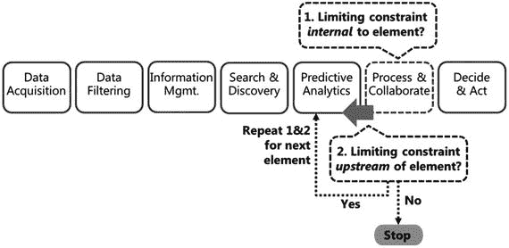
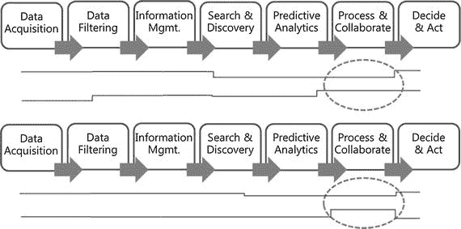
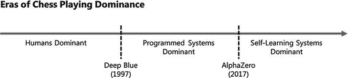
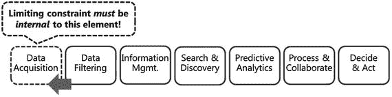
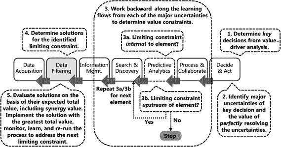

# 9. 学习约束与解决方案的模式

现在，我们已经掌握了所有工具来优化一个或多个“数据-学习-行动”流程，更具体地说，是最大化与这些流程相关的学习价值。因此，在本章中，我们将探讨一些适用于各种组织和职能领域的常见学习约束模式及其潜在解决方案。这些解决方案 invariably 依赖于人员、流程或技术能力，并且最常见的是这三者的组合。我们将沿着从目标决策开始的链条反向推进来讲解这些示例，这是在任何现实世界场景中最适用的顺序。当然，这个目标决策应该是已被确定为对组织价值驱动因素具有显著杠杆作用的决策。我们将花时间讨论“数据-学习-行动”链条的每个环节，并探讨与每个环节相关的一些常见约束以及针对这些约束的一些典型潜在解决方案。希望这些示例能与您自己组织中的某些“数据-学习-行动”流程产生共鸣，并帮助您启动分析。

## 确定价值

我们方法的第一步是理解将某个“数据-学习-行动”流程相关的决策改进到完美决策或接近完美决策水平的潜在价值，正如我们在第 6 章中概述的那样。然后，我们确定阻碍我们实现完美决策的不确定性，并识别那些影响最显著的不确定性，接着确定完美解决这些显著不确定性的价值。然后，当我们沿着链条系统地反向推进时，我们寻求识别导致不确定性的因素，按学习流对这些因素进行分类，识别每个学习流中关于学习吞吐量和价值的限制性约束，然后探索解决这些限制性约束的可能性。

尽管我们可能无法在现实中实现完美决策，但我们努力寻找能够让我们更接近完美的限制性学习约束的解决方案，并且重要的是，我们可以确定这样做的价值，即解决方案的预期学习价值，正如我们在第 6 章中也回顾过的那样。这意味着我们还可以量化实施该解决方案的预期净价值，即预期总价值，正如我们在第 7 章中讨论的那样，该价值可以有效地与组织正在考虑的所有其他投资机会竞争资源。

正如我们在第 8 章中回顾的那样，我们可能还需要考虑跨“数据-学习-行动”流程的学习协同效应是否会影响潜在解决方案的预期总价值，以及约束前瞻考量，以及任何可能需要的辅助场景，以考虑解决方案粒度和预期的未来能力。

## 流程与协作约束

作为数据-学习-行动链条中最接近决策点的环节，我们沿着该链条向上游追溯，从流程与协作环节开始。正如我们在遇到流向流程与协作环节的每个上游环节时所做的那样，也正如我们在第 5 章中讨论过的，如果我们识别出一个可能具有降低价值的不确定性（即可能影响我们的目标决策），我们需要将当前不确定性水平的因果因素细分如下：

*   可归因于流程与协作环节自身操作的因果因素
*   可归因于上游环节向本环节的学习流不足的因果因素

这种识别因果因素的过程能够确定每个学习流的限制性约束，为方便起见，图 9-1 再次对此进行了说明。

图 9-1.

确定数据-学习-行动链条中价值限制性约束的流程

在我们逆向工作时，识别每个环节关键不确定性及其内部和外部因果因素的核心流程包括：在与我们当前分析的数据-学习-行动链条特定环节的参与者进行讨论时，应用结构化的访谈流程。我们采用基于问题的“漏斗式”方法来锁定因果因素，并辅以后续分析和建模。正如我们在第 5 章中讨论过的，分两个阶段执行此流程通常是有意义的：第一遍主要侧重于了解数据-学习-行动流程的“整体情况”，以便在第二遍中能够提出最有效的问题，同时与参与者建立良好的工作关系。以下示例访谈问题，以及本章后续部分中针对链条其他环节的类似示例，都体现了这种访谈技巧。

对于流程与协作环节，我们可以向参与者提出诸如“哪些因素最限制您就 x 做出最佳决策的能力？”以及“这些因素中哪些最重要，为什么？”等问题。然后，根据这些问题的答案，针对每个被指出是最重要的因素（例如因素 y），我们接着提出诸如“如果因素 y 改善到某个水平 z，您的决策会好多少？”等问题。然后再追问：“需要什么条件才能将因素 y 改善到那个水平？”对此问题的回答可能会产生候选的学习变量，以便在后续分析中纳入学习价值图。

可能存在多个潜在改进因素影响因素 y，我们将沿着这些因素线索继续提出类似问题。我们希望尽可能多地对决策参与者执行此流程，然后交叉校准我们的发现。我们可能需要回访部分参与者，根据交叉校准结果进行进一步访谈。这可以单独进行，或者以小组讨论的形式进行可能更有益，这样参与者可以讨论他们不同的假设和观点，并确定如果这些假设和观点在小组内达成一致，是否会对这些因素的相对杠杆作用达成共识。基于与流程与协作环节参与者对话以及参与者之间对话的结果，我们可以开始开发学习价值图、不确定性的概率评估以及相关建模。

作为数据-学习-行动链条中最下游的环节，通常可以预期，流程与协作环节中杠杆作用最高的学习约束和解决方案将倾向于人们协作和集体决策的方式。在分析流程与协作环节时，需要注意的典型决策问题可分为以下两类：

*   **群体决策问题**。群体决策问题可能因底层技术和流程约束而加剧，正如我们在本书中一直使用的投标定价示例中的情况。但它们更可能主要是人际动态问题的结果，例如害怕被评判或尴尬、领导指导不足、思维多样性欠佳（即群体思维）、承诺升级，和/或缺乏既定的决策流程或流程不完善。此外，或者另一种情况是，来自上游数据-学习-行动环节所需的学习流可能不可用或不及时。
*   **个体决策问题**。个体决策问题可能包括我们讨论过的、人们在面对显著复杂性和不确定性时做出决策时众所周知的固有缺陷。但这可能因决策主题方面的知识和技能不足、无法在需要时利用专业知识，或投入决策的时间和注意力不足而加剧。与群体决策的情况一样，来自上游数据-学习-行动环节所需的数据和信息可能不可用或不及时。

鉴于流程与协作环节中的约束通常更直接地与人员相关，对于那些可归因于环节内部操作的约束，适当的辅导和教育将是大多数解决方案的基础。这些辅导和教育通常分为以下几类：

*   领导力与团队建设
*   认识阻碍最佳个体和群体决策的认知障碍以及克服这些障碍的方法¹
*   主题技能发展

然后，用优化数据-学习-行动方法的概述来补充这些教育是很有用的，这样所有需要理解这些基于教育的解决方案的背景和动机的人都能获得这种理解。

从技术角度来看，在“流程与协作”要素中，决策者之间的互动通常是通过通用协作平台实现的，这些平台融合了多种通信模式，例如电子邮件、即时消息、视频会议、社交网络、群组管理，或许还有项目或工作流管理。更好地整合这些不同的协作模式，可能是解决某些情况下制约因素的方法。随着技术的不断进步，未来或许有机会应用更前沿的工具，例如包含虚拟现实和混合现实的沉浸式环境，以促进决策者之间富有价值的互动。

如果发现用于协作决策的技术导致了某种限制性约束，那么潜在的基于技术的解决方案通常将由跨多个“数据-学习-行动”流程的协同价值驱动，如图 9-2 所示。这是因为，在大多数情况下，对于任何一个“数据-学习-行动”流程，直接归因于“流程与协作”要素中技术相关约束的价值损失，并不足以证明进行重大技术升级是合理的。然而，如果仔细考虑跨多个“数据-学习-行动”流程的潜在升级价值，则可能恰恰证明这种升级是合理的。

图 9-2. 识别跨多个“数据-学习-行动”流程的协同价值，以支持“流程与协作”支持系统

对于“流程与协作”要素中的“流程”方面，以最佳结构传递正确信息以支持决策者的方法，例如通过商业智能应用及相关的关键及时指标仪表板，可能有助于解除学习约束。当然，确定哪些指标对于正在做出的决策最为重要，正是我们的学习约束与解决方案识别流程的核心所在，因此许多关键指标必然会直接从我们的流程中得出（更多内容将在下一章讨论）。

无论是辅导、教育、流程改进，还是被确定为学习约束解决方案组合一部分的基于技术的解决方案，“数据-学习-行动”方法的优势在于，我们拥有一种稳健且可信的方式来量化这些解决方案的价值。这对于“流程与协作”要素尤其重要，因为在许多组织中，该要素传统上往往在教育支持和基础设施方面投入不足，部分原因可能在于该要素的性质通常使得相关的效益分析仅仅停留在引用轶事和“感觉良好”的诉求上。如果没有优化的“数据-学习-行动”方法，基于人的“软性”投资的价值往往显得难以量化，而支持协作的平台则常被认为其效益过于分散，以至于严格量化其净增值被认为是徒劳的。但是，我们现在当然可以做得更好！

还应该记住，当我们在此链条的“流程与协作”要素或任何其他要素中梳理学习流及相关约束时，需要小心识别哪些流构成了独立的流程及相关约束，以便在价值模型表明适当时，可以选择并行处理它们。

对于某个给定的“数据-学习-行动”流程，所有主要的学习约束可能都直接归因于“流程与协作”要素的内部运作。如果是这样，并且按照图 9-1 的流程，我们无需再向上游追溯“数据-学习-行动”流程链。但如果不是这种情况，我们将沿着输入到“流程与协作”要素的学习流向上游追溯，从“预测分析”要素开始。

## 预测分析约束

来自“预测分析”要素的学习正向流，可能以两种基本方式支持相关的“数据-学习-行动”流程。它可以向下游的“流程与协作”要素传递预测性洞察，以促进基于人类的决策；或者，它可以提供实现自动化决策的预测，从而基本上绕过“流程与协作”要素。当然，随着软件不可避免地持续“吞噬世界”，而人工智能又反过来持续“吞噬软件”，后一种方法的范围正在不断扩大。² 此外，随着数据科学领域和数据科学家角色的兴起，再加上预测分析自动化能力几乎每月都在进步，该要素总体上正在经历一场革命——即使你的组织尚未经历，很可能也即将经历。

例如，自学习人工智能已经开始迅速“吞噬”直接编程的人工智能，而后者在短短几年前在某些领域还是新鲜事物，甚至在其它领域尚未得到应用！一个分水岭式的例子是 AlphaZero 能够在极短时间内从基本原理自学国际象棋等技能游戏，然后不仅超越人类玩家的能力，还超越了在过去二十年中发展起来的最佳人类编程人工智能的能力。³ 如图 9-3 所示，这种在国际象棋领域的进展，无疑将在企业的许多预测分析应用中得到重现，并必将对众多领域产生深远影响。

图 9-3. 人工智能在国际象棋领域的进展

至少，在短期内，人工智能/机器学习的这些进步构成了需要密切监控的关键预期能力领域之一，以便在任何一个“数据-学习-行动”优化中寻找潜在应用。在第 4 章中，我们回顾了一些主要的企业应用及其各种功能如何映射到“数据-学习-行动”要素，一个共同的主题是，随着基于机器学习的能力不断进步，许多此类应用正在将其功能集扩展到“预测分析”要素。尽管我们尚不清楚它们最适合哪些应用，但自学习系统的出现无疑将延续这一趋势，因此需要持续监控和评估，以优化“数据-学习-行动”的目的。

与我们对每个要素的分析一样，我们将学习约束分为两类：一类是“预测分析”要素自身运作内部的约束，另一类是归因于该要素输入的约束。预测分析归结为以下几点：

*   数据/信息 + 模型/算法 ==> 预测

这一基本事实使得划分清晰明了：如果约束是内部的，那么它通常是一个基于预测建模的问题（无论该建模发生在人脑还是机器中）；如果约束是由于该要素输入不足造成的，那么它是一个基于数据或信息的问题（包括可能因“搜索与发现”要素不足而导致的信息传递问题）。

与“流程与协作”要素的情况类似，我们可以运用结构化的提问流程来协助识别内部和外部的约束条件。在跟进“流程与协作”分析所识别的具体约束之前，一个很好的通用问题是先获得第一轮的“全局概况”，这个问题不仅与当前要素相关，也与我们处理其上游任何要素时相关，它涉及“预测分析”要素参与者的工作投入和关注重点。他们的回答能提供洞见，帮助我们判断参与者与我们分析至今所开发的初步价值模型的契合程度。例如，我们可以问：“您大部分时间都花在哪些问题或模型上？为什么？”然后根据他们的回答进行追问，以了解所需的更多细节。

接着，我们需要进入访谈的核心环节，即跟进在“流程与协作”要素中识别出的、因“预测分析”要素的输入（或缺乏输入）而产生的约束。对于被识别为“预测分析”要素内部的约束，我们可以问：“鉴于当前可用并作为预测基础的数据和信息，针对不确定性 x，理论上最佳的预测能力是什么？”然后追问：“哪些预测流程、模型和/或技能能够帮助尽可能接近这个理论最佳值？”受访者可能会提出多种可能性，我们需要逐一深入探究以了解更多。为了理解外部来源的约束，我们可以问：“哪些数据、增强的数据过滤手段或信息传递方式，能够使您对 x 的预测变得更好？能好多少？”同样，我们可能面临多种可能性，需要通过额外提问来跟进。在某些情况下，获取外部专家的观点可能有益，以确保所有可能性都被考虑到。

与首轮访谈后的常规做法一样，我们可能需要根据对迄今为止访谈结果的交叉校准，回头找部分参与者进行进一步提问。此外，在某些情况下，特别是当团队氛围不利于在小组讨论中从受访者那里获得完全坦诚的观点时，这种跟进可以单独与受访者进行（如果必须如此，我们可能已经发现了一个学习约束！）。或者，如果团队氛围健康，那么与参与者小组进行交叉校准可能更有益，这样他们不同的假设和观点可以得到讨论，并确定：如果这些假设和观点在小组内成为共识，大家是否能在约束因素的相对杠杆作用、不确定性水平以及潜在解决方案想法上达成一致。随着我们收到的信息变得更加可靠，我们可以构建出关于最重要约束、学习变量、概率评估和潜在解决方案想法的模型。

以下是按职能领域划分的常见不确定性领域示例，在这些领域应用增强型预测分析来降低不确定性可能具有高价值的杠杆作用：

*   研发：新产品的性能属性、新产品上市时间、新产品开发成本
*   市场营销：营销活动产生的合格线索数量、每条合格线索的成本、合格线索的成交率、需求的价格弹性、性能属性以及竞争对手产品的市场时机
*   销售：给定合格线索的成交概率、预期谈判价格、客户留存率、客户支持成本、客户终身价值
*   供应链：供应链各环节的供应中断概率、产品随时间变化的需求、产品需求的波动性、库存核销水平
*   人力资源：新员工的绩效水平、晋升员工的绩效、未来所需的员工薪酬水平、员工士气预期水平、员工留存率

当然，关键在于理解这些不确定性类型背后的因素，并为最重要的因素识别约束条件及相关学习变量。在识别基于模型的内部约束时，我们需要小心，在访谈过程及随后将结果编码到我们的模型中时，要充分考虑人员、流程和技术因素。“预测分析”要素内学习约束的一些常见原因包括：

*   资源和/或流程未针对最重要的问题——即，未与最高杠杆的决策和可量化价值保持一致
*   缺乏合格的人力资源或技能，例如数据科学能力
*   缺乏足够的基于系统的工具来支持人力资源
*   未能有效利用可用的数据和信息来源
*   未能将预测分析结果有效传递给“数据-学习-行动”流程中的其他要素

除了最后一项（未能将结果传递给其他要素）之外，这些问题中的大多数本质上都是关于从可用的数据和信息中榨取最大可能的预测能力。针对这类问题，一些通用的潜在解决方案和考虑因素包括以下内容。

*   采用本书概述的**优化数据到学习到行动的方法**，确保稀缺的数据和决策科学资源能投入到预期价值最高的领域！
*   如果需要，再获取专业知识，但前提是，通过再次应用本书中的方法，你已确切了解该专业知识的预期应用场景及其预期价值！
*   提供有针对性的培训和教育资源，使其与基于预期总价值（是的，再次强调，通过应用本书倡导的方法！）最需要关注的领域保持一致。
*   确保生成预测分析的流程与期望的结果保持一致，这意味着它们要特别关注那些具有最大价值杠杆作用的学习变量。
*   判断增强型建模工具和应用程序的可用性是否能提升预测能力。尤其需要监控基于云的能力的可用性，因为它们发展迅速，几乎每天都在进步。基于机器学习的技术也在快速进步，可能适用于某些类型的预测分析问题，因此应持续关注。当然，要破除炒作，迫使此类技术的供应商尽可能量化地说明该技术预期能带来的不确定性降低程度，以便你评估其预期价值——不要接受含糊其辞的说法！
*   鉴于我们仍处于某些预测分析方法（例如基于机器学习的应用程序）生命周期的早期阶段，可能需要考虑“自建还是购买”的子决策。在某些情况下，为了应对快速发展的商业能力，先进行原型设计并预期将其抛弃，可能是合理的。
*   确保不仅要考虑提供决策者可直接应用的预测能力的机会，还要考虑将预测推断嵌入信息管理、搜索与发现元素中的能力机会。但需理解，实际上，这类能力中的大多数很可能最好由商业软件包提供。

以上是一些可供考虑的通用解决方案思路。但与其他要素一样，可能需要一些创造性思维，才能从已有的数据和信息中榨取更多的预测能力，或者确定可以输入到预测分析要素中、能带来改变但此前未被认真考虑过的新数据和信息输入。切勿混淆的是，优化数据到学习到行动方法所倡导的额外流程结构，并不意味着创造力和创新是不必要的共同成分！

正如我们对数据到学习到行动流程中每个要素的分析一样，我们应该识别独立的学习流及其相关约束，并评估在独立流之间并行解除这些约束的价值。在评估解除约束的方法时，鉴于机器学习等领域的快速发展，我们还应特别关注预测分析要素未来预期的技术进步。当然，对于将应用于多个数据到学习到行动流程的专业知识和技术，我们需要谨慎地通过汇总其对所有相关数据到学习到行动流程的预期增值贡献，来计算协同价值。

如果我们发现，某个数据到学习到行动流程的独立学习流的限制性约束直接归因于预测分析要素的内部运作，那么我们就不必调查上游要素的输入，可以直接深入评估潜在约束解决方案（如前文列举的例子）的预期价值。但如果不是这种情况，我们就需要沿着输入到预测分析要素的相关学习流向上游追溯，这些学习流通常通过搜索与发现和信息管理要素进入。

## 搜索与发现的约束

对于搜索与发现，我们是在数据到学习到行动链中进一步回溯，以寻找价值的限制性约束。请记住——我们可能不会走到这一步，除非必要，我们也不想走到这一步！任何给定学习流的限制性约束很可能位于搜索与发现下游的某个要素内，如果是这样，就没有理由在该约束的上游做任何工作。这正是优化数据到学习到行动方法的核心要义——它不是要“煮沸整个海洋”，而是要像激光一样聚焦于价值的限制性约束，并找到能够释放该约束价值的解决方案。话虽如此，在某个时间点，对于组织中的某些数据到学习到行动流程，搜索与发现将不可避免地成为需要解决的限制性约束。

当然，搜索与发现功能主要由个人用户直接使用，向他们提供信息，作为其活动输入到数据到学习到行动链中的预测分析和流程与协作要素。正如我们在第 3 章中讨论的，搜索根据用户提供的明确信息来传递信息，而发现则更为通用，它根据从当前上下文和/或历史行为中得出的其他或额外的推断来传递信息。

搜索和发现中的约束基本上可以归结为两种熟悉的对比错误类型：第一类错误是错误地传递了不相关且不需要的信息，从而浪费了我们的注意力和时间；第二类错误是错误地未能传递我们确实需要的信息，这比浪费时间的结果更糟糕。在分析这两类学习约束时，像往常一样，我们将约束分为两类：一类是搜索与发现要素内部运作产生的约束，另一类是归因于该要素输入的约束，这些输入通常来自数据到学习到行动链的信息管理要素。

与预测分析的情况一样，搜索与发现的核心方面是“数据/信息加模型/算法”。这一事实再次使得划分清晰明了：如果约束是内部的，通常是基于算法的问题；如果约束是要素输入不足的结果，则是基于数据或信息的问题。然而，由于搜索和发现是直接由人使用的功能，除了算法之外，还有另一个重要的内部因素应被视为可能导致学习约束的因素：系统与用户的界面。

与之前的要素一样，我们可以应用结构化的访谈流程来帮助识别搜索与发现的内部和外部约束。我们的访谈应侧重于提出与搜索与发现的输入或其缺失（我们称这些约束为 x）具体相关的问题，这些约束被发现限制了预测分析或流程与协作要素的参与者。因此，我们的提问应从这些搜索与发现功能的用户开始。

关于搜索功能，首先要向用户提出的一个基本问题是：“您能否有效地搜索并找到与 x 相关的信息？”接着问：“为什么能或为什么不能？”然后，我们会顺着“为什么不能”的答案深入探究，在此过程中识别出促成因素，评估其相对影响，对因素进行优先级排序，并根据我们的评估和优先级排序，不断调整后续的提问和分析方向。并且，像往常一样，我们通常会在首轮访谈后与参与者进行跟进，以确保双方理解一致，并就识别出的限制因素及其相对重要性进行交叉校准。

在这些练习中可能发现的限制因素包括：

*   搜索系统常常无法理解用户的查询和/或其上下文（元素内部问题）。
*   找到用户搜索的内容耗时过长；即，搜索未能立即提供最相关的信息（元素内部问题）。
*   搜索系统对被搜索内容的语义理解有限（元素内部问题）。
*   搜索系统无法有效处理非文本信息源，如图像或音频信息（元素内部问题）。
*   用户不完全信任其搜索请求的结果（问题可能属于元素内部和/或外部）。
*   用户寻找的信息根本不存在，搜索功能无法找到（来自上游元素的输入问题）。

类似地，对于发现功能，要向用户提出的一个基本问题是：“与 x 相关的相关信息是否会自动呈现给您？如果没有，是您收到了关于 x 的信息，但这些信息不相关？还是您根本没有自动收到任何关于 x 的信息？”现实情况是，对于许多组织而言，目前可用的发现功能有限，因此在短期内，我们更可能得到第二种情况的确认，但随着基于机器学习的能力不断进步，这种情况正在迅速改变。

关于发现功能，访谈中通常会揭示的典型限制因素如下：

*   在相关用例中，用户无法使用发现功能（元素内部问题）。
*   用户可以使用发现功能，但效果不够好——它无法呈现最符合个人和上下文相关信息，和/或呈现了太多不相关的信息（元素内部问题）。
*   发现功能可用，但系统的建议可能难以理解，从而降低了用户对发现结果的信任，并且系统未能为用户提供充分的建议解释。
*   发现功能可用，但无法访问与用户最相关的信息（可能是内部/输入问题的组合）。
*   发现功能可用，但组织内不存在可供发现功能呈现的相关信息（来自上游元素的输入问题）。

针对搜索与发现元素内部限制因素，可以考虑的一些通用潜在解决方案包括：

*   能够更准确推断用户搜索请求含义的搜索功能
*   增强的发现情境化能力，能更有效地呈现与用户当前活动相关的信息
*   通过一个能够更有效、更高效地理解用户当前情境和意图的界面，来访问搜索和发现功能
*   通过一个智能的、基于对话的界面来访问搜索和发现功能
*   增强的搜索和发现个性化能力，能基于推断出的用户兴趣和/或专长，更有效地预测并呈现与用户个人相关的信息
*   能更好地理解被搜索或考虑呈现的内容集合的上下文或含义的搜索和发现功能
*   能为搜索结果以及推荐和建议提供有意义的解释的搜索和发现功能，从而增强用户对系统的信任，并提供有用的辅助信息

虽然上述潜在解决方案被归类为搜索与发现元素内部的问题，但其中一些可能也需要在信息管理元素中实施增强功能。例如，为了增强搜索和发现的个性化，可能需要在信息管理元素中提供更丰富的行为信息集。而为了更有效地理解被搜索文档的上下文和含义，可能需要在信息管理元素中提供通用和/或特定领域的本体，供搜索和发现功能访问。当然，这可能需要应用专门的技术和/或本体技能。此外，对于某些需求，可能需要专门的数据仓库来支持搜索和发现功能的运行。当然，与许多其他领域一样，基于神经网络的方法也可能越来越适用于推断企业环境中的内容语义。

还要记住，有一个时间因素需要考虑——我们希望优化的学习吞吐量是一个速率，即单位时间内可采取行动的学习量。仅仅最终获得减少不确定性所需的信息，从而能够更有效地预测，通常是不够的。因此，搜索和发现功能如果花费太长时间才能向用户呈现相关信息，就会损耗价值。对于许多从数据到学习再到行动的过程而言，这不仅仅是一个普遍的生产力问题——学习延迟导致行动延迟，会直接造成可衡量的价值损失（例如在竞标场景中）。

与分析从数据到学习再到行动过程中每个元素内的学习流一样，我们应该识别出独立的搜索与发现相关流，并找出每个独立流的相关限制因素，然后评估并行解除这些独立流限制的价值。并且，我们应该意识到一个现实：搜索和发现功能主要由商业软件包提供，而对这些软件包增强功能的论证，很可能由多个从数据到学习再到行动过程的协同价值所驱动。

如果我们发现价值的限制因素直接归因于搜索与发现元素的内部运作，那么我们无需调查其上游元素的输入，可以直接评估针对这些限制因素的潜在解决方案（例如本节前面列出的示例）的预期总价值。但如果不是这种情况，我们就需要沿着限制搜索与发现元素价值的因素向上游追溯，而识别这个“罪魁祸首”的下一站就是信息管理元素！

## 信息管理约束

现在我们来到了信息管理环节，我们之所以来到这里，是因为之前的调查发现，特定学习流程的限制性约束既不在流程与协作环节内部，也不在预测分析环节内部，更不在搜索与发现环节内部，因此约束必然位于数据-学习-行动链条的更上游。所以，我们只是勉强走到这里，而这恰恰是应有的状态。组织常常在没有彻底弄清问题真正所在的情况下，就贸然采用技术解决方案。我们这种从决策出发、逐步逆向推导的流程，正是为了克服这种倾向。

对于信息管理环节，学习方面的约束将分为两类：

*   克服约束所需的信息存在于组织内部，但需要这些信息的用户无法轻易获取（环节内部问题）。
*   克服约束所需的信息目前不存在于组织内部的任何地方（来自上游环节的输入问题）。

如果是后一种情况，我们需要继续逆流而上，调查数据过滤环节。如果是前一种情况，我们则需要在信息管理环节内部进行更多分析，具体如下。

像往常一样，我们首先采访具有相关知识和专长的人员，以此开始对该环节的分析。在这种情况下，相关人员可能包括企业架构师、知识管理者、分类学家/本体论专家（假设组织中有这些角色）以及数据库管理员。然后，我们顺着对话线索，找出导致约束的具体因素。

信息管理环节内部可能出现的约束，以及对话中可能浮现的问题包括：

*   所需信息可供组织内部分成员访问，但并非所有需要它的成员都能访问，因为这是目前仅存在于部分成员头脑中的隐性知识。
*   所需信息可供部分用户访问，但并非所有需要它的用户都能访问，原因是技术不兼容。
*   所需信息可供部分用户访问，但并非所有需要它的用户都能访问，原因是隐私或安全限制。
*   所需信息不易获取，因为它没有针对下游分析中确定的用例进行适当结构化，而这些用例之所以受到约束，正是由于无法轻松获取所需信息。这种情况不仅适用于人类用户，也适用于基于系统的信息访问和消费，例如神经网络的训练。

以下是针对上述内部约束的示例性潜在解决方案，包括技术类和技能类方法：

*   确定隐性知识能否被转化为基于计算机的格式或结构，从而让组织内部更广泛地访问这些信息。可以预见，本书的倾向是，鉴于技术的进步（例如，能够有效解释和搜索视频及音频格式的技术），即使过去不行，现在对于大多数信息来说，这应该越来越可行。
*   通过评估整合信息管理平台或应用连接器来集成不同技术的机会，探索克服技术不兼容问题的方法。
*   应用第 3 章讨论的“学习型”架构，该架构对行为信息、兴趣推断以及从行为信息中提取的专业知识进行编码，以实现搜索与发现功能的自适应个性化。
*   对于隐私或安全限制，要确保相关政策在现实评估成本与收益（好消息是，你现在实际上已经掌握了量化的收益）的前提下是合理的，特别是针对那些需要信息来克服限制性约束的特定用户。
*   根据需要获取适当的数据库、分类法、本体论和数据科学技能及/或技术，以更好地结构化和组织信息，从而有效支持受约束的用例。在某些情况下，可能需要更专门的架构，如 NoSQL 结构或数据仓库。应用基于图的结构可能是整合原本分散的信息池的一种途径。

当然，对于那些导致限制性约束的所需信息目前不存在于组织内部任何地方的情况，我们必须再次向上游寻找潜在的解决方案，因此我们接下来将转向数据过滤环节。

## 数据过滤约束

如果我们已经走到了这一步，即数据过滤环节，那么很可能信息管理环节无法获取所需信息，是因为底层数据根本不存在于组织内部。在这种情况下，我们需要再向上游迈进一步，到达数据-学习-行动链条中的数据采集环节。

然而，在某些情况下，所需的原始数据在组织内部是可用的，但尚未经过充分过滤，从而未能转化为可用的信息——而这正是数据过滤环节的工作。一如既往，我们首先采访信息的潜在用户，以更好地了解是什么限制了他们的相关用例，同时也要采访具有相关技能的人员，例如数据科学家，他们可以提供关于根本原因和潜在解决方案的见解。

从采访中，我们可能会发现一些常见的数据过滤相关约束，包括：

*   原始数据中包含的无关数据比代表关键用例所需信息信号的有用数据多出几个数量级。因此，当前原始状态的数据是不可用的。
*   原始数据中包含大量虚假或异常数据，使其无法使用。
*   数据需要与其他数据耦合才能使用（例如，事件数据需要带有时间戳）。
*   数据需要被转换成不同的格式或语言才能使用。

针对这些制约因素，示例性的潜在解决方案（可能需要组合应用）包括：

*   应用技术从海量数据中提取相关信息。例如，基于神经网络的技术可应用于视频流，从视频流中大量且大部分无关的像素中提取出特定的感兴趣特征。另一个例子是第 4 章讨论的高通量实验中的“以废促快”方法，其中绝大多数实验结果需要被快速过滤掉，不再进一步考虑，以便真正重要的结果能得到适当关注。
*   应用数据科学技能，通过移除虚假和异常数据点来调节数据，使其适合使用。
*   根据需要合并或扩充数据集，以创建可用的信息。例如，将个体与行为数据匹配，或为事件数据添加时间戳。
*   应用不断改进的翻译或解释技术，将文档和其他内容（如图片）转换为特定用户及其用例可用的信息。

当然，如果所需的原始数据在组织内部完全不可用，那么我们将继续调查数据-学习-行动流程的初始环节——数据采集。

## 数据采集约束

我们现在已处于链条的末端，因此学习价值的责任到此为止！我们在此发现的任何限制性约束必然存在于数据采集环节内部，如图 9-4 所示，因此无法推卸责任。这必然意味着组织内部无法获取所需数据，因此我们需要设法获取这些数据。当然，我们必须承认，完全获取期望的数据可能并不现实。但这正是发挥组织创造力去实现目标的契机！如果能够做到使预期总价值为正，那么理所当然，我们应该全力以赴去获取数据。

图 9-4.

学习价值的责任止于数据采集环节

当然，有许多不同类型的数据和数据源可以被视为限制性约束的解决方案，因此我们只能涵盖极小一部分可能的解决方案，但以下是一些常见的方案：

*   物联网和传感器技术持续进步，为从各种工业流程和环境条件中捕获运营数据提供了机会，而这些数据在以往是不可能获取的。
*   基于组合化学和高通量实验的方法，可以为基于实体产品的研发提供额外的、甚至数量级更高的原始数据。
*   A/B 测试可以提供新的、基于经验的数据，帮助优化用户界面，以最大化客户满意度和收入。
*   可以捕获或获取日益精细的消费者行为数据，包括购买历史、位置历史、观看和收听习惯、社交互动等。
*   员工行为数据可以通过最新一代的企业应用和平台进行捕获和访问。
*   虽然上述与技术相关的机遇值得考虑，但我们不应忽视一个事实：大量未开发的数据存在于组织成员的头脑中，而对话和访谈流程可以用来捕获这些数据！

当然，我们可能会发现，至少在短期内，我们无法获取所需数据以缓解限制性约束，或者无法以经济高效的方式做到这一点。但正如数据到学习再到行动链条中任何其他限制性约束一样，由于我们已经掌握了限制性约束的量化成本，我们可以随着技术的进步和成本的降低，持续关注可行的解决方案，并随时准备在成本效益提升时立即加以利用。

## 总结

在本章中，我们探讨了优化数据到学习再到行动的过程，并涉及了一些典型的学习约束及其潜在的解决方案。我们介绍的优化数据到学习再到行动过程的一般步骤如下：

*   量化与数据到学习再到行动过程相关的主要决策的完美决策价值，为解决制约价值的瓶颈问题设定一个基准上限值。
*   识别导致非完美决策的重大不确定性，并量化完美解决每个高杠杆不确定性的价值。
*   通过逆向追溯至数据到学习再到行动过程中最接近决策的环节（即处理与协作环节），开始分析导致不确定性的学习约束。
*   识别与相互独立的不确定性相关的学习流和限制性约束。
*   确定每个独立的限制性约束是存在于处理与协作环节内部，还是与上游环节所需的输入相关。
*   对于内部限制性约束，确定潜在的解决方案，并评估每个解决方案的初步预期总价值。
*   对于与数据到学习再到行动链条更上游环节所需输入相关的限制性约束，通过应用与先前分析环节相同的流程，开始分析该上游环节中的限制性约束。
*   继续此过程，直到所有已识别的限制性约束都被确定为存在于数据到学习再到行动链条的某个环节内部；如果我们到达最上游的环节（数据采集），则此条件必然满足。
*   某些解决方案的预期总价值将取决于跨多个数据到学习再到行动链条解决限制性约束的协同价值。
*   实施预期总价值为正的解决方案，并监控结果，从中学习。

这些步骤在图 9-5 中以图表形式进一步总结。主要步骤始于通过价值驱动因素分析确定目标决策及相关的数据到学习再到行动链条（1）。识别影响目标决策的最重大不确定性，并估算完美解决这些不确定性的价值（2）。

图 9-5.

优化数据到学习再到行动过程的图表总结

然后，该过程开始沿着数据到学习再到行动链条逆向追溯，针对与每个对目标决策具有显著杠杆作用的不确定性相对应的独立学习流进行。执行一个迭代步骤（3），依次检查数据到学习再到行动链条的每个环节，以确定是否存在该环节内部的学习流限制性约束（3a）和/或是否存在该环节上游的限制性约束（3b）。如果是后一种情况，迭代过程将向上游移动到下一个环节。该迭代步骤最终必然识别出至少一个限制性约束——在此例中，假设该约束存在于数据过滤环节内部，如该环节的阴影所示。

随后，将确定基于人员、流程和/或技术的解决方案，以解决制约因素（4）。这些解决方案将根据其预期总价值进行评估，该价值可能包括从数据到学习再到行动流程中的协同价值，同时还需考虑未来能力预期可用性和/或解决方案粒度等因素。总价值最大的解决方案将被实施，其结果受到监控，并将由此产生的学习成果融入流程中（5）。然后，该流程会重新运行，以识别并解决下一个制约因素。

就是这样！这一流程适用于任何组织以及任何从数据到学习再到行动的流程。在开始应用该方法后，组织各职能和流程中的模式很快就会显现出来，识别制约因素和量化价值也会变得越来越容易。另一方面，随着通过应用该方法摘取“低垂的果实”，预计需要发挥更多创造力，才能为下一层级的制约因素找到经济高效的解决方案。

尽管优化数据到学习再到行动的方法看起来可能比现有流程更费功夫，但实际上并非如此。这只是一个将组织的注意力和资源引导到真正重要的事情上，而不在无关紧要的事情上浪费时间的问题。这可以类比为下棋。较弱的棋手或系统倾向于考虑局面中几乎所有可能的走法，因此无法对任何一条可能的走法序列进行深入思考。而强大的棋手或系统则不会在大量可能的走法上浪费时间。他们会持续大幅修剪走法树，然后对最有希望的几条线路进行深入探索。⁴

同样，在优化数据到学习再到行动的方法中，我们根本不会在无关紧要的事情上投入精力。如果减少不确定性的收益非常低（这通常可能并不直观），我们就不会去做。如果它不是一个制约因素，我们也不会去做。当优化数据到学习再到行动流程的纪律得到贯彻时，你会惊讶地发现，它能多么清晰地揭示出有多少时间和金钱被花费在了真正无关紧要的事情上。当然，所有这些时间和金钱随后都可以被重新分配，用于深入钻研那些经优化数据到学习再到行动方法证明确实重要的事情！

脚注 1

关于克服个人和群体决策中常见认知障碍的技巧，请再次参阅：Bang, Dan, and Chris Frith, “Making better decisions in groups”, *Royal Society Open Science*, August 2017\. [`http://rsos.royalsocietypublishing.org/content/4/8/170193`](http://rsos.royalsocietypublishing.org/content/4/8/170193)

2

Andreessen, Mark, “Why Software Is Eating the World”, *Wall Street Journal*, August 20, 2011, [`https://www.wsj.com/articles/SB10001424053111903480904576512250915629460`](https://www.wsj.com/articles/SB10001424053111903480904576512250915629460) ; Simonite, Tom, “Nvidia CEO: Software Is Eating the World, but AI Is Going to Eat Software”, *MIT Technology Review*, May 12, 2017, [`https://www.technologyreview.com/s/607831/nvidia-ceo-software-is-eating-the-world-but-ai-is-going-to-eat-software/`](https://www.technologyreview.com/s/607831/nvidia-ceo-software-is-eating-the-world-but-ai-is-going-to-eat-software/)

3

Silver, David et al., “Mastering Chess and Shogi by Self-Play with a General Reinforcement Learning Algorithm”, Cornell University Library Arxiv.org, December 5, 2017\. [`https://arxiv.org/pdf/1712.01815.pdf`](https://arxiv.org/pdf/1712.01815.pdf)

4

例如，这正是自我学习的 AlphaZero 系统所采用的方法，该系统最近击败了最佳的直接编程系统：“AlphaZero 通过利用其深度神经网络，更有选择性地聚焦于最有希望的变化，从而弥补了评估次数较少的不足——这可以说是一种更‘类人’的搜索方法……” Silver, David et al., “Mastering Chess and Shogi by Self-Play with a General Reinforcement Learning Algorithm”, Cornell University Library Arxiv.org, December 5, 2017\. [`https://arxiv.org/pdf/1712.01815.pdf`](https://arxiv.org/pdf/1712.01815.pdf)

