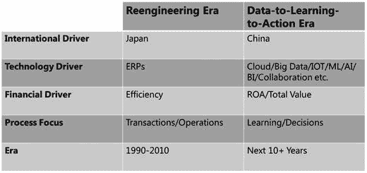

# 结论

我们开启这段优化“数据-学习-行动”流程的旅程时，首先思考了当今商业时代的典型特征、广泛技术领域前所未有的进步，以及由此给商业和 IT 战略带来的复杂性。与此同时，我们也审视了诸如资产回报率和企业更替率等长期商业绩效指标中令人警醒的趋势。

我们得出的结论是，无论是提升商业绩效的道路，还是管理技术驱动型复杂性及其伴随的海量数据的道路，最终都指向了决策。归根结底，商业绩效最根本地取决于我们决策及其执行的有效性，而决策的有效性又完全取决于我们学习的有效性。

但学习究竟是什么？我们通过一个核心结论驯服了这个最难以捉摸的概念：学习的本质是通过降低不确定性来提升预测能力。这对人类心智的学习成立，对机器的学习同样成立。因此，学习就是降低不确定性的过程。但它也可以被视为一个流程中的流动过程。具体而言，就是“数据-学习-行动”流程——这是学习的通用流程。之所以说它通用，是因为它涵盖了几乎所有我们做的重要事情；之所以说它通用，是因为鸟类如此行事，人类如此行事，如今连受过训练的机器也如此行事。

基于“学习是降低不确定性的过程”这一视角，我们发现可以量化可行动学习——即有可能影响决策的学习——的价值。我们可以为这种可行动学习赋予货币价值，从而像评估其他任何投资机会一样，在同样可信的基础上有效评估学习投资。学习的价值不再仅仅是那些感觉良好的宣言和含糊其辞的价值主张的专属领域——这些主张可能根本就是错的，即便碰巧对了，也往往无法为持续聚焦提供基础。

以量化后的学习价值上限为指引，我们可以沿着“数据-学习-行动”流程反向推导，识别学习流程中的约束条件。具体而言，我们可以识别出学习价值的限制性约束，并通过应用人员、流程和/或技术解决方案，量化部分或完全解除该限制性约束的预期价值。

当这个限制性约束被解除后，相关决策会比之前更优，从而产生额外的有形价值。此时必然会出现另一个需要解决的学习价值限制性约束。解决这些限制性约束的过程将持续进行，直到解决下一个限制性约束的预期价值不再超过其预期成本。

我们将这种净价值称为预期总价值。总价值更广泛地适用于任何投资机会，因此为优化组织的整体投资组合提供了恰当的基础。而这将带来持续改善的商业绩效。

这就是我们走过的基本旅程。现在，让我们更详细地回顾本书的核心概念。最后，我们将探讨为什么优化“数据-学习-行动”流程代表着商业绩效提升的下一个时代，并发出挑战：在您的组织中迈出下一步，开启这个新时代。

## 核心概念

以下是本书关键概念的概述，大致按照其引入顺序和逻辑脉络排列。

商业绩效必须提升，而且需要采用新方法。尽管存在股市上涨等表象，但更根本的商业健康指标——例如美国企业的资产回报率——几十年来一直呈下降趋势。股东价值正被处于下四分位的企业所摧毁。企业的更替率总体在上升。传统的绩效提升方法显然已不足以应对，而且可以预见，它们在未来商业环境中将更加力不从心。

商业绩效由决策的有效性驱动。决策有效性与财务结果在 95%的置信水平上存在相关性。必然的结论是：导致资产回报率等指标下滑的商业绩效不佳，必然是由与商业决策相关的系统性问题所驱动的。当然，这一结论也符合朴素的老常识。

面对日益增加的复杂性和不确定性，决策尤其具有挑战性。日益激烈的全球竞争和前所未有的技术加速发展，构成了极具挑战性的决策环境。讽刺的是，虽然基于技术的进步本应是好消息，并成为绩效提升方程的一部分，但如果没有最佳实践决策流程的加持，与技术加速发展相关的复杂性因素，以及随之产生的额外数据浪潮，反而可能导致商业绩效比原本更差。

与价值驱动因素直接相关的决策对商业绩效具有最大的杠杆作用。价值驱动因素是通过将组织的财务报表分解为有意义的组成部分，并进行敏感性分析，以确定具有最大财务杠杆作用的因素来确定的。因此，改善与这些最高杠杆因素直接相关的决策，是提升商业绩效的关键。

关键不在于数据——而在于决策。以及学习。数据本身没有内在价值——数据只有在能够影响决策时才有价值。无论数据有多大，如果只盯着数据而不考虑其与决策的直接联系，那就像呆伯特漫画里的情节，是价值毁灭的处方。学习是连接数据与决策的桥梁，而有可能改变决策的学习具有有形价值。

学习是通过降低不确定性来做出更好预测的过程。学习，无论是显性还是隐性的，都会导致概率分布收缩，从而提高预测准确性。预测准确性直接影响决策的有效性，而决策的有效性又直接影响商业绩效。

可能影响决策的学习是可行动学习，而可行动学习具有有形的、可量化的预期价值。预期学习价值类似于决策分析领域中“信息价值”的概念。但信息，如同数据一样，并不具有内在价值——是学习有益地利用了信息，如果学习有可能改变决策，那么它就具有正向的、可量化的价值。

学习的期望价值，是指得益于学习后的决策期望价值，与未得益于学习时的决策价值之间的差额。这是学习价值的基本前瞻性公式，且始终成立。我们计算得益于额外学习或未得益于额外学习时的决策期望价值，可能基于决策树或模拟等多种技术——归根结底，都归结为贝叶斯方法的应用。但随后，总是通过计算这两种前瞻性决策情境（得益于额外学习与未得益于额外学习）之间的差额，来推导出额外学习的期望价值。

从数据到学习再到行动，是一个过程。事实上，这是一个普遍的过程，因为它是学习和决策的基本过程，无论是由人脑还是机器执行。因此，从数据到学习再到行动的过程在任何组织中都是普遍存在的。

从数据到学习再到行动的过程可以分解为一组标准要素。一个稳健的要素分解方案，对于优化组织中大多数从数据到学习再到行动的应用场景非常有效，它包含以下要素序列：数据采集、数据过滤、信息管理、搜索与发现、预测分析、流程与协作、决策与行动。这些要素中的每一个通常都包含基于人和基于技术的能力与活动。

学习价值图可以有效地应用于对从数据到学习再到行动的过程进行建模。学习价值图是决策图的衍生形式。它们对决策、不确定性、学习变量以及相关关系进行建模，并且可以随着优化数据到学习到行动的项目或计划的推进而进行扩展和完善。学习变量代表了可操作的学习机会，用于减少不确定性并改进决策。

所有流程都存在一个流量，以及一个对流量吞吐量的限制性约束。这是约束理论的基本定律。既然从数据到学习再到行动是一个流程，那么它必然存在一个对其吞吐量的限制性约束。从数据到学习再到行动流程的限制性约束，是对学习流量的约束。

从数据到学习再到行动流程的限制性学习约束，是通过从决策反向推导到数据来确定的。沿着从数据到学习再到行动流程的学习流，从决策以及影响决策的不确定性出发，系统地反向推导，能够识别出学习流的限制性约束。诸如结构化访谈之类的技术被用来辅助识别该限制性约束。

解决限制性学习约束是使从数据到学习再到行动流程能够产生更多价值的必要条件。这一事实也遵循约束理论的基本定律：学习吞吐量只能通过解决限制性学习约束来提高。其推论是，在不解决流程中学习流限制性约束的情况下，投资于从数据到学习再到行动流程中其他部分的学习能力是徒劳的，实际上会破坏价值。

限制性约束通过基于人员、流程和/或技术的解决方案来解决。解决限制性约束的方案旨在减少影响相关决策的一个或多个不确定性——因此，这些方案直接对应于学习价值图中的学习变量。通常需要结合基于人员、流程和/或技术的改进，才能最有效地解决限制性约束。

确定限制性学习约束的解决方案是一项创造性的工作。虽然从数据到学习再到行动的方法相较于更临时性的方法提供了额外的结构，但这种结构有助于确定正确的位置，以集中组织的创造力，例如寻找解决限制性学习约束的最佳可能方案，从而放大创造力的价值。

可以计算部分或完全解决从数据到学习再到行动流程中一个限制性约束的价值。可能应用于该限制性约束的基于人员、流程和/或技术的解决方案有助于减少不确定性，从而提高预测准确性，进而改进决策。此类解决方案的计算所得期望学习价值，是以下因素的函数：不确定性减少的程度、不确定性对决策的杠杆作用，以及决策对财务绩效的杠杆作用。此外，多个从数据到学习再到行动流程之间可能存在协同价值，这也会贡献于解决方案的期望学习价值。

解决限制性学习约束的备选方案，根据其期望总价值进行评估。期望总价值包括按折现现金流基础计算的解决方案的期望学习价值，减去该解决方案的期望成本。

期望总价值等于期望学习价值加上期望直接价值。期望直接价值定义为项目或活动的标准期望折现现金流，其中不确定性被视为给定条件。它还包括与学习相关的投资成本，旨在减少当前给定的不确定性。在学习发生之后，期望学习价值实质上会转化为期望直接价值，此时通过学习过程更新后的不确定性成为新的给定条件。这种转化过程代表了业务更新生命周期的定义性动态。

应使用期望总价值来对组织的投资机会组合进行优先级排序。组织内某些项目和活动的期望总价值可能主要由期望学习价值构成，某些主要由期望直接价值构成，还有一些则是两者的重要混合。无论构成如何，如果某个项目或活动的期望总价值为正，就应该实施。或者，在预算受限的环境中，应对投资机会组合进行优化，以在预算约束下最大化组合的期望总价值。

实施并学习。组织起来，以成功优化从数据到学习再到行动流程，识别对学习具有最高杠杆作用的限制性约束，实施具有最大期望总价值且能解决学习限制性约束的解决方案，监控和衡量业务绩效结果，从实施中学习，并根据所学内容重新校准模型和不确定性，为下一轮应用优化从数据到学习再到行动流程做好准备。

## 数据到学习再到行动的时代

# 新时代：从数据到学习再到行动

在《学习层》一书中，我曾提出我们正进入一个全新的信息技术时代，在这个时代，系统通过向我们学习来自动适应，并持续将学习成果反馈给我们，使我们变得更聪明、更高效。这个时代显然已经来临，尽管过去几年的进步令人惊叹，但显然仍处于起步阶段。

然而，无论这些进步已经取得或将要取得多么惊人的成就，与任何技术发展一样，它们并不能保证企业绩效的提升。事实上，正如我们所看到的，无论是在宏观经济层面还是在特定组织中，情况可能恰恰相反。要提升企业绩效，我们需要更多的东西。而这更多的东西，就是优化从数据到学习再到行动的流程。

我们以前也遇到过类似的商业局面。进入 20 世纪 90 年代时，西方企业感受到了持续性的竞争压力。全球化已真正开始，效率和产品质量的门槛突然被提高。财务业绩下滑，工厂关闭。

虽然存在滞后，但企业最终做出了反应。产品质量和效率都成为改进的焦点。这开启了一个持续的企业绩效提升时代，可以称之为“再造时代”——上一次企业绩效提升的大浪潮。对于真正拥抱所需分析和变革的企业来说，这是一个非常成功的时代；尽管正如我们从宏观数据中了解到的，更普遍的情况是，这还不够。

现在，我们需要一个新的企业绩效提升时代，我相信这个时代必然是优化数据到学习再到行动的时代，因为只有它体现了一种方法，既能解决企业绩效的核心问题，又能充分拥抱即将到来的日益智能化技术时代的承诺。

## 再造时代与新时代的对比

图 11-1 对比了上一个伟大的企业绩效提升时代和我现在倡导的新兴时代，该图总结了再造时代与即将到来的优化数据到学习再到行动时代在一些关键维度上的基本相似之处和区别。

当我们浏览图 11-1 时，请注意其与 20 世纪 90 年代至 21 世纪初的再造范式的相似之处和对比之处。例如，在 20 世纪 80 年代，日本是新的国际竞争威胁，最终不仅推动了再造浪潮，也推动了诸如质量改进和约束理论等方法的普及，所有这些最终都为全球范围内更强大的企业和实践做出了贡献。

图 11-1.
再造时代与优化数据到学习再到行动时代的对比

如今，崛起的国际竞争威胁显然是中国，与日本不同，中国拥有规模优势和持续动力，能够成为更持久的竞争压力驱动因素。而且，这种竞争压力不仅限于像日本那样主要提高制造业的竞争门槛，而是几乎涉及经济的每一个领域，包括人工智能、生物技术和材料科学等科学领域中最先进的理论和应用。

在现在看来似乎有些过时的 20 世纪 80 年代和 90 年代的技术环境中，推动再造浪潮的主要动力是企业资源规划（ERP）系统。这些系统，至少在最初，主要关注制造和采购等交易流程。那是那个时代颠覆性的企业技术。

当然，现在我们有了云、物联网、人工智能/机器学习、先进的商业智能能力、新的协作方式等等。紧随这些技术之后的是区块链、虚拟/混合现实、3D 打印等等。正如中国作为全球化的竞争颠覆力量远非日本可比，当今技术的颠覆潜力与再造时代早期相比，很可能要大一个数量级。

再造时代的财务驱动力主要是效率，这当然仍然重要。然而，再造的这种普遍关注点也是它常常不受许多员工欢迎的原因，因为它有时被视为仅仅是裁员的委婉说法。相比之下，优化数据到学习再到行动的财务驱动力则更为全面。从整体企业绩效的角度来看，优化数据到学习再到行动旨在提高资产回报率以及其他重要的财务指标。而从单个投资机会以及投资机会组合的角度来看，它关注的是总价值，其中明确包含了学习的价值。因此，它触及组织中的每一个经济决策。

再造更侧重于改善组织的交易和运营领域，而优化数据到学习再到行动则拥有更广泛的职责，即普遍改善学习和决策，影响组织的每一个领域，包括几乎所有商业模式的核心竞争优势领域——即组织持续成长和自我更新的流程。

并且，由于优化数据到学习再到行动在其企业绩效目标以及其覆盖组织职能和流程的范围方面都更为全面，它不易产生适得其反的局部优化和其他经济扭曲，而这些往往是更狭隘的绩效改进关注点带来的常见后果。

数据到学习再到行动的时代注定会持续多久？当然，技术的进步绝不会削弱其重要性。相反，这些进步只会使优化数据到学习再到行动变得更加关键，尤其是当基于机器的学习变得日益普遍和强大时。

因此，很难想象会有这样一个时代，优化组织的数据到学习再到行动流程不再是实现可持续绩效改进的最相关杠杆。毕竟，被优化的是普遍流程，即学习的流程。还有什么比这更根本的呢？

## 后续步骤

那么，你和你的组织下一步该做什么？我建议尝试一种方法，它能够：

*   提供一种在当今高度颠覆性的竞争和技术环境中成功导航的方法；

*   聚焦于可持续竞争优势的核心——改进学习和决策，包括针对企业最具战略意义领域的学习和决策；

*   通过可信地量化学习投资的价值，支持组织的持续更新；

*   简化组织的决策过程；

*   直接改善关键财务指标；并且

*   完全适用于组织的所有部分。

当然，这些是优化数据到学习再到行动方法所独有的属性组合。它们也应该是能够满足决策者关注点的要素，这些决策者可以帮助你为你的组织实现这一目标。第 10 章提供了一些关于如何开始的建议。

因此，本书为你提供了数据和信息。从这些数据和信息中，你已经学到了东西。而你现在知道，这个过程的下一步是……行动！

# 索引

## A

- `AlphaZero`
- 预期能力
- 应用程序编程接口（`API`）
- 人工神经网络

## B

- 贝叶斯方法
- 基于生物的神经网络
- 商业智能系统
- 业务更新生命周期
- 行动意图矩阵
- 自动驾驶描述
- 预期直接价值
- 预期学习价值
- 经验曲线效应
- 实验设计
- 毕业生
- 学习价值图
- 制造技术
- 运营决策
- 流程与活动
- 项目与活动
- 研发与试点
- 软件相关岗位
- 第一类与第二类错误

## C

- 云计算模型
- 常见学习约束
- 约束预判
- 客户关系管理（`CRM`）

## D

- 数据采集元素
- 数据聚类
- 数据过滤元素
- 从数据到学习再到行动的过程
- 预期计算 `API`
- 学习架构
- 人工神经网络
- 概率评估
- 初学者思维
- 基于生物的过程
- 业务与 `IT` 战略
- 商业智能
- 业务绩效改进
- 变革管理
- 普遍认为需要改进的因素
- 公司财务绩效
- 基于计算机的形式
- 计算机编程人才
- 价值约束（参见价值约束）
- 核心概念
- 核心特性与技术
- 数据采集元素
- 数据过滤元素
- 决策与行动
- 专用资源
- 文档与内容管理
- 企业 `IT` 应用要素
- 企业社交网络
- 企业技术
- 高管
- 过滤器
- 财务杠杆
- 财务报表
- 学习流
- 职能领域
- 指导原则
- 高通量实验系统，研发
- 信息、知识与学习
- 信息管理元素
- 访谈及后续建模
- 迭代方法
- `IT` 堆栈
- 学习质量
- 学习价值
- 法律组织
- 限制性约束
- 基于机器的学习
- 宏观经济层面
- 方法进展
- 建模技能
- 基于谈判的决策
- 网络结构
- 神经网络
- 组织结构
- 分阶段方法
- 预测分析元素
- 定价决策
- 主要决策
- 流程与协作元素
- 产品质量与效率
- 研发职能
- 研发组织
- 解决约束
- 销售与营销
- 搜索与发现元素
- 选择偏差
- 怀疑论
- 指导委员会
- 优化步骤
- 供应链管理
- 人才管理
- 学习层
- 约束理论
- 行动类型
- 不确定性降低
- 通用流程
- 上游元素
- 价值覆盖与机会
- 价值驱动分析
- 可行动学习的价值
- 学习的价值
- 逆向工作
- 工作团队
- 决策与行动
- 决策科学
- 与业务相关的决策
- 基于经济的决策
- 人类决策者
- 医学诊断测试
- 概率密度函数
- 概率分布
- 翻译过程
- 不确定性
- 行动价值
- 信息价值
- 深度学习
- 德勤边缘中心
- 颠覆性技术
- 大数据与商业智能
- 云计算模型
- 组合效应
- 混乱
- 经济衰退
- 企业协作
- 物联网
- `IT` 驱动的机遇与混乱
- 机器学习/人工智能
- 文档与内容管理系统
- `3D` 打印

## E, F

- 经济要务
- 企业底部四分之一
- 癌症筛查
- 决策过程
- `GDP` 增长
- 资产回报率
- 股东价值
- 转移指数
- 颠覆率
- 价值破坏
- 企业协作
- 企业 `IT`
- 企业资源规划（`ERP`）系统
- 企业社交网络

## G

- 群体决策

## H

- 高通量实验系统
- 人力资源

## I, J

- 个体决策
- 信息管理
- 物联网
- `IT` 堆栈

## K

- 知识管理

## L

- 学习能力水平
- 学习层
- 学习协同效应
- 传统方法
- 限制性约束

## M

- 机器学习
- 营销分析

## N, O

- 神经网络

## P, Q

- 并行与串行瓶颈解除
- 解决学习约束
- 集体学习
- 群体决策过程
- 独立学习约束
- 投资资源
- 学习流
- 限制性约束
- 流程与协作元素
- 资源
- 完美决策
- 预测分析
- `AI` 进展，棋类领域
- 预期能力
- 预期技术
- 自动化决策
- 学习约束的原因
- 创造性思维
- 基于数据或信息的问题
- 努力与注意力优先级
- 小组讨论
- 基于人类的决策
- 人力资源
- 独立学习流
- 内部运营
- 访谈
- 营销
- 潜在解决方案与考虑因素，问题
- 基于预测建模的问题
- 预测能力
- 研发
- 销售
- 自学习 `AI`
- 结构化提问过程
- 供应链
- 不确定性
- 概率密度函数
- 流程与协作元素
- 商业智能应用
- 因果因素
- 辅导与教育
- 沟通模式
- 决策参与者
- 教育与基础设施
- 特殊工具
- 小组对话
- 群体决策
- 独立流
- 个体决策
- 限制性约束
- 潜在改进因素
- 基于问题的“漏斗”方法
- 软投资
- 协同价值
- 流程改进
- 业务流程
- 复杂性
- 除了我之外的每个人
- 学习与适应
- 基于人的流程
- 产品质量优势
- 质量改进运动
- 流程再造

## R

- 归结为限制性约束
- 回顾性价值
- 资产回报率
- 投资回报率
- 斯坦福大学的罗纳德·霍华德

## S

- 销售与营销
- `CRM`
- 营销分析
- 搜索与发现元素
- 行为信息
- 数据/信息加模型/算法
- 数据仓库
- 练习
- 对用户的基本问题
- 独立流
- 个体用户
- 内部运营
- 访谈
- 限制性约束
- 基于机器学习的能力
- 组织
- 潜在解决方案
- 结构化访谈过程
- 时间元素
- 第一类与第二类错误
- 自学习 `AlphaZero`
- 系统
- 转移指数
- 社交图谱
- 斯坦福工程经济系统
- 供应链管理系统

## T, U

- 人才管理
- 约束理论
- 从数据到学习再到行动的过程
- 基于经济的决策
- 与目标相关的单位
- 总价值
- 业务更新（参见业务更新生命周期）
- 现金流
- 嵌入式实验
- 预期学习价值与预期直接价值
- 投资机会
- 优化预算约束
- 经济扭曲
- 预期总价值
- 投资机会
- 项目组合与预算限制
- 投资回报率
- 潜在投资
- 项目与活动
- 回顾性价值
- 证券市场

## V, W, X, Y, Z

- 价值约束
- 数据采集与过滤元素
- 流程元素
- 学习流
- 预测分析元素
- 程序
- 流程与协作元素
- 搜索与发现元素
- 价值确定
- 价值驱动因素
- 临时方法
- 糖果产品
- 财务报表
- 固定成本组成部分
- 基于人类的预测建模
- 组成部分水平
- 损益表
- 产品定价与人才获取
- 资产回报率
- 服务型公司
- 组成部分集合
- 学习的价值
- 出价预测
- 决策质量
- 有向图
- 决策分析领域
- 不完全可预测性
- 影响图
- 学习质量
- 学习量化
- 学习价值图
- 学习变量
- 行动结果
- 预测准确性
- 信息状态
- 价值节点
- 不完全信息价值
- 完美信息价值
- 价值量化
- 贝叶斯方法
- 决策树
- 编码不确定性
- 钟形概率函数
- 黑天鹅事件
- 竞争对手出价
- 累积分布函数
- 累积概率分布
- 累积概率函数
- 完美可预测性
- 概率评估
- 概率密度函数
- 概率分布
- 概率函数
- 选择偏差与情感共鸣
- 系统思维
- 技术
- 建模改进
- 概率