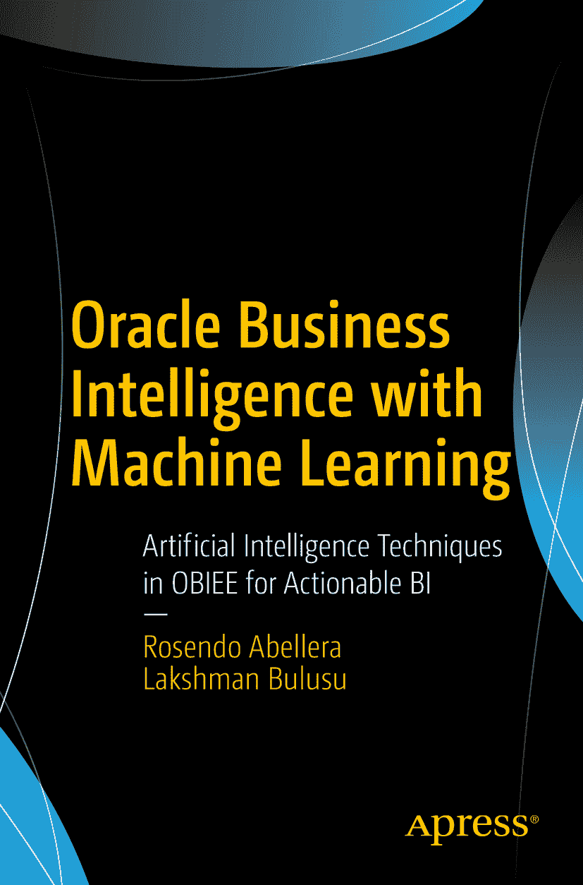

<!--

罗森多·阿贝莱拉 与 拉克什曼·布鲁苏 著《Oracle 商业智能与机器学习：OBIEE 中用于可操作 BI 的人工智能技术》

本书作者引用的任何源代码或其他补充材料，读者均可通过本书的产品页面在 GitHub 上获取，网址为 [`www.apress.com/978-1-4842-3110-4`](http://www.apress.com/978-1-4842-3110-4)。如需更详细信息，请访问 [`www.apress.com/source-code`](http://www.apress.com/source-code)。ISBN 978-1-4842-3254-5e-ISBN 978-1-4842-3255-2 [`doi.org/10.1007/978-1-4842-3255-2`](https://doi.org/10.1007/978-1-4842-3255-2) 美国国会图书馆控制号：2017963641 © 罗森多·阿贝莱拉 与 拉克什曼·布鲁苏 2018 年版权所有。本作品受版权保护。出版商保留所有权利，无论涉及材料的全部或部分，特别是翻译、重印、重用插图、朗诵、广播、以缩微胶卷或任何其他物理方式复制，以及电子改编、计算机软件或目前已知或未来开发的任何类似或不同方法的传输或信息存储与检索。本书中可能出现商标名称、标识和图像。我们并非在每次出现商标名称、标识或图像时都使用商标符号，而是仅以编辑方式使用这些名称、标识和图像，以利于商标所有者，且无意侵犯商标权。本出版物中对商品名称、商标、服务标志及类似术语的使用，即使未明确标识，也不应被视为对其是否受所有权保护的看法。尽管本书中的建议和信息在出版时被认为是真实准确的，但作者、编辑和出版商均不对可能出现的任何错误或遗漏承担法律责任。出版商对本书所含材料不作任何明示或暗示的保证。本书采用无酸纸印刷。由 `Springer Science+Business Media New York` 向全球图书贸易发行，地址：233 Spring Street, 6th Floor, New York, NY 10013。电话：1-800-SPRINGER，传真：(201) 348-4505，电子邮件：orders-ny@springer-sbm.com，或访问 www.springeronline.com。`Apress Media, LLC` 是加利福尼亚州的有限责任公司，其唯一成员（所有者）是 `Springer Science + Business Media Finance Inc` (`SSBM Finance Inc`)。`SSBM Finance Inc` 是特拉华州的一家公司。

-->

# 引言

随着我们迎来 `人工智能` 和 `机器学习`，商业智能进入了一个激动人心的新时代。想象一下。如果这项新技术真的能帮助我们增强思维，并提供通常人类无法实现的能力，那会怎样？我们是否应该冒险押注这项新技术？它真的能帮助我们在数据方面获得竞争优势吗？它能做出正确的推荐吗？我们准备好了吗？

几十年来，我们一直在开发和实施以数据为中心的解决方案。我想说“我们什么都见过了”，但业界从未停止让我惊叹，因为新的进步不断涌现，令人兴奋的新技术不断开辟新天地——比如 `人工智能` 和 `机器学习`。这项技术有望改变游戏规则，我迫不及待想要掌握它。但是等等！我该如何成功地将它融入我繁忙的日程？我该如何成功实施它？我们总有同样的老借口。

随着技术的每一次进步，我们在采用它之前似乎总是要经历一个仪式。首先是怀疑和否认。我们问：“这可能是真的吗？”或者“这是我们一直等待的圣杯吗？”这引发了无休止的讨论和辩论。界限被划出，分歧产生，人们相互对立。有时，一个勇敢的灵魂会站出来，经历反复试验的过程，经验（通过一些成功）缓解了怀疑和反对的痛苦。当尘埃落定，自信的参与者最终开始尝试将新技术纳入他们的计划。这些仪式与每个技术专家和开发人员都争相成为新软件测试者的日子相去甚远。

所以，情况就变成了这样——无论新技术看起来多么迷人。“一朝被蛇咬，十年怕井绳，”他们在我们努力掌握新技术时这样说。所以我们一直等到看到经过验证的成功，并且能够成功复制它。然后它成为一种经过实践检验的可靠方法，从业者可以在他们的项目中信任和使用。最后，知道别人已经铺平了道路，信心就会占据上风。

规避这种经验的一种方法是让一位导师一步步带你完成实施过程，并向你展示如何操作。作为顾问，我们当然提供这种服务，并且我们很乐意始终与您并肩作战，随时准备行动。但由于这可能不可行，我们为您提供了次优选择：我们的书作为指南。在这里，我们记录了我们经过验证的成功经验，并展示了我们的代码。

鉴于这个主题如此新颖，我们撰写本书的目的是提供一个战略和战术视角，将 `机器学习` 纳入您的 `Oracle 商业智能` 安装中。对于从业者和实施者，我们希望本书能让您直接找到所需的部分，以便快速启动和运行您的系统。

如果您对商业智能和 `机器学习` 不熟悉，您可能希望通读全书（但可以略过实际代码），以了解这项新技术如何在您的特定环境中提供最佳优势。这样做将为您提供良好的概述和基础知识，帮助您入门商业智能和 `机器学习`。因此，如果您是负责分析的项目经理或总监，我们建议您采用这种方法。然后，您或许可以将其传递给您的开发团队，让他们整合 `R` 代码，以充分利用本书。出于我们描述的目的，我们有意识地编写了一些纯粹围绕代码的章节，而其他章节则有助于围绕该主题展开讨论。

此外，如果整体来看，每一章都建立在前一章的基础上。本书首先介绍 `人工智能` 和 `机器学习` 的一般概念。然后介绍 `Oracle 商业智能`。最后，逐步深入到一些编码和编程，并以一个实际用例来应用代码作为结尾。本书的这种渐进式结构是有意为之，模仿了软件开发生命周期的方法，我们从规划和分析一直走到实施。

我们希望您觉得本书有用，并祝您在实施这项令人兴奋的新技术时取得成功。

祝您数据探索愉快。

## 致谢

我将本书献给我的母亲维奥莱塔·门多萨·阿贝莱拉，她体现了纯粹的决心和毅力，并向我展示了追求目标永远不嫌晚。您为您的所有子孙树立了永不放弃希望的闪亮榜样。

特别感谢埃里克·佩里开发了结合 `机器学习` 和实时流分析的 `Qteria` 概念验证。同时感谢涂建明和米格尔·加米斯为研究做出的贡献。

——罗森多·阿贝莱拉

感谢我以往所有书籍的读者，感谢他们宝贵的评论和反馈，使我能够在探索 `人工智能` 与商业智能融合这一趋势领域时克服挑战。

——拉克什曼·布鲁苏

# 目录

## 第 1 章：引言 1

### 人工智能与机器学习 2

### 机器学习概述 4

### 模式，模式，还是模式 5

### 机器学习供应商 7

### 自建还是购买？ 7

### OBIEE 中的机器学习组件简介 8

### Oracle BI 与大数据 8

### 适用于 Oracle BI 的 R 语言 9

### 总结 9

### 参考文献 10

## 第 2 章：商业智能、大数据与云 11

### 商业智能的目标 11

### 大数据分析 12

### 但为何现在是机器学习？ 14

### 一图胜千言 14

### 数据建模 17

### 机器学习驱动数据准备的未来 18

### Oracle 商业智能云服务 19

### Oracle 分析云 19

### Oracle 数据库 18c 19

### Oracle 移动分析 20

### 总结 20

## 第 3 章：Oracle R 技术与 R 企业版 23

### 面向企业的 R 技术 23

### 开源 R 23

### Oracle 的 R 技术 25

### 使用 ORE 在 OBIEE 中实现机器学习与商业智能：端到端实践 38

### 使用 ORD 的 randomForest 算法预测葡萄酒产地 38

### 在 Oracle DB 中使用嵌入式 R 执行及 ORE R 接口预测葡萄酒产地 41

### 使用 ore.randomForest 替代 R 的 randomForest 模型 52

### 在 Oracle DB 中使用 ORE SQL 接口的嵌入式 R 执行预测葡萄酒产地 57

### 使用 ORE SQL 接口生成 PNG 图表并集成至 OBIEE 仪表盘 66

### 将 PNG 图表与 OBIEE 集成 70

### 使用上传的 RPD 创建 OBIEE 分析与仪表盘 87

### 机器学习趋势：与 EDW 的完美匹配 89

### 总结 98

## 第 4 章：OBIEE 中的机器学习 99

### 人工智能与商业智能的融合 99

### OBIEE 的演进历程 101

### OBIEE 机器学习的诞生与历史 103

### 作为最佳平台的 Oracle 云上的 OBIEE 105

### OBIEE 中的机器学习 105

### 总结 106

## 第 5 章：用例：OBIEE 12c 中的机器学习 107

### 真实世界用例 107

### 预测葡萄酒产地：使用机器学习分类模型 108

### 以分类后的葡萄酒产地作为预测分析基础——在 OBIEE 中运用机器学习技术扩展 BI 108

### 使用 BI 仪表盘进行可操作决策 108

### 用例的技术与功能分析 109

### 图表输出分析：使用随机森林预测葡萄酒产地的配对图 111

### 图表输出分析：基于葡萄酒来源预测购买倾向 111

### 更详细层面的分析 112

### 预测购买倾向的用例 121

### 总结 133

## 第 6 章：在 OBIEE 12c 中实现机器学习 135

### 业务用例问题描述与解决方案 135

### 技术层面 136

### 解决方案的第一部分 136

### 解决方案的第二部分 147

### Logit 模型总结 168

### AUC 曲线 173

### 使用 ORE SQL 接口实现解决方案 174

### 将 PNG 输出与 OBIEE 仪表盘集成 187

### 总结 193

## 索引 195

## 关于作者与技术审校者

### 关于作者

### 关于技术审校者