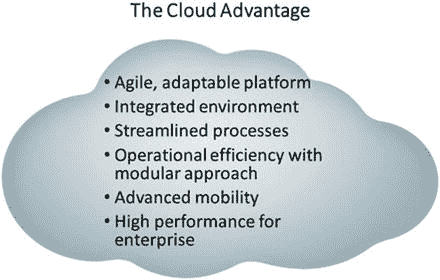

# 2. 商业智能、大数据与云

在我们大约于 2015 年合著的第一本书中，我们描述了一个完整、整体的 BI 解决方案通常涉及三大类报表和分析。在那本书中，我们将其标记为：

*   运营报表
*   运营 BI
*   分析型 BI

当时，我们主要侧重于描述企业商业智能解决方案中的要素——即涉及结构化数据的解决方案。尽管我们写了几章相关内容，但我们几乎有意忽略了当时随着大数据和云的出现而发生的行业变化。自那时起，我们再也无法忽视它们在商业智能和分析未来格局中的存在和主导地位。本书涵盖了这些组件，以及实现高级分析甚至大数据分析的人工智能（机器学习）。

现在，借助大数据、人工智能和云计算等最新技术带来的新能力，报表和分析领域的一个新分类已经占据了前沿并吸引了大量关注。这个新分类包括数据发现和探索，甚至广义上的大数据分析。在这个新分类中，即使是整个商业智能领域也扮演了一个全新的角色。商业智能已经转变为一个完全不同层次的功能，能够提供对从数据中收集到的智能的洞察和交互。这个由人工智能驱动的新一代商业智能，被称为**可操作智能**。

## 商业智能的目标

在商业智能领域，我们已经取得了长足的进步。作为实践者和实施者，我们见证了许多变化和新增功能。其中一些功能在行业早期甚至无法实现，这主要是由于所需技术的不足。以实时或近实时分析为例。当时的挑战在于，当数据到达正确的人手中时，其情报价值已不再新鲜或值得利用。负责此类运营的部门经理或主管甚至无法获取这类信息（及相关洞察）来影响运营流程；这种信息缺失可能使企业无法获得竞争优势。

因此，直到工具和技术变得足够成熟，能够以有助于利用数据获得竞争优势的方式在数据源之间移动数据时，实时商业智能才得以发挥作用。仅仅是在组织内部收集数据以供使用这一行为本身就构成了巨大挑战。在过去的几十年里，仅仅是将所有信息集中存储在一个地方的想法就是一个大问题。当时根本没有有效的方法在系统之间移动数据。人们研究了多种方法，以确定从原始数据中生成情报和分析的最有效途径。让我们来讨论一种早期的数据移动解决方案。

数据收集和使用能力的很大一部分演进是由 Informatica 等公司推动的，这些公司专注于将数据从一个源端传输到目标端。借助基于 Oracle 的优化引擎（OBOE），我们已经有了移动数据的方法，例如，编写 SQL 脚本并使用 Oracle 的 SQL*Loader。但当时仍然没有一种复杂的方法来在系统之间移动数据。即使你能够收集所有数据，仍然面临着清洗、传输和转换数据的挑战。Informatica 等公司通过创建现在所谓的提取、转换、加载（ETL）流程来自动化这一过程，从而解决了这个问题。随着高管们能够专注于商业智能和分析，围绕这项新技术形成了一个完整的市场。

尽管 ETL 在管理流程方面很有效，但在处理大量异构数据，尤其是我们现在称之为大数据的非结构化数据方面，它仍然存在空白。即使有强大的 ETL 工具，也没有有效的方法来移动数据。这个问题为处理大量数据开辟了一个全新的范式。我们将在本章后面讨论这种新的数据准备方法。

### 大数据分析

商业智能和大数据分析之间存在差异。尽管如今这两个术语经常互换使用。然而，随着技术、数据架构和策略——特别是高级分析领域——的新进展，我预计两者最终将融合为一。

在早期，从报表开始，主要关注点是能够以事务方式访问数据。然而，它实际上无法基于历史数据获得任何洞察分析——至少不能自动实现。报表实际上只是访问事务系统中任何数据的一种手段。此后的任何分析都是由不同的系统完成的，通常称为决策支持系统（DSS）或联机分析处理（OLAP）系统。

在当今使用人工智能进行高级分析的世界中，从报表到分析的过渡正变得越来越无缝。如果我们要区分现有的各种系统类型，我们可以讨论报表与分析（作为一个整体，它们被包含在现在所谓的商业智能中）。但是，随着提供无缝报表和分析能力的工具和技术的每一次进步，都会出现新的子类别，这些子类别有其自己的一套成功标准和需求。

就大数据分析而言，出现了一整套与可操作商业智能相关的新目标。我们的目标是推动分析系统走得更远，使其具有预测性和规范性。如果我们想真正改变这个行业的成功，我们必须将这些最新进展视为推动演进的动力，这种演进将把商业智能和分析真正提升到新的水平，使信息和情报能够提供有价值的洞察，然后这些洞察完全可以付诸行动。

借助云，我们离实现可操作商业智能这一目标更近了，因为这种无处不在的解决方案显然提供了几个优势（见图 2-1）。

图 2-1.

云的优势

2016 年，一家流行的数据可视化供应商撰写了一份白皮书，题为“2016 年十大云趋势”。该白皮书指出：

> 2015 年，云技术格局发生了只有高度颠覆性市场才能带来的变化。从分水岭式的创新公告到意想不到的商业举措，2015 年打消了怀疑论者心中关于云革命是永久性的最后一丝疑虑。这场风暴的核心是人们日益认识到，数据作为一种关键业务资产，可以非常高效（且经济高效）地存储在云中。数据库、集成和分析市场现在正竞相了解各自如何最终利用这一转变。

### 但为什么是现在采用机器学习？

支持机器学习的论点相当简单：我们希望在一个存储库中访问尽可能多的数据，并能够分析这些数据，以发现可能有用的某些模式。这些模式可能是人类在没有超级计算机的情况下无法推导出来的。因此，我们可以论证，只有通过人工智能（即机器学习），我们才能获得这些结果。

直到现在，技术还没有为我们提供能够使用当前产生的所有数据的手段。没有这些新工具和技术，我们将面对一片无尽的数据海洋，而作为人类，我们根本无法分析和处理这些数据。

2016 年，Oracle 宣布了其未来战略和下一代云基础设施，称为 Cloud at Customer。为了响应公众对其先前云产品的接受和采用，Oracle 将其新战略聚焦于客户以及新技术可以为其 ERP 项目（例如，EBS）带来的优势，这些项目涵盖了从人力资源到供应链管理的企业各个方面。

Cloud at Customer 将整个企业中的数据与多个来源相结合，并使用机器学习来提供建议。人工智能被嵌入到软件应用程序中，并与 Oracle 的数据相结合。Oracle 将这些产品描述为“软件即服务产品，它将第三方数据与实时分析相结合，以创建能够自适应和学习的云应用程序”。

此外，凭借其实时分析、以用户友好界面呈现的机器学习结果以及数据可视化，像 Cloud at Customer 这样的工程化系统可以为用户提供对其企业数据和信息的更深入洞察。

## 一图胜千言

什么是数据可视化？让我们来探讨这一极为流行的技术在现代分析中日益重要的作用。可视化本身被定义为将信息转化为点、线、条等视觉对象，目的是更高效地向观众传达信息。这些信息可以是数值数据，甚至是抽象的想法、过程或概念。在技术领域，数据可视化指的是展示可存储在计算机中的信息，旨在解释或探索模式、趋势和相关性。从更广泛的意义上讲，这可以看作是数字之间的关系。毫无疑问，使用图表（或其他形式的数据可视化）是处理大量复杂数据的更简便方式，相比之下，处理以电子表格形式存储的表格数据则要困难得多。

我们都听过那句流行的俏皮话：“一图胜千言”，或者用当今商业智能和分析领域的话来说：“一个可视化胜过千个数据点”。数据可视化可以将成行的数据压缩成图形表示，让观众能够快速高效地获取大量信息。它旨在吸引观众并保持其注意力。这是因为图像比表格数据更容易吸收和理解；与文字和数字相比，人类大脑对图像的感知能力更强。

除了视觉特性外，文字和数字是我们一生中习得的编码信息单元。同时呈现大量数字需要大量的脑力处理以及数学和统计专业知识，才能看出它们之间的关系。相比之下，模式、相关性、异常值和趋势则更容易通过视觉识别出来。

在利用数据可视化进行解释说明时，图像也比文字和数字更容易记住。此外，数据可视化能够更全面地回答问题，展示全局图景。例如，假设你有一个定量问题，比如哪个月的销售额最低。通过数据可视化呈现的答案会展示完整的图景，让你看到全年销售额的分布情况，以及该最低值与其他月份相比小了多少。相比之下，基于简单查询的软件给出的答案只会提供直接数值。数据可视化还提供了便捷的数据访问途径和新见解，这能激发后续问题，进而带来新的洞察。例如，回答月度模式的数据如果进行汇总，同样可以回答年度模式的问题。

业务管理者需要精准定位业务中的问题和机遇，同时也要快速弄清其发生的原因和方式，以便做出应对决策。业务分析师需要找出影响这些问题和机遇的关键变量，从而制定正确的解决方案。[1] 数据可视化对分析的影响，是由企业对商业智能和分析的持续需求所决定的。企业依靠分析，通过提供自助式数据访问和即时定制分析，将可操作的信息快速交到业务线用户手中，从而赋能决策者。[2]

认识到将可视化解决方案与数据分析和数据挖掘前端相结合的需求，信息可视化、科学可视化和数据挖掘领域催生了一门新学科：可视分析学。可视分析学关注的是整个所谓的“意义构建”过程，该过程始于数据获取，经过一系列重复和精炼的可视化场景（在此过程中，交互允许用户探索不同视角，或测试和精炼众多假设），最终呈现用户对感兴趣底层现象的洞察。因此，可视分析学通常关注那些因单一静态图像而显得过于庞大或复杂的过程或数据集。可视分析学的目标是提供支持最终用户进行分析性思考的技术和工具。[3]

可视化的另一个基本特征是其交互性。可视化过程很少是静态的。在大多数应用中，需要可视化大量无法在单个屏幕上显示的数据，或者包含每个数据点多个独立数据值的高维数据集，或者两者兼有。在这种情况下，通常不可能显示包含所有数据的静态图像。此外，即使可能，通常也有多种构建数据到图像映射的方法，用户可能希望尝试这些方法以更好地理解手头的数据。所有这些方面都得益于交互式可视化的使用。此类应用使用户能够修改多个参数（从视角、缩放因子、颜色使用到所使用的可视化方法类型），并观察生成图像中的变化。

然而，当今设备和计算机正在产生更大规模和更复杂形式的数据。一个流行的大数据说法是：“当今互联网上 90%的数字数据都是在过去两年内产生的”[4]。数据科学家或数据挖掘者通常要求分析团队具备统计学和数据科学方面的专业知识，以便进行更复杂的探索性分析来处理大数据。因此，业务思考者在获得关于其数据问题的明确答案之前，可能需要咨询数据团队。

可视化是一个持续的过程。大量数据无法通过一张甚至几张图像来概括；大数据过于庞大，每个数据点都有太多有价值的属性。例如，一家连锁百货商店的销售交易数据行包含许多属性：售价、利润率、日期、销售地点、时间，以及源自产品和买家的更多属性。所有这些属性无法全部概括到一种或几种可视化形式中。不同的变量需要在一个持续的过程中被隔离、省略和过滤，以获得新的见解。

从某种意义上说，可视分析学已成为业务思考者访问大数据的用户友好界面。业务思考者可以主动出击，充当分析师。通过快速交互式地访问数据，业务思考者可以自由探索数据，而不必非得回答特定问题或解决特定问题。数据的可见性使得模式、相关性、趋势和异常值更容易、更快速地识别出来，再结合业务专业知识对这些观察结果进行推理，这对企业来说就成了一种非常强大的资产。因此，许多企业软件提供商现在都将可视分析学视为必需品。

在当今商业智能与知识管理的格局中，数据可视化已成为分析领域不可或缺、甚至是最强大的工具。正因如此，许多供应商都聚焦于此，并大力推广其有效实施方法。许多人认为数据可视化是科学与艺术的精妙融合。其引人入胜且高效的界面体验已成为大数据分析方程中不可或缺的一部分，许多供应商也已认识到其作用。

总而言之，数据可视化工具正在改变商业智能，因为市场上的许多供应商主要围绕其数据可视化工具进行市场推广。一些供应商最近凭借这股数据可视化和发现浪潮而声名鹊起，并看到了通过专注于产品数据可视化能力来参与竞争的新机遇。其中许多是小型“部门级”工具。另一方面，商业智能的主要参与者如今也已入局，例如 Oracle 及其最新版本的 OBIEE 12c。在这种情况下，他们发布了可视化功能，以补充其传统且已广受欢迎的工具套件。

参考文献

[`www.sas.com/en_ca/insights/analytics/what-is-analytics.htm`](http://www.sas.com/en_ca/insights/analytics/what-is-analytics.htm) [1]

[`http://bluehillresearch.com/business-intelligence-data-visualization-and-the-brain/`](http://bluehillresearch.com/business-intelligence-data-visualization-and-the-brain/) [2]

Telea, Alexandru. Data Visualization: Principles and Practice. Boca Raton: CRC, Taylor & Francis Group, 2015\. Print. [3]

SINTEF. “Big Data, for better or worse: 90% of world’s data generated over last two years.” ScienceDaily. ScienceDaily, 22 May 2013\. [`www.sciencedaily.com/releases/2013/05/130522085217.htm.`](http://www.sciencedaily.com/releases/2013/05/130522085217.htm) [4]

## 数据建模

当前处理数据的方向是自动将非结构化数据转化为结构化数据。借助 Oracle Analytics Cloud 平台，大数据服务将使用轻量级模型，然后利用人工智能驱动的数据准备功能，从任何数据存储中读取数据并将其添加到模型中。重点转向了业务和分析建模人员，让他们能够将模型应用于已经准备好并可供分析的数据之上，以及真正需要完成的实际工作。

另一个特性是 Oracle Big Data SQL，它能够发送任何非原生格式和标准的查询，例如 NoSQL 数据库。此外，SQL 与 R 语言将结合用于执行分析。

理解支持事务型系统和决策支持系统需要两种不同的结构和架构至关重要。简单来说，一种架构无法有效满足两者的需求。作为数据架构师，你必须理解如何以及何时为各自的系统应用合适的架构。时至今日，我仍然遇到一些组织不理解这一基本概念，从而在构建合适的解决方案时惨遭失败。更糟糕的是，我最近遇到一些组织自行创建了另一种结构（将其解释为混合结构），这种结构既不能有效支持事务型解决方案，也不能有效支持决策支持解决方案。他们最终得到的只是另一个需要维护的结构，需要耗费巨额资金和资源来创建，却仍然在提供合适解决方案方面留下空白。此外，任何由人工智能和机器学习辅助的未来进步，都会因数据结构的模式而进一步混淆，从而无法被利用。

为了说明这一点，请尝试像优化决策支持系统那样优化事务型系统，反之亦然。你会发现最终得到的是徒劳的结果。例如，为事务型系统创建的索引侧重于数据操作（插入、更新和删除），而肯定与为决策支持系统创建的索引不同，后者的主要重点是快速检索和查询。如果能直接对事务型系统进行查询，而无需任何其他类型的工作，那该有多好。确实，当技术发展到事务型系统和决策支持系统可以在后台使用相同数据库结构的地步时，数据架构师及其专业知识将不再被需要。借助机器学习，那一天可能已经到来。

通过使用数据点，我们可以从数据中创建聚合和摘要，从而描绘出事实和行为的图景（这些可能是预期的或意外的）。此外，通过人工智能和机器学习，可以基于基线数据识别异常，以预测某些未来行为。这种预测性和规范性功能是机器学习的最终目标，其重点在于实时分析以及数据中的自动异常检测。

这项技术不仅可以用于查找数据异常，还可以“学习”某些变化，然后根据数据模式和变化提出建议。机器学习可以从数据指标中学习，识别异常，提醒用户，并提供建议。除此之外，它还能识别出我们作为人类未能提出或不可能知道要提出的问题。就像一个最值得信赖的顾问，人工智能可以以我们甚至未曾意识到的方式帮助我们。无论是在我们的日常生活中还是在商业领域，应用人工智能的未来都充满了无限可能。

### 机器学习驱动的数据准备未来

人工智能通过改变我们创建分析解决方案的方式，改变了 Oracle 中分析的未来。其中最重要的变化之一体现在为生成报告而准备数据的过程中。“数据准备”这一术语正变得越来越重要，并且可能成为我们一直寻求的颠覆性变革。

让我来阐述一下这为何意义重大。当从头开始构建一个解决方案时，传统的实施方法是首先建立支持应用程序或解决方案所需的数据基础。通常，这项工作需要业务和技术资源投入大量的时间和精力，才能构建出合适的数据基础。因此，数据架构师的任务是设计数据模型及后续的数据库，整个开发过程都依赖于它。

二十多年来，我的专业知识被反复运用。根据我的个人观察，尽管这对于以数据为中心的应用程序开发者来说是一项极其重要的技能，但它似乎常常被遗忘甚至被搁置。结果，我目睹了许多项目因缺乏数据架构和数据建模技能而失败。事实上，奠定基础可能是以数据为中心和数据驱动的解决方案中唯一最重要的部分。没有合适的基础，下游应用程序就不得不“强行”拼凑解决方案，试图弥补数据模型中的问题。我花了多年的经验才最终能够一次又一次地提供这种专业知识。那么，如果这种专业知识能够被打包，以便随时用于创建解决方案，那会怎样？这样的应用程序将扮演数据架构师的角色，配备必要的设计技术，以构建合适的数据模型和基础。本质上，你将能够即时交付解决方案，因为自动化可以轻松处理这一切。

进入当今创建数据模型的范式，它已经发生了显著变化。在当今的流程中，时机同样是一个重要因素。在启动一个解决方案时，我们不再需要预先完全指定数据模型，机器学习使我们能够识别缺失的某些数据元素和对象，并将它们追加到已有的模型中。这消除了数据建模师和架构师在首次尝试正确奠定基础时经常遇到的常见障碍。那么，这对开发有何影响？通过仅需建立一个基线基础，然后让人工智能通过识别缺失组件来继续开发，实施周期可以大大缩短。换句话说，通过机器学习，你的机器学习算法可以读取并利用一个简单的模式，从而确定数据进入着陆区时的正确存储方式。因此，通过机器学习算法，该机制可以根据数据采样推荐甚至创建合适的属性，以自动生成新的模式。

那么，这对数据建模意味着什么？这意味着你不再需要确保你的模式当前已与你的数据库及后续的 RPD 正确指定。机器学习将帮助自动包含任何超出结构化模式的数据，通过根据数据中发现的模式将其作为推荐添加进来。

总结一下，建议的创建合适数据模型的流程是：使用一个规范模型，为任何实体指定一个基础。然后，利用机器学习算法，任何后续需要的额外属性都可以自动添加到模式和结构中。

### Oracle 商业智能云服务

2014 年，Oracle 发布了其首批云上 BI 平台之一，作为其 Oracle 分析云产品的一部分。这是一个功能完备的云应用程序，在当时相对较新。对于熟悉 OBIEE 的从业者来说，它本质上提供了 11g 的功能。

2016 年，我正在为一家美国政府机构实施 OBIEE 12c，同时也在一次 Oracle 应用用户组会议上展示了 BICS 产品。我注意到数据可视化功能和组件是作为独立产品提供的。我感觉到 Oracle 将 OBIEE、Visual Analyzer 和大数据分析整合在一起只是时间问题。现在，那个时刻已经到来，我敦促那些曾经感兴趣并尝试过的人再给它一次机会。

### Oracle 分析云

在我们今天拥有的 Oracle 分析云之前，BICS 是第一代云上 BI 应用程序。如前所述，其套件包中包含了从头开始开发报告和分析所需的工具，包括数据库服务、建模工具、数据加载器和仪表盘。从行业角度来看，它是首批云上产品之一，其功能集更类似于 11g。

Oracle 分析云是第二代分析产品，本质上是 Oracle 云解决方案的“最新、最强大”版本（12c）。此外，作为未来的战略方向，Oracle 将首先在云版本中更新新功能，随后本地部署版本也会跟进。

在功能方面，标准版专注于可视化（与 Tableau、Qlikview 和 PowerBI 等数据可视化工具竞争）。企业版则包含了一切，使其成为一个完整的整体解决方案，包括包含大数据和人工智能组件的大数据湖版。此外，它还拥有用于报表的 BI Publisher。对于高级分析，内置了 R 语言和地图功能。为了帮助快速启动开发，还免费提供了一个内容包。通过用 R 语言编程的机器学习方法，分析工具会建议纠正措施。随后，分析项目可以发布、导出和导入，以便与他人共享或嵌入网页中分享。

### Oracle 数据库 18c

Oracle 于 2017 年 10 月宣布，其旗舰产品 Oracle 关系数据库管理系统的最新版本（18c 版）现在使用机器学习来自动维护、管理和排查系统问题。这包括升级、打补丁和自身调优。该技术能够为系统建立基线，然后利用机器学习方法和技术，学习什么是“不正常”的，并建议相应的纠正或自我修改方法。

## Oracle 移动分析

作为 Oracle 整体战略中不可或缺的一部分，它已整合了多种程序和应用程序，以适配当今的移动设备。Day by Day 和 Synopsis 是移动应用程序，属于其与企业层无缝集成的下一代移动应用的一部分。

### 随时随地分析

Oracle Business Intelligence Mobile 是唯一一款提供全方位功能的移动应用——从交互式仪表盘到位置智能——并允许您直接从移动设备启动业务流程。该应用使您能够执行以下操作：

*   让商业智能像任何消费级移动应用一样易于使用
*   在 Apple iPhone 和 iPad 上查看、分析所有 Oracle Business Intelligence 内容并采取行动
*   即时访问移动设备上的新内容或现有内容；无需更改设计
*   通过直观易用的移动应用程序，提高组织中商业智能的使用率

[`www.oracle.com/solutions/business-analytics/business-intelligence/mobile/bi-mobile/index.html`](https://www.oracle.com/solutions/business-analytics/business-intelligence/mobile/bi-mobile/index.html)

用户将通过移动设备使用语音界面，该界面进而会经过企业 BI 和大数据湖层的语义层，最终根据您的查询构建可视化结果。

## 总结

Oracle 通过其最新推出的 Oracle Analytics Cloud 平台，提供了一个完整、整体的分析解决方案，涵盖了商业智能、大数据和人工智能，所有这些都运行在无处不在的云上。

机器学习的两个主要特点如下：

*   数据可视化
*   数据准备

这些是颠覆性的变革，为通过高级分析提供商业智能提供了全新的范式。

通过机器学习，洞察成为可能。其中一些洞察涉及我们人类甚至无法想到的事物。即使在有效处理来自大数据甚至企业数据仓库的海量数据时，人工智能也能帮助识别数据中我们通常无法发现的模式。

