# 3. Oracle R 技术与 R Enterprise

人工智能的进步已将商业智能的领域扩展到机器学习、预测分析以及大数据分析。这产生了一套广泛的机器学习算法，可用于解决现实世界中的商业智能问题。用于机器学习和统计计算的最流行且广泛使用的语言之一是 `R` 开源语言。其广泛的算法集，加上对丰富图形和数据可视化的支持，使其成为数据分析和数据科学的首选语言。

本章重点介绍面向企业的 `R` 技术。它还概述了如何使用一些广泛的 `R` 开源包，以及如何从机器学习的角度在 `Oracle` 数据库中使用 `R` 脚本和 `Oracle R Enterprise`。本章解释了如何将 `Oracle R Enterprise` 与 `OBIEE` 结合使用。最后，它解释了如何通过使用 `R` 生态系统中的机器学习来执行大数据高级分析。

## 面向企业的 R 技术

`R` 是一种用于机器和统计学习以及高级图形功能的开源脚本语言。就本章而言，`R` 技术可以大致分为两类：开源 `R` 和 `Oracle` 的 `R` 技术。

### 开源 R

开源 `R` 包含丰富的编译代码、功能例程以及以包和视图形式存在的相关数据，这些视图称为 `CRAN` 视图或 `CRAN` 任务视图。`CRAN` 是 `Comprehensive R Archive Network`（综合 `R` 档案网络）的缩写，包含发布到其网站 [`http://cran.r-project.org`](http://cran.r-project.org) 的用户自定义包。每个任务视图包含一个特定于某个功能域的网页以及该域对应包的详细信息。`CRAN` 任务视图的示例包括：医疗保健领域的遗传学、临床试验和医学影像；机器学习；统计学习；时间序列分析；以及金融分析。

`R` 具有可扩展性和全面性，能够以新包的形式添加自定义功能。`R` 还可以通过开箱即用的功能（以旋钮的形式）进一步扩展，有助于进行额外的定制。可以使用 `R` 项目网站或 `CRAN` 网站免费下载和安装 `R`。

**注意**：`R` 开源项目的详细信息可在 [`www.R-project.org`](http://www.r-project.org) 找到。

表 3-1 描述了广泛用于机器学习的 `CRAN` 任务视图。这些信息也可以在 [`https://cran.r-project.org/web/views/MachineLearning.html`](https://cran.r-project.org/web/views/MachineLearning.html) 找到。

**表 3-1. 用于机器学习的 CRAN 任务视图**

| 视图名称 | 描述 |
| --- | --- |
| [神经网络](https://cran.r-project.org/web/views/Bayesian.html)与深度学习 | 斯图加特神经网络模拟器 (`RSNNS`) 用户可扩展人工神经网络 (`FCNN`) 深度学习——`darch`、`deepnet`、`RcppDL`、`h2o` `TensorFlow` |
| [递归](https://cran.r-project.org/web/views/ChemPhys.html)划分 | 用于回归、分类和生存分析的树结构模型；基于规则的模型和提升；递归划分 |
| [随机](https://cran.r-project.org/web/views/ClinicalTrials.html)森林 | 回归与分类、集成学习、强化学习树 |
| [正则化](https://cran.r-project.org/web/views/Cluster.html)与收缩方法 | 线性、逻辑和多项回归模型；基因表达分析 |
| [提升](https://cran.r-project.org/web/views/DifferentialEquations.html)与梯度下降 | 基于梯度下降的梯度提升和学习模型，用于回归任务 |
| [支持](https://cran.r-project.org/web/views/Distributions.html)向量机 | 与 `SVMLIB` 和 `SVMLight` 的接口（仅用于一对多分类） |
| [贝叶斯方法](https://cran.r-project.org/web/views/Econometrics.html) | 贝叶斯加性回归树 (`BART`)、遗传算法等 |
| [关联](https://cran.r-project.org/web/views/Environmetrics.html)规则 | 挖掘频繁项集、最大项集、闭合频繁项集和关联规则 |
| [基于模糊规则](https://cran.r-project.org/web/views/ExperimentalDesign.html)的系统 | 基于数据的模糊规则系统，用于回归和分类、粗糙集理论和模糊粗糙集理论 |
| [元](https://cran.r-project.org/web/views/ExtremeValue.html)包 | 构建预测模型 (`caret`)、`GBM`、`GLM`（带弹性网络正则化）、`mlr` 和深度学习（前馈多层网络） |
| `GUI` | `R` 中用于数据挖掘的图形用户界面 |
| [可视化](https://cran.r-project.org/web/views/Genetics.html) | `R` 中的各种图表和图形，用于可视化，包括散点图、特征集、`ggplots`、配对图、探索性数据分析图、格子图，以及用于学习模型（包括随机森林和 `SVM`）的图、预测函数等 |
| [统计](https://cran.r-project.org/web/views/Graphics.html)学习 | 基于统计和概率的各种算法，用于数据挖掘、推理和预测 |
| [杂项](https://cran.r-project.org/web/views/HighPerformanceComputing.html) | 模型选择和验证算法、量化测试模式类别的证据分类器、用于确定和处理缺失值和数值数据的分类模型、用于预测响应变量的基于特征和基于图的数据 |

### Oracle 的 R 技术

`Oracle` 的 `R` 技术包含以下组件：

*   `Oracle R` 发行版
*   `ROracle`
*   `Oracle R Enterprise (ORE)`
*   `Oracle R Advanced Analytics for Hadoop`

以下各小节将对每个组件进行说明。

#### Oracle R 发行版

`Oracle R` 发行版是开源 `R` 的免费 `R` 软件再发行版。它包含动态加载数学库以进行高性能计算和学习的功能，包括多线程执行。主要的数学库包括 `Intel` 数学核心函数库、`AMD` 核心数学库和 `Solaris Sun` 性能库。矩阵函数、成分分析、快速傅里叶级数变换和向量分析等数学函数可以使用这些库透明地完成。`Oracle R` 发行版还对开源 `R` 进行了增强，并可在 `Oracle Enterprise Linux`、`Solaris`、`AIX` 和 `Windows` 上使用。`Oracle` 高级分析选项和大数据设备以及 `Oracle R Enterprise` 的客户均可享受 `Oracle` 支持。使用 `Oracle R` 发行版还可以在客户端和数据库之间实现嵌入式 `R` 执行的扩展性。在撰写本文时，`Oracle R` 发行版的最新版本是 `3.3.0`。

#### ROracle

`ROracle` 是一个符合数据库接口规范的 `Oracle` 驱动程序，用于 `R`，它使用 `Oracle` 调用接口 (`OCI`) 库。`ROracle` 经过重新设计和优化，用于 `R` 与 `Oracle DB` 之间的连接，是由 `Oracle` 管理的开源 `R CRAN` 包。它主要支持从 `R` 接口执行 `SQL` 语句，并为数据操作语言 (`DML`) 操作提供事务支持。`Oracle R Enterprise` 也使用 `ROracle` 来连接 `R` 和 `Oracle DB`。与 `RODBC` 和 `RJDBC` 相比，`ROracle` 在从 `Oracle` 表读取到 `R data.frame` 以及从 `R data.frame` 写入到 `Oracle` 表时，连接速度更快。`ROracle` 还可跨所有数据类型（主要是 `Oracle` `NUMBER`、`VARCHAR2`、`TIMESTAMP` 和 `RAW` 数据类型）以及大型结果集进行扩展。在撰写本文时，`ROracle 3-1.11` 是 `ROracle` 的最新版本。

**注意**：`ROracle` 可用于从 `Oracle R` 发行版连接到 `Oracle DB`。要使用 `ROracle`，必须安装 `Oracle Instant Client` 或 `Oracle` 标准数据库客户端。使用 `ROracle` 连接时，`SQL*Plus` `SQL` 接口也可以与 `Oracle Instant Client` 一起使用。使用 `Oracle Instant Client` 时，无需创建 `ORACLE_HOME`。

# 使用 ROracle 包连接和操作 Oracle 数据库

## 安装准备
要使用 `ROracle` 包，首先必须安装 Oracle 数据库。然后安装 Oracle R，接着安装 `ROracle` 包和数据库接口 (`DBI`) 包。

## 建立连接
完成安装后，可以通过首先加载 `ROracle` 库和 Oracle DB 驱动程序，然后创建数据库连接，在 Oracle DB 和 Oracle R 之间建立连接。
```
SQL> alter user testr quota unlimited on users;
用户已更改。
```
这将为用户 `testr` 在表空间 `users` 上分配无限配额。
```
SQL> create table temp_tab(cd varchar2(10 char) constraint temp_tab_pk primary key,
2  descr varchar2(30 char) not null,
3  eff_start_date date not null,
4  eff_end_date date);
表已创建。
```

## 执行操作
完成后，可以执行标准的 DDL、DML 和/或提交/回滚操作。完成数据库操作后，需要关闭数据库连接并卸载数据库驱动程序。

### 使用 ROracle 查询数据示例
清单 3-1 给出了使用 `ROracle` 的示例；该代码加载 `ROracle` 包，然后从 Oracle 模式表中检索结果。可以使用内置的 RConsole 来运行 `ROracle` 方法。
```
library(ROracle)
drvr <- dbDriver("Oracle")
conn <- dbConnect(drvr, username = "myusername", password = "mypassword")
select_resultset <- dbSendQuery(conn, "select * from myusername.temp_tab")
fetch(select_resultset)
row_cnt <- dbGetRowCount(select_resultset)
if (row_cnt == 0) {
warning("未返回任何结果！")
}
dbClearResult(select_resultset)
dbDisconnect(conn)
dbUnloadDriver(drvr)
```
以下是在 RGui 中执行代码的输出：
```
> library(ROracle)
正在加载所需包：DBI
警告消息：
1: 包 'ROracle' 是在 R 版本 3.3.0 下构建的
2: 包 'DBI' 是在 R 版本 3.2.5 下构建的
> drvr <- dbDriver("Oracle")
> conn <- dbConnect(drvr, username = "myusername", password = "mypassword")
> select_resultset <- dbSendQuery(conn, "select * from myusername.temp_tab")
> fetch(select_resultset)
[1] CD             DESCR          EFF_START_DATE EFF_END_DATE
 (或 0 行行名)
> row_cnt <- dbGetRowCount(select_resultset)
> if (row_cnt == 0) {
+ warning("未返回任何结果！")
+ }
警告消息：
未返回任何结果！
> dbClearResult(select_resultset)
[1] TRUE
> dbDisconnect(conn)
[1] TRUE
> dbUnloadDriver(drvr)
[1] TRUE
>
```

## 其他连接选项
也可以在 `dbConnect` 中使用数据库实例名称属性来指定 Oracle 实例：
```
conn <- dbConnect(drvr, username = "myusername", password = "mypassword", dbname="mydbinstance")
```
除了使用 `dbDriver("Oracle")`，还可以使用 Oracle 方法 `Oracle()` 来实例化一个 Oracle 实例：
```
drvr <- Oracle()
```
此外，还可以设置另外两个参数 `SYSDBA` 和 `external_credentials`，分别用于以 `SYSDBA` 身份连接和进行外部身份验证。它们的指定方式为 `SYSDBA = TRUE|FALSE` 和 `external_credentials=TRUE|FALSE`。这些功能在 `ROracle` 1-1.11 版本中受支持。

## 完整示例：写入与读取数据
清单 3-2 给出了将数据从 R 的 `data.frame` 写入 Oracle 表，随后从同一表中读取数据到 R 的 `data.frame` 并显示的示例代码。
```
library(ROracle)
drvr <- dbDriver("Oracle")
conn <- dbConnect(drvr, username = "testr", password = "testr", dbname="orcl")
insertStr <- "insert into testr.temp_tab values (:1, :2, :3, :4)";
cd <- "CD13";
descr <- "Description for Code 13";
eff_start_date <- "2017-01-01";
eff_start_date <- as.POSIXct(eff_start_date);
eff_end_date <- "2017-12-31";
eff_end_date <- as.POSIXct(eff_end_date);

# The TZ env variable in R must be set as also the corresponding ORA_SDTZ # env var to the same value
Sys.setenv(TZ = "EST")  # EST value is obtained from SESSIONTIMEZONE value # in Oracle
Sys.setenv(ORA_SDTZ = "EST")
dbGetQuery(conn, insertStr, data.frame(cd, descr, eff_start_date, eff_end_date));
dbCommit(conn)

# Selecting data into R data.frame and displaying it
select_resultset <- dbSendQuery(conn, "select * from testr.temp_tab")
data <- fetch(select_resultset)
dim(data)
data
dbClearResult(select_resultset)
dbDisconnect(conn)
dbUnloadDriver(drvr)
```
清单 3-2 使用 `ROracle` 连接到 Oracle 数据库表，将数据从 R 的 `data.frame` 写入该表，再将同一表的数据读入 R 的 `data.frame` 并显示。

### 运行清单 3-2 中代码的输出
```
> library(ROracle)
Loading required package: DBI
Warning messages:
1: package 'ROracle' was built under R version 3.3.0
2: package 'DBI' was built under R version 3.2.5
> drvr  conn  dbListTables(conn)
[1] "TEMP_TAB"
> Sys.timezone()
[1] "EST"
> Sys.setenv(TZ = "EST")
> Sys.setenv(ORA_SDTZ = "EST")
> dbGetQuery(conn, insertStr, data.frame(cd, descr, eff_start_date, eff_end_date));
[1] TRUE
> dbCommit(conn)
[1] TRUE
> select_resultset  data  dim(data)
[1] 1 4
> data
CD                   DESCR EFF_START_DATE EFF_END_DATE
1 CD13 Description for Code 13     2017-01-01   2017-12-31
> dbClearResult(select_resultset)
[1] TRUE
> dbDisconnect(conn)
[1] TRUE
> dbUnloadDriver(drvr)
[1] TRUE
>
```

基于绑定参数值（即执行清单 3-2 时代替 `:1`、`:2`、`:3`、`:4` 的实际值）的一组行，也可以从 Oracle 表读入 R 的 `data.frame` 并显示。清单 3-3 给出了示例代码。

##### 清单 3-3. 使用 Oracle R 的 ROracle 连接到 Oracle 数据库表，将数据从 R 的 `data.frame` 写入该表，再将同一表的数据读入 R 的 `data.frame` 并显示

```
library(ROracle)
drvr <- dbDriver("Oracle")
conn <- dbConnect(drvr, username = "testr", password = "testr", dbname="orcl")
dbListTables(conn)

# Selecting data based on code value CODE13 into R data.frame and displaying it
select_resultset <- dbSendQuery(conn, "select * from testr.temp_tab where cd = :1", data = data.frame(cd='CODE13'))
data1 <- fetch(select_resultset)
dim(data1)
data1
dbClearResult(select_resultset)
dbDisconnect(conn)
dbUnloadDriver(drvr)
```

以下是运行清单 3-3 中代码的输出：

```
> library(ROracle)
> drvr  conn  dbListTables(conn)
[1] "TEMP_TAB"
> select_resultset  data1  dim(data1)
[1] 1 4
> data1
CD                   DESCR EFF_START_DATE EFF_END_DATE
1 CD13 Description for Code 13     2017-01-01   2017-12-31
> dbClearResult(select_resultset)
[1] TRUE
> dbDisconnect(conn)
[1] TRUE
> dbUnloadDriver(drvr)
[1] TRUE
>
```

## Oracle R Advanced Analytics for Hadoop

Oracle R Advanced Analytics for Hadoop (ORAAH) 是 Oracle Big Data Connectors 软件套件的一个组件。ORAAH 的最新版本是 2.7.0。它将 Hadoop 集群内的 Hadoop 和 Apache Hive 与 Oracle 数据库（需具备 Advanced Analytics 选项）以及 R（通过包含 R 引擎和开源 R 包的 R 接口）集成在一起。可以使用基于 Hive 的 Hibernate 查询语言 (HQL) 以及通过将 HDFS 数据映射直接作为机器学习例程的输入，来处理 Hadoop 分布式文件系统 (HDFS) 中的数据。后者随后可以作为调用自定义 R 映射器和/或归约器的 MapReduce 作业来执行，或者通过使用 Apache Spark 来执行。基于 Hive 的 HQL 支持数据准备、连接和视图创建。源数据可以是 HDFS 逗号分隔值 (CSV) 数据集、Hive 表，或者缓存到 Apache Spark 中作为弹性分布式数据集 (RDD) 的 HDFS CSV 数据集。与基于 Spark MLlib 的算法相比，ORAAH 基于 Spark 的算法性能更优，同样，与相应的 MapReduce 算法相比，ORAAH 基于 Spark 的算法也是如此。

表 3-2 显示了 ORAAH 最新版本支持的 Hadoop 集群中的主要算法。这些算法用于机器学习和统计学习，并支持并行化和分布式执行。此外，GLM 和 LM 算法能够处理大数据并在企业范围内扩展，且比相应的 Apache Spark MLlib 模型更快。

##### 表 3-2. ORAAH 支持的主要机器学习算法

| 算法名称 | 描述 |
| :--- | :--- |
| 线性回归 | 用于回归——基于 Spark 和 MapReduce |
| 逻辑回归 | 用于分类，基于 Apache Spark MLlib |
| LM | 用于回归，基于 Apache Spark MLlib 和 MapReduce |
| 启用 Spark 缓存的多层感知前馈神经网络 (MLP NN) | 用于分类，自 2.7.0 版本起基于 MapReduce 和 Spark |
| 启用 Spark 缓存的广义线性模型 (GLM) | （表内原描述未区分，此处保留原格式） |
| 主成分分析 (PCA) | 用于属性重要性，基于 Spark 和 MapReduce |
| k-means | 用于聚类，基于 Spark 和 MapReduce |
| 非负矩阵分解 (NMF) | 用于特征提取，基于 MapReduce |
| 低秩矩阵分解 (LMF) | 用于特征提取，基于 MapReduce |
| 高斯混合模型 | 2.7.0 版本新增，基于 Apache Spark MLlib |
| 相关性和协方差矩阵计算 | 用于统计计算和学习，基于 MapReduce |
| 最小绝对收缩和选择算子 (LASSO) | 基于 Spark |
| 决策树 | 基于 Spark |
| 随机森林 | 基于 Spark |
| 支持向量机 | 基于 Spark |

**注意**
关于 ORAAH 的更多信息，包括支持的各种算法和基准测试，可在 Oracle 网站上找到：[`www.oracle.com/technetwork/database/database-technologies/bdc/r-advanalytics-for-hadoop/overview/index.html`](http://www.oracle.com/technetwork/database/database-technologies/bdc/r-advanalytics-for-hadoop/overview/index.html)。

使用 Hive 和 ORAAH 实现其中一些算法的实际用例示例，可在 [`https://blogs.oracle.com/R/entry/oracle_r_advanced_analytics_for`](https://blogs.oracle.com/R/entry/oracle_r_advanced_analytics_for) 找到。

## Oracle R Enterprise

Oracle R Enterprise（ORE）是迄今为止最重要的 Oracle R 技术，它随 Oracle 数据库的 Oracle Advanced Analytics 选件一同提供。ORE 通过直接利用 Oracle 数据库内计算来处理存储的数据，从而增强并扩展了开源 R 的执行能力，进而实现了更低的延迟、高性能计算、数据和任务的多线程并行执行、可扩展性以及更低或最小的内存使用。

从架构角度来看，ORE 包含以下组件：

*   安装了 Oracle 数据库的数据库服务器机器，其中包含支持 ORE 客户端的库和 PL/SQL 程序

*   安装在 Oracle 数据库上的 R 引擎，支持嵌入式 R 执行，并执行数据库内统计和机器学习功能。每个数据库 R 引擎、ORE 服务器和 ORE 客户端包。Oracle 数据库会生成多个 R 引擎以实现数据并行。数据库内 R 引擎具有原生 Oracle 数据库功能集，能够实现紧密的 SQL 集成和基于 DBMS 包的功能

*   Oracle R 发行版

*   用于数据库连接的 R Oracle

*   包含客户端 ORE 包、开源 R（或 Oracle R 发行版）和 ROracle 的客户端 R 引擎

*   数据库 R 脚本仓库，用于在 Oracle 数据库内存储 R 脚本，这些脚本可以直接从 SQL 中按名称调用

*   数据库 R 数据存储，用于在 Oracle 数据库内存储 R 对象

图 3-1 概述了 ORE 架构。

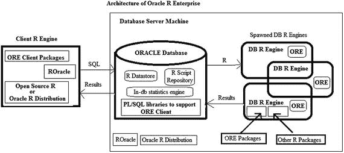

##### 图 3-1. Oracle R Enterprise 架构概览

从增强功能的角度来看，ORE 通过以下方式扩展了开源 R：

*   ORE 透明层

*   嵌入式 R 执行（通过嵌入式 R 引擎）——包括 R 接口和 SQL 接口

*   预测分析

在撰写本文时，Oracle R Enterprise 的最新版本是 1.5.0。

**注意**

# 使用 ORE 与 OBIEE 进行机器学习和商业智能：端到端实践

有关 ORE 的更多信息，包括 ORE 1.5.0 中的增强功能，请访问 [`www.oracle.com/technetwork/database/database-technologies/r/r-enterprise/overview/index.html`](http://www.oracle.com/technetwork/database/database-technologies/r/r-enterprise/overview/index.html)。

从企业角度来看，ORE 具有以下特性：

### 表 3-3. ORE 嵌入式执行 API（适用于 R 接口和 SQL 接口）

| API R 接口 | API SQL 接口 | 描述 |
| --- | --- | --- |
| `ore.doEval` | `rqEval` | 执行函数 `f`，不带输入数据参数。 |
| `ore.tableApply` | `rqTableApply` | 执行函数 `f`，通过 `f` 的第一个参数（作为 `data.frame`）提供 `ore.frame` 输入数据参数。 |
| `ore.groupApply` | `rqGroupApply` | 根据索引列中的值对数据进行分区，然后执行函数 `f`。每个数据分区作为 `data.frame` 参数提供给 `f` 的第一个参数。支持对 `f` 的每次调用进行并行执行。 |
| `ore.rowApply` | `rqRowEval` | 通过传递所提供输入数据的行块来执行函数 `f`。每个输入数据块作为 `data.frame` 传递给 `f` 的第一个参数。支持对 `f` 的每次调用进行并行执行。 |
| `ore.indexApply` | 不适用 | 执行函数 `f`，不带输入数据参数，但带有执行调用的索引 `1` 到 `n`，其中 `n` 是函数调用的次数。支持对 `f` 的每次调用进行并行执行。 |
| `ore.scriptCreate` | `sys.rqScriptCreate` | 将 R 脚本以给定的名称和关联函数存储到 ORE R 脚本仓库中。 |
| `ore.scriptDrop` | `sys.rqScriptDrop` | 从 ORE R 脚本仓库中删除具有给定名称的 R 脚本。 |
| `ore.scriptLoad` |  | 从 ORE R 脚本仓库加载具有给定名称的 R 脚本，以便后续执行与该 R 脚本关联的函数。 |

在“描述”列中，函数 `f` 指的是与每个 API 关联的 R 函数。

- ORE 在内存分配和多线程执行方面提供了所需的优化，无需额外的补充包，因为它能够直接在 Oracle 数据库中的数据上执行数据库内的 R 脚本和模型。大型数据集可以加载到内存中，并通过函数调用运行，而无需创建数据的副本，从而消除了 R 的按值调用语义。这在执行来自 CRAN 集合的开源 R 包时也同样适用。

- 通过 R 进行的数据库内数据计算和分析是透明完成的。基本的 R 操作可以编码为 R `data.frame`。相应的 R 函数以重载的函数定义形式暴露，其执行被推送到 Oracle 数据库。统计和机器学习操作在 Oracle 表的数据上执行。ORE 提供了 `ore.frame` 对象（`data.frame` 的子类），这些对象会替代数据库表，从而生成 SQL，用于对存储在 Oracle 中的数据进行数据库内执行。这种透明层在操作效率和大数据集规模下提供了更低的延迟和最佳性能。

- 通过使用 Oracle 数据库生成的嵌入式 R 引擎，ORE 通过其嵌入式 R 执行支持实现了数据和任务的并行性。利用更多的内存可用性和数据库启用的数据并行性，嵌入式 R 执行能够执行嵌入在 SQL 和 PL/SQL 例程中的 R 脚本（包括基于开源 CRAN 包的脚本）。这种处理方式称为无人值守处理。R 脚本可以存储在数据库 R 脚本仓库中，并在调用 SQL 语句时按名称调用。这也可以动态完成。嵌入式 R 执行通过 R 和 SQL API 暴露。此类执行的输出可以是结构化数据、R 对象和图形的 XML 表示，或者通过 Oracle 表中的 BLOB 列生成的 PNG 图形。后者通过将 R 的结果传递给商业智能和高级分析，实现了与其他应用程序（如 OBIEE RPD 和仪表板）的无缝集成。表 3-3 列出了 ORE v1.5.0 的这些 API（包括 R 接口和 SQL 接口）。

- ORE 还允许通过 R 与数据库内预测分析算法进行交互。示例包括 `OREeda`（探索性数据分析）、`OREdm`（数据挖掘）和 `OREpredict`。`OREeda` 可以实现线性模型、逐步回归、广义线性模型、神经网络和随机森林算法，以及基础 SAS 等效功能。

`OREeda` 包含数据库启用的 ORE 版本的 R 模型，用于并行执行线性回归和逐步回归、广义线性模型、神经网络和随机森林分类。它通过以下函数暴露这些功能：`ore.lm()` 用于线性回归和最小二乘回归，`ore.stepwise()` 用于逐步最小二乘回归，`ore.glm` 用于广义线性模型和逻辑回归，`ore.neural()` 用于模式识别的神经网络模型，以及 `ore.randomForest()` 用于分类。所有这些都基于 `ore.frame` 中的数据工作，并可用于基于 Oracle 数据库中的数据创建 R 模型。

`OREdm` 拥有与实现分类、回归、聚类、属性重要性、关联规则、特征提取和异常检测等效的 Oracle 数据挖掘算法。这些算法可用于使用 Oracle 表中的数据构建模型。以下是算法列表：

- 分类
  - 决策树
  - GLM 分类——二元逻辑回归
  - 朴素贝叶斯
  - 支持向量机
  - 随机森林——ORE V1.5.0 新增
- 回归
  - GLM 回归（线性回归和岭回归）
  - 支持向量机
- 聚类
  - k-means（一种基于距离的聚类算法）
  - 正交划分聚类，或 O-Cluster（`ore.odmOC`）
- 属性重要性（最小描述长度——`ore.odmAI`）
- 关联规则
  - Apriori（`ore.odmAssocRules`）
- 特征提取
  - 非负矩阵分解（`ore.odmNMF`）
  - 主成分分析——V1.5.0 新增
  - 奇异值分解——V1.5.0 新增
- 异常检测
  - 支持向量机

`OREpredict` 提供了使用选定的 R 模型对 `ore.frame` 对象中的数据库内数据进行评分的能力。通常，使用 R 模型进行评分的数据必须位于 R 的 `data.frame` 中。ORE 允许在评分操作期间将这些原生 R 模型透明地转换为 SQL。示例包括用于行为分析的数据库内 SQL 和 R 预测模型。`OREpredict` 包含以下算法：

- 线性模型
- 广义线性模型
- 负二项广义线性模型
- 多项对数线性模型
- k-means 聚类
- 层次聚类
- 神经网络
- 递归划分与回归树

ORE 提供了在企业级分析所需数据的备份、恢复和安全性。

ORE 会自动处理从 Oracle 表到 R 的 `data.frame` 的语义数据映射，反之亦然。否则，在使用 `RODBC`、`RJDBC` 和 `ROracle` 包直接访问数据库时，或在涉及 R 的分析模型创建过程中，这些映射是必需的。

### 表 3-4. 主要的 ORE 包

| 包 | 功能 |
| --- | --- |
| `DBI` | R 数据库接口的补充包 |
| `ORE` | Oracle R Enterprise |
| `OREbase` | 与 R 基础包相关的功能 |
| `OREgraphics` | 与 R 图形包相关的功能 |
| `OREstats` | 与 R 统计包相关的功能 |
| `OREeda` | 探索性数据分析包 |
| `OREdm` | 数据挖掘包（Oracle 数据挖掘） |
| `OREpredict` | 使用 R 模型预测对 Oracle 数据库中的数据进行评分的包 |
| `ORExml` | 在 R 内生成 XML 的功能 |
| `bitops` | 位运算函数 |
| `png` | 在 R 和 Oracle DB 之间读写 PNG 图像的补充包 |
| `OBIEEAdvancedAnalytics` | ORE 中支持的、用于与 OBIEE 集成的先进分析和机器学习 R 函数 |

OBIEE 与 R 图形的集成还包括参数控件，可用于自定义图形，例如图形绘图和图表。

本节详细介绍了使用 ORE 进行机器学习算法的端到端实践，以及随后通过 OBIEE 仪表板将其输出整合到商业智能中的过程。我们将首先展示一个使用 `randomForest()` 算法预测葡萄酒产地的 R 程序示例。接下来，我们将展示如何修改此程序，以使用 ORE R 接口在 Oracle DB 中展示嵌入式 R 执行。然后，我们将演示一个使用相同程序通过 SQL 接口展示嵌入式 R 执行的示例。此示例说明了如何从 ORE 获取输出，包括结构化表、XML 和图形（PNG）。最后，我们将详细介绍如何将 ORE 执行的输出集成到 OBIEE 仪表板中，用于预测分析。

### 使用 ORD randomForest 算法预测葡萄酒产地

这是通过随机森林 R 模型完成的，该模型是决策树模型的扩展。

注意：关于决策树和随机森林的详细解释，请参见 `https://medium.com/towards-data-science/decision-trees-and-random-forests-df0c3123f991` 和 `https://medium.com/towards-data-science/decision-trees-and-random-forests-for-classification-and-regression-pt-1-dbb65a458df`。决策树和随机森林的比较使用，请参见 `http://whrc.org/wp-content/uploads/2016/02/DecisionTrees_RandomForest_v2.pdf`。

清单 3-4 给出了示例代码。它构建了 R 模型，随后在测试数据上测试构建的模型，以根据 `Wine` 类别预测葡萄酒的产地。它输出一个预测结果表，以及一个显示预测葡萄酒产地输出与输出表对比的 PNG 图形。其源数据包括修改从 `https://archive.ics.uci.edu/ml/machine-learning-databases/wine/wine.data` 获取的葡萄酒数据集。此外，还参考了 `https://datascienceplus.com/predicting-wine-quality-using-random-forests/` 上的文章作为示例。

```
> library(randomForest)
randomForest 4.6-12
输入 rfNews() 可查看新功能/变更/错误修复。
警告信息：
包 'randomForest' 是在 R 版本 3.2.5 下构建的
> winedata  head(winedata)
  class Alcohol Malic.acid  Ash Alcanility.of.ash Magnesium Total.phenols Flavanoids
1     1   14.23     1.71 2.43           15.6     127        2.80       3.06
2     1   13.20     1.78 2.14           11.2     100        2.65       2.76
3     1   13.16     2.36 2.67           18.6     101        2.80       3.24
4     1   14.37     1.95 2.50           16.8     113        3.85       3.49
5     1   13.24     2.59 2.87           21.0     118        2.80       2.69
6     1   14.20     1.76 2.45           15.2     112        3.27       3.39
  Nonflavanoid.phenols Proanthocyanins Color.intensity  Hue OD280.OD315.of.diluted.wines
1               0.28          2.29          5.64 1.04                  3.92
2               0.26          1.28          4.38 1.05                  3.40
3               0.30          2.81          5.68 1.03                  3.17
4               0.24          2.18          7.80 0.86                  3.45
5               0.39          1.82          4.32 1.04                  2.93
6               0.34          1.97          6.75 1.05                  2.85
  Proline
1    1065
2    1050
3    1185
4    1480
5     735
6    1450
> winedata$origin  winedata$origin  head(winedata$origin)
[1] Origin1 Origin1 Origin1 Origin1 Origin1 Origin1
Levels: Origin1 Origin2 Origin3
> table(winedata$origin)
Origin1 Origin2 Origin3
    489     549     336
> set.seed(123)
> sample_size  sampledata  training_data  test_data  wine.rf  wine.rf
Call:
randomForest(formula = origin ∼ . - class, data = training_data)
                Type of random forest: classification
                     Number of trees: 500
No. of variables tried at each split: 3

        OOB estimate of  error rate: 0%
Confusion matrix:
          Origin1 Origin2 Origin3 class.error
Origin1     349       0       0           0
Origin2       0     387       0           0
Origin3       0       0     225           0
> origin_pred  table(origin_pred, test_data$origin)
          origin_pred Origin1 Origin2 Origin3
          Origin1     140       0       0
          Origin2       0     162       0
          Origin3       0       0     111
> pairs(table(origin_pred, test_data$origin), main="葡萄酒产地预测器")
>
```
清单 3-4. 使用 R 的 `randomForest` 模型预测葡萄酒产地（R 代码及其输出）

图 3-2 展示了清单 3-4 生成的图形。

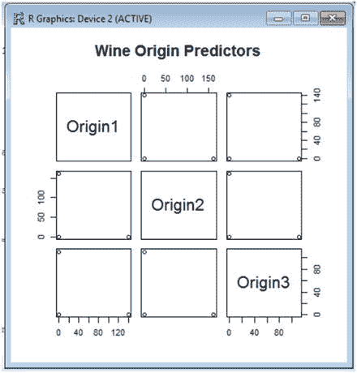

图 3-2. 葡萄酒产地预测器表格数据的散点图矩阵的 PNG 图形输出

### 在 Oracle DB 中使用嵌入式 R 执行及 ORE R 接口预测葡萄酒产地

在本节中，我们将修改清单 3-4，使用 ORE 嵌入式 R 执行函数作为 R 接口。它使用 `ore.doEval()` 函数实现相同的功能。修改后的代码见清单 3-5，对应的 PNG 图形如图 3-3 所示。如您所见，使用 `ore.doEval()` 和原始 R 程序的输出是相同的。区别在于 `ore.doEval()` ORE 函数在数据库内部执行，并将结果传递到用户控制台上的 R 终端。

## 清单 3-5
使用 ORE 构建并测试 `randomForest()` 模型

```r
library(ORE)
ore.connect(user="testr", sid="orcl", host="localhost", password="testr")
ore.doEval(function () {
library(randomForest)

# 文件 winedata.csv 位于调用 ORE 接口时的工作目录中
winedata <- read.csv("winedata.csv", header=TRUE, sep=',')
head(winedata)
winedata$origin <- ifelse(winedata$class == 1, 'Origin1',
ifelse(winedata$class == 2, 'Origin2',
ifelse(winedata$class == 3, 'Origin3', '')))
winedata$origin <- as.factor(winedata$origin)
head(winedata$origin)
set.seed(123)
sample_size <- 0.70 * nrow(winedata)
sampledata <-sample(seq_len(nrow(winedata)), sample_size)
training_data <- winedata[sampledata, ]
test_data <- winedata[-sampledata, ]
wine.rf <- randomForest(origin ∼ . - class, data = training_data)
origin_pred <- predict(wine.rf, newdata = test_data)
table(origin_pred, test_data$origin)
library(AppliedPredictiveModeling)
transparentTheme(trans = .4)
pairs(table(origin_pred, test_data$origin), main="葡萄酒产地预测器")
}, ore.graphics=TRUE, ore.png.height=600, ore.png.width=500)
```

以下是需要遵循的步骤：

1.  使用 ORE 打开一个 R 终端。
2.  连接到数据库。即使未使用任何与数据库相关的函数，此步骤也是使用 ORE 所必需的。
3.  加载 ORE 库。
4.  编写一个 `ore.doEval()` 函数，该函数执行以下操作：
    1.  加载 `randomForest` 库。
    2.  从源 CSV 文件中检索葡萄酒数据集，并将其存入名为 `winedata` 的数据框。
    3.  显示前几行，以验证数据框包含已加载的数据。
    4.  基于 `winedata` 数据集中的第一列 `class`，创建一个葡萄酒产地分类器变量 `winedata$origin`。
    5.  将 `winedata` 中的数据拆分为训练数据集和测试数据集。大约 70% 的数据被采样为训练数据，其余为测试数据。
    6.  在训练数据集上应用 `randomForest()` 模型，生成一个名为 `wine.rf` 的葡萄酒预测器类。模型输出显示每次分裂有三个预测器，即 `Origin1`、`Origin2` 和 `Origin3`。输出还显示了一个预测值与实际值的对照表。
    7.  通过在测试数据上使用 `predict()` 来测试模型，并根据预测输出和 `test_data$origin` 分类器变量，以表格形式显示预测输出。
    8.  使用预测器表格作为输入数据绘制散点图矩阵。PNG 图形显示在单独的图形显示窗口中。

以下是清单 3-5 中代码的输出：

```
> library(ORE)
Loading required package: OREbase
Loading required package: OREcommon
Attaching package: 'OREbase'
The following objects are masked from 'package:base':
    cbind, data.frame, eval, interaction, order, paste, pmax, pmin,
    rbind, table
Loading required package: OREembed
Loading required package: OREstats
Loading required package: MASS
Loading required package: OREgraphics
Loading required package: OREeda
Loading required package: OREmodels
Loading required package: OREdm
Loading required package: lattice
Loading required package: OREpredict
Loading required package: ORExml
> ore.connect(user="testr", sid="orcl", host="localhost", password="testr")
> ore.doEval(function () {
+ library(randomForest)
+ winedata 
```

图 3-3 展示了对应的 PNG 图形。

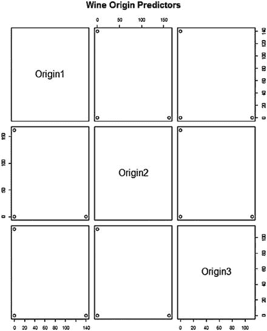
*图 3-3. 葡萄酒产地预测器数据散点图矩阵的 PNG 图形输出*

清单 3-6 展示了使用 ORE 构建随机森林模型的详细版本。它详细描述了以下步骤：使用 R 的 `print()` 函数打印 RF 模型以查看重要特征；使用 `plot()` 函数绘制 RF 模型以查看相应的 RF 模型图；使用 `importance()` 函数打印构建后模型的重要性输出；以及使用 `varImpPlot()` 函数绘制构建后的重要性变量。此外，还使用 `margin()` 函数的输出绘制了准确率的误差边际，该函数的参数包括模型和从 `test_data` 上对 RF 模型评分得到的产地分类器。这些输出，连同原始表格和散点图矩阵输出，紧跟在清单 3-6 之后展示。

# 清单 3-6. 使用 ORE 构建和测试 `randomForest()` 模型——详细版本

```r
library(ORE)
ore.connect(user="testr", sid="orcl", host="localhost", password="testr")
ore.is.connected()
ore.doEval(function () { library(randomForest)

# The file winedata.csv is in the working directory from where the ORE # interface was invoked
winedata <- read.csv("winedata.csv", header=TRUE, sep=',')
head(winedata)
winedata$origin <- ifelse(winedata$class == 1, 'Origin1',
ifelse(winedata$class == 2, 'Origin2',
ifelse(winedata$class == 3, 'Origin3', '')))
class(winedata$origin)
winedata$origin <- as.factor(winedata$origin)
head(winedata$origin)
set.seed(123)
sample_size <- 0.70 * nrow(winedata)
sampledata <-sample(seq_len(nrow(winedata)), sample_size)
training_data <- winedata[sampledata, ]
test_data <- winedata[-sampledata, ]
formula <- origin ∼ . - class
wine.rf <- randomForest(formula, data=training_data,ntree=100, importance=TRUE, proximity=TRUE)
head(wine.rf)
class(wine.rf)
print(wine.rf) # Print RF model to see important features
plot(wine.rf) # Plot RF Model to see the corresponding RF model graph
importance(wine.rf) # See the importance of the variables
varImpPlot(wine.rf) # Plot RF Model see the variable Importance
origin_pred <- predict(wine.rf, newdata = test_data)
head(origin_pred)
table(origin_pred, test_data$origin)
plot(margin(wine.rf, test_data$origin)) # Plot margin of error for accuracy
library(AppliedPredictiveModeling)
transparentTheme(trans = .4)
pairs(table(origin_pred, test_data$origin), main="Wine Origin Predictors")
}, ore.graphics=TRUE, ore.png.height=600, ore.png.width=500)
```

## 清单 3-6 中代码的两个主要输出是 `print(wine.rf)` 和 `importance(wine.rf)`，如下所示：

```r
> print(wine.rf)
Call:
randomForest(formula = formula, data = training_data, ntree = 100,      importance = TRUE, proximity = TRUE)
Type of random forest: classification
Number of trees: 100
No. of variables tried at each split: 3
OOB estimate of  error rate: 0%
Confusion matrix:
Origin1 Origin2 Origin3 class.error
Origin1     349       0       0           0
Origin2       0     387       0           0
Origin3       0       0     225           0
> plot(wine.rf)
> importance(wine.rf) # See the importance of the variables
Origin1   Origin2   Origin3        MeanDecrease                                                                   Accuracy
Alcohol                     11.105535 9.526838  7.123277         12.129635
Malic.acid                  4.839083  6.448424  4.905585          6.960896
Ash                         4.326631  6.724472  5.399456          7.243023
Alcanility.of.ash           4.527594  6.332050  4.863168          6.958164
Magnesium                   6.467083  6.776471  4.327440          7.301142
Total.phenols               6.739080  6.357134  6.025438          7.877900
Flavanoids                  8.465542  8.610455 11.318216         12.551384
Nonflavanoid.phenols        2.866508  4.082630  3.718137          4.484671
Proanthocyanins             2.909023  5.907274  5.583297          7.075015
Color.intensity             12.855845 12.054849 12.554351        17.634433
Hue                         5.896908  7.500771  8.471345          9.225476
OD280.OD315.of.diluted.wines  6.017725   7.304052  8.207104           9.652773
Proline                     12.374653 8.791325  6.200598         13.307739
MeanDecreaseGini
Alcohol                             80.459884
Malic.acid                          15.259082
Ash                                  8.053578
Alcanility.of.ash                   14.141569
Magnesium                           19.983451
Total.phenols                       42.076450
Flavanoids                          96.234232
Nonflavanoid.phenols                 6.998323
Proanthocyanins                     14.879801
Color.intensity                    109.622069
Hue                                 50.237897
OD280.OD315.of.diluted.wines        52.182508
Proline                            114.973278
```

## 接下来是运行清单 3-6 中代码的输出，随后是图 3-4 至 3-7 中生成的四个图形。

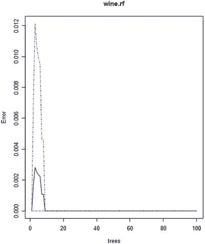

图 3-4. `plot(wine.rf)` 的输出

```
> library(ORE)
Loading required package: OREbase
Loading required package: OREcommon
Attaching package: 'OREbase'
The following objects are masked from 'package:base':
cbind, data.frame, eval, interaction, order, paste, pmax, pmin,
rbind, table
Loading required package: OREembed
Loading required package: OREstats
Loading required package: MASS
Loading required package: OREgraphics
Loading required package: OREeda
Loading required package: OREmodels
Loading required package: OREdm
Loading required package: lattice
Loading required package: OREpredict
Loading required package: ORExml
> ore.connect(user="testr", sid="orcl", host="localhost", password="testr")
> ore.doEval(function () {
+ library(randomForest)
+ winedata 
```

请注意，x 轴上的树的数量最多为 100，这是由清单 3-6 中调用 `randomForest` 模型时 `ntree` 参数的值所定义的。

关于 `ranDomForest` 模型的重要性输出，它们是 `MeanDecreaseAccuracy` 和 `MeanDecreaseGini`。这些显示在图 3-5 的 x 轴上。

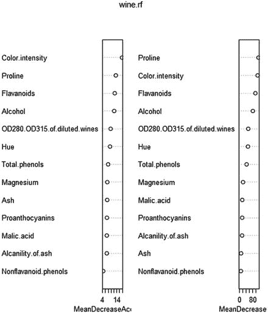

图 3-5. `varImpPlot(wine.rf)` 的输出

图 3-6 中显示的重要性变量分别是 `MeanDecreaseAccuracy` 和 `MeanDecreaseGini`。

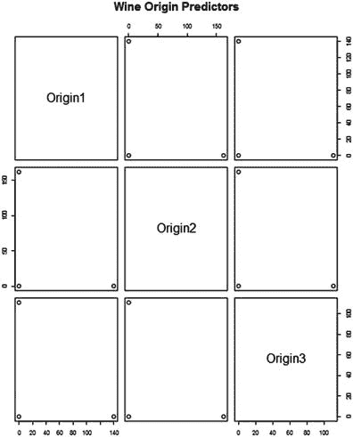

图 3-7. `pairs(table(origin_pred, test_data$origin), main=“葡萄酒产地预测器”)` 的输出

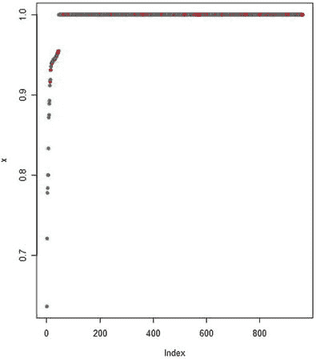

图 3-6. `plot(margin(wine.rf, test_data$origin))` 的输出

## 使用 `ore.randomForest` 替代 R 的 `randomForest` 模型

本小节演示了如何使用 ORE 的 `ore.randomForest` 函数来构建和评分随机森林模型，以预测葡萄酒产地。我们对清单 3-4 中的代码进行了修改，以使用 `ore.randomForest`；清单 3-7 提供了修改后的代码，其执行输出显示在该清单之后的代码中。

```
library(ORE)
ore.connect("testr","orcl","localhost","testr")
library(OREmodels)

# 文件 winedata.csv 位于调用 ORE 接口时的工作目录中
winedata <- read.csv("winedata.csv", header=TRUE, sep=',')
head(winedata)
winedata$origin <- ifelse(winedata$class == 1, 'Origin1',
ifelse(winedata$class == 2, 'Origin2',
ifelse(winedata$class == 3, 'Origin3', '')))
class(winedata$origin)
winedata$origin <- as.factor(winedata$origin)
class(winedata$origin)
head(winedata$origin)
table(winedata$origin)
set.seed(123)
sample_size <- 0.70 * nrow(winedata)
sampledata <-sample(seq_len(nrow(winedata)), sample_size)
training_data <- winedata[sampledata, ]
class(training_data)
TRAINING_DATA <- ore.push(training_data)
class(TRAINING_DATA)
test_data <- winedata[-sampledata, ]
TEST_DATA <- ore.push(test_data)
class(TEST_DATA)
head(TRAINING_DATA)
head(TEST_DATA)
wine.rf <- ore.randomForest(origin ∼ . - class, TRAINING_DATA)
class(wine.rf)
tree15 = grabTree(wine.rf, k = 15, labelVar = TRUE)
origin_pred <- predict(wine.rf, TEST_DATA, type = "all", supplemental.cols="origin")
res <- table(origin_pred$origin, origin_pred$prediction)
library(AppliedPredictiveModeling)
transparentTheme(trans = .4)
pairs(table(origin_pred$origin, origin_pred$prediction), main="葡萄酒产地预测器")
res
清单 3-7. 使用 `ore.randomForest` 预测葡萄酒产地
```

以下是执行清单 3-7 中代码的输出：

# 葡萄酒产地预测分析

## 数据加载与预览

首先加载 `ORE` 包及其依赖项。

```R
library(ORE)
```

加载后，将一些基础函数（如 `cbind`, `data.frame`）从 `OREbase` 附加到当前环境，覆盖了 `base` 包中的同名函数。

然后连接到数据库并加载 `OREmodels` 包。

```R
ore.connect("testr","orcl","localhost","testr")
library(OREmodels)
```

接下来加载并预览葡萄酒数据集 `winedata`。

```R
winedata
head(winedata)
```

数据包含 `class`、`Alcohol`、`Malic.acid` 等多个变量。

## 数据检查

查看 `winedata$origin` 变量的类型和内容。

```R
winedata$origin
class(winedata$origin)
```

查看 `origin` 变量的前几个值及其水平。

```R
head(winedata$origin)
```

统计各产地（`origin`）的观测数量。

```R
table(winedata$origin)
```

## 数据准备

设置随机种子以确保结果可复现。

```R
set.seed(123)
```

指定样本大小并随机抽样。

```R
sample_size
sampledata
training_data
class(training_data)
```

将训练数据和测试数据转换为 ORE 数据框（`ore.frame`）。

```R
TRAINING_DATA
class(TRAINING_DATA)

TEST_DATA
class(TEST_DATA)
```

查看 `TRAINING_DATA` 和 `TEST_DATA` 的前几行。

```R
head(TRAINING_DATA)
head(TEST_DATA)
```

## 模型训练与评估

假设已训练好一个随机森林模型 `wine.rf`，查看其类。

```R
wine.rf
class(wine.rf)
```

从模型 `wine.rf` 中提取第 15 棵树，并启用标签变量显示。

```R
tree15 = grabTree(wine.rf, k = 15, labelVar = TRUE)
```

进行预测并查看预测结果的类。

```R
origin_pred
res
```

加载 `AppliedPredictiveModeling` 包（该包构建于 R 版本 3.2.5）并设置透明主题。

```R
library(AppliedPredictiveModeling)
transparentTheme(trans = .4)
```

使用 `pairs` 函数可视化真实标签与预测标签的列联表。

```R
pairs(table(origin_pred$origin, origin_pred$prediction), main="葡萄酒产地预测器")
```

查看最终的混淆矩阵结果。

```R
res
```

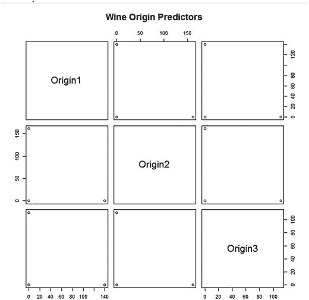

图 3-8.
清单 3-7 中配对图的输出结果

请注意，`table(origin_pred$origin, origin_pred$prediction)` 的图与 `table(origin_pred, test_data$origin)` 的图相同。

### 在 Oracle 数据库中使用 ORE SQL 接口执行嵌入式 R 代码以预测葡萄酒产地

清单 3-8 展示了与清单 3-5 等效的嵌入式 R 执行的 SQL 接口，该接口将 R 代码存储在 Oracle 数据库仓库脚本中，然后由以下 SQL `SELECT` 语句调用。清单 3-8 的输出图像与执行清单 3-5 中的代码所获得的图像相同。R 函数代码封装在一个 PL/SQL 块中，随后通过 SQL `SELECT` 语句调用。当执行第 24 行和第 25 行时，图像会生成为一个 PNG 文件。PL/SQL 块和后续的 `SELECT` 语句被保存为一个名为 `rTestRF.sql` 的 SQL 文件。图像 `rTestRF.png` 创建在设置为工作目录的文件夹中，如代码第 6 行所示。

要执行清单 3-8 到 3-13 中的代码，可以使用 SQL*Plus。也可以使用基于 GUI 的界面，例如 Oracle SQL Developer。打开 SQL*Plus，使用特定的用户名和密码登录，复制并粘贴代码，然后按 Enter 键。

```
SQL> begin
2  sys.rqScriptDrop('rTestRF');
3  sys.rqScriptCreate('rTestRF',
4  ' function () {
5  library(randomForest)
6  setwd("F:/testr/")
7  winedata <- read.csv("winedata.csv", header=TRUE, sep='','')
8  head(winedata)
9  winedata$origin <- ifelse(winedata$class == 1, ''Origin1'',
10  ifelse(winedata$class == 2, ''Origin2'',
11  ifelse(winedata$class == 3, ''Origin3'', '''')))
12  winedata$origin <- as.factor(winedata$origin)
13  head(winedata$origin)
14  set.seed(123)
15  sample_size <- 0.70 * nrow(winedata)
16  sampledata <-sample(seq_len(nrow(winedata)), sample_size)
17  training_data <- winedata[sampledata, ]
18  test_data <- winedata[-sampledata, ]
19  wine.rf <- randomForest(origin ∼ . - class, data = training_data)
20  origin_pred <- predict(wine.rf, newdata = test_data)
21  res <- table(origin_pred, test_data$origin)
22  res.df <- as.matrix(res)
23  head(res.df)
24  png("rTestRF.png")
25  pairs(table(origin_pred, test_data$origin), main="Wine Origin Predictors")
26  dev.off()
27  res.df
28  }' );
29  end;
30  /
PL/SQL procedure successfully completed.
清单 3-8.
使用嵌入式 R 执行的 SQL 接口构建和测试 randomForest() 模型
```

要验证脚本是否已存储在 Oracle 数据库 R 脚本仓库中，请从 ORE 数据库用户帐户发出查询，如清单 3-9 所示。

```
SQL> select * from user_rq_scripts where name = 'rTestRF';
NAME

SCRIPT

rTestRF
function () {
library(randomForest)
setwd("F:/testr/")
winedata
清单 3-9.
用于验证脚本 rTestRF 已在 Oracle RB 中创建的 SQL 查询
```

请注意，`NAME` 列的值是 `rTestRF`，而 `SCRIPT` clob 列显示了 R 函数的定义，如清单 3-8 中所定义。

上述脚本可以通过使用 SQL `SELECT` 语句从 SQL*Plus 调用，如下所示：

```
select * from table (rqEval(NULL, 'XML', 'rTestRF'));
```

第一个参数是 `NULL`，因为脚本中定义的函数不接受任何输入参数。第二个参数是 `XML`，用于指定所需的输出是 R 函数输出的 XML 表示形式，在本例中是一个 R 表。第三个参数是存储在 ORE 数据库 R 脚本仓库中的实际 R 脚本名称。

执行上述 SQL 语句的输出如清单 3-10 所示。

```
SQL> set pages 1000
SQL> set long 200000
SQL> select * from table(rqEval(NULL, 'XML', 'rTestRF'));
NAME

VALUE

Origin1Origin1140Origin2Origin10Origin3Origin10Origin1Origin20Origin2Origin2162Origin3Origin20Origin1Origin30Origin2Origin30Origin3Origin3111
SQL>
清单 3-10.
基于嵌入式 R 执行的 SQL 接口查询，调用清单 3-8 中定义的脚本 rTestRF
```

注意

从上述 XML 输出可以明显看出，ORE 中 R 输出的表格表示由三个列组成，分别名为 `origin_pred`、`Var2` 和 `Preq`。这些是列名和列值。列值显示在每个列名旁边（在 XML 中以粗斜体表示）。PNG 图形创建于清单 3-8 第 6 行指定的工作目录中。该图像通过执行清单 3-8 的第 24 行和第 25 行生成。

清单 3-8 使用 R 的 `View` 调用生成的 R 表格输出如图 3-9 所示。R 的 `View` 调用在 R 控制台中按如下方式调用：

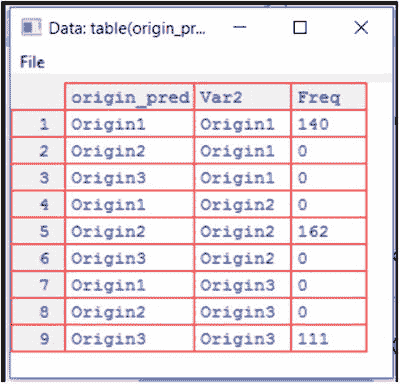

图 3-9.
使用 R 函数 `View` 查看清单 3-8 的 R 表格输出

```
View(res.df)
```

清单 3-10 中 `VALUE` 列对应的 XML 输出如图 3-10 所示。

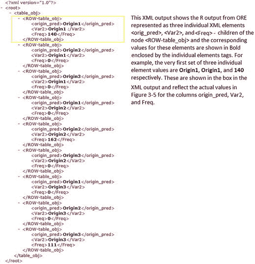

图 3-10.
清单 3-10 中 VALUE 列的 XML 输出

为了通过使用 SQL SELECT 获取上述 View 调用的输出，必须将 `res.df` 输出转换为 `data.frame` 输出。这可以通过在清单 3-8 的第 27 行之后添加以下代码行来实现：

```
res.df.output <- data.frame(res.df)
```

清单 3-10 中的查询可以修改为如清单 3-11 所示，以获取结构化的（关系型）表格输出。

## 使用 ORE SQL 接口生成 PNG 图并集成到 OBIEE 仪表盘

在本节中，我们将演示如何通过 ORE SQL 接口，利用 `randomForest` R 算法为葡萄酒产地预测问题获取 PNG 图。如之前的示例所述，我们首先创建两个存储在 Oracle DB R 脚本存储库中的脚本。这两个脚本分别命名为 `BuildandScoreRF` 和 `validateRF`。第一个脚本 `BuildandScoreRF` 关联一个 R 函数，该函数将输入数据作为参数，并基于随机抽样将其划分为两个数据集——70% 作为训练数据集，30% 作为测试数据集。它基于训练数据集构建一个随机森林模型，然后使用 `predict` R 函数基于测试数据集对模型进行评分。

`validateRF` 脚本根据葡萄酒数据的 CSV 文件，基于 `Wine` 类别和其他相关属性，准备 `BuildandScoreRF` 脚本所需的输入数据。它将此输入数据存储在一个名为 `WINE_DATA` 的数据库表中，然后调用第一个脚本，并将准备好的数据作为输入传递给其对应的 R 函数。

清单 3-14 和 3-15 展示了这两个 R 脚本的代码。

要执行清单 3-14 到 3-16 中的代码以及任何 `SELECT` 语句，请打开 SQL*Plus 或 Oracle SQL Developer。登录后，复制并粘贴代码。对于 SQL*Plus，按 Enter 键；对于 Oracle SQL Developer，单击“运行脚本”图标。

```
begin
sys.rqscriptDrop('BuildandScoreRF');
sys.rqScriptcreate('BuildandScoreRF',
'function(winedata) {
library(randomForest)
winedata$origin <- ifelse(winedata$class == 1, ''Origin1'',
ifelse(winedata$class == 2, ''Origin2'',
ifelse(winedata$class == 3, ''Origin3'', '''')))
winedata$origin <- as.factor(winedata$origin)
set.seed(123)
sample_size <- 0.70 * nrow(winedata)
sampledata <-sample(seq_len(nrow(winedata)), sample_size)
training_data <- winedata[sampledata, ]
test_data <- winedata[-sampledata, ]
wine.rf <- randomForest(origin ∼ . - class, data = training_data)
origin_pred <- predict(wine.rf, newdata = test_data)
res <- table(origin_pred, test_data$origin)
pairs(table(origin_pred, test_data$origin), main="Wine Origin Predictors")
res
}');
end;
/
清单 3-14.
使用 SQL 接口的 `BuildandScoreRF` 脚本，该脚本使用 `randomForest` R 函数构建并评分葡萄酒类别数据
```

```
begin
sys.rqScriptDrop('validateRF');
sys.rqScriptCreate('validateRF',
'function() {
library(ORE)
ore.connect("testr","orcl","localhost","testr")
setwd("F:/testr/")
inputdata <- read.csv("winedata.csv", header=TRUE, sep='','')
ore.drop(table="WINE_DATA")
ore.create(inputdata, table="WINE_DATA")
ore.scriptLoad(name = "BuildandScoreRF")
res1 <- BuildandScoreRF(inputdata)
res1.df <- data.frame(res1)
res1.df
}');
end;
/
清单 3-15.
使用 SQL 接口的 `validateRF` 脚本，该脚本准备输入数据并调用基于 `BuildandScoreRF` 脚本的 R 函数
```

为了验证 `validateRF` 的输出是否准确，我们首先通过执行以下查询来查询其 SQL 表格输出：

```SQL
SQL> select *
2  from table(rqEval(
3      NULL,
4       'select CAST(''a'' as VARCHAR2(50)) "origin_pred", CAST(''b'' AS VARCHAR2(50)) "Var2", 1 as "Freq" from dual',
      'rTestRF'));
origin_pred

Var2                                                     Freq
-------------------------------------------------- ----------
Origin1
Origin1                                                   140
Origin2
Origin1                                                     0
Origin3
Origin1                                                     0
Origin1
Origin2                                                     0
Origin2
Origin2                                                   162
Origin3
Origin2                                                     0
Origin1
Origin3                                                     0
Origin2
Origin3                                                     0
Origin3
Origin3                                                   111
已选择 9 行。
清单 3-11.
修改后的清单 3-10，用于生成结构化表格输出
```

与清单 3-8 中将图像生成为 PNG 文件不同，输出可以以 `XML` 格式捕获。区别在于从清单 3-8 中移除第 24 行和第 26 行，并修改清单 3-10 中的 `SELECT` 查询。清单 3-12 和 3-13 说明了这一更改及相应的执行输出。

```
SQL> begin
2      sys.rqScriptDrop('rTestRF_final1');
3      sys.rqScriptCreate('rTestRF_final1',
4      ' function () {
5      library(randomForest)
6      setwd("F:/testr/")
7      winedata 
清单 3-12.
修改后的清单 3-8，用于捕获以 XML 格式生成的图像
```

```
SQL> set pages 1000
SQL> set long 100000
SQL> select xmltype(a.value).getClobVal() as "包含图像的 XML 输出"
2  from   table(rqEval( NULL,'XML','rTestRF_final1')) a;
包含图像的 XML 输出

Origin1Origin1140Origin2Origin10Origin3Origin10Origin1Origin20Origin2Origin2162Origin3Origin20Origin1Origin30Origin2Origin30Origin3Origin3111 
清单 3-13.
基于嵌入式 R 执行的 SQL 接口查询，调用清单 3-12 中定义的脚本 `rTestRF_final1`
```

清单 3-13 中修改后列的 XML 输出如图 3-11 所示。

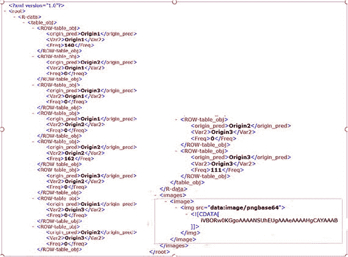

图 3-11. 清单 3-13 中修改后的 VALUE 列的 XML 输出

```
SQL> select *
2  from table(rqEval(
3      NULL,
4       'select CAST(''a'' as VARCHAR2(50)) "origin_pred", CAST(''b'' AS VARCHAR2(50)) "Var2", 1 as "Freq" from dual',
      'validateRF'));
origin_pred

Var2                                                     Freq
-------------------------------------------------- ----------
Origin1
Origin1                                                   140
Origin2
Origin1                                                     0
Origin3
Origin1                                                     0
Origin1
Origin2                                                     0
Origin2
Origin2                                                   162
Origin3
Origin2                                                     0
Origin1
Origin3                                                     0
Origin2
Origin3                                                     0
Origin3
Origin3                                                   111
已选择 9 行。
```
该输出与从清单 3-11 获得的输出类似。接下来，我们执行清单 3-16 中所示的查询，该查询生成一个对应于 PNG 图输出的 `IMAGE` 列。

**注意**
清单 3-16 中的查询将用于集成两个 R 脚本以及使用 OBIEE RPD 生成的图形输出。
```
SQL> select *
2  from table(rqEval(
3      NULL,
4      'PNG',
5      'validateRF'));
NAME

ID

IMAGE

89504E470D0A1A0A0000000D49484452000001E0000001E008060000007DD4BE9500002000494441
54789CEDDD7F901BF57DFFF1D706FFA80DC660E3D824181B9FCE105998160A89EF8A99129B727243
0E42AF6EC28F09A15203ADEF8039481ABE43004FA7E4A0D191528F44CA8CA16E2767DC5E2720116C
0A76F1D171301D8C7C98938E40B0030D0E501FBFFC83EEF70F6637924EBA9374BAFDE8C7F331A319
6B6FF7F3794B27EFEB3E9F5DED5AB66DDB0200009EFA8CE90200006844043000000610C000001840
0003006000010C008001043000000610C0000018400003006000010C008001043000000610C00000
18400003006000010C008001043000000610C00000184000030060010CA35A5B5B655996D2E9B4
BB2C1C0ECBB22CB5B6B666AD6B59962CCB1AF56F2FF4F6F6BA7D3A8FDEDEDEA2B72FA7DE4ABCC6D
C9A9D47EE7B5B69B9B57BFDFB026A01018CA30281802429954AB9CB62B19824696060C05DE6047428
........
SQL>
清单 3-16.
用于获取 `validateRF` 脚本执行的 PNG 图输出的基于 SQL 的查询
```
从 SQL Developer 查看时，清单 3-16 中查询的输出如图 3-12 所示。请注意 `IMAGE` 列的 BLOB 输出。双击 `IMAGE` 列并选择“查看为图像”即可显示 PNG 图。

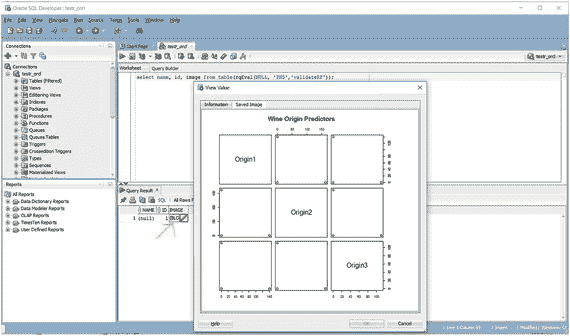
图 3-12.
清单 3-16 中 `IMAGE` 列的 PNG 输出

### 将 PNG 图与 OBIEE 集成
将 R PNG 图输出与 OBIEE 12c 集成需要下载现有存储库，或创建一个新存储库并将其与 OBIEE 12c 存储库集成。在本节中，我们将下载现有的 `SampleAppLite` 存储库并对其进行修改，以反映我们的葡萄酒产地预测图。

#### OBIEE 12c 集成所需的预备步骤
在从 OBIEE 12c 服务器下载 `SampleAppLite` 存储库之前，必须完成一些预备步骤，以便 OBIEE 12c 能够与测试数据库和模式通信：
1. 在位于 `<FusionMiddlewareHome>\user_projects\domains\bi\config\fmwconfig\biconfig\OBIS` 文件夹中的 `NQSConfig.INI` 文件中，进行以下更改：
    1. 在 `[ADVANCE_ANALYTICS_SCRIPT]` 部分，将 `TARGET = "ORE";` 的值设置为 `TARGET = "ORE";`，并将连接池的值设置为 `CONNECTION_POOL = "ORCL"."testr/testr:1521";`
    2. 确保在 Oracle DB 12c 服务器的 `tnsnames.ora` 文件中定义了 `ORCL` 别名。
2. 通过发出 `stop.cmd` 命令，然后发出 `start.cmd` 命令，重新启动 WebLogic Server 和相关服务。这些命令位于 `<FusionMiddlewareHome>\user_projects\domains\bi\bitools\bin` 文件夹中。
3. 重新启动 Oracle Business Intelligence 服务（如果在 Windows 上，则通过任务管理器 ➤ 服务进行）。
4. 使用以下命令下载对应于 `SampleAppLite` 的服务器 RPD 文件：
    ```
    \user_projects\domains\bi\bitools\bin\datamodel.cmd downloadrpd -O obieenew.rpd -W Admin123 -U weblogic -P  -SI ssi
    ```
    RPD 被下载为 `obieenew.rpd` 文件。

#### 自定义下载的 SampleAppLite RPD 以集成 ORE 返回的 PNG 图形
将葡萄酒原产地预测图与 `obieenew.rpd` 文件集成的完整步骤包括对 `obieenew.rpd` 的自定义，该操作在客户端的 OBIEE 管理工具中完成。
这主要包括以下步骤：
1. 创建 Oracle 连接池
2. 创建物理层
3. 创建业务模型和映射层
4. 创建表示层
这些步骤将在后续小节中描述。

##### 创建 Oracle 连接池
具体步骤如下：
1. 在 OBIEE 管理工具中以离线模式打开 `obieenew.rpd`。在物理层中，选择新建数据库。按图 3-13 所示对话框填写详细信息。
    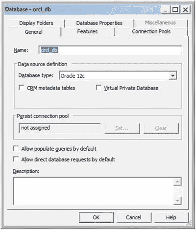
    图 3-13.
    OBIEE 管理工具中的新建数据库对话框
2. 单击连接池选项卡，创建一个具有图 3-14 所示属性的新连接池。数据源名称必须指定为 tnsnames 别名 `ORCL` 的完整连接描述符字符串。
    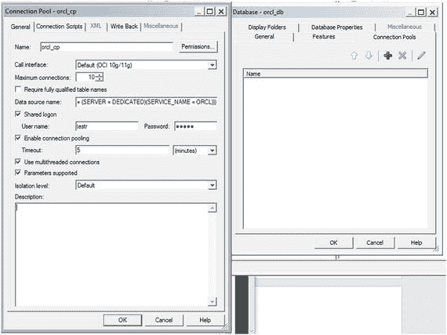
    图 3-14.
    新建连接池对话框

##### 创建物理层
创建物理层的步骤如下：
1. 选择 `orcl_db`，右键单击并选择新建对象 ➤ 物理模式。将名称指定为 `TESTR`，如图 3-15 所示。
```

# 使用 RPD 创建 OBIEE 分析和仪表盘

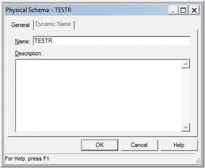

**图 3-15. 新建物理模式对话框**

2.  右键单击 `TESTR` 模式并选择新建物理表。将出现一个新对话框，如图 3-16 所示。注意：在物理表对话框的“常规”选项卡中，将名称指定为 `validateRF`，表类型选择为“选择”，默认初始化字符串指定为清单 3-16 中的 `SELECT` 语句，如下所示：

    ```
    select id, image from table(rqEval(NULL, 'PNG', 'validateRF'))
    ```

    这些内容在图 3-16 中突出显示。

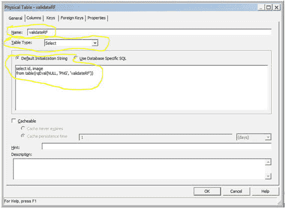

**图 3-16. 新建物理表对话框**

3.  在“列”选项卡中，定义两个名为 `Id` 和 `image` 的列。对于 `Id` 列，将类型设置为 `INT`，并为 `Id` 列设置长度，如图 3-17 所示。对于 `image` 列，将类型设置为 `LONGVARBINARY`，长度设置为 `32000`，如图 3-18 所示。

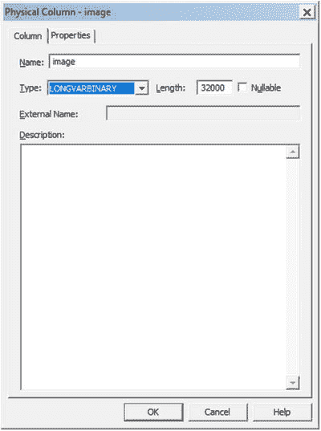

**图 3-18. 新建物理表 validateRF 的 image 列对话框**

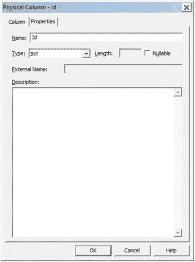

**图 3-17. 新建物理表 validateRF 的 Id 列对话框**

4.  在“键”选项卡中，在键名称和列下添加 `id`，如图 3-19 所示。

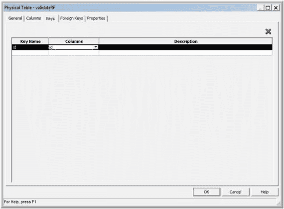

**图 3-19. 新建物理表 validateRF 的键对话框**

5.  在主物理表对话框中单击“确定”，如图 3-20 所示。

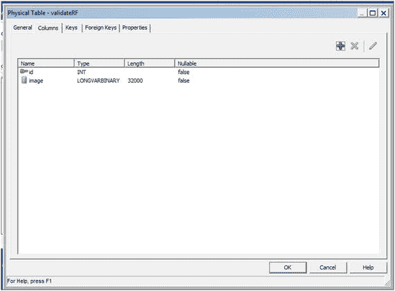

**图 3-20. validateRF 表的物理表对话框**

6.  将显示物理关系图窗口，其中显示 `validateRF` 物理表，如图 3-21 所示。

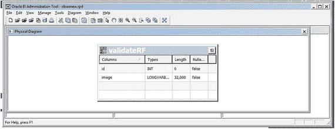

**图 3-21. 显示 validateRF 物理表的物理关系图窗口**

7.  保存 RPD 并关闭物理关系图窗口。

## 创建业务模型和映射层

以下是创建业务模型和映射层的步骤：

1.  单击物理层中的 `TESTRF` 模式，将其拖放到业务模型和映射层（BMM 层）中。图 3-22 显示了包含 `validateRF` 表及其列的物理层（注意，`id` 列被标记为键列，如其左侧的黄色键图标所示）；以及 BMM 层中包含 `validateRF` 实体的 `TESTR` 模式。

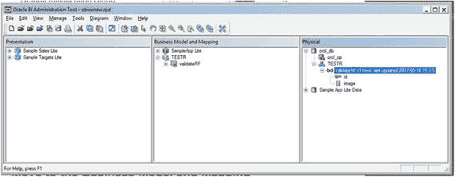

**图 3-22. 显示包含 validateRF 表的 TESTR 模式的物理层和业务模型及映射层**

2.  右键单击 BMM 层中的 `validateRF` 实体以复制它，得到 `validateRF#1`。如图 3-23 所示。

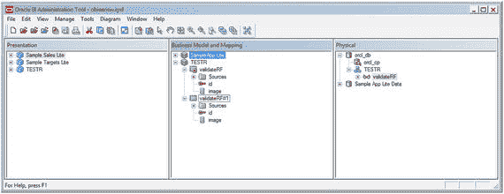

**图 3-23. BMM 显示复制的 validateRF 表，显示为 validateRF#1**

3.  展开 `validateRF` 表。双击 `id`。将出现 `id` 的逻辑列对话框，如图 3-24 所示。

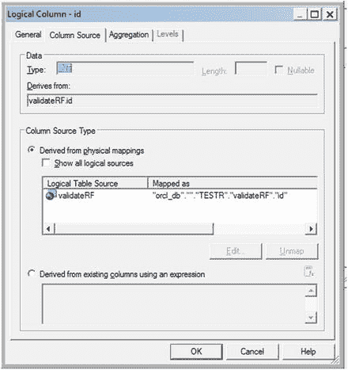

**图 3-24. id 的逻辑列对话框**

4.  在“列源”选项卡中，双击逻辑表源条目。在此处指定图像查找列。单击右侧的编辑图标。按如下方式指定查找表达式：
    1.  在已有的 `image` 字符串之前，键入 `lookup(`。
    2.  在 `image` 字符串后添加一个逗号。
    3.  双击 `id` 将其添加到表达式中。
    4.  将第二个 `orcl_db` 后的两个连续点改为两个连续的双引号。
    5.  在表达式末尾添加一个右括号 `)`。

5.  单击“确定”。生成的对话框如图 3-25 所示。

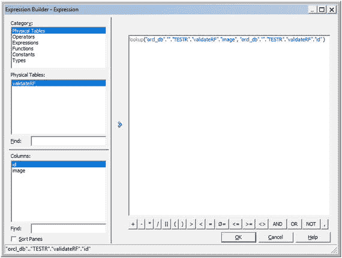

**图 3-25. image 列的查找表达式生成器**

6.  为 `image` 列指定排序顺序和描述符 `id` 列，如下所示：
    1.  双击 `image` 并单击“设置”对应于排序顺序。
    2.  在生成的对话框中选择 `id` 列，如图 3-26 所示，然后单击“确定”。
    3.  对描述符 `id` 重复此操作。现在将显示 `image` 的逻辑列对话框，如图 3-27 所示。

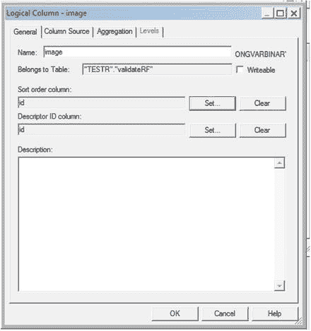

**图 3-27. 设置排序顺序和描述符 id 后 image 列的逻辑列对话框**

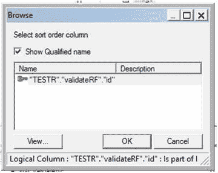

**图 3-26. 为 image 列设置排序顺序和描述符 id**

此时，物理层和 BMM 层如图 3-28 所示。

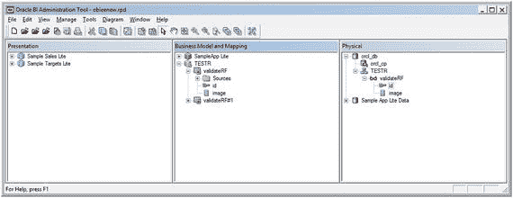

**图 3-28. 包含 validateRF 表的 TESTR 模式对应的物理层和 BMM 层**

7.  右键单击 BMM 层中的 `validateRF` 实体，选择“业务模型关系图” > “完整关系图”，如图 3-29 所示。BMM 关系图将显示在新窗口中。单击工具栏中的“新建联接”图标，在 BMM 关系图中选择 `validateRF` 对象，将光标拖到 `validateRF#1` 对象上形成一条直线，然后释放光标。更新后的 BMM 关系图如图 3-30 所示。

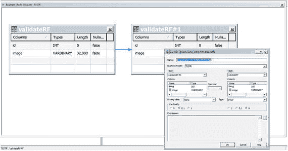

**图 3-30. 更新后的 BMM 关系图，显示 validateRF 和 validateRF#1 之间的联接**

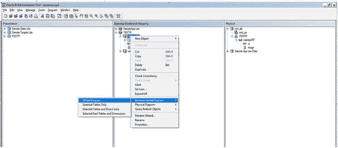

**图 3-29. BMM 关系图——TESTR 模式的完整关系图**

## 创建表示层

以下是创建表示层的步骤：

1.  关闭 BMM 图并保存 RPD。在表示区域中，从 BMM 层拖放 `TESTR` 模式，以创建一个名为 `TESTR` 的新表示主题区域。三个修改后的层如图 3-31 所示。

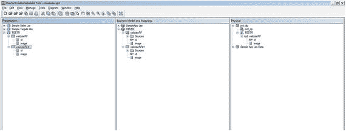

**图 3-31. 物理层、业务模型和映射层以及表示层，显示了 TESTR 模式以及表示层中的 validateRF 和 validateRF#1 表**

2.  保存 RPD。使用以下命令上传 RPD：

    ```
    \user_projects\domains\bi\bitools\bin\datamodel.cmd uploadrpd -I obieenew.rpd -SI ssi -U weblogic -P <RPD 密码>
    ```
    服务实例：`ssi`
    操作成功。
    RPD 上传成功完成。

## 使用上传的 RPD 创建 OBIEE 分析和仪表盘

这意味着将使用 `obieenew.rpd` 在 OBIEE 12c 表示服务中创建和定制新的分析和仪表盘。

1.  登录 OBIEE，点击“管理” > “重新加载文件和元数据”。
2.  然后通过点击“新建” > “分析”来创建一个分析。现在，`TESTR` 模式出现在可用的主题区域下。点击它，如图 3-32 所示。

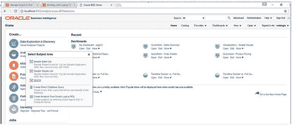

**图 3-32.**

# OBIEE 分析创建与机器学习趋势分析

## 创建分析与仪表盘

新的 OBIEE 分析，显示 `TESTR` 为可选的主题区域之一。

3.  从 `TESTR` 主题区域拖放 `id` 和 `image` 列到“选定列”区域。点击“结果”。将显示葡萄酒产地预测的配对图。该图与从 ORE R 接口和 SQL 接口生成的图相同。
4.  点击顶部的“保存”图标保存分析。

该分析及其生成的图表（PNG）如图 3-33 和 3-34 所示。

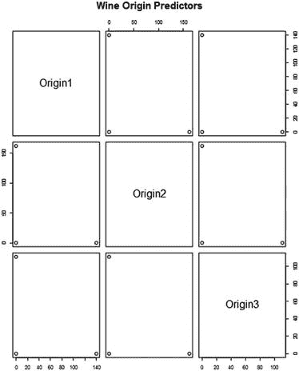
**图 3-34.** 葡萄酒产地预测变量的配对图

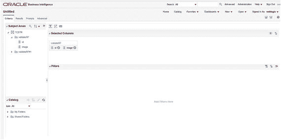
**图 3-33.** 基于 `TESTR` 主题区域和 `validateRF` 表的新分析

要创建仪表盘，请点击新建 ➤ 仪表盘，指定名称为 `TESTR` 仪表盘，并选择一个用于保存的文件夹名称。在“我的文件夹”或“共享文件夹”中选择一个文件夹。在左下角的“目录”部分，选择名为“葡萄酒产地预测的配对图”的分析，然后将其拖放到仪表盘右侧的空白区域。点击“运行”查看仪表盘。图 3-35 显示了刚刚创建的 `TESTR` 仪表盘。

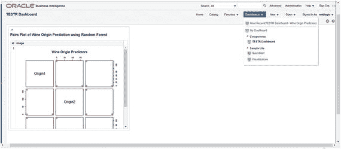
**图 3-35.** 显示葡萄酒产地预测配对图的 `TESTR` 仪表盘

`TESTR` 仪表盘也会显示在仪表盘 ➤ 组件菜单下，如屏幕右上角区域所示。PNG 图像是通过在初始物理表默认初始化字符串中指定的 SQL `SELECT` 查询生成的，并且物理表类型设置为 Select。此查询调用存储在 Oracle DB R 脚本存储库中的 R 函数。

至此，完成了将从执行 ORE R 脚本获得的 PNG 图形输出与 OBIEE12c 分析和仪表盘的集成。此外，基于从 ORE R 函数生成的多个图像，可以将与同一分析相关的多个图形与 OBIEE 集成。同时，可以通过定义与 R 脚本对应的参数化 R 函数，并定义可在运行时交互选择的 OBIEE 变量和提示，来实现动态仪表盘。

## 机器学习趋势分析与企业数据仓库的契合

OBIEE 12c 提供了五种有助于机器学习的分析算法：聚类、异常值、回归、趋势线和评估脚本。此外，OBIEE 12 还提供了时间序列预测算法。其中，与企业数据仓库（EDW）需求最匹配的主要是趋势线。本节重点介绍如何在 EDW 环境中使用趋势线进行机器学习趋势分析。

已有大量算法被编写出来，机器学习也已成功应用于众多应用。从农业和制造业等行业的任务自动化，我们已进入一个为知识工作者寻求任务自动化新应用的时代。

决策支持系统（DSS），或者更具体地说，企业数据仓库（EDW），就是这样一个自动化领域。在这里，计算能力和处理海量数据的能力正通过由人工智能驱动的新应用接受考验。使用 EDW 的基本目标是能够从已集成和存储的数据中发现趋势。通常，只有在 EDW 中，组织才能拥有完全收集、集成并进一步清洗的数据，从而用于提供对企业的历史洞察并揭示趋势。

以发现趋势为目标，与趋势线和基本模式发现相关的机器学习应用算法恰好符合 EDW 的精确目的，因此，对于商业企业而言，这无疑是未来完美的人工智能驱动技术。

以下边栏提供了定义趋势线的 OBIEE 12c 文档。

### 趋势线定义

`TRENDLINE` 函数衡量随时间变化的数据，并显示按有序记录排列的指标折线图。

目前，`TRENDLINE` 函数可以将数据建模为线性回归和指数回归。

```
TRENDLINE( , ( [] ) BY ( [] ),
, , [number_of_degrees] )
```

其中：
- `numeric_expr` 表示要进行趋势分析的数据。这通常是一个度量列。请注意，这是 y 轴。
- `series` 表示 x 轴。这是一个 `<valueExp> <orderByDirection>` 列表，其中 `<valueExp>` 是一个维度列，`<orderByDirection>` 是 `ASC` 或 `DES`。默认值为 `ASC`。请注意，这不能是数字列的任意组合。
- `partitionBy` 表示趋势线的控制中断。
- `model_type` 表示要使用的模型类型。目前，您只能指定 `LINEAR`。
- `result_type` 表示输出的类型。您可以指定 `VALUE` 或 `MODEL`。`VALUE` 返回拟合中给定 X 的回归 Y 值。`MODEL` 以 JSON 格式字符串返回参数。
- `number_of_degrees` 仅用于多项式模型。此参数是可选的。

请考虑以下 `TRENDLINE` 示例。它定义了按订单类型划分的“每名称季度总收入”的趋势线，这意味着结果是针对每种订单类型特定的趋势线。

```
TRENDLINE("Calculated Facts"."Full Quarter Revenue", ("Time"."Per Name Qtr") BY ("Orders"."Order Type"), 'LINEAR', 'VALUE')
```

### 实现步骤与输出

图 3-32 到 3-35 展示了使用上述函数为 `TRENDLINE` 创建的分析以及获得的输出。图 3-36 显示了相应的仪表盘视图。

以下是所需的步骤：
1.  登录 OBIEE 演示服务，在 `SampleSales` 主题区域下选择“分析”。
2.  选择“订单”，然后选择“订单类型”。将其拖放到右侧的空白区域。
3.  在“时间”下选择“按名称季度”。将其拖放到“订单类型”字段的右侧。
4.  在“计算事实”下选择“全季度收入”。将其拖放到“按名称季度”字段的右侧。到目前为止的分析截图如图 3-36 所示。

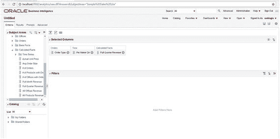
**图 3-36.** 基于订单类型、按名称季度和全季度收入创建分析

5.  复制“全季度收入”字段，并将其放置在现有字段的右侧。
6.  点击其上的圆形图标，然后选择并展开“分析”节点。内置的 OBIEE 分析函数将出现，如图 3-37 所示。

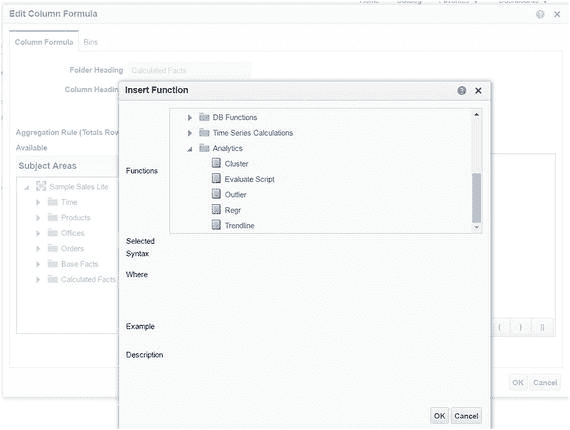
**图 3-37.** 选择趋势线分析函数作为分析的一部分

7.  选择“趋势线”函数。在打开的对话框中，点击 `f(…)`。
8.  `TRENDLINE` 函数的公式将隐式填充在“列公式”区域下。按图 3-38 所示完成它。

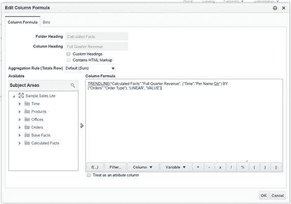
**图 3-38.** 指定 `TRENDLINE` 函数公式，如“列公式”部分所示

9.  点击“确定”关闭对话框。生成的 OBIEE 分析屏幕如图 3-39 所示。

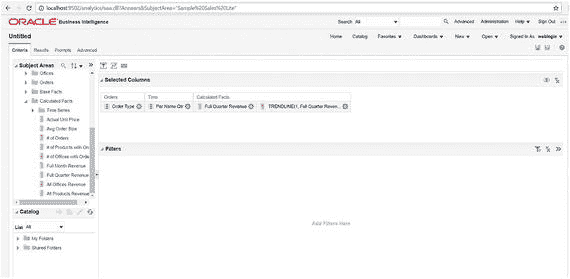
**图 3-39.** 添加 `TRENDLINE` 后的 OBIEE 分析

10. 在左上角，点击“结果”（位于“条件”右侧）以显示趋势线图表，如图 3-40 所示。

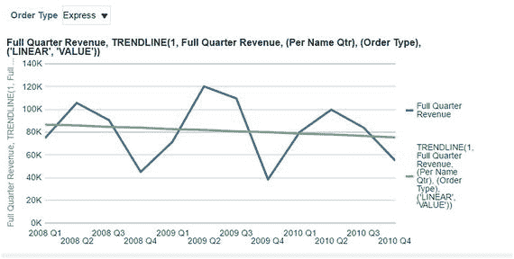
**图 3-40.** 从 `TRENDLINE` 的 OBIEE 分析中生成的图表

11. 点击“仪表盘视图”图标，以显示图表在 OBIEE 仪表盘中的呈现方式。相应的仪表盘视图如图 3-41 所示。

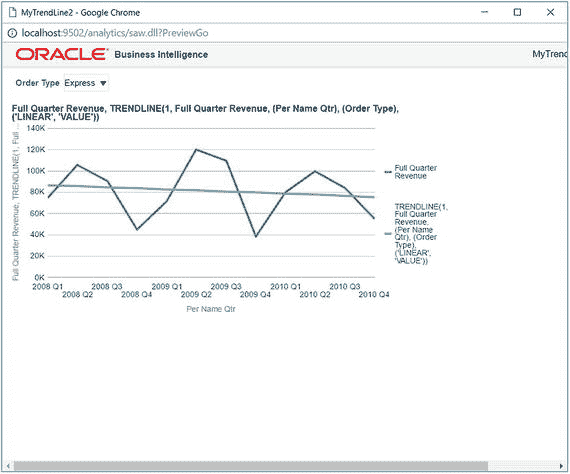
**图 3-41.** 来自图 3-36 的 `TRENDLINE` 分析的仪表盘视图

发出的分析查询如下：

```
SELECT
0 s_0,
"Sample Sales Lite"."Orders"."Order Type" s_1,
"Sample Sales Lite"."Time"."Per Name Qtr" s_2,
TRENDLINE("Sample Sales Lite"."Calculated Facts"."Full Quarter Revenue",("Sample Sales Lite"."Time"."Per Name Qtr") BY ("Sample Sales Lite"."Orders"."Order Type"),'LINEAR','VALUE') s_3
FROM "Sample Sales Lite"
ORDER BY 3 ASC NULLS LAST, 2 ASC NULLS LAST
FETCH FIRST 65001 ROWS ONLY
```

**注意**：x 轴必须表示数值或日期变量，`TRENDLINE` 才能正常工作。但是，也可以使用属于日期或时间层次结构的字符串值。这里我们使用了 `"Time"."Per Name Qtr"`。

TRENDLINE 仪表盘的相应 3D 视图与表格输出一起显示在图 3-42 中。

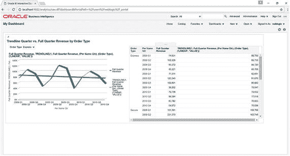
图 3-42. 图 3-37 中 `TRENDLINE` 的仪表盘 3D 视图及相应的表格输出

在 `TRENDLINE` 的公式中将 `model_type` 指定为 `EXPONENTIAL` 而不是 `LINEAR` 会产生不同的分析，如图 3-43 所示。

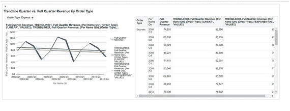
图 3-43. 图 3-38 的 3D `TRENDLINE` 的 `LINEAR` 和 `EXPONENTIAL` 视图及相应的表格输出

为前述数据绘制格状图会生成如图 3-44 所示的输出。

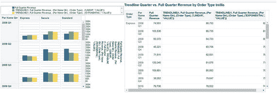
图 3-44. 分析的格状图

使用格状图、3D 图形和表格输出创建仪表盘会生成如图 3-45 和 3-46 所示的图形。

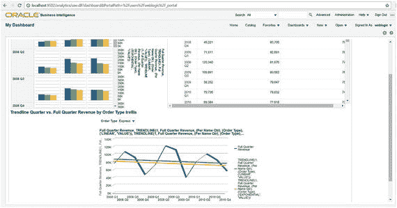
图 3-46. `TRENDLINE` 的格状图、3D 图形和表格输出仪表盘

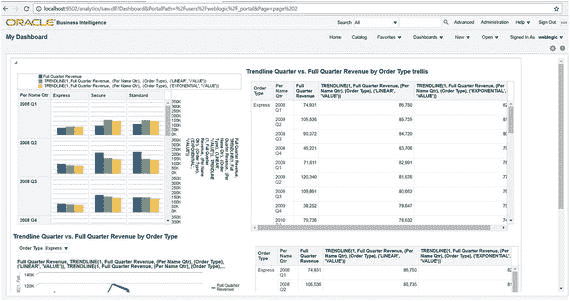
图 3-45. `TRENDLINE` 的格状图、3D 图形和表格输出仪表盘

## 总结

本章涵盖了 Oracle `R` 技术。首先简要描述了开源 `R`，然后概述了 Oracle 的 `R` 技术，例如 `Oracle R Distribution`、`ROracle`、`Oracle R Advanced Analytics for Hadoop` 和 `Oracle R Enterprise`。接着详细解释了使用 `ORE` 进行机器学习以及与 `OBIEE` 集成的端到端流程。我们介绍了以多种方式使用机器学习的随机森林分类算法，即使用 `ORD`、通过 `R` 接口和 SQL 接口执行嵌入式 `R`、生成相应的 `PNG` 图形，并将其与 `OBIEE` 集成以创建分析和仪表盘。最后，我们简要介绍了 `EDW` 的机器学习趋势匹配，并详细说明了在 `OBIEE 12c` 中使用预定义的趋势线高级分析函数。