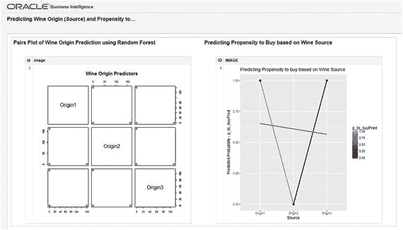
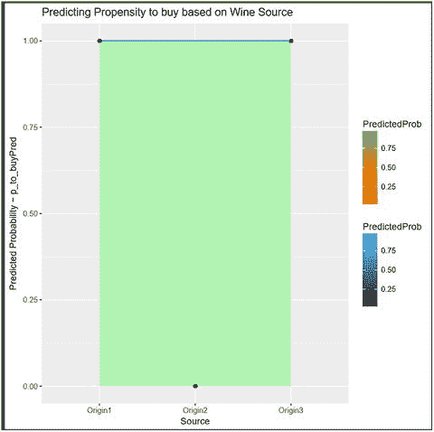
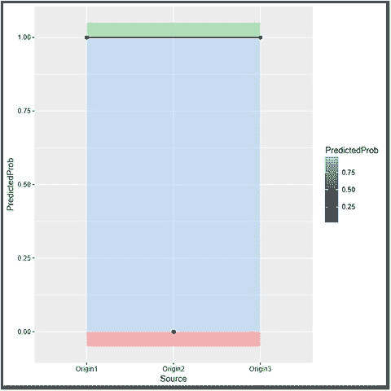

# 5. 用例：OBIEE 12c 中的机器学习

我们已经介绍了机器学习以及大数据和云计算在 BI 方面的相关性。您已经了解了主要的 R 技术和 Oracle R Enterprise，它们描述了如何将基于 R 的算法用于在 Oracle 12c 中构建模型。在 OBIEE 仪表板中使用这些算法，让您在机器学习和 OBIEE 方面有了一个快速起步。所有这些，再加上第 4 章（该章阐述了在 OBIEE 中使用机器学习的“原因”），回答了 BI 中最受关注的问题：为什么以及如何将机器学习作为解决业务问题的完美方案，并将其用于 OBIEE 中以提供可操作的决策支持？

本章首先概述了一些实际用例，这些用例扩展了第 3 章中描述的用例（预测葡萄酒产地）。本章详细描述了一个利用 OBIEE 中的机器学习来构建高级决策解决方案的用例。本章的主要焦点是描述所选的实际用例，以及如何将其与预测葡萄酒产地的用例结合使用，以构建一个整体的决策解决方案。上述用例的逐步实施细节将在下一章中讨论。此类实际决策支持解决方案在提供更好的业务成果和业务价值方面大有裨益，并提升了企业的竞争情报水平。

## 实际用例

本节介绍的实际用例大致可分为两大类：

*   预测葡萄酒产地
*   将该产地作为预测分析的基础，以预测购买该葡萄酒的倾向

### 预测葡萄酒产地：使用机器学习分类模型

此用例预测葡萄酒的产地。根据每种葡萄酒的类别和其他属性，将葡萄酒分类为三个产地之一。预测结果以配对图的形式呈现，该图随后集成到 OBIEE 仪表板中。

### 使用分类后的葡萄酒产地作为预测分析的基础——利用 OBIEE 中的机器学习技术扩展 BI

通过使用分类后的葡萄酒产地，此用例预测购买该特定葡萄酒的倾向。此预测不同于预测葡萄酒产地；现在我们预测的是消费者根据葡萄酒来源购买该葡萄酒的概率。这意味着概率始终介于 0 和 1 之间，其中 0 表示消费者不会（或者更准确地说，不太可能）根据产地购买该葡萄酒，而 1 表示消费者极有可能根据产地购买该葡萄酒。请注意，在葡萄酒产地预测用例中，输出是三个不同的值：`Origin1`、`Origin2` 和 `Origin3`。相比之下，此处的输出是介于 0 和 1（含）之间的数值分数。

注意

通过在 OBIEE 分析和仪表板中使用葡萄酒产地预测模型和购买倾向模型的输出，业务分析师或 BI 用户可以做出支持采取适当行动以加速业务流程的决策。通过这种方式，BI 可以扩展到由 Oracle 12c 和 OBIEE 中的 R/ORE 驱动的机器学习支持的预测分析领域。

### 使用 BI 仪表盘进行可操作决策

在 OBIEE 中，利用葡萄酒产地预测来构建决策支持解决方案的用例有很多。主要用例列举如下：

*   影响购买倾向（如前一小节所述）
*   根据产地预测产量
*   预测葡萄酒品质
*   推荐用途

你可以使用与 OBIEE 集成的基于 R 语言的机器学习模型，或者直接使用 OBIEE，具体操作如下：

*   购买倾向可以通过名为逻辑回归或广义线性模型（GLM）的机器学习算法进行预测。在 OBIEE 中，这可以通过使用内置的回归分析函数，或者使用基于 R 或 ORE 的逻辑回归模型，然后利用概率值来确定结果。
*   产量预测也可以在 OBIEE 中直接完成，方法是结合过去的购买趋势与时间序列分析，或者使用 `Evaluate_Script` 分析函数配合基于 SQL 的模型对模型进行评分。也可以使用类似于预测葡萄酒产地的 R 或 ORE 函数。
*   品质预测可以通过使用相同的、基于产地或来源预测变量的随机森林机器学习模型来完成。
*   用途推荐可以通过使用推荐引擎常用的机器学习算法，并将其集成到 OBIEE 仪表盘中来实现。

注意

预测购买倾向可以通过以下方式辅助决策支持：

1.  葡萄酒的需求量
2.  每位消费者带来的收入和利润
3.  提升葡萄酒品质

## 用例的技术与功能分析

无论业务用例和所使用的机器学习模型是什么，使用基于 AI 的机器学习模型（OBIEE 可利用这些模型构建可操作的决策支持解决方案）都可以分解为以下步骤：

1.  在 Oracle 中使用 R 语言构建基于 AI 的机器学习模型。
2.  在业务数据集上对模型进行评分，以生成图形输出或进行预测分析。
3.  将前述输出与 OBIEE 集成，用于可视化和决策支持。这可以是一个可在 OBIEE 中利用的基于 SQL 的脚本，也可以是 PNG 格式的输出。
    1.  交互式图表可以根据用户输入的参数或控件动态驱动。
    2.  SQL 和基于图表的输出可以组合起来与 OBIEE 集成。前者可供技术用户调整关键绩效指标（KPI），后者可供技术/业务用户创建更详细的可视化内容，以支持面向最终用户的分析。

图 5-1 展示了 OBIEE 仪表盘的可视化效果，该效果结合了葡萄酒产地预测的初始用例与购买倾向预测用例。这些看起来可能过于简单，但重要的是要知道，当它们被启用为交互式或基于 SQL 的控件时，它们能够驱动用户操作，如前文步骤所述。



图 5-1.

仪表盘展示了预测葡萄酒产地的配对图，并利用该结果基于葡萄酒产地（来源）预测购买倾向

### 图形输出分析：使用随机森林预测葡萄酒产地的配对图

该配对图展示了 `table(origin_pred, test_set$origin)` 的图形。以下是 `table(origin_pred, test_data$origin)` 的输出：

```
> table(origin_pred, test_data$origin)
origin_pred Origin1 Origin2 Origin3
Origin1     140       0       0
Origin2       0     162       0
Origin3       0       0     111
```

以下是 R 语言中调用配对图的代码：

```
pairs(table(origin_pred, test_set$origin), main="Wine Origin Predictors")
```

响应变量以对角线形式呈现，从左上到右下。这些是结果 `Origin1`、`Origin2` 和 `Origin3`。然后每个变量与其他变量进行绘图。这里，我们使用 `table`（或矩阵）输出，将 `origin_pred` 的值与 `test_data$origin` 的值进行绘图。第一列中间的图是 `Origin1` 与 `Origin2` 的单个配对图——同样以 `table` 输出形式呈现。这对应于前面表格输出中的第一行。

同样的图形在顶部中间行重复出现。如您所见，这对应于前面表格中的第二行。左上角没有数据，因为那将是一条绘制产地与产地关系的直线对角线，而不是 `origin_pred` 与 `origin` 的关系。

其他单个图形可以类似地进行分析，以对应前面表格输出中的相应行。

### 图表输出分析：基于葡萄酒来源预测购买倾向

`ggplot` 是一个属于 `ggplot2` R 库的图形可视化函数。使用 `ggplot`，图表或图形由以下部分组成：

数据 + 美学映射 + 几何对象

其中，数据是一个 R 数据框。美学映射表示 x 和 y 变量，以及/或者图表元素（点、线、带状区域、条形等）的类型、颜色和大小。几何对象是图表的类型；例如点图、线图、条形图、带状图、箱线图和密度图。创建自定义图表的主要函数是 `ggplot()`，它允许组合点、线、带状等元素。参数 `group` 在这里很重要。`ggplot` 调用的规范设置了图表画布，并将响应变量放在 y 轴上。

注意

关于 `ggplot` 及其函数调用、签名和示例的详细介绍，请访问 [`www.r-bloggers.com/part-3a-plotting-with-ggplot2/`](https://www.r-bloggers.com/part-3a-plotting-with-ggplot2/) 。

以下是我们示例用例中用于绘制基于葡萄酒来源预测购买倾向的 `ggplot()` 函数调用：

```
library(ggplot2)
gg_plot <- ggplot(data=test_set, aes(x=Source, y=p_to_buyPred, group=1)) +
geom_line(aes(colour = p_to_buyPred), size = 1) + geom_point() +
stat_smooth(method="glm", family="binomial", se=FALSE) +
ggtitle("Predicting Propensity to buy based on Wine Source") +
labs(x="Source", y="Predicted Probability - p_to_buyPred")
plot(gg_plot)
```

注意

`geom_line` 和 `stat_smooth` 连接属于同一组的数据点。通过指定 `group=1`，我们告诉 `ggplot` 所有数据点都属于组 1。因此，我们得到一条单一的（V 形）线，它将 `geom_point()` 绘制的三个数据点连接在一起。此外，如下所述，回归线也会出现在图表中。

对 `geom_line()` 的调用包含 `colour=p_to_buyPred`，这意味着线条颜色由 `p_to_buyPred` 变量的水平（预测概率）自动控制；`size = 1` 表示线条大小为 1 个单位。如前所述，`aes` 表示线条的美学映射。`stat_smooth()` 函数基于原始数据通过 `link = "binomial"` 的 GLM 模型转换，在 `geom_line` 和 `geom_point` 几何对象上生成并拟合一条平滑线（回归线或最佳拟合线）作为图层。这也被称为绘制回归斜率。这通过参数 `method = "glm"`、`family="binomial"` 传递。参数 `se` 指示是否显示要使用的置信区间（默认为 0.95）。`method` 参数是要使用的平滑方法（在此代码中指定为 `glm`，因为我们使用了逻辑回归模型），`formula` 是平滑函数中要使用的公式。平滑函数有助于识别何时发生过绘制。在图 5-1 中，这显示为图表中间分割 V 形线的线。

对 `geom_point()` 的调用不带任何参数意味着使用默认的点形状（即圆点）和颜色（即黑色）。此函数调用绘制实际数据点。

`ggtitle` 打印其参数中给出的图表标题。`labs` 指示图表的 x 轴和 y 轴标签，分别为 `"Source"` 和 `"Predicted Probability - p_to_buyPred"`。可以通过更改与透明度、颜色、线型和大小相对应的参数来自定义 ggplot。

### 更详细层面的分析

在更详细的层面上，可以通过使用 `geom_ribbon()` 几何对象的带状图进一步分析购买倾向的用例。我们首先通过从 `Wineptobuy.csv` 文件中采样原始数据获得的 tsetse 数据集中省略 `propensity_to_buy` 列来推导测试数据。我们将此数据加载到一个名为 `test_set2` 的数据框中。然后，我们使用 `test_set2` 推导出 `test_set3`。清单 5-1 显示了此分析的完整代码。

```markdown

```
library(ORE)
ore.connect("testr","orcl","localhost","testr")
library(OREmodels)

# 假设 Wineptobuy.csv 文件位于调用 ORE CLI 时的工作目录中
winedata <- read.csv("Wineptobuy.csv", header = TRUE)
head(winedata)

# 将数据拆分为训练集和测试集
ind <- sample(2, nrow(winedata), replace = TRUE, prob = c(0.7, 0.3))
train_set <- winedata[ind == 1, ]
test_set <- winedata[ind == 2, ]

# 使用训练集拟合逻辑回归模型
logitM <- glm(formula = propensity_to_buy ~ Source, family = binomial, data = train_set)
summary(logitM)

# 使用测试集进行预测
logitPredict <- predict(logitM, newdata = test_set, type = "response")
head(logitPredict)

# 将预测概率转换为类别（1 或 0）
p_to_buyPred <- ifelse(logitPredict > 0.5, 1, 0) # 将概率量化为值 1 和 0
misClasificError <- mean(p_to_buyPred != test_set$propensity_to_buy)
print(paste('准确率', 1 - misClasificError))

# 对于 p>0.5，ROC 总结了所有可能值的预测情况

# 曲线下面积（AUC）是 ROC 的最佳性能指标，AUC 值越高越好

# 该模型（glm）的预测效果也越好。

# 该包能够使用 prediction、performance 和 plot 函数可视化评分分类器的性能。

# 其定义可在 http://rocr.bioinf.mpi-sb.mpg.de/ 找到
library(ROCR)
class(test_set$p_to_buyPred) # 显示 test_set 中预测值 p_to_buyPred 的 R 类

# 使用 GLM 的 R 语言 prediction() 函数将包含预测的输入数据转换为标准格式

# 此处转换由 p_to_buyPred（预测值）和 propensity_to_buy 给出的两列数据为标准格式

# 并返回一个类为 prediction 的对象。
pr1 <- prediction(test_set$p_to_buyPred, test_set$propensity_to_buy)
class(pr1) # 这会将类显示为 "prediction"

# performance 函数用于执行预测器评估。其签名为

# performance(prediction.obj, measure, x.measure)。它作用于一个 prediction 对象（本例中为 pr1），

# measure 是用于评估的性能度量（本例中为 "tpr" 或真阳性率），

# x.measure 是第二个性能度量（"fpr" 或假阳性率）。measure 绘制在 y 轴，

# x.measure 绘制在 x 轴，从而形成一条二维曲线。也可以传递其他度量，例如 "auc"（ROC 曲线下面积）、

# "acc"（准确率）、"err"（错误率）等。
prf1 <- performance(pr1, measure = "tpr", x.measure = "fpr")
class(prf1) # 这会将类显示为 "performance"
pdf("plot_prf1.pdf") # 这会将绘制的图形保存为工作目录中的 PDF 文件

# 这会绘制一个类为 performance 的对象，本例中为 prf1。colorize 指定曲线是否

# 根据截止点进行着色。
plot(prf1, colorize = TRUE) # , text.adj = c(-0.2,1.7)
dev.off()

# 这会对 performance() 函数进行不同的调用，要评估的度量设为 "auc" 或 ROC 曲线下面积。

# 这会返回上述预测以 "auc" 作为评估度量的性能。Auc 是 ROC 曲线下的面积。
auc1 <- performance(pr1, measure = "auc")
auc1 <- auc1@y.values[[1]]
auc1 # "auc" 越接近 1 或等于 1 表示模型拟合优度好，预测性能更佳
library(ROCR)
p <- predict(logitM, newdata= data.frame(test_set[,c(1:19)]), type="response")
class(p)
pr <- prediction(p, test_set$propensity_to_buy)
class(pr)
prf <- performance(pr, measure = "tpr", x.measure = "fpr")
class(prf)
plot(prf, colorize = TRUE) # , text.adj = c(-0.2,1.7)
auc <- performance(pr, measure = "auc")
auc <- auc@y.values[[1]]
auc
test_set2 <- data.frame(test_set[,c(1:19)])
head(test_set2)

# R 语言内部的 within 函数使用 test_set3 数据集作为其参数，并生成一个用于

# 带状图层数据的 data.frame。within 内部的第一行生成预测概率以及

# 有助于绘制置信区间的标准误差。参数 se 用于指定是否

# 显示要使用的置信区间（默认为 0.95），并且还可以绘制置信区间。

# type="link" 给出链接尺度上的估计值。

# 剩余的行将预测值和置信区间都反向转换为概率。

# cbind 对数据框 test_set2 与 predict 函数评分的预测结果列进行按列绑定，

# 该预测结果列作为第二个参数传递给 cbind。对于逻辑回归模型，置信区间

# 基于剖面似然函数。lower 和 upper 表示置信下限和上限。
test_set3 <- cbind(test_set2, predict(logitM, newdata=test_set2, type = "link", se = TRUE))
test_set3 <- within(test_set3, {
PredictedProb <- plogis(fit)
lower <- plogis(fit - (1.96 * se.fit))
upper <- plogis(fit + (1.96 * se.fit))
})
head(test_set3)
library(ggplot2)
pdf("test_set3_ribbon.pdf") # 下面一行设置图形画布，y 轴为响应变量
ggplot(test_set3, aes(x = Source, y = PredictedProb, group=PredictedProb)) +
geom_line(aes(colour = PredictedProb), size = 1) + geom_point() + # 绘制实际数据点
geom_ribbon(aes(ymin = lower, ymax = upper, fill = PredictedProb), alpha = 0.25) + # alpha 淡化连接线
scale_fill_gradient(low="red", high="green") + # 为带状图层定义连续颜色标度
ggtitle("基于葡萄酒来源预测购买倾向") + # 最终图形的标题
ylab("预测概率 - p_to_buyPred") # 指定 y 轴标签。这也作为图形图例
dev.off()
清单 5-1.
进一步分析 propensity_to_buy 用例的代码
```

```

`scale_fill_gradient()` 函数用于定义连续的颜色标度。在我们的案例中，高值将填充为绿色，低概率值将填充为红色。该图是一个带状图（连续型），因此添加 `scale_fill_gradient()` 图层会使其成为一个带有彩色带状填充的连续标度——绿色代表高值，红色代表低值。

以下来自清单 5-1 的代码段与我们关于进一步分析的讨论相关：

```
test_set3 <- cbind(test_set2, predict(logitM, newdata=test_set2, type = "link", se = TRUE))
test_set3 <- within(test_set3, {
PredictedProb <- plogis(fit)
lower <- plogis(fit - (1.96 * se.fit))
upper <- plogis(fit + (1.96 * se.fit))
})
head(test_set3)
```

以下是代码的解释：

要查看 `test_set2` 中的内容，我们在命令行中运行 `head(test_set2)` R 命令，得到以下输出：

```
> head(test_set2)
origin class Alcohol Malic.acid  Ash Alcanility.of.ash Magnesium
1 Origin1     1   14.22       1.70 2.30              16.3       118
2 Origin1     1   14.10       2.16 2.30              18.0       105
3 Origin1     1   14.12       1.48 2.32              16.8        95
4 Origin1     1   14.21       4.04 2.44              18.9       111
5 Origin1     1   13.05       1.73 2.04              12.4        92
6 Origin1     1   13.77       1.90 2.68              17.1       115
Total.phenols Flavanoids Nonflavanoid.phenols Proanthocyanins Color.intensity
1        3.20     3.00               0.26            2.03            6.38
2        2.95     3.32               0.22            2.38            5.75
3        2.20     2.43               0.26            1.57            5.00
4        2.85     2.65               0.30            1.25            5.24
5        2.72     3.27               0.17            2.91            7.20
6        3.00     2.79               0.39            1.68            6.30
Hue OD280.OD315.of.diluted.wines Proline Origin1 Origin2 Origin3  Source
1 0.94                         3.31     970   1.000   0.000       0 Origin1
2 1.25                         3.17    1510   1.000   0.000       0 Origin1
3 1.17                         2.82    1280   1.000   0.000       0 Origin1
4 0.87                         3.33    1080   0.996   0.004       0 Origin1
5 1.12                         2.91    1150   1.000   0.000       0 Origin1
6 1.13                         2.93    1375   1.000   0.000       0 Origin1
>
```

最后一列 `Source` 给出了使用随机森林算法预测的葡萄酒产地来源，其输出以配对图形式显示。我们看到，当 `Origin1` 和 `Origin3` 的值等于 1 或几乎接近 1 时，来源被预测为 `Origin1`。当 `Origin2` 列中的值为 0 或接近 0 时，`Source` 则为 `Origin2`。

`within` R 函数将 `test_set3` 数据集作为其参数，并生成一个用于带状图层数据的数据框。

前面代码的第一行生成了预测概率以及用于绘制置信区间的标准误差。`type="link"` 给出了链接尺度上的估计值。其余行将预测值和置信区间反向转换为概率。

要查看 `test_set3` 的输出，我们运行 `head(test_set3)` 命令，得到以下输出：

```
> head(test_set3)
origin class Alcohol Malic.acid  Ash Alcanility.of.ash Magnesium
1 Origin1     1   14.22       1.70 2.30              16.3       118
2 Origin1     1   14.10       2.16 2.30              18.0       105
3 Origin1     1   14.12       1.48 2.32              16.8        95
4 Origin1     1   14.21       4.04 2.44              18.9       111
5 Origin1     1   13.05       1.73 2.04              12.4        92
6 Origin1     1   13.77       1.90 2.68              17.1       115
Total.phenols Flavanoids Nonflavanoid.phenols Proanthocyanins Color.intensity
1         3.20       3.00               0.26            2.03            6.38
2         2.95       3.32               0.22            2.38            5.75
3         2.20       2.43               0.26            1.57            5.00
4         2.85       2.65               0.30            1.25            5.24
5         2.72       3.27               0.17            2.91            7.20
6         3.00       2.79               0.39            1.68            6.30
Hue OD280.OD31 5.of.diluted.wines Proline Origin1 Origin2 Origin3  Source
1 0.94                         3.31     970   1.000   0.000       0 Origin1
2 1.25                         3.17    1510   1.000   0.000       0 Origin1
3 1.17                         2.82    1280   1.000   0.000       0 Origin1
4 0.87                         3.33    1080   0.996   0.004       0 Origin1
5 1.12                         2.91    1150   1.000   0.000       0 Origin1
6 1.13                         2.93    1375   1.000   0.000       0 Origin1
fit   se.fit residual.scale upper lower PredictedProb
1 28.56607 94471.71              1     1     0             1
2 28.56607 94471.71              1     1     0             1
3 28.56607 94471.71              1     1     0             1
4 28.56607 94471.71              1     1     0             1
5 28.56607 94471.71              1     1     0             1
6 28.56607 94471.71              1     1     0              1
```

注意

`fit`、`se.fit`、`residual.scale`、`upper`、`lower` 和 `PredictedProb` 列分别给出了拟合度、拟合的标准误差、残差尺度、预测值及其上下置信限，以及预测概率。置信区间为 95% 水平。

然后，我们使用 `geom_ribbon()` 几何函数，并结合 `geom_line()` 和 `geom_point()`，如清单 5-2 所示，得到图 5-2 中所示的带状图。将 `ggplot` 与 `geom_ribbon()` 结合使用，可以绘制带有预测概率和 95% 置信区间的图形。这在调用 `geom_ribbon()` 时显而易见，其中美学参数使用了置信限的下限和上限值（见清单 5-1 中的粗体代码行）。如下所示，来自清单 5-1 的代码段：

```
library(ggplot2)
pdf("test_set3_ribbon.pdf")
ggplot(test_set3, aes(x = Source, y = PredictedProb, group=PredictedProb)) +
geom_line(aes(colour = PredictedProb), size = 1) + geom_point() +
geom_ribbon(aes(ymin = lower, ymax = upper, fill = PredictedProb), alpha = 0.25)  +
scale_fill_gradient(low="red", high="green") +
ggtitle("基于葡萄酒来源预测购买倾向") +
ylab("预测概率 - p_to_buyPred")
dev.off()
```

主要图形是通过将美学映射指定为 x 轴的葡萄酒`Source`，以及按`PredictedProb`自身分组的 y 轴（从代码清单 5-1 中获得的`PredictedProb`）而得到的 ggplot 图形。该图形绘制为一条连接 Origin1 和 Origin3 两个点的单线，因为这两个点对应的概率值为 1。带状图层本身以绿色绘制，这是由`fill = PredictedProb`以及对`scale_fill_gradient()`函数的调用（该函数设置了`low="red"`和`high="green"`）所指定的。由于`PredictedProb`的最大值为 1，因此带状图的填充色为绿色，而`Origin2`对应的红色则被该图层本身所掩盖。`geom_line()`和`geom_ribbon()`的测量尺度或图例作为图形的一部分，与带状图和线条一同显示。alpha 值决定了带状图的透明度级别。`scale_fill_gradient()`与`geom_ribbon()`配合使用，生成了图 5-2 中的复合图形。整个图形以 PDF 格式保存为图像文件。



图 5-2.

test_set3_ribbon.pdf（test_set 预测概率的带状图）

```
g <- ggplot(test_set3, aes(x = Source, y = PredictedProb, group=PredictedProb)) +
geom_line(aes(colour = PredictedProb), size = 1) + geom_point() +
geom_ribbon(aes(ymin = lower, ymax = upper, fill = PredictedProb), alpha = 0.25)  +
scale_fill_gradient(low="red", high="green") +
ggtitle("基于葡萄酒来源预测购买倾向") +
ylab("预测概率 - p_to_buyPred")
```

### 预测购买倾向的应用场景

我们可以使用带状几何图形的多个图层来构建一个图表，用以描绘决策制定的依据。通过将代码清单 5-2 中所示的代码添加到代码清单 5-1 的代码示例中，我们可以展示带状图上方和下方的区域，这些区域反过来有助于决策制定。执行此代码的结果如图 5-3 所示。



图 5-3.

显示带状图下方和上方区域的图表（基于购买倾向的应用场景）

```
library(ggplot2)
g <- ggplot(test_set3, aes(x = Source, y = PredictedProb, group=PredictedProb)) +
geom_line(aes(colour = PredictedProb), size = 1) + geom_point() +
geom_ribbon(aes(ymin = lower, ymax = upper, fill = PredictedProb), alpha = 0.25)

# ggplot_build 函数返回一个数据框列表（每个图层一个）和一个面板对象，

# 其中包含关于当前上下文中图形实际 x 轴和 y 轴范围的信息。

# 在我们的例子中，这是带状图
res <- ggplot_build(g)
bottom <- res[[2]]$panel_ranges[[1]]$y.range[1] # 设置 ggplot2（带状图）的 y 轴绘图范围下限
top    <- res[[2]]$panel_ranges[[1]]$y.range[2] # 设置 ggplot2（带状图）的 y 轴绘图范围上限
ggplot(test_set3, aes(x = Source, y = PredictedProb, group=PredictedProb)) +
geom_ribbon(aes(ymin = lower, ymax = upper, fill = PredictedProb), alpha=0.25) + # 带状图层
geom_ribbon(aes(ymin=bottom, ymax=lower), fill="red", alpha=0.25) + # 带状图下方的图层
geom_ribbon(aes(ymin=upper, ymax=top), fill="green", alpha=0.25) + # 带状图上方的图层
geom_point() + geom_line()
代码清单 5-2.
在带状图层下方和上方添加多个区域的代码段
```

在上图中，我们可以看到红色区域代表了 Origin2 葡萄酒的应用场景，并且这种葡萄酒的需求量很低。由此我们可以推断，要么是这种葡萄酒的质量需要改进，要么是其生产来源需要更加集中。

然而，带状图上方的绿色区域表明，来自`Origin1`和`Origin3`的葡萄酒的需求量（以及相应的供应量）很高。因此，来自这些来源的葡萄酒的收入和利润也很高。

当此输出与 OBIEE 集成时，可以通过提供参数和操作过滤器等控件，使上述结论变得可操作，用户可以利用这些控件来支持业务决策。

以下是代码清单 5-1 和 5-2 中代码组合的输出结果：

```
> ore.connect("testr","orcl","localhost","testr")
> library(OREmodels)
> winedata  head(winedata)
id  origin class Alcohol Malic.acid  Ash Alcanility.of.ash Magnesium
1  1 Origin1     1   14.37       1.95 2.50              16.8       113
2  2 Origin1     1   14.20       1.76 2.45              15.2       112
3  3 Origin1     1   14.06       2.15 2.61              17.6       121
4  4 Origin1     1   13.64       3.10 2.56              15.2       116
5  5 Origin1     1   14.06       1.63 2.28              16.0       126
6  6 Origin1     1   12.85       1.60 2.52              17.8        95
Total.phenols Flavanoids Nonflavanoid.phenols Proanthocyanins Color.intensity
1          3.85       3.49              0.24            2.18            7.80
2          3.27       3.39              0.34            1.97            6.75
3          2.60       2.51              0.31            1.25            5.05
4          2.70       3.03              0.17            1.66            5.10
5          3.00       3.17              0.24            2.10            5.65
6          2.48       2.37              0.26            1.46            3.93
Hue OD280.OD315.of.diluted.wines Proline Origin1 Origin2 Origin3  Source
1 0.86                         3.45    1480   1.000   0.000   0.000 Origin1
2 1.05                         2.85    1450   0.994   0.004   0.002 Origin1
3 1.06                         3.58    1295   1.000   0.000   0.000 Origin1
4 0.96                         3.36     845   1.000   0.000   0.000 Origin1
5 1.09                         3.71     780   1.000   0.000   0.000 Origin1
6 1.09                         3.63    1015   1.000   0.000   0.000 Origin1
origin.1 id.1 propensity_to_buy
1  Origin1    1                 1
2  Origin1    2                 1
3  Origin1    3                 1
4  Origin1    4                 1
5  Origin1    5                 1
6  Origin1    6                 1
> summary(winedata)
id          origin        class         Alcohol        Malic.acid
Min.   :  1   Origin1:140   Min.   :1.00   Min.   :11.03   Min.   :0.740
1st Qu.:104   Origin2:162   1st Qu.:1.00   1st Qu.:12.37   1st Qu.:1.530
Median :207   Origin3:111   Median :2.00   Median :13.05   Median :1.830
Mean   :207                 Mean   :1.93   Mean   :13.00   Mean   :2.343
3rd Qu.:310                 3rd Qu.:3.00   3rd Qu.:13.67   3rd Qu.:3.100
Max.   :413                 Max.   :3.00   Max.   :14.75   Max.   :5.800
Ash        Alcanility.of.ash   Magnesium      Total.phenols
Min.   :1.360   Min.   :10.60     Min.   : 70.00   Min.   :0.980
1st Qu.:2.210   1st Qu.:17.00     1st Qu.: 89.00   1st Qu.:1.740
Median :2.360   Median :19.00     Median : 97.00   Median :2.230
Mean   :2.366   Mean   :19.43     Mean   : 99.58   Mean   :2.276
3rd Qu.:2.580   3rd Qu.:21.50     3rd Qu.:107.00   3rd Qu.:2.800
Max.   :3.230   Max.   :30.00     Max.   :162.00   Max.   :3.880
Flavanoids    Nonflavanoid.phenols Proanthocyanins Color.intensity
Min.   :0.340   Min.   :0.1300       Min.   :0.410   Min.   : 1.280
1st Qu.:1.200   1st Qu.:0.2700       1st Qu.:1.140   1st Qu.: 3.300
Median :2.140   Median :0.3400       Median :1.460   Median : 4.600
Mean   :2.011   Mean   :0.3658       Mean   :1.538   Mean   : 4.934
3rd Qu.:2.780   3rd Qu.:0.4500       3rd Qu.:1.870   3rd Qu.: 5.850
Max.   :5.080   Max.   :0.6600       Max.   :3.580   Max.   :13.000
Hue         OD280.OD315.of.diluted.wines    Proline
Min.   :0.5400   Min.   :1.270                Min.   : 278.0
1st Qu.:0.7600   1st Qu.:1.830                1st Qu.: 510.0
Median :0.9600   Median :2.780                Median : 678.0
Mean   :0.9618   Mean   :2.587                Mean   : 749.5
3rd Qu.:1.1300   3rd Qu.:3.140                3rd Qu.: 985.0
Max.   :1.7100   Max.   :4.000                Max.   :1680.0
Origin1         Origin2         Origin3           Source       origin.1
Min.   :0.0000  Min.   :0.0000  Min.   :0.0000   Origin1:140    Origin1:140
1st Qu.:0.0000  1st Qu.:0.0000  1st Qu.:0.0000   Origin2:162    Origin2:162
Median :0.0000  Median :0.0020  Median :0.0000   Origin3:111    Origin3:111
Mean   :0.3395   Mean   :0.3922   Mean   :0.2683
3rd Qu.:1.0000   3rd Qu.:1.0000   3rd Qu.:0.9760
Max.   :1.0000   Max.   :1.0000   Max.   :1.0000
id.1     propensity_to_buy
Min.   :  1   Min.   :0.0000
1st Qu.:104   1st Qu.:0.0000
Median :207   Median :1.0000
Mean   :207   Mean   :0.6077
3rd Qu.:310   3rd Qu.:1.0000
Max.   :413   Max.   :1.0000
> sapply(winedata, sd)
id                       origin
119.3670809                    0.7773550
class                      Alcohol
0.7773550                    0.7667311
Malic.acid                          Ash
1.1720914                    0.2931987
Alcanility.of.ash                    Magnesium
3.4096871                   14.2594176
Total.phenols                   Flavanoids
0.6270436                    0.9700433
Nonflavanoid.phenols              Proanthocyanins
0.1293551                    0.5520653
Color.intensity                          Hue
2.1460253                    0.2289449
OD280.OD315.of.diluted.wines                      Proline
0.7162199                  311.4138632
Origin1                      Origin2
0.4731436                    0.4869368
Origin3                       Source
0.4421105                    0.7773550
origin.1                         id.1
0.7773550                  119.3670809
propensity_to_buy
0.4888445
> xtabs(∼propensity_to_buy +Source, data=winedata)
Source
propensity_to_buy Origin1 Origin2 Origin3
0       0     162       0
1     140       0     111
> xtabs(∼propensity_to_buy +origin, data=winedata)
origin
propensity_to_buy Origin1 Origin2 Origin3
0       0     162       0
1     140       0     111
> label  head(label)
[1] 1 1 1 1 1 1
> library(caTools)
Warning message:
package 'caTools' was built under R version 3.2.5
> s  train_set  test_set  head(train_set)
origin class Alcohol Malic.acid  Ash Alcanility.of.ash Magnesium
1 Origin1     1   14.37       1.95 2.50              16.8       113
3 Origin1     1   14.06       2.15 2.61              17.6       121
4 Origin1     1   13.64       3.10 2.56              15.2       116
6 Origin1     1   12.85       1.60 2.52              17.8        95
7 Origin1     1   13.87       1.90 2.80              19.4       107
9 Origin1     1   13.51       1.80 2.65              19.0       110
Total.phenols Flavanoids Nonflavanoid.phenols Proanthocyanins Color.intensity
1          3.85       3.49              0.24            2.18            7.80
3          2.60       2.51              0.31            1.25            5.05
4          2.70       3.03              0.17            1.66            5.10
6          2.48       2.37              0.26            1.46            3.93
7          2.95       2.97              0.37            1.76            4.50
9          2.35       2.53              0.29            1.54            4.20
Hue OD280.OD315.of.diluted.wines Proline Origin1 Origin2 Origin3  Source
1 0.86                         3.45    1480   1.000   0.000       0 Origin1
3 1.06                         3.58    1295   1.000   0.000       0 Origin1
4 0.96                         3.36     845   1.000   0.000       0 Origin1
6 1.09                         3.63    1015   1.000   0.000       0 Origin1
7 1.25                         3.40     915   0.996   0.004       0 Origin1
9 1.10                         2.87    1095   1.000   0.000       0 Origin1
propensity_to_buy
1                 1
3                 1
4                 1
6                 1
7                 1
9                 1
> nrow(train_set)
[1] 310
> head(test_set)
origin class Alcohol Malic.acid  Ash Alcanility.of.ash Magnesium
2  Origin1     1   14.20       1.76 2.45              15.2       112
5  Origin1     1   14.06       1.63 2.28              16.0       126
8  Origin1     1   13.73       1.50 2.70              22.5       101
10 Origin1     1   13.05       1.65 2.55              18.0        98
11 Origin1     1   13.88       1.89 2.59              15.0       101
18 Origin1     1   13.74       1.67 2.25              16.4       118
Total.phenols Flavanoids Nonflavanoid.phenols Proanthocyanins
2           3.27       3.39                 0.34            1.97
5           3.00       3.17                 0.24            2.10
8           3.00       3.25                 0.29            2.38
10          2.45       2.43                 0.29            1.44
11          3.25       3.56                 0.17            1.70
18          2.60       2.90                 0.21            1.62
Color.intensity  Hue OD280.OD315.of.diluted.wines Proline Origin1 Origin2
2             6.75 1.05                         2.85    1450   0.994   0.004
5             5.65 1.09                         3.71     780   1.000   0.000
8             5.70 1.19                         2.71    1285   0.998   0.002
10            4.25 1.12                         2.51    1105   1.000   0.000
11            5.43 0.88                         3.56    1095   0.996   0.002
18            5.85 0.92                         3.20    1060   1.000   0.000
Origin3  Source propensity_to_buy
2    0.002 Origin1                 1
5    0.000 Origin1                 1
8    0.000 Origin1                 1
10   0.000 Origin1                 1
11   0.002 Origin1                 1
18   0.000 Origin1                 1
> nrow(test_set)
[1] 103
> sp.tab  sp.tab
0   1
Origin1   0  98
Origin2 122   0
Origin3   0  90
> train_set$Source  logitM  summary(logitM)
Call:
glm(formula = propensity_to_buy ∼ Source, family = "binomial",
data = train_set, control = glm.control(maxit = 100))
Deviance Residuals:
Min          1Q      Median          3Q         Max
-8.861e-07  -8.861e-07   8.861e-07   8.861e-07   8.861e-07
Coefficients:
Estimate Std. Error z value Pr(>|z|)
(Intercept)    2.857e+01  9.779e+04       0        1
SourceOrigin2 -5.713e+01  1.313e+05       0        1
SourceOrigin3  1.838e-05  1.413e+05       0        1
(Dispersion parameter for binomial family taken to be 1)
Null deviance: 4.1559e+02  on 309  degrees of freedom
Residual deviance: 2.4340e-10  on 307  degrees of freedom
AIC: 6
Number of Fisher Scoring iterations: 27
> anova(logitM)
Analysis of Deviance Table
Model: binomial, link: logit
Response: propensity_to_buy
Terms added sequentially (first to last)
Df Deviance Resid. Df Resid. Dev
NULL                     309     415.59
Source  2   415.59       307       0.00
> # install.packages("aod")
> library(aod)
Warning message:
package 'aod' was built under R version 3.2.5
> wald.test(b = coef(logitM), Sigma = vcov(logitM), Terms =  1:2)
Wald test:


卡方检验：
X2 = 1.9e-07, df = 2, P(> X2) = 1.0
> wald.test(b = coef(logitM), Sigma = vcov(logitM), Terms =  1:3)
Wald 检验：

卡方检验：
X2 = 2.7e-07, df = 3, P(> X2) = 1.0
> wald.test(b = coef(logitM), Sigma = vcov(logitM), Terms =  2:3)
Wald 检验：

卡方检验：
X2 = 2.6e-07, df = 2, P(> X2) = 1.0
> exp(coef(logitM))
(Intercept) SourceOrigin2 SourceOrigin3
2.547343e+12  1.541085e-25  1.000018e+00
> head(test_set)
origin class Alcohol Malic.acid  Ash Alcanility.of.ash Magnesium
2  Origin1     1   14.20       1.76 2.45              15.2       112
5  Origin1     1   14.06       1.63 2.28              16.0       126
8  Origin1     1   13.73       1.50 2.70              22.5       101
10 Origin1     1   13.05       1.65 2.55              18.0        98
11 Origin1     1   13.88       1.89 2.59              15.0       101
18 Origin1     1   13.74       1.67 2.25              16.4       118
Total.phenols Flavanoids Nonflavanoid.phenols Proanthocyanins
2           3.27       3.39                 0.34            1.97
5           3.00       3.17                 0.24            2.10
8           3.00       3.25                 0.29            2.38
10          2.45       2.43                 0.29            1.44
11          3.25       3.56                 0.17            1.70
18          2.60       2.90                 0.21            1.62
Color.intensity  Hue OD280.OD315.of.diluted.wines Proline Origin1 Origin2
2             6.75 1.05                         2.85    1450   0.994   0.004
5             5.65 1.09                         3.71     780   1.000   0.000
8             5.70 1.19                         2.71    1285   0.998   0.002
10            4.25 1.12                         2.51    1105   1.000   0.000
11            5.43 0.88                         3.56    1095   0.996   0.002
18            5.85 0.92                         3.20    1060   1.000   0.000
Origin3  Source propensity_to_buy
2    0.002 Origin1                 1
5    0.000 Origin1                 1
8    0.000 Origin1                 1
10   0.000 Origin1                 1
11   0.002 Origin1                 1
18   0.000 Origin1                 1
> nrow(test_set)
[1] 103
> head(data.frame(test_set[,c(1:19)]))
origin class Alcohol Malic.acid  Ash Alcanility.of.ash Magnesium
1 Origin1     1   14.20       1.76 2.45              15.2       112
2 Origin1     1   14.06       1.63 2.28              16.0       126
3 Origin1     1   13.73       1.50 2.70              22.5       101
4 Origin1     1   13.05       1.65 2.55              18.0        98
5 Origin1     1   13.88       1.89 2.59              15.0       101
6 Origin1     1   13.74       1.67 2.25              16.4       118
Total.phenols Flavanoids Nonflavanoid.phenols Proanthocyanins Color.intensity
1          3.27       3.39              0.34            1.97            6.75
2          3.00       3.17              0.24            2.10            5.65
3          3.00       3.25              0.29            2.38            5.70
4          2.45       2.43              0.29            1.44            4.25
5          3.25       3.56              0.17            1.70            5.43
6          2.60       2.90              0.21            1.62            5.85
Hue OD280.OD315.of.diluted.wines Proline Origin1 Origin2 Origin3  Source
1 1.05                         2.85    1450   0.994   0.004   0.002 Origin1
2 1.09                         3.71     780   1.000   0.000   0.000 Origin1
3 1.19                         2.71    1285   0.998   0.002   0.000 Origin1
4 1.12                         2.51    1105   1.000   0.000   0.000 Origin1
5 0.88                         3.56    1095   0.996   0.002   0.002 Origin1
6 0.92                         3.20    1060   1.000   0.000   0.000 Origin1
> nrow(data.frame(test_set[,c(1:19)]))
[1] 103
> test_set$p_to_buyPred  class(test_set$p_to_buyPred)
[1] "numeric"
> head(test_set)
origin class Alcohol Malic.acid  Ash Alcanility.of.ash Magnesium
2  Origin1     1   14.20       1.76 2.45              15.2       112
5  Origin1     1   14.06       1.63 2.28              16.0       126
8  Origin1     1   13.73       1.50 2.70              22.5       101
10 Origin1     1   13.05       1.65 2.55              18.0        98
11 Origin1     1   13.88       1.89 2.59              15.0       101
18 Origin1     1   13.74       1.67 2.25              16.4       118
Total.phenols Flavanoids Nonflavanoid.phenols Proanthocyanins
2           3.27       3.39                 0.34            1.97
5           3.00       3.17                 0.24            2.10
8           3.00       3.25                 0.29            2.38
10          2.45       2.43                 0.29            1.44
11          3.25       3.56                 0.17            1.70
18          2.60       2.90                 0.21            1.62
Color.intensity  Hue OD280.OD315.of.diluted.wines Proline Origin1 Origin2
2             6.75 1.05                         2.85    1450   0.994   0.004
5             5.65 1.09                         3.71     780   1.000   0.000
8             5.70 1.19                         2.71    1285   0.998   0.002
10            4.25 1.12                         2.51    1105   1.000   0.000
11            5.43 0.88                         3.56    1095   0.996   0.002
18            5.85 0.92                         3.20    1060   1.000   0.000
Origin3  Source propensity_to_buy p_to_buyPred
2    0.002 Origin1                 1            1
5    0.000 Origin1                 1            1
8    0.000 Origin1                 1            1
10   0.000 Origin1                 1            1
11   0.002 Origin1                 1            1
18   0.000 Origin1                 1            1
> test_set$p_to_buyPred  0.5,1,0)
> misClasificError  print(paste('Accuracy',1-misClasificError))
[1] "Accuracy 1"
> ####
> library(ROCR)
Loading required package: gplots
Attaching package: 'gplots'
The following object is masked from 'package:stats':
lowess
Warning messages:
1: package 'ROCR' was built under R version 3.2.5
2: package 'gplots' was built under R version 3.2.5
> # p1  class(test_set$p_to_buyPred)
[1] "numeric"
> pr1  class(pr1)
[1] "prediction"
attr(,"package")
[1] "ROCR"
> prf1  class(prf1)
[1] "performance"
attr(,"package")
[1] "ROCR"
> pdf("plot_prf1.pdf")
> plot(prf1, colorize = TRUE) # , text.adj = c(-0.2,1.7)
> dev.off()
null device

> auc1  auc1  auc1
[ 1] 1
> ####
> library(ROCR)
> p  class(p)
[1] "numeric"
> pr  class(pr)
[1] "prediction"
attr(,"package")
[1] "ROCR"
> prf  class(prf)
[1] "performance"
attr(,"package")
[1] "ROCR"
> # plot(prf, colorize = TRUE) # , text.adj = c(-0.2,1.7)
> auc  auc  auc
[1] 1
> test_set2  head(test_set2)
origin class Alcohol Malic.acid  Ash Alcanility.of.ash Magnesium
1 Origin1     1   14.20       1.76 2.45              15.2       112
2 Origin1     1   14.06       1.63 2.28              16.0       126
3 Origin1     1   13.73       1.50 2.70              22.5       101
4 Origin1     1   13.05       1.65 2.55              18.0        98
5 Origin1     1   13.88       1.89 2.59              15.0       101
6 Origin1     1   13.74       1.67 2.25              16.4       118
Total.phenols Flavanoids Nonflavanoid.phenols Proanthocyanins Color.intensity
1          3.27       3.39              0.34            1.97            6.75
2          3.00       3.17              0.24            2.10            5.65
3          3.00       3.25              0.29            2.38            5.70
4          2.45       2.43              0.29            1.44            4.25
5          3.25       3.56              0.17            1.70            5.43
6          2.60       2.90              0.21            1.62            5.85
Hue OD280.OD315.of.diluted.wines Proline Origin1 Origin2 Origin3  Source
1 1.05                         2.85    1450   0.994   0.004   0.002 Origin1
2 1.09                         3.71     780   1.000   0.000   0.000 Origin1
3 1.19                         2.71    1285   0.998   0.002   0.000 Origin1
4 1.12                         2.51    1105   1.000   0.000   0.000 Origin1
5 0.88                         3.56    1095   0.996   0.002   0.002 Origin1
6 0.92                         3.20    1060   1.000   0.000   0.000 Origin1
> test_set3  test_set3  head(test_set3)
origin class Alcohol Malic.acid  Ash Alcanility.of.ash Magnesium
1 Origin1     1   14.20       1.76 2.45              15.2       112
2 Origin1     1   14.06       1.63 2.28              16.0       126
3 Origin1     1   13.73       1.50 2.70              22.5       101
4 Origin1     1   13.05       1.65 2.55              18.0        98
5 Origin1     1   13.88       1.89 2.59              15.0       101
6 Origin1     1   13.74       1.67 2.25              16.4       118
Total.phenols Flavanoids Nonflavanoid.phenols Proanthocyanins Color.intensity
1          3.27       3.39              0.34            1.97            6.75
2          3.00       3.17              0.24            2.10            5.65
3          3.00       3.25              0.29            2.38            5.70
4          2.45       2.43              0.29            1.44            4.25
5          3.25       3.56              0.17            1.70            5.43
6          2.60       2.90              0.21            1.62            5.85
Hue OD280.OD315.of.diluted.wines Proline Origin1 Origin2 Origin3  Source
1 1.05                         2.85    1450   0.994   0.004   0.002 Origin1
2 1.09                         3.71     780   1.000   0.000   0.000 Origin1
3 1.19                         2.71    1285   0.998   0.002   0.000 Origin1
4 1.12                         2.51    1105   1.000   0.000   0.000 Origin1
5 0.88                         3.56    1095   0.996   0.002   0.002 Origin1
6 0.92                         3.20    1060   1.000   0.000   0.000 Origin1
fit   se.fit residual.scale upper lower PredictedProb
1 28.56607 97787.51              1     1     0             1
2 28.56607 97787.51              1     1     0             1
3 28.56607 97787.51              1     1     0             1
4 28.56607 97787.51              1     1     0             1
5 28.56607 97787.51              1     1     0             1
6 28.56607 97787.51              1     1     0             1
> library(ggplot2)
Warning message:
package 'ggplot2' was built under R version 3.2.5
> g  res  bottom  top     ggplot(test_set3, aes(x = Source, y = PredictedProb, group=PredictedProb)) +
+ geom_ribbon(aes(ymin = lower, ymax = upper, fill = PredictedProb), alpha=0.2$
+ geom_ribbon(aes(ymin=bottom, ymax=lower), fill="red", alpha=0.25) +
+ geom_ribbon(aes(ymin=upper, ymax=top), fill="green", alpha=0.25) +
+ geom_point() + geom_line()
```

## 总结

本章简要讨论了预测葡萄酒产地的主要用例，以及通过预测基于产地购买特定葡萄酒的倾向来扩展预测分析的用途。它解释了在这两种情况下绘制输出的多种选项；我们创建了配对图以及包含线条、点和色带的复合图。你还了解了如何将回归线拟合到生成的图形中。

