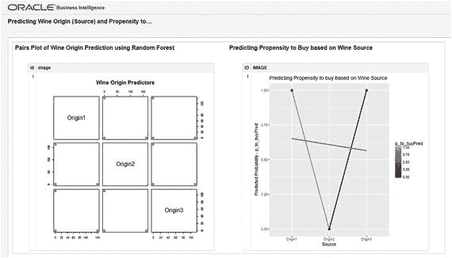

# 5. 用例：OBIEE 12c 中的机器学习

我们已经介绍了机器学习以及大数据和云计算在 BI 方面的相关性。您已经了解了主要的 R 技术和 Oracle R Enterprise，它们描述了如何将基于 R 的算法用于在 Oracle 12c 中构建模型。在 OBIEE 仪表板中使用这些算法，让您在机器学习和 OBIEE 方面有了一个快速起步。所有这些，再加上第 4 章（该章阐述了在 OBIEE 中使用机器学习的“原因”），回答了 BI 中最受关注的问题：为什么以及如何将机器学习作为解决业务问题的完美方案，并将其用于 OBIEE 中以提供可操作的决策支持？

本章首先概述了一些实际用例，这些用例扩展了第 3 章中描述的用例（预测葡萄酒产地）。本章详细描述了一个利用 OBIEE 中的机器学习来构建高级决策解决方案的用例。本章的主要焦点是描述所选的实际用例，以及如何将其与预测葡萄酒产地的用例结合使用，以构建一个整体的决策解决方案。上述用例的逐步实施细节将在下一章中讨论。此类实际决策支持解决方案在提供更好的业务成果和业务价值方面大有裨益，并提升了企业的竞争情报水平。

## 实际用例

本节介绍的实际用例大致可分为两大类：

*   预测葡萄酒产地
*   将该产地作为预测分析的基础，以预测购买该葡萄酒的倾向

### 预测葡萄酒产地：使用机器学习分类模型

此用例预测葡萄酒的产地。根据每种葡萄酒的类别和其他属性，将葡萄酒分类为三个产地之一。预测结果以配对图的形式呈现，该图随后集成到 OBIEE 仪表板中。

### 使用分类后的葡萄酒产地作为预测分析的基础——利用 OBIEE 中的机器学习技术扩展 BI

通过使用分类后的葡萄酒产地，此用例预测购买该特定葡萄酒的倾向。此预测不同于预测葡萄酒产地；现在我们预测的是消费者根据葡萄酒来源购买该葡萄酒的概率。这意味着概率始终介于 0 和 1 之间，其中 0 表示消费者不会（或者更准确地说，不太可能）根据产地购买该葡萄酒，而 1 表示消费者极有可能根据产地购买该葡萄酒。请注意，在葡萄酒产地预测用例中，输出是三个不同的值：`Origin1`、`Origin2` 和 `Origin3`。相比之下，此处的输出是介于 0 和 1（含）之间的数值分数。

注意

通过在 OBIEE 分析和仪表板中使用葡萄酒产地预测模型和购买倾向模型的输出，业务分析师或 BI 用户可以做出支持采取适当行动以加速业务流程的决策。通过这种方式，BI 可以扩展到由 Oracle 12c 和 OBIEE 中的 R/ORE 驱动的机器学习支持的预测分析领域。


### 使用 BI 仪表盘进行可操作决策

在 OBIEE 中，利用葡萄酒产地预测来构建决策支持解决方案的用例有很多。主要用例列举如下：

*   影响购买倾向（如前一小节所述）
*   根据产地预测产量
*   预测葡萄酒品质
*   推荐用途

你可以使用与 OBIEE 集成的基于 R 语言的机器学习模型，或者直接使用 OBIEE，具体操作如下：

*   购买倾向可以通过名为逻辑回归或广义线性模型（GLM）的机器学习算法进行预测。在 OBIEE 中，这可以通过使用内置的回归分析函数，或者使用基于 R 或 ORE 的逻辑回归模型，然后利用概率值来确定结果。
*   产量预测也可以在 OBIEE 中直接完成，方法是结合过去的购买趋势与时间序列分析，或者使用 `Evaluate_Script` 分析函数配合基于 SQL 的模型对模型进行评分。也可以使用类似于预测葡萄酒产地的 R 或 ORE 函数。
*   品质预测可以通过使用相同的、基于产地或来源预测变量的随机森林机器学习模型来完成。
*   用途推荐可以通过使用推荐引擎常用的机器学习算法，并将其集成到 OBIEE 仪表盘中来实现。

注意

预测购买倾向可以通过以下方式辅助决策支持：

1.  葡萄酒的需求量
2.  每位消费者带来的收入和利润
3.  提升葡萄酒品质

## 用例的技术与功能分析

无论业务用例和所使用的机器学习模型是什么，使用基于 AI 的机器学习模型（OBIEE 可利用这些模型构建可操作的决策支持解决方案）都可以分解为以下步骤：

1.  在 Oracle 中使用 R 语言构建基于 AI 的机器学习模型。
2.  在业务数据集上对模型进行评分，以生成图形输出或进行预测分析。
3.  将前述输出与 OBIEE 集成，用于可视化和决策支持。这可以是一个可在 OBIEE 中利用的基于 SQL 的脚本，也可以是 PNG 格式的输出。
    1.  交互式图表可以根据用户输入的参数或控件动态驱动。
    2.  SQL 和基于图表的输出可以组合起来与 OBIEE 集成。前者可供技术用户调整关键绩效指标（KPI），后者可供技术/业务用户创建更详细的可视化内容，以支持面向最终用户的分析。

图 5-1 展示了 OBIEE 仪表盘的可视化效果，该效果结合了葡萄酒产地预测的初始用例与购买倾向预测用例。这些看起来可能过于简单，但重要的是要知道，当它们被启用为交互式或基于 SQL 的控件时，它们能够驱动用户操作，如前文步骤所述。



图 5-1.

仪表盘展示了预测葡萄酒产地的配对图，并利用该结果基于葡萄酒产地（来源）预测购买倾向

### 图形输出分析：使用随机森林预测葡萄酒产地的配对图

该配对图展示了 `table(origin_pred, test_set$origin)` 的图形。以下是 `table(origin_pred, test_data$origin)` 的输出：

```
> table(origin_pred, test_data$origin)
origin_pred Origin1 Origin2 Origin3
Origin1     140       0       0
Origin2       0     162       0
Origin3       0       0     111
```

以下是 R 语言中调用配对图的代码：

```
pairs(table(origin_pred, test_set$origin), main="Wine Origin Predictors")
```

响应变量以对角线形式呈现，从左上到右下。这些是结果 `Origin1`、`Origin2` 和 `Origin3`。然后每个变量与其他变量进行绘图。这里，我们使用 `table`（或矩阵）输出，将 `origin_pred` 的值与 `test_data$origin` 的值进行绘图。第一列中间的图是 `Origin1` 与 `Origin2` 的单个配对图——同样以 `table` 输出形式呈现。这对应于前面表格输出中的第一行。

同样的图形在顶部中间行重复出现。如您所见，这对应于前面表格中的第二行。左上角没有数据，因为那将是一条绘制产地与产地关系的直线对角线，而不是 `origin_pred` 与 `origin` 的关系。

其他单个图形可以类似地进行分析，以对应前面表格输出中的相应行。


### 图表输出分析：基于葡萄酒来源预测购买倾向

`ggplot` 是一个属于 `ggplot2` R 库的图形可视化函数。使用 `ggplot`，图表或图形由以下部分组成：

数据 + 美学映射 + 几何对象

其中，数据是一个 R 数据框。美学映射表示 x 和 y 变量，以及/或者图表元素（点、线、带状区域、条形等）的类型、颜色和大小。几何对象是图表的类型；例如点图、线图、条形图、带状图、箱线图和密度图。创建自定义图表的主要函数是 `ggplot()`，它允许组合点、线、带状等元素。参数 `group` 在这里很重要。`ggplot` 调用的规范设置了图表画布，并将响应变量放在 y 轴上。

注意

关于 `ggplot` 及其函数调用、签名和示例的详细介绍，请访问 [`www.r-bloggers.com/part-3a-plotting-with-ggplot2/`](https://www.r-bloggers.com/part-3a-plotting-with-ggplot2/) 。

以下是我们示例用例中用于绘制基于葡萄酒来源预测购买倾向的 `ggplot()` 函数调用：

```
library(ggplot2)
gg_plot <- ggplot(data=test_set, aes(x=Source, y=p_to_buyPred, group=1)) +
geom_line(aes(colour = p_to_buyPred), size = 1) + geom_point() +
stat_smooth(method="glm", family="binomial", se=FALSE) +
ggtitle("Predicting Propensity to buy based on Wine Source") +
labs(x="Source", y="Predicted Probability - p_to_buyPred")
plot(gg_plot)
```

注意

`geom_line` 和 `stat_smooth` 连接属于同一组的数据点。通过指定 `group=1`，我们告诉 `ggplot` 所有数据点都属于组 1。因此，我们得到一条单一的（V 形）线，它将 `geom_point()` 绘制的三个数据点连接在一起。此外，如下所述，回归线也会出现在图表中。

对 `geom_line()` 的调用包含 `colour=p_to_buyPred`，这意味着线条颜色由 `p_to_buyPred` 变量的水平（预测概率）自动控制；`size = 1` 表示线条大小为 1 个单位。如前所述，`aes` 表示线条的美学映射。`stat_smooth()` 函数基于原始数据通过 `link = "binomial"` 的 GLM 模型转换，在 `geom_line` 和 `geom_point` 几何对象上生成并拟合一条平滑线（回归线或最佳拟合线）作为图层。这也被称为绘制回归斜率。这通过参数 `method = "glm"`、`family="binomial"` 传递。参数 `se` 指示是否显示要使用的置信区间（默认为 0.95）。`method` 参数是要使用的平滑方法（在此代码中指定为 `glm`，因为我们使用了逻辑回归模型），`formula` 是平滑函数中要使用的公式。平滑函数有助于识别何时发生过绘制。在图 5-1 中，这显示为图表中间分割 V 形线的线。

对 `geom_point()` 的调用不带任何参数意味着使用默认的点形状（即圆点）和颜色（即黑色）。此函数调用绘制实际数据点。

`ggtitle` 打印其参数中给出的图表标题。`labs` 指示图表的 x 轴和 y 轴标签，分别为 `"Source"` 和 `"Predicted Probability - p_to_buyPred"`。可以通过更改与透明度、颜色、线型和大小相对应的参数来自定义 ggplot。

### 更详细层面的分析

在更详细的层面上，可以通过使用 `geom_ribbon()` 几何对象的带状图进一步分析购买倾向的用例。我们首先通过从 `Wineptobuy.csv` 文件中采样原始数据获得的 tsetse 数据集中省略 `propensity_to_buy` 列来推导测试数据。我们将此数据加载到一个名为 `test_set2` 的数据框中。然后，我们使用 `test_set2` 推导出 `test_set3`。清单 5-1 显示了此分析的完整代码。


```markdown

```
library(ORE)
ore.connect("testr","orcl","localhost","testr")
library(OREmodels)
