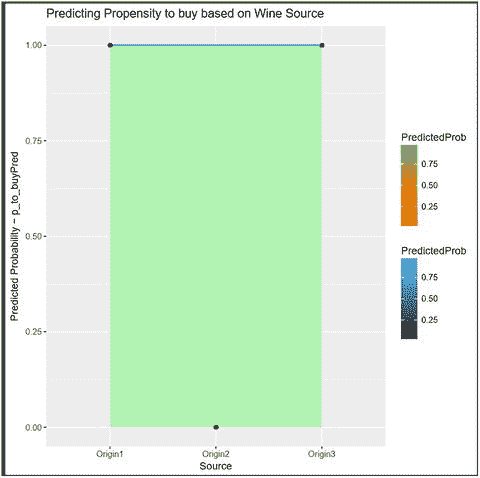
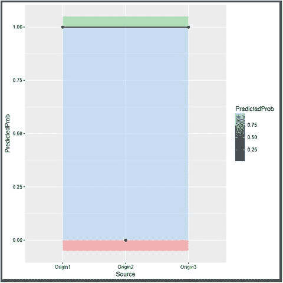

# 基于剖面似然函数。lower 和 upper 表示置信下限和上限。
test_set3 <- cbind(test_set2, predict(logitM, newdata=test_set2, type = "link", se = TRUE))
test_set3 <- within(test_set3, {
PredictedProb <- plogis(fit)
lower <- plogis(fit - (1.96 * se.fit))
upper <- plogis(fit + (1.96 * se.fit))
})
head(test_set3)
library(ggplot2)
pdf("test_set3_ribbon.pdf") # 下面一行设置图形画布，y 轴为响应变量
ggplot(test_set3, aes(x = Source, y = PredictedProb, group=PredictedProb)) +
geom_line(aes(colour = PredictedProb), size = 1) + geom_point() + # 绘制实际数据点
geom_ribbon(aes(ymin = lower, ymax = upper, fill = PredictedProb), alpha = 0.25) + # alpha 淡化连接线
scale_fill_gradient(low="red", high="green") + # 为带状图层定义连续颜色标度
ggtitle("基于葡萄酒来源预测购买倾向") + # 最终图形的标题
ylab("预测概率 - p_to_buyPred") # 指定 y 轴标签。这也作为图形图例
dev.off()
清单 5-1.
进一步分析 propensity_to_buy 用例的代码
```

```


`scale_fill_gradient()` 函数用于定义连续的颜色标度。在我们的案例中，高值将填充为绿色，低概率值将填充为红色。该图是一个带状图（连续型），因此添加 `scale_fill_gradient()` 图层会使其成为一个带有彩色带状填充的连续标度——绿色代表高值，红色代表低值。

以下来自清单 5-1 的代码段与我们关于进一步分析的讨论相关：

```
test_set3 <- cbind(test_set2, predict(logitM, newdata=test_set2, type = "link", se = TRUE))
test_set3 <- within(test_set3, {
PredictedProb <- plogis(fit)
lower <- plogis(fit - (1.96 * se.fit))
upper <- plogis(fit + (1.96 * se.fit))
})
head(test_set3)
```

以下是代码的解释：

要查看 `test_set2` 中的内容，我们在命令行中运行 `head(test_set2)` R 命令，得到以下输出：

```
> head(test_set2)
origin class Alcohol Malic.acid  Ash Alcanility.of.ash Magnesium
1 Origin1     1   14.22       1.70 2.30              16.3       118
2 Origin1     1   14.10       2.16 2.30              18.0       105
3 Origin1     1   14.12       1.48 2.32              16.8        95
4 Origin1     1   14.21       4.04 2.44              18.9       111
5 Origin1     1   13.05       1.73 2.04              12.4        92
6 Origin1     1   13.77       1.90 2.68              17.1       115
Total.phenols Flavanoids Nonflavanoid.phenols Proanthocyanins Color.intensity
1        3.20     3.00               0.26            2.03            6.38
2        2.95     3.32               0.22            2.38            5.75
3        2.20     2.43               0.26            1.57            5.00
4        2.85     2.65               0.30            1.25            5.24
5        2.72     3.27               0.17            2.91            7.20
6        3.00     2.79               0.39            1.68            6.30
Hue OD280.OD315.of.diluted.wines Proline Origin1 Origin2 Origin3  Source
1 0.94                         3.31     970   1.000   0.000       0 Origin1
2 1.25                         3.17    1510   1.000   0.000       0 Origin1
3 1.17                         2.82    1280   1.000   0.000       0 Origin1
4 0.87                         3.33    1080   0.996   0.004       0 Origin1
5 1.12                         2.91    1150   1.000   0.000       0 Origin1
6 1.13                         2.93    1375   1.000   0.000       0 Origin1
>
```

最后一列 `Source` 给出了使用随机森林算法预测的葡萄酒产地来源，其输出以配对图形式显示。我们看到，当 `Origin1` 和 `Origin3` 的值等于 1 或几乎接近 1 时，来源被预测为 `Origin1`。当 `Origin2` 列中的值为 0 或接近 0 时，`Source` 则为 `Origin2`。

`within` R 函数将 `test_set3` 数据集作为其参数，并生成一个用于带状图层数据的数据框。

前面代码的第一行生成了预测概率以及用于绘制置信区间的标准误差。`type="link"` 给出了链接尺度上的估计值。其余行将预测值和置信区间反向转换为概率。

要查看 `test_set3` 的输出，我们运行 `head(test_set3)` 命令，得到以下输出：

```
> head(test_set3)
origin class Alcohol Malic.acid  Ash Alcanility.of.ash Magnesium
1 Origin1     1   14.22       1.70 2.30              16.3       118
2 Origin1     1   14.10       2.16 2.30              18.0       105
3 Origin1     1   14.12       1.48 2.32              16.8        95
4 Origin1     1   14.21       4.04 2.44              18.9       111
5 Origin1     1   13.05       1.73 2.04              12.4        92
6 Origin1     1   13.77       1.90 2.68              17.1       115
Total.phenols Flavanoids Nonflavanoid.phenols Proanthocyanins Color.intensity
1         3.20       3.00               0.26            2.03            6.38
2         2.95       3.32               0.22            2.38            5.75
3         2.20       2.43               0.26            1.57            5.00
4         2.85       2.65               0.30            1.25            5.24
5         2.72       3.27               0.17            2.91            7.20
6         3.00       2.79               0.39            1.68            6.30
Hue OD280.OD31 5.of.diluted.wines Proline Origin1 Origin2 Origin3  Source
1 0.94                         3.31     970   1.000   0.000       0 Origin1
2 1.25                         3.17    1510   1.000   0.000       0 Origin1
3 1.17                         2.82    1280   1.000   0.000       0 Origin1
4 0.87                         3.33    1080   0.996   0.004       0 Origin1
5 1.12                         2.91    1150   1.000   0.000       0 Origin1
6 1.13                         2.93    1375   1.000   0.000       0 Origin1
fit   se.fit residual.scale upper lower PredictedProb
1 28.56607 94471.71              1     1     0             1
2 28.56607 94471.71              1     1     0             1
3 28.56607 94471.71              1     1     0             1
4 28.56607 94471.71              1     1     0             1
5 28.56607 94471.71              1     1     0             1
6 28.56607 94471.71              1     1     0              1
```

注意

`fit`、`se.fit`、`residual.scale`、`upper`、`lower` 和 `PredictedProb` 列分别给出了拟合度、拟合的标准误差、残差尺度、预测值及其上下置信限，以及预测概率。置信区间为 95% 水平。

然后，我们使用 `geom_ribbon()` 几何函数，并结合 `geom_line()` 和 `geom_point()`，如清单 5-2 所示，得到图 5-2 中所示的带状图。将 `ggplot` 与 `geom_ribbon()` 结合使用，可以绘制带有预测概率和 95% 置信区间的图形。这在调用 `geom_ribbon()` 时显而易见，其中美学参数使用了置信限的下限和上限值（见清单 5-1 中的粗体代码行）。如下所示，来自清单 5-1 的代码段：

```
library(ggplot2)
pdf("test_set3_ribbon.pdf")
ggplot(test_set3, aes(x = Source, y = PredictedProb, group=PredictedProb)) +
geom_line(aes(colour = PredictedProb), size = 1) + geom_point() +
geom_ribbon(aes(ymin = lower, ymax = upper, fill = PredictedProb), alpha = 0.25)  +
scale_fill_gradient(low="red", high="green") +
ggtitle("基于葡萄酒来源预测购买倾向") +
ylab("预测概率 - p_to_buyPred")
dev.off()
```


主要图形是通过将美学映射指定为 x 轴的葡萄酒`Source`，以及按`PredictedProb`自身分组的 y 轴（从代码清单 5-1 中获得的`PredictedProb`）而得到的 ggplot 图形。该图形绘制为一条连接 Origin1 和 Origin3 两个点的单线，因为这两个点对应的概率值为 1。带状图层本身以绿色绘制，这是由`fill = PredictedProb`以及对`scale_fill_gradient()`函数的调用（该函数设置了`low="red"`和`high="green"`）所指定的。由于`PredictedProb`的最大值为 1，因此带状图的填充色为绿色，而`Origin2`对应的红色则被该图层本身所掩盖。`geom_line()`和`geom_ribbon()`的测量尺度或图例作为图形的一部分，与带状图和线条一同显示。alpha 值决定了带状图的透明度级别。`scale_fill_gradient()`与`geom_ribbon()`配合使用，生成了图 5-2 中的复合图形。整个图形以 PDF 格式保存为图像文件。



图 5-2.

test_set3_ribbon.pdf（test_set 预测概率的带状图）

```
g <- ggplot(test_set3, aes(x = Source, y = PredictedProb, group=PredictedProb)) +
geom_line(aes(colour = PredictedProb), size = 1) + geom_point() +
geom_ribbon(aes(ymin = lower, ymax = upper, fill = PredictedProb), alpha = 0.25)  +
scale_fill_gradient(low="red", high="green") +
ggtitle("基于葡萄酒来源预测购买倾向") +
ylab("预测概率 - p_to_buyPred")
```

### 预测购买倾向的应用场景

我们可以使用带状几何图形的多个图层来构建一个图表，用以描绘决策制定的依据。通过将代码清单 5-2 中所示的代码添加到代码清单 5-1 的代码示例中，我们可以展示带状图上方和下方的区域，这些区域反过来有助于决策制定。执行此代码的结果如图 5-3 所示。



图 5-3.

显示带状图下方和上方区域的图表（基于购买倾向的应用场景）

```
library(ggplot2)
g <- ggplot(test_set3, aes(x = Source, y = PredictedProb, group=PredictedProb)) +
geom_line(aes(colour = PredictedProb), size = 1) + geom_point() +
geom_ribbon(aes(ymin = lower, ymax = upper, fill = PredictedProb), alpha = 0.25)
# ggplot_build 函数返回一个数据框列表（每个图层一个）和一个面板对象，
# 其中包含关于当前上下文中图形实际 x 轴和 y 轴范围的信息。
# 在我们的例子中，这是带状图
res <- ggplot_build(g)
bottom <- res[[2]]$panel_ranges[[1]]$y.range[1] # 设置 ggplot2（带状图）的 y 轴绘图范围下限
top    <- res[[2]]$panel_ranges[[1]]$y.range[2] # 设置 ggplot2（带状图）的 y 轴绘图范围上限
ggplot(test_set3, aes(x = Source, y = PredictedProb, group=PredictedProb)) +
geom_ribbon(aes(ymin = lower, ymax = upper, fill = PredictedProb), alpha=0.25) + # 带状图层
geom_ribbon(aes(ymin=bottom, ymax=lower), fill="red", alpha=0.25) + # 带状图下方的图层
geom_ribbon(aes(ymin=upper, ymax=top), fill="green", alpha=0.25) + # 带状图上方的图层
geom_point() + geom_line()
代码清单 5-2.
在带状图层下方和上方添加多个区域的代码段
```

在上图中，我们可以看到红色区域代表了 Origin2 葡萄酒的应用场景，并且这种葡萄酒的需求量很低。由此我们可以推断，要么是这种葡萄酒的质量需要改进，要么是其生产来源需要更加集中。

然而，带状图上方的绿色区域表明，来自`Origin1`和`Origin3`的葡萄酒的需求量（以及相应的供应量）很高。因此，来自这些来源的葡萄酒的收入和利润也很高。

当此输出与 OBIEE 集成时，可以通过提供参数和操作过滤器等控件，使上述结论变得可操作，用户可以利用这些控件来支持业务决策。

以下是代码清单 5-1 和 5-2 中代码组合的输出结果：


```
> ore.connect("testr","orcl","localhost","testr")
> library(OREmodels)
> winedata  head(winedata)
id  origin class Alcohol Malic.acid  Ash Alcanility.of.ash Magnesium
1  1 Origin1     1   14.37       1.95 2.50              16.8       113
2  2 Origin1     1   14.20       1.76 2.45              15.2       112
3  3 Origin1     1   14.06       2.15 2.61              17.6       121
4  4 Origin1     1   13.64       3.10 2.56              15.2       116
5  5 Origin1     1   14.06       1.63 2.28              16.0       126
6  6 Origin1     1   12.85       1.60 2.52              17.8        95
Total.phenols Flavanoids Nonflavanoid.phenols Proanthocyanins Color.intensity
1          3.85       3.49              0.24            2.18            7.80
2          3.27       3.39              0.34            1.97            6.75
3          2.60       2.51              0.31            1.25            5.05
4          2.70       3.03              0.17            1.66            5.10
5          3.00       3.17              0.24            2.10            5.65
6          2.48       2.37              0.26            1.46            3.93
Hue OD280.OD315.of.diluted.wines Proline Origin1 Origin2 Origin3  Source
1 0.86                         3.45    1480   1.000   0.000   0.000 Origin1
2 1.05                         2.85    1450   0.994   0.004   0.002 Origin1
3 1.06                         3.58    1295   1.000   0.000   0.000 Origin1
4 0.96                         3.36     845   1.000   0.000   0.000 Origin1
5 1.09                         3.71     780   1.000   0.000   0.000 Origin1
6 1.09                         3.63    1015   1.000   0.000   0.000 Origin1
origin.1 id.1 propensity_to_buy
1  Origin1    1                 1
2  Origin1    2                 1
3  Origin1    3                 1
4  Origin1    4                 1
5  Origin1    5                 1
6  Origin1    6                 1
> summary(winedata)
id          origin        class         Alcohol        Malic.acid
Min.   :  1   Origin1:140   Min.   :1.00   Min.   :11.03   Min.   :0.740
1st Qu.:104   Origin2:162   1st Qu.:1.00   1st Qu.:12.37   1st Qu.:1.530
Median :207   Origin3:111   Median :2.00   Median :13.05   Median :1.830
Mean   :207                 Mean   :1.93   Mean   :13.00   Mean   :2.343
3rd Qu.:310                 3rd Qu.:3.00   3rd Qu.:13.67   3rd Qu.:3.100
Max.   :413                 Max.   :3.00   Max.   :14.75   Max.   :5.800
Ash        Alcanility.of.ash   Magnesium      Total.phenols
Min.   :1.360   Min.   :10.60     Min.   : 70.00   Min.   :0.980
1st Qu.:2.210   1st Qu.:17.00     1st Qu.: 89.00   1st Qu.:1.740
Median :2.360   Median :19.00     Median : 97.00   Median :2.230
Mean   :2.366   Mean   :19.43     Mean   : 99.58   Mean   :2.276
3rd Qu.:2.580   3rd Qu.:21.50     3rd Qu.:107.00   3rd Qu.:2.800
Max.   :3.230   Max.   :30.00     Max.   :162.00   Max.   :3.880
Flavanoids    Nonflavanoid.phenols Proanthocyanins Color.intensity
Min.   :0.340   Min.   :0.1300       Min.   :0.410   Min.   : 1.280
1st Qu.:1.200   1st Qu.:0.2700       1st Qu.:1.140   1st Qu.: 3.300
Median :2.140   Median :0.3400       Median :1.460   Median : 4.600
Mean   :2.011   Mean   :0.3658       Mean   :1.538   Mean   : 4.934
3rd Qu.:2.780   3rd Qu.:0.4500       3rd Qu.:1.870   3rd Qu.: 5.850
Max.   :5.080   Max.   :0.6600       Max.   :3.580   Max.   :13.000
Hue         OD280.OD315.of.diluted.wines    Proline
Min.   :0.5400   Min.   :1.270                Min.   : 278.0
1st Qu.:0.7600   1st Qu.:1.830                1st Qu.: 510.0
Median :0.9600   Median :2.780                Median : 678.0
Mean   :0.9618   Mean   :2.587                Mean   : 749.5
3rd Qu.:1.1300   3rd Qu.:3.140                3rd Qu.: 985.0
Max.   :1.7100   Max.   :4.000                Max.   :1680.0
Origin1         Origin2         Origin3           Source       origin.1
Min.   :0.0000  Min.   :0.0000  Min.   :0.0000   Origin1:140    Origin1:140
1st Qu.:0.0000  1st Qu.:0.0000  1st Qu.:0.0000   Origin2:162    Origin2:162
Median :0.0000  Median :0.0020  Median :0.0000   Origin3:111    Origin3:111
Mean   :0.3395   Mean   :0.3922   Mean   :0.2683
3rd Qu.:1.0000   3rd Qu.:1.0000   3rd Qu.:0.9760
Max.   :1.0000   Max.   :1.0000   Max.   :1.0000
id.1     propensity_to_buy
Min.   :  1   Min.   :0.0000
1st Qu.:104   1st Qu.:0.0000
Median :207   Median :1.0000
Mean   :207   Mean   :0.6077
3rd Qu.:310   3rd Qu.:1.0000
Max.   :413   Max.   :1.0000
> sapply(winedata, sd)
id                       origin
119.3670809                    0.7773550
class                      Alcohol
0.7773550                    0.7667311
Malic.acid                          Ash
1.1720914                    0.2931987
Alcanility.of.ash                    Magnesium
3.4096871                   14.2594176
Total.phenols                   Flavanoids
0.6270436                    0.9700433
Nonflavanoid.phenols              Proanthocyanins
0.1293551                    0.5520653
Color.intensity                          Hue
2.1460253                    0.2289449
OD280.OD315.of.diluted.wines                      Proline
0.7162199                  311.4138632
Origin1                      Origin2
0.4731436                    0.4869368
Origin3                       Source
0.4421105                    0.7773550
origin.1                         id.1
0.7773550                  119.3670809
propensity_to_buy
0.4888445
> xtabs(∼propensity_to_buy +Source, data=winedata)
Source
propensity_to_buy Origin1 Origin2 Origin3
0       0     162       0
1     140       0     111
> xtabs(∼propensity_to_buy +origin, data=winedata)
origin
propensity_to_buy Origin1 Origin2 Origin3
0       0     162       0
1     140       0     111
> label  head(label)
[1] 1 1 1 1 1 1
> library(caTools)
Warning message:
package 'caTools' was built under R version 3.2.5
> s  train_set  test_set  head(train_set)
origin class Alcohol Malic.acid  Ash Alcanility.of.ash Magnesium
1 Origin1     1   14.37       1.95 2.50              16.8       113
3 Origin1     1   14.06       2.15 2.61              17.6       121
4 Origin1     1   13.64       3.10 2.56              15.2       116
6 Origin1     1   12.85       1.60 2.52              17.8        95
7 Origin1     1   13.87       1.90 2.80              19.4       107
9 Origin1     1   13.51       1.80 2.65              19.0       110
Total.phenols Flavanoids Nonflavanoid.phenols Proanthocyanins Color.intensity
1          3.85       3.49              0.24            2.18            7.80
3          2.60       2.51              0.31            1.25            5.05
4          2.70       3.03              0.17            1.66            5.10
6          2.48       2.37              0.26            1.46            3.93
7          2.95       2.97              0.37            1.76            4.50
9          2.35       2.53              0.29            1.54            4.20
Hue OD280.OD315.of.diluted.wines Proline Origin1 Origin2 Origin3  Source
1 0.86                         3.45    1480   1.000   0.000       0 Origin1
3 1.06                         3.58    1295   1.000   0.000       0 Origin1
4 0.96                         3.36     845   1.000   0.000       0 Origin1
6 1.09                         3.63    1015   1.000   0.000       0 Origin1
7 1.25                         3.40     915   0.996   0.004       0 Origin1
9 1.10                         2.87    1095   1.000   0.000       0 Origin1
propensity_to_buy
1                 1
3                 1
4                 1
6                 1
7                 1
9                 1
> nrow(train_set)
[1] 310
> head(test_set)
origin class Alcohol Malic.acid  Ash Alcanility.of.ash Magnesium
2  Origin1     1   14.20       1.76 2.45              15.2       112
5  Origin1     1   14.06       1.63 2.28              16.0       126
8  Origin1     1   13.73       1.50 2.70              22.5       101
10 Origin1     1   13.05       1.65 2.55              18.0        98
11 Origin1     1   13.88       1.89 2.59              15.0       101
18 Origin1     1   13.74       1.67 2.25              16.4       118
Total.phenols Flavanoids Nonflavanoid.phenols Proanthocyanins
2           3.27       3.39                 0.34            1.97
5           3.00       3.17                 0.24            2.10
8           3.00       3.25                 0.29            2.38
10          2.45       2.43                 0.29            1.44
11          3.25       3.56                 0.17            1.70
18          2.60       2.90                 0.21            1.62
Color.intensity  Hue OD280.OD315.of.diluted.wines Proline Origin1 Origin2
2             6.75 1.05                         2.85    1450   0.994   0.004
5             5.65 1.09                         3.71     780   1.000   0.000
8             5.70 1.19                         2.71    1285   0.998   0.002
10            4.25 1.12                         2.51    1105   1.000   0.000
11            5.43 0.88                         3.56    1095   0.996   0.002
18            5.85 0.92                         3.20    1060   1.000   0.000
Origin3  Source propensity_to_buy
2    0.002 Origin1                 1
5    0.000 Origin1                 1
8    0.000 Origin1                 1
10   0.000 Origin1                 1
11   0.002 Origin1                 1
18   0.000 Origin1                 1
> nrow(test_set)
[1] 103
> sp.tab  sp.tab
0   1
Origin1   0  98
Origin2 122   0
Origin3   0  90
> train_set$Source  logitM  summary(logitM)
Call:
glm(formula = propensity_to_buy ∼ Source, family = "binomial",
data = train_set, control = glm.control(maxit = 100))
Deviance Residuals:
Min          1Q      Median          3Q         Max
-8.861e-07  -8.861e-07   8.861e-07   8.861e-07   8.861e-07
Coefficients:
Estimate Std. Error z value Pr(>|z|)
(Intercept)    2.857e+01  9.779e+04       0        1
SourceOrigin2 -5.713e+01  1.313e+05       0        1
SourceOrigin3  1.838e-05  1.413e+05       0        1
(Dispersion parameter for binomial family taken to be 1)
Null deviance: 4.1559e+02  on 309  degrees of freedom
Residual deviance: 2.4340e-10  on 307  degrees of freedom
AIC: 6
Number of Fisher Scoring iterations: 27
> anova(logitM)
Analysis of Deviance Table
Model: binomial, link: logit
Response: propensity_to_buy
Terms added sequentially (first to last)
Df Deviance Resid. Df Resid. Dev
NULL                     309     415.59
Source  2   415.59       307       0.00
> # install.packages("aod")
> library(aod)
Warning message:
package 'aod' was built under R version 3.2.5
> wald.test(b = coef(logitM), Sigma = vcov(logitM), Terms =  1:2)
Wald test:
```


卡方检验：
X2 = 1.9e-07, df = 2, P(> X2) = 1.0
> wald.test(b = coef(logitM), Sigma = vcov(logitM), Terms =  1:3)
Wald 检验：

卡方检验：
X2 = 2.7e-07, df = 3, P(> X2) = 1.0
> wald.test(b = coef(logitM), Sigma = vcov(logitM), Terms =  2:3)
Wald 检验：

卡方检验：
X2 = 2.6e-07, df = 2, P(> X2) = 1.0
> exp(coef(logitM))
(Intercept) SourceOrigin2 SourceOrigin3
2.547343e+12  1.541085e-25  1.000018e+00
> head(test_set)
origin class Alcohol Malic.acid  Ash Alcanility.of.ash Magnesium
2  Origin1     1   14.20       1.76 2.45              15.2       112
5  Origin1     1   14.06       1.63 2.28              16.0       126
8  Origin1     1   13.73       1.50 2.70              22.5       101
10 Origin1     1   13.05       1.65 2.55              18.0        98
11 Origin1     1   13.88       1.89 2.59              15.0       101
18 Origin1     1   13.74       1.67 2.25              16.4       118
Total.phenols Flavanoids Nonflavanoid.phenols Proanthocyanins
2           3.27       3.39                 0.34            1.97
5           3.00       3.17                 0.24            2.10
8           3.00       3.25                 0.29            2.38
10          2.45       2.43                 0.29            1.44
11          3.25       3.56                 0.17            1.70
18          2.60       2.90                 0.21            1.62
Color.intensity  Hue OD280.OD315.of.diluted.wines Proline Origin1 Origin2
2             6.75 1.05                         2.85    1450   0.994   0.004
5             5.65 1.09                         3.71     780   1.000   0.000
8             5.70 1.19                         2.71    1285   0.998   0.002
10            4.25 1.12                         2.51    1105   1.000   0.000
11            5.43 0.88                         3.56    1095   0.996   0.002
18            5.85 0.92                         3.20    1060   1.000   0.000
Origin3  Source propensity_to_buy
2    0.002 Origin1                 1
5    0.000 Origin1                 1
8    0.000 Origin1                 1
10   0.000 Origin1                 1
11   0.002 Origin1                 1
18   0.000 Origin1                 1
> nrow(test_set)
[1] 103
> head(data.frame(test_set[,c(1:19)]))
origin class Alcohol Malic.acid  Ash Alcanility.of.ash Magnesium
1 Origin1     1   14.20       1.76 2.45              15.2       112
2 Origin1     1   14.06       1.63 2.28              16.0       126
3 Origin1     1   13.73       1.50 2.70              22.5       101
4 Origin1     1   13.05       1.65 2.55              18.0        98
5 Origin1     1   13.88       1.89 2.59              15.0       101
6 Origin1     1   13.74       1.67 2.25              16.4       118
Total.phenols Flavanoids Nonflavanoid.phenols Proanthocyanins Color.intensity
1          3.27       3.39              0.34            1.97            6.75
2          3.00       3.17              0.24            2.10            5.65
3          3.00       3.25              0.29            2.38            5.70
4          2.45       2.43              0.29            1.44            4.25
5          3.25       3.56              0.17            1.70            5.43
6          2.60       2.90              0.21            1.62            5.85
Hue OD280.OD315.of.diluted.wines Proline Origin1 Origin2 Origin3  Source
1 1.05                         2.85    1450   0.994   0.004   0.002 Origin1
2 1.09                         3.71     780   1.000   0.000   0.000 Origin1
3 1.19                         2.71    1285   0.998   0.002   0.000 Origin1
4 1.12                         2.51    1105   1.000   0.000   0.000 Origin1
5 0.88                         3.56    1095   0.996   0.002   0.002 Origin1
6 0.92                         3.20    1060   1.000   0.000   0.000 Origin1
> nrow(data.frame(test_set[,c(1:19)]))
[1] 103
> test_set$p_to_buyPred  class(test_set$p_to_buyPred)
[1] "numeric"
> head(test_set)
origin class Alcohol Malic.acid  Ash Alcanility.of.ash Magnesium
2  Origin1     1   14.20       1.76 2.45              15.2       112
5  Origin1     1   14.06       1.63 2.28              16.0       126
8  Origin1     1   13.73       1.50 2.70              22.5       101
10 Origin1     1   13.05       1.65 2.55              18.0        98
11 Origin1     1   13.88       1.89 2.59              15.0       101
18 Origin1     1   13.74       1.67 2.25              16.4       118
Total.phenols Flavanoids Nonflavanoid.phenols Proanthocyanins
2           3.27       3.39                 0.34            1.97
5           3.00       3.17                 0.24            2.10
8           3.00       3.25                 0.29            2.38
10          2.45       2.43                 0.29            1.44
11          3.25       3.56                 0.17            1.70
18          2.60       2.90                 0.21            1.62
Color.intensity  Hue OD280.OD315.of.diluted.wines Proline Origin1 Origin2
2             6.75 1.05                         2.85    1450   0.994   0.004
5             5.65 1.09                         3.71     780   1.000   0.000
8             5.70 1.19                         2.71    1285   0.998   0.002
10            4.25 1.12                         2.51    1105   1.000   0.000
11            5.43 0.88                         3.56    1095   0.996   0.002
18            5.85 0.92                         3.20    1060   1.000   0.000
Origin3  Source propensity_to_buy p_to_buyPred
2    0.002 Origin1                 1            1
5    0.000 Origin1                 1            1
8    0.000 Origin1                 1            1
10   0.000 Origin1                 1            1
11   0.002 Origin1                 1            1
18   0.000 Origin1                 1            1
> test_set$p_to_buyPred  0.5,1,0)
> misClasificError  print(paste('Accuracy',1-misClasificError))
[1] "Accuracy 1"
> ####
> library(ROCR)
Loading required package: gplots
Attaching package: 'gplots'
The following object is masked from 'package:stats':
lowess
Warning messages:
1: package 'ROCR' was built under R version 3.2.5
2: package 'gplots' was built under R version 3.2.5
> # p1  class(test_set$p_to_buyPred)
[1] "numeric"
> pr1  class(pr1)
[1] "prediction"
attr(,"package")
[1] "ROCR"
> prf1  class(prf1)
[1] "performance"
attr(,"package")
[1] "ROCR"
> pdf("plot_prf1.pdf")
> plot(prf1, colorize = TRUE) # , text.adj = c(-0.2,1.7)
> dev.off()
null device


> auc1  auc1  auc1
[ 1] 1
> ####
> library(ROCR)
> p  class(p)
[1] "numeric"
> pr  class(pr)
[1] "prediction"
attr(,"package")
[1] "ROCR"
> prf  class(prf)
[1] "performance"
attr(,"package")
[1] "ROCR"
> # plot(prf, colorize = TRUE) # , text.adj = c(-0.2,1.7)
> auc  auc  auc
[1] 1
> test_set2  head(test_set2)
origin class Alcohol Malic.acid  Ash Alcanility.of.ash Magnesium
1 Origin1     1   14.20       1.76 2.45              15.2       112
2 Origin1     1   14.06       1.63 2.28              16.0       126
3 Origin1     1   13.73       1.50 2.70              22.5       101
4 Origin1     1   13.05       1.65 2.55              18.0        98
5 Origin1     1   13.88       1.89 2.59              15.0       101
6 Origin1     1   13.74       1.67 2.25              16.4       118
Total.phenols Flavanoids Nonflavanoid.phenols Proanthocyanins Color.intensity
1          3.27       3.39              0.34            1.97            6.75
2          3.00       3.17              0.24            2.10            5.65
3          3.00       3.25              0.29            2.38            5.70
4          2.45       2.43              0.29            1.44            4.25
5          3.25       3.56              0.17            1.70            5.43
6          2.60       2.90              0.21            1.62            5.85
Hue OD280.OD315.of.diluted.wines Proline Origin1 Origin2 Origin3  Source
1 1.05                         2.85    1450   0.994   0.004   0.002 Origin1
2 1.09                         3.71     780   1.000   0.000   0.000 Origin1
3 1.19                         2.71    1285   0.998   0.002   0.000 Origin1
4 1.12                         2.51    1105   1.000   0.000   0.000 Origin1
5 0.88                         3.56    1095   0.996   0.002   0.002 Origin1
6 0.92                         3.20    1060   1.000   0.000   0.000 Origin1
> test_set3  test_set3  head(test_set3)
origin class Alcohol Malic.acid  Ash Alcanility.of.ash Magnesium
1 Origin1     1   14.20       1.76 2.45              15.2       112
2 Origin1     1   14.06       1.63 2.28              16.0       126
3 Origin1     1   13.73       1.50 2.70              22.5       101
4 Origin1     1   13.05       1.65 2.55              18.0        98
5 Origin1     1   13.88       1.89 2.59              15.0       101
6 Origin1     1   13.74       1.67 2.25              16.4       118
Total.phenols Flavanoids Nonflavanoid.phenols Proanthocyanins Color.intensity
1          3.27       3.39              0.34            1.97            6.75
2          3.00       3.17              0.24            2.10            5.65
3          3.00       3.25              0.29            2.38            5.70
4          2.45       2.43              0.29            1.44            4.25
5          3.25       3.56              0.17            1.70            5.43
6          2.60       2.90              0.21            1.62            5.85
Hue OD280.OD315.of.diluted.wines Proline Origin1 Origin2 Origin3  Source
1 1.05                         2.85    1450   0.994   0.004   0.002 Origin1
2 1.09                         3.71     780   1.000   0.000   0.000 Origin1
3 1.19                         2.71    1285   0.998   0.002   0.000 Origin1
4 1.12                         2.51    1105   1.000   0.000   0.000 Origin1
5 0.88                         3.56    1095   0.996   0.002   0.002 Origin1
6 0.92                         3.20    1060   1.000   0.000   0.000 Origin1
fit   se.fit residual.scale upper lower PredictedProb
1 28.56607 97787.51              1     1     0             1
2 28.56607 97787.51              1     1     0             1
3 28.56607 97787.51              1     1     0             1
4 28.56607 97787.51              1     1     0             1
5 28.56607 97787.51              1     1     0             1
6 28.56607 97787.51              1     1     0             1
> library(ggplot2)
Warning message:
package 'ggplot2' was built under R version 3.2.5
> g  res  bottom  top     ggplot(test_set3, aes(x = Source, y = PredictedProb, group=PredictedProb)) +
+ geom_ribbon(aes(ymin = lower, ymax = upper, fill = PredictedProb), alpha=0.2$
+ geom_ribbon(aes(ymin=bottom, ymax=lower), fill="red", alpha=0.25) +
+ geom_ribbon(aes(ymin=upper, ymax=top), fill="green", alpha=0.25) +
+ geom_point() + geom_line()
```

## 总结

本章简要讨论了预测葡萄酒产地的主要用例，以及通过预测基于产地购买特定葡萄酒的倾向来扩展预测分析的用途。它解释了在这两种情况下绘制输出的多种选项；我们创建了配对图以及包含线条、点和色带的复合图。你还了解了如何将回归线拟合到生成的图形中。

# 6. 在 OBIEE 12c 中实现机器学习

第 3 章重点介绍了机器学习模型（即 `randomForest` 算法）的使用，以预测葡萄酒产地的业务用例为例，并将其结果与 OBIEE 12c 集成。它解释了如何使用 R 和 Oracle R Enterprise (ORE) 实现这一点，然后将其图形输出与 OBIEE 仪表板集成以用于商业智能目的。第 5 章讨论了在 OBIEE 中利用机器学习的其他业务用例，这些用例有助于构建决策支持解决方案。其中一个用例扩展了葡萄酒产地预测用例，以根据葡萄酒的产地预测购买倾向。此类现实世界的决策支持解决方案在提供更好的业务成果和商业价值方面大有裨益，并提高了企业竞争情报的门槛。

本章重点介绍如何使用基于 R 和 ORE 的算法在 Oracle 12c 中实现上述业务案例，以构建和评分模型，然后将输出以可视化或其他方式整合到 OBIEE 12c 中。最后，它描述了如何通过基于动态用户输入的方式，根据机器学习输出构建交互式仪表板的步骤。

## 业务用例问题描述与解决方案

葡萄酒产地预测用例根据每种葡萄酒的类别和其他属性，将葡萄酒的产地分为 `Origin1`、`Origin2` 或 `Origin3`。根据产地，当前需要解决的问题是预测购买特定葡萄酒的倾向。后者作为四个示例用例之一被提出，这些用例是与葡萄酒产地相关的现实世界业务问题及其结果。这一点在第 5 章中已强调，同时还包括使用机器学习和/或基于 OBIEE 的功能来解决每个问题的方法。


### 技术视角

从数据科学的角度分析上述业务用例，预测购买倾向的问题具有二元结果：1 或 0。结果为 1 表示客户会从该来源购买葡萄酒，结果为 0 则表示客户不会购买该葡萄酒。虽然这听起来像是一个分类问题，但实际上更有意义的是将其视为根据葡萄酒来源预测客户购买特定葡萄酒的概率。

解决该问题的方法同时存在于 R 和 ORE 中，本章将深入讨论这些方法。在深入探讨编程和图形部分之前，我们将先介绍用于解决此类预测（即涉及概率二元结果）的机器学习算法背后的基础原理。这需要对模型背后的数学概念以及为预测输出进行模型评分做出一些解释。

注意

在众多可用的机器学习算法中，最适用于预测概率（二元结果）的是广义线性模型，也称为逻辑回归。它输出的概率值介于 0 和 1 之间，因此在预测方面较为准确。对此问题使用线性回归等线性模型，可能导致预测概率低于 0 或高于 1。相比之下，逻辑回归的结果被限制在 [0,1] 的区间内，这些并非实际值，而是概率值，因此可以直接作为概率进行解释。

### 解决方案的第一部分

我们用例中的葡萄酒 `Source` 变量被称为分类变量，而购买倾向则被称为响应变量。我们使用逻辑回归的机器学习模型预测一个介于 0 和 1 之间的概率，该概率可以通过设定某个阈值转换为二元响应。例如，如果 p >= 0.5，则概率为 1；否则为 0，其中 p 是预测的概率值。

清单 6-1 展示了预测葡萄酒来源的代码（类似于第 3 章的清单）。它使用 `ore.randomForest` 机器学习算法来预测葡萄酒产地，并将预测的产地列命名为 `Source`。

```
library(ORE)
ore.connect("testr","orcl","localhost","testr")
library(OREmodels)
winedata <- read.csv("winedata.csv", header=TRUE, row.names = NULL, sep=',')
head(winedata)
winedata$origin <- ifelse(winedata$class == 1, 'Origin1',
ifelse(winedata$class == 2, 'Origin2',
ifelse(winedata$class == 3, 'Origin3', '')))
class(winedata$origin)
winedata$origin <- as.factor(winedata$origin)
class(winedata$origin)
head(winedata$origin)
table(winedata$origin)
set.seed(123)
sample_size <- 0.70 * nrow(winedata)
sampledata <-sample(seq_len(nrow(winedata)), sample_size)
training_data <- winedata[sampledata, ]
class(training_data)
TRAINING_DATA <- ore.push(training_data)
class(TRAINING_DATA)
test_data <- winedata[-sampledata, ]
TEST_DATA <- ore.push(test_data)
class(TEST_DATA)
head(TRAINING_DATA)
head(TEST_DATA)
wine.rf <- ore.randomForest(origin ∼ . - class, TRAINING_DATA)
class(wine.rf)
tree15 = grabTree(wine.rf, k = 15, labelVar = TRUE)
origin_pred <- predict(wine.rf, TEST_DATA, type = "all", supplemental.cols="origin")
res <- table(origin_pred$origin, origin_pred$prediction)
library(AppliedPredictiveModeling)
transparentTheme(trans = .4)
pairs(table(origin_pred$origin, origin_pred$prediction), main="Wine Origin Predictors")
test_data$id <- seq_len(nrow(test_data))
row.names(test_data) <- test_data$id
head(test_data[,c(16,1,15)])
origin_pred2 <- ore.pull(origin_pred)
origin_pred2$id <- seq_len(nrow(origin_pred2))
head(origin_pred2)
row.names(origin_pred2) <- origin_pred2$id
head(test_data)
head(origin_pred2)
head(origin_pred2[,c(6,5,4)])
df1 <- test_data[,c(16,15,1:14)]
df2 <- origin_pred2[, c(1:6)]
class(df1)
df1_new <- df1[order(df1$origin),]
head(df1_new)
df2_new <- df2[order(df2$origin),]
head(df2_new)
nrow(df1_new)
nrow(df2_new)
data_set <- data.frame(df1_new, df2_new)
nrow(data_set)
head(data_set)
colnames(data_set)[20] <- "Source"
head(data_set)
data_set$propensity_to_buy <- ifelse((data_set$Source == 'Origin1'), 1,
ifelse((data_set$Source == 'Origin2'), 0,
ifelse((data_set$Source == 'Origin3'), 1, '')))
class(data_set)
nrow(data_set)
head(data_set)
write.csv(data_set, "Wineptobuy.csv", row.names=FALSE)
清单 6-1.
使用 ore.randomForest 预测葡萄酒产地
```

清单 6-1 的输出如下所示，其中插入了注释以解释代码：


```
> library(ORE)  # 加载 ORE 库，这是 Oracle R Enterprise 执行的主要库
Loading required package: OREbase
Loading required package: OREcommon
Attaching package: 'OREbase'
The following objects are masked from 'package:base':
cbind, data.frame, eval, interaction, order, paste, pmax, pmin,
rbind, table
Loading required package: OREembed
Loading required package: OREstats
Loading required package: MASS
Loading required package: OREgraphics
Loading required package: OREeda
Loading required package: OREmodels
Loading required package: OREdm
Loading required package: lattice
Loading required package: OREpredict
Loading required package: ORExml
> ore.connect("testr","orcl","localhost","testr") # 通过调用 ore.connect 连接到数据库
> library(OREmodels) # 加载 OREmodels 库，用于调用 ORE 机器学习模型
> winedata  head(winedata) # 显示输入数据框中的前 6 行。这显示了包含预测变量和属性的各个列
class Alcohol Malic.acid  Ash Alcanility.of.ash Magnesium Total.phenols
1     1   14.23       1.71 2.43              15.6       127          2.80
2     1   13.20       1.78 2.14              11.2       100          2.65
3     1   13.16       2.36 2.67              18.6       101          2.80
4     1   14.37       1.95 2.50              16.8       113          3.85
5     1   13.24       2.59 2.87              21.0       118          2.80
6     1   14.20       1.76 2.45              15.2       112          3.27
Flavanoids Nonflavanoid.phenols Proanthocyanins Color.intensity    Hue
1       3.06                 0.28            2.29            5.64    1.04
2       2.76                 0.26            1.28            4.38    1.05
3       3.24                 0.30            2.81            5.68    1.03
4       3.49                 0.24            2.18            7.80    0.86
5       2.69                 0.39            1.82            4.32    1.04
6       3.39                 0.34            1.97            6.75    1.05
OD280.OD315.of.diluted.wines Proline
1                         3.92    1065
2                         3.40    1050
3                         3.17    1185
4                         3.45    1480
5                         2.93     735
6                         2.85    1450
> winedata$origin  class(winedata$origin) # 显示新创建的 'origin' 列的 R 类
[1] "character"
> winedata$origin  class(winedata$origin) # 显示转换后的 'origin' 列的 R 类
[1] "factor"
> head(winedata$origin) # 显示 'origin' 的不同类别数量，作为 'origin' 预测变量的水平
[1] Origin1 Origin1 Origin1 Origin1 Origin1 Origin1
Levels: Origin1 Origin2 Origin3
> table(winedata$origin) # 显示每个不同 'origin' 值的计数
Origin1 Origin2 Origin3
489     549     336
> set.seed(123) # 设置随机种子，用于对输入 winedata 数据集进行采样
> sample_size  sampledata  training_data  class(training_data) # 显示 training_data 的 R 类
[1] "data.frame"
> TRAINING_DATA  class(TRAINING_DATA)
[1] "ore.frame"
attr(,"package")
[1] "OREbase"
> test_data  TEST_DATA  class(TEST_DATA)
[1] "ore.frame"
attr(,"package")
[1] "OREbase"
> head(TRAINING_DATA) # 显示 TRAINING_DATA 数据集的前 6 行。注意它包含一个额外的 'origin' 列
class Alcohol Malic.acid  Ash Alcanility.of.ash Magnesium Total.phenols
396      3   12.60       2.46 2.20              18.5        94          1.62
1083     3   13.45       3.70 2.60              23.0       111          1.70
562      2   11.82       1.72 1.88              19.5        86          2.50
1211     2   11.82       1.47 1.99              20.8        86          1.98
1289     3   12.70       3.55 2.36              21.5       106          1.70
63       2   13.67       1.25 1.92              18.0        94          2.10
Flavanoids Nonflavanoid.phenols Proanthocyanins Color.intensity    Hue
396        0.66                 0.63            0.94            7.10   0.73
1083       0.92                 0.43            1.46           10.68   0.85
562        1.64                 0.37            1.42            2.06   0.94
1211       1.60                 0.30            1.53            1.95   0.95
1289       1.20                 0.17            0.84            5.00   0.78
63         1.79                 0.32            0.73            3.80   1.23
OD280.OD315.of.diluted.wines Proline  origin
396                          1.58     695 Origin3
1083                         1.56     695 Origin3
562                          2.44     415 Origin2
1211                         3.33     495 Origin2
1289                         1.29     600 Origin3
63                           2.46     630 Origin2 # 这也包含一个额外的 'origin' 列
> head(TEST_DATA) # 显示 TEST_DATA 数据集的前 6 行
class Alcohol Malic.acid  Ash Alcanility.of.ash Magnesium Total.phenols
4      1   14.37       1.95 2.50              16.8       113          3.85
6      1   14.20       1.76 2.45              15.2       112          3.27
8      1   14.06       2.15 2.61              17.6       121          2.60
20     1   13.64       3.10 2.56              15.2       116          2.70
21     1   14.06       1.63 2.28              16.0       126          3.00
24     1   12.85       1.60 2.52              17.8        95          2.48
Flavanoids Nonflavanoid.phenols Proanthocyanins Color.intensity  Hue
4        3.49                 0.24            2.18            7.80 0.86
6        3.39                 0.34            1.97            6.75 1.05
8        2.51                 0.31            1.25            5.05 1.06
20       3.03                 0.17            1.66            5.10 0.96
21       3.17                 0.24            2.10            5.65 1.09
24       2.37                 0.26            1.46            3.93 1.09
OD280.OD315.of.diluted.wines Proline  origin
4                          3.45    1480 Origin1
6                          2.85    1450 Origin1
8                          3.58    1295 Origin1
20                         3.36     845 Origin1
21                         3.71     780 Origin1
24                         3.63    1015 Origin1
```

输出的下一部分展示了通过调用 `ore.randomForest()` 函数构建随机森林模型的过程，该模型使用 `class` 作为预测变量，`origin` 作为响应变量，并在 `TRAINING_DATA` 数据集上运行。它会生成特定数量的决策树，对它们的输出进行平均，并利用这些信息得出分类结果。


```markdown
> wine.rf  class(wine.rf) # 显示构建模型返回对象的类别。该对象属于 "ore.model" 类。
[1] "ore.randomForest" "ore.model"
