# 将 train_set 中 Source 和 propensity_to_buy 列的数据加载到矩阵 # sp.tab 中
> sp.tab  sp.tab # 显示上述矩阵
0   1
Origin1   0 104
Origin2 122   0
Origin3   0  84
> train_set$Source <- factor(train_set$Source) # 将 Source 视为分类变量
```


我们使用 R 语言中的 `glm` 机器学习算法构建了一个逻辑回归模型，其中响应变量为 `propensity_to_buy`，预测变量为 `Source`，使用的数据集是 `train_set`。glm 模型的族函数为 `"binomial"`（表明该模型是二项式模型），链接函数为 `logit`，最大迭代次数设置为 100：

```
> logitM <- glm(propensity_to_buy ∼ Source, data = train_set, family="binomial$
```

我们展示刚构建的 `logitM` 模型的摘要，内容包括：`glm` 的函数调用；偏差残差（最小值、第一四分位数、中位数、第三四分位数和最大值），这些是模型拟合程度的度量，换句话说，即模型中观测值所用偏差残差的分布；系数表，其中包含系数、标准误差、z 统计量或 Wald Z 统计量以及相应的 p 值（横向排列），截距和预测变量（纵向排列）；拟合指数，包括零偏差、残差偏差以及赤池信息准则（AIC）。AIC 值最小的模型被认为在模型系数方面拟合良好且无惩罚。

```
> summary(logitM)
Call:
glm(formula = propensity_to_buy ∼ Source, family = "binomial",
data = train_set, control = glm.control(maxit = 100))
Deviance Residuals:
Min          1Q      Median          3Q         Max
-8.861e-07  -8.861e-07   8.861e-07   8.861e-07   8.861e-07
Coefficients:
Estimate Std. Error z value Pr(>|z|)
(Intercept)    2.857e+01  9.493e+04       0        1
SourceOrigin2 -5.713e+01  1.292e+05       0        1
SourceOrigin3 -1.927e-05  1.420e+05       0        1
(Dispersion parameter for binomial family taken to be 1)
Null deviance: 4.1559e+02  on 309  degrees of freedom
Residual deviance: 2.4340e-10  on 307  degrees of freedom
AIC: 6
Number of Fisher Scoring iterations: 27
> anova(logitM)
Analysis of Deviance Table
Model: binomial, link: logit
Response: propensity_to_buy
Terms added sequentially (first to last)
Df Deviance Resid. Df Resid. Dev
NULL                     309     415.59
Source  2   415.59       307       0.00
> # install.packages("aod")
```

`wald.test` 函数基于 `logitM` 模型的系数进行卡方检验统计量测试。在我们的案例中，我们可以使用 R 语言 `aod` 库中的这个函数来测试 `Source` 预测变量的显著性。系数表中模型系数的顺序与模型中项的顺序相同。这一点很重要，因为 `wald.test` 函数通过系数在模型中的顺序来引用它们。在以下三个 `wald.test` 调用中，参数 `b` 传递系数，`Sigma` 给出误差项的方差-协方差矩阵，`Terms` 指示模型中需要测试的项。在我们的用例中，这些项是第 2 项和第 3 项。此外，对第 1 项和第 2 项、第 1、2 和 3 项以及第 2 和第 3 项运行 `wald.test` 函数，分别得到自由度为 2、3 和 2 的卡方检验统计量，且三种情况的 p 值均为 1.0，从而表明 `Source` 具有统计显著性。

```
> library(aod)
Warning message:
package 'aod' was built under R version 3.2.5
> wald.test(b = coef(logitM), Sigma = vcov(logitM), Terms =  1:2)
Wald test:

Chi-squared test:
X2 = 2e-07, df = 2, P(> X2) = 1.0
> wald.test(b = coef(logitM), Sigma = vcov(logitM), Terms =  1:3)
Wald test:

Chi-squared test:
X2 = 2.7e-07, df = 3, P(> X2) = 1.0
> wald.test(b = coef(logitM), Sigma = vcov(logitM), Terms =  2:3)
Wald test:

Chi-squared test:
X2 = 2.6e-07, df = 2, P(> X2) = 1.0
> exp(coef(logitM)) # exp 函数对系数进行指数化，并将其作为优势比进行分析。
(Intercept) SourceOrigin2 SourceOrigin3
2.547392e+12  1.541056e-25  9.999807e-01
> head(test_set) # 显示 test_set 数据集的前 6 行
origin class Alcohol Malic.acid  Ash Alcanility.of.ash Magnesium
2  Origin1     1   14.20       1.76 2.45              15.2       112
9  Origin1     1   13.51       1.80 2.65              19.0       110
10 Origin1     1   13.05       1.65 2.55              18.0        98
11 Origin1     1   13.88       1.89 2.59              15.0       101
13 Origin1     1   14.38       3.59 2.28              16.0       102
17 Origin1     1   13.83       1.65 2.60              17.2        94
Total.phenols Flavanoids Nonflavanoid.phenols Proanthocyanins
2           3.27       3.39                 0.34            1.97
9           2.35       2.53                 0.29            1.54
10          2.45       2.43                 0.29            1.44
11          3.25       3.56                 0.17            1.70
13          3.25       3.17                 0.27            2.19
17          2.45       2.99                 0.22            2.29
Color.intensity  Hue OD280.OD315.of.diluted.wines Proline Origin1 Origin2
2             6.75 1.05                         2.85    1450   0.994   0.004
9             4.20 1.10                         2.87    1095   1.000   0.000
10            4.25 1.12                         2.51    1105   1.000   0.000
11            5.43 0.88                         3.56    1095   0.996   0.002
13            4.90 1.04                         3.44    1065   1.000   0.000
17            5.60 1.24                         3.37    1265   1.000   0.000
Origin3  Source propensity_to_buy
2    0.002 Origin1                 1
9    0.000 Origin1                 1
10   0.000 Origin1                 1
11   0.002 Origin1                 1
13   0.000 Origin1                 1
17   0.000 Origin1                 1
> nrow(test_set) # 显示 test_set 中的行数
[1] 103
> head(data.frame(test_set[,c(1:19)])) # 显示 test_set 中第 1 到第 19 列的前 6 行
origin class Alcohol Malic.acid  Ash Alcanility.of.ash Magnesium
1 Origin1     1   14.20       1.76 2.45              15.2       112
2 Origin1     1   13.51       1.80 2.65              19.0       110
3 Origin1     1   13.05       1.65 2.55              18.0        98
4 Origin1     1   13.88       1.89 2.59              15.0       101
5 Origin1     1   14.38       3.59 2.28              16.0       102
6 Origin1     1   13.83       1.65 2.60              17.2        94
Total.phenols Flavanoids Nonflavanoid.phenols Proanthocyanins Color.intensity
1         3.27       3.39              0.34            1.97            6.75
2         2.35       2.53              0.29            1.54            4.20
3         2.45       2.43              0.29            1.44            4.25
4         3.25       3.56              0.17            1.70            5.43
5         3.25       3.17              0.27            2.19            4.90
6         2.45       2.99              0.22            2.29            5.60
Hue OD280.OD315.of.diluted.wines Proline Origin1 Origin2 Origin3  Source
1 1.05                         2.85    1450   0.994   0.004   0.002 Origin1
2 1.10                         2.87    1095   1.000   0.000   0.000 Origin1
3 1.12                         2.51    1105   1.000   0.000   0.000 Origin1
4 0.88                         3.56    1095   0.996   0.002   0.002 Origin1
5 1.04                         3.44    1065   1.000   0.000   0.000 Origin1
6 1.24                         3.37    1265   1.000   0.000   0.000 Origin1
> nrow(data.frame(test_set[,c(1:19)])) # 显示取 test_set 中第 1 到第 19 列后的行数
[1] 103
```


我们在 R 中使用 `predict()` 函数来预测新数据集上的购买倾向，该数据集包含 `test_set` 中所有行以及第 1 到第 19 列，这表明预测变量的值来自此 `test_set`，并且 `test_set$p_to_buyPred` 的值必须使用 `predict()` 进行预测。这被称为`对模型进行评分`。响应类型为 `response`，表示预测类型是预测概率，而非实际值。请注意，在对模型进行评分时，原始列 `propensity_to_buy` 已从新数据集（`test_set`）中移除。它输出一组落在闭区间 `[0,1]` 内的概率（而非实际值）。这些概率存储在 `test_set` 中新建的列 `p_to_buyPred` 中。

```
> test_set$p_to_buyPred  class(test_set$p_to_buyPred) # 显示 test_set$p_to_buyPred 的 R 类
[1] "numeric"
> head(test_set) # 显示 test_set 的 6 行，其中包括新创建的列 p_to_buyPred
origin class Alcohol Malic.acid  Ash Alcanility.of.ash Magnesium
2  Origin1     1   14.20       1.76 2.45              15.2       112
9  Origin1     1   13.51       1.80 2.65              19.0       110
10 Origin1     1   13.05       1.65 2.55              18.0        98
11 Origin1     1   13.88       1.89 2.59              15.0       101
13 Origin1     1   14.38       3.59 2.28              16.0       102
17 Origin1     1   13.83       1.65 2.60              17.2        94
Total.phenols Flavanoids Nonflavanoid.phenols Proanthocyanins
2           3.27       3.39                 0.34            1.97
9           2.35       2.53                 0.29            1.54
10          2.45       2.43                 0.29            1.44
11          3.25       3.56                 0.17            1.70
13          3.25       3.17                 0.27            2.19
17          2.45       2.99                 0.22            2.29
Color.intensity  Hue OD280.OD315.of.diluted.wines Proline Origin1 Origin2
2             6.75 1.05                         2.85    1450   0.994   0.004
9             4.20 1.10                         2.87    1095   1.000   0.000
10            4.25 1.12                         2.51    1105   1.000   0.000
11            5.43 0.88                         3.56    1095   0.996   0.002
13            4.90 1.04                         3.44    1065   1.000   0.000
17            5.60 1.24                         3.37    1265   1.000   0.000
Origin3  Source propensity_to_buy p_to_buyPred
2    0.002 Origin1                 1            1
9    0.000 Origin1                 1            1
10   0.000 Origin1                 1            1
11   0.002 Origin1                 1            1
13   0.000 Origin1                 1            1
17   0.000 Origin1                 1            1
> test_set$p_to_buyPred  0.5,1,0) # 将概率量化为值 1 和 0
> misClasificError  print(paste('Accuracy',1-misClasificError)) # 显示所构建和评分模型的准确率
[1] "Accuracy 1"
> ####
```

准确率接近 1 被认为是最优的。使用 `ROCR` 库加载用于绘制接收者操作特征（ROC）曲线的 R 函数。ROC 通过评估真正率（或灵敏度）与假负率（或 1-特异度）之间的交叉相关性来总结模型的性能。保持 p > 0.5，ROC 总结了所有 p > 0.5 可能值的预测结果。曲线下面积（AUC）是 ROC 的一个最优性能指标；AUC 值越高，`glm` 模型的预测效果越好。该包通过使用 `prediction`、`performance` 和 `plot` 函数来实现评分分类器性能的可视化。其定义可在 [`http://rocr.bioinf.mpi-sb.mpg.de/`](http://rocr.bioinf.mpi-sb.mpg.de/) 找到。

```
> library(ROCR)
Loading required package: gplots
Attaching package: 'gplots'
The following object is masked from 'package:stats':
lowess
Warning messages:
1: package 'ROCR' was built under R version 3.2.5
2: package 'gplots' was built under R version 3.2.5
> class(test_set$p_to_buyPred) # 显示 test_set 的预测值 p_to_buyPred 的 R 类
[1] "numeric"
```

我们使用 GLM 的 R `prediction()` 函数将包含预测结果的输入数据转换为标准格式。此处，它将 `p_to_buyPred`（预测值）和 `propensity_to_buy` 这两列数据转换为标准格式，并返回一个类为 `prediction` 的对象。

```
> pr1  class(pr1) # 这给出类为 "prediction"
[1] "prediction"
attr(,"package")
[1] "ROCR"
```

`performance` 函数用于进行预测器评估。其签名为 `performance(prediction.obj, measure, x.measure)`。它作用于一个预测对象（本例中为 `pr1`），`measure` 是用于评估的性能度量（本例中为 `"tpr"`，即真正率），而 `x.measure` 是第二个性能度量（`"fpr"`，即假正率）。`measure` 绘制在 y 轴上，`x.measure` 绘制在 x 轴上，从而形成一条二维曲线。也可以传入其他度量，例如 `"auc"`（ROC 曲线下面积）、`"acc"`（准确率）和 `"err"`（错误率）。

```
> prf1  class(prf1) # 这给出类为 "performance"
[1] "performance"
attr(,"package")
[1] "ROCR"
> pdf("plot_prf1.pdf") # 将绘制的图形保存为工作目录中的 PDF 文件
```

以下代码绘制一个类为 performance 的对象，在本例中为 `prf1`。`colorize` 指定是否根据截止点对曲线进行着色。

```
> plot(prf1, colorize = TRUE) # , text.adj = c(-0.2,1.7)
> dev.off()
null device

```

这会对 `performance()` 函数进行不同的调用，其中要评估的度量是 `"auc"`，即 ROC 曲线下面积。这将返回之前预测的性能，以 `"auc"` 作为评估度量，即 ROC 曲线下面积。

```
> auc1  auc1  auc1 # "auc" 接近 1 或等于 1 表示模型拟合良好且预测性能更佳
[1] 1
> ####
> library(ROCR)
> p  class(p)
[1] "numeric"
> pr  class(pr)
[1] "prediction"
attr(,"package")
[1] "ROCR"
> prf  class(prf)
[1] "performance"
attr(,"package")
[1] "ROCR"
> plot(prf, colorize = TRUE) # , text.adj = c(-0.2,1.7)
> auc  auc  auc
[1] 1
> test_set2  # test_set2$p_to_buyPred <- predict(logitM, newdata=test_set2, type = "link"$
```

R 函数 `within` 使用 `test_set3` 数据集作为其参数，并生成一个用于带状图层数据的 `data.frame`。`within` 内部的第一行生成预测概率及其标准误差，这有助于绘制置信区间。参数 `se` 用于指定是否显示要使用的置信区间（默认为 0.95），并且还使我们能够绘制置信区间。`type="link"` 给出链接尺度上的估计值。其余行将预测值和置信区间都反变换为概率。`cbind` 将数据框 `test_set2` 与由 `predict` 函数评分的预测结果列按列绑定，该函数作为第二个参数传递给 `cbind`。对于逻辑回归模型，置信区间基于剖析的`对数似然`函数。`lower` 和 `upper` 分别表示置信下限和置信上限。


```
> test_set3  test_set3  head(test_set3)
origin class Alcohol Malic.acid  Ash Alcanility.of.ash Magnesium
1 Origin1     1   14.20       1.76 2.45              15.2       112
2 Origin1     1   13.51       1.80 2.65              19.0       110
3 Origin1     1   13.05       1.65 2.55              18.0        98
4 Origin1     1   13.88       1.89 2.59              15.0       101
5 Origin1     1   14.38       3.59 2.28              16.0       102
6 Origin1     1   13.83       1.65 2.60              17.2        94
Total.phenols Flavanoids Nonflavanoid.phenols Proanthocyanins Color.intensity
1          3.27       3.39              0.34            1.97            6.75
2          2.35       2.53              0.29            1.54            4.20
3          2.45       2.43              0.29            1.44            4.25
4          3.25       3.56              0.17            1.70            5.43
5          3.25       3.17              0.27            2.19            4.90
6          2.45       2.99              0.22            2.29            5.60
Hue OD280.OD315.of.diluted.wines Proline Origin1 Origin2 Origin3  Source
1 1.05                         2.85    1450   0.994   0.004   0.002 Origin1
2 1.10                         2.87    1095   1.000   0.000   0.000 Origin1
3 1.12                         2.51    1105   1.000   0.000   0.000 Origin1
4 0.88                         3.56    1095   0.996   0.002   0.002 Origin1
5 1.04                         3.44    1065   1.000   0.000   0.000 Origin1
6 1.24                         3.37    1265   1.000   0.000   0.000 Origin1
fit   se.fit residual.scale upper lower PredictedProb
1 28.56609 94925.73              1        1        0             1
2 28.56609 94925.73              1        1        0             1
3 28.56609 94925.73              1        1        0             1
4 28.56609 94925.73              1        1        0             1
5 28.56609 94925.73              1        1        0             1
6 28.56609 94925.73              1        1        0             1
> library(ggplot2)
> pdf("test_set3_ribbon.pdf") # 以下代码行设置了图形画布，y 轴为响应变量
> ggplot(test_set3, aes(x = Source, y = PredictedProb, group=PredictedProb)) +
+ geom_line(aes(colour = PredictedProb), size = 1) + geom_point() + # 绘制实际数据点
+ geom_ribbon(aes(ymin = LL, ymax = UL, fill = PredictedProb), alpha = 0.25)  + # alpha 淡化了连接线
+ scale_fill_gradient(low="red", high="green") + # 为带状图层定义连续颜色标度
+ ggtitle("基于葡萄酒产地的购买倾向预测") + # 最终图形的标题
+ ylab("预测概率 - p_to_buyPred") # 指定 y 轴标签，同时也作为图形图例
> dev.off()
windows

>  fillc_train   train_set   library(ggplot2)
```

此代码绘制了一个条形图，条形的高度来自`train_set data`，其中 y 值位于`propensity_to_buy`中（当指定`stat="identity"`时）。`scale_fill_manual()`添加了一个手动标度，而非条形图颜色图例中的色相。此处，`Origin1`填充为绿色，`Origin2`填充为橙色，`Origin3`填充为蓝色。每个条形的宽度为 0.25 个单位。最终图形保存为 PDF 文件。

```
>  pdf("WineOriginTrainingDataGLMPlot_test_bar.pdf")
>  ggplot(data=train_set, aes(x=Source, y=propensity_to_buy, fill = Source)) +
+  geom_bar(stat="identity", width=0.25) +
+  scale_fill_manual("图例", values = c("Origin1" = "green", "Origin2" = "or$
>  dev.off()
null device

>  fillc_test   test_set   library(ggplot2)
>  pdf("WineOriginTestDataGLMPlot_test_bar.pdf") # 此代码绘制条形图，y 轴为 p_to_buyPred 的值，使用 test_set 中的数据。
>  ggplot(data=test_set, aes(x=Source, y=p_to_buyPred, fill = Source)) +
+  geom_bar(stat="identity", width=0.25)  +
+  scale_fill_manual("图例", values = c("Origin1" = "green", "Origin2" = "or$
>  dev.off()
null device

> library(ggplot2)
> pdf("WineOriginTrainingDataGLMPlot_test_lineNpoint.pdf")
```

此代码使用`train_set`绘制了一个连接线图，数据点属于`Source`和`propensity_to_buy`所在的同一组。此处，该组被指定为`1`。这告诉`ggplot`绘制组 1 中的所有数据点。我们得到一条单一的 V 形线，连接了`Origin1`、`Origin2`、`#`和`Origin3`。`geom_line()`的测量标度（或图例）作为图形的一部分显示在线条旁边。`geom_line()`中的颜色参数被指定为`propensity_to_buy`，这意味着它由该变量的水平自动控制。`stat_smooth()`函数基于`glm`模型（使用`link="binomial"`）对原始数据的转换，在`geom_line`和`geom_point`几何对象上生成并拟合一条平滑线（回归线或最佳拟合线）作为图层。这也称为绘制回归斜率。这通过参数`method="glm"`、`family="binomial"`传递。参数`se`用于指定是否显示要使用的置信区间（默认为 0.95）。`method`参数是要使用的平滑方法（在此代码中指定为`glm`，因为我们使用了逻辑回归模型），`formula`是平滑函数中要使用的公式。平滑函数有助于识别何时发生过绘制。

```
> ggplot(data=train_set, aes(x=Source, y=propensity_to_buy, group=1)) +
+ geom_line(aes(colour = propensity_to_buy), size = 1) + geom_point() +
+ stat_smooth(method="glm", family="binomial", se=FALSE)
Warning: Ignoring unknown parameters: family
> dev.off()
null device

> library(ggplot2)
> pdf("WineOriginTestDataGLMPlot_test_lineNpoint.pdf") # 此图与上图类似，但作用于 test_set。
> ggplot(data=test_set, aes(x=Source, y=p_to_buyPred, group=1)) +
+ geom_line(aes(colour = p_to_buyPred), size = 1) + geom_point() +
+ stat_smooth(method="glm", family="binomial", se=FALSE)
Warning: Ignoring unknown parameters: family
> dev.off()
null device

>
```

AUC 图和 GLM 图（基于产地与购买倾向的关系）如图 6-1 至 6-6 所示。

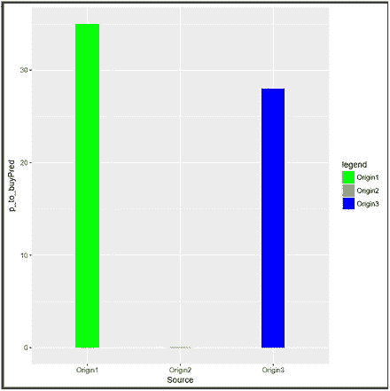

图 6-6.

WineOriginTestDataGLMPlot_test_bar.pdf

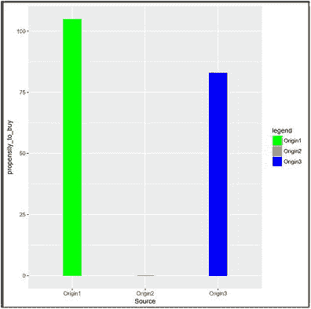

图 6-5.

WineOriginTrainingDataGLMPlot_test_bar.pdf

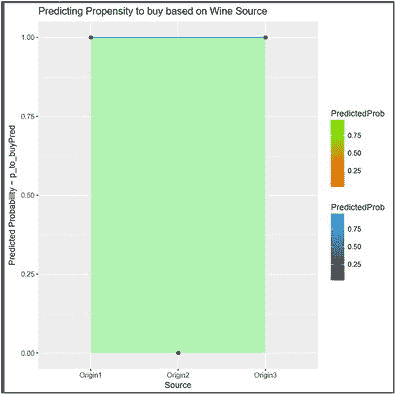

图 6-4.

test_set3_ribbon.pdf（test_set 的预测概率带状图）

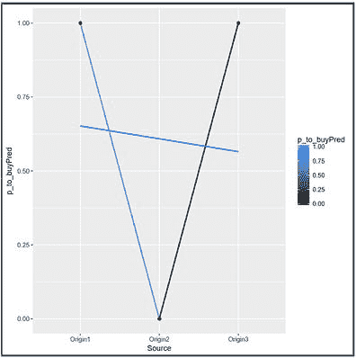

图 6-3.

WineOriginTestDataGLMPlot_test_lineNpoint.pdf

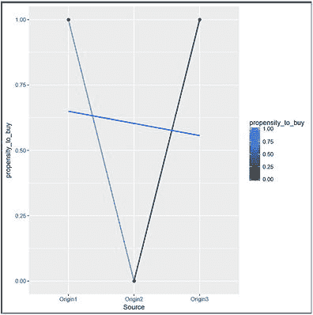

图 6-2.

WineOriginTrainingDataGLMPlot_test_lineNpoint.pdf

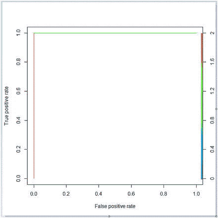

图 6-1.

已执行 GLM 模型的 AUC 图

让我们看看`train_set and test_set`中产地与购买倾向的矩阵（或表格）：

```
> table(train_set$Source, train_set$propensity_to_buy)
0   1
Origin1   0  99
Origin2 122   0
Origin3   0  89
> table(test_set$Source, test_set$p_to_buyPred)
0  1
Origin1  0 34
Origin2 40  0
Origin3  0 29
>
```

这些表格输出表明，两个表格中都有一些单元格的值为 0。这可能导致`glm`模型的摘要中不显示显著性代码，如下所示。

`type='response'` 简单地对预测的对数几率分数应用逻辑变换，因此预测值处于概率尺度上。

系数是模型的估计值，其值处于对数几率尺度上。


### Logit 模型概要

上述 `summary(logitM)` 命令的输出如下：

```
> summary(logitM)
Call:
glm(formula = propensity_to_buy ∼ Source, family = "binomial",
data = train_set, control = glm.control(maxit = 100))
Deviance Residuals:
Min          1Q      Median          3Q         Max
-8.861e-07  -8.861e-07   8.861e-07   8.861e-07   8.861e-07
Coefficients:
Estimate Std. Error z value Pr(>|z|)
(Intercept)    2.857e+01  9.493e+04       0        1
SourceOrigin2 -5.713e+01  1.292e+05       0        1
SourceOrigin3 -1.927e-05  1.420e+05       0        1
(Dispersion parameter for binomial family taken to be 1)
Null deviance: 4.1559e+02  on 309  degrees of freedom
Residual deviance: 2.4340e-10  on 307  degrees of freedom
AIC: 6
Number of Fisher Scoring iterations: 27
```

该概要提供了模型及其收敛性的信息。

对 GLM 模型输出的分析可按如下方式进行：

*   `summary(logitM)`
    *   模型信息与模型收敛状态
        *   调用 (Call)
        *   离散参数 (Dispersion parameter)
        *   Fisher 评分迭代次数 (Number of Fisher scoring iterations)
    *   系数表 (Table of coefficients)
        *   系数 (Coefficients)
        *   显著性标记 (Significant codes)
    *   单个参数检验 (Testing individual parameters)
        *   Wald 卡方统计量 (Wald chi-squared statistics)
    *   单个参数的置信区间 (Confidence intervals of individual parameters)
        *   整体拟合优度 (Overall goodness-of-fit)
            *   零偏差 (Null deviance)
            *   残差偏差 (Residual deviance)
            *   赤池信息准则 (AIC)
*   `anova(logitM)`
    *   偏差分析表 (Analysis of deviance table)

在这些指标中，AIC、零偏差和残差偏差，连同混淆矩阵和 ROC 曲线，共同反映了 `glm` 模型的性能。具体说明如下：

AIC，如前所述，代表赤池信息准则，它衡量模型拟合度，并对模型中涉及的系数数量进行惩罚。建议选择 AIC 值较低的模型。在我们的示例用例中，`summary(logitM)` 输出显示 AIC 为 6，表明该模型拟合良好。

零偏差表示仅包含截距的模型所预测的响应。该值越低，模型越好。

残差偏差表示使用自变量后的模型所预测的响应。该值越低，模型越好。

混淆矩阵定义了一个实际值与预测值的对照表。这对于确定模型的准确性非常有用，并有助于避免过拟合。实际值和预测值被分为“好”和“坏”，单元格值由真正例、真负例、假正例和假负例表示。其形式如表 6-1 所示。

表 6-1.

逻辑回归的样本混淆矩阵

|   |   | 预测值 |   |
| --- | --- | --- | --- |
|   |   | 好 | 坏 |
| 实际值 | 好 | 真正例 (d) | 假负例 (c) |
|   | 坏 | 假正例 (b) | 真负例 (a) |

(来源：[`www.analyticsvidhya.com`](http://www.analyticsvidhya.com) )

关于 ROC 曲线的详细信息将在后续小节中介绍。

粗体行提供了关于用作训练数据集的数据集（即 `train_set`）、响应变量和预测变量的标签（分别为 `propensity_to_buy` 和 `Source`）以及用于拟合的逻辑回归算法类型（`glm`，即 `binary(logit)` 族的广义线性模型）的信息。它还提供了用于参数估计的评分模型类型。

此处，模型使用 Fisher 评分算法进行最大似然估计。`glm` 模型的 `maxit` 参数给出了拟合模型的迭代次数，这使我们能够确定最大似然估计值。

注意

Fisher 评分是一种用于获取结果的逐步上升算法；它通过逐步接近最大值（顶部）来最大化似然，每步也称为一次迭代。该算法能够识别是否已达到顶部，并且后续步骤不会增加似然值。它被认为是一种高效的算法——通常不需要很多次迭代——并且通常能收敛到一个答案。如果 Fisher 评分迭代次数很大，则意味着 `glm` 模型在收敛性方面并非最优。如果样本数据集较小或预测变量之间的相关性不是共线性的，则可能发生这种情况。这是一种数值分析算法，是 Newton-Raphson 方法的替代方案。

在 `glm` 模型中，二项式链接使用 logit 链接。这表明我们正在拟合一个 logit 模型，并且响应变量是 log 几率，数学表示如下：

```
logit(p) = l0g(p/(1-p))
```

`logit(p)` 在闭区间 `[0,1]` 内取值，并在 y 轴上输出实数值。逆 logit 函数接收 x 轴上的数据点，并在 y 轴上输出闭区间 `[0,1]` 内的值。当所涉及的数据是离散的时，如果观测响应与其预测值之间存在差异，并且这些值大于 `binomial(link=logit)` 模型所预测的值，则可能发生过度离散。

注意

您可以参考 `glm` 算法背后的数学原理，详见 [`https://onlinecourses.science.psu.edu/stat504/node/225`](https://onlinecourses.science.psu.edu/stat504/node/225) 。其他网站也解释了逻辑回归模型背后的概念，例如 [`https://datascienceplus.com/perform-logistic-regression-in-r/`](https://datascienceplus.com/perform-logistic-regression-in-r/) `和` [`www.r-bloggers.com/how-to-perform-a-logistic-regression-in-r/`](http://www.r-bloggers.com/how-to-perform-a-logistic-regression-in-r/) `等`。

以下是 `glm` 模型概要输出的详细解析：

```
=>模型信息与模型收敛状态
->调用 (Call):
```

调用下方的两行提供了关于用作训练数据集的数据集（即 `train_set`）、响应变量和预测变量的标签（分别为 `propensity_to_buy` 和 `Source`）以及用于拟合的逻辑回归算法类型（`glm`，即 `binary(logit)` 族的广义线性模型）的信息。`glm` 模型的 `maxit` 参数给出了拟合模型的迭代次数，这使我们能够确定最大似然估计值。

```
->偏差残差 (Deviance residuals)
```

偏差残差输出是对 `glm` 模型中每个数据点相关计算偏差分布的描述。它以非参数形式输出。偏差残差是 `glm` 模型输出的标准残差。

```
->二项式族的离散参数假定为 1。
```

离散参数默认由 GLM 打印输出，但在计数模型中更有价值。这仅表示二项式族的离散参数被假定为 1。

```
-> Fisher 评分迭代次数
```

它给出了用于参数估计的评分模型类型，即模型是如何估计的。线性模型通常使用可解的方程进行估计，并以封闭形式输出，但 GLM 使用迭代方法进行估计。默认使用 Newton-Raphson 方法。此处，模型使用 Fisher 评分算法进行最大似然估计。

注意


在数值分析中，牛顿法（也称为牛顿-拉夫逊法，以艾萨克·牛顿和约瑟夫·拉夫逊命名）是一种用于寻找实值函数根（或零点）的逐次逼近方法。它是求根算法的一个例子，也是之前描述的费舍尔评分法的一种替代方案。关于此方法的进一步讨论，可参见[`www.math.ubc.ca/∼anstee/math104/104newtonmethod.pdf`](http://www.math.ubc.ca/%E2%88%BCanstee/math104/104newtonmethod.pdf)。

```
=> 系数表
```

系数和显著性代码提供了关于协变量的详细信息。

```
-> 系数
系数：
              估计值     标准误差    z 值    Pr(>|z|)
(截距)        2.857e+01  9.493e+04       0        1
来源 Origin2 -5.713e+01  1.292e+05       0        1
来源 Origin3 -1.927e-05  1.420e+05       0        1
零偏差：4.1559e+02  自由度：309
残差偏差：2.4340e-10  自由度：307
AIC：6
```

我们的模型有一个预测变量 `Source` 和一个截距（称为常数）。以下概述了如何分析输出结果：

在第二行的 `Estimate` 列中，该值给出了左侧所列变量对应的系数。它表示如果 `Source` 增加一个单位（`Source` 取值为 `Origin2`），`propensity_to_buy` 的对数几率估计会增加的量。类似地，第三行中 `Source` 取值为 `Origin3` 的情况也是如此。

当 `Source` 为 00 时，`propensity_to_buy` 的对数几率由第一行（第二行上方）给出。对数几率是对 `glm` 模型中简单预测值到优势比的一种解释。

下一列 `Std. Error` 给出了与这些估计值相关的标准误差（如第二行所述）。它估计了如果使用新数据反复重新运行相同模型，这些估计值平均会分散多少。将估计值除以标准误差，得到的商在样本量足够大时被认为服从正态分布。该值列在 `z value` 列中。最后一列 `Pr(>|z|)` 列出了在标准正态分布中与这些 z 值相对应的双尾 p 值。

```
-> 显著性代码
```

额外的显著性代码信息以星号形式出现在最后一列的右侧。这些信息遵循系数表正下方显示的键值。在我们的案例中，我们没有看到这些星号，因为 `table(train_set$Source`, `train_set$propensity_to_buy` 和 `table(test_set$Source`, `test_set$p_to_buyPred)` 表中的值均为零。

```
=> 检验单个参数
-> 瓦尔德卡方统计量
> library(aod)
警告信息：
程序包 'aod' 是在 R 版本 3.2.5 下构建的
> wald.test(b = coef(logitM), Sigma = vcov(logitM), Terms =  1:2)
瓦尔德检验：

卡方检验：
X2 = 2e-07, df = 2, P(> X2) = 1.0
> wald.test(b = coef(logitM), Sigma = vcov(logitM), Terms =  1:3)
瓦尔德检验：

卡方检验：
X2 = 2.7e-07, df = 3, P(> X2) = 1.0
> wald.test(b = coef(logitM), Sigma = vcov(logitM), Terms =  2:3)
瓦尔德检验：

卡方检验：
X2 = 2.6e-07, df = 2, P(> X2) = 1.0
=> 单个参数的置信区间
-> 整体拟合优度
```

整体拟合优度由三个指标决定：零偏差、残差偏差和 AIC。

零偏差衡量的是仅包含截距的模型（无预测变量的简化模型）所预测的响应。这属于简化模型的情况。

残差偏差衡量的是包含预测变量的模型所预测的响应。换句话说，这两个指标反映了 `glm` 模型的拟合不足程度；值越低，模型越好。因此，它是拟合优度的一个度量。

与这两个偏差相关的自由度之差仅为 2。在我们的案例中，我们有一个预测变量 `Source`；但为其值 Origin2 和 Origin3 估计了两个值，因此使用了两个额外的自由度。

```
-> AIC
```

AIC 是另一个衡量拟合优度的指标，用于评估模型对数据的拟合程度。换句话说，它根据模型需要估计的系数数量来反映模型的“成本”。推荐选择 AIC 值较低的模型。在我们的案例中，该值为 6，可以视为一个拟合良好的模型。

### AUC 曲线

这涉及 GLM 模型的 ROC 曲线。它通过评估真阳性率（也称为灵敏度）和假阴性率（也推导为 1-特异度）来提供模型的性能特征。考虑 p > 0.5 的情况，ROC 图通过预测所有可能的 p > 0.5 的值，给出了成功率的最佳拟合场景。曲线下面积（也称为 AUC）是 ROC 曲线的性能指标。AUC 提供了准确度指数或一致性指数。

注意

AUC 越高，模型的预测能力越好。

图 6-1 描绘了我们用于预测购买倾向的逻辑回归模型的 AUC 曲线。根据我们的 `Source` 数据值以及相应的购买倾向，我们看到 AUC 是一条完美的、翻转的 L 形直角曲线，从 x 轴上的 0 开始，延伸到 y 轴上的 1，然后以直角方式向右弯曲，最终在 x = 1 处结束。

这是因为我们起始的数据中，`Origin1` 和 `Origin3` 的值为 1，`Origin2` 的值为 0，而 `propensity_to_buy` 列中的对应值分别为 1 和 0。并且对于相应的 `Source` 值，预测概率也是 1 和 0。

```
=> anova(logitM)
-> 偏差分析表
```

R 中的 `anova` 函数使我们能够通过分析 `pf` 偏差表来检验因子的效应。在我们的逻辑回归模型中，有一个解释变量及其对应的因子 `Source`。`glm` 模型拟合了仅含截距的模型，输出了与针对零偏差（系数下方）相同的统计量：偏差 = 415.59。这由以下 `anova` 输出显示：

```
偏差分析表
模型：二项分布，链接函数：logit
响应变量：propensity_to_buy
项按顺序添加（从前到后）
    自由度 偏差 残差自由度 残差偏差
NULL                     309     415.59
Source  2   415.59       307       0.00
```


### 使用 ORE SQL 接口实现解决方案

现在我们有了初步的解决方案，接下来通过 ORE SQL 接口将其实现，以便与 OBIEE 12c 集成。实现步骤如下：

1.  使用 `sys.rqScriptCreate` 在 R 脚本仓库中创建一个 R 函数作为脚本，该函数在 Oracle 数据库中创建一个输入表，用于存储葡萄酒源数据，并根据 `Source` 列添加一个 `propensity_to_buy` 列。代码如清单 6-3 所示。

```
    begin
    sys.rqScriptDrop('CreateInputTable');
    sys.rqScriptCreate('CreateInputTable',
    'function(dat) {
    library(ORE)
    ore.connect("testr","orcl","localhost","testr")
    setwd("F:/testr")
    dat <- read.csv("Wineptobuy.csv")
    ore.drop(table="WINE_SOURCE_DATA")
    ore.create(dat, table="WINE_SOURCE_DATA")
    }');
    end;
    /
    清单 6-3.
    基于输入的 .csv 文件创建 Oracle 表的 R 脚本
    ```

2.  执行上述代码，在 `testr` 模式下创建 `WINE_SOURCE_DATA` 表。这通过以下 `select` 语句完成：

```
    select * from table (rqEval(NULL, 'XML', 'CreateInputTable'));
    ```

执行此 `select` 语句的输出如下：

```
    ----------------------------------------------------------------------------
    SQL> select * from table (rqEval(NULL, 'XML', 'CreateInputTable'));
    NAME
    ----------------------------------------------------------------------------
    VALUE
    ----------------------------------------------------------------------------

SQL>
    ```

3.  创建一个 R 函数，用于构建逻辑回归模型，以根据葡萄酒源预测购买倾向，然后在测试数据上对模型进行评分。此处使用 GLM 的机器学习算法。此函数与一个 R 脚本关联，该脚本将保存在 ORE 的 R 脚本仓库中。清单 6-4 展示了代码。

```
    begin
    sys.rqscriptDrop('BuildandScoreptobuy');
    sys.rqScriptcreate('BuildandScoreptobuy',
    'function(table_name) {
    ore.sync(table=table_name)
    ore.attach()
    winedata  0.5,1,0)
    misClasificError <- mean(p_to_buyPred != test_set$propensity_to_buy)
    p_to_buyPred[as.integer(rownames(p_to_buyPred))] <- p_to_buyPred
    res <- cbind(data.frame(test_set[,c(1:19)]), PRED = p_to_buyPred)
    res1.df <- data.frame(res[,c(1,2,19,20)])
    library(ggplot2)
    gg_plot <- ggplot(data=test_set, aes(x=Source, y=p_to_buyPred, group=1)) +
    geom_line(aes(colour = p_to_buyPred), size = 1) + geom_point() +
    stat_smooth(method="glm", family="binomial", se=FALSE) +
    ggtitle("根据葡萄酒源预测购买倾向") +
    labs(x="源", y="预测概率 - p_to_buyPred")
    plot(gg_plot)
    res1.df
    }');
    end;
    /
    清单 6-4.
    基于 GLM 的逻辑回归模型，用于根据葡萄酒源构建和评分购买倾向
    ```

4.  创建一个 R 函数，调用上述 `BuildandScoreptobuy` 函数，使其在由 Oracle 12c 数据库清单生成的 ORE 引擎中执行，以输出根据葡萄酒源预测的购买倾向概率。清单 6-5 展示了代码。

```
    begin
    sys.rqScriptDrop('CallPtoBuy');
    sys.rqScriptCreate('CallPtoBuy',
    'function(dat, input_table_name) {
    input_table_name <- "WINE_SOURCE_DATA"
    ore.scriptLoad(name = "BuildandScoreptobuy")
    res1 <- BuildandScoreptobuy(input_table_name)
    res1.df <- data.frame(res1)
    res1.df
    }');
    end;
    /
    清单 6-5.
    调用 BuildandScoreptobuy 函数以输出基于源预测购买倾向概率的 R 函数
    ```

清单 6-5 中的代码可以通过 ORE SQL 接口以多种方式执行，以输出 XML、单个列或 PNG 图像图形。以下 `SELECT` 语句展示了如何实现：
    1.  输出 XML：用于获取集成图形 XML 输出的初始 SQL `SELECT` 如下：

```
        select * from table(rqTableEval(cursor(select * from WINE_SOURCE_DATA),
        cursor(select 1 as "ore.connect", 'WINE_SOURCE_DATA' as "input_table_name" from dual),
        'XML',
        'CallPtoBuy'));
        ```

输出可以改进，以便在 Internet Explorer 或其他 XML 显示软件中打开时显示为 XML。以下查询可实现此目的：

```
        select xmltype(a.value).getClobVal() as "包含图像的 XML 输出"
        from table(rqTableEval(cursor(select * from WINE_SOURCE_DATA),
        cursor(select 1 as "ore.connect", 'WINE_SOURCE_DATA' as "input_table_name" from dual),
        'XML',
        'CallPtoBuy')) a;
        ```

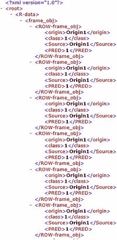 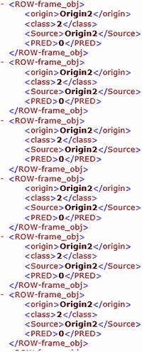 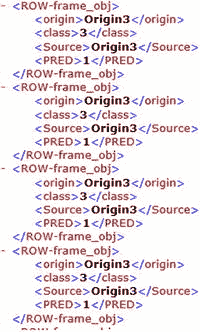 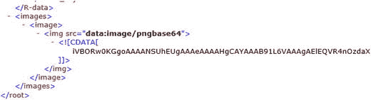  
    2.  输出单个列：

```
        SQL> select * from table(rqTableEval(cursor(select * from WINE_SOURCE_DATA),
        2  cursor(select 1 as "ore.connect", 'WINE_SOURCE_DATA' as "input_table_name" from dual),
        3  'select "origin", "class","Source", 1 "PRED" from WINE_SOURCE_DATA a',
        4  'CallPtoBuy'));
        origin
        ----------------------------------------------------------------------------
        class
        ----------
        Source
        ----------------------------------------------------------------------------
        PRED
        ----------
        Origin1

Origin1

Origin1

Origin1

Origin1

Origin1

Origin1

Origin1

Origin1

Origin1

Origin1

Origin1

Origin1

Origin1

Origin1

Origin1

Origin1

Origin1

Origin1

Origin1

Origin1

Origin1

Origin1

Origin1

Origin1

Origin1

Origin1

Origin1

Origin1

Origin1

Origin1

Origin1

Origin2

Origin2

Origin2

Origin2

......
        已选择 103 行。
        ```

3.  输出 PNG 图形：

```
        SQL>select id, image from table(rqTableEval(cursor(select * from WINE_SOURCE_DATA),
        cursor(select 1 as "ore.connect", 'WINE_SOURCE_DATA' as "input_table_name" from dual),
        'PNG',
        'CallPtoBuy'));
        SQL> select id, image from table(rqTableEval(cursor(select * from WINE_SOURCE_DATA),
        2     cursor(select 1 as "ore.connect", 'WINE_SOURCE_DATA' as "input_table_name" from dual),
        3      'PNG',
        4      'CallPtoBuy'));
        ID
        ----------
        IMAGE
        ----------------------------------------------------------------------------


89504E470D0A1A0A0000000D49484452000001E0000001E008060000007DD4BE9500002000494441
        54789CECDD6B701BE79A27F67F032078274851574A962C8B775D6C89B22D03E3736AB333734269C5
        28991AED566EAA64CBD4EC4C2AD497A3DA0FA7E6A476BDB5159F9A1D22134FAD349BA9782A959495
        AA73142922D7D94A65667C08D19628DBBA5014015D2D93922551BCDF00F49B0F4D800DB0890B8946
        77A3FFBF2A9648400D3CB8F583F7F6BC92104280888828AF1C460740444464474CC0444444066002
        262222320013B0CE42A190D121148CF53C977C1D88C86C2C9D802549D2FCE9EDEDCDE9FDF4F6F642
        92A484FBCD4C4EE83E9F0F57AE5CC9FAB8B5C8D773914FEAE72BF9B9CCC67A8E8DC591AFE7D14CAF
        59F2FB5E4FA74F9FC6E9D3A735EFDFEFF7275CEEF7FBE1F3F900E8FB998AC5A5FE3C25C748B41E96
        4EC000D0D3D3032144FCA7A7A707478F1ED5F5432984407D7D7DDE8ECB9411CF859EF47EBEC83C5A
        5B5B71FBF6ED84CB2E5EBC88CECE4E0C0E0E265C7EE1C2059C3C791280BEEF9158B2557FA66EDFBE
        CD244CB9232C0C80E8E9E95971B9D7EB15DDDDDD09BF0310004430188C5F1EBBCCEBF56ADE76EC27
        76BCFABAD8ED048341CDDB51DF7E6767E78AE362B1ABEF27765D2631E4EBB9D08A53EB3EB2395EFD
        38D5F1245F17FB3BF9B98CFDA8757777AFB82C3936F5F5E95EFFE4C7901CA7D6638C893D5E214456
        B166725FEAF75BEC477DDFA99ECF4C1E7736EFB974B797C97B3CF97125DFB6D6E5C99FA36C3E53D9
        BEEEC9C7AB5FDB6C9E83D58ED7FA4CAE764E59CB6320732BD8041CBBDCEBF5AE7893AA939210CA49
        2B3979AAAF4F3E116A7DE8B58ED3BA1DF571EADBECECEC4C882176021422F1A4ABC773A14E065A71
        A8EF37F9A49CEEB94CF538934F46C97F277F4988DDCF6A2741ADC7AF1563BAC79C2CDD7390EA249B
        6DACD9DE576767E7AAF7B5DAC95E7DDBD9BCEF9365FBDE49F73CAB9F97D8172FADCB537D1653DD5F
        BAC79FEEF165F27FB49E8374093855D24E774E49F718C8DC0A2E01C7DEE05A276EF5F5C9621F72AD
        EB574B0CABDD96FA365325E05427EDE40FD55A5AC0E99E0BADD645F26D69DD6EECB274CF65268F33
        DD635A2D76F5EDAEF638D4F1247F9949F59833B92ED573A4F57EC934D674F7952CD3E73317EF7BB5
        B5BC77D2BDDE9D9D9D095FB262BF77777727FCAE4E78D97CA6D2BD57B5A85BD3C99FC95C3C07999E
        9FD6F318C8BC2C3F067CF4E8D1844912478F1E4530184C18176A6C6C8CFF3E3C3C0C60E5A4A54020
        80E1E1610C0F0FC3EBF526DC47434383E67D6BFDDF5C181E1EC6BE7DFB122E533F86D564FB5C0483
        41CDF8BD5E6FFC7902563EFED8F5E99ECB74DADBDBE1F57AD73461ACB3B313172F5E04005CB97205
        9D9D9D191D97E9634EB6DA73A047AC99DC97FA358E49F57CE6F27D0FACFD794CE5C48913F1F1DE8B
        172FC6DFABC78E1DC3850B1700008383833871E244D6B7BDD6F7AA508DFF060281848958B97A0E92
        CF4FAB9D53D6FB7923F3B17C024E9E7824329894E1F57A571C2384405757579EA2D6C75A9E8BF55A
        EF73D9D7D70721043A3B3BE35F20329934F6F39FFF1CE7CF9F07A04CCA59CB49395F72196BECA4DB
        DDDD1D9F68A796EAF934FBFBBEA1A121FE3C9D3F7F1EEDEDED0080FAFA7A04020100C0EDDBB7537E
        314865BD8F5F0881603088F3E7CF1B36B1D1ECAF2165C7F209385B8D8D8DF10F73A6D70783C135DD
        D65A353636AE9811AAC737DC868606CDF80381C08A96B2D6F5B97CFCE7CE9D8310025EAF37A32543
        F5F5F5F07ABDF0FBFD080402F193753A993EE664AB3D0799C836D6D5EEABB7B7377E024E77C24D7E
        3E73F9BE07D6FE3CA6127B9E628F53ADB3B333BE1C692D5F2AB37DAFAEB6042B76DFC1605097E720
        559C7A9D6FC8403A756DE705528C8DC5688D8F244F7CD01A2B4D1E67523F555865DC29797C6AAD63
        C0AB1D9BEAE55ACF73B19E8934E99ECB548F33F931C7C6D4B466B8263F1F422C8F8B673251269793
        B0B49E03AD19D66B8935D57DADF67CC59EA774CFE77ADFF7C9D63B01494BEC36B45E6BADCBB3FD4C
        A57AFC5A8F2FDD5C8C74CF41BAF786D66732DD39259BC740E666CB041CBB3C7682D17A03ABAFCF74
        1952BA936E36278BD8FF51C7902E49E4E2B9D09A91199B69AB757DF2F1C9CF65BAC7A9BEEDE4FFAB
        BE2DAD04167BEED33D6EAD63533DE664B1FB48F5FF931F43F26B9969ACE9EE2BF9F9521FA375BDD6
        17AEB5BEEFB5A47BEF649B8063FF2739EED59EBF6C3F53E91E7FB2E4E733DDFB3FDBF786D66732D5
        39652D8F81CC4B12420890E9F5F6F6E2E38F3F465F5F5F5EEF579224F4F4F464DCC59B4FA150080D
        0D0DB0C25BD84AB112517ED86E0CD80A62E34FEA891E1F7FFC71BCFA0F29AE5CB982EEEE6EA3C3C8
        88956225A2FC70191D00ADD4DEDE8EEEEEEE84D99EDDDDDD9CE9B824D69AF47ABD79EF11C8969562
        25A2FC62173411119101D8054D444464002660222222033001131111198009988888C8004CC04444
        44066002262222328025D701CBB28CD7AF5F1B1D46DE6DD8B001737373989B9B333A144A525D5D8D
        70388C999919A343A1245555551042606A6ACAE850F2AEB6B6D6E81028054B266000B62DE92796B6
        1F2373E26B635E7C6DC86CD8054D444464002660222222033001131111198009988888C8004CC044
        4444066002262222320013301111910198808988880CC0044C444464002660222222033001131111
        198009988888C8004CC044444406600226222232405E12F0E5CB97313030A079DDD9B367D1D1D181
        4F3FFD34E5......

当上述 `SELECT` 语句执行后，在 Oracle SQL Developer 中查看其输出，即可得到图 6-7 所示的图形。该图基于 ggplot 图形，绘制了来源与预测概率（`p_to_buyPred`）的关系。

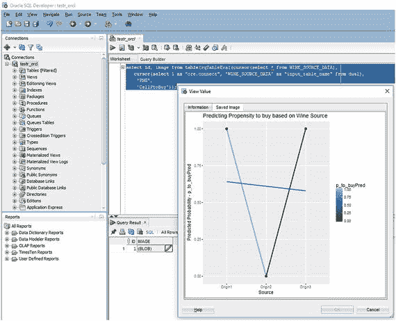

图 6-7.

逻辑回归模型的 PNG 输出，用于根据葡萄酒来源预测购买倾向

对于 GLM 机器学习算法，我们关注的另一个图形是 AUC 曲线。相关代码如代码清单 6-6 所示。

```
begin
--   sys.rqscriptDrop('BuildandScoreptobuyAUC');
sys.rqScriptcreate('BuildandScoreptobuyAUC',
'function(table_name) {
ore.sync(table=table_name)
ore.attach()
winedata  0.5,1,0)
misClasificError <- mean(p_to_buyPred != test_set$propensity_to_buy)
p_to_buyPred[as.integer(rownames(p_to_buyPred))] <- p_to_buyPred
res <- cbind(data.frame(test_set[,c(1:19)]), PRED = p_to_buyPred)
res1.df <- data.frame(res[,c(1,2,19,20)])
library(ROCR)
pr1 <- prediction(p_to_buyPred, test_set$propensity_to_buy)
class(pr1)
prf1 <- performance(pr1, measure = "tpr", x.measure = "fpr")
class(prf1)
plot(prf1, colorize = TRUE) # , text.adj = c(-0.2,1.7)
res1.df
}');
end;
/
代码清单 6-6.
基于 GLM 的逻辑回归模型，用于根据葡萄酒来源构建和评分购买倾向，并绘制 AUC 曲线
```

调用此 R 函数的代码如代码清单 6-7 所示。

```
begin
sys.rqScriptDrop('CallPtoBuyAUC');
sys.rqScriptCreate('CallPtoBuyAUC',
'function(dat, input_table_name) {
input_table_name <- "WINE_SOURCE_DATA"
ore.scriptLoad(name = "BuildandScoreptobuyAUC")
res1 <- BuildandScoreptobuyAUC(input_table_name)
res1.df <- data.frame(res1)
res1.df
}');
end;
/
代码清单 6-7.
调用 BuildandScoreptobuyAUC 的代码
```

执行以下 `SELECT` 语句来调用代码清单 6-7 中的函数，即可得到图 6-8 所示的图形。

```
select * from table(rqTableEval(cursor(select * from WINE_SOURCE_DATA),
cursor(select 1 as "ore.connect", 'WINE_SOURCE_DATA' as "input_table_name" from dual),
'PNG',
'CallPtoBuyAUC'));
```

AUC 曲线呈现倒 L 形，这意味着所构建和评分的 GLM 模型非常适合当前上下文中的数据。曲线下面积越大，模型越完美。

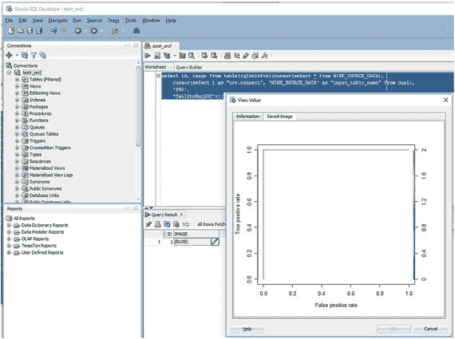

图 6-8.

逻辑回归模型的 PNG 输出，显示了根据葡萄酒来源预测购买倾向的 AUC


## 将 PNG 输出与 OBIEE 仪表盘集成

按照第 3 章“将 PNG 图形与 OBIEE 集成”小节中概述的步骤，可以将图 6-7 所示的 PNG 图像与 OBIEE 集成。图像集成后，即可在 OBIEE 中创建分析及后续的仪表盘。此处列出了所涉及的主要步骤；其中部分步骤已在第 3 章中提供：

1.  在物理层创建一个类型为 `SELECT` 的新物理表（使用从 WebLogic 服务器下载的 OBIEE RPD，并在 BI 管理工具中离线打开）。我们已拥有第 3 章中创建的连接池。用于生成逻辑回归机器学习算法 PNG 输出的查询，将用作 `SELECT` 类型表的初始化字符串值。如图 6-9 所示。这个新表被命名为 `CallPtoBuy`。可以使用以下命令下载 RPD：

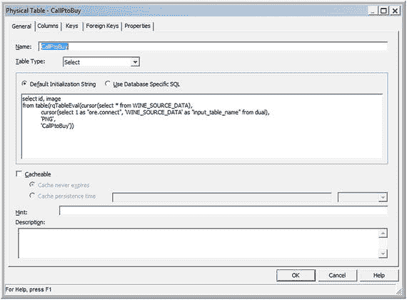

图 6-9.

在 OBIEE RPD 中为“购买倾向”PNG 图形创建的物理表属性，以便与 OBIEE12c 集成

```
    datamodel.cmd downloadrpd -O obieenew.rpd -W Admin123 -U weblogic -P  -SI ssi -S localhost -N 9502 -Y
    ```

2.  将新表添加到业务映射和建模层。图 6-10 和图 6-11 中的对话框显示了要为 `ID` 列和 `IMAGE` 列构建的逻辑列属性和表达式。

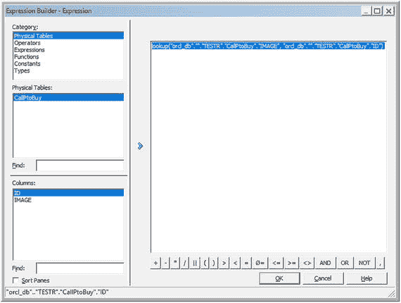

图 6-11.

为 ID 列指定的逻辑表达式，该表达式同时包含 ID 列和 IMAGE 列

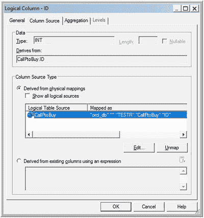

图 6-10.

逻辑列 ID 属性 逻辑表达式如下所示：

```
    lookup("orcl_db".""."TESTR"."CallPtoBuy"."IMAGE", "orcl_db".""."TESTR"."CallPtoBuy"."ID")
    ```

3.  需要使用以下命令将修改后的 RPD 上传到 WebLogic 服务器：

```
    datamodel.cmd uploadrpd -I obieenew08062017.rpd -W Admin123 -U weblogic -P  -SI ssi -S localhost -N 9502
    Service Instance: ssi
    Operation successful.
    RPD upload completed successfully.
    ```

4.  重启 WebLogic 服务器。
    1.  使用 URL `localhost:9502/analytics` 登录 OBIEE12c。  
    2.  单击“管理” ➤ “维护与故障排除”。  
    3.  然后单击“重新加载文件和元数据”。  
    4.  在“分析与交互式报告”下，单击“分析”。  
    5.  选择 TESTR 主题区域。  
    6.  在“条件”选项卡中展开 `CallPtoBuy`。然后将 `ID` 和 `IMAGE` 列拖放到其右侧的“所选列”区域。  
    7.  单击“结果”。

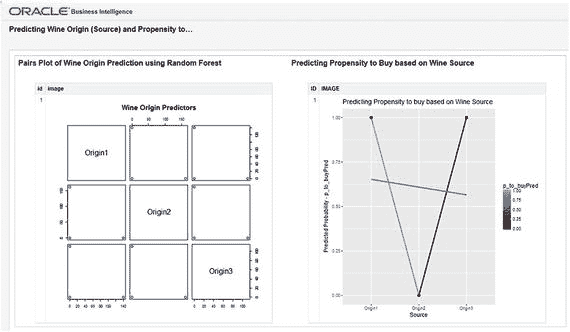

图 6-14.

显示预测葡萄酒产地并使用其预测购买倾向的配对图的仪表盘

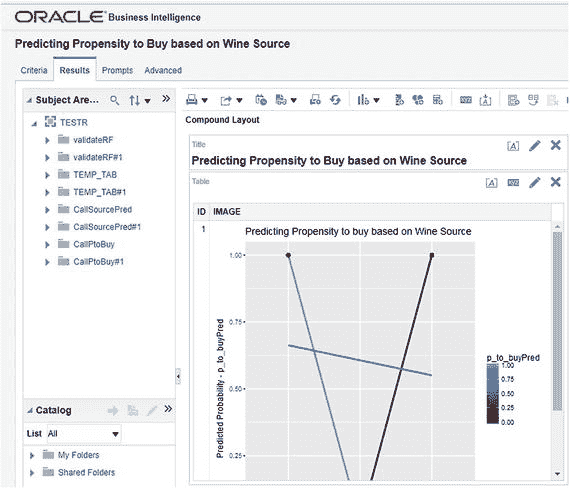

图 6-13.

基于在 ORE 中执行并与 OBIEE 12c 集成的机器学习 GLM 算法，葡萄酒来源与预测概率的输出图

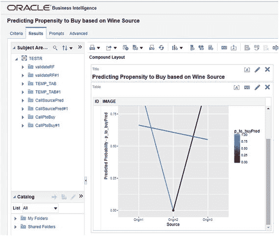

图 6-12.

基于在 ORE 中执行并与 OBIEE 12c 集成的机器学习 GLM 算法，葡萄酒来源与预测概率的输出图  
    8.  来源与预测概率（`ptobuyPred`）的图形如图 6-12 和图 6-13 所示。

图 6-14 显示了最终的仪表盘，其中展示了预测葡萄酒产地，然后利用该产地预测购买倾向的配对图。

## 总结

本章介绍了在 OBIEE 12c 中实现机器学习的内容。从简要描述业务问题和解决方案开始，详细说明了如何利用基于 GLM 模型的逻辑回归机器学习算法，根据葡萄酒产地预测购买倾向。然后，本章展示了模型输出的各种形式，包括 XML、结构化表格结果和 PNG 图形。最后，概述了如何将 PNG 图像与 OBIEE 仪表盘集成，并与葡萄酒产地预测图合并，最终形成一个并排显示两者的仪表盘。在必要之处提供了可执行代码及其执行输出。


索引 A 可执行情报 赤池信息量准则（AIC） 歧义性 anova 函数 曲线下面积（AUC） 人工智能（AI） 可执行情报 先进企业 定义 学习方面 主流预测任务 数学原理 软件应用 技术 B 后端供应商 大数据分析 vs. 商业智能 要素 目标 服务改进 BuildandScoreptobuyAUC BuildandScoreptobuy 函数 BuildandScoreRF 商业案例 AIC AUC 曲线 anova 函数 GLM 图 ROC 分类变量 ggplot2 函数 逻辑回归 logitM 模型 logit 模型 AIC anova(logitM) 系数与显著性 混淆矩阵 常数 偏差残差 离散参数 估计列 Fisher 评分 glm 模型 logit(p) 零偏差 残差偏差 显著性代码 训练数据 ORE SQL 接口 BuildandScoreptobuy 函数 基于 GLM 的逻辑回归模型 输入.csv 文件 PNG 图 R 函数 SELECT 语句 XML 输出 性能函数 PNG 图 参见 PNG 图 predict()函数 prediction()函数 预测葡萄酒产地 购买倾向与来源 响应变量 ROC 来源 vs. 倾向 test_set2 test_set3 数据 test_set3_ribbon.pdf train_set 数据 wald.test 函数 葡萄酒产地 WineOriginTestDataGLMPlot_test_bar.pdf WineOriginTestDataGLMPlot_test_lineNpoint.pdf WineOriginTrainingDataGLMPlot_test_bar.pdf WineOriginTrainingDataGLMPlot_test_lineNpoint.pdf 商业智能（BI） vs. 大数据分析 云优势 云客户 商业对象 C 云优势 云客户 聚类 Cognos 逗号分隔值（CSV） CRAN 视图 D 数据操作语言（DML） 数据建模 数据准备 数据可视化 决策支持系统（DSS） 决策树 E 企业数据仓库（EDW） 提取、转换、加载（ETL） F Fisher 评分算法 G 高斯混合模型 广义线性模型（GLM） ggplot()函数 H Hadoop 分布式文件系统（HDFS） 基于 Hive 的 Hibernate 查询语言（HQL） Hyperion I, J, K 首次公开募股（IPO） L 最小绝对收缩与选择算子（LASSO） 线性回归 逻辑回归 Logit 模型 AIC anova(logitM) 系数与显著性 混淆矩阵 常数 偏差残差 离散参数 估计列 Fisher 评分 glm 模型 GLM 模型输出 logit(p) 零偏差 残差偏差 显著性代码 训练数据 logitM 模型 对数似然函数 低秩矩阵分解（LMF） M 机器学习（ML） 算法 诞生与历史 CRAN 任务视图 定义 EDW 全季度收入 函数 线性和指数视图 预测结果 强化学习 监督学习 Trellis 图 TRENDLINE 函数 无监督学习 供应商 现代数据仓库 多层感知器 N Newton-Raphson 方法 非负矩阵分解（NMF） O OBIEE 12c 商业案例 参见商业案例 Oracle R PNG 图输出 葡萄酒产地 参见葡萄酒产地 在线分析处理（OLAP） 在线事务处理（OLTP） Oracle 分析云 Oracle 优化引擎（OBOE） Oracle 大数据 SQL Oracle 商业智能企业版（OBIEE） 演变 机器学习的诞生与历史 函数 Oracle 云 Oracle 商业智能移动版 Oracle 调用接口（OCI）库 Oracle 云 Oracle 数据库 18c Oracle 数据集成器（ODI） Oracle R 高级分析 Hadoop 版（ORAAH） Oracle R 发行版 Oracle R 企业版（ORE） 算法 架构 构建与测试 randomForest()模型 定义 嵌入式执行 API 嵌入式 R 执行 生成结构化表输出 无人值守处理 修改捕获图像生成 修改 VALUE 列 OBIEE 分析与仪表盘 OREpredict 算法 ore.randomForest 包 PNG 图 BMM 图 BuildandScoreRF 脚本 业务模型与映射层 重复项 validateRF Id 列 对话框 图像列 对话框 IMAGE 列输出 键对话框 逻辑列对话框 查找表达式构建器 OBIEE 管理工具 OBIEE 12c 集成 Oracle 连接池 物理层与 BMM 层 物理图窗口 物理层 物理表对话框 表示层 设置排序顺序与描述符 基于 SQL 的查询 TESTR 模式 validateRF 输出 validateRF 脚本 预测分析 主要包 R randomForest 模型 SQL 接口 透明性 VALUE 列 Oracle R 技术的 XML 输出 dbDriver(“Oracle”) 开源 R ORAAH Oracle 数据库表 Oracle R 发行版 ORE 参见 Oracle R 企业版（ORE） R 数据框 ROracle ore.randomForest()函数 ORE SQL 接口 BuildandScoreptobuy 函数 基于 GLM 的逻辑回归模型 输入.csv 文件 PNG 图 R 函数 SELECT 语句 XML 输出 P 模式识别 性能函数 绘制回归斜率 PNG 图 逻辑列属性 逻辑表达式 配对图 物理层 RPD WebLogic 服务器 葡萄酒来源 vs. 预测概率 PowerBI 预测分析 主成分分析（PCA） 数学原理 Q Qlikview R 随机森林 基于 R 的算法 参见葡萄酒产地 接收者操作特征（ROC） 强化学习 残差偏差 弹性分布式数据集（RDD） R 语言 ROracle R 表输出 S scale_fill_gradient()函数 自助式分析 自助式 BI stat_smooth()函数 监督学习 支持向量机 T Tableau 事务系统 TRENDLINE 函数 U 不确定性 非结构化数据 无监督学习 V validateRF 可视化分析 W, X, Y, Z wald.test 函数 WebLogic 服务器 葡萄酒产地 代码段 仪表盘可视化 决策支持解决方案 扩展 BI geom_ribbon() 图输出 ggplot 配对图 预测分析 购买倾向 基于 R 的机器学习模型 scale_fill_gradient()函数 test_set2 test_set3
