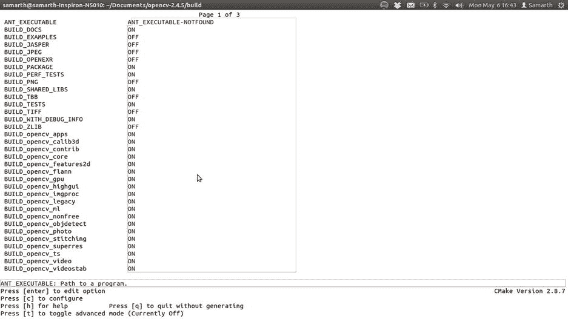

# 二、在计算机上设置 OpenCV

## Abstract

现在你知道了计算机视觉对你的机器人有多重要，以及 OpenCV 如何帮助你实现很多，本章将指导你在你的计算机上安装 OpenCV 和设置开发工作站的过程。这也将允许你尝试和使用本书后续章节中描述的所有项目。官方的 OpenCV 安装 wiki 可以在 [`http://opencv.willowgarage.com/wiki/InstallGuide`](http://opencv.willowgarage.com/wiki/InstallGuide) 获得，本章将主要在此基础上构建。

## 操作系统

OpenCV 是一个独立于平台的库，因为它可以安装在几乎所有满足特定要求的操作系统和硬件配置上。然而，如果你有选择你的操作系统的自由，我会建议一个 Linux 版本，最好是 Ubuntu(最新的 LTS 版本是 12.04)。这是因为它是免费的，与 Windows 和 Mac OS X 一样好用(有时甚至更好)，你可以将许多其他很酷的库与你的 OpenCV 项目集成在一起，如果你计划在嵌入式系统上工作，如 Beagleboard 或 Raspberry Pi，它将是你唯一的选择。

在这一章中，我将提供 Ubuntu、Windows 和 Mac OSX 的安装说明，但主要集中在 Ubuntu 上。后面章节中的项目本身是独立于平台的。

### 下载与解压

从 [`http://sourceforge.net/projects/opencvlibrary/`](http://sourceforge.net/projects/opencvlibrary/) 下载 OpenCV tarball 并解压到一个首选位置(后续步骤我称之为 `OPENCV_DIR`)。您可以通过使用归档管理器或发出 `tar–xvf` 命令来提取，如果您对它感到满意的话。

#### 简单安装

这意味着您将安装当前稳定的 OpenCV 版本，带有默认编译标志，并且只支持标准库。

If you don’t have the standard build tools, get them by

```bash
sudo apt-get install build-essential checkinstall cmake
```

Make a build directory in `OPENCV_DIR` and navigate to it by

```bash
mkdir build
cd build
```

Configure the OpenCV installation by

```bash
cmake ..
```

Compile the source code by

```bash
make
```

Finally, put the library files and header files in standard paths by

```bash
sudo make install
```

#### 自定义安装(32 位)

这意味着您将安装许多支持库并配置 OpenCV 安装以考虑它们。我们将安装的额外库包括:

*   FFmpeg、gstreamer、x264 和 v4l，支持视频观看、录制、流式传输等

如果您没有标准的构建工具，请使用

```bash
sudo apt-get install build-essential checkinstall cmake
```

Install gstreamer

```bash
sudo apt-get install libgstreamer0.10-0 libgstreamer0.10-dev gstreamer0.10-tools gstreamer0.10-plugins-base libgstreamer-plugins-base0.10-dev gstreamer0.10-plugins-good gstreamer0.10-plugins-ugly gstreamer0.10-plugins-bad gstreamer0.10-ffmpeg
```

Remove any installed versions of ffmpeg and x264

```bash
sudo apt-get remove ffmpeg x264 libx264-dev
```

Install dependencies for ffmpeg and x264

```bash
sudo apt-get update
sudo apt-get install git libfaac-dev libjack-jackd2-dev libmp3lame-dev libopencore-amrnb-dev libopencore-amrwb-dev libsdl1.2-dev libtheora-dev libva-dev libvdpau-dev libvorbis-dev libx11-dev libxfixes-dev libxvidcore-dev texi2html yasm zlib1g-dev libjpeg8 libjpeg8-dev
```

Get a recent stable snapshot of x264 from `ftp://ftp.videolan.org/pub/videolan/x264/snapshots/` , extract it to a folder on your computer and navigate into it. Then configure, build, and install by

```bash
./configure –-enable-static
make
sudo make install
```

Get a recent stable snapshot of ffmpeg from [`http://ffmpeg.org/download.html`](http://ffmpeg.org/download.html) , extract it to a folder on your computer and navigate into it. Then configure, build, and install by

```bash
./configure --enable-gpl --enable-libfaac --enable-libmp3lame –-enable-libopencore-amrnb --enable-libopencore-amrwb --enable-libtheora --enable-libvorbis –-enable-libx264 --enable-libxvid --enable-nonfree --enable-postproc --enable-version3 –-enable-x11grab
make
sudo make install
```

Get a recent stable snapshot of v4l from [`http://www.linuxtv.org/downloads/v4l-utils/`](http://www.linuxtv.org/downloads/v4l-utils/) , extract it to a folder on your computer and navigate into it. Then build and install by

```bash
make
sudo make install
```

Install `cmake-curses-gui`, a semi-graphical interface to CMake that will allow you to see and edit installation flags easily

```bash
sudo apt-get install cmake-curses-gui
```

Make a build directory in `OPENCV_DIR` by

```bash
mkdir build
cd build
```

Configure the OpenCV installation by

```bash
ccmake ..
```

Press ‘`c`’ to configure and ‘g’ to generate, and then build and install by

表 2-1。

Configuration flags for installing OpenCV with support for other common libraries

| 旗 | 价值 |
| --- | --- |
| 构建 _ 文档 | 安大略 |
| 构建示例 | 安大略 |

| 安装示例 | 安大略 |
| :--- | :--- |
| `WITH_GSTREAMER` | 安大略 |
| 使用 `_JPEG` | 安大略 |
| 带 `_PNG` | 安大略 |
| `WITH_QT` | 安大略 |
| `WITH_FFMPEG` | 安大略 |
| 带 `_V4L` | 安大略 |


图 2-1。

当你开始安装 OpenCV 时，会显示配置标志。按‘`c`’开始配置。`CMake-GUI`会自动发现你安装的所有库，并显示一个包含安装标志的屏幕（图2-1）。你可以用上下箭头在标志之间导航，并用回车键更改标志的值。将以下标志更改为表 2-1 所示的值。

```
make
sudo make install
```

通过编辑文件`opencv.conf`来告诉 Ubuntu 在哪里找到 OpenCV 共享库（第一次使用的用户可能没有该文件——如果这样，请创建它）：

```
sudo gedit /etc/ld.so.conf.d/opencv.conf
```

向此文件添加行‘`/usr/local/lib`’（不带引号），保存并关闭。通过以下命令使更改生效：

```
sudo ldconfig /etc/ld.so.conf
```

类似地，编辑`/etc/bash.bashrc`并将以下行添加到文件底部，保存并关闭：

```
PKG_CONFIG_PATH=$PKG_CONFIG_PATH:/usr/local/lib/pkgconfig
export PKG_CONFIG_PATH
```

重新启动计算机。

#### 自定义安装(64 位)

如果你用的是 64 位版本的 Ubuntu，除了以下变化，这个过程基本上是一样的。

在第 5 步配置 `x264` 时，使用以下命令代替：

```
./configure --enable-shared –-enable-pic
```

在第 6 步配置 `ffmpeg` 时，使用以下命令代替：

```
./configure --enable-gpl --enable-libfaac --enable-libmp3lame –-enable-libopencore-amrnb –-enable-libopencore-amrwb --enable-libtheora --enable-libvorbis --enable-libx264 --enable-libxvid --enable-nonfree --enable-postproc --enable-version3 --enable-x11grab –-enable-shared –-enable-pic
```

#### 检查安装

您可以通过将以下代码放入名为`hello_opencv.cpp`的文件中来检查安装。它会显示一个图像，并在您按下“`q`”时关闭窗口：

```cpp
#include <iostream>
#include <opencv2/highgui/highgui.hpp>
using namespace std;
using namespace cv;
int main(int argc, char **argv)
{
Mat im = imread("image.jpg", CV_LOAD_IMAGE_COLOR);
namedWindow("Hello");
imshow("Hello", im);
cout << "Press 'q' to quit..." << endl;
while(1)
{
if(char(waitKey(1)) == 'q') break;
}
destroyAllWindows();
return 0;
}
```

在终端中打开该目录，并给出以下命令来编译代码：

```
g++ `pkg-config opencv --cflags` hello_opencv.cpp -o hello_opencv `pkg-config opencv --libs`
```

通过以下命令运行编译后的代码：

```
./hello_opencv
```

注意，为了运行这个程序，在同一个目录中需要有一个名为“image.jpg”的图像。

#### 没有超级用户权限的情况下安装

很多时候，您对正在使用的计算机没有超级用户访问权限。如果你告诉 Ubuntu 在哪里寻找库和头文件，你仍然可以安装和使用 OpenCV。事实上，这种使用 OpenCV 的方法比以前的方法更值得推荐，因为根据官方 OpenCV 安装 Wiki 页面，它不会用冲突版本的 OpenCV 文件“污染”系统目录。注意，安装额外的库，比如 Qt、Ffmpeg 等等，仍然需要超级用户权限。但是 OpenCV 在没有这些附件的情况下仍然可以工作。涉及的步骤有：

下载 OpenCV tarball 并将其解压到你具有读/写权限的目录。我们将此目录称为`OPENCV_DIR`。在`OPENCV_DIR`中创建以下目录：

```
mkdir build
cd build
mkdir install-files
```

如前所述配置你的安装。根据你系统中安装的额外库更改标志值。同时，将`CMAKE_INSTALL_PREFIX`的值设置为`OPENCV_DIR/build/install-files`。继续与正常安装相同的构建过程，直到第 12 步。然后，运行`make install`而不是`sudo make install`。这将把所有必要的 OpenCV 文件放在`OPENCV_DIR/build/install-files`中。现在，编辑文件`∼/.bashrc`（你的本地 bashrc 文件，你应该拥有其读/写访问权限），将以下行添加到文件末尾，然后保存并关闭：

```
export INCLUDE_PATH=<path-to-OPENCV_DIR>/build/install-files/include:$INCLUDE_PATH
export LD_LIBRARY_PATH=<path-to-OPENCV_DIR>/build/install-files/lib:$LD_LIBRARY_PATH
export PKG_CONFIG_PATH=<path-to-OPENCV_DIR>/build/install-files/lib/pkgconfig:$PKG_CONFIG_PATH
```

其中`<path-to-OPENCV_DIR>`例如可以是`/home/user/libraries/opencv/`。

Reboot your computer. You can now compile and use OpenCV code as mentioned previously, like a normal install.

#### 使用集成开发环境

如果您喜欢在 IDE 中工作而不是在终端中工作，那么您必须配置 IDE 项目来找到您的 OpenCV 库文件和头文件。对于广泛使用的 Code::Blocks IDE，在 [http://opencv.willowgarage.com/wiki/CodeBlocks](http://opencv.willowgarage.com/wiki/CodeBlocks) 可以找到非常好的指令，对于任何其他 IDE 来说，这些步骤应该都差不多。

### Windows 操作系统

Windows 用户的安装说明可以在 [http://opencv.willowgarage.com/wiki/InstallGuide](http://opencv.willowgarage.com/wiki/InstallGuide) 获得，并且运行得很好。与 MS Visual C++集成的说明可在 [http://opencv.willowgarage.com/wiki/VisualC++](http://opencv.willowgarage.com/wiki/VisualC%2b%2b) 获得。

### mac os x

Mac OSX 用户可以按照 [http://opencv.willowgarage.com/wiki/Mac_OS_X_OpenCV_Port](http://opencv.willowgarage.com/wiki/Mac_OS_X_OpenCV_Port) 的指示在自己的电脑上安装 OpenCV。

## 摘要

所以你可以看到在 Linux 上安装软件比在 Windows 和 Mac OS X 上有趣多了！玩笑归玩笑，浏览整个过程会给初学者提供关于 Linux 内部工作和终端使用的有价值的见解。如果，甚至在按照指示做了之后，你在安装 OpenCV 的时候还有问题，谷歌你的错误。很有可能其他人也遇到过这个问题，并且他们已经在论坛上询问过这个问题。YouTube 上也有许多网站和详细的视频解释 Linux、Windows 和 Mac OS X 的安装过程。