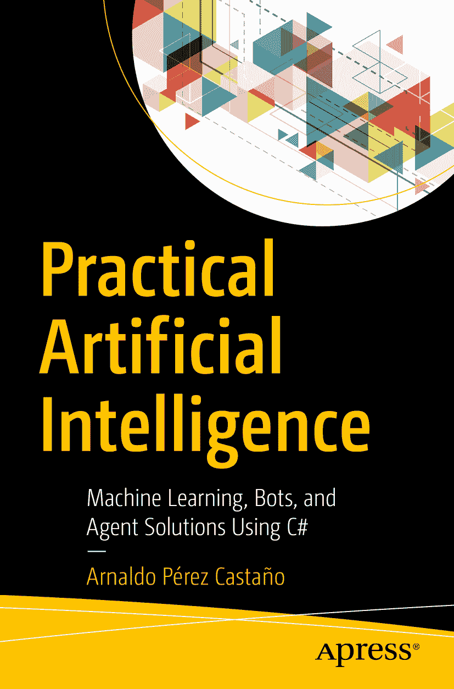

阿纳尔多·佩雷斯·卡斯塔尼奥 著 《实用人工智能：基于 C#的机器学习、机器人与智能体解决方案》

本书作者引用的任何源代码或其他补充材料，读者均可通过本书的产品页面在 GitHub 上获取，该页面位于 [www.​apress.​com/​9781484233566](http://www.apress.com/9781484233566)。如需更详细信息，请访问 [`​www.​apress.​com/​source-code`](http://www.apress.com/source-code)。ISBN 978-1-4842-3356-6e-ISBN 978-1-4842-3357-3 [`doi.org/10.1007/978-1-4842-3357-3`](https://doi.org/10.1007/978-1-4842-3357-3) 美国国会图书馆控制号：2018943123 © 阿纳尔多·佩雷斯·卡斯塔尼奥 2018 本作品受版权保护。出版商保留所有权利，涉及材料的全部或部分内容，具体包括翻译、重印、重用插图、朗诵、广播、以缩微胶卷或任何其他物理方式复制，以及电子改编、计算机软件或目前已知或未来开发的类似或不同方法的传输或信息存储与检索。本书中可能出现商标名称、标识和图像。我们不以每次出现商标名称、标识或图像时都使用商标符号，而是仅以编辑方式使用这些名称、标识和图像，以利于商标所有者，且无意侵犯商标权。本出版物中对商品名称、商标、服务标志及类似术语的使用，即使未明确标识，也不应被视为对其是否受专有权利保护的看法。尽管本书中的建议和信息在出版时被认为是真实准确的，但作者、编辑和出版商均不对可能出现的任何错误或遗漏承担法律责任。出版商对本书所含内容不作任何明示或暗示的保证。本书由 Springer Science+Business Media New York 在全球图书贸易中发行，地址：233 Spring Street, 6th Floor, New York, NY 10013。电话：1-800-SPRINGER，传真：(201) 348-4505，电子邮件：orders-ny@springer-sbm.com，或访问 www.springeronline.com。Apress Media, LLC 是一家加利福尼亚有限责任公司，其唯一成员（所有者）是 Springer Science + Business Media Finance Inc (SSBM Finance Inc)。SSBM Finance Inc 是一家特拉华州公司。致 ML，感谢你带来的戏剧与美好时光。致我的母亲、父亲、兄弟、祖母以及我的整个家庭，感谢你们巨大的支持。引言

《实用人工智能》（PAI）是一本提出全新学习模式的书籍。大多数人工智能书籍深度聚焦于理论，而忽略了贯穿全书用于演示理论的实践问题。在 PAI 中，我们提出了一种遵循本杰明·富兰克林（美利坚合众国开国元勋）理念的模式：“告诉我，我会忘记；教给我，我可能记住；让我参与，我才能学会。”因此，PAI 包含理论知识，但保证每章至少包含一个完全编码（C#）的实践问题，以便读者更好地理解，并让他们参与到本章介绍的理论概念和思想中。读者可以使用本书附带的代码执行这些实践问题，从而更深入地理解本书所述的概念。

PAI 中包含的解释和定义力求尽可能简单（同时不忽视其属于数学、科学环境的事实），以便不同背景的读者都能接触并理解内容，只需具备最基础的数学或编程知识。

第 1 章和第 2 章探讨逻辑学，将其作为数学或计算机科学等许多科学的基础基石。在这些章节中，我们将描述命题逻辑、一阶逻辑和自动定理证明；并将介绍用 C# 编码的相关实践问题。

在第 3 章至第 7 章中，我们将重点介绍智能体与多智能体系统。我们将深入探讨不同类型的智能体及其架构，然后提出一个大型实践问题：我们将编写一个火星车的代码，其任务是在火星上寻找水。我们还将包含另一个实践问题，其中我们设置一组智能体使用 Windows Communication Foundation (WCF) 进行通信。最后，我们将通过介绍另一个实践问题（第 7 章）来结束本书的这一部分，在该问题中，一组智能体组成一个多智能体系统，将协作通信以清理房间的污垢。

第 8 章将描述人工智能的一个子领域，即模拟，通过使用统计、概率工具来模拟现实生活中的场景。在本例中，我们将模拟一个机场的运作，包括飞机在特定时间段内抵达和离开机场的情况。

第 9 章至第 12 章将专门讨论监督学习，这是机器学习中一个非常重要的范式。其基本思想是通过向机器（程序）展示大量 `<数据, 分类>` 对样本，来教会它做某事（通常是分类数据），其中 `数据` 可以是任何东西，例如动物、房屋、人等。例如，样本集可以是 `<大象, 大型>`、`<猫, 小型>` 等等。显然，为了让机器能够理解和处理任何数据，我们必须输入数值而非文本。在这些章节中，我们将探讨支持向量机、决策树、神经网络以及手写数字识别。

第 13 章将解释机器学习的另一个非常重要的范式，即无监督学习。在无监督学习中，我们学习输入数据的结构，并且没有像监督学习中那样的标签（分类）；换句话说，样本仅仅是 `<数据>`，不包含分类。因此，无监督学习程序无需任何外部帮助，仅通过观察数据本身提供的信息来学习。在本章中，我们将描述聚类，这是一种经典的无监督学习技术。我们还将描述多目标聚类和多目标优化。本章将包含一种由作者提出的构建帕累托前沿的方法，即帕累托前沿构建器。

第 14 章将重点介绍启发式算法和元启发式算法，这是我们在前面章节中会提及，并最终在此处深入研究的主题。我们将主要描述两种元启发式算法：遗传算法和禁忌搜索，它们是元启发式算法两大主要类别的代表，即基于种群的元启发式算法和基于单一解的元启发式算法。

第 15 章将探索游戏编程的世界，特别是那些需要执行搜索的游戏。我们将详细介绍并实现许多流行的搜索算法。此外，还会包含一个实际问题：设计并编写一个滑动拼图智能体的代码。

第 16 章将深入探讨博弈论，特别是其中被称为对抗性搜索的子领域。在这一领域中，我们将研究极小化极大算法，并实现一个使用该策略（极小化极大）进行对弈的奥赛罗智能体。

第 17 章将描述一种如今被视为人工智能未来的机器学习范式；这种范式就是**强化学习**。在强化学习中，智能体通过奖励和惩罚进行学习；它们像人类一样随着时间的推移而学习，当学习过程足够长时，它们可以在游戏中达到极具竞争力的水平，甚至能够击败人类世界冠军（正如在西洋双陆棋和围棋中所发生的那样）。

致谢

首先，衷心感谢来自华盛顿州雷德蒙德微软研究院的詹姆斯·麦卡弗里博士，他欣然接受了本书技术审校的职责。我是在为《MSDN 杂志》撰写文章时与詹姆斯在网上结识的。他当时的评论总是非常有用，而在本书的审校过程中，这些评论依然极具价值。我还必须感谢詹姆斯的耐心，因为原本计划写九章的书最终变成了十七章，而他始终与我们并肩同行。

另一个感谢要献给我的编辑们，帕奥·娜塔莉和杰西卡·瓦基利，她们在写作过程中同样非常耐心且善解人意。

最后，我要感谢所有人工智能/机器学习领域的研究人员，他们日复一日地努力，通过新的进展、技术和想法，推动这个极其重要的科学领域向前发展。谢谢你们，所有人！

目录 第 1 章：逻辑与人工智能 1 什么是逻辑？ 2 命题逻辑 3 逻辑连接词 6 否定 7 合取 8 析取 9 蕴含 10 等价 11 命题逻辑定律 12 范式 16 逻辑电路 17 实践问题：使用继承和 C#运算符评估逻辑公式 21 实践问题：将逻辑公式表示为二叉决策树 26 实践问题：将公式转换为否定范式（NNF） 31 实践问题：将公式转换为合取范式（CNF） 36 总结 40 第 2 章：自动定理证明与一阶逻辑 41 自动定理证明 42 实践问题：C#中的子句与 CNF 类 45 DPLL 算法 55 实践问题：在命题逻辑中建模鸽巢原理 67 实践问题：判断命题逻辑公式是否可满足（SAT） 68 一阶逻辑 75 C#中的谓词 80 实践问题：清洁机器人 82 总结 89 第 3 章：智能体 91 什么是智能体？ 92 智能体属性 95 环境类型 99 带状态的智能体 102 实践问题：将清洁机器人建模为智能体并为其添加状态 103 智能体架构 113 反应式架构：包容架构 114 慎思式架构：BDI 架构 119 混合架构 127 图灵机 131 InteRRaP 133 总结 135 第 4 章：火星车 137 什么是火星车？ 138 火星车架构 140 火星车代码 143 火星车可视化应用程序 176 总结 192 第 5 章：多智能体系统 193 什么是多智能体系统？ 194 多智能体组织 197 通信 199 言语行为理论 201 智能体通信语言（ACL） 204 协调与合作 211 使用合同网进行协商 215 社会规范与社会 218 总结 220 第 6 章：使用 WCF 在多智能体系统中进行通信 221 服务 222 契约 224 绑定 227 端点 229 发布/订阅模式 230 实践问题：使用 WCF 在多个智能体之间进行通信 231 总结 248 第 7 章：清洁智能体：一个多智能体系统问题 249 程序结构 250 清洁任务 251 清洁智能体平台 254 合同网 256 FIPA-ACL 262 MAS 清洁智能体 267 图形用户界面 280 运行应用程序 283 总结 288 第 8 章：仿真 289 什么是仿真？ 290 离散事件仿真 292 概率分布 294 实践问题：机场仿真 297 总结 313 第 9 章：支持向量机 315 什么是支持向量机（SVM）？ 318 实践问题：C#中的线性 SVM 328 不完全分离 343 非线性可分情况：核技巧 345 序列最小优化算法（SMO） 348 实践问题：SMO 实现 356 总结 365 第 10 章：决策树 367 什么是决策树？ 368 生成决策树：ID3 算法 372 熵与信息增益 375 实践问题：实现 ID3 算法 377 C4.5 算法 393 实践问题：实现 C4.5 算法 399 总结 410 第 11 章：神经网络 411 什么是神经网络？ 412 感知机：单一神经网络 415 实践问题：实现感知机神经网络 420 Adaline 与梯度下降搜索 427 随机逼近 431 实践问题：实现 Adaline 神经网络 432 多层网络 435 反向传播算法 440 实践问题：实现反向传播并解决 XOR 问题 446 总结 459 第 12 章：手写数字识别 461 什么是手写数字识别？ 462 训练数据集 464 用于手写数字识别的多层神经网络 464 实现 467 测试 476 总结 478 第 13 章：聚类与多目标聚类 479 什么是聚类？ 480 层次聚类 484 划分聚类 486 实践问题：K-Means 算法 490 多目标聚类 499 帕累托前沿构建器 501 总结 507 第 14 章：启发式与元启发式 509 什么是启发式？ 510 爬山法 512 实践问题：实现爬山法 515 P-元启发式：遗传算法 522 实践问题：为旅行商问题实现遗传算法 526 S-元启发式：禁忌搜索 538 总结 548 第 15 章：游戏编程 549 什么是电子游戏？ 551 游戏中的搜索 553 无信息搜索 556 实践问题：实现 BFS、DFS、DLS 和 IDS 560 实践问题：在滑动拼图游戏上实现双向搜索 568 有信息搜索 580 滑动拼图游戏的 A*算法 583 总结 588 第 16 章：博弈论：对抗性搜索与奥赛罗游戏 589 什么是博弈论？ 590 对抗性搜索 593 极小化极大搜索算法 596 Alpha-Beta 剪枝 599 奥赛罗游戏 602 实践问题：在 Windows 窗体中实现奥赛罗游戏 607 实践问题：使用极小化极大算法实现奥赛罗游戏 AI 628 总结 631 第 17 章：强化学习 633 什么是强化学习？ 634 马尔可夫决策过程 636 价值/动作价值函数与策略 640 价值迭代算法 644 策略迭代算法 646 Q 学习与时间差分 647 实践问题：使用 Q 学习解决迷宫问题 650 总结 668 索引 669 关于作者与技术审校者 关于作者 关于技术审校者

