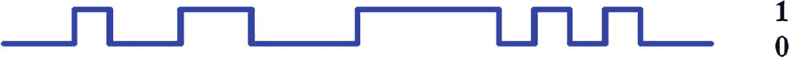
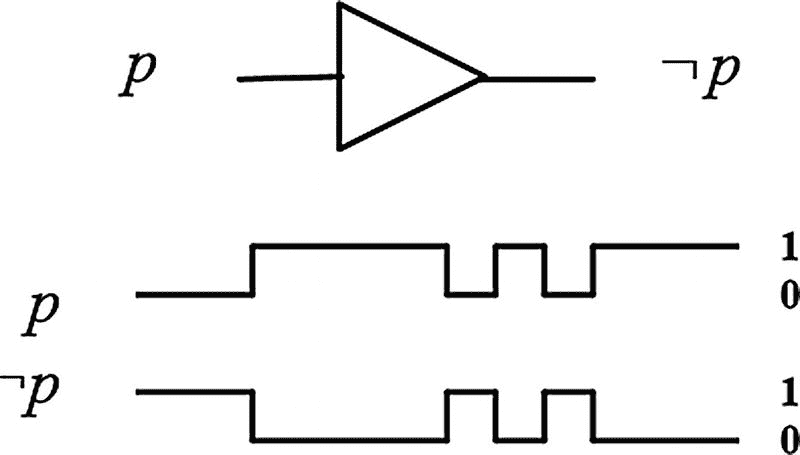
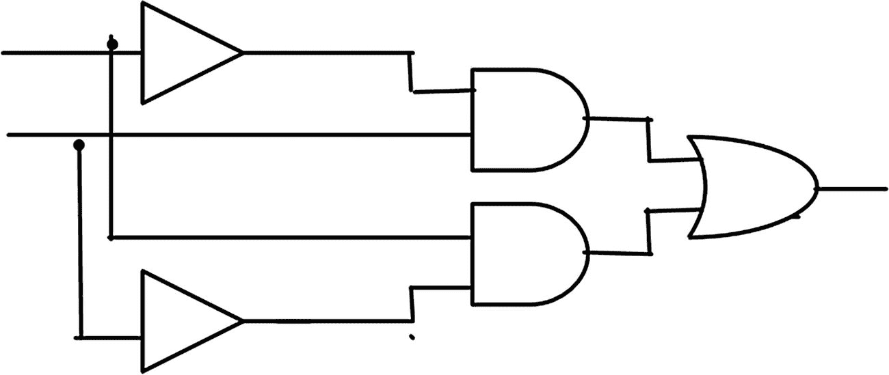
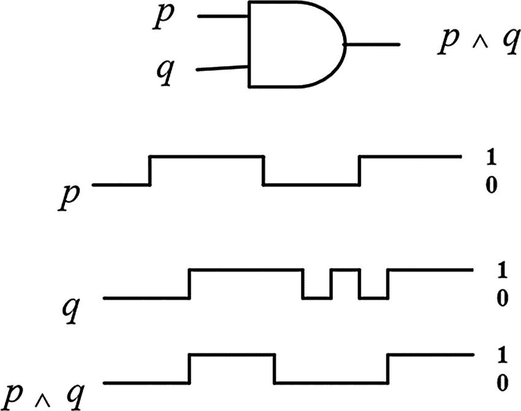
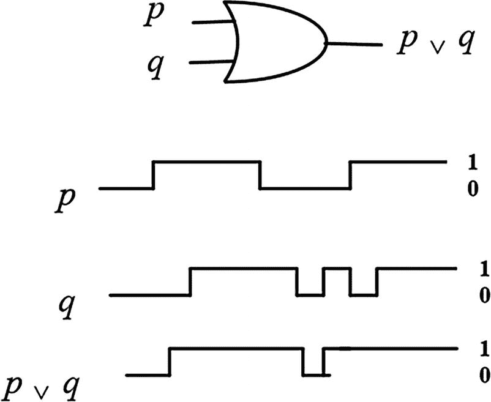
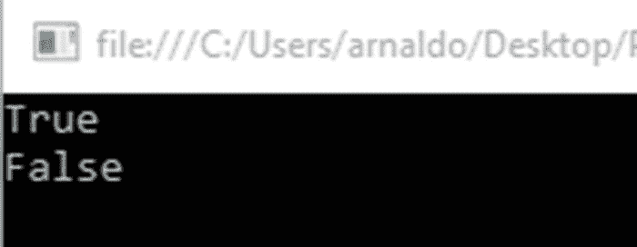
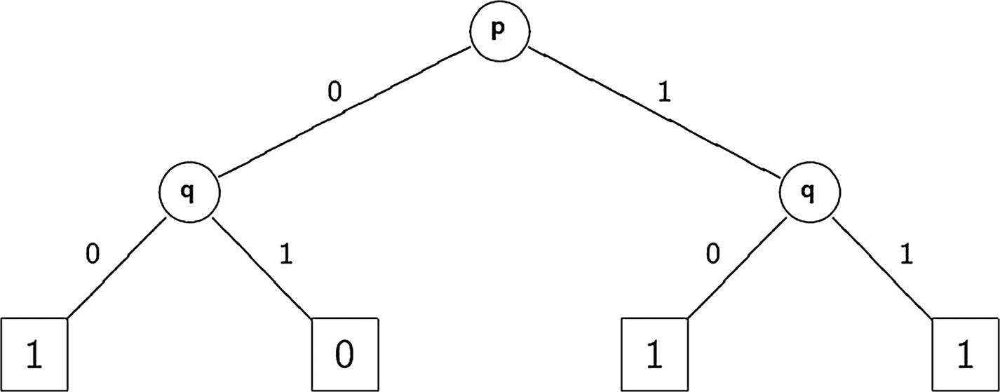

# 1. 逻辑与人工智能

在本章中，我们将介绍一个主题，它不仅对人工智能领域至关重要，而且对数学、物理学、医学、哲学等许多其他知识领域也同样重要。自古以来，像亚里士多德、欧几里得和柏拉图这样的伟大哲学家，以及一些有史以来最伟大的数学家，就对其进行了深入的研究和形式化。它诞生于人类早期，是一种基本工具，使得科学得以蓬勃发展至今日之境地。它澄清并理顺了我们复杂的人类思维，为我们有时混乱的思想带来了秩序。

我们迄今为止一直在讨论的逻辑，将是本章的重点。我们将解释它的一些基本概念、思想和分支，以及它与计算机科学和人工智能的关系。这个主题对于理解本书后续将涉及的许多概念至关重要。此外，没有逻辑，我们又如何能创造出像样的人工智能呢？逻辑指导着我们思维中的理性；因此，如果我们绕开存在于我们“自然”智能中、并在许多情况下（准确地说，是理性决策中）决定决策的那个极其重要的元素（逻辑），我们又怎能创造出我们思维的人工版本呢？

命题逻辑；一阶逻辑；以及一些实际问题——我们将学习如何创建一个逻辑框架，如何使用一种名为`DPLL`的杰出算法来解决`SAT`（可满足性）问题，以及如何使用一阶逻辑组件编写第一个简单的、天真的清洁机器人代码——这些主题将引领我们开启本书的学习。

> **注意**
>
> 逻辑可以细分为数理逻辑、哲学逻辑、计算逻辑、布尔逻辑、模糊逻辑、量子逻辑等等。在本书中，我们将涉及计算逻辑，这是一个与计算机科学和逻辑学必然重叠的领域。

## 什么是逻辑？

直观上，我们都有关于逻辑是什么以及它在日常生活中能有多大用处的概念。尽管存在这种关于逻辑的常识或文化概念，但令人惊讶的是，在科学界，至今仍没有关于逻辑是什么的正式或全球性的定义。

为了从其奠基者那里寻求定义，我们可以追溯到它的根源，发现“逻辑”这个词实际上源自古希腊语 *logike*，意为“概念、想法或思想”。

一些理论家将逻辑定义为“思想的科学”。尽管这个定义似乎是对我们通常与逻辑相关联的概念的一个不错的近似，但它并不是一个非常准确的定义，因为逻辑并非唯一与思想和推理研究相关的科学。现实情况是，这个主题在所有其他科学的基础中根深蒂固，以至于很难为其提供一个正式的定义。

在本书中，我们将把逻辑视为一种形式化人类推理的方式。

由于计算逻辑是与计算机科学相关的逻辑分支，我们将描述这个主题的一些重要概念。最终，这里描述的概念将在本书以及将要呈现的每个实际问题中发挥作用。

> **注意**
>
> 逻辑在计算机科学中被广泛使用：在处理器层面通过逻辑门实现，在硬件和软件验证（如浮点运算）中，在高级编程（如约束编程）中，以及在人工智能中用于规划、调度、智能体控制等问题。

## 命题逻辑

在日常生活和人类沟通过程中，我们不断听到具有特定含义的语言表达；在这些表达中，我们可以找到命题。

命题是可以根据其真值（真或 1，假或 0 等）或根据其模态（可能、不可能、必要等）进行分类的陈述。每个命题都表达某种思想，代表了其意义和内容。由于我们语言中表达的多样性，它们可以被分类为叙述句、感叹句、疑问句等等。在本书中，我们将关注第一种命题——叙述句，即判断的表达，并且从现在起我们将其简称为命题。

以下列表给出了一些命题的例子：

1.  “吸烟有害健康。”

2.  “迈克尔·乔丹是有史以来最伟大的篮球运动员。”

3.  “爵士乐是世界上最酷的音乐类型。”

4.  “100 大于 1。”

5.  “哈瓦那有美丽的海滩。”

6.  “第二次世界大战于 1945 年结束。”

7.  “我听斯汀的音乐。”

8.  “我会读西班牙诗人拉斐尔·阿尔贝蒂的诗。”

这些是简单或原子命题，我们可以在任何普通日子的任何普通对话中使用它们。为了增加复杂性并将其转化为更有意义的东西，我们可以依赖复合命题，这些命题是通过逻辑连接词连接像上面列出的那些简单命题而得到的。

因此，从刚刚列出的命题中，我们可以得到以下（不一定正确或有意义的）复合命题：

1.  “哈瓦那**没有**美丽的海滩。”

2.  “吸烟有害健康**并且** 100 大于 1。”

3.  “迈克尔·乔丹是有史以来最伟大的篮球运动员**或者**第二次世界大战于 1945 年结束。”

4.  “**如果**爵士乐是世界上最酷的音乐类型，**那么**我听斯汀的音乐。”

5.  “我会读西班牙诗人拉斐尔·阿尔贝蒂的诗**当且仅当** 100 大于 1。”

这些情况下的逻辑连接词以大写字母显示，并由词语或短语“NOT”、“AND”、“OR”、“IF …THEN”和“IF AND ONLY IF”表示。

简单或原子命题使用字母（`p`, `q`, `r` 等）表示，这些字母被称为命题变量。我们可以将前面的一些命题命名如下：

1.  `p` = “吸烟有害健康。”

2.  `q` = “迈克尔·乔丹是有史以来最伟大的篮球运动员。”

3.  `r` = “爵士乐是世界上最酷的音乐类型。”

4.  `s` = “100 大于 1。”

一个根据其组成命题的真值可以为真（1）或假（0）的命题被称为公式。注意，一个公式可以是简单的；换句话说，它可以由单个命题组成。因此，每个命题都被视为一个公式。

命题逻辑的语法由以下规则支配：

1.  所有变量和命题常量（`True`, `False`）都是公式。

2.  如果 `F` 是一个公式，那么 `NOT F` 也是一个公式。

3.  如果 `F`, `G` 是公式，那么 `F AND G`, `F OR G`, `F => G`, `F <=> G` 也代表公式。

公式 `F` 的一个解释是对出现在 `F` 中的每个命题变量赋予真值，并确定 `F` 的一个真值。由于每个变量总是有两个可能的值（真、假或 1、0），那么 `F` 的解释总数为 `2^n`，其中 `n` 是出现在 `F` 中的变量总数。

一个对于所有解释都为真的命题被称为重言式或逻辑定律。

一个对于所有解释都为假的命题被称为矛盾式或不可满足的。

我们将研究复合命题的真值及其计算方法。在可满足性问题中，我们接收一个公式作为输入，该公式通常采用一种特殊的标准化形式，称为合取范式（稍后将详细说明），然后我们尝试为其原子命题分配真值，使得公式为真（1）；如果存在这样的赋值，我们就称该公式是可满足的。这是计算机科学中的一个经典问题，将在本章中详细讨论。

在下一节中，我们将更深入地研究逻辑连接词，因为它们对于确定公式的最终真值起着决定性作用。

## 逻辑连接词

通常，逻辑连接词使用以下符号表示：

*   `¬` 表示否定（“非”）

*   `∧` 表示合取（“与”）

*   `∨` 表示析取（“或”）

*   `=>` 表示蕴含（“如果……那么”）

*   `<=>` 表示双蕴含或等价（“当且仅当”）

逻辑连接词作为一元或二元（接收一个或两个参数）函数，其输出可以是 1（真）或 0（假）。为了更好地理解每个连接词在每种可能输入下的输出，我们依赖真值表。

> **注意**
>
> 波浪符号（`~`）也用于表示否定。

在真值表中，列对应变量和输出，行对应每个命题变量的所有可能取值组合。我们将在以下小节中看到每个连接词的详细真值表。

### 否定

如果我们有一个命题 `p`，那么它的否定记为 `¬p`（读作“非 `p`”）。这是一个一元逻辑连接词，因为它只需要一个命题作为输入。

让我们尝试否定前面提出的一些命题：

1.  “吸烟**不**损害你的健康。”

2.  “迈克尔·乔丹**不是**有史以来最伟大的篮球运动员。”

3.  “爵士乐**不是**世界上最酷的音乐流派。”

4.  “100 **不**大于 1。”

5.  “哈瓦那**没有**美丽的海滩。”

6.  “第二次世界大战**没有**在 1945 年结束。”

否定连接词的真值表如下（表 1-1）。

表 1-1 否定逻辑连接词的真值表

| `p` | `¬p` |
| --- | --- |
| 1 | 0 |
| 0 | 1 |

从表 1-1 中我们可以看到，如果命题 `p` 为真（1），那么它的否定（`¬p`）为假（0），反之亦然，如果命题为假。

### 合取

如果我们有命题 `p`、`q`，那么它们的合取记为 `p ∧ q`（读作“`p` 且 `q`”）。这是一个二元逻辑连接词；它需要两个命题作为输入。

可以通过简单地使用“AND”一词来获得前述命题的合取，如下所示：

1.  “吸烟损害你的健康**并且**我会朗读西班牙诗人拉斐尔·阿尔贝蒂的诗。”

2.  “迈克尔·乔丹是有史以来最伟大的篮球运动员，**并且**爵士乐是世界上最酷的音乐流派。”

3.  “100 大于 1，**并且**哈瓦那有美丽的海滩。”

合取连接词的真值表如表 1-2 所示。

表 1-2 合取逻辑连接词的真值表

| `p` | `q` | `p ∧ q` |
| --- | --- | --- |
| 1 | 0 | 0 |
| 0 | 1 | 0 |
| 0 | 0 | 0 |
| 1 | 1 | 1 |

表 1-2 使我们能够看到，只有当 `p` 和 `q` 同时为真时，`p ∧ q` 才为真。

### 析取

如果我们有命题 `p`、`q`，那么它们的析取记为 `p ∨ q`（读作“`p` 或 `q`”）。这是一个二元逻辑连接词；它需要两个命题作为输入。

可以通过简单地使用“OR”一词来获得前述命题的析取，如下所示：

1.  “我将朗读西班牙诗人拉斐尔·阿尔贝蒂的诗，**或者**我听斯汀的音乐。”

2.  “迈克尔·乔丹是有史以来最伟大的篮球运动员，**或者**爵士乐是世界上最酷的音乐流派。”

3. “第二次世界大战在 1945 年结束，或者哈瓦那有美丽的海滩。”

合取连接词的真值表如下（表 1-3）。

### 表 1-3

析取逻辑连接词的真值表

| p | q | p ∨ q |
|---|---|---|
| 1 | 0 | 1 |
| 0 | 1 | 1 |
| 0 | 0 | 0 |
| 1 | 1 | 1 |

从表 1-3 中我们可以看到，当 `p` 或 `q` 为真时，`p ∨ q` 为真。

### 蕴含

数学中有无数表达式以蕴含的形式陈述；即，以“如果……那么”的方式。如果我们有命题 `p`、`q`，那么它们的蕴含记为 `p => q`（读作“p 蕴含 q”）。这是一个二元逻辑连接词；它需要两个命题作为输入，并表明从 `p` 的真实性我们可以推导出 `q` 的真实性。

我们说 `q` 是 `p` 为真的必要条件，`p` 是 `q` 为真的充分条件。

蕴含连接词类似于我们在许多命令式编程语言（如 C#、Java 或 Python）中遇到的条件语句（`if`）。为了理解该连接词产生的输出，让我们考虑以下命题：
* `p` = 约翰很聪明。
* `q` = 约翰去剧院。

蕴含式 `p => q` 将被写为“如果约翰很聪明，那么他去剧院。”让我们分析 `p`、`q` 的每种可能组合以及从该连接词获得的结果。

情况 1，其中 `p = 1`，`q = 1`。在这种情况下，约翰很聪明并且他去剧院；因此，`p => q` 为真。

情况 2，其中 `p = 1`，`q = 0`。在这种情况下，约翰很聪明但不去剧院；因此，`p => q` 为假。

情况 3，其中 `p = 0`，`q = 1`。在这种情况下，约翰不聪明，尽管他去剧院。由于 `p` 为假，并且 `p => q` 仅指示当 `p = 约翰很聪明` 时发生的情况，因此命题 `p => q` 并未被否定；因此，它为真。

情况 4，其中 `p = 0`，`q = 0`。在这种情况下，约翰不聪明并且不去剧院。由于 `p` 为假，并且 `p => q` 仅指示当 `p` 为真时发生的情况，因此 `p => q` 为真。

一般来说，只要 `p = 0`，命题 `p => q` 就为真，因为如果条件 `p` 不成立（约翰很聪明），那么结果（约翰去剧院）可以是任何情况。这可以解释为“如果约翰很聪明，那么他去剧院”；否则，“如果约翰不聪明，那么任何事情都可能发生”，这是真的。

蕴含连接词的真值表如表 1-4 所示。

### 表 1-4

蕴含逻辑连接词的真值表

| p | q | p => q |
|---|---|---|
| 1 | 0 | 0 |
| 0 | 1 | 1 |
| 0 | 0 | 1 |
| 1 | 1 | 1 |

当 `p` 为假，或者 `p` 和 `q` 都为真时，命题 `p => q` 为真。

### 等价

命题 `p`、`q` 被称为等价的，记为 `p <=> q`（读作“p 等价于 q”或“p 当且仅当 q”），如果 `p => q` 和 `q => p` 都具有相同的值。

双蕴含或等价连接词仅当命题 `p`、`q` 具有相同值时输出真。

等价连接词的真值表如表 1-5 所示。

### 表 1-5

等价逻辑连接词的真值表

| p | q | p <=> q |
|---|---|---|
| 1 | 0 | 0 |
| 0 | 1 | 0 |
| 0 | 0 | 1 |
| 1 | 1 | 1 |

考虑命题 `p`、`q`、`r`，等价连接词满足以下性质：
*   自反性：`p <=> p`
*   传递性：如果 `p <=> r` 且 `r <=> q`，则 `p <=> q`
*   对称性：如果 `p <=> q`，则 `q <=> p`

蕴含和等价连接词在数学和计算逻辑中都具有重要意义，它们代表了用于呈现数学定理的基本逻辑结构。随着本书内容的深入，人工智能、逻辑连接词以及一般逻辑之间的关系将变得更加明显。

## 命题逻辑定律

在熟悉了所有逻辑连接词之后，我们来介绍一系列逻辑等价式和蕴含式，它们因其重要性而被视为命题逻辑定律。在此，`p`、`q` 和 `r` 均为公式，我们将使用 ≡ 符号来表示 `p <=> q` 是一个重言式；即，对于 `p`、`q` 的任何取值（任何解释），它都为真。在这种情况下，我们说 `p` 和 `q` 是逻辑等价的。该符号类似于算术中使用的等号，因为其含义相似，但处于逻辑层面。`p ≡ q` 基本上意味着，当接收相同输入（每个变量的真值）时，`p` 和 `q` 将始终产生相同的输出。

逻辑等价式：
1.  `p ∨ p ≡ p` （幂等律）
2.  `p ∧ p ≡ p` （幂等律）
3.  `[p ∨ q] ∨ r ≡ p ∨ [q ∨ r]` （结合律）
4.  `[p ∧ q] ∧ r ≡ p ∧ [q ∧ r]` （结合律）
5.  `p ∨ q ≡ q ∨ p` （交换律）
6.  `p ∧ q ≡ q ∧ p` （交换律）
7.  `p ∧ [q ∨ r] ≡ [p ∧ q] ∨ [p ∧ r]` （对 ∧ 的分配律）
8.  `p ∨ [q ∧ r] ≡ [p ∨ q] ∧ [p ∨ r]` （对 ∨ 的分配律）
9.  `p ∨ [p ∧ q] ≡ p`
10.  `p ∧ [p ∨ q] ≡ p`
11.  `p ∨ 0 ≡ p`
12.  `p ∧ 1 ≡ p`
13.  `p ∨ 1 ≡ 1`
14.  `p ∧ 0 ≡ 0`
15.  `p ∨ ¬p ≡ 1`
16.  `p ∧ ¬p ≡ 0` （矛盾律）
17.  `¬[¬p] ≡ p` （双重否定律）
18.  `¬1 ≡ 0`
19.  `¬0 ≡ 1`
20.  `¬[p ∨ q] ≡ ¬p ∧ ¬q` （德摩根定律）
21.  `¬[p ∧ q] ≡ ¬p ∨ ¬q` （德摩根定律）
22.  `p => q ≡ ¬p ∨ q` （=> 的定义）
23.  `[p <=> q] ≡ [p => q] ∧ [q => p]` （<=> 的定义）

注意上述某些公式中括号的使用。与数学中一样，括号可用于将变量及其连接词分组，以表示顺序相关性、与逻辑连接词的关联等。例如，像 `p ∨ [q ∧ r]` 这样的公式表示子公式 `q ∧ r` 的结果将与析取逻辑连接词和变量 `p` 相连。

与我们引入 ≡ 符号来表示 `p`、`q` 逻辑等价类似，现在我们引入 ≈ 符号来表示 `p`、`q` 逻辑蕴含，写作 `p ≈ q`。如果它们逻辑蕴含，则 `p => q` 必须是一个重言式。

逻辑蕴含式：
1.  `p ≈ q => [p ∧ q]`
2.  `[p => q] ∧ [q => r] ≈ p => q`
3.  `¬q => ¬p ≈ p => q`
4.  `[p => q] ∧ [¬p => q] ≈ q`
5.  `[p => r] ∧ [q => r] ≈ [p ∨ q] => r`
6.  `¬p => [q ∧ ¬q] ≈ p`
7.  `p => [q ∧ ¬q] ≈ ¬p`
8.  `¬p => p ≈ p`
9.  `p => ¬p ≈ ¬p`
10.  `p => [¬q => [r ∧ ¬r]] ≈ p => q`
11.  `[p ∧ ¬q] => q ≈ p => q`
12.  `[p ∧ ¬q] => ¬p ≈ p => q`
13.  `[p => q] ∧ [¬p => r] ≈ q ∨ r`
14.  `¬p => q ≈ p ∨ q`
15.  `p => q ≈ q ∨ ¬p`
16.  `p ≈ p ∨ q`
17.  `p ∧ q ≈ p`
18.  `p ≈ q => p`

这些定律中有许多非常直观，可以通过找出所涉及变量的所有可能值以及每个公式的最终结果来轻松证明。例如，等价式 `¬[p ∨ q] ≡ ¬p ∧ ¬q`（即德摩根定律），可以通过考虑 `p`、`q` 在真值表中的所有可能值来证明，如表 1-6 所示。

### 表 1-6

验证 `¬[p ∨ q] ≡ ¬p ∧ ¬q` 的真值表

| p | q | ¬[p ∨ q] | ¬p ∧ ¬q |
|---|---|---|---|
| 0 | 0 | 1 | 1 |
| 0 | 1 | 0 | 0 |
| 1 | 0 | 0 | 0 |
| 1 | 1 | 0 | 0 |

到目前为止，我们已经介绍了计算逻辑的一些基本主题。此时，读者可能会好奇命题逻辑与人工智能之间有何关系。首先，命题逻辑以及更广泛的逻辑学是许多与人工智能相关领域的奠基学科。我们的大脑充满了逻辑决策，每一步都会做出开（1）/关（0）的定义，而这些决策在多种情况下都受到我们“内置”逻辑的支撑。因此，由于人工智能在某种程度上试图模拟人脑，我们必须理解逻辑并学会如何运用它，以便在未来构建坚实、合乎逻辑的人工智能。在接下来的章节中，我们将继续研究命题逻辑，并最终一窥实际问题的面貌。

## 范式

在检查可满足性时，某些类型的公式比其他公式更容易处理。在这些公式中，我们可以找到范式。

*   否定范式 (NNF)
*   合取范式 (CNF)
*   析取范式 (DNF)

我们假设所有公式都不含蕴含式；即，每个蕴含式 `p => q` 都被转换为等价的 `¬p ∨ q`。

如果一个公式中只有变量被否定，则称该公式处于否定范式。每个公式都可以使用上一节中介绍的逻辑等价式 17、20 和 21 转换为等价的 NNF。

**注意**：范式在自动定理证明（也称为自动演绎或 ATP）中非常有用，而自动定理证明是自动推理的一个子领域，自动推理同时又是人工智能的一个子领域。ATP 致力于通过计算机程序证明数学定理。

如果一个公式的形式为`(p1 ∧ p2 … ∨ pn) ∧ (q1 ∨ q2 … ∨ qm)`，其中每个`pi`、`qj`要么是命题变量，要么是命题变量的否定，则称该公式处于**合取范式**。CNF是变量析取的合取，每个NNF都可以使用命题逻辑定律转换为CNF。

如果一个公式的形式为`(p1 ∧ p2 … ∧ pn) ∨ (q1 ∧ q2 … ∨ qm)`，其中每个`pi`、`qj`要么是命题变量，要么是命题变量的否定，则称该公式处于**析取范式**。DNF是变量合取的析取，每个NNF也可以使用命题逻辑定律转换为CNF。

在本章末尾，我们将研究几个实际问题，其中会描述计算NNF和CNF的算法；我们还将探讨范式与ATP之间的关系。

### 注意

数学对象的规范形式或范式是表示该对象的标准方式。规范形式意味着每个对象都有唯一的表示方式；而范式则不涉及唯一性特征。

## 逻辑电路

至此所介绍的关于命题逻辑的主题，在设计问题中有所应用，更重要的是，在数字逻辑电路中也有应用。这些电路执行逻辑二值函数，用于处理数字信息。

此外，人类有史以来创造的最重要的逻辑机器（计算机）在基本层面上就是使用逻辑电路运行的。

计算机作为最基础、最经典的人工智能载体实例，接收输入数据（以二进制0和1的流形式）。它像我们的大脑一样，使用逻辑和算术处理这些信息，并最终提供输出或执行动作。计算机的核心是**中央处理器**（CPU），它由**算术逻辑单元**（ALU）和**控制单元**（CU）组成。ALU——以及整个计算机——使用带有符号1和0的二进制语言，以数字形式处理信息。这些符号被称为**比特**，是计算机中信息的基本单位。

逻辑电路是我们当前计算机的主要技术组件之一，本章迄今为止描述的每一个逻辑连接词在电子学领域都被称为**逻辑门**。

逻辑门是一种用于在数字电路中进行计算的开关结构。它能够根据输入产生可预测的输出。通常，输入是两种选定电压之一，分别表示为0和1。0代表低电压，1代表高电压。电压范围在发射极耦合逻辑的0.7伏特和继电器逻辑的大约28伏特之间。

### 注意

被称为神经元的神经细胞，其功能比逻辑门更复杂，但方式相似。神经元具有树突和轴突的结构，用于传输信号。神经元从其树突接收一组输入，以加权和的方式关联它们，并根据输入信号的频率类型在轴突中产生输出。与逻辑门不同，神经元具有适应性。

我们输入计算机的每一条信息（来自键盘的字符、图像等）最终都会被转换成0和1。然后，这些信息通过逻辑电路以不连续或离散的方式被承载和传输。信息以连续的信号形式流动，这些信号通常由高（1）和低（0）电压电平构成的电子脉冲组成，如图1-1所示。


**图 1-1** 数字信息流

ALU中的逻辑电路通过执行相应的逻辑门（与门、或门等）来转换接收到的信息。因此，输入信息所经受的任何变换都可以使用命题逻辑来描述。电路是由连接各种基本电子元件构建而成的。我们将把每个电子元件及其所代表的操作抽象为图1-2、1-3和1-4所示的示意图之一。


**图 1-2** 非门（NOT）组件的表示

在图1-5中，我们可以看到一个二进制比较器，作为逻辑电路的第一个示例。该电路接收两个输入`p`、`q`（比特），如果`p`和`q`相等则输出0；否则输出1。为了验证图1-5所示电路的输出是否正确，并且确实代表一个二进制比较器，我们可以遍历输入比特`p`、`q`的所有可能值并检查相应的结果。

对该电路进行简单分析会告诉我们：每当输入`p`、`q`具有不同的值时，每个输入都会沿着一条路径被取反，而另一个比特保持不变。这将激活其中一个与门，使其输出1；因此，最终的或门也将输出1，并且这两个比特不被视为相等。简而言之，当两个输入相等时，输出为1；如果输入不相等，则输出为0。


**图 1-5** 二进制比较器电路


**图 1-4** 与门（AND）组件的表示


**图 1-3** 或门（OR）组件的表示

现在我们已经学习了与命题逻辑相关的各种主题，是时候引入第一个实际问题了。在下一节中，我们将介绍如何使用C#这种强大语言提供的工具来表示逻辑公式。我们还将看到如何使用二叉决策树来找出一个公式的所有可能输出。

## 实际问题：利用继承和C#运算符求值逻辑公式

至此，我们已经学习了命题逻辑的基础知识。在本节中，我们将提出第一个实际问题。我们将创建一组通过继承关联的类，这些类使我们能够根据预先定义的输入，获取任意公式的输出。这些类将使用**结构递归**。

在结构递归中，类（以及对象）所展现的结构本身是递归的。在这种情况下，递归将出现在`Formula`类及其子类的方法中。利用递归，我们将沿着继承层次树一路调用方法。C#中的继承将通过调用方法的正确版本（即与类所代表的逻辑门相对应的版本）来辅助递归。

在代码清单1-1中，展示了我们公式设计中所有其他类的父类。

```
public abstract class Formula
{
    public abstract bool Evaluate();
    public abstract IEnumerable Variables();
}
代码清单 1-1
抽象类 Formula
```

抽象类`Formula`规定其所有子类必须实现一个布尔方法`Evaluate()`和一个`IEnumerable<Variable>`方法`Variables()`。前者将返回公式的求值结果，后者将返回公式中包含的变量。`Variable`类稍后介绍。

由于二元逻辑门共享一些特性，我们将创建一个抽象类来归纳这些特性，从而设计出更简洁、更符合逻辑的继承结构。`BinaryGate`类（如代码清单1-2所示）将包含每个二元门共有的相似之处。

```
public abstract class BinaryGate : Formula
{
    public Formula P { get; set; }
    public Formula Q { get; set; }
    public BinaryGate(Formula p, Formula q)
    {
        P = p;
        Q = q;
    }
    public override IEnumerable Variables()
    {
        return P.Variables().Concat(Q.Variables());
    }
}
代码清单 1-2
抽象类 BinaryGate
```

在代码清单1-3中，展示了第一个逻辑门——与门。

```
public class And: BinaryGate
{
    public And(Formula p, Formula q): base(p, q)
    { }
    public override bool Evaluate()
    {
        return P.Evaluate() &&Q.Evaluate();
    }
}
代码清单 1-3
And 类
```

`And`类的实现非常简单。它接收两个参数，并将它们传递给父类构造函数，而`Evaluate`方法仅返回C#内置的逻辑与运算。`Or`、`Not`和`Variable`类与之非常相似，如代码清单1-4所示。

```
## 代码清单 1-4：`Or`、`Not`、`Variable` 类

```csharp
public class Or : BinaryGate
{
    public Or(Formula p, Formula q): base(p, q)
    { }
    public override bool Evaluate()
    {
        return P.Evaluate() || Q.Evaluate();
    }
}
public class Not : Formula
{
    public Formula P { get; set; }
    public Not(Formula p)
    {
        P = p;
    }
    public override bool Evaluate()
    {
        return !P.Evaluate();
    }
    public override IEnumerable Variables()
    {
        return new List(P.Variables());
    }
}
public class Variable : Formula
{
    public bool Value { get; set; }
    public Variable(bool value)
    {
        Value = value;
    }
    public override bool Evaluate()
    {
        return Value;
    }
    public override IEnumerable Variables()
    {
        return new List() { this };
    }
}
```

请注意，`Variable` 类是我们用来表示公式中变量的类。它包含一个 `Value` 字段，即赋予该变量的值（`true` 或 `false`）。当调用 `Variables()` 方法时，它会返回一个 `List<Variable>`，其唯一元素就是它自身。我们设计的这种递归继承结构随后会将该值在继承链中向上传递，以便在请求时输出包含正确 `Variable` 类型对象的 `IEnumerable<Variable>`。

现在，让我们尝试创建一个公式，并根据一些定义的输入求出其输出，如代码清单 1-5 所示。

### 代码清单 1-5：创建并求值公式 ¬p ∨ q

```csharp
var p = new Variable(false);
var q = new Variable(false);
var formula = new Or(new Not(p), q);
Console.WriteLine(formula.Evaluate());
p.Value = true;
Console.WriteLine(formula.Evaluate());
Console.Read();
```

执行上述代码后得到的结果如图 1-6 所示。


**图 1-6** 执行代码清单 1-5 中代码后的结果

由于每个蕴含式都可以利用 `OR` 和 `NOT` 表达式转换为自由蕴含公式（根据命题逻辑定律），并且每个双蕴含式都可以通过将其转换为蕴含式的合取来消除蕴含，因此拥有上述逻辑门就足以表示任何公式。

## 实际问题：将逻辑公式表示为二叉决策树

二叉决策树（BDT）是一种带标签的二叉树，满足以下条件：
*   叶节点标签为 0（假）或 1（真）。
*   非叶节点标签为正整数。
*   每个标签为 `i` 的非叶节点都有两个子节点，且子节点标签均为 `i + 1`。
*   通向左侧子节点的分支取低值（0），通向右侧子节点的分支取高值（1）。

**注意**
二叉决策树只是表示或书写公式真值表的另一种方式。

在图 1-7 中，我们可以看到一棵二叉决策树，其中叶节点用正方形表示，非叶节点用圆形表示。


**图 1-7** `p ∨ ¬q` 的二叉决策树

在二叉决策树中，树的每一层对应一个变量，其两个分支对应变量的可能取值（1, 0）。从根节点到叶节点的路径表示公式中所有变量的一种赋值。叶节点处的值表示公式的一种解释，即从根节点开始赋值的结果。

现在我们已经学习了与命题逻辑相关的一些主题，是时候创建我们的第一个 AI 数据结构了。正如我们将看到的，通过使用上一个实际问题中介绍的 `Formula` 类，我们只需几行代码就能创建二叉决策树。该类将包含三个用于不同用途的构造函数，如代码清单 1-6 所示。

### 代码清单 1-6：`BinaryDecisionTree` 类的构造函数与属性

```csharp
public class BinaryDecisionTree
{
    private BinaryDecisionTree LeftChild { get; set; }
    private BinaryDecisionTree RightChild { get; set; }
    private int Value { get; set; }
    public BinaryDecisionTree()
    { }
    public BinaryDecisionTree(int value)
    {
        Value = value;
    }
    public BinaryDecisionTree(int value, BinaryDecisionTree lft, BinaryDecisionTree rgt)
    {
        Value = value;
        LeftChild = lft;
        RightChild = rgt;
    }
    ...
}
```

二叉决策树是一种递归结构；因此，其模板或类将包含两个属性 `LeftChild` 和 `RightChild`，它们的类型均为 `BinaryDecisionTree`。`Value` 属性是一个整数，用于标识变量，其顺序由 `Formula` 类中的 `Variables()` 方法提供；该顺序等同于树的高度；即，在第一层，根节点的值为 0，然后在高度为 1 的层，每个节点（均代表同一变量）的值均为 1，依此类推。

**注意**
在二叉决策树中，每一层代表公式中的一个变量。离开节点（变量）的左侧分支对应变量取值为 0（假）的决策，右侧分支则表示变量取值为 1（真）的决策。

代码清单 1-7 中所示的静态方法将负责构建二叉决策树。
```

## 构建二叉决策树

```
public static BinaryDecisionTreeFromFormula(Formula f)
{
return TreeBuilder(f, f.Variables(), 0, "");
}
private static BinaryDecisionTreeTreeBuilder(Formula f, IEnumerable variables, intvarIndex, string path)
{
if (!string.IsNullOrEmpty(path))
variables.ElementAt(varIndex - 1).Value = path[path.Length - 1] != '0';
if (varIndex == variables.Count())
return new BinaryDecisionTree(f.Evaluate() ? 1 : 0);
return new BinaryDecisionTree(varIndex, TreeBuilder(f, variables, varIndex + 1, path + "0"),
TreeBuilder(f, variables, varIndex + 1, path + "1"));
}
```
代码清单 1-7：从公式构建二叉决策树的方法

公共方法 `FromFormula` 使用一个辅助私有方法，该方法依赖递归来创建树。

`varIndex` 变量定义了树的高度，或者等价地，定义了代表该树层级的变量的索引。

`Path` 以二进制字符串的形式存储每个变量的求值结果；例如，“010”表示一条路径，其中根变量 `r` 求值为假，然后其左子节点 `lft` 求值为真，最后 `lft` 的右子节点求值为假。一旦我们到达与公式变量数量相等的深度，我们就使用与已构建路径匹配的赋值来对公式进行求值，并将最终结果保存在叶节点中。

通过遍历决策树，我们可以获得公式在为其变量预定义的一组值（从根节点到叶节点的路径）下的输出。这一特性在决策过程中非常有用，因为树结构非常直观，易于解释和理解。决策树将在第 4 章中深入介绍；目前我们应知道它们提供了若干优势或好处。其中值得一提的是，它们能在一张视图中创建所有可能输出及后续决策的可视化表示。由原始选择产生的每个后续决策也会在树上描绘出来，这样我们就能看到任何一个决策的整体效果。当我们遍历树并做出选择时，我们会看到从一个节点到另一个节点的特定路径，以及当前做出的决策可能对未来产生的影响。

如前所述，我们将在下一节中描述与范式相关的各种实际问题。我们将学习如何将常规状态的公式转化为否定范式（`NNF`），再进一步转化为合取范式（`CNF`）。这种转化在处理公式时，尤其是在开发像 `DPLL` 这样的逻辑相关算法时，会非常有用。

## 实际问题：将公式转化为否定范式（NNF）

在本问题中，我们将最终研究一种将任意公式转化为否定范式的算法。请记住，范式之所以有用，是因为：
- 它们减少了逻辑运算符（如蕴含等）；
- 它们简化了句法结构（子公式的嵌套）；
- 可以利用它们来寻求高效的数据结构。

`NNF` 转换算法由以下递归思想确定；假设 `F` 是输入公式，以下是伪代码。

`NNF(F)`：

- 如果 `F` 是变量或否定变量，则返回 `F`
- 如果 `F` 是 `¬¬p`，则返回 `NNF(p)`
- 如果 `F` 是 `p ∧ q`，则返回 `NNF(p) ∧ NNF(q)`
- 如果 `F` 是 `p ∨ q`，则返回 `NNF(p) ∨ NNF(q)`
- 如果 `F` 是 `¬(p ∨ q)`，则返回 `NNF(¬p) ∧ NNF(¬q)`
- 如果 `F` 是 `¬(p ∧ q)`，则返回 `NNF(¬p) ∨ NNF(¬q)`

我们将假设所有公式都不含蕴含，并利用 `Formula` 层次结构来实现所描述的伪代码。

> **注意**
>
> 公式 `¬p ∧ q`、`p ∨ q`、`(p ∧ (¬q ∨ r))` 都处于否定范式。而公式 `¬(q ∨¬r)`、`¬(p ∧ q)` 则不属于否定范式，因为这些公式中的某些部分包含了被否定的 Or、And 公式。要处于 `NNF`，只有变量才能被否定。

我们将从修改 `Formula` 抽象类开始，如清单 1-8 所示。

```
public abstract class Formula
{
public abstract bool Evaluate();
public abstract IEnumerable Variables();
public abstract Formula ToNnf();
}
```
清单 1-8：向抽象类 `Formula` 添加抽象方法 `ToNnf()`

`And`、`Or` 类需要稍作修改，包括重写新创建的 `ToNnf()` 抽象方法（清单 1-9）。

```
public class And: BinaryGate
{
public And(Formula p, Formula q): base(p, q)
{ }

public override bool Evaluate()
{
return P.Evaluate() &&Q.Evaluate();
}

public override Formula ToNnf()
{
return new And(P.ToNnf(), Q.ToNnf());
}
}

public class Or : BinaryGate
{
public Or(Formula p, Formula q): base(p, q)
{ }

public override bool Evaluate()
{
return P.Evaluate() || Q.Evaluate();
}

public override Formula ToNnf()
{
return new Or(P.ToNnf(), Q.ToNnf());
}
}
```
清单 1-9：重写 `ToNnf()` 方法的 `And`、`Or` 类

`Not` 类包含了 `NNF` 伪代码中的大部分步骤（`if` 语句）；其最终实现可见清单 1-10。

```
public class Not : Formula
{
public Formula P { get; set; }

public Not(Formula p)
{
P = p;
}

public override bool Evaluate()
{
return !P.Evaluate();
}

public override IEnumerable Variables()
{
return new List(P.Variables());
}

Public override Formula ToNnf()
{
if (P is And)
return new Or(new Not((P as And).P), new Not((P as And).Q));

if (P is Or)
return new And(new Not((P as Or).P), new Not((P as Or).Q));

if (P is Not)
return new Not((P as Not).P);

return this;
}
}
```
清单 1-10：重写 `Nnf()` 方法的 `Not` 类

最后，`Variable` 类包含对其父类继承的 `Nnf()` 抽象方法的简单重写；整个类如清单 1-11 所示。

```
public class Variable : Formula
{
public bool Value { get; set; }

public Variable(bool value)
{
Value = value;
}

public override bool Evaluate()
{
return Value;
}

public override IEnumerable Variables()
{
return new List() { this };
}

public override Formula ToNnf()
{
return this;
}
}
```
清单 1-11：重写 `Nnf()` 方法的 `Variable` 类

### 引言

要从一个公式中获得 NNF，我们只需在 `Formula` 类的某个实例上调用 `Nnf()` 方法即可。

## 实际问题：将公式转化为合取范式（CNF）

合取范式（CNF）本质上是“AND of ORs”；即，变量或否定变量的组全部通过析取连接词连接，而所有组之间通过合取连接词关联；例如，`(p ∨ q) ∧ (r ∨ ¬q)`。由于前面详述的多种原因，我们有兴趣将公式转化为 CNF。CNF 转换算法的伪代码如下所示。

函数 `CNF(F)`：
*   如果 `F` 是变量或否定变量，则返回 `F`
*   如果 `F` 是 `p ∧ q`，则返回 `CNF(p) ∧ CNF(q)`
*   如果 `F` 是 `p ∨ q`，则返回 `DISTRIBUTE-CNF(CNF(p), CNF(q))`

函数 `DISTRIBUTE-CNF(P, Q)`：
*   如果 `P` 是 `R ∧ S`，则返回 `DISTRIBUTE-CNF(R, Q) ∧ DISTRIBUTE-CNF(S, Q)`
*   如果 `Q` 是 `T ∨ U`，则返回 `DISTRIBUTE-CNF(P, T) ∨ DISTRIBUTE-CNF(P, U)`
*   返回 `P ∨ Q`

CNF 算法依赖于一个名为 `DISTRIBUTE-CNF` 的辅助方法，该方法利用命题逻辑的分配律来分解公式，使其更接近 CNF 的预期形式。

> **注意**
> CNF 算法假设输入公式已经处于 NNF。每个 NNF 公式都可以使用命题逻辑的分配律转化为等价的 CNF 公式。

正如我们对 NNF 算法所做的那样，我们将把 CNF 算法插入到我们在之前实际问题中一直在增强的 `Formula` 层次结构中。对 `Formula` 抽象类必要的编辑如清单 1-12 所示。

```
public abstract class Formula
{
    public abstract bool Evaluate();
    public abstract IEnumerable Variables();
    public abstract Formula ToNnf();
    public abstract Formula ToCnf();

    public Formula DistributeCnf(Formula p, Formula q)
    {
        if (p is And)
            return new And(DistributeCnf((p as And).P, q), DistributeCnf((p as And).Q, q));
        if(q is And)
            return new And(DistributeCnf(p, (q as And).P), DistributeCnf(p, (q as And).Q));
        return new Or(p, q);
    }
}
```

*清单 1-12*
向 `Formula` 类添加 `ToCnf()` 和 `DistributeCnf()` 方法

现在我们已经向父类添加了抽象方法，可以在子类 `And`、`Or` 中包含相应的重写，如清单 1-13 和 1-14 所示。

```
public class And: BinaryGate
{
    public And(Formula p, Formula q): base(p, q)
    { }
    public override bool Evaluate()
    {
        return P.Evaluate() && Q.Evaluate();
    }
    public override Formula ToNnf()
    {
        return new And(P.ToNnf(), Q.ToNnf());
    }
    public override Formula ToCnf()
    {
        return new And(P.ToNnf(), Q.ToNnf());
    }
}
```

*清单 1-13*
重写 `ToCnf()` 方法的 `And` 类

`Or` 和 `And` 类中 `ToCnf()` 方法的重写实现直接源自 CNF 函数的伪代码（清单 1-14）。

```
public class Or : BinaryGate
{
    public Or(Formula p, Formula q): base(p, q)
    { }
    public override bool Evaluate()
    {
        return P.Evaluate() || Q.Evaluate();
    }
    public override Formula ToNnf()
    {
        return new Or(P.ToNnf(), Q.ToNnf());
    }
    public override Formula ToCnf()
    {
        return DistributeCnf(P.ToCnf(), Q.ToCnf());
    }
}
```

*清单 1-14*
重写 `ToCnf()` 方法的 `Or` 类

`Not` 和 `Variable` 类在其 `ToCnf()` 重写中将简单地返回对自身的引用，如清单 1-15 所示。

```
public override Formula ToCnf()
{
    return this;
}
```

*清单 1-15*
`Not`、`Variable` 类中的 `ToCnf()` 方法重写

请记住：CNF 算法期望输入一个 NNF 公式；因此，在执行此算法之前，我们需要在创建的 `Formula` 对象上先调用 `ToNnf()` 方法，然后再调用 `ToCnf()` 方法。在下一章中，我们将开始深入探讨人工智能和逻辑的一个应用，该应用与我们迄今为止看到的所有实际问题直接相关：自动定理证明。

## 总结

在本章中，我们分析了人工智能与逻辑之间的关系。我们介绍了一种基础逻辑——命题逻辑。我们描述了包含用于表示公式（变量、逻辑连接词等）层次结构的各种代码，并通过不同方法对该层次结构进行了补充。这些方法包括否定范式转换算法和合取范式转换算法（依赖于先前介绍的分配律）。我们还描述了一种用于表示公式及其可能求值的二叉决策树。

在下一章中，我们将开始研究一种扩展了命题逻辑的非常重要的逻辑：一阶逻辑。同时，我们将深入自动定理证明（ATP）的世界，并介绍一种用于判定公式可满足性的非常重要的方法——DPLL 算法。

```
(x)IsFriend(x, Arnaldo)(x)IsFriend(x, Arnaldo) (y)IsWorkingWith(y, Arnaldo)
```