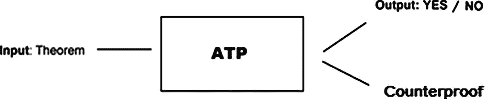
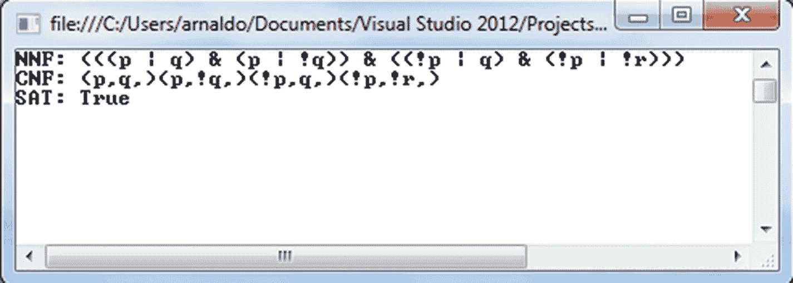
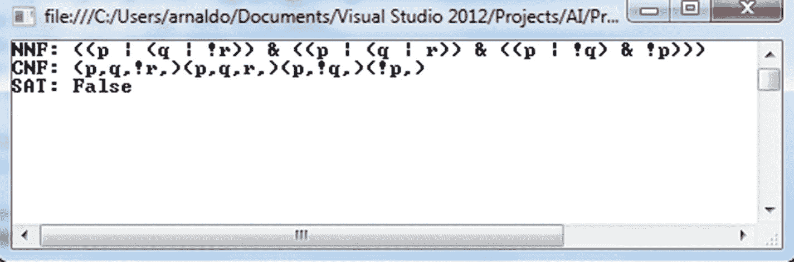
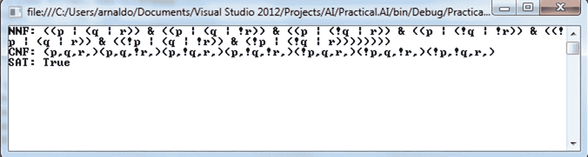
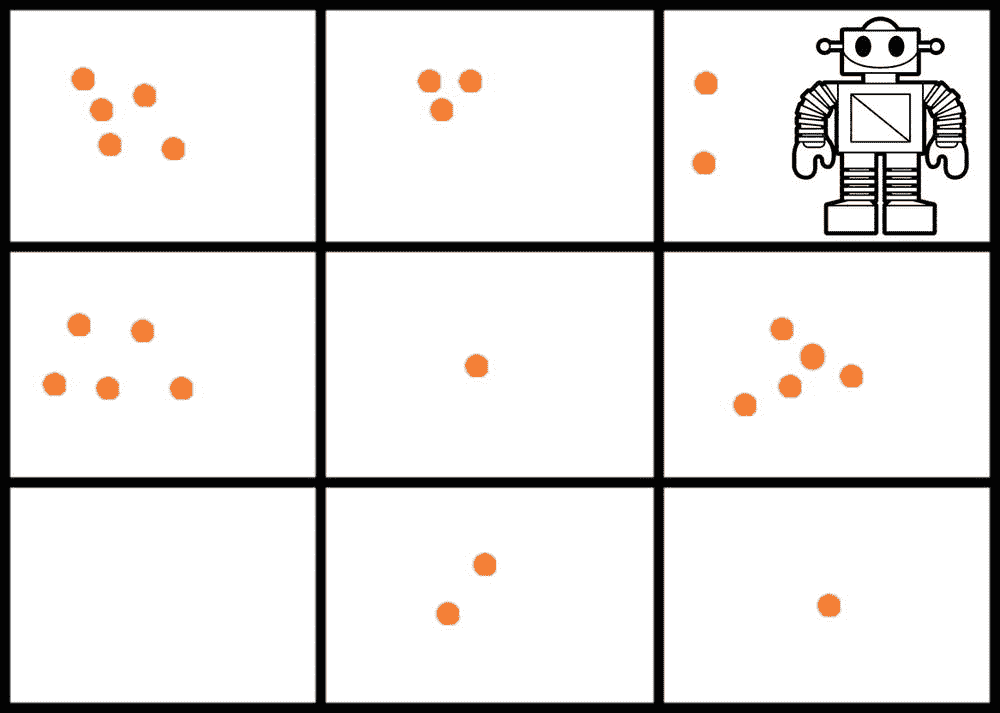
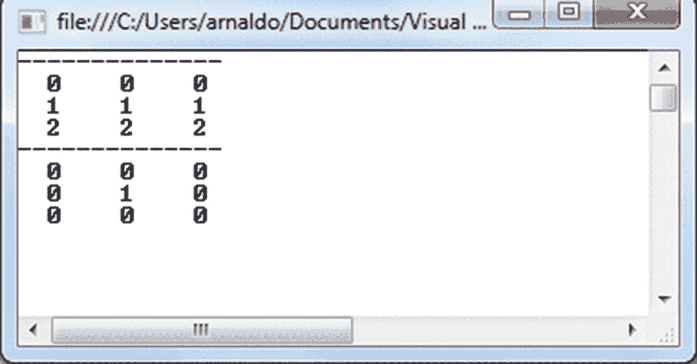

# 2. 自动定理证明与一阶逻辑

延续第一章 1 的思路，本章我们将首先介绍一个与人工智能和逻辑相关的主题：自动定理证明。这是人工智能的一个领域，它服务于数学家的研究，并协助他们证明定理、推论等。在本章中，我们还将用一些篇幅来介绍一阶逻辑，这是一种通过允许或包含量词（全称量词和存在量词）来扩展命题逻辑的逻辑，并提供了一个更完整的框架，以便轻松表示日常生活中可能出现的不同类型的逻辑场景。

同时，我们将通过插入子句和 `C#` 类，并描述一种解决 `SAT`（可满足性）问题的非常重要的方法——`DPLL` 算法，来继续扩展第一章 1 中引入的 `Formula` 层次结构。实践问题将帮助我们更好地理解后续描述的每一个概念。本章最后将介绍一个简单的清洁机器人，它将使用一阶逻辑的一些术语，并展示它们如何应用于现实问题中。

## 自动定理证明

自动定理证明器（`ATP`）是一种计算机程序，它可以生成并检查数学定理，并搜索定理真实性的证明；即其陈述总是为真。定理使用某种数学逻辑（如命题逻辑、一阶逻辑等）来表达。在这种情况下，我们只考虑使用命题逻辑作为其语言的 `ATP`。我们可以将 `ATP` 的工作流程想象为`图 2-1`中所示。



`图 2-1` `ATP` 工作流程图

`ATP` 最初是为数学计算而创建的，但最近由于与之相关的广泛应用潜力，已在科学界引起关注。`ATP` 的众多应用之一是为数学定理数据库增加智能；换句话说，使用自动定理证明器在数学定理数据库中巧妙地查询等价定理。`ATP` 将用于验证数据库中的某个定理在数学上是否与用户输入的另一个定理等价。字符串匹配算法或类似技术对于此类应用来说不够好，因为用户可能以与数据库中存储方式不同的措辞来表达定理，或者所搜索的定理可能是现有定理的逻辑推论，而非直接克隆。

定理证明器和形式化方法的另一个应用可以在硬件和软件设计的验证中找到。硬件验证恰好是一项极其重要的任务。例如，现代微处理器设计中的错误，其商业成本可能非常巨大，因此设计验证至关重要。

软件验证同样至关重要，因为该领域的错误可能代价高昂。此类错误造成灾难性后果的例子包括阿丽亚娜 5 号火箭的毁坏（由简单的整数溢出问题引起，本可通过形式化验证程序检测到）以及奔腾 II 处理器浮点单元中的错误。

`ATP` 的经典应用当然还是其最初创建的目的——作为辅助数学家研究的工具。可以说，`ATP` 是数学家们最喜欢的机器人。

**注意**

一些逻辑比其他的更强大，能够表达和证明更多的定理。命题逻辑通常是其中最弱、最简单的。

定理证明器因证明搜索所需的人工指导量以及可用于表达待证明定理的逻辑语言的复杂程度而异。必须在自动化程度与逻辑语言的复杂程度之间进行权衡。

只有在语言受限的情况下，才能实现高度的自动化。灵活的高阶语言的证明通常需要人工指导，相关的定理证明器被称为证明助手。

这种人工协助可以通过程序员事先给出提示，或在证明过程中通过提示与 `ATP` 进行交互来提供。

最简单的 `ATP` 类型是 `SAT`（可满足性）求解器，它依赖命题逻辑作为定理语言。`SAT` 求解器非常有用，但命题逻辑的表达能力有限，布尔表达式可能会变得相当庞大。此外，`SAT` 问题是第一个被证明为 `NP`（非多项式）完全复杂性的问题（S.A. Cook，《定理证明过程的复杂性》）。目前有大量关于寻找高效 `SAT` 求解启发式方法的研究。

在纯数学中，证明通常是非形式化的；它们通过同行评审来“验证”，旨在令人信服地传达证明如何运作的直观、清晰的概念，并且定理陈述应始终为真。自动定理证明器（`ATP`）提供形式化证明，其输出可以是如`图 1-8`所示的布尔值“是”、“否”（真、假），或者如果发现陈述为假，则可能输出一个反例。

**注意**

使用模型检测方法进行软件和硬件验证与命题逻辑配合良好。在考虑问题的状态机描述后，得到表达式，并以二叉决策树的形式进行处理。

自动定理证明器（`ATP`）通常可以处理两类任务：它们可以检查其逻辑中的定理，或者可以自动生成证明。

在证明检查时，`ATP` 接收一个形式化证明作为输入，该证明由一系列（步骤）公式组成，每个公式要么由一条公理证明，要么由应用于先前公式的推理规则证明：

```
公式                    证明依据
F1                       公理
F2                       规则 X 和 F1
...                       ...
定理
```

这类证明在机械上非常容易检查；我们只需确保每个证明依据有效或应用正确即可。

然而，证明生成要困难得多。我们需要生成一系列公式，每个公式都有有效的证明依据，并保证最后一个公式是要证明的定理。对于简单问题，证明生成非常有用；例如，类型推断（`C#`、`Java`）、Web 应用程序的安全性等。

到目前为止，我们描述了一个 `SAT` 求解器——二叉决策树，它适用于小问题。然而，其规模是指数级的，并且在最坏情况下，为了检查可满足性，我们需要遍历整棵树。因此，在后续章节中，我们将更详细地讨论这个主题，以及如何使用其他方法获得更好的结果。

**注意**

1976 年，肯尼斯·阿佩尔和沃尔夫冈·哈肯使用一个程序证明了四色定理，该程序对数十亿种情况进行了庞大的案例分析。四色定理指出，只需使用四种颜色就可以绘制世界地图，并保证不会有任何两个相邻国家共享同一种颜色。

## 实际问题：C#中的子句和 CNF 类

在本节中，我们将通过添加 `Clause` 和 `Cnf` 类来增强本章一直在开发的逻辑框架。在编写 `DPLL` 算法（可能是确定逻辑公式可满足性的最巧妙算法，也是自动定理证明的基本工具）时，我们将使用这些类。

在开始开发这个新增强功能之前，让我们简要了解一些定义，这些定义将有助于理解我们即将开发的类。

文字要么是一个变量，要么是变量的否定（例如，`p`、`¬p`、`q`、`¬q`）。

子句是文字的析取 `p1 ∨ p2 ∨ ... ∨ pm`，每个 `CNF` 都是一组子句。从现在开始，我们将子句表示为 `{p1, p2, ... pm}`，其中每个 `pi`（`i = 1, 2, ... ,m`）都是一个文字。

在`清单 2-1`中，我们展示了提议的 `Clause` 类。

```csharp
public class Clause
{
    public List<Formula> Literals { get; set; }
    public Clause()
    {
        Literals = new List<Formula>();
    }
    public bool Contains(Formula literal)
    {
        if (!IsLiteral(literal))
            throw new ArgumentException("指定的公式不是文字");
        foreach (var formula in Literals)
        {
            if (LiteralEquals(formula, literal))
                return true;
        }
        return false;
    }
    public Clause RemoveLiteral(Formula literal)
    {
        if (!IsLiteral(literal))
            throw new ArgumentException("指定的公式不是文字");
        var result = new Clause();
        for (var i = 0; i < Literals.Count; i++)
        {
            if (!LiteralEquals(literal, Literals[i]))
                result.Literals.Add(Literals[i]);
        }
        return result;
    }
    public bool LiteralEquals(Formula p, Formula q)
    {
        if (p is Variable && q is Variable)
            return (p as Variable).Name == (q as Variable).Name;
        if (p is Not && q is Not)
            return LiteralEquals((p as Not).P, (q as Not).P);
        return false;
    }
    public bool IsLiteral(Formula p)
    {
        return p is Variable || (p is Not && (p as Not).P is Variable);
    }
}
```

`清单 2-1` `Clause` 类

`Clause` 类包含以下方法：

*   `public bool Contains(Formula literal)`：确定给定的文字是否属于该子句

*   `public Clause RemoveLiteral(Formula literal)`：返回一个不包含作为参数传递的文字的新 `Clause`

*   `public bool LiteralEquals(Formula p, Formula q)`：确定文字 `p`、`q` 是否相等

*   `public bool IsLiteral(Formula p)`：确定给定的公式是否为文字

`Cnf` 类表示合取范式，如`清单 2-2`所示。

## Cnf 类

```csharp
public class Cnf
{
    public List Clauses { get; set; }
    public Cnf()
    {
        Clauses = new List();
    }
    public Cnf(And and)
    {
        Clauses = new List();
        RemoveParenthesis(and);
    }
    public void SimplifyCnf()
    {
        Clauses.RemoveAll(TautologyClauses);
    }
    private bool TautologyClauses(Clause clause)
    {
        for (vari = 0; i others)
        {
            Clauses.AddRange(others);
        }
        private void RemoveParenthesis(And and)
        {
            var currentAnd = and;
            while (true)
            {
                // 如果 P 是 OR 或字面量，且 Q 是 OR 或字面量。
                if ((currentAnd.P is Or || currentAnd.P is Variable || currentAnd.P is Not) &&
                    (currentAnd.Q is Or || currentAnd.Q is Variable || currentAnd.Q is Not))
                {
                    Clauses.Add(new Clause { Literals = new List(currentAnd.P.Literals()) });
                    Clauses.Add(new Clause { Literals = new List(currentAnd.Q.Literals()) });
                    break;
                }
                // 如果 P 是 AND，且 Q 是 OR 或字面量。
                if (currentAnd.P is And && (currentAnd.Q is Or || currentAnd.Q is Variable || currentAnd.Q is Not))
                {
                    Clauses.Add(new Clause { Literals = new List(currentAnd.Q.Literals()) });
                    currentAnd = currentAnd.P as And;
                }
                // 如果 P 是 OR 或字面量，且 Q 是 AND。
                if ((currentAnd.P is Or || currentAnd.P is Variable || currentAnd.P is Not) && currentAnd.Q is And)
                {
                    Clauses.Add(new Clause { Literals = new List(currentAnd.P.Literals()) });
                    currentAnd = currentAnd.Q as And;
                }
                // 如果 P 和 Q 都是 AND。
                if (currentAnd.P is And && currentAnd.Q is And)
                {
                    RemoveParenthesis(currentAnd.P as And);
                    RemoveParenthesis(currentAnd.Q as And);
                    break;
                }
            }
        }
    }
}
```

`Cnf` 类包含以下方法：

*   `public void SimplifyCnf()`：通过删除所有同时包含 `p` 和 `¬p` 的子句来简化公式。由于 `p ∨ ¬p` 始终为真，整个子句变为真，因此无需对其进行分析。
*   `public bool TautologyClauses(Clause clause)`：判断给定子句是否包含 `p` 和 `¬p`。
*   `private bool IsNegation(Not f1, Variable f2)`：判断 `f1` 是否为变量 `f2` 的否定。
*   `private void Join(IEnumerable<Clause> others)`：将 `IEnumerable<Clause>` `others` 连接到 `Cnf` 的子句列表中。
*   `private void RemoveParenthesis(And and)`：将 `Cnf` 转换为子句列表。

`RemoveParenthesis(And and)` 方法负责执行一项非常重要的任务。该方法将我们已有的、由一系列串联的 AND 连接符 `And(p1, And(p2, And( ... ) ))` 组成的 CNF 公式，转换为一个子句列表。

到目前为止，我们一直使用的 `Formula` 层次结构使我们免于为逻辑公式实现解析器，但它在清晰性上付出了一点代价。我们旨在通过执行此方法，将表示 CNF 的 `And` 公式转换为子句列表，来恢复清晰性。这种新的表示形式对于任何我们可能需要开发的、与 CNF 相关的算法都会非常有用；它对于我们将要介绍的 DPLL 算法肯定也会很有帮助。

> **注意**：如果你想为逻辑公式开发一个解析器，可以使用 ANTLR（另一种语言识别工具），这是一个非常有用的工具，可以帮助开发者编写语法和创建解析器。ANTLR 生成并输出 Java 或 C# 类（`.cs` 文件）形式的解析器，使你之后可以将它们包含在项目中并随意使用。

`RemoveParenthesis(And and)` 方法主要由一个包含若干条件的 `while` 循环组成。这些条件可能标志着循环的结束，每个条件都对应一个不同的场景，这些场景在我们考虑参数 `And` 中的公式 `P` 和 `Q` 的类型时可能出现。这些场景如下：

*   `P`、`Q` 是 OR 或字面量。
*   （`P` 是 OR 或字面量）且 `Q` 是 And。
*   `P` 是 And 且（`Q` 是 OR 或字面量）。
*   `P`、`Q` 都是 And。

请注意，在 `RemoveParenthesis(And and)` 的方法体中，存在对 `Literals()` 方法的多次调用。此方法必须被创建并插入到整个 `Formula` 层次结构中，就像我们之前对 `ToNnf()` 和 `ToCnf()` 方法所做的那样。我们从顶层开始，即 `Formula` 抽象类，如清单 2-3 所示。

```csharp
public abstract class Formula
{
    public abstract bool Evaluate();
    public abstract IEnumerable Variables();
    public abstract Formula ToNnf();
    public abstract Formula ToCnf();
    public abstract IEnumerable Literals();
    ...
}
// 清单 2-3
// 向 Formula 抽象类添加 Literals() 抽象方法
```

现在，我们需要在整个层次结构中分布 `Literals()` 方法的具体实现。在清单 2-4 中，我们展示了其余类的具体实现。

```csharp
public abstract class BinaryGate : Formula
{
    ...
    public override IEnumerable Literals()
    {
        return P.Literals().Concat(Q.Literals());
    }
}
public class Not : Formula
{
    ...
    public override IEnumerable Literals()
    {
        return P is Variable ? new List() { this } : P.Literals();
    }
}
public class Variable : Formula
{
    ...
    public override IEnumerable Literals()
    {
        return new List() { this };
    }
}
// 清单 2-4
// 向层次结构中的其余类添加 Literals() 方法
```

到目前为止，我们已经用 C# 构建了一个逻辑框架；现在，是时候研究一个用于判断公式可满足性的最简单、最高效且最巧妙的算法之一了：DPLL 算法。

## DPLL 算法

Davis-Putnam-Logemann-Loveland（DPLL）算法是一种决策过程，它利用回溯搜索来寻找一个能使 CNF（合取范式）公式可满足的赋值。该算法于 1960 年（由 Davis 和 Putnam 提出）和 1962 年（由 Davis、Logemann 和 Loveland 提出）的两篇文章中引入，至今仍是大多数高效 SAT 求解器的基础；它甚至已被扩展用于处理更复杂逻辑（如一阶逻辑）的小片段。

SAT 问题是第一个被证明是 NP 完全的问题；因此，找到解决该问题的有效程序至关重要。此外，该问题在自动定理证明、规划、调度以及人工智能的许多其他领域都有应用，因此多年来一直引起科学界的极大兴趣。

DPLL 接收一个 CNF 公式作为输入，并尝试通过回溯以及应用某些简化和降低当前公式复杂度的规则，来构建一个验证该公式的赋值。可能的赋值集合使用二叉树表示，这与我们在第 1 章中介绍的二叉决策树非常相似。

该算法的伪代码如下所示：

```
DPLL(cnf):
TERMINATION-CONDITIONS(cnf)
cnf' = Rule_OneLiteral(cnf)
cnf'' = Rule_PureLiteral(cnf')
// 将决策树拆分为分支 p 和 ¬p
splitted = Rule_Split(cnf'')
return DPLL(splitted[p]) || DPLL(splitted[¬p])
TERMINATION-CONDITIONS(cnf):
如果 cnf.Clauses 为空:
返回 True
如果 cnf.Clauses 包含 Empty_Clause:
返回 False
```

`DPLL` 构建的树形结构由三个规则塑造：`OneLiteral`、`PureLiteral` 和 `Split`。前两个规则决定了每个节点中包含的公式，而最后一个规则则在树中创建新的分支。让我们逐一审视它们：

*   `OneLiteral`：如果存在一个单元子句（即只包含一个文字 p 的子句），则删除该子句以及所有包含 p 的子句。然后，从 CNF 的每个子句中删除 p 的否定（`¬p`）。如果一个公式是可满足的，那么这个文字必然为 1，因为它决定了其子句的真值。

*   `PureLiteral`：如果存在一个文字 p，且 `¬p` 不属于 CNF 的任何子句，则删除所有包含 p 的子句。在这种情况下，我们可以将 p 赋值为 1，因为它的否定在 CNF 中不存在。

*   `Split`：应用纯文字规则后，我们知道如果存在文字 p，那么它的否定也必然存在。因此，我们选择一个文字 p，并将子句集划分为 `Cp`、`C¬p` 和 `R`。`Cp` 子句集包含所有包含文字 p 的子句。`C¬p` 包含所有包含 `¬p` 的子句，`R` 是不包含 p 或 `¬p` 的子句集。最后，我们得到 `Cp + R` 和 `C¬p + R` 这两个集合，其中 `Cp + R` 是将 `R` 中的每个子句添加到 `Cp` 后得到的集合；`C¬p + R` 是将 `R` 中的每个子句添加到 `C¬p` 后得到的集合。这两个集合将成为我们在 `DPLL` 过程中形成的树的左右分支的新 CNF 根节点。

这些规则的示例可以在以下行中看到；每种情况都给出了一个初始 CNF 公式，然后对其应用每个规则。

```
单文字示例
CNF = {{p, q, ¬r},{p, ¬q}, {¬p}, {r}, {u}}
-应用 OneLiteral 规则，L = ¬p
CNF' = {{p, q, ¬r},{p, ¬q}, {r}, {u}}
-从 Cnf' 的子句中移除 ¬L = p
CNF'' = {{q, ¬r},{¬q}, {r}, {u}}
纯文字示例
CNF = {{p, q},{p, ¬q}, {r, q}, {r, ¬q}}
-应用 PureLiteral 规则，L = p
CNF' = {{r, q}, {r, ¬q}}
拆分示例
CNF = {{p, ¬q, r},{¬p, q}, {¬r, q}, {¬r, ¬q}}
-应用 Split 规则，L = p
CNF' = {{¬q, r}, {¬r, q}, {¬r, ¬q}}
CNF'' = {{q}, {¬r, q}, {¬r, ¬q}}
```

`DPLL` 算法及其所有辅助方法都将包含在 `Cnf` 类中。公共的 `Dpll()` 方法将依赖于一个私有的辅助 `Dpll` 方法，该方法接收一个 `Cnf` 类的副本作为参数，如代码清单 2-5 所示。

```csharp
public bool Dpll()
{
    return Dpll(new Cnf {Clauses = new List(Clauses)});
}
private bool Dpll(Cnf cnf)
{
    // 没有子句的 CNF 被视为 True
    if (cnf.Clauses.Count == 0)
        return true;

    // 规则 One Literal：如果存在一个只包含单个文字的子句
    // 我们将其赋值为 True 并移除所有包含它的子句。
    var cnfAfterOneLit = OneLiteral(cnf);
    if (cnfAfterOneLit.Item2 == 0)
        return true;
    if (cnfAfterOneLit.Item2 < 0)
        return false;
    cnf = cnfAfterOneLit.Item1;

    // 规则 Pure Literal：如果存在一个文字，且其否定不在 Cnf 的任何子句中
    var cnfPureLit = PureLiteralRule(cnf);

    // 规则 Split：在一个文字上进行拆分，创建树的 2 个分支
    var split = Split(cnfPureLit);

    return Dpll(split.Item1) || Dpll(split.Item2);
}
```

从代码清单 2-5 中我们可以看到，`Dpll(Cnf cnf)` 方法与之前展示的 `DPLL` 伪代码非常接近。首先，我们检查当前 `Cnf` 类中是否存在一些子句，然后执行第一个简化规则，即单文字规则。如代码清单 2-6 所示，`OneLiteral(Cnf cnf)` 方法返回一个 `Tuple<Cnf, int>`，其中元组中的结果 `Cnf` 类是在执行简化后得到的，结果整数可以是 -1、0 或 1。如果其值为 0，则 `Cnf` 公式没有更多子句需要检查，因此它必须为真（可满足）；如果其值为 -1，则在 `Cnf` 中发现了一个空子句，它必须为假（不可满足）。最后，在值为 1 的情况下，由于尚未得出关于 `Cnf` 可满足性的决定性结果，程序必须继续执行。

`OneLiteral(Cnf cnf)` 使用的两个辅助方法的描述如下：

*   `NegateLiteral(Formula literal)`：接收一个假定为文字的 `Formula` 作为参数，并返回其否定。在其他情况下返回 null。
*   `UnitClause(Cnf cnf)`：查找一个只包含单个文字的子句，并返回该文字。如果不存在这样的子句，则返回 null。

该规则的代码如代码清单 2-6 所示。

```markdown
# SAT求解算法的简化规则

## OneLiteral规则

```csharp
private Tuple<Cnf, int> OneLiteral(Cnf cnf)
{
    var unitLiteral = UnitClause(cnf);
    if (unitLiteral == null)
        return new Tuple<Cnf, int>(cnf, 1);

    var newCnf = new Cnf();
    while (unitLiteral != null)
    {
        var clausesToRemove = new List<int>();
        int i = 0;

        // 第一轮循环 - 查找包含单元文字的子句，这些子句将不会出现在新的 Cnf 中
        foreach (var clause in cnf.Clauses)
        {
            if (clause.Literals.Any(literal => clause.LiteralEquals(literal, unitLiteral)))
                clausesToRemove.Add(i);
            i++;
        }

        // 移除所有包含单元文字的子句后得到新的 Cnf
        newCnf = new Cnf();

        // 第二轮循环 - 保留不包含单元文字的子句
        for (var j = 0; j < cnf.Clauses.Count; j++)
        {
            if (!clausesToRemove.Contains(j))
                newCnf.Clauses.Add(cnf.Clauses[j]);
        }

        if (newCnf.Clauses.Count == 0)
            return new Tuple<Cnf, int>(newCnf, 0);

        // 从剩余子句中移除单元文字的否定形式
        var unitNegated = NegateLiteral(unitLiteral);
        var clausesNoLitNeg = new List<Clause>();

        foreach (var clause in newCnf.Clauses)
        {
            var newClause = new Clause();

            // 保留除单元文字否定形式之外的所有文字
            foreach (var literal in clause.Literals)
            {
                if (!clause.LiteralEquals(literal, unitNegated))
                    newClause.Literals.Add(literal);
            }
            clausesNoLitNeg.Add(newClause);
        }
        newCnf.Clauses = new List<Clause>(clausesNoLitNeg);

        // 为下一阶段重置变量
        cnf = newCnf;
        unitLiteral = UnitClause(cnf);

        // 发现空子句
        if (cnf.Clauses.Any(c => c.Literals.Count == 0))
            return new Tuple<Cnf, int>(newCnf, -1);
    }

    return new Tuple<Cnf, int>(newCnf, 1);
}

public Formula NegateLiteral(Formula literal)
{
    if (literal is Variable)
        return new Not(literal);
    if (literal is Not)
        return (literal as Not).P;
    return null;
}

private Formula UnitClause(Cnf cnf)
{
    foreach (var clause in cnf.Clauses)
    {
        if (clause.Literals.Count == 1)
            return clause.Literals.First();
    }
    return null;
}
```

**代码清单 2-6** OneLiteral() 规则及其辅助方法

`OneLiteral` 方法包含一个 `while` 循环，该循环在以下两种情况下结束：当前 `Cnf` 类中不再存在仅含单个文字的子句，或者达到终止条件（`Cnf` 中无子句或发现空子句）。在此 `while` 循环内部，第一个循环用于存储每个子句中单元子句的位置（包括当前单元文字）。第二个循环通过跳过第一个循环中存储了位置的子句，构建一个新的 `Cnf` 类。`while` 循环内的第三个也是最后一个循环，其作用与前两个循环类似，但在此情况下，它确保在执行完前两个循环后得到的新 `Cnf` 中，每个子句都移除了单元文字的否定形式。

## PureLiteral规则

在代码清单 2-7 中，我们可以看到纯文字规则的代码，该规则通常在单文字规则之后应用。

```csharp
private Cnf PureLiteralRule(Cnf cnf)
{
    var pureLiterals = PureLiterals(cnf);
    if (pureLiterals.Count() == 0)
        return cnf;

    var newCnf = new Cnf();
    var clausesRemoved = new SortedSet<int>();

    // 检查哪些子句包含纯文字
    foreach (var pureLiteral in pureLiterals)
    {
        for (var i = 0; i < cnf.Clauses.Count; i++)
        {
            if (cnf.Clauses[i].Contains(pureLiteral))
                clausesRemoved.Add(i);
        }
    }

    // 构建新的 Cnf
    newCnf = new Cnf();
    for (var i = 0; i < cnf.Clauses.Count; i++)
    {
        if (!clausesRemoved.Contains(i))
        {
            var newClause = new Clause();
            foreach (var literal in cnf.Clauses[i].Literals)
            {
                if (!pureLiterals.Contains(literal))
                    newClause.Literals.Add(literal);
            }
            if (newClause.Literals.Count > 0)
                newCnf.Clauses.Add(newClause);
        }
    }

    return newCnf;
}

private IEnumerable<Formula> PureLiterals(Cnf cnf)
{
    var result = new List<Formula>();
    foreach (var clause in cnf.Clauses)
    {
        foreach (var literal in clause.Literals)
        {
            if (PureLiteral(cnf, literal))
                result.Add(literal);
        }
    }
    return result;
}

private bool PureLiteral(Cnf cnf, Formula literal)
{
    var negation = NegateLiteral(literal);
    foreach (var clause in cnf.Clauses)
    {
        foreach (var l in clause.Literals)
        {
            if (clause.LiteralEquals(l, negation))
                return false;
        }
    }
    return true;
}
```

**代码清单 2-7** PureLiteral() 规则及其辅助方法

`PureLiteralRule` 方法负责对单文字规则返回的新 `Cnf` 类执行纯文字规则。它依赖于以下辅助方法：

*   `PureLiterals(Cnf cnf)`：返回在 `Cnf` 类中找到的纯文字列表。
*   `PureLiteral(Cnf cnf, Formula literal)`：判断给定文字是否为纯文字；即，如果其否定形式存在于 `Cnf` 类中，则返回 false；否则返回 true。

`PureLiteralRule()` 方法会找出 `Cnf` 类中的所有纯文字，并将其从 `CNF 公式` 的每个子句中移除；然后返回一个包含结果子句的新 `Cnf`。

## Split规则

最后，`Split()` 方法如代码清单 2-8 所示。

```csharp
private Tuple<Cnf, Cnf> Split(Cnf cnf)
{
    var literal = Heuristics.ChooseLiteral(cnf);
    var tuple = SplittingOnLiteral(cnf, literal);
    return new Tuple<Cnf, Cnf>(RemoveLiteral(tuple.Item1, literal), RemoveLiteral(tuple.Item2, NegateLiteral(literal)));
}

private Cnf RemoveLiteral(Cnf cnf, Formula literal)
{
    var result = new Cnf();
    foreach (var clause in cnf.Clauses)
    {
        result.Clauses.Add(clause.RemoveLiteral(literal));
    }
    return result;
}

private Tuple<Cnf, Cnf> SplittingOnLiteral(Cnf cnf, Formula literal)
{
    // 包含该文字的子句列表
    var @in = new List<Clause>();
    // 包含 Not(literal) 的子句列表
    var inNegated = new List<Clause>();
    // 既不包含该文字也不包含 Not(literal) 的子句列表
    var @out = new List<Clause>();
    var negated = NegateLiteral(literal);

    foreach (var clause in cnf.Clauses)
    {
        if (clause.Contains(literal))
            @in.Add(clause);
        else if (clause.Contains(negated))
            inNegated.Add(clause);
        else
            @out.Add(clause);
    }

    var inCnf = new Cnf { Clauses = @in };
    var outCnf = new Cnf { Clauses = inNegated };
    inCnf.Join(@out);
    outCnf.Join(@out);

    return new Tuple<Cnf, Cnf>(inCnf, outCnf);
}
```

**代码清单 2-8** Split() 规则及其辅助方法

该方法使用了以下辅助方法：

*   `RemoveLiteral(Cnf cnf, Formula literal)`：返回一个新的 `Cnf` 类，其中每个子句都不包含作为参数传入的文字。
```

# SplittingOnLiteral 函数与分裂策略

`SplittingOnLiteral(Cnf cnf, Formula literal)`：根据前面描述的分裂规则，返回一个包含两个 CNF 的元组。

在 `Split()` 方法中，我们调用了名为 `Heuristics` 的类中的一个静态方法 `ChooseLiteral()`；该方法从 CNF 公式中输出第一个文字，并将其作为分支文字。

启发式方法和元启发式方法是我们在第 7 章中将要深入分析的主题。目前，我们可以将启发式方法视为一种基于经验的过程，它有助于将人类的经验性知识附加到解决特定问题的过程中。

## `注意`

在 `SplittingOnLiteral()` 方法中，我们声明了变量 `@in`、`inNegated` 和 `@out`，其目的分别是存储包含用于分裂或分支的文字、其否定形式以及其他任何子句。我们使用 `@` 前缀是因为 `in` 和 `out` 是 C# 中的关键字。

在 DPLL 算法中，为了正确选择用于分支的文字（即用于分裂当前节点并创建树的新分支的文字），树的构建对于效率至关重要。我们暂且满足于当前这种简单的分支方法，在本书后续部分，我们将深入探讨更好的选择和分支方法。

# 实践问题：在命题逻辑中建模鸽巢原理

鸽巢原理，也称为狄利克雷抽屉原理，是数学中一个简单但基础的概念。它由德国数学家[彼得·古斯塔夫·勒热纳·狄利克雷](https://es.wikipedia.org/wiki/Peter_Gustav_Lejeune_Dirichlet)于 19 世纪提出，这位科学家定义了我们现在所知的函数概念——这是他众多领域贡献之一。

该原理指出，如果你有 `n` 个鸽巢和 `m` 只鸽子，且 `m > n`（鸽子数量 > 鸽巢数量），那么至少有一个鸽巢包含两只鸽子。

为了在命题逻辑中表述该原理，我们考虑变量 `p_ij`，它表示鸽子 `i` 被映射到鸽巢 `j`。我们将尝试创建一个 CNF 公式来建模此问题，然后判断其可满足性。

以下约束条件将决定最终 CNF 公式的子句。

*   `p_i1 ∨ p_i2 ∨ ... ∨ p_in`，对于每个 `i <= m`
*   `¬p_ik ∨ ¬p_jk`，对于每个 `i, j <= m` 且 `k <= n`，`i ≠ j`

第一条规则保证每个子句（鸽巢）至少包含一只鸽子。第二条规则或约束适用于每一对不同变量，并保证没有两只鸽子在同一个鸽巢中。在接下来的实践问题中，我们将看到一个如何在程序中测试鸽巢原理的示例。

# 实践问题：判断命题逻辑公式是否可满足

在这个实践问题中，我们将使用之前描述的层次结构和 DPLL 算法来判断给定的命题逻辑公式是否可满足。为了更好地可视化结果，我们将在 `Variable` 类中实现一个 `Name` 属性，并在 `Not`、`And`、`Or`、`Variable` 和 `Cnf` 类中重写 `ToString()` 方法（列表 2-9）。

```csharp
public class Variable : Formula
{
    public bool Value { get; set; }
    public string Name { get; set; }
    ...
    public override string ToString()
    {
        return Name;
    }
}
public class Not : Formula
{
    ...
    public override string ToString()
    {
        return "!" + p;
    }
}
public class Or : BinaryGate
{
    ...
    public override string ToString()
    {
        return  "(" + P + " | " + Q + ")";
    }
}
public class And : BinaryGate
{
    ...
    public override string ToString()
    {
        return  "(" + P + " & " + Q + ")";
    }
}
public class Cnf : BinaryGate
{
    ...
    public override string ToString()
    {
        if (Clauses.Count > 0)
        {
            var result = "";
            foreach (var clausule in Clauses)
            {
                var c = "";
                foreach (var literal in clausule.Literals)
                    c += literal + ",";
                result += "(" + c + ")";
            }
            return result;
        }
        return "Empty CNF";
    }
}
```
列表 2-9
为 `Variable` 类添加 `Name` 属性，并为 `Variable`、`Not`、`And`、`Or` 和 `Cnf` 类重写 `ToString()` 方法

让我们首先尝试将以下公式输入到我们的程序中：

```
(p ∨ q) ∧ (p ∨ ¬q) ∧ (¬p ∨ q) ∧ (¬p ∨ ¬r)
```

我们将使用 `And`、`Or`、`Variable` 和 `Not` 类来创建此公式，如列表 2-10 所示。

```csharp
var p = new Variable(true) { Name = "p" };
var q = new Variable(true) { Name = "q" };
var r = new Variable(true) { Name = "r" };
var f1 = new And(new Or(p, q), new Or(p, new Not(q)));
var f2 = new And(new Or(new Not(p), q), new Or(new Not(p), new Not(r)));
var formula = new And(f1, f2);
var nnf = formula.ToNnf();
Console.WriteLine("NNF: " + nnf);
nnf = nnf.ToCnf();
var cnf = new Cnf(nnf as And);
cnf.SimplifyCnf();
Console.WriteLine("CNF: " + cnf);
Console.WriteLine("SAT: " + cnf.Dpll());
```
列表 2-10
创建公式 `(p ∨ q) ∧ (p ∨ ¬q) ∧ (¬p ∨ q) ∧ (¬p ∨ ¬r)` 并使用 DPLL 算法判断其是否可满足

执行此代码后获得的结果如图 2-2 所示。


图 2-2
执行前一个代码后的结果

现在，让我们尝试一个不同的公式（列表 2-11；图 2-3）：

```
(p ∨ q ∨ ¬r) ∨ (p ∨ q ∨ r) ∧ (p ∨ ¬q) ∧ ¬p
```


图 2-3
对前一个公式执行 DPLL 算法后的结果

```csharp
var f1 = new Or(p, new Or(q, new Not(r)));
var f2 = new Or(p, new Or(q, r));
var f3 = new Or(p, new Not(q));
var formula = new And(f1, new And(f2, new And(f3, new Not(p))));
```
列表 2-11
创建公式 `(p ∨ q ∨ ¬r) ∨ (p ∨ q ∨ r) ∨ (p ∨ ¬q) ∨ ¬p` 并使用 DPLL 算法判断其是否可满足

我们将使用最后一个公式来测试本章介绍的算法和 `Formula` 层次结构（列表 2-12；图 2-4）。

```
(p ˅ q ˅ r) ˄ (p ˅ q ˅ ¬r) ˄ (p ˅ ¬q ˅ r) ˄ (p ˅ ¬q ˅ ¬r) ˄ (¬p ˅ q ˅ r) ˄ (¬p ˅ q ˅ ¬r) ˄ (¬p ˅ ¬q ˅ r)
```


图 2-4
对前一个公式执行 DPLL 算法后的结果

var f1 = new Or(p, new Or(q, r));
var f2 = new Or(p, new Or(q, new Not(r)));
var f3 = new Or(p, new Or(new Not(q), r));
var f4 = new Or(p, new Or(new Not(q), new Not(r)));
var f5 = new Or(new Not(p), new Or(q, r));
var f6 = new Or(new Not(p), new Or(q, new Not(r)));
var f7 = new Or(new Not(p), new Or(new Not(q), r));
var formula = new And(f1, new And(f2, new And(f3, new And(f4, new And(f5, new And(f6, f7))))));
```

列表 2-12
创建公式 (p ˅ q ˅ r) ˄ (p ˅ q ˅ ¬r) ˄ (p ˅ ¬q ˅ r) ˄ (p ˅ ¬q ˅ ¬r) ˄ (¬p ˅ q ˅ r) ˄ (¬p ˅ q ˅ ¬r) ˄ (¬p ˅ ¬q ˅ r) 并使用 DPLL 算法判断其是否可满足

现在回顾鸽巢原理（在最后一个实践问题中描述），让我们考虑 m = 3, n = 2 的情况。这种情况将在我们的程序中编码，如列表 2-13 所示。

```
// 鸽巢原理 m = 3, n = 2
var p11 = new Variable(true) { Name = "p11" };
var p12 = new Variable(true) { Name = "p12" };
var p21 = new Variable(true) { Name = "p21" };
var p22 = new Variable(true) { Name = "p22" };
var p31 = new Variable(true) { Name = "p31" };
var p32 = new Variable(true) { Name = "p32" };
var f1 = new Or(p11, p12);
var f2 = new Or(p21, p22);
var f3 = new Or(p31, p32);
var f4 = new Or(new Not(p11), new Not(p21));
var f5 = new Or(new Not(p11),  new Not(p31));
var f6 = new Or(new Not(p21), new Not(p31));
var f7 = new Or(new Not(p12), new Not(p22));
var f8 = new Or(new Not(p12), new Not(p32));
var f9 = new Or(new Not(p22), new Not(p32));
var formula = new And(f1, new And(f2, new And(f3, new And(f4, new And(f5, new And(f6, new And(f7, new And(f8, f9))))))));
```

列表 2-13
在我们的程序中为 m = 3, n = 2 的情况建模的鸽巢原理；即 m 只鸽子，n 个鸽巢

正如预期，这种情况的结果为 False，因为我们无法让每个鸽巢只容纳一只鸽子。

在最后几节中，我们一直在研究命题逻辑及其相关的一些算法和方法。我们还分析了逻辑与人工智能之间的关系，描述了 ATP 的含义及其一些用途和优势。让我们记住，ATP 是一个试图自动化数学家工作的领域，而 SAT 求解器是该领域中非常有用的工具。在接下来的章节中，我们将开始研究一种比命题逻辑更复杂的逻辑——一阶逻辑，它是命题逻辑的扩展，并且我们将初步了解它相对于更简单的命题逻辑所提供的一些优势。

## 一阶逻辑

我们迄今为止所研究的命题由主语（对象或个体）和谓语组成。给定一组对象或主体，在这些对象之间定义的关系和属性被称为谓词。谓词的示例如下：

1.  x > x   
2.  5 + y - x = 1   
3.  x > 2

在考虑了前面的示例后，我们可能会问自己，命题和谓词之间的区别是什么？在最新的谓词示例中，我们有常量（1, 2, 5）、关系（>, =）和函数（+, -），它们都有固定的解释，但数值变量（x, y）的情况并非如此。这些变量在其可能取的值方面引入的不确定性，导致该表达式在逻辑上不被视为命题。根据变量 x、y 可能取的值，前面的表达式可能变为真或假——因此，成为命题。

在逻辑学中，表达式 1、2、3 被称为 n 元谓词；即，一个具有 n 个变量的谓词。考虑示例 1、2 和 3，我们可以说第一个表达式是一元谓词，第二个是二元谓词。属性是一元谓词，一种与主体本身的特定关系；因此，它被视为谓词的一个特例。

注意
谓词表示主体、对象和个体之间的关系。它们缺乏真值；即，它们不像命题那样具有真或假的值。

一阶逻辑（FOL）通过允许在逻辑语句中对对象进行某些形式的推理，扩展了命题逻辑。在命题逻辑中，我们有代表可能为真或假的事实或陈述的变量，例如“第二次世界大战于 1952 年结束”或“《星球大战》由乔治·卢卡斯执导”，但你不能有代表汽车、铅笔或温度等事物的变量。在 FOL 中，变量指的是世界上的事物，如铅笔或温度，我们可以对它们进行量化，从而允许我们在一个句子中表达在命题逻辑中可能需要多个句子才能表达的内容。

总的来说，我们需要 FOL 的一些原因如下：

*   我们需要一种方式来表达一个个体或主体具有某种属性，或者某些个体以特定方式相关联（例如，佐菲亚是单身，或者她嫁给了阿尔伯特，或者约翰尼是本杰明的狗）。
*   我们需要一种方式来表达所有（某种类型的）主体都具有某种属性（例如，所有的鸟都有翅膀，或者存在一个身高超过 7 英尺的男人）。
*   我们需要一种方式来指代由其他实体功能性地确定的实体（例如，一个人的身高；一个物体的重量；两个数的和）。

命题逻辑提供的简化表示使得建模我们日常生活中通常出现的许多问题变得非常复杂。因此，我们必须依赖像 FOL 这样更复杂的逻辑。前面描述的原因催生了 FOL 的语法。其语法允许我们（使用形式语言）形成类似于英语句子的公式，例如 `IsDog(“Johnny”)`（约翰尼是狗吗？）、`Misses(“Katty”, “John”)`（凯蒂想念约翰）或 `∀x (IsDog(x) => ¬CanFly(x))`（对于所有对象 x，如果 x 是狗，那么 x 不能飞）。

FOL 的组成部分包括命题逻辑的连接词；项，可以是常量（a, b, John, Lucas 等）、变量（x, y 等）或应用于其他项的函数（F, G, H 等）；命题常量（True, False）；谓词（IsDog, CanFly 等），表示单个对象的属性或两个或多个对象之间的关系；以及量词（‘对于所有...’ 记作 ∀，‘存在...’ 记作 ∃，‘存在唯一...’ 记作 ∃!）。FOL 中的重大新特性无疑是量词运算符的出现。

一个公式可以是一个应用于一个或多个项的谓词，两个项的相等性（即 t1 = t2；∀(v)F'(v), ∃(v)F'(v)，如果 v 是一个变量且 F' 是一个公式），或者任何源自将命题逻辑的逻辑连接词应用于其他公式的结果。

下面我们更详细地描述一下 FOL 的语法：

```
constant ::= a | A | b | B | c | C | John | Block1 | Block2 | ...
variable ::= x | y | z | x1| x2 | block1 | ...
function::= f | g | h | weight | sum | mother-of | ...
term ::= constant | variable | function (term , ..., term)
predicate::= A | B | C |IsDog| Loves |IsBrother ...
binary connective ::=˄ | ˅ | => | 
formula ::= predicate (term , ..., term) | (term = term) | ¬formula | ((formula) binary connective (formula)) | ∀(variable) formula | ∃(variable) formula
```

在命题逻辑中，我们将公式解释为对其命题变量赋予真值。在 FOL 中，谓词和量词的引入使得公式的求值取决于在某个域（整数、实数、汽车、铅笔……任何我们能想到的东西）或对象宇宙中给出的解释；在这种情况下，解释的概念稍微复杂一些。

注意
一个公式的解释是一个对 (D, A)，其中 D 是域，A 是对每个常量、函数、谓词等的赋值。

为了定义公式 I 在域或对象集 D 中的解释，我们必须考虑以下解释规则：

# 一阶逻辑的解释与求值

## 常量、谓词和函数在域中的解释

1.  如果 `c` 是一个常量，那么 `c` 具有域 `D`。这种映射指示了名称（常量基本上是名称）如何与宇宙中的对象连接。我们可能有一个常量 Johnny，而 Johnny 在狗的世界中的解释可能是一只特定的狗。

2.  如果 `P` 是一个谓词，那么 `P` 具有域 `D x D x ... x D`；即，存在一个从谓词到 `D` 中关系的映射。

3.  如果 `f` 是一个函数，那么 `f` 具有域 `D`，其像也在 `D` 中；即，存在一个从函数到 `D` 中函数的映射。

## 求值规则

给定公式 `F` 在域 `D` 下的解释 `I`，`I` 遵循以下求值规则：

1.  如果 `P(v1, v2, ... , vn)` 是一个谓词，那么如果 `(v1, v2, ... , vn)` 是 `D` 中的一个关系，则 `P` 为真；即，`(v1, v2, ... , vn) ∈ D x D x ... x D`。回想一下，n 元关系是一组 n 元组。

2.  如果 `F`, `F'` 是 FOL 的公式，那么 `F ∧ F'`, `F ∨ F'`, `F => F'`, `F <=> F'`, `¬F` 在域 `D` 中具有与在命题逻辑中使用相同运算符时相同的真值；即，这些运算符在两种逻辑中具有相同的真值表。

3.  如果对于 `D` 中 `v` 的所有值，`F(v)` 都为真，则公式 `∀(v)F(v)` 为真。

4.  如果对于 `D` 中 `v` 的至少一个值，`F(v)` 为真，则公式 `∃(v)F(v)` 为真。

## 示例：解释与求值

让我们检查一个示例，该示例将阐明解释和求值在 FOL 中如何工作；考虑以下公式在域 `D` 下的解释 `I`：

```
∃(x)IsFriend(x, Arnaldo)∧∃(y)IsWorkingWith(y, Arnaldo)
D = {John, Arnaldo, Mark, Louis, Duke, Sting, Jordan, Miles, Lucas, Thomas, Chuck, Floyd, Hemingway}
Constants = {Arnaldo}
Predicates = {IsFriend, IsWorkingWith}
I(Arnaldo) = Arnaldo
I(IsFriend) = {(John, Arnaldo), (Mark, Louis), (Duke, Sting), (Jordan, Miles)}
I(IsWorkingWith) = {(Lucas, Arnaldo), (Thomas, Chuck), (Floyd, Hemingway)}
```

为了确定上述解释的真值，我们有

```
∃(x)IsFriend(x, Arnaldo)
```

对于 `x = John` 为真，因为元组或关系 `(John, Arnaldo)` 属于 `IsFriend`；因此，`∃(x)IsFriend(x, Arnaldo)` 也为真。

```
∃(y)IsWorkingWith(y, Arnaldo)
```

对于 `y = Lucas` 为真，因为元组或关系 `(Lucas, Arnaldo)` 属于 `IsWorkingWith`；因此，`∃(y)IsWorkingWith(y, Arnaldo)` 也为真。

由于 `∃(x)IsFriend(x, Arnaldo)` 和 `∃(y)IsWorkingWith(y, Arnaldo)` 都为真，它们的合取也为真，因此该解释也为真。

## C# 中的谓词

既然我们正在探索一阶逻辑的世界及其最显著的组成部分（谓词、量词等），那么值得一提的是，在 C# 中我们可以使用 `Predicate<T>` 委托，这是一种允许我们测试类型 `T` 的对象是否满足给定条件的构造。例如，我们可以像下面这样定义 `Dog` 类（列表 2-14）。

```csharp
public class Dog
{
    public string Name { get; set; }
    public double Weight { get; set; }
    public Gender Sex { get; set; }
    public Dog(string name, double weight, Gender sex)
    {
        Name = name;
        Weight = weight;
        Sex = sex;
    }
}
public enum Gender {
    Male, Female
}
// 列表 2-14
// Dog 类
```

然后，我们可以使用谓词来过滤并获取满足特定属性的对象，如列表 2-15 所示，我们创建了一个狗列表，然后使用 `Find()` 方法（该方法需要一个谓词作为参数）来“查找”所有满足给定谓词的对象（狗）。

```csharp
var johnny = new Dog("Johnny", 17.5, Gender.Male);
var jack = new Dog("Jack", 23.5, Gender.Male);
var jordan = new Dog("Jack", 21.2, Gender.Male);
var melissa = new Dog("Melissa", 19.7, Gender.Female);
var dogs = new List<Dog> { johnny, jack, jordan, melissa };
Predicate<Dog> maleFinder = (Dog d) => { return d.Sex == Gender.Male; };
Predicate<Dog> heavyDogsFinder = (Dog d) => { return d.Weight >= 22; };
var maleDogs = dogs.Find(maleFinder);
var heavyDogs = dogs.Find(heavyDogsFinder);
// 列表 2-15
// 在 C# 中使用谓词来过滤并获取对象（本例中为狗），这些对象是雄性且体重超过 22 磅的狗
```

至此，我们已经进入了命题逻辑和一阶逻辑的世界。在下一节中，我们将介绍一个实际问题，在其中看到一阶逻辑的实际应用。

## 实际问题：清洁机器人

在本节中，我们将看到前面描述的许多概念（函数、谓词等）如何应用于创建清洁机器人，其世界如图 2-5 所示。



图 2-5

网格中的清洁机器人。污垢用橙色球标记，并在网格上逻辑地表示为整数。按照这个思路，左上角的单元格（第一个）的值为 5。

这个清洁机器人试图清除一个 `n x m`（`n` 行，`m` 列）网格中的污垢。网格中的每个单元格都是一个整数 `d`，其中 `d` 表示该单元格中的污垢数量。当 `d = 0` 时，该单元格被认为是干净的。

机器人将具有以下特性：

*   它一次移动一步，有四个可能的方向（左、上、右、下）。

*   在完全清洁一个单元格之前，它不会离开，并且它一次只清理一个单位的污垢；也就是说，如果在一个脏单元格上，它将一次清理一个单位的污垢（留下 -1 的污垢），然后继续到下一个决策阶段。

*   当所有地方都干净或者其任务超过给定的时间（以毫秒为单位）时，它会停止。

我们的清洁机器人将依赖以下谓词和函数：

*   `IsDirty()` 是一个谓词，用于确定机器人所在的单元格是否脏。

*   `IsTerrainClean()` 是一个谓词，用于确定地形上的每个单元格是否都干净。

*   `MoveAvailable(int x, int y)` 是一个谓词，用于确定移动到地形上的 `(x, y)` 是否合法。

*   `SelectMove()` 是一个函数，用于随机选择一个移动方向。

*   `Clean()` 是一个函数，用于从当前单元格（即机器人当前所在的单元格）清理一个单位的污垢（-1）。

*   `Move(Direction m)` 是一个函数，用于将机器人向方向 `m` 移动。

*   `Print()` 是一个函数，用于打印地形。

*   `Start(int milliseconds)` 是一个函数，用于命令机器人开始清理。此方法的代码与前面解释的机器人行为相匹配。整数参数 `milliseconds` 表示机器人将进行清理的最长时间，以毫秒为单位。

该机器人被编码在一个 `CleaningRobot` C# 类中，如列表 2-16 所示。

## 清洁机器人类实现与示例

```
public class CleaningRobot
{
    private readonly int[,] _terrain;
    private static Stopwatch _stopwatch;
    public int X { get; set; }
    public int Y { get; set; }
    private static Random _random;

    public CleaningRobot(int [,] terrain, int x, int y)
    {
        X = x;
        Y = y;
        _terrain = new int[terrain.GetLength(0), terrain.GetLength(1)];
        Array.Copy(terrain, _terrain, terrain.GetLength(0) * terrain.GetLength(1));
        _stopwatch = new Stopwatch();
        _random = new Random();
    }

    public void Start(int milliseconds)
    {
        _stopwatch.Start();
        do
        {
            if (IsDirty())
                Clean();
            else
                Move(SelectMove());
        } while (!IsTerrainClean() && !(_stopwatch.ElapsedMilliseconds > milliseconds));
    }

    // 函数
    private Direction SelectMove()
    {
        var list = new List { Direction.Down, Direction.Up, Direction.Right, Direction.Left };
        return list[_random.Next(0, list.Count)];
    }

    // 函数
    public void Clean()
    {
        _terrain[X, Y] -= 1;
    }

    // 谓词
    public bool IsDirty()
    {
        return _terrain[X, Y] > 0;
    }

    // 函数
    private void Move(Direction m)
    {
        switch (m)
        {
            case Direction.Up:
                if (MoveAvailable(X - 1, Y))
                    X -= 1;
                break;
            case Direction.Down:
                if (MoveAvailable(X + 1, Y))
                    X += 1;
                break;
            case Direction.Left:
                if (MoveAvailable(X, Y - 1))
                    Y -= 1;
                break;
            case Direction.Right:
                if (MoveAvailable(X, Y + 1))
                    Y += 1;
                break;
        }
    }

    // 谓词
    public bool MoveAvailable(int x, int y)
    {
        return x >= 0 && y >= 0 && x < _terrain.GetLength(0) && y < _terrain.GetLength(1);
    }

    public bool IsTerrainClean()
    {
        for (int i = 0; i < _terrain.GetLength(0); i++)
            for (int j = 0; j < _terrain.GetLength(1); j++)
                if (_terrain[i, j] > 0)
                    return false;
        return true;
    }

    public void Print()
    {
        var col = _terrain.GetLength(1);
        var i = 0;
        var line = "";
        Console.WriteLine("--------------");
        foreach (var c in _terrain)
        {
            line += string.Format("  {0}  ", c);
            i++;
            if (col == i)
            {
                Console.WriteLine(line);
                line = "";
                i = 0;
            }
        }
    }
}

public enum Direction
{
    Up, Down, Left, Right
}
```

列表 2-16
CleaningRobot 类

该类的构造函数接收地形和两个整数 `x`、`y` 作为参数，这两个整数表示机器人在地形上的初始位置。

`print()` 方法是为了测试目的而包含的。假设我们有以下代码所示的地形，然后执行机器人，即调用其 `Start()` 方法，如列表 2-17 所示。

```
var terrain = new [,]
{
    {0, 0, 0},
    {1, 1, 1},
    {2, 2, 2}
};
var cleaningRobot = new CleaningRobot(terrain, 0, 0);
cleaningRobot.Print();
cleaningRobot.Start(50000);
cleaningRobot.Print();
```

列表 2-17
启动清洁机器人

地形在第二行（每列 1 个）和第三行（每列 2 个）包含污垢，在机器人根据之前陈述的终止条件之一（所有地方都干净或时间到）完成任务后，我们得到如图 2-6 所示的结果。



图 2-6

机器人清洁前后的地形

与之前开发 DPLL 算法时的情况一样，我们需要一个启发式方法来选择智能体的下一步移动。我们将在第 7 章中深入探讨启发式和元启发式领域。

这个清洁机器人是一个非常简单、朴素的智能体；关于人工智能中智能体的主题将在下一章中讨论。目前，我们已经为开始深入研究人工智能中更复杂和有趣的课题与分支奠定了必要的基础。无论如何，未来要研究的主题都将与逻辑相关，因为逻辑是许多科学和知识领域的基础。

## 总结

在最后两章中，我们分析了人工智能与逻辑之间的关系。我们介绍了两种基本逻辑类型：命题逻辑和一阶逻辑。我们研究了多种代码，这些代码包含一个用于表示公式（变量、逻辑连接词等）的层次结构，并通过不同的方法对该层次结构进行了补充。在这些方法中，我们介绍了否定范式转换算法、合取范式转换算法（依赖于之前介绍的分配律），以及 DPLL 算法，这是一种用于判定公式可满足性的经典算法。此外，我们还描述了一种用于表示公式及其可能求值的二叉决策树，以及一个实际问题，其中一种简单的、朴素的清洁机器人使用一阶逻辑概念来构建其简单的智能。

在下一章中，我们将开始解释智能体以及围绕它们的许多概念（主动的、反应式的），这些概念我们可能之前从电子游戏爱好者、人工智能爱好者、朋友或同事那里听说过。