# 3. 智能体

在本章中，我们将开始描述人工智能世界中一个非常重要的研究领域：智能体。如今，智能体代表了计算机科学和人工智能许多子领域强烈关注的领域。它们被广泛应用于大量应用程序中，从相对较小的系统（如电子邮件过滤器）到复杂庞大的系统（如空中交通管制）。

在接下来的篇幅中，我们将把智能体视为基本的人工智能实体；我们将首先了解一个可能的智能体定义（因为关于这个概念并没有全球共识）。我们将研究不同的智能体属性和架构，并分析一个实际问题，这将帮助我们理解如何用 C# 开发智能体。本章及下一章中探讨的实际问题将为本章提出的概念奠定坚实的基础，其中许多问题将与人工智能的经典问题相关联。

我们将赋予许多我们今天经常从电子游戏玩家、人工智能爱好者或与人工智能相关的程序员那里听到的词语以意义和定义——例如反应式、主动式、感知、行动、意图或深思熟虑。我们可能知道的智能体典型例子包括机器人（如上一章的清洁机器人）、基于网络的购物程序、交通控制系统、软件守护进程等。

> **注意**
>
> 智能体通俗地被称为机器人（bots），这个词源于 robot（机器人）。它们可能使用类似于我们在科幻电影中看到的金属身体，或者仅仅由安装在我们手机上的计算机软件组成，比如 Siri。它们可能拥有人类的能力，如语言和语音识别，并且能够自主行动。

## 什么是智能体？

如前所述，关于“智能体”这个术语的全球概念并没有达成共识。让我们回想一下，逻辑概念也发生过同样的情况（回想一下我们在第 2 章中分析过这一点）。

为了给“智能体”这个术语提供一个定义，我们将考虑不同作者的不同定义，并从所有定义中提取最通用的特征，并为其附加一些自身的逻辑。

由于智能体是一个源自人工智能的术语，我们必须牢记，与人工智能领域的一切事物一样，它涉及创建一个人工实体，一个在可能的情况下，以某种方式和环境模拟并增强一组人类任务执行的实体。

因此，智能体是一个实体（人类、计算机程序），它利用一组传感器（用于感知热量、压力等，有点像人类那样），能够获取一组感知或输入（温暖、高压等），并具有通过执行器对该环境采取行动（打开空调、移动到不同位置）的能力。

对于人类来说，执行器可以是他们的腿、手臂或嘴巴；对于机器人来说，执行器可以是它们的机械臂、轮子或类似部件。

感知或输入是智能体通过其传感器接收到的每一条数据。

对于人类来说，传感器可以是眼睛、鼻子、耳朵或任何我们实际用于从世界（我们的日常环境）中提取信息的东西。对于机器人来说，传感器可以是它们的摄像头、麦克风或任何它们可以用来从环境中获取输入的东西。在这两种情况下，接收到的输入都会被转换成感知，这些感知代表带有某种逻辑的信息片段。例如，用我们的耳朵，我们可能会注意到，进入一个房间时，里面的音乐太大声了。注意到并接收这种感知的过程是如何工作的？我们的耳朵感知到房间里的巨大声音，这些信息被传递到我们的大脑，大脑对其进行处理并创建一个标记为“大声的音乐”的感知，然后我们就知道了。可选地，我们可以对该感知采取行动，并使用我们的手臂和手（执行器）来调低音乐的音量。对于非人类智能体也是如此，但发生在软件层面，并且可能使用一些机器人部件（手臂、轮子等）。

从数学角度来看，智能体的定义可以看作一个函数，该函数使用一组来自感知集的元组或关系作为定义域，并具有一组动作（图 3-1）；即，假设 `F` 是智能体的函数，`P` 是感知集，`A` 是动作集，则 `F: P^* -> A`。

既然我们已经为“智能体”这个非常重要的术语提供了定义，现在是时候定义我们将称之为“智能智能体”的概念了。

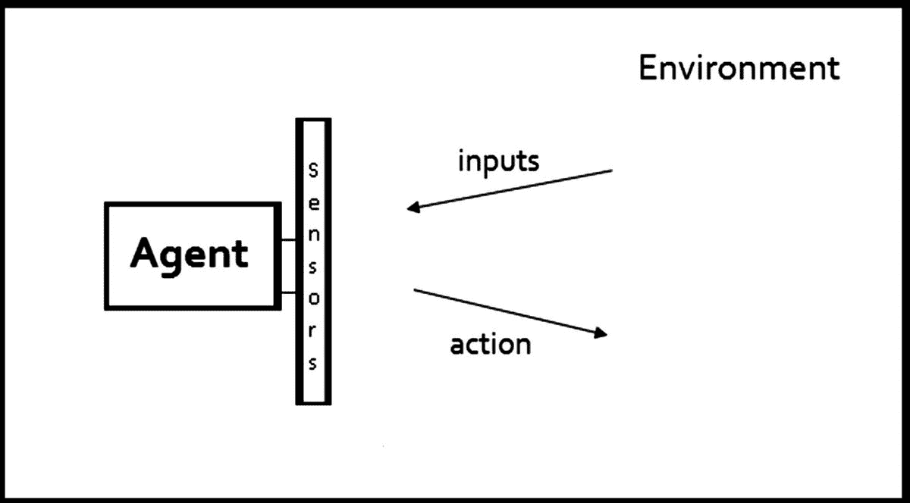
图 3-1 环境中的智能体。智能体使用其感官组件从环境中接收输入。它处理这些输入，并最终输出一个影响环境的动作。只要智能体保持活跃，这将是一个持续的交互。

智能智能体是一个自主智能体，能够在考虑多种智能体属性（如反应性、主动性和社交能力）的同时执行其动作。智能体与智能智能体之间的主要区别在于“智能”和“自主”这两个词，后者与其行为中预期的独立性相关，而前者则与刚刚提到的属性相关。这些属性及其他属性将是接下来几节的主要话题。

> **注意**
>
> 智能体不一定必须是智能智能体，因为该特性涉及一组更人性化或更高级的属性（反应性、主动性、社交能力等），而像运动检测器这样的简单智能体可能不需要这些属性。因此，为了尽可能通用，我们从更通用的智能体定义开始，然后讨论智能智能体的定义。

## 智能体属性

在了解了智能体与智能代理的概念之后，现在我们来描述那些使智能体具备智能特性的属性。

- **自主性**是指智能体无需人类或其他智能体的直接干预即可行动，并能控制自身行为与内部状态的能力。
- **反应性**是指智能体能够感知环境，并对接收到的感知信息做出及时响应（响应必须有用），以实现其既定目标的能力。
- **主动性**是指智能体能够展现目标导向行为，通过制定计划或类似策略主动采取行动，从而达成其指定目标的能力。
- **社交能力**是指智能体在多智能体系统中与其他智能体（可能包括人类）进行交互以实现其指定目标的能力。由于该属性涉及多智能体环境，我们将在下一章进一步讨论。

另一个非常重要的属性是**理性**。如果一个智能体为实现目标而行动，且绝不会采取阻碍目标实现的行为，我们就称其为理性的。

**纯反应式智能体**在决定行动时不会参考其感知历史。它们的决策过程仅基于当前感知，而不考虑过去；因此，它们没有记忆或不会利用记忆。从数学角度讲，纯反应式智能体的智能体函数为 `F: P -> A`。由此可见，仅具备反应属性的智能体只需当前感知即可提供行动。

> **注意**
>
> 通用智能体的智能体函数为 `F: P^* -> A`。`P` 上方的星号表示零个或多个感知的关系；即一组长度为 `n` (`n >= 0`) 的元组；该数字替代了星号。在纯反应式智能体的情况下，`n = 1`。

反应式智能体的决策过程实现为从状态到行动的直接映射。具备此属性的智能体对环境做出反应，而不进行推理。上一章描述的清洁机器人就是反应式智能体的一个例子；回想一下，我们曾有如代码清单 3-1 所示的规则。

```
if (IsDirty())
    Clean();
else
    Move(SelectMove());
```

代码清单 3-1 上一章清洁机器人的简单规则，一个反应式智能体

这些只是让机器人对环境做出反应而不进行任何推理的简单规则。`SelectMove()` 方法返回一个由智能体执行的随机移动，因此该智能体没有融入任何启发式方法（将在第 14 章介绍）或任何其他类型的目标导向分析或行为。与清洁机器人一样，每个反应式智能体基本上都被硬编码为一组 `if` … `then` 规则。

开发反应式智能体有哪些优势？

1.  编码非常简单，并且能让我们获得优雅、易读的代码。
2.  易于跟踪和理解。
3.  对故障具有鲁棒性。

纯反应式智能体的缺点或局限性是什么？

1.  由于它们基于局部信息（即关于智能体当前状态的信息）做出决策，因此很难看到这种决策如何能考虑非局部信息；因此，它们具有“短视”的视角。
2.  很难让它们从经验中学习并随时间推移提高性能。
3.  编码需要包含大量行为的反应式智能体很困难（太多情境 -> 行动规则）。
4.  它们没有任何主动行为；因此，它们不制定计划或关心未来，只关心当前或立即要执行的行动。

对环境做出反应相当容易，但我们通常对智能体有更多需求；我们需要它们代表我们行动并为我们做事。为了完成这些任务，它们必须具有目标导向行为——它们必须具有主动性。

**主动式智能体**会寻求创建并实现次要目标，这些目标最终将引导它们实现主要目标。作为其运作的一部分，此类智能体应能够预测需求、机会和问题，并主动采取行动加以应对。它们还应能够即时识别机会；例如，可用资源、模式异常、合作机会等。

主动式智能体的一个常见例子是个人助理智能体，就像可能安装在我们某个设备上的那种。这个智能体可以持续在我们的手机上运行，跟踪我们的位置和偏好，并根据这些偏好主动建议参观地点（该地区的文化活动、提供我们喜欢食物的餐厅等）。

总的来说，我们希望智能体具有**反应性**；即及时响应环境变化，或等效地响应短期目标。我们也希望它们具有**主动性**，并系统地朝着实现长期目标努力。让一个智能体平衡这两个属性是一个开放的研究问题。

在本章中，我们将分析一个实际问题，在该问题中，我们将为第 1 章介绍的清洁机器人添加主动特性。

智能体的其他属性，虽然不像前面提到的那些被视为基本属性，但仍然具有相关性，如表 3-1 所示。

**表 3-1 智能体的其他属性**

| 属性 | 描述 |
| :--- | :--- |
| 协调性 | 指智能体能够与其他智能体在共享环境中执行某些活动。它回答了这样一个问题：如何在智能体群体之间分配任务？协调通过计划、工作流或任何其他管理工具实现。 |
| 合作性 | 指智能体能够与其他智能体合作以实现共同目标（共享资源、结果、分布式问题求解）。它们作为一个团队要么一起成功，要么一起失败。 |
| 适应性 | 也称为学习能力，指智能体具有反应性、主动性，并能从自身经验、环境以及与他人的交互中学习。 |
| 移动性 | 指智能体能够从一个平台迁移到另一个平台，并使用不同的平台。 |
| 时间连续性 | 指智能体持续运行。 |
| 个性 | 指智能体具有明确的个性和情感状态感。 |

| 可重用性 | 指连续的智能体实例可能需要保留智能体类的实例，以便重用信息或检查分析先前生成的信息。 |

| 资源限制 | 指智能体只有在拥有可用资源时才能行动。这些资源会因其行动以及委托而改变。 |

| 真实性 | 指智能体不会故意传播虚假信息。 |

| 善意性 | 指智能体在假设自身没有冲突目标的前提下运行，并且会始终尽力完成被要求做的事情。 |

| 知识级通信 | 指智能体能够使用类似人类的语言（英语、西班牙语等）与人类智能体以及可能的其他非人类智能体进行通信。 |

现在我们已经详细介绍了智能体的一些重要属性，接下来让我们考察智能体可能与之交互的不同类型的环境；最终，我们还将介绍我们可以为智能体实现的各种智能体架构。

## 环境类型

根据环境类型的不同，智能体可能需要也可能不需要一组属性。因此，智能体的决策过程会受到其运行环境所暴露特征的影响。这些特征构成了本节将要描述的环境类型。

### 确定性环境

在`确定性环境`中，智能体执行的每个动作都只有一个可能的结果；也就是说，执行动作后，产生的状态或感知结果不存在不确定性（图 3-2）。

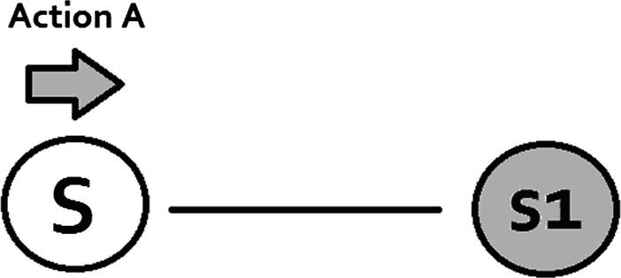

图 3-2

确定性环境；智能体处于状态 `S`，执行动作 `A` 后只能移动到状态或感知结果 `S1`。每个状态仅与一个状态相连；即智能体执行的每个动作都只有一个可能的结果。

### 非确定性环境

另一方面，`非确定性环境`是指智能体执行的动作没有确定的状态，结果可能是一组状态而非单一状态；例如，执行动作 `A` 可能导致状态 `S1`、`S2` 或 `S3`。这就是非确定性，如图 3-3 所示。非确定性环境是智能体设计中最复杂的环境。使用骰子的棋盘游戏通常是非确定性的，因为骰子的投掷结果可能将智能体带到任何状态，这取决于骰子显示的点数。

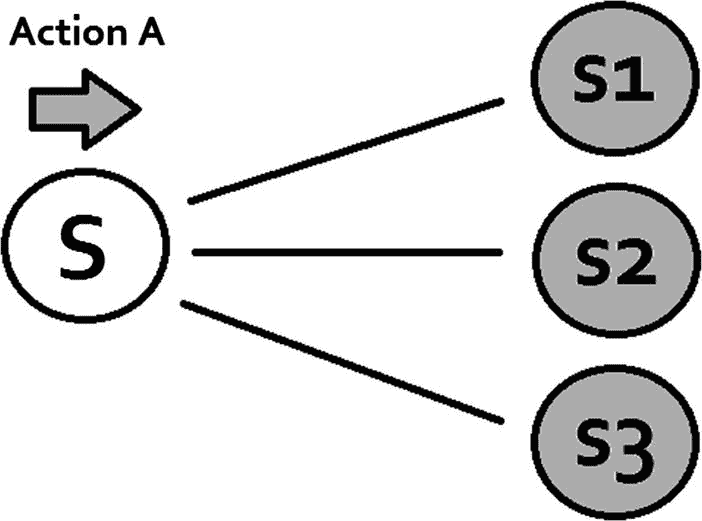

图 3-3

非确定性环境；智能体处于状态 `S`，执行动作 `A` 后可能移动到状态 `S1`、`S2` 或 `S3`。每个状态都与一组状态相连；即智能体执行的每个动作都有多个可能的结果。

### 静态与动态环境

在`静态环境`中，只有智能体执行的动作会影响环境并使其发生变化。在`动态环境`中，存在多个运行过程，其中许多过程与智能体无关，但它们仍然会影响环境并使其改变。物理世界就是一个高度动态的环境。

### 离散与连续环境

`离散环境`是指动作和感知结果的数量是固定且有限的。相反，`连续环境`是指动作和感知结果的数量不受有限数字限制。像国际象棋、滑块拼图、黑白棋或双陆棋这类棋盘游戏代表离散环境。然而，由真实城市构成的环境则代表连续环境，因为在这种环境中，智能体可能感知到的感知结果无法被限制在固定、有限的数字内。

### 可访问与不可访问环境

`可访问环境`是指智能体能够获取关于环境状态的准确、完整且最新的信息。`不可访问环境`则相反——智能体无法获取准确、完整、最新的信息。环境越可访问，为其设计智能体就越容易。

### 片段式环境

最后，`片段式环境`是指智能体的性能取决于离散的片段数量，且智能体在不同片段中的性能之间没有关联。在这种环境中，智能体可以仅基于当前片段来决定执行什么动作。

> 注意

> 最复杂的环境类别由那些不可访问、非确定性、非片段式、动态且连续的环境组成。

## 具有状态的智能体

到目前为止，我们考虑的智能体都是将感知结果或感知结果序列映射到动作。由于智能体（非反应式智能体）能够从感知结果序列进行映射，因此它们了解自身的历史。在本节中，我们将进一步探讨那些也维护状态的智能体。

智能体的状态将通过内部数据结构来维护，该数据结构用于在智能体执行期间存储有关环境的信息。因此，决策过程可以基于存储在此数据结构中的信息。

智能体函数会稍作修改以纳入这一新特性。

```
F: I x P* → A
```

其中 `I` 是智能体存储的内部环境状态集合，`P` 是感知结果集合，`A` 是动作集合。

因此，对于无状态智能体，我们只有 `F: P^* → A`；现在在这种情况下，我们通过让智能体函数接收内部状态和感知结果或感知结果序列作为参数，增加了对内部数据结构的必要考虑；即：

```
F(I, P1, P2 ... PN) = A.
```

值得注意的是，像本节定义的这类基于状态的智能体，实际上比无状态智能体强大得多。

在接下来的实际问题中，我们将通过为第 1 章中描述的清洁机器人添加状态来对其进行增强。

## 实践问题：将清洁机器人建模为智能体并为其添加状态

在本实践问题中，我们将修改上一章描述的`CleaningRobot`类，使其适应智能体范式（感知、动作等），特别是智能体的函数。我们还将以`List<Tuple<int, int>>`的形式为该智能体添加状态，用于存储已访问和已清洁的单元格。我们将看到拥有这种状态的好处，并将其与无状态的`CleaningRobot`类进行比较。

我们将这个新类命名为`CleaningAgent`，其构造函数将与`CleaningRobot`的构造函数非常相似，如代码清单 3-2 所示。对于这个新类，我们将添加布尔字段`TaskFinished`，用于指示智能体的任务是否完成，以及`List<Tuple<int, int>> __cellsVisited`，用于确定已访问过的单元格集合。

```csharp
public class CleaningAgent
{
    private readonly int[,] _terrain;
    private static Stopwatch _stopwatch;
    public int X { get; set; }
    public int Y { get; set; }
    public bool TaskFinished { get; set; }
    // 用于保持状态的内部数据结构
    private readonly List<Tuple<int, int>> __cellsVisited;
    private static Random _random;

    public CleaningAgent(int [,] terrain, int x, int y)
    {
        X = x;
        Y = y;
        _terrain = new int[terrain.GetLength(0), terrain.GetLength(1)];
        Array.Copy(terrain, _terrain, terrain.GetLength(0) * terrain.GetLength(1));
        _stopwatch = new Stopwatch();
        _cellsVisited= new List<Tuple<int, int>>();
        _random = new Random();
    }
}
```
代码清单 3-2
清洁智能体的构造函数和字段

智能体的工作循环现在与智能体函数相关；即，它根据从环境获取的一组感知来执行动作。当任务完成或达到最大执行时间（以毫秒为单位）时，循环结束，如代码清单 3-3 所示。

```csharp
public void Start(int miliseconds)
{
    _stopwatch.Start();
    do
    {
        AgentAction(Perceived());
    }
    while (!TaskFinished && !(_stopwatch.ElapsedMilliseconds > miliseconds));
}
```
代码清单 3-3
匹配智能体函数定义的智能体循环

方法`Clean()`、`IsDirty()`、`MoveAvailable(int x, int y)`和`Print()`将保持与`CleaningRobot`类中相同；这些方法在代码清单 3-4 中进行了说明。

```csharp
public void Clean()
{
    _terrain[X, Y] -= 1;
}

public bool IsDirty()
{
    return _terrain[X, Y] > 0;
}

public bool MoveAvailable(int x, int y)
{
    return x >= 0 && y >= 0 && x < _terrain.GetLength(0) && y < _terrain.GetLength(1);
}

public void Print()
{
    var col = _terrain.GetLength(1);
    var i = 0;
    var line = "";
    Console.WriteLine("--------------");
    foreach (var c in _terrain)
    {
        line += string.Format("  {0}  ", c);
        i++;
        if (col == i)
        {
            Console.WriteLine(line);
            line = "";
            i = 0;
        }
    }
}
```
代码清单 3-4
`Clean()`、`IsDirty()`、`MoveAvailable(int x, int y)` 和 `Print()` 方法，与 `CleaningRobot` 类中的相同

# 清洁代理：状态、感知与动作

## 3.2.1 获取与定义感知

感知集合将通过代码清单 3-5 中所示的方法获取，该方法返回一个感知列表。这些感知由一个枚举（在 `CleaningAgent` 类外部声明）表示，该枚举定义了 `CleaningAgent` 环境中每一种可能的感知；该枚举也可以在代码清单 3-5 中看到。

```csharp
public enum Percepts
{
    Dirty, Clean, Finished, MoveUp, MoveDown, MoveLeft, MoveRight
}

private List<Percepts> Perceived()
{
    var result = new List<Percepts>();
    if (IsDirty())
        result.Add(Percepts.Dirty);
    else
        result.Add(Percepts.Clean);

    if (_cellsVisited.Count == _terrain.GetLength(0) * _terrain.GetLength(1))
        result.Add(Percepts.Finished);

    if (MoveAvailable(X - 1, Y))
        result.Add(Percepts.MoveUp);
    if (MoveAvailable(X + 1, Y))
        result.Add(Percepts.MoveDown);
    if (MoveAvailable(X, Y - 1))
        result.Add(Percepts.MoveLeft);
    if (MoveAvailable(X, Y + 1))
        result.Add(Percepts.MoveRight);

    return result;
}
```

**代码清单 3-5** `Percepts` 枚举和 `Perceived()` 方法，该方法返回一个列表，包含智能体从环境中获得的每一种感知。

## 3.2.2 维护内部状态

如前所述，该智能体将维护一个与已访问单元格历史记录相对应的状态。为此，我们实现了代码清单 3-6 中所示的 `UpdateState()` 方法。

```csharp
private void UpdateState()
{
    if (!_cellsVisited.Contains(new Tuple(X, Y)))
        _cellsVisited.Add(new Tuple(X, Y));
}
```

**代码清单 3-6** 用于更新智能体状态（即已访问的单元格）的方法。

## 3.2.3 整合动作逻辑

将所有内容整合在一起的方法是 `AgentAction(List<Percepts> percepts)`，如代码清单 3-7 所示。在此方法中，我们遍历从环境中获得的每一种感知并做出相应动作。例如，如果当前单元格是干净的，我们通过将该单元格添加到 `_cellsVisited` 列表来更新智能体的状态（内部数据结构）；如果我们感知到当前单元格是脏的，我们就清洁它，以此类推，针对每种情况或感知及其后果或动作。此外，代码清单 3-7 还说明了 `RandomAction(List<Percepts> percepts)` 和 `Move(Percepts p)` 方法。前者选择一个要执行的随机移动感知（`MoveUp`、`MoveDown` 等），后者执行作为参数提供的移动感知。

请注意，该智能体在移动之前总是会检查其状态和感知（回想一下 `I x P` 是有状态智能体的领域），并且它总是会尝试移动到之前未访问过的相邻单元格。

```csharp
public void AgentAction(List<Percepts> percepts)
{
    if (percepts.Contains(Percepts.Clean))
        UpdateState();
    if (percepts.Contains(Percepts.Dirty))
        Clean();
    else if (percepts.Contains(Percepts.Finished))
        TaskFinished = true;
    else if (percepts.Contains(Percepts.MoveUp) && !_cellsVisited.Contains(new Tuple(X - 1, Y)))
        Move(Percepts.MoveUp);
    else if (percepts.Contains(Percepts.MoveDown) && !_cellsVisited.Contains(new Tuple(X + 1, Y)))
        Move(Percepts.MoveDown);
    else if (percepts.Contains(Percepts.MoveLeft) && !_cellsVisited.Contains(new Tuple(X, Y - 1)))
        Move(Percepts.MoveLeft);
    else if (percepts.Contains(Percepts.MoveRight) && !_cellsVisited.Contains(new Tuple(X, Y + 1)))
        Move(Percepts.MoveRight);
    else
        RandomAction(percepts);
}

private void RandomAction(List<Percepts> percepts)
{
    var p = percepts[_random.Next(1, percepts.Count)];
    Move(p);
}

private void Move(Percepts p)
{
    switch (p)
    {
        case Percepts.MoveUp:
            X -= 1;
            break;
        case Percepts.MoveDown:
            X += 1;
            break;
        case Percepts.MoveLeft:
            Y -= 1;
            break;
        case Percepts.MoveRight:
            Y += 1;
            break;
    }
}
```

**代码清单 3-7** 用于更新智能体状态（即已访问的单元格）的方法。

## 3.2.4 优势对比与实例

与无状态清洁机器人相比，清洁代理为我们提供了哪些优势？为了回答这个问题，我们首先注意到，清洁代理所使用的策略（通过保存已访问单元格坐标来记录其环境历史）非常直观。想象一下，你需要在一个拥有超过 100 家商店的大城市里寻找某种产品 X；你会如何完成这项任务？直观上，你会每家商店只去一次，然后在脑海中记录下你已经去过那家店且产品不在那里，从而节省了再次访问的时间。接着你会一家接一家地移动，直到找到产品，始终牢记已访问过的商店是在浪费时间。这基本上就是我们的清洁代理试图做的事情，但有一个例外：有时可能不得不重新访问已经去过的单元格，因为代理只能移动到相邻的单元格，而所有相邻单元格可能都已被访问过。

在图 3-4 中，我们可以看到清洁代理与清洁机器人的基本对比。

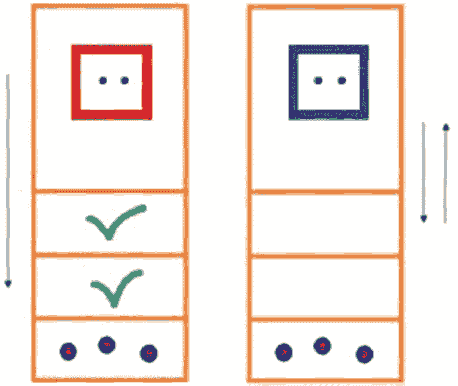
**图 3-4** 清洁代理（蓝色）搜索环境，保存已访问单元格的坐标，而清洁机器人（红色）不保存环境状态或其历史记录；因此，它只是随机移动，可能向上或向下，甚至原地打转，从而消耗更多时间来清理最后一个单元格上的污垢。

在代码清单 3-8 中，我们有一个 1000 x 1 单元格的环境，即 1000 行和一列，污垢仅位于最后一行。

```csharp
var terrain = new int[1000, 1];
for (int i = 0; i < terrain.GetLength(0); i++)
{
    for (int j = 0; j < terrain.GetLength(1); j++)
    {
        if (i == terrain.GetLength(0) - 1)
            terrain[i, j] = 1;
    }
}

var cleaningEntity = new CleaningRobot(terrain, 0, 0);
cleaningEntity.Print();
cleaningEntity.Start(200);
cleaningEntity.Print();

var cleaningEntity = new CleaningAgent(terrain, 0, 0);
cleaningEntity.Print();
cleaningEntity.Start(200);
cleaningEntity.Print();
```

**代码清单 3-8** 更新代理状态（即已访问单元格）的方法。

清洁代理标记每个已访问的单元格，从而更快地移动到最后一个单元格并完成任务。另一方面，清洁机器人不保存环境状态，因此没有任何内部结构来帮助它决定哪个移动是正确的，基本上可以随机上下移动多次，甚至原地打转。清洁代理拥有包含环境信息的数据结构，以帮助其应用逻辑并做出理性决策，而清洁机器人则没有。根据代码清单 3-8 所示代码的结果，随机机器人无法清理最后一个单元格上的污垢，而代理则能在给定时间内完成（图 3-5）。

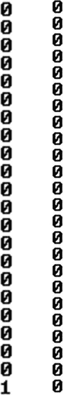
**图 3-5** 左侧是执行 `CleaningRobot` 后得到的结果；右侧是执行 `CleaningAgent` 后得到的结果。前者在最后一行留下了污垢，而后者能够将其清理干净。

## 3.3 总结

到目前为止，本章我们探讨了代理的属性与环境，并描述了一个实际问题，其中我们可以看到有状态的代理超越了上一章介绍的清洁机器人。在后续章节中，我们将研究一些最流行的代理架构。

# 代理架构

代理架构代表了预定义的设计，这些设计考虑了不同的代理属性（如之前研究过的那些），为构建代理提供了方案或蓝图。

我们可以将目前介绍的不同概念类比为：代理是建筑物；它们的属性类似于建筑物的属性（颜色、高度、使用的材料等）；架构之于代理，就如同建筑中的基础设施，即支撑建筑并定义其功能的结构；而代理类型（即将详细说明）则类似于我们拥有的建筑类型（商业、政府、军事等）。

代理架构作为代理功能的基础，指明了代理将如何运作。到目前为止，我们一直将代理的功能视为抽象概念；而架构作为定义功能的组件，将为我们提供一个实现该功能的模型。

## 反应式架构：包容架构

同样地，我们可以拥有一个明亮的属性和发光的架构——换句话说，一个专注于提供最大轻量性的架构——我们也可以拥有一个反应式智能体和基于反应的架构，一个首先关注反应性的架构。智能体反应式架构就是这种情况。

在反应式架构中，如同在反应式智能体中一样，每个行为都是从感知或环境状态到动作的映射。在图 3-6 中，我们可以看到展示反应式架构的示意图。

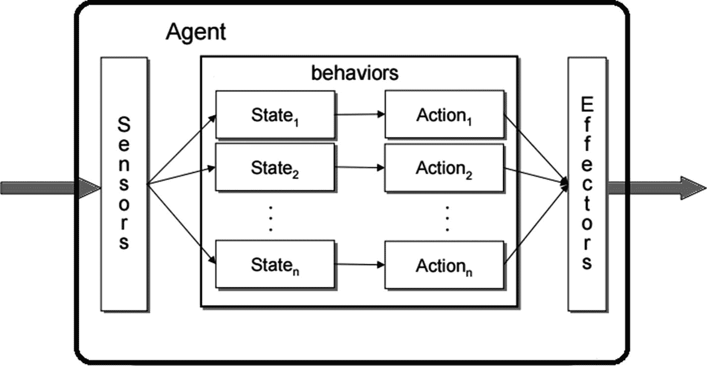

图 3-6

反应式架构示意图

前面几节开发的清洁智能体就是反应式架构的一个明显例子。从智能体的属性部分我们已经知道，纯粹的反应式会带来一些弊端：这种架构中没有学习；它通常是手工制作的，这使得创建大型系统非常困难；它只能用于其最初的目的，等等。

最流行——也可以说是最著名——的反应式架构之一是包容架构，由罗德尼·布鲁克斯在 20 世纪 80 年代中期开发。他的架构被认为是一种基于行为的架构；它摒弃了基于逻辑的智能体（即那些完全依赖逻辑来表示世界、其交互及其关系的智能体）的理念，试图开创一种有别于他那个时代传统人工智能的新方法。

注意

基于行为的智能体使用生物系统作为构建模块，并依赖适应性。它们往往比其人工智能同类表现出更多的生物特征，并且可以重复动作、犯错、表现出坚韧等，有点像蚂蚁的行为。

布鲁克斯架构背后的主要思想如下：

1. 智能行为可以在没有像符号人工智能所提出的那种显式表示的情况下产生。

2. 智能行为可以在没有符号人工智能所提出的那种显式抽象推理的情况下产生。

3. 智能是某些复杂系统的一种涌现属性。

包容架构具有两个基本特征：

1. 智能体的决策过程通过一组完成任务的行为来执行，其中每个行为模块都可以被视为一个独立的智能体函数。由于这是一种反应式架构，每个智能体函数都是从感知或状态到动作的映射。

2. 行为模块旨在完成特定任务，每个行为都与其他行为“竞争”以行使对智能体的控制。

3. 许多行为可以同时触发，这些行为提出的多个动作根据包容层级结构执行，行为被排列成多个层级。

4. 层级结构中的较低层能够抑制较高层：层级越低，其优先级越高。

包容层级结构的原则是，较高层将指示更抽象的行为。例如，考虑我们的清洁智能体，人们会希望赋予“清洁”行为高优先级；因此，它将被编码在具有更高优先级的较低层中。

注意

符号人工智能有时被称为老式人工智能或经典老式人工智能。它在 20 世纪 50 年代和 60 年代很流行，其基础是通过符号（逻辑公式、图形、规则等）来表示知识的理念。因此，符号人工智能的方法是在逻辑、形式语言理论、离散数学的各个领域等基础上发展起来的。

再次审视清洁智能体，我们可以看到它遵循包容架构（清单 3-9）。

```csharp
public void AgentAction(List percepts)
{
    if (percepts.Contains(Percepts.Clean))
        UpdateState();
    if (percepts.Contains(Percepts.Dirty))
        Clean();
    else if (percepts.Contains(Percepts.Finished))
        TaskFinished = true;
    else if (percepts.Contains(Percepts.MoveUp) && !_cellsVisited.Contains(new Tuple(X - 1, Y)))
        Move(Percepts.MoveUp);
    else if (percepts.Contains(Percepts.MoveDown) && !_cellsVisited.Contains(new Tuple(X + 1, Y)))
        Move(Percepts.MoveDown);
    else if (percepts.Contains(Percepts.MoveLeft) && !_cellsVisited.Contains(new Tuple(X, Y - 1)))
        Move(Percepts.MoveLeft);
    else if (percepts.Contains(Percepts.MoveRight) && !_cellsVisited.Contains(new Tuple(X, Y + 1)))
        Move(Percepts.MoveRight);
    else
        RandomAction(percepts);
}
清单 3-9
清洁智能体动作函数遵循包容架构
```

清洁智能体为其展现的行为建立了一个顺序；这个顺序对应于图 3-7 中所示的包容层级结构。

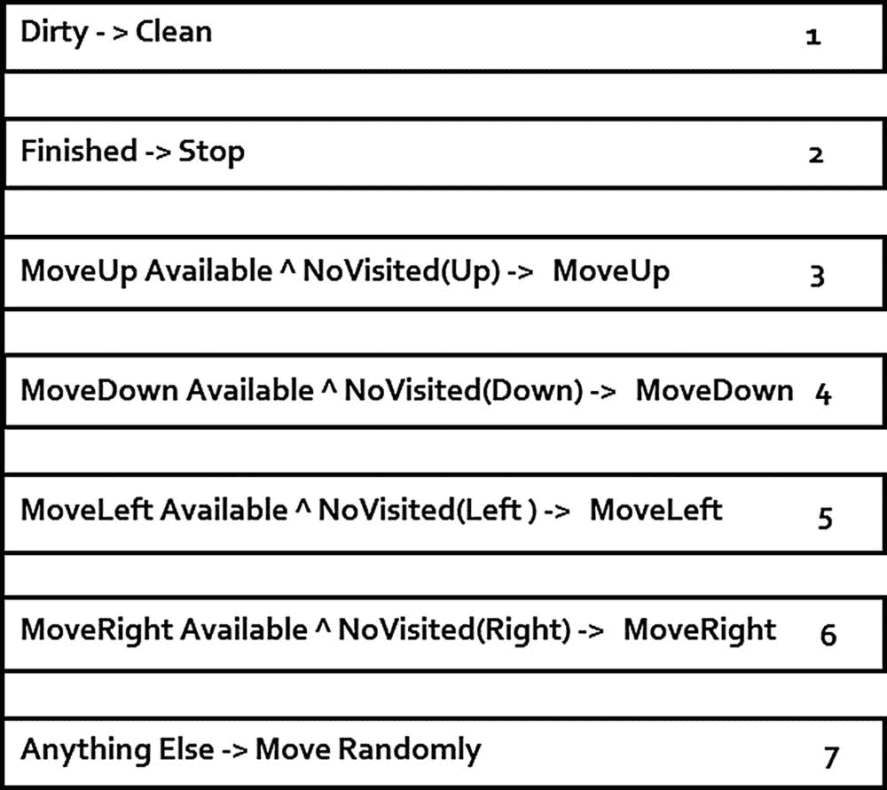

图 3-7

清洁智能体的包容层级结构

清洁智能体中由包容层级结构建立的优先级顺序是 1、2、3、4、5、6 和 7，其中 7 是优先级最高的行为。

这种架构继承了反应式架构的问题（没有学习、硬连线规则等）。除此之外，对复杂系统进行建模需要将许多行为包含在层级结构中，这使得它过于庞大且不可行。到目前为止，我们已经描述了智能体属性和反应式架构，并提供了其中一个（可能是最著名的例子）包容架构的示例。在接下来的几节中，我们将研究其他智能体架构，例如 `BDI`（信念-愿望-意图）和混合架构。

## 慎思架构：BDI 架构

在纯粹的慎思架构中，智能体遵循基于目标的行为，能够进行推理和提前规划。慎思架构通常通过逻辑、图论、离散数学等方式，融入某种对世界的符号化表征，而决策（例如，关于执行何种行动）通常通过模式匹配和符号操作进行逻辑推理来做出。熟悉逻辑或函数式编程语言（如 `Prolog`、`Haskell` 或 `FSharp`）的读者可能更容易理解符号的含义。慎思架构通常面临两个需要解决的问题：

1. 将现实世界转化为一个恰当、准确的符号化版本，该版本对于智能体的目的而言是高效且有用的。这个问题通常非常耗时，尤其是在环境过于动态且不断变化的情况下。

2. 符号化地表示关于现实世界实体、关系、过程等信息，以及如何利用这些信息进行推理和决策。

问题 1 推动了人脸识别、语音识别、学习等领域的研究，而问题 2 则启发了知识表示、自动调度、自动推理、自动规划等方面的工作。尽管这些问题产生了大量的科学成果，但大多数研究者都承认，它们远未得到解决。即使是看似简单的问题，例如基本推理，也被证明异常困难。根本问题似乎在于，即使在非常简单的逻辑中进行定理证明也很困难，并且符号操作本身就很复杂；回想一下，一阶逻辑（`FOL`）甚至是不可判定的，而附加在其上的模态扩展（包括信念、愿望、时间等的表示）往往高度不可判定。

注意

术语“可判定”或“可判定性”与判定问题相关；即，可以定义为对输入值的问题输出“是”（1）或“否”（0）的问题。可满足性问题（`SAT`）是判定问题的一个特例。因此，我们说一个理论（公式集）是可判定的，如果存在一种方法或算法，可以判定一个给定的随机选择的公式是否属于该理论。

通用的慎思架构如图 3-8 所示。

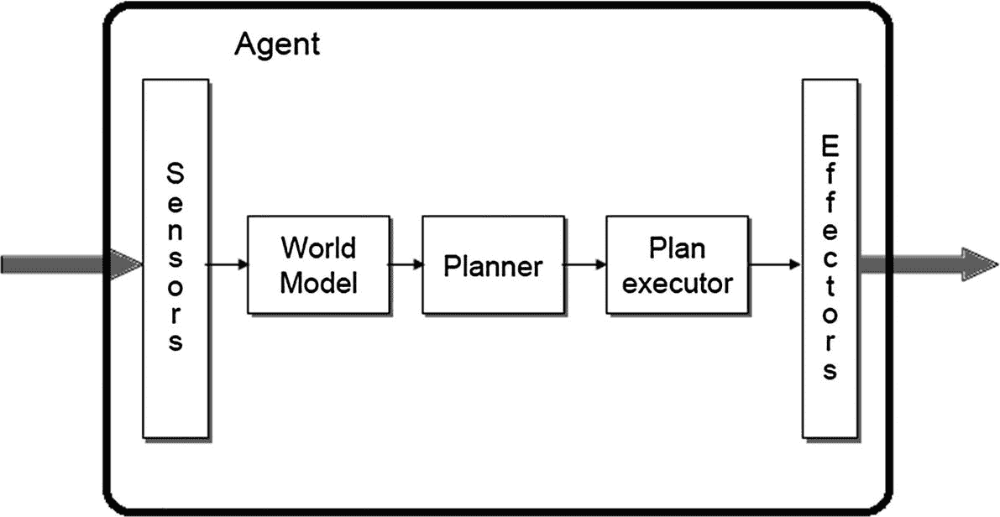

图 3-8

慎思架构

多种慎思架构，如 `BDI`（稍后详述），其根源在于理解实践推理的哲学传统，即当寻求实现目标时，逐刻决定执行哪个行动的过程。人类的实践推理包含两个活动：

1. 决定我们想要达到什么样的状态（慎思）。

2. 决定如何达到这些状态（手段-目的推理或规划）。

从前述活动中我们可以得出结论：慎思输出意图，手段-目的推理输出计划。

注意

实践推理与理论推理之间存在区别。前者指向行动，而后者指向信念。

手段-目的推理是利用可用手段决定如何达成目的的过程；在人工智能领域，这被称为规划。智能体要生成一个计划，通常需要有一个待达成的表征或目标意图、一个其可执行行动的表征，以及一个其环境的表征（图 3-9）。

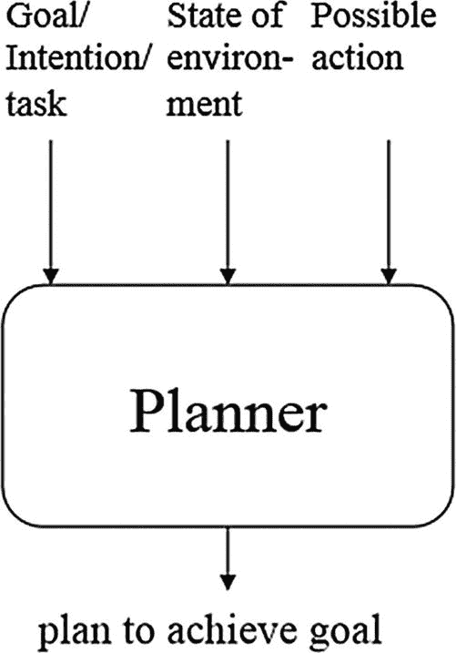

图 3-9

智能体规划组件的输入与输出流

慎思是如何发生的？在慎思过程中，第一步称为备选方案生成，智能体生成一组备选方案（目标、愿望）以供考虑。在第二步称为过滤中，智能体在可用选项中进行选择，并承诺执行其中一些。这些被选中的选项或备选方案就是它的意图。

# 智能体架构

## 慎思架构

慎思架构中的关键问题是：“智能体如何对其（可能相互冲突的）目标进行慎思，以决定它将追求哪些目标？”这个问题的答案由每个慎思架构特有的目标-慎思策略提供；其中最流行的是由迈克尔·E·布拉特曼在其著作《意图、计划与实践理性》（1987）中创建的 `BDI` 架构。

> **注意**
>
> 考虑到它们与时间的交互，反应式架构存在于当下（持续时间短），而慎思架构则对过去进行推理，并面向未来进行规划（计划等）。

信念、愿望与意图（`BDI`）架构包含对智能体信念、愿望和意图的显式表示。信念（它认为什么）通常被视为智能体对其环境所拥有的信息；我们可以说知识而非信念，但我们更倾向于使用更通用的术语“信念”，因为智能体所相信的有时可能是错误的。愿望（它想要什么）是智能体希望看到实现的事情，我们并不期望智能体对其所有愿望都采取行动。意图（它正在做什么）是智能体承诺要做的事情，它们基本上是过滤愿望的结果；`BDI` 架构如图 3-10 所示。

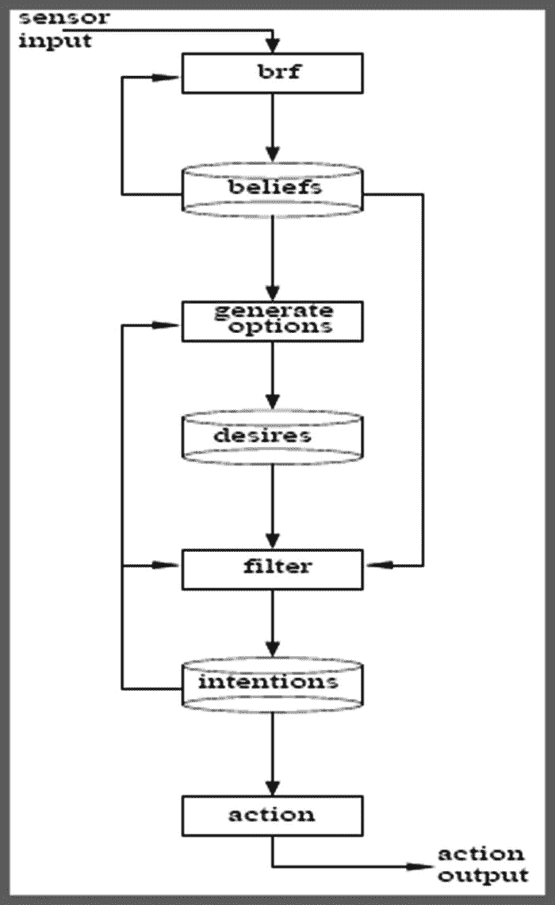

图 3-10：`BDI` 架构

信念通常由输出真值或假值的谓词（例如，`IsDirty(x,y)`）来描述，并代表智能体对世界拥有的内部知识。

当愿望存在于信念库中（或被智能体手动移除）时，它们即被视为已实现。与信念库一样，愿望库在智能体执行过程中会不断更新。当一个愿望被创建为中间目标时，愿望之间可以通过层级链接（子/超愿望）相关联（例如，要清理地面上的污垢，可以有两个子愿望或子目标：移动到每个脏污单元格并清理它）。愿望具有一个可以动态变化的优先级值，该值用于在必要时从一组愿望中选择一个新的意图。

一旦智能体考虑了所有选项，它必须承诺执行其中一些。在此例中，作为示例，它将只承诺执行一个，即其唯一可用的选项，该选项随后成为其意图。意图最终会导向行动，智能体应通过尝试实现其意图来行动。智能体应做出合理尝试以实现其意图，并可能为此遵循一系列行动（计划）。

智能体选择的意图将从那一刻起约束其实践推理；一旦对某个意图做出承诺，智能体将不再考虑与已启动的意图相冲突的其他意图。意图可以被搁置（例如，当它们需要先实现一个子愿望时）。因此，存在一个意图栈；栈顶的意图是当前意图，也是唯一未被搁置的意图。

意图应当持之以恒；换言之，我们必须投入所有可用资源去实现它们，而不能因为短期内未能达成便立即放弃，否则我们将始终一事无成。另一方面，意图也不能持续太久，因为可能存在合乎逻辑的理由需要放弃它们。例如，清洁代理可能在某时刻无事可做（清洁），或许是因为它处于多代理环境中，而其他代理已经完成了清洁任务。

意图在实践推理中扮演着一系列重要角色：

*   **意图驱动规划**：一旦代理决定实现某个意图，它就必须规划一系列行动来完成该意图。
*   **意图约束后续思考**：一旦代理承诺于某个意图，它就不会再考虑与该选定意图相冲突的其他意图。
*   **意图具有持续性**：代理不会无缘无故放弃其意图；通常会持续下去，直到它认为意图已成功实现、无法实现，或意图的目的已不复存在。
*   **意图影响对未来的信念**：一旦代理采纳了某些意图，就有必要且合乎逻辑地基于这些意图将被实现的假设，对未来进行规划。

代理需要时常停下来重新审视其意图，因为有些意图可能已变得不合理或无法实现。这一重新审视阶段会带来空间和时间上的成本，同时也给我们提出了一个问题：

*   **鲁莽的代理**：如果代理不经常停下来重新审视其意图，可能会试图实现一个已不再可能的意图。
*   **谨慎的代理**：如果代理过于频繁地停下来重新审视其意图，可能会在重新审视阶段消耗过多资源，而在实现意图上投入不足。

在代理的事件驱动行为与目标导向行为之间取得平衡或折衷，是解决这一困境的方法。

> **注意**
>
> 实验表明，在变化不频繁的环境中，鲁莽的代理比谨慎的代理表现更好。而在另一种场景（环境频繁变化）中，谨慎的代理则优于鲁莽的代理。

`BDI` 代理中的实践推理过程依赖于以下组件。在后续要点中，假设 `B` 为信念集合，`D` 为愿望集合，`I` 为意图集合：

*   一组当前信念，代表代理对其环境所掌握的信息。
*   一个信念修正函数（`brf`），接收感知输入和代理的信念，并确定新的信念集：`brf: P x B -> B`。
*   一个选项生成函数（`options`），接收关于环境的信念和意图（如有）作为输入，并确定代理的选项（愿望）：`options: B x I -> D`。
*   一组当前选项，代表代理可能采取的行动方案。
*   一个过滤函数（`filter`），代表代理的思考过程，使用信念、愿望和意图作为输入，以确定代理的意图：`filter: B x D x I -> I`。
*   一组当前意图，代表代理的承诺。
*   一个动作选择函数，使用当前意图作为输入，以确定要执行的动作。

毫不意外，`BDI` 代理在任何时刻的状态都是一个三元组 `(B, D, I)`。在不深入细节的情况下，`BDI` 代理的动作函数看起来相当简单；其伪代码如下所示：

```
function AgentAction(P):
B = brf(P, B)
D = options(D, I)
I = filter(B, D, I)
end
```

在下一章中，我们将介绍一个实际问题，为火星车开发一个基于 `BDI` 架构的人工智能；这个问题将帮助我们巩固本节介绍的许多概念。

## 混合架构

许多研究者认为，在设计代理时，纯粹基于推理的代理或纯粹基于反应的代理都不是好策略。混合架构中，代理同时具备基于目标的组件（能够进行推理和提前规划）和反应式组件（能够对环境情况立即做出反应），这种架构通常比纯粹的推理型或反应型代理更受青睐。

通常，混合架构代理由以下子系统或组件构成：

*   **推理组件**：包含世界表征，该表征在某种程度上可以是符号化的；它像推理架构一样构建计划并做出决策。
*   **反应组件**：能够无需复杂推理即可对特定情况做出反应（情况 -> 后果规则）。

因此，混合代理兼具反应性和主动性，并且反应组件通常比推理组件具有更高的优先级。

反应组件与推理组件共存所形成的分层且略带层级结构，自然引出了分层架构的概念，这代表了混合代理的设计思路。在这种架构中，代理的控制组件按层级排列，较高层级处理较抽象的信息。

通常，分层架构中至少会有两层：一层处理反应行为，一层处理主动行为。实际上，没有理由不能有更多层。一般来说，我们可以将分层架构分为两种类型：

*   **水平分层**：在水平分层架构中，代理的每一层都直接连接到感知输入和动作输出。因此，每一层都像一个代理，对要执行的动作提出建议。
*   **垂直分层**：在垂直分层架构中，感知输入和动作输出都通过每一层进行处理，方向可以是一个或多个。

水平分层和垂直分层如图 3-11 所示。

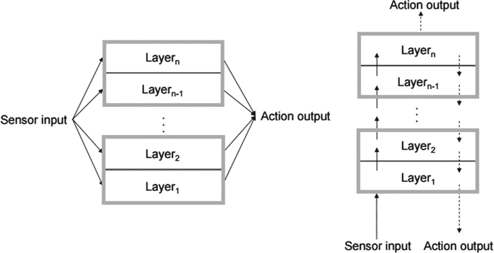

图 3-11：水平分层架构（左侧）和垂直分层架构（右侧）。注意，在垂直分层架构中，信息可能不止一次地通过每一层。

水平分层架构在概念设计上非常简单；具有 `n` 种行为的代理需要 `n` 层，每层对应一种行为。尽管有这一优点，但每一层实际上都在相互竞争以提出动作建议，这可能导致代理表现出不一致的行为。为了提供一致性，通常需要一个中介函数来充当“中间人”，决定在任何给定时刻由哪一层控制代理。

中介函数涉及高度复杂性，因为必须考虑所有层之间的所有可能交互，才能最终输出一个动作。从设计者的角度来看，创建这样的控制机制极其困难。

在垂直分层架构中，这些问题会减少，因为层与层之间存在顺序，且最后一层负责输出待执行的动作。垂直分层架构通常分为两种类型：单程架构和双程架构。在前者中，智能体的决策过程依次流经每一层，直到最后一层生成动作。在双程架构中，信息先向上流经架构（第一程），然后再向下回流。双程垂直分层架构的原理与组织及企业的工作方式存在显著相似之处，即信息向上流至最高层，然后指令向下传达。在单程和双程垂直分层架构中，层间交互的复杂性都降低了。由于 `n` 层之间有 `n-1` 条边，如果每层能够建议 `m` 个动作，那么层间最多需要考虑 `m²(n − 1)` 次交互。显然，这比水平分层架构迫使我们面对的交互级别要简单得多。这种简单性是有代价的，这个代价就是灵活性。为了让垂直分层架构做出决策，控制权必须在每个不同层之间传递。垂直分层架构并非完美无缺，任何一层的故障都可能对智能体的性能造成严重后果。在下一节中，我们将研究水平分层架构的一个特例：旅行机器。

### 旅行机器

旅行机器代表由三层（建模层、规划层和反应层）组成的水平分层架构。图 3-12 展示了一台旅行机器。

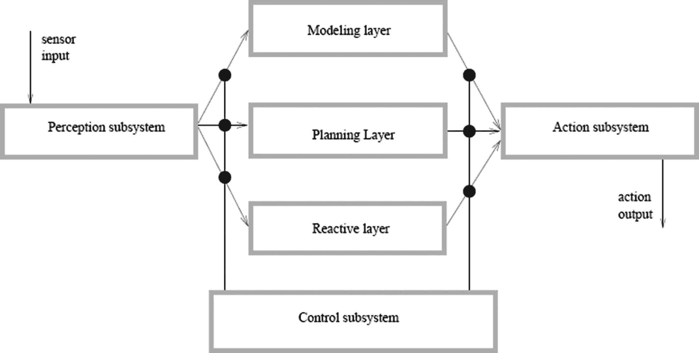

图 3-12：旅行机器

反应层以一组情境-动作规则的形式，对环境中检测到的变化提供即时响应，这些规则类似于包容架构中的规则。在接下来的伪代码中，我们展示了一个自主车辆智能体的反应规则。此示例展示了车辆的避障规则：

```
rule-1: obstacle-avoidance
if (in_front(vehicle, observer)
and speed(observer) > 0
and separation(vehicle, observer) < vehicleThreshHold)
then
change_orientation(vehicleAvoidanceAngle)
```

规划层负责智能体的主动行为；换句话说，它负责智能体长期将要执行的操作。为了进行规划，该层维护着一个计划库；这些计划本质上是分层结构化的计划，旅行机器在运行时对其进行详细阐述以决定做什么。因此，为了实现一个目标，规划层会尝试在计划库中找到一个与智能体所寻求目标相匹配的计划。

> **注意**
> 旅行机器最早的基准测试场景之一是自动驾驶车辆。

顾名思义，建模层代表了世界及其各种实体（包括智能体）的模型。它预测智能体之间的冲突，并生成新目标以解决这些冲突。新生成的目标随后被向下传递到规划层，规划层利用其计划库来确定一个或一组满足这些目标的计划。

所有三层都与一个控制子系统相关联，该子系统决定哪一层拥有对智能体的控制权。该子系统由一组控制规则组成，这些规则可以限制层间的信息，或者作用于层的输出，如下一个展示控制规则的伪代码所示：

```
censorRule_1:
if (entity(bigObstacle) in perceptions)
then
removeSensoryRecord(layerReact, entity(bigObstacle))
```

这条控制规则阻止反应层知晓已检测到一个大障碍物。在大多数场景下，反应层是处理避障最合适的层，但在不同场景下，将此感知信息传递给其他层可能更好。在这种情况下，由于传感器检测到了一个可能从远处就能看到的大障碍物，规划层可能需要找到一个考虑大障碍物并改变智能体路线的计划。

### InteRRaP

InteRRaP（理性反应行为与规划的集成）是一种垂直分层双程架构，由三层（协作层、规划层和行为层）组成，类似于旅行机器中的层次。图 3-13 展示了一个 InteRRaP 架构。

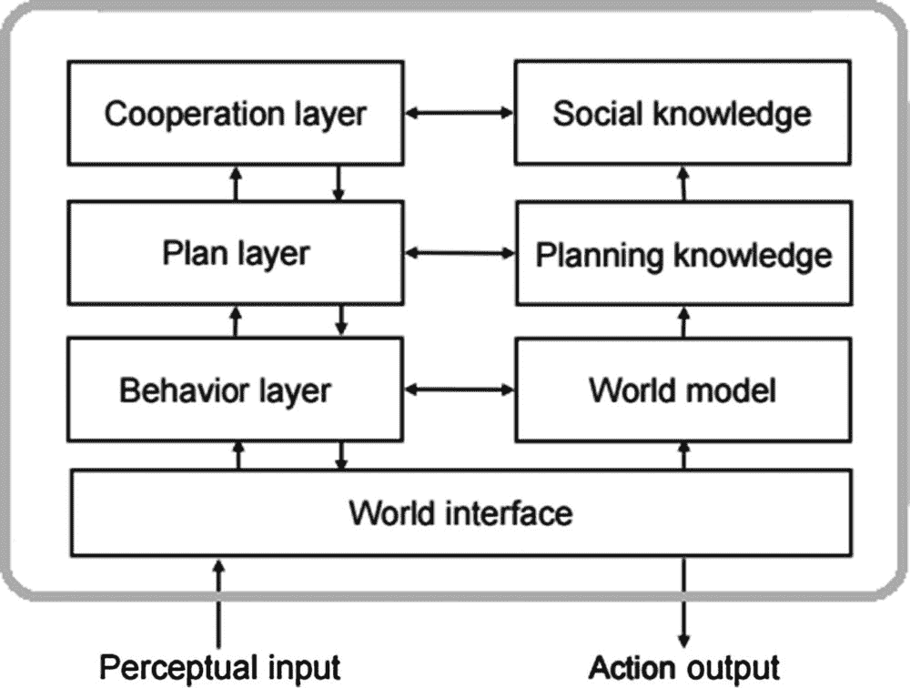

**图 3-13 InteRRaP 架构**

行为层（最底层）处理反应行为；规划层（中间层）处理常规规划以实现智能体的目标；协作层（最顶层）处理多智能体环境中的社交互动。每一层都关联着一个知识库；每个知识库都以便于其对应层使用的方式表示世界。

最顶层的知识库表示环境中其他智能体的计划和动作集合；中间层的知识库表示智能体自身的计划和动作；最底层的知识库表示关于环境的原始信息。

> **注意**
> 知识库是 InteRRaP 与旅行机器的区别所在。

InteRRaP 与旅行机器的主要区别在于它们与环境交互的方式。在旅行机器中，每一层都连接到感知输入和动作输出，因此需要一个控制子系统来处理层间的冲突。在 InteRRaP 中，各层在寻求实现共同目标时相互交互。

InteRRaP 中层间交互存在两种主要类型：自底向上激活和自顶向下执行。前者发生在较低层无法处理当前情境，被迫将控制权传递给较高层时。后者发生在较高层利用较低层提供的设施来实现其目标时。典型的流程将从底层开始，当反应层接收到感知输入时；如果该层能够处理接收到的感知输入，它将自行处理；否则，它将控制权传递给规划层。如果规划层能够处理该情境，它可能会利用自顶向下执行；否则，它会继续将控制权向上传递给下一层。通过这种方式，控制权从最低层流向更高层（如有必要），然后再向下回流。

## 总结

在本章中，我们介绍了智能体的概念，审视了其一些最相关的属性，并研究了一个实际问题，在该问题中，我们将第 2 章的清洁机器人转变为一个遵循智能体动作函数模型的清洁智能体，该函数接收一组感知并输出一个动作。我们还为该智能体添加了状态，并将其与执行随机动作的无状态智能体进行了比较。最后，我们介绍了各种智能体架构：反应式、慎思式和混合式。

在下一章中，我们将研究一个非常有趣的问题（火星车），它将向我们展示智能体架构如何在现实场景中实现。
```