# 4. 火星车

延续上一章开启的路线（智能体），我们将把第 4 章用于介绍一款基于混合架构的火星车 AI，该架构包含一个用于即时决策的反应层，并采用 BDI（信念、愿望、意图）范式来实现其慎思层。这个实际问题将帮助我们巩固在第 3 章中学到的所有知识（智能体属性、智能体状态、架构等），并帮助我们理解如何将所有这些整合到一个现实世界的问题中。

太空探索是一个引人入胜的话题，它与人工智能领域结合得很好，并在全球拥有数百万追随者。由于太空条件对人类来说相当困难和危险，因此使用机器人是常见且必要的。因此，将人工智能用于参与太空探索的机器这一想法是合乎逻辑的，并且近年来对此进行了许多研究。

本章涉及的实际问题将包括一个可视化应用程序（Windows Forms），该程序在 `n x m`（行 x 列）的离散环境中实时展示火星车的执行过程。该应用程序模拟了火星环境，其中有各种被智能体视为障碍物的岩石，以及隐藏的水源或水迹。该程序还将向我们展示其规划（构成计划的行动序列将以黄色标示）以及它如何管理信念、愿望和意图。火星车的目标基本上是科学研究，而在我们的案例中，最重要的任务是寻找火星上任何类型的水的痕迹，同时努力保持活跃并避开障碍物。

> **注意**
> 勇气号和机遇号是两款最著名的火星车；它们都做出了惊人的发现，并大大超过了预期寿命。勇气号于 2003 年 6 月发射，机遇号于 2003 年 7 月发射。勇气号一直活跃到 2010 年（七年寿命），当时它的轮子陷入沙中，而机遇号截至本书撰写时，仍在火星上活跃并漫游。

## 什么是火星车？

今天的火星是一个荒凉、干燥的星球，从远处看，它与我们的家园地球几乎毫无相似之处。然而，当接近火星轨道时，我们可以在其表面看到可能是古代、现已干涸的湖泊和峡谷的痕迹，这表明火星可能在三四百万年前不仅拥有水，还可能拥有生命。

太空中的生命是艰难的；人类在那里生存极其复杂、充满风险和危险，到达一些最近的星球可能需要很多年。因此，为了促进对其他世界的研究，多个航天机构（NASA、CSA、ESA 等）一直在设计机器人——或者通常被称为漫游车——用于行星的探索和研究。

火星车是一种自动化机动车辆，它装载了用于分析周围环境的摄像头、用于挖掘并可能分析有趣岩石的研究仪器、用于发送图片和数据以及接收指令的通信设备、用于自身供电的太阳能电池板等（图 4-1）。火星车的任务是探索火星并收集重要数据，这些数据有望得出该星球过去存在水的结论——或者可能发现古代生命。

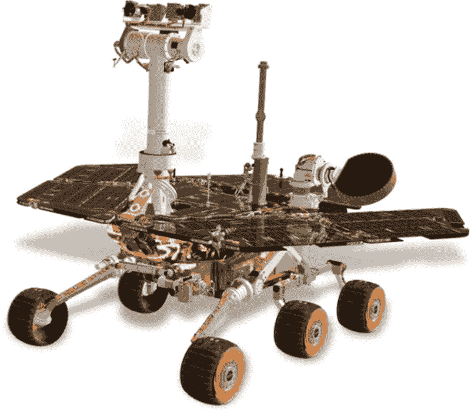
*图 4-1 火星车*

火星车的移动速度通常非常缓慢，大约每秒两英寸（约每小时 0.09 英里）。考虑到将火星车送上火星所涉及的麻烦和成本，工程师们更倾向于稳妥行事、谨慎驾驶；没有人愿意看到一辆价值 25 亿美元的火星车因为开得太快而翻倒。另一个重要点是：大多数火星车每天都会收到来自地球团队的一组命令或指令；这些指令告诉火星车去哪里或做什么。从这个意义上说，可以说经典的火星车并不像我们想象的那么自主；它们当然包含一些自主行为，因为地球团队并不在火星上，无法实时监视它们的每一步。因此，火星车的 AI 负责判断何时岩石太大无法越过（障碍物），或者何时岩石的颜色和纹理使其值得检查。可以说，火星车是某种程度上的自主，并且非常擅长服从命令，有点像人类士兵。火星车的任务是一项双方面的工作；一方面，我们有地球上的工程师，规划他们的日常行动、大规模策略等；另一方面，我们有火星车，执行这些行动、探索、收集数据并将其发送回地球。

在本章中，我们将演示如何为一款完全自主的火星车开发 AI，该 AI 将考虑地形中的障碍物，并在一种混合架构下寻找水源，该架构包含一个 BDI（信念、愿望、意图）慎思机制，并利用统计和概率为其注入新的信念，这些信念将作为从其状态（过往历史）得出的结论。

> **注意**
> 火星通常被称为红色星球，因为它在夜空中呈现微红色调。总的来说，火星大部分呈铁锈色，这是因为其土壤中含有铁。当暴露于火星大气中微量的氧气时，铁会氧化或生锈。这种“铁锈尘埃”也可能被吹到空中，将天空变成桃色。

## 火星车架构

让我们花点时间审视一下我们将为火星车 AI 提出的混合架构（图 4-2）。

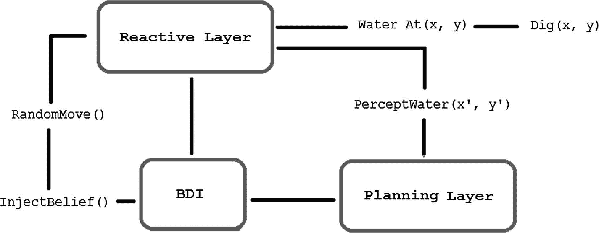
*图 4-2 火星车架构*

该架构由三层组成（反应层、BDI 层和规划层）；不同的感知或事件（在图 4-2 中以较小字体表示）可以触发某一层执行。例如，如果火星车当前位置有水，反应层将立即行动，引导火星车在该点挖掘。如果附近区域有与水相关的感知，反应层也会被触发。火星车将包含一个名为 `SenseRadius` 的变量或字段，用于确定其周围的圆形区域并代表其视野；火星车将能够感知该圆形区域内的一切。由于我们处理的是离散环境，这个圆形将是真实圆形的近似值；换句话说，它是圆形的离散版本。

> **注意**
> 像勇气号或机遇号这样的火星车（均由 NASA 制造）都配备了鱼眼摄像头或广角摄像头，使它们能够捕捉前方地形的全景。这些摄像头拍摄的照片会被分析，以判断路径上的某块岩石是否太大而无法越过，等等。

如果火星车有一些初始信念，并且没有特别重要的感知，控制权将从反应层转移到 BDI 层，在那里，一个从信念集开始的过程启动；在此过程中，信念集被更新。我们今天可能持有的信念，明天可能被证明是错误的。对于火星车来说，它认为可能有水的地形位置可能是错误的，因此，随着新感知的到来，这个信念数据库必须不断更新。在第二阶段，从信念中生成愿望。对于火星车来说，其信念将由可能存在水的位置组成，而其愿望则是这些可能存在水的位置，按照曼哈顿距离（也称为街区距离）作为度量标准，按邻近程度排序。因此，前往最近的水源位置将成为火星车当前的意图。

为了实现其当前意图，火星车使用其计划库（在规划层中），并选择一个适合所选意图的计划。由于在本例中，我们只考虑与可能存在的水源位置相关的意图，我们的计划库将仅包含一种计划类型：路径查找。

路径查找算法解决了在给定两点之间寻找最短路径的问题；这些算法不仅考虑网格/地形上的障碍物，还考虑每条可能路径的成本。其代表算法包括广度优先搜索（BFS）、迪杰斯特拉算法和 A*搜索。对于我们的火星车，我们开发了 BFS，这是其中效率最低但也最简单的算法。其他算法通过使用启发式方法、动态规划等来获得更好的性能，并避免考虑成本高昂的路径。

一旦火星车探索了其所有信念，它就会四处游荡（进行随机移动），直到达到一定数量的动作。此时，我们将通过使用一个数据结构（字典）向火星车注入信念，该数据结构将其状态或过去的历史维护为一组已访问的单元格及其访问频率（访问某个单元格的次数），以及一个包含应用概率和统计简单概念的 deliberation 过程。

在这个 deliberation 过程中，火星车已知的地形被划分为四个相等（或几乎相等）的扇区（为了更高的精度，可以划分为 `2^n` 个扇区），对于每个扇区以及该扇区中的每个 `(位置, 访问频率)` 对，我们计算相对频率，并将每个单独扇区中获得的结果相加，最终得到四个总相对频率值（每个扇区一个）。相对频率（`RF`）的计算公式如下：

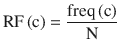

其中 `freq(c)` 表示单元格 `c` 被访问的次数，`N` 是 `c` 所属集合（扇区）中的元素总数。然后，对于每个扇区 `S`，其总相对频率为：

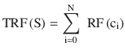

最后，火星车将选择在总相对频率最低的扇区的一个角落“注入”水源位置的信念，该扇区应该是过去访问最少的扇区。我们可以说这种方法在很大程度上是一种启发式方法；也就是说，我们对这个问题有特定的知识，并将其嵌入其中，试图让火星车在其任务中表现出更好的行为。这种启发式方法以及与此问题相关的其他方法将非常简单，甚至幼稚；当前的目的只是为了说明如何创建一个混合智能体架构。因此，启发式方法不会成为本章的核心。顺便提一下，我们总是选择选定扇区的一个角落来注入信念的策略或启发式方法，可以像扇区划分和选择过程一样得到极大的改进。

现在，我们已经初步了解了火星车的架构以及它实际上如何一步步做出决策，是时候展示其代码了。

## 火星车代码

火星车是用一个 `C#` 类编写的，包含以下字段、属性和构造函数（清单 4-1）。

# 火星车字段、变量和构造函数

```
public class MarsRover
{
    public Mars Mars { get; set; }
    public List Beliefs { get; set; }
    public Queue Desires { get; set; }
    public Stack Intentions { get; set; }
    public List PlanLibrary { get; set; }
    public int X { get; set; }
    public int Y { get; set; }
    public int SenseRadius { get; set; }
    public double RunningOverThreshold { get; set; }
    // 标识火星车看到的最后一部分地形
    public List> CurrentTerrain { get; set; }
    public Plan CurrentPlan { get; set; }
    public List> WaterFound { get; set; }
    private double[,] _terrain;
    private static Random _random;
    private Dictionary, int> _perceivedCells;
    private int _wanderTimes;
    private const int WanderThreshold = 10;

    public MarsRover(Mars mars, double [,] terrain, int x, int y, IEnumerable initialBeliefs, double runningOver, int senseRadious)
    {
        Mars = mars;
        X = x;
        Y = y;
        _terrain = new double[terrain.GetLength(0), terrain.GetLength(1)];
        Array.Copy(terrain, _terrain, terrain.GetLength(0) * terrain.GetLength(1));
        Beliefs = new List(initialBeliefs);
        Desires = new Queue();
        Intentions = new Stack();
        PlanLibrary = new List
        {
            new  Plan(TypesPlan.PathFinding, this),
        };
        WaterFound = new List>();
        RunningOverThreshold = runningOver;
        SenseRadius = senseRadious;
        CurrentTerrain = new List>();
        _random = new Random();
        _perceivedCells = new Dictionary, int>();
    }
}
```

`MarsRover`类包含以下字段和变量：

*   `Mars`：火星世界或环境的面向对象表示。智能体将使用此对象来查询火星实际地形上的水源位置和障碍物。

*   `X`，`Y`：均为整数，表示探测车在网格/火星地形中的当前位置。

*   `_terrain`：矩阵，表示探测车在着陆前最初设想的火星世界或地形，之后可通过感知进行更新。它类似于工程师给出的火星预想图；这是他们的地图，可能存在错误，因此必须更新。

*   `Beliefs`：列表，表示探测车所持有的信念集合；这些信念可能来自探测车着陆前工程师编码的一组初始信念，例如 `WaterAt(2,3)` 等，也可能是探测车后来通过某种深思熟虑的逻辑过程自行注入的信念。

*   `Desires`：队列，表示探测车所持有的愿望集合；愿望源于信念，并根据当前意图（如果有）进行更新。对于探测车而言，愿望将由可能的水源位置组成，并始终按距离排序或优先排序。

*   `Intentions`：探测车所持有的意图栈；栈顶元素表示当前意图，并且该意图已有相应的计划正在执行。

*   `PlanLibrary`：表示探测车根据所采纳的意图可以执行的一系列计划。

*   `WaterFound`：在火星上发现的水源位置列表（如果有）。

*   `RunningOverThreshold`：双精度值，表示地形上的岩石被视为探测车障碍物的阈值。

*   `SenseRadius`：整数值，表示探测车的视觉半径；即以探测车当前位置为圆心、决定其周围“视野”的圆的半径。

*   `CurrentTerrain`：表示探测车的当前地形；即由半径为 `SenseRadius` 的圆所定义的地形。该数据结构会随着探测车的移动而更新。

*   `CurrentPlan`：表示探测车当前正在执行的计划。

*   `_random`：用于获取随机值的变量（当探测车漫游时使用）。

*   `_perceivedCells`：存储每个单元格被访问次数的数据结构。用于探测车的“统计-概率”组件，以决定当探测车漫游足够长时间后应在何处注入水源信念。

*   `_wanderTimes`：整数值，表示探测车漫游的次数。

*   `WanderThreshold`：整数值，决定探测车可以执行“漫游”动作的次数。一旦探测车执行了 `WanderThreshold` 次动作，它将停止漫游并自动注入一个信念。

`Mars`对象（火星世界的表示）使用清单 4-2 中所示的类作为蓝图。

# Mars 类

```
public class Mars
{
    private readonly double[,] _terrain;

    public Mars(double[,] terrain)
    {
        _terrain = new double[terrain.GetLength(0), terrain.GetLength(1)];
        Array.Copy(terrain, _terrain, terrain.GetLength(0) * terrain.GetLength(1));
    }

    public double TerrainAt(int x, int y)
    {
        return _terrain[x, y];
    }

    public bool WaterAt(int x, int y)
    {
        return _terrain[x, y] < 0;
    }
}
```

`Mars`类非常简单；它包含一个描述地形（海拔）的矩阵，以及两个允许探测车查询给定位置环境状况的方法。该地形代表真实的火星地形；探测车也包含一个火星环境的表示，但这是基于工程师地图等的表示。它不会像实际地形那样精确。因此，探测车必须处理此对象，以确保其关于火星环境的数据准确无误，如果不准确，则进行更新。

为了处理信念、愿望和意图，我们将它们全部编码为类。`Intention`类继承自`Desire`类（清单 4-3）。

## 信念、愿望和意图类

```csharp
public class Belief
{
    public TypesBelief Name { get; set; }
    public dynamic Predicate;
    public Belief(TypesBelief name, dynamic predicate)
    {
        Name = name;
        Predicate = predicate;
    }
    public override string ToString()
    {
        var result = "";
        var coord = Predicate as List<Tuple<int, int>>;
        foreach (var c in coord)
            result += Name + " (" + c.Item1 + "," + c.Item2 + ")" + "\n";
        return result;
    }
}
public class Desire
{
    public TypesDesire Name { get; set; }
    public dynamic Predicate;
    public List<Desire> SubDesires { get; set; }
    public Desire() { SubDesires = new List<Desire>(); }
    public Desire(TypesDesire name)
    {
        Name = name;
        SubDesires = new List<Desire>();
    }
    public Desire(TypesDesire name, dynamic predicate)
    {
        Name = name;
        Predicate = predicate;
        SubDesires = new List<Desire>();
    }
    public Desire(TypesDesire name, IEnumerable<Desire> subDesires)
    {
        Name = name;
        SubDesires = new List<Desire>(subDesires);
    }
    public Desire(TypesDesire name, params Desire[] subDesires)
    {
        Name = name;
        SubDesires = new List<Desire>(subDesires);
    }
    public List<Desire> GetSubDesires()
    {
        if (SubDesires.Count == 0)
            return new List<Desire>() { this };
        var result = new List<Desire>();
        foreach (var desire in SubDesires)
            result.AddRange(desire.GetSubDesires());
        return result;
    }
    public override string ToString()
    {
        return Name.ToString() + "\n";
    }
}
public class Intention: Desire
{
    public static Intention FromDesire(Desire desire)
    {
        var result = new Intention
        {
            Name = desire.Name,
            SubDesires = new List<Desire>(desire.SubDesires),
            Predicate = desire.Predicate
        };
        return result;
    }
}
清单 4-3
信念、愿望和意图类
```

信念通常被编码为谓词，因此我们包含了一个动态（可以是任何类型）的 `Predicate` 属性来表示它们。在这种情况下，探测车的谓词是一个 `List<Tuple<int, int>>`，表示水源位置的信念。要使该类能够容纳不同类型的谓词，只需更改 `override ToString()` 方法即可。

愿望不仅包含谓词，还包含子愿望，如第 3 章所述。`GetSubDesires()` 方法将负责从愿望树中获取叶子节点。回顾第 3 章，一个给定的愿望可能包含必须首先满足的子愿望，然后实际愿望才能实现，而这些叶子愿望或基本愿望是智能体必须首先执行的（因为其他愿望依赖于叶子愿望或由其产生）。

最后，意图继承自愿望。请记住：意图是愿望的一个子集，我们可能有多个愿望，但并非所有愿望在特定时刻都需要是现实的；因此，意图是我们在某个时刻决定承诺的那些愿望。为了能够将愿望转换为意图，我们包含了 `FromDesire()` 方法。

## 枚举类型

为了定义并轻松处理有限的信念、愿望、感知、动作等集合，我们声明了以下枚举（清单 4-4）。

```csharp
public enum TypePercept
{
    WaterSpot, Obstacle, MoveUp, MoveDown, MoveLeft, MoveRight
}
public enum TypesBelief
{
    PotentialWaterSpots, ObstaclesOnTerrain
}
public enum TypesDesire
{
    FindWater, GotoLocation, Dig
}
public enum TypesPlan
{
    PathFinding
}
public enum TypesAction
{
    MoveUp, MoveDown, MoveLeft, MoveRight, Dig,
    None
}
清单 4-4
信念、愿望、感知、计划和动作的枚举
```

为了更好地处理感知和计划，我们将在程序中加入 `Percept` 和 `Plan` 类，如清单 4-5 所示。

## 感知类与计划类（清单 4-5）

```csharp
public class Percept
{
    public TypePercept Type { get; set; }
    public Tuple Position { get; set; }
    public Percept(Tuple position, TypePercept percept)
    {
        Position = position;
        Type = percept;
    }
}

public class Plan
{
    public TypesPlan Name { get; set; }
    public List> Path { get; set; }
    private MarsRover _rover;

    public Plan(TypesPlan name, MarsRover rover)
    {
        Name = name;
        Path = new List>();
        _rover = rover;
    }

    public TypesAction NextAction()
    {
        if (Path.Count == 0)
            return TypesAction.None;

        var next = Path.First();
        Path.RemoveAt(0);

        if (_rover.X > next.Item1)
            return TypesAction.MoveUp;
        if (_rover.X  next.Item2)
            return TypesAction.MoveLeft;

        return TypesAction.None;
    }

    public void BuildPlan(Tuple source, Tuple dest)
    {
        switch (Name)
        {
            case TypesPlan.PathFinding:
                Path = PathFinding(source.Item1, source.Item2, dest.Item1, dest.Item2).Item2;
                break;
        }
    }

    private Tuple, List>> PathFinding(int x1, int y1, int x2, int y2)
    {
        var queue = new Queue, List>>>();
        queue.Enqueue(new Tuple, List>>(new Tuple(x1, y1), new List>()));
        var hashSetVisitedCells = new HashSet>();

        while(queue.Count > 0)
        {
            var currentCell = queue.Dequeue();
            var currentPath = currentCell.Item2;
            hashSetVisitedCells.Add(currentCell.Item1);

            var x = currentCell.Item1.Item1;
            var y = currentCell.Item1.Item2;

            if (x == x2 && y == y2)
                return currentCell;

            // Up
            if (_rover.MoveAvailable(x - 1, y) && !hashSetVisitedCells.Contains(new Tuple(x - 1, y)))
            {
                var pathUp = new List>(currentPath);
                pathUp.Add(new Tuple(x - 1, y));
                queue.Enqueue(new Tuple, List>>(new Tuple(x - 1, y), pathUp));
            }

            // Down
            if (_rover.MoveAvailable(x + 1, y) && !hashSetVisitedCells.Contains(new Tuple(x + 1, y)))
            {
                var pathDown = new List>(currentPath);
                pathDown.Add(new Tuple(x + 1, y));
                queue.Enqueue(new Tuple, List>>(new Tuple(x + 1, y), pathDown));
            }

            // Left
            if (_rover.MoveAvailable(x, y - 1) && !hashSetVisitedCells.Contains(new Tuple(x, y - 1)))
            {
                var pathLeft = new List>(currentPath);
                pathLeft.Add(new Tuple(x, y - 1));
                queue.Enqueue(new Tuple, List>>(new Tuple(x, y - 1), pathLeft));
            }

            // Right
            if (_rover.MoveAvailable(x, y + 1) && !hashSetVisitedCells.Contains(new Tuple(x, y + 1)))
            {
                var pathRight = new List>(currentPath);
                pathRight.Add(new Tuple(x, y + 1));
                queue.Enqueue(new Tuple, List>>(new Tuple(x, y + 1), pathRight));
            }
        }

        return null;
    }

    public bool FulFill()
    {
        return Path.Count == 0;
    }
}
```

`Percept` 类非常简单；我们只是用它来更方便地了解感知发生的位置。通过使用这个类，我们可以保存感知的位置。

### 计划类详解

`Plan` 类则稍微复杂一些。它包含一个属性 `List<Tuple<int, int>> Path`，该属性定义了智能体执行计划后所创建的路径；在本例中，这是一个寻路计划。`BuildPlan()` 方法允许我们构建不同类型的计划。它旨在充当一种计划选择机制。`NextAction()` 方法通过返回并删除当前计划中要执行的下一个动作来更新 `Path` 属性。

最后，`PathFinding()` 方法实现了广度优先搜索（BFS）算法，用于在给定地形中从指定起点到指定终点或位置寻找最优路线。我们将在后续章节中进一步了解该算法；目前，我们将其视为一种用于不同图相关任务的基本算法，并记住它从起点开始，逐层发现从起点到终点的路径新步骤（图 4-3）。为此，它使用一个队列来存储当前正在检查的单元格的所有未被访问的邻居。

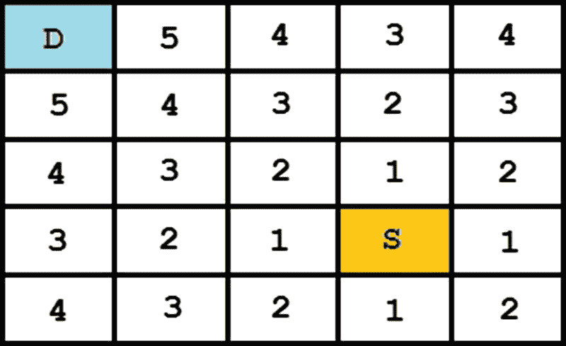
*图 4-3 BFS 能够按层级发现路径；S 是起点，D 是终点。每个带编号的单元格代表搜索中的一个层级；即第 1 层、第 2 层等。*

`FulFill()` 方法用于判断一个计划是否已完全执行完毕。

现在我们已经熟悉了火星车将使用的所有类，让我们深入探讨火星车的人工智能代码。

### 感知方法

与第 3 章中为智能体实现的方法类似，我们的火星车包含一个 `GetPercepts()` 方法（清单 4-6），该方法提供智能体在当前时间和其视野半径内感知到的感知列表。

```csharp
public List GetPercepts()
{
    var result = new List();
    if (MoveAvailable(X - 1, Y))
        result.Add(new Percept(new Tuple(X - 1, Y), TypePercept.MoveUp));
    if (MoveAvailable(X + 1, Y))
        result.Add(new Percept(new Tuple(X + 1, Y), TypePercept.MoveDown));
    if (MoveAvailable(X, Y - 1))
        result.Add(new Percept(new Tuple(X, Y - 1), TypePercept.MoveLeft));
    if (MoveAvailable(X, Y + 1))
        result.Add(new Percept(new Tuple(X, Y + 1), TypePercept.MoveRight));

    result.AddRange(LookAround());
    return result;
}
```

`GetPercepts()` 方法使用了 `MoveAvailable()` 和 `LookAround()` 方法，这两个方法均在清单 4-7 中展示。

### 辅助方法

```csharp
public bool MoveAvailable(int x, int y)
{
    return x >= 0 && y >= 0 && x < _terrain.Width && y < _terrain.Height && _terrain.GetTerrainType(x, y) != TypeTerrain.Impassable;
}

public List LookAround()
{
    return GetCurrentTerrain();
}
```

由于我们希望尽可能通用地编写火星车“环顾四周”的代码（不同人对环顾四周可能有不同定义），该功能的最终实现由清单 4-8 中所示的 `GetCurrentTerrain()` 方法提供。

## 概述
清单 4-8 中的方法包含多个依赖于圆周长公式的循环：

$$ {\left(\mathrm{x}-\mathrm{h}\right)}²+{\left(\mathrm{y}-\mathrm{k}\right)}²={\mathrm{r}}² $$

其中 `(h, k)` 代表圆心，在此处即智能体的位置；`r` 代表圆的半径，在此处即`SenseRadius`。这些循环使火星车能够追踪其当前位置`SenseRadius`距离内的每个单元格。在这些循环中，我们调用了`UpdatePerceivedCellsDicc()`和`CheckTerrain()`方法（清单 4-9）。前者仅更新已访问单元格字典，我们在统计与概率组件中使用该字典向火星车注入新的信念。后者检查地形中的给定单元格，判断其是否为障碍物或水源位置。它还会更新火星车最初维护的内部`_terrain`数据结构，并通过更新与感知坐标对应的值来保持后续更新。

## 清单 4-8：`GetCurrentTerrain()` 方法
```csharp
public IEnumerable GetCurrentTerrain()
{
    var R = SenseRadius;
    CurrentTerrain.Clear();
    var result = new List();
    for (var i = X - R > 0 ? X - R : 0; i = _terrain.GetLength(0)) break;
        // 在圆内
        result.AddRange(CheckTerrain(Mars.TerrainAt(i, j), new Tuple(i, j)));
        CurrentTerrain.Add(new Tuple(i, j));
        UpdatePerceivedCellsDicc(new Tuple(i, j));
    }
    for (var j = Y + 1; (j - Y) * (j - Y) + (i - X) * (i - X) = _terrain.GetLength(1) || i >= _terrain.GetLength(0)) break;
        // 在圆内
        result.AddRange(CheckTerrain(Mars.TerrainAt(i, j), new Tuple(i, j)));
        CurrentTerrain.Add(new Tuple(i, j));
        UpdatePerceivedCellsDicc(new Tuple(i, j));
    }
}
    return result;
}
```

## 清单 4-9：`UpdatePerceivedCellsDicc()` 和 `CheckTerrain()` 方法
```csharp
private void UpdatePerceivedCellsDicc(Tuple position)
{
    if (!_perceivedCells.ContainsKey(position))
        _perceivedCells.Add(position, 0);
    _perceivedCells[position]++;
}
private IEnumerable CheckTerrain(double cell, Tuple position)
{
    var result = new List();
    if (cell > RunningOverThreshold)
        result.Add(new Percept(position, TypePercept.Obstacle));
    else if (cell < 0)
        result.Add(new Percept(position, TypePercept.WaterSpot));
    // 更新火星车的内部地形
    _terrain[position.Item1, position.Item2] = cell;
    return result;
}
```

## 清单 4-10：`Action()` 方法
负责生成火星车下一步要执行动作的方法是`Action()`方法，如清单 4-10 所示。
```csharp
public TypesAction Action(List percepts)
{
    // 反应层
    if (Mars.WaterAt(X, Y) && !WaterFound.Contains(new Tuple(X, Y)))
        return TypesAction.Dig;
    var waterPercepts = percepts.FindAll(p => p.Type == TypePercept.WaterSpot);
    if (waterPercepts.Count > 0)
    {
        foreach (var waterPercept in waterPercepts)
        {
            var belief = Beliefs.FirstOrDefault(b => b.Name == TypesBelief.PotentialWaterSpots);
            List> pred;
            if (belief != null)
                pred = belief.Predicate as List>;
            else
            {
                pred = new List> {waterPercept.Position};
                Beliefs.Add(new Belief(TypesBelief.PotentialWaterSpots, pred));
            }
            if (!WaterFound.Contains(waterPercept.Position))
                pred.Add(waterPercept.Position);
            else
            {
                pred.RemoveAll(
                    t => t.Item1 == waterPercept.Position.Item1 && t.Item2 == waterPercept.Position.Item2);
                if (pred.Count == 0)
                    Beliefs.RemoveAll(b => (b.Predicate as List>).Count == 0);
            }
        }
        if (waterPercepts.Any(p => !WaterFound.Contains(p.Position)))
            CurrentPlan = null;
    }
    if (Beliefs.Count == 0)
    {
        if (_wanderTimes == WanderThreshold)
        {
            _wanderTimes = 0;
            InjectBelief();
        }
        _wanderTimes++;
        return RandomMove(percepts);
    }
    if (CurrentPlan == null || CurrentPlan.FullFill())
    {
        // 慎思层
        Brf(percepts);
        Options();
        Filter();
    }
    return CurrentPlan.NextAction();
}
```

在此方法中，我们整合了智能体的反应层和慎思层。前几行对应反应层，考虑了需要立即响应的不同场景：
1. 火星车当前位置有水，且该位置之前未被发现。
2. 在火星车周围区域（由半径为`SenseRadius`的圆定义）感知到可能存在水源的位置。在这种情况下，并且始终检查该可能水源位置尚未被发现，我们向火星车添加一个水源信念。
3. 如果步骤 2 中感知到的水源位置之前未被发现，则删除当前计划。将根据新信念构建新计划。
4. 如果火星车没有信念，它将执行随机动作（清单 4-11），即四处漫游。一旦这种“漫游”达到一定数量的动作（此处为十次），则注入一个信念。
上述四个步骤构成了我们智能体的反应层；方法最后部分由`Brf()`、`Options()`和`Filter()`方法组成，代表慎思层（BDI 架构）。`InjectBelief()`方法也属于慎思层，因为它涉及一个“慎思”过程，智能体在此过程中决定其下一步行动方案。

## 清单 4-11：`RandomMove()` 方法
```csharp
private TypesAction RandomMove(List percepts)
{
    var moves = percepts.FindAll(p => p.Type.ToString().Contains("Move"));
    var selectedMove = moves[_random.Next(0, moves.Count)];
    switch (selectedMove.Type)
    {
        case TypePercept.MoveUp:
            return TypesAction.MoveUp;
        case TypePercept.MoveDown:
            return TypesAction.MoveDown;
        case TypePercept.MoveRight:
            return TypesAction.MoveRight;
        case TypePercept.MoveLeft:
            return TypesAction.MoveLeft;
    }
    return TypesAction.None;
}
```

火星车的统计与概率组件，以及使其能够基于历史记录注入信念的组件，由`InjectBelief()`方法表示，该方法及其辅助方法可见于清单 4-12。

```
private void InjectBelief()
{
var halfC = _terrain.GetLength(1) / 2;
var halfR = _terrain.GetLength(0) / 2;
var firstSector = _perceivedCells.Where(k => k.Key.Item1 < halfR && k.Key.Item2 < halfC).ToList();
var secondSector = _perceivedCells.Where(k => k.Key.Item1 < halfR && k.Key.Item2 >= halfC).ToList();
var thirdSector = _perceivedCells.Where(k => k.Key.Item1 >= halfR && k.Key.Item2 < halfC).ToList();
var fourthSector = _perceivedCells.Where(k => k.Key.Item1 >= halfR && k.Key.Item2 >= halfC).ToList();
var freq1stSector = SetRelativeFreq(firstSector);
var freq2ndSector = SetRelativeFreq(secondSector);
var freq3rdSector = SetRelativeFreq(thirdSector);
var freq4thSector = SetRelativeFreq(fourthSector);
var min = Math.Min(freq1stSector, Math.Min(freq2ndSector, Math.Min(freq3rdSector, freq4thSector)));
if (min == freq1stSector)
Beliefs.Add(new Belief(TypesBelief.PotentialWaterSpots, new List<Tuple<int, int>> { new Tuple<int, int>(0, 0) }));
else if (min == freq2ndSector)
Beliefs.Add(new Belief(TypesBelief.PotentialWaterSpots, new List<Tuple<int, int>> { new Tuple<int, int>(0, _terrain.GetLength(1) - 1) }));
else if (min == freq3rdSector)
Beliefs.Add(new Belief(TypesBelief.PotentialWaterSpots, new List<Tuple<int, int>> { new Tuple<int, int>(_terrain.GetLength(0) - 1, 0) }));
else
Beliefs.Add(new Belief(TypesBelief.PotentialWaterSpots, new List<Tuple<int, int>> { new Tuple<int, int>(_terrain.GetLength(0) - 1, _terrain.GetLength(1) - 1) }));
}
private double SetRelativeFreq(List<KeyValuePair<Tuple<int, int>, int>> cells)
{
var result = 0.0;
foreach (var cell in cells)
result += RelativeFrequency(cell.Value, cells.Count);
return result;
}
private double RelativeFrequency(int absFreq, int n)
{
return (double) absFreq/n;
}
```

代码清单 4-12
`InjectBelief()`、`SetRelativeFreq()` 和 `RelativeFrequency()` 方法

正如上一节所述，对于给定扇区中的每个单元格，计算其相对频率，然后在 `SetRelativeFreq()` 方法中求和，以获得该组单元格的总频率。请注意，在此示例中，我们决定将地形划分为四个相等的扇区，但您可以根据需要决定划分为任意数量的扇区，或者达到您认为必要的细节级别，就像在四叉树（`QuadTree`）中所做的那样。甚至可以根据探测车的 `SenseRadius` 及其漫游时间，决定将地形划分为特定数量的扇区。这些值都是相互关联的，其中大部分在探测车附带的启发式规则中有所考虑。在本例中——为了追求示例的简洁性——我们选择为探测车附加非常简单的启发式规则；例如，始终在选定扇区的角落注入一个水源信念，在不同场景下可能是个坏主意，因为它并非每次都能奏效。因此，扇区选择和扇区内单元格选择机制需要更加通用，以便探测车在多种环境中都能表现良好。请记住，这里介绍的启发式规则可以大幅改进，从而提升探测车的性能。

**注意**

四叉树是一种树形数据结构，其中每个内部节点恰好有四个子节点。它们通常用于通过递归地将二维空间或区域细分为四个象限或子区域来对其进行划分。

最后，让我们检查一下 deliberative 层及其所有方法，从信念修正函数开始（代码清单 4-13）。

```
public void Brf(List<TypesBelief> percepts)
{
var newBeliefs = new List<Belief>();
foreach (var b in Beliefs)
{
switch (b.Name)
{
case TypesBelief.PotentialWaterSpots:
var waterSpots = new List<Tuple<int, int>>(b.Predicate);
waterSpots = UpdateBelief(TypesBelief.PotentialWaterSpots, waterSpots);
if (waterSpots.Count > 0)
newBeliefs.Add(new Belief(TypesBelief.PotentialWaterSpots, waterSpots));
break;
case TypesBelief.ObstaclesOnTerrain:
var obstacleSpots = new List<Tuple<int, int>>(b.Predicate);
obstacleSpots = UpdateBelief(TypesBelief.ObstaclesOnTerrain, obstacleSpots);
if (obstacleSpots.Count > 0)
newBeliefs.Add(new Belief(TypesBelief.ObstaclesOnTerrain, obstacleSpots));
break;
}
}
Beliefs = new List<Belief>(newBeliefs);
}
```

代码清单 4-13
`Brf()` 方法

在 `Brf()` 方法中，我们检查每一个信念（可能的水源位置、可能的障碍物位置）并更新它们，从而创建一组新的信念。`UpdateBelief()` 方法如代码清单 4-14 所示。

```
private List<Tuple<int, int>> UpdateBelief(TypesBelief belief, IEnumerable<Tuple<int, int>> beliefPos)
{
var result = new List<Tuple<int, int>>();
foreach (var spot in beliefPos)
{
if (CurrentTerrain.Contains(new Tuple<int, int>(spot.Item1, spot.Item2)))
{
switch (belief)
{
case TypesBelief.PotentialWaterSpots:
if (_terrain[spot.Item1, spot.Item2] >= 0)
continue;
break;
case TypesBelief.ObstaclesOnTerrain:
if (_terrain[spot.Item1, spot.Item2] < RunningOverThreshold)
continue;
break;
}
}
result.Add(spot);
}
return result;
}
```

代码清单 4-14
`UpdateBelief()` 方法

在 `UpdateBelief()` 方法中，我们根据当前感知到的地形检查每一个信念。如果存在错误的信念——例如，我们曾认为或相信会在位置 (x, y) 找到水源，但碰巧我们刚刚去过那里，却什么也没有——那么该信念必须被删除。

负责生成愿望的 `Options()` 方法如代码清单 4-15 所示。

我们只考虑一种类型的愿望——在特定位置寻找水源的愿望。因此，以信念集为基础，我们生成愿望，并使用距离（代码清单 4-16）作为邻近度量，按距离远近对其进行排序。

```csharp
public void Options()
{
    Desires.Clear();
    foreach (var b in Beliefs)
    {
        if (b.Name == TypesBelief.PotentialWaterSpots)
        {
            var waterPos = b.Predicate as List<Tuple<int, int>>;
            waterPos.Sort(delegate(Tuple<int, int> tupleA, Tuple<int, int> tupleB)
            {
                var distA = ManhattanDistance(tupleA, new Tuple<int, int>(X, Y));
                var distB = ManhattanDistance(tupleB, new Tuple<int, int>(X, Y));
                if (distA < distB)
                    return 1;
                else if (distA > distB)
                    return -1;
                return 0;
            });
            foreach (var wPos in waterPos)
                Desires.Enqueue(new Desire(TypesDesire.FindWater, new Desire(TypesDesire.GotoLocation, new Desire(TypesDesire.Dig, wPos))));
        }
    }
}
```
*代码清单 4-15: `Options()` 方法*

```csharp
public int ManhattanDistance(Tuple<int, int> x, Tuple<int, int> y)
{
    return Math.Abs(x.Item1 - y.Item1) + Math.Abs(x.Item2 - y.Item2);
}
```
*代码清单 4-16: 曼哈顿距离*

使用愿望集，我们在 `Filter()` 方法中将新的意图推入我们的意图集；如果当前意图没有正在执行的计划，则使用 `ChoosePlan()` 方法（代码清单 4-17）选择一个计划。

```csharp
private void Filter()
{
    Intentions.Clear();
    foreach (var desire in Desires)
    {
        if (desire.SubDesires.Count > 0)
        {
            var primaryDesires = desire.GetSubDesires();
            primaryDesires.Reverse();
            foreach (var d in primaryDesires)
                Intentions.Push(Intention.FromDesire(d));
        }
        else
            Intentions.Push(Intention.FromDesire(desire));
    }
    if (Intentions.Any() && !ExistsPlan())
        ChoosePlan();
}

private void ChoosePlan()
{
    var primaryIntention = Intentions.Pop();
    var location = primaryIntention.Predicate as Tuple<int, int>;
    switch (primaryIntention.Name)
    {
        case TypesDesire.Dig:
            CurrentPlan = PlanLibrary.First(p => p.Name == TypesPlan.PathFinding);
            CurrentPlan.BuildPlan(new Tuple<int, int>(X, Y), location);
            break;
    }
}
```
*代码清单 4-17: `Filter()` 和 `ChoosePlan()` 方法*

最后，`ExistsPlan()` 方法判断是否有正在执行的计划，而 `ExecuteAction()` 方法则执行智能体选择的动作（代码清单 4-18）。后一个方法还负责使用已发现水源的位置更新 `WaterFound` 数据结构。

```csharp
public bool ExistsPlan()
{
    return CurrentPlan != null && CurrentPlan.Path.Count > 0;
}

public void ExecuteAction(TypesAction action, List<TypesBelief> percepts)
{
    switch (action)
    {
        case TypesAction.MoveUp:
            X -= 1;
            break;
        case TypesAction.MoveDown:
            X += 1;
            break;
        case TypesAction.MoveLeft:
            Y -= 1;
            break;
        case TypesAction.MoveRight:
            Y += 1;
            break;
        case TypesAction.Dig:
            WaterFound.Add(new Tuple<int, int>(X, Y));
            break;
    }
}
```
*代码清单 4-18: `ExistsPlan()` 和 `ExecuteAction()` 方法*

在下一节中，我们将通过一个 Windows 窗体应用程序来观察我们的火星车实际运行情况，该程序是我们为实验和观察其 AI 在测试世界中的工作方式而创建的。

## 火星车可视化应用程序

正如本章开头所述，我们创建了一个 Windows 窗体应用程序，用于测试我们的火星车，并观察它在隐藏水源和沿途障碍物的火星测试世界中的表现。这个示例不仅有助于我们理解如何设置 `MarsRover` 和 `Mars` 类，还将展示本章介绍的 AI 如何在不同的场景下执行其决策过程。Windows 窗体应用程序的完整细节（列表 4-19）超出了本书的范围；我们仅展示其中的一部分，以便向读者说明图形来源。如需进一步参考，可查阅本书附带的源代码。

```
public partial class MarsWorld : Form
{
    private MarsRover _marsRover;
    private Mars _mars;
    private int _n;
    private int _m;
    public MarsWorld(MarsRover rover, Mars mars, int n, int m)
    {
        InitializeComponent();
        _marsRover = rover;
        _mars = mars;
        _n = n;
        _m = m;
    }
    private void TerrainPaint(object sender, PaintEventArgs e)
    {
        var pen = new Pen(Color.Wheat);
        var waterColor = new SolidBrush(Color.Aqua);
        var rockColor = new SolidBrush(Color.Chocolate);
        var cellWidth = terrain.Width/_n;
        var cellHeight = terrain.Height/_m;
        for (var i = 0; i < _n; i++)
        {
            for (var j = 0; j < _m; j++)
            {
                if (_mars.RockAt(i, j))
                    e.Graphics.DrawImage(new Bitmap("rock-transparency.png"), j * cellWidth, i * cellHeight, cellWidth, cellHeight);
                else
                    e.Graphics.DrawRectangle(pen, j * cellWidth, i * cellHeight, cellWidth, cellHeight);

                if (_marsRover.RunningOverThreshold)
                    e.Graphics.DrawImage(new Bitmap("obstacle-transparency.png"), j*cellWidth, i*cellHeight,
                        cellWidth, cellHeight);
                if (_mars.WaterAt(i, j))
                    e.Graphics.DrawImage(new Bitmap("water-transparency.png"), j * cellWidth, i * cellHeight, cellWidth, cellHeight);
                // 以白色绘制所有信念
                foreach (var belief in _marsRover.Beliefs)
                {
                    var pred = belief.Predicate as List<Tuple<int, int>>;
                    if (pred != null && !pred.Contains(new Tuple<int, int>(i, j)))
                        continue;
                    if (belief.Name == TypesBelief.ObstaclesOnTerrain)
                    {
                        e.Graphics.DrawImage(new Bitmap("obstacle-transparency.png"), j * cellWidth, i * cellHeight, cellWidth, cellHeight);
                        e.Graphics.DrawRectangle(new Pen(Color.Gold, 6), j * cellWidth, i * cellHeight, cellWidth, cellHeight);
                    }
                    if (belief.Name == TypesBelief.PotentialWaterSpots)
                    {
                        e.Graphics.DrawImage(new Bitmap("water-transparency.png"), j * cellWidth, i * cellHeight,
                            cellWidth, cellHeight);
                        e.Graphics.DrawRectangle(new Pen(Color.Gold, 6), j * cellWidth, i * cellHeight, cellWidth, cellHeight);
                    }
                }
            }
        }
        e.Graphics.DrawImage(new Bitmap("rover-transparency.png"), _marsRover.Y * cellWidth, _marsRover.X * cellHeight, cellWidth, cellHeight);
        var sightColor = Color.FromArgb(80, Color.Lavender);
        _marsRover.GetCurrentTerrain();
        foreach (var cell in _marsRover.CurrentTerrain)
            e.Graphics.FillRectangle(new SolidBrush(sightColor), cell.Item2 * cellWidth, cell.Item1 * cellHeight, cellWidth, cellHeight);
    }
    private void TimerAgentTick(object sender, EventArgs e)
    {
        var percepts = _marsRover.GetPercepts();
        agentState.Text = "状态：思考中 ...";
        agentState.Refresh();
        var action = _marsRover.Action(percepts);
        _marsRover.ExecuteAction(action, percepts);
        var beliefs = UpdateText(beliefsList, _marsRover.Beliefs);
        var desires = UpdateText(beliefsList, _marsRover.Desires);
        var intentions = UpdateText(beliefsList, _marsRover.Intentions);
        if (beliefs != beliefsList.Text)
            beliefsList.Text = beliefs;
        if (desires != desiresList.Text)
            desiresList.Text = desires;
        if (intentions != intentionsList.Text)
            intentionsList.Text = intentions;
        foreach (var wSpot in _marsRover.WaterFound)
        {
            if (!waterFoundList.Items.Contains(wSpot))
                waterFoundList.Items.Add(wSpot);
        }
        Refresh();
    }
    private string UpdateText(RichTextBox list, IEnumerable<string> elems)
    {
        var result = "";
        foreach (var elem in elems)
            result += elem;
        return result;
    }
    private void PauseBtnClick(object sender, EventArgs e)
    {
        if (timerAgent.Enabled)
        {
            timerAgent.Stop();
            pauseBtn.Text = "播放";
        }
        else
        {
            timerAgent.Start();
            pauseBtn.Text = "暂停";
        }
    }
}
```
列表 4-19：`Windows` 窗体可视化应用程序代码片段

从这段代码中我们可以注意到，可视化应用程序由一个网格构成，其中包含了播放/暂停按钮，并使用一个定时器来控制探测车的动作，使其每秒执行一次。

为了设置我们的火星探测车和世界，我们需要定义一组初始信念、一个供探测车使用的地形，以及一个真实的火星地形（列表 4-20）。

运行该应用程序后，会出现一个如图4-4所示的图形用户界面。在这个程序中，我们可以轻松区分水源位置（水滴图像）和障碍物位置（岩石图像）。

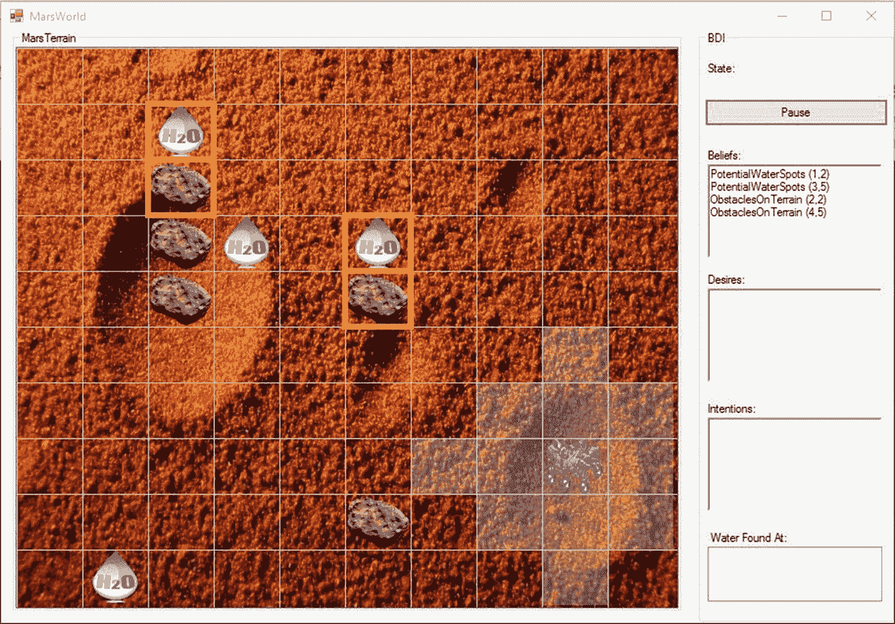
图 4-4

Windows 窗体应用程序展示了探测车、其感知半径、用黄色方块标记的水源位置和障碍物信念，以及没有黄色方块环绕的实际水源和障碍物位置。

请注意，探测车周围始终有浅色单元格；这些是探测车在任何给定时刻能够“看到”或感知到的单元格，由 `SenseRadius` 参数（在设置代码中定义为 [曼哈顿距离] 值 2）和以探测车当前位置为圆心、`SenseRadius` 为半径的“离散”圆定义。

在应用程序的右侧，有一个包含各种信息区域的面板，例如信念、愿望、意图、发现水源位置。这些都是 Windows 窗体控件，最终使用了上一节中介绍的 `ToString()` 重写方法。

是时候看看我们的火星探测车智能体实际运行了。让我们看看运行应用程序时会发生什么（图4-5）。

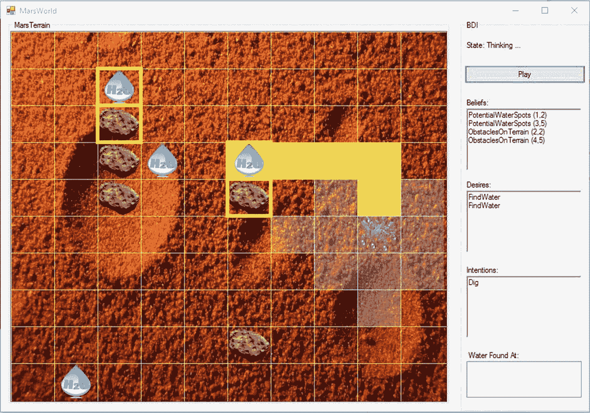
图 4-5

探测车制定了一个前往位置 (3, 5) 的计划，这是它最近的可能水源位置，因此它创建了一个计划或一系列动作（用黄色单元格表示）以到达那里并进行挖掘。

请注意，我们的寻路算法返回的计划（动作序列）或路径用黄色表示，目的是让我们更容易理解探测车要去哪里以及为什么。在这种情况下，探测车正在追踪其最近的水源位置信念。一旦到达那里（图4-6），它发现自己的信念是错误的，目标位置没有水，因为在该水源位置信念相邻的单元格中没有障碍物。好消息是，在探索该区域时，探测车感知到附近有一个水源位置（在其感知圈内），因此它冒险前往那里以了解更多信息。

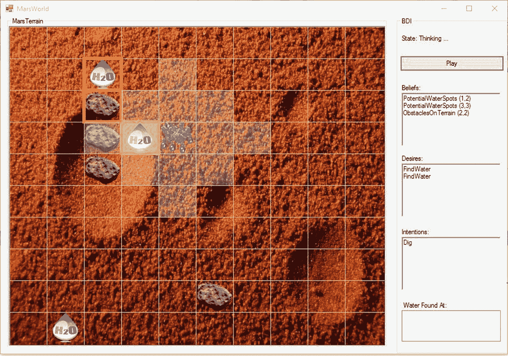
图 4-6

探测车在探索一个信念时感知到一个水源位置，并发现了火星上的第一个水源位置

智能体之前寻找的位置是一个水源位置，因此 `WaterFound` 数据结构被更新，探测车在火星上找到了水！之后，它继续追踪下一个信念（图4-7）：位于 (1, 2) 的水源。再次，当接近（进入其感知或感知半径）时，下一个水源位置信念以及另一个障碍物位置信念被智能体丢弃，因此信念集被更新。

现在，探测车已经用尽了它的信念集，它将四处漫游（持续十个动作；这在代码中是硬编码的，见图4-8），直到我们的统计与概率推理组件被激活，并促使探测车根据逻辑结论为自己注入一个新的信念。在这种情况下——模仿我们人类大脑会做的事情，因为我们只是试图模仿人类在这种情况下会做什么——我们会认为，在未探索的区域找到水的可能性更大，或者说机会要大得多。在“启发式与元启发式”章节 14 中，我们将看到这个概念被称为多样化，并且在遗传算法、禁忌搜索等元启发式算法中非常常见。

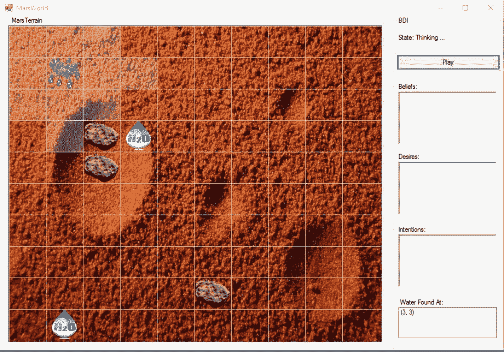
图 4-8

探测车在用尽信念集后四处漫游

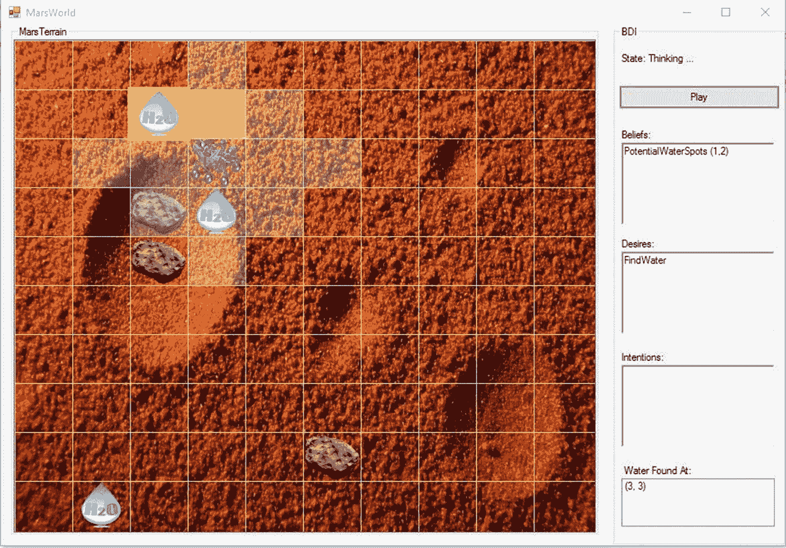
图 4-7

探测车丢弃了一个水源位置信念和一个障碍物位置信念

同样，我们可以有一个多样化阶段来探索地形中访问较少或未探索的区域，也可以有一个强化阶段来更好地探索之前发现过水的区域；即地形中有希望的区域。在我们的案例中，强化阶段可能涉及让探测车在地形的某个区域漫游。

正如我们将在后续章节中看到的，在与搜索相关的问题中，找到强化和多样化阶段之间的平衡（有时称为探索-利用权衡）至关重要，而我们日常生活中面临的大多数问题都是搜索问题或优化问题，这些归根结底都是搜索问题，因为我们在所有可能解的空间中搜索一个最佳或最优的解。因此，许多问题都可以简化为仅仅是搜索，而这是一项通常需要智慧才能完成的复杂任务。

继续我们的火星探测车示例，图4-9显示了探测车在完成漫游阶段后，为自己注入了一个关于第三区域左下角单元格有水的信念，并因此设定路线前往该单元格。

这个信念的注入使得探测车找到了一个实际的水源位置，该位置位于注入的水源位置信念附近。因此，通过将搜索多样化到未探索的区域，我们找到了一个实际的水源位置（图4-10）。这个过程会重复进行；探测车四处漫游（随机移动），最终注入一个新的信念，并移动到该位置（图4-11）。

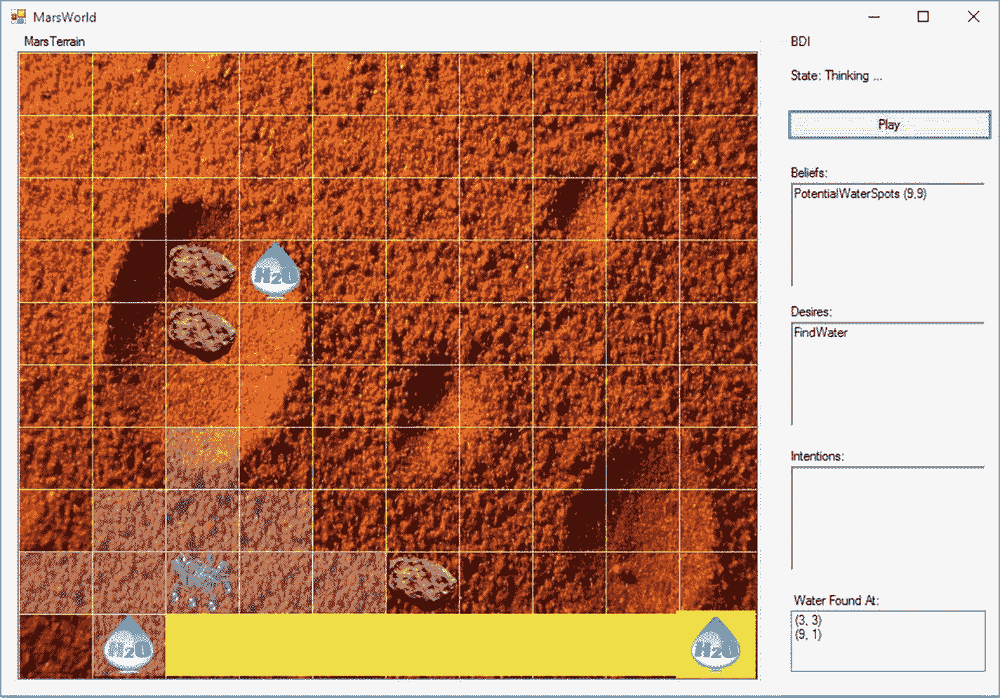
图 4-11

探测车重复该过程，四处漫游，然后注入一个新的水源位置信念

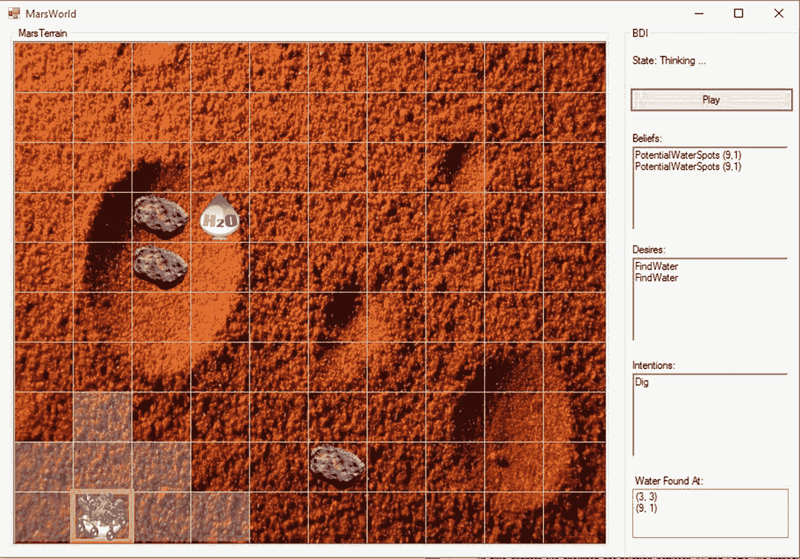
图 4-10

探测车跟随注入的信念，并在此过程中找到了一个实际的水源位置

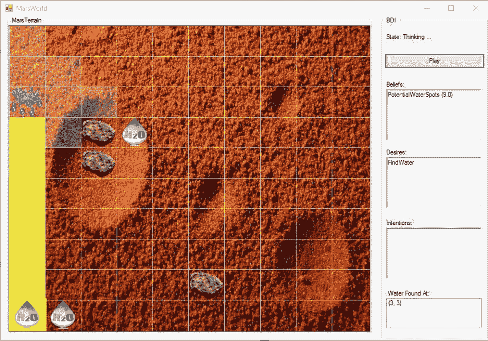
图 4-9

探测车为自己注入了一个关于第三区域左下角可能存在水源位置的信念

本章介绍的“火星漫游车”具有多种可优化的特性，以提升其性能。例如，随着漫游车在火星上停留的时间越来越长，可以调整 `WanderThreshold` 参数，以延长其在特定区域徘徊的时间；这一决策可能取决于它当前所在区域的方形面积。此外，总是选择访问频率较低区域的角落来注入“水源位置信念”的策略也可以改变，并使其依赖于与漫游车历史或状态相关的各种条件。该选择也可以随机进行；例如，在所选区域中随机选择一个单元格来注入水源位置信念，或者选择该区域中访问最少的单元格。地形的划分方式也可能改变；我们可以使用存储在数据库中的一组划分模式，以不同方式（不总是 2^n 细分）划分地形，让漫游车有机会探索不同形状的多样化区域。可能性是无限的，读者可以利用本章提供的框架，创建自己完美的火星漫游车。

以下是设置火星探测车和世界的代码示例：
```csharp
var water = new List<Tuple<int, int>>
{
    new Tuple<int, int>(1, 2),
    new Tuple<int, int>(3, 5),
};
var obstacles = new List<Tuple<int, int>>
{
    new Tuple<int, int>(2, 2),
    new Tuple<int, int>(4, 5),
};
var beliefs = new List<Belief> {
    new Belief(TypesBelief.PotentialWaterSpots, water),
    new Belief(TypesBelief.ObstaclesOnTerrain, obstacles),
};
var marsTerrain = new double[,]
{
    {0, 0, 0, 0, 0, 0, 0, 0, 0, 0},
    {0, 0, 0, 0, 0, 0, 0, 0, 0, 0},
    {0, 0, 0, 0, 0, 0, 0, 0, 0, 0},
    {0, 0, 0.8, -1, 0, 0, 0, 0, 0, 0},
    {0, 0, 0.8, 0, 0, 0, 0, 0, 0, 0},
    {0, 0, 0, 0, 0, 0, 0, 0, 0, 0},
    {0, 0, 0, 0, 0, 0, 0, 0, 0, 0},
    {0, 0, 0, 0, 0, 0, 0, 0, 0, 0},
    {0, 0, 0, 0, 0, 0.8, 0, 0, 0, 0},
    {0, 0, 0, 0, 0, 0, 0, 0, 0, 0}
};
var roverTerrain = new double[,]
{
    {0, 0, 0, 0, 0, 0, 0, 0, 0, 0},
    {0, 0, 0, 0, 0, 0, 0, 0, 0, 0},
    {0, 0, 0, 0, 0, 0, 0, 0, 0, 0},
    {0, 0, 0.8, 0, 0, 0, 0, 0, 0, 0},
    {0, 0, 0.8, 0, 0, 0, 0, 0, 0, 0},
    {0, 0, 0, 0, 0, 0, 0, 0, 0, 0},
    {0, 0, 0, 0, 0, 0, 0, 0, 0, 0},
    {0, 0, 0, 0, 0, 0, 0, 0, 0, 0},
    {0, 0, 0, 0, 0, 0.8, 0, 0, 0, 0},
    {0, 0, 0, 0, 0, 0, 0, 0, 0, 0}
};
var mars = new Mars(marsTerrain);
var rover = new MarsRover(mars, roverTerrain, 7, 8, beliefs, 0.75, 2);
Application.EnableVisualStyles();
Application.SetCompatibleTextRenderingDefault(false);
Application.Run(new MarsWorld(rover, mars, 10, 10));
```

现在，我们已经研究了一个关于智能体及其架构的完整实际问题，可以继续前进，探索多智能体系统。在这些系统中，多个智能体共存，并可能协作或竞争，以实现它们共同的目标。这将是下一章的重点。

## 总结

在本章中，我们介绍了设计火星漫游车 AI 的实际问题，该 AI 采用了一种混合架构，由反应层和实现 BDI（信念、愿望和意图）范式的审慎层组成。火星漫游车示例包含一个可视化应用程序（Windows Forms），演示了漫游车如何对不同场景做出反应，如何通过寻路算法进行规划，以及如何对即时感知到的情况提供及时响应。我们还介绍了智能体中的一个统计与概率组件，它作为一个审慎组件，使智能体能够探索未探索或访问较少的区域。