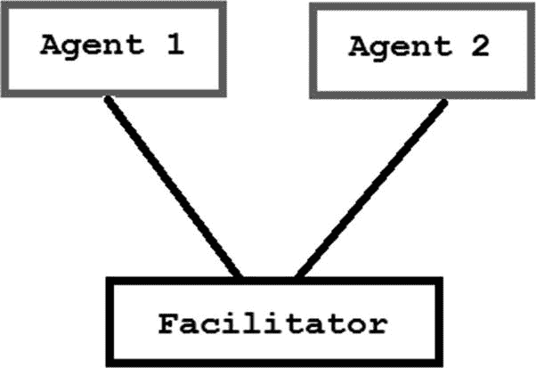
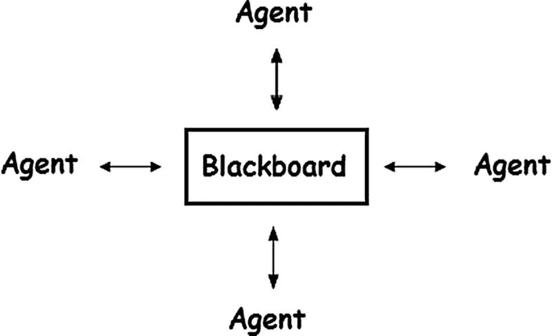
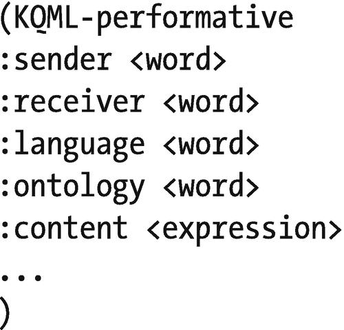
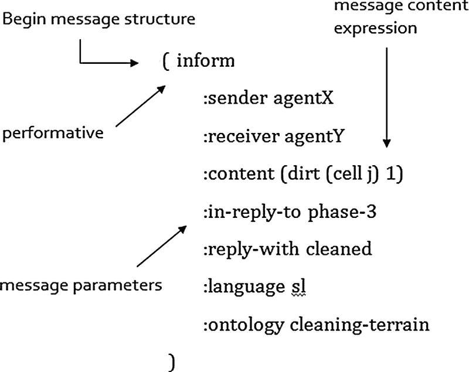
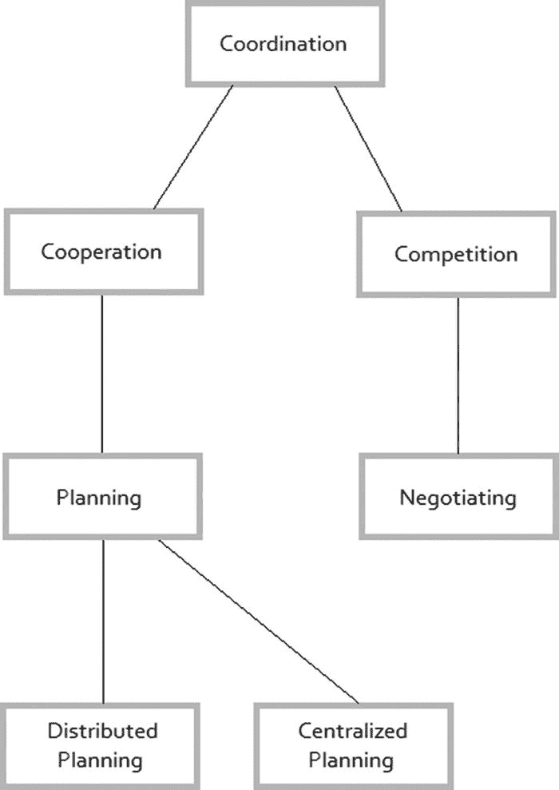
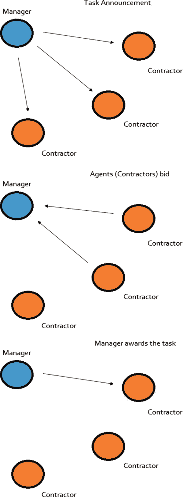
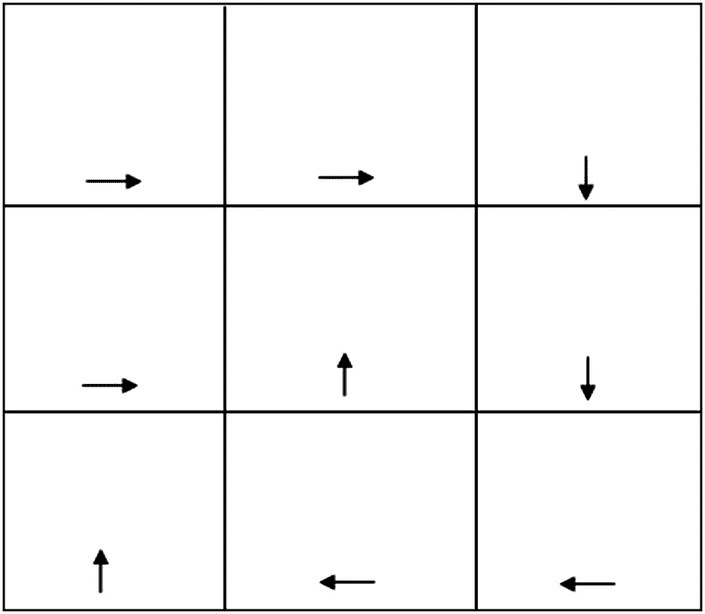

# 5. 多智能体系统

到目前为止，我们一直将智能体视为与环境交互的单一实体；在现实生活中，当多个智能体协作以实现共同目标时，许多问题可以更快、更高效地解决。

回想一下第 2 章和第 3 章中的清洁智能体；这个智能体独自处理整个地形的清洁问题。毫无疑问，如果多个清洁机器人在同一地形上相互通信并互相帮助，就能在更短的时间内完成这项任务，而单个智能体完成该任务则需要更长的时间并消耗更多资源。

如今，多智能体系统（`MAS`）被应用于现实世界的各种应用中，例如电脑游戏、军事防御系统、空中交通管制、交通运输、地理信息系统（GIS）、物流、医疗诊断等。其他用途涉及移动技术，它们被用于实现自动、动态的负载均衡和高可扩展性。

在本章中，我们将研究多智能体系统，其中多个智能体可以协作、协调、通信或竞争以实现特定目标。`MAS` 属于分布式系统与人工智能相结合的领域，形成了所谓的分布式人工智能。在本部分（将涵盖接下来的三章）结束时，我们将提出一个实际问题，即多个清洁机器人将协作清洁一个房间。

注意

多智能体系统代表了分布式计算系统。与任何分布式系统一样，它们由多个相互作用的计算实体组成。然而，与经典分布式系统不同，它们的组成实体是智能的，并且能够彼此进行智能交互。

## 什么是多智能体系统？

与之前介绍的逻辑和智能体术语一样，对于多智能体系统的定义并没有全球共识。在本书中，我们将提供一个我们认为合乎逻辑的个人定义，该定义也考虑了从科学文献中提取的其他 `MAS` 定义。

多智能体系统（`MAS`）是一个智能体集合 S，这些智能体以竞争方式（旨在实现它们所属的子集 S' 所定义的目标，其中 S' 是 S 的一个划分）或协作方式（旨在实现 S 中定义的共同目标）相互交互。此外，也可能出现 S 中的每个智能体都为实现自身目标而行动的情况；在这种情况下，我们称之为独立的 `MAS`。

在表 5-1 中，我们可以看到 `MAS` 应用于空中交通管制的第一个非常常见的场景；在此场景中，智能体控制器 1（A1）直接与飞行员打交道，并与智能体控制器 2（A2）协作，为他们寻找可用的着陆跑道。有关这两个协作智能体之间的完整对话，请参阅表 5-1。

现在我们已经介绍了 `MAS` 术语的自我定义，我们将继续介绍其他相关的概念。

联盟被认为是智能体集合的一个子集；对于像篮球、棒球或足球比赛这样的 `MAS`，总是存在两个联盟——即竞争的两个队伍。

策略是一个函数，它接收环境的当前状态，并输出联盟要执行的动作。A 队的策略通常取决于 B 队中每个智能体在当前时刻执行的动作。

`平台`，也称为多智能体基础设施，是一个框架、基础或支撑，它描述了`智能体架构`、`多智能体组织`以及它们之间的关系或依赖关系。它允许智能体在不考虑此类`平台`属性（集中式与否、是否嵌入智能体等）的情况下进行交互，并且通常根据系统需求为智能体提供一组服务（智能体定位等），旨在增强 `MAS` 的活动和组织；它被视为智能体的工具。

`智能体架构`描述了构成单个智能体的层或模块，以及它们之间的关系和交互。例如，在 `MAS` 上下文中，智能体通常有一个`通信模块`，用于加强与用户和其他智能体的通信。正如我们所知（来自第 3 章和第 4 章），某些类型的智能体还具有`规划层`。通常，到达`通信模块`的传入消息会通过某种连接影响`规划层`，而`规划层`可能会创建由`通信模块`处理的传出消息。

`多智能体组织`描述了多个智能体如何组织起来形成一个 `MAS`。关系、智能体之间的交互以及它们在组织中的特定角色构成了`多智能体组织`。`智能体架构`不是`多智能体组织`的一部分，尽管它们之间的相互关系很常见。

如果一个智能体相对于构成 `MAS` 的智能体集合中的其他每个智能体都是自主的，则称该智能体在 `MAS` 中是自主的；换句话说，如果它不受任何其他智能体的控制或权力支配。

表 5-1

空中交通管制场景中的 `MAS` 示例

| 飞行员 | 智能体控制器 1 (A1) | 智能体控制器 2 (A2) |
| --- | --- | --- |
| 对 A1：我可以降落吗？ |   |   |
|   | 对 A2：有空闲跑道吗？ |   |
|   |   | 对 A1：跑道 P。 |
|   | 对飞行员：允许使用跑道 P。 |   |
| 对 A1：收到 |   |   |
|   | 对 A2：跑道 P 现在繁忙。 |   |

如果一个多智能体系统（`MAS`）是独立的，且各智能体的目标互不相关，则该系统是离散的。因此，离散型 `MAS` 不涉及合作，因为每个智能体都会各行其是，努力实现自己的目标。

`模块化`是 `MAS` 的优势之一；有时，解决一个复杂问题会被细分为原问题中更简单的子问题，每个智能体可以专门解决其中某一特定类型的问题，从而提高了`可重用性`。想象一个应对城市灾难（如地震）的 `MAS`。这样的 `MAS` 将由不同的智能体（警察、消防员等）组成，每个智能体专注于单一任务，而所有智能体都肩负着建立秩序和拯救生命的全局使命。

通过 `MAS` 解决问题能带来`高效性`；如果有多个并发、并行的智能体同时工作来解决问题，那么问题的解决方案往往能更快地达成。

`MAS` 还提供了更高的`可靠性`，因为我们可以有多个智能体负责处理单一任务，如果其中一个失败，其他智能体可以通过在剩余智能体之间重新分配任务来继续其工作。

`MAS` 提供的最后一个重要优势是`灵活性`；我们可以随意在 `MAS` 中添加或删除智能体，并且拥有互补技能的不同智能体可以组成联盟，共同协作以解决问题。

在接下来的章节中，我们将探讨分布式人工智能领域的一些关键概念，特别是关于 `MAS` 的主题：通信、合作、协商和协调。我们还将更深入地审视之前介绍过的一些概念。

注意

`平台`可以提供的服务之一是智能体定位；换句话说，这是一种设施，通过它，一个智能体或第三方能够在 `MAS` 环境中定位到另一个智能体。

## 多智能体组织

在本章前面部分，我们给出了术语“`多智能体组织`”的定义。在本节中，我们将详细介绍一些最常见的`多智能体组织`类型：

*   **层级式**：智能体只能通过遵循层级结构进行通信的组织。由于这种限制，不需要智能体定位机制。取而代之的是一组协调者充当中间人，接收和发送智能体之间的所有消息。这些协调者通常位于层级结构的上层。因此，下层通常依赖于上层。在这种类型的组织中，通信量大大减少。

*   **扁平式或民主式**：智能体可以直接相互通信的组织。这种类型的组织没有固定结构，但如果智能体认为有必要解决某个特定任务，它们可以形成自己的结构。此外，不假定一个智能体对另一个智能体有控制权。智能体定位必须作为基础设施或`平台`的一部分提供，否则系统必须是封闭的；换句话说，每个智能体必须始终了解其他智能体。这种类型的组织可能导致通信开销过大。

*   **包含式**：智能体（被包含者）可以是其他智能体（容器）的组成部分的组织。这种类型的组织类似于层级模型，不同之处在于，被包含的智能体将其所有控制权交给其容器智能体。与层级式组织一样，它的通信开销较低。

*   **模块式**：`MAS` 由多个模块组成的组织，每个模块都可以被视为一个独立的 `MAS`。将系统划分为模块通常是通过考虑诸如地理邻近性或同一模块内智能体与服务之间需要极端交互等因素来完成的。模块化提高了任务执行的效率并减少了通信开销。

这些组织类型的混合形式以及从一种风格到另一种风格的动态变化都是可能的。从前面几点详述的`多智能体组织`中，我们可以很容易地看出，通信在定义智能体的架构和运作方式方面起着至关重要的作用。我们将用下一节来阐述这个非常重要主题的一些关键方面。

注意

近年来，人们提出了各种各样的智能体架构。对于 `MAS` 架构而言，这个数量大大减少，因为要使一个智能体能够融入 `MAS`，它必须配备关键的组件（通信、协调等），使其能够与其他智能体进行适当的交互。

## 通信

`MAS` 中的智能体必须协调它们的行动来解决问题。在这种情况下，协调是通过通信实现的，通信在提供智能体交互、促进信息共享与合作以及协调方面起着至关重要的作用。

在上一节中，我们讨论了 `MAS` 组织以及它们如何根据智能体所处的组织类型影响智能体通信。现在，我们将研究这个主题的一些具体方面。

智能体之间建立的通信链路可以分为：

*   **点对点**：智能体直接相互通信。

*   **广播/组播**：智能体能够向智能体集合的一个子集发送信息。如果这个子集等于整个智能体集合，那么该智能体是在广播；否则，它是在组播。

*   **中介式**：智能体之间的通信由第三方（协调者）进行中介（见图 5-1）。

    

    图 5-1

    智能体 1 和智能体 2 通过充当中间人的协调者进行通信

考虑到消息从一个智能体传输到另一个智能体的媒介性质，通信可以分为：

*   **直接路由**：消息直接发送给其他智能体，信号无损失。

*   **信号传播路由**：智能体发送信号，其强度随距离增加而减弱。

*   **公告板路由**：使用黑板系统

黑板系统和直接消息传递是建立智能体通信的两种选择。

## 黑板系统

黑板系统（图 5-2）代表一个公共的共享空间，供每个智能体放置其数据、信息和知识。每个智能体可以在任何给定时间从黑板读写数据，在这种集中式系统中，智能体之间没有直接通信。黑板还充当调度器，处理智能体请求、公共问题的数据、解决方案的当前状态、每个智能体的当前任务等。由于黑板系统由共享资源组成，必须注意在这种模型中可能出现的所有并发问题（多个智能体试图访问相同信息、智能体使用其他智能体写入的未更新的部分数据等）。



图 5-2
黑板系统是一个集中的、公共的空间，供所有智能体放置和共享其信息

### 消息传递与言语行为理论

在另一种变体（消息传递）中，信息从一个智能体（发送者）传递到另一个智能体（接收者）。智能体之间的通信意味着比分布式系统中的通信更多；因此，谈论交互比谈论通信更合适。当我们通信时，我们执行的不只是像在分布式系统中那样，按照指定的语法和给定的协议交换消息。因此，一种更精细的、倾向于 MAS 特有的通信类型是基于言语行为理论（Searle, 1969; Vanderveken, 1994）的通信，该理论最能描述用于建立智能体通信的消息传递替代方案。

#### 言语行为理论

言语行为理论（也称交际行为理论）的起源可追溯到约翰·奥斯汀的著作《如何以言行事》（1962 年）；多智能体系统中大多数关于交际的处理方式都受此理论启发。该理论的核心观点在于，我们应将交际视为一种行为形式。此外，奥斯汀注意到，某些话语如同物理行为一般，似乎能改变世界的状态。例如，宣战或简单的一句“我宣布你们结为夫妻”。

奥斯汀认为，所有交际都可以通过使用恰当的施为动词，以陈述形式表达出来。因此，像“爵士音乐会将于 10 月 10 日举行”这样简单的告知性短语，可以被视为“我通知你，爵士音乐会将于 10 月 10 日举行”。指令性话语——例如“把那瓶朗姆酒给我”——可以被视为“我请求（要求）你把那瓶朗姆酒给我”。承诺性话语，如“我出 100 美元买你的家具”，可以被视为“我承诺我会出 100 美元买你的家具”。

我们所说的每一句话，都是为了实现某个目标；研究话语如何用于实现意图的理论就是言语行为理论。通过使用不同类型的言语行为，智能体可以有效地进行交互。

> **注**
>
> 交际行为理论是关于语言使用的理论；它们试图解释人们每天如何运用语言来实现自己的目标和意图。

以下是一些言语行为构式的示例：
* 向其他智能体告知某些数据。
* 查询其他智能体的状态或当前情况。
* 回答问题。
* 请求其他智能体采取行动。
* 承诺做某事。
* 提出交易。
* 确认提议和请求。

塞尔（1969 年）将言语行为分为以下几类：
* `断言类`：当我们告知、断言、声称、描述时；例如，天阴了。
* `指令类`：试图让听话者做某事；换句话说，就是请求、命令、建议、禁止；例如，把那瓶朗姆酒拿给我。
* `承诺类`：当说话者承诺做某事时，例如承诺、同意、提议、威胁、邀请；例如，我保证会给你带茶。
* `表达类`：当说话者表达一种心理状态时；换句话说，就是祝贺、感谢、道歉；例如，很遗憾你没考上哈佛。
* `宣告类`：当说话者使某种事态得以实现时；换句话说，就是宣布、证婚、逮捕；例如，我宣布（宣告）你们结为夫妻。

一个言语行为包含两个组成部分：一个`施为动词`（例如，告知、宣布、请求等）和一个`命题内容`（例如，瓶子是开着的）。构建言语行为涉及将`施为动词`与`命题内容`相结合。请参见以下示例：

```
施为动词 = 告知
内容 = 瓶子是开着的
言语行为 = 瓶子是开着的。
施为动词 = 请求
内容 = 瓶子是开着的
言语行为 = 请打开瓶子。
施为动词 = 询问
内容 = 瓶子是开着的
言语行为 = 瓶子是开着的吗？
施为动词 = 拒绝
内容 = 瓶子是开着的
言语行为 = 我拒绝打开瓶子
施为动词 = 同意
内容 = 瓶子是开着的
言语行为 = 我同意打开瓶子
```

正如我们通常为工作中的同事之间创建一种交流语言一样，一个包含不同智能体（这些智能体可能运行在不同的机器、不同的操作系统上）的多智能体系统，需要一种标准化的智能体通信语言，以便能够以标准格式交换消息。

## 智能体通信语言（ACL）

智能体通信语言始于 20 世纪 80 年代；起初，它们依赖于为其创建的项目以及使用它们的智能体的内部表示；当时还没有标准语言。

大约在同一时期，出现了一种比其前身更具通用性的语言，即`知识查询与操纵语言`，通常称为`KQML`。它由 DARPA 知识共享计划创建，旨在作为对知识表示技术（特别是本体论）研究的补充。

### KQML

`KQML`由两部分组成：语言本身充当“外部”语言，而`知识交换格式（KIF）`充当“内部”语言；前者描述`施为动词`，后者描述`命题内容`，并且主要基于一阶谓词演算。`KQML`表示依赖于知识库结构的知识；因此，它不使用特定的内部表示，而是假设每个智能体维护一个以知识断言形式描述的知识库。`KQML`提出了许多`施为动词`，例如`query`和`tell`。其理念是，每个`施为动词`都可以根据其对通信智能体知识库产生的影响来赋予语义。此外，一个智能体只有在相信所发送内容的情况下，才会发送`tell``施为动词`；换句话说，如果它认为该内容属于其知识库。接收到某个内容的`tell` `施为动词`的智能体，会将该内容插入到其知识库中；换句话说，它会开始相信被告知的内容。

> **注**
>
> 本体论是对某个领域（概念、属性、约束、个体等）的显式描述。它定义了一个词汇表，并用于在计算机智能体或人类之间共享对信息结构的理解。在积木世界中，`Block`表示一个概念，`OnTop`表示一种关系。

`KQML`的优雅之处在于，所有用于理解消息内容的信息都包含在通信本身之中。其通用语法如图 5-3 所示；请注意它类似于 Lisp 编程语言：



图 5-3
KQML 消息的基本结构

以下我们展示了一个`AgentX`和`AgentY`之间`KQML`对话的示例：

```
(stream-about
:sender AgentX
:receiver AgentY
:language KIF
:ontology CleaningTerrains
:query
:reply-for query_from_AgentY
:content cell_i cell_j
)
(query
:sender AgentX
:receiver AgentY
:content(> (dirt cell_i) (0))
)
(tell
:sender AgentX
:receiver AgentY
:content(= (cell_j) (1))
)
(eos
:sender AgentX
:receiver AgentY
:query
:reply-for query_from_AgentY
)
```

在这段`KQML`消息的小片段中，`AgentX`询问`AgentY`单元格 i 是否有污垢；它还回复了之前从`AgentY`收到的查询，并告诉它单元格 j 有 1 个单位的污垢；`eos`代表信号结束。请注意，`content`字段的值是用`language`标签定义的语言编写的，在本例中是`KIF`。

> **注**
>
> `KIF`是一种特定的逻辑语言，已被提议作为在专家系统、数据库、智能体等中描述事物的标准。可以说，`KIF`是用于翻译其他语言的中介。尽管`KQML`通常与`KIF`结合作为内容语言，但它也可以与其他语言（如 Prolog、Lisp、Scheme 等）结合使用。

### FIPA-ACL

1996 年，智能物理代理基金会（FIPA），一个独立的非营利组织（现为 IEEE 计算机学会的一部分），开始致力于制定基于智能体应用的若干规范；其中一项规范就是与组织同名的 ACL，即`FIPA-ACL`。

`FIPA`的基本结构与`KQML`非常相似，如图 5-4 所示。



图 5-4
FIPA 消息的组成部分

`FIPA`语言规范所接受的参数如下：
* `:sender` — 消息的发送者
* `:receiver` — 消息的接收者
* `:content` — 消息的内容
* `:reply-with` — 消息的标识符
* `:reply-by` — 回复消息的截止时间
* `:in-reply-to` — 被回复消息的标识符
* `:language` — 内容所使用的语言
* `:ontology` — 用于表示领域的本体
* `:protocol` — 要遵循的通信协议
* `:conversation-id` — 会话的标识符

表 5-2 详细列出了部分`FIPA`执行语及其创建目的。

**表 5-2 部分 FIPA 执行语**

| 执行语 | 传递信息 | 请求信息 | 协商 | 执行动作 | 错误处理 |
| --- | --- | --- | --- | --- | --- |

| `accept-proposal` |   |   | x |   |   |
| `agree` |   |   |   | x |   |
| `cancel` |   | x |   | x |   |
| `cfp` |   |   | x |   |   |
| `confirm` | x |   |   |   |   |
| `disconfirm` `failure` | x |   |   |   | x |
| `inform` | x |   |   |   |   |
| `inform-if` | x |   |   |   |   |
| `inform-ref` | x |   |   |   |   |
| `not-understood` |   |   |   |   | x |
| `propose` |   |   | x |   |   |
| `query-if` |   | x |   |   |   |
| `query-ref` |   | x |   |   |   |
| `refuse` |   |   |   | x |   |
| `reject-proposal` |   |   | x |   |   |
| `request` |   |   |   | x |   |
| `request-when` |   |   |   | x |   |
| `request-whenever` |   |   |   | x |   |
| `subscribe` |   | x |   |   |   |

### FIPA `inform`执行语

`Inform` 和 `Request` 代表了两种基本的执行语，而其他执行语则是基于它们定义的。它们的含义由两部分组成：一个前提条件列表，说明言语行为成功必须满足的条件；以及一个理性效果，即消息发送者希望达到的目的。

在 FIPA 的 `inform` 执行语中，`content` 是一个陈述，`sender` 告知 `receiver` 某个给定命题为真；`sender` 声明以下内容：

*   某个命题为真。

*   接收代理也必须相信该命题为真。

*   接收方对该命题的真假一无所知。

以下代码行展示了一个 FIPA `inform` 执行语的示例：

```
(inform
:sender(agent-identifier :x)
:receiver(agent-identifier :y)
:content dirt( cell_i, 0 )
:language Prolog
)
```

另一方面，`request` 执行语中的内容包含一个动作；在这种情况下，发送者请求接收者执行某个动作；发送者声明以下内容：

*   动作内容将被执行。

*   接收方有能力执行此动作。

*   不相信接收方已经打算执行该动作。

## 协调与合作

在本节中，我们分析了 MAS 设计中的一个关键主题：通信。尽管这是每个 MAS 的基本方面，但还有其他相关组件，其中之一是协调。我们需要我们的代理进行协调，以避免出现诸如两个代理同时执行相同动作（例如，同时试图通过同一扇门）而可能无法实现的问题。协调将是下一节的重点。

作为 MAS 一部分的代理，其存在和决策制定都处于一个存在其他代理的环境中。为了避免混乱并确保在此环境中的理性行为，我们需要代理进行协调，并以简洁、逻辑的方式实现其目标。评估 MAS 有两个主要标准：一致性和协调性。

一致性指的是 MAS 在考虑某些评估标准（如解决方案质量、资源应用效率、逻辑决策等）时的表现如何。MAS 的一个常见问题是，在缺乏显式全局控制的情况下，如何保持整体一致性。在这种情况下，代理必须能够自行确定它们与其他代理共享的目标；它们还必须确定共同任务，避免不必要的冲突，并收集知识。在这种场景下，代理之间拥有某种组织形式是有用的。

协调性指的是代理通过同步来避免可能涉及两个或多个代理的非理性活动的能力。它意味着在规划和执行一个代理的动作时，需要考虑其他代理的动作。它也是实现 MAS 一致行为的一种手段，并且可能涉及合作。当 MAS 中的代理合作时，它们共同努力实现共同目标。当它们竞争时，它们的目标是相反的。在这两种情况下，协调都是必不可少的，因为代理在竞争、请求特定资源或提供服务时，必须考虑其他代理的动作。协调的例子包括确保代理的动作同步、向其他代理提供及时信息以及避免冗余的问题解决。

合作是非对抗性代理之间的协调。通常，为了成功合作，每个代理必须维护一个关于其他代理的模型，并开发一个关于未来交互的模型；这暗示了社交性。

为了让 MAS 中的代理协同工作，它们必须能够共享任务和信息。如果我们有一个由不同个体设计的代理组成的 MAS，那么最终可能会得到一个具有多种目标的 MAS，这些目标都源自不同的代理。或者，如果我们负责设计整个系统，那么我们可以让代理在我们认为必要时互相帮助；我们的最佳利益也将成为它们的最佳利益。在这种合作模型中，我们说代理是善意的，因为它们共同努力以实现共同目标。一个善意的 MAS，或者所有代理都是善意的 MAS，会显著简化系统的设计任务。

当代理代表个人、组织、公司等的利益时，我们说它们是自利的。这些代理除了 MAS 中其他代理的目标之外，还有自己的一套目标，并且会为了实现这些目标而行动，甚至不惜牺牲其他代理的利益；这可能导致它们之间发生冲突。

注意：自利的代理会严重复杂化 MAS 的设计任务。对于包含自利代理的 MAS，我们通常需要引入智能行为机制，例如基于博弈论或基于规则的算法。


图 5-5 代理协调可能性的分类法

MAS 中合作的基本策略是将任务分解并分配给各个代理。这种分而治之的方法无疑可以降低全局任务的复杂性，因为通过将其划分为更小的子任务，可以在更短的时间内使用更少的资源获得全局解决方案。通常，任务共享可以分为三个阶段：

*   问题分解（分）

*   子问题求解

*   解决方案综合（治）

在问题分解阶段，全局问题被划分为子问题，通常通过递归或分层过程进行。如何划分是一个设计选择，且依赖于具体问题。由谁来进行问题分解以及如何进行分解，可以交由我们指定的一个智能体（任务分配者）来处理。该智能体可能只负责在集中式设计中向其他智能体分配任务，除此之外不处理任何其他事务。或者，它也可以成为子问题解决方案团队的一员，像其他智能体一样行动，但具备工作组织者的特殊属性。

一旦问题分解阶段为我们提供了全局问题的划分，每个智能体便对分配到的子问题做出贡献。在此过程中，智能体可能需要共享一些信息，并向其他智能体更新其当前状态。最后，在解决方案综合阶段，所有子问题的解决方案被（递归或分层地）整合起来。

在这种协作模型中，我们可以区分出多智能体系统执行过程中最可能出现的两种主要活动：任务共享和结果共享。前者将任务的组成部分分配给各个智能体，而后者则分配部分或完整的结果。

我们可以使用订阅/通知（发布者/订阅者）模式来进行结果共享；在这种模式中，一个对象（订阅者）订阅另一个对象（通知者），请求在事件 `evt` 发生时获得通知。一旦 `evt` 发生，通知者便会通知订阅者该事件的发生，它们以此方式主动交换信息。

至此，我们还有一些未解答的问题。如何将任务分配或匹配给智能体？如何从已解决的部分组装出解决方案？为了回答第一个问题，我们将研究一种称为合同网的任务共享协议。

注意：一些常用的任务共享机制包括：市场机制，即通过广义协议或相互选择将任务分配给智能体；多智能体规划，即由规划智能体负责任务分配；以及合同网协议，它是几种任务共享机制之一。

### 使用合同网进行协商

合同网机制是一种用于智能体间任务共享的交互机制。它遵循实体（政府、公司等）用于规范商品和服务交换的模型。合同网为寻找合适的智能体来执行任务提供了一种解决方案。

想要完成任务的智能体被称为管理者。能够完成任务的候选智能体被称为承包商。合同网过程可概括为以下几个阶段（图 5-6）：

1.  **公告**：管理者发出任务公告，其中包含待完成任务的具体说明。该说明必须包括任务描述、任何约束条件（截止日期等）以及元任务信息（投标必须在截止日期前提交、到期日等）。公告以广播形式发出。

2.  **投标**：智能体接收到与管理者公告相对应的广播，并自行决定是否要对该任务进行投标。在此过程中，他们必须考虑各种因素，如执行任务的能力以及能否满足所有约束条件。如果他们最终决定投标，则提交标书。

3.  **授标**：管理者必须在投标中进行选择，并决定将合同授予哪个智能体。此过程的结果会通知给每个提交了投标的智能体。

4.  **执行**：中标者或成功的承包商执行任务。


图 5-6 合同网过程

## 合同网机制

通常，任何智能体都可以充当管理者，任何智能体也可以通过回复任务公告来充当承包商。由于这种灵活性，任务分解可以进一步深入到不同的层次。此外，如果某个承包商无法完成或无法为任务提供合适的解决方案，管理者可以寻找其他候选承包商；只要多智能体系统中还有智能体存在，管理者就可以寻找一个在某个时间点能够根据其要求执行任务的候选承包商。

从承包商的角度来看，他收到来自不同管理者的各种邀约（公告），并根据自己的判断决定哪个是最佳邀约。此决定基于某些标准（距离、报酬等）做出，然后他向相应的管理者发送投标。

从管理者的角度来看，他接收并评估针对每个任务公告的投标。任何被认为满意的、针对特定任务的投标，都将在任务公告的到期时间之前被接受。之后，管理者会通知中标的承包商，并可能通过发布“授标通知”公告，告知所有其他发送了投标的候选者该任务已被授予。

或许有人会说，合同网机制的一个缺点是，被授予任务的智能体不一定是该任务最合适或最佳的智能体，因为最合适的智能体可能在授标时正忙。

注意

管理者可能收不到针对某个公告的投标，原因有多种。所有智能体在收到公告时可能正忙；某个候选承包商（智能体）将公告的任务排在低于其他提供任务的位置；或者没有承包商能够处理公告的任务。

`FIPA-ACL` 规范旨在支持合同网协商机制。`cfp`（征求建议）执行语用于公告任务；`propose` 和 `refuse` 执行语用于提出或拒绝提议；`accept` 和 `reject` 用于接受或拒绝提议；`inform` 和 `failure` 用于传达任务完成及其相应结果。

### 社会规范与社会

经典人工智能一直关注于设计采用冯·诺依曼架构实现推理与控制逻辑的单一智能体。然而，智能体并非总是孤立存在的；它们所处的环境中可能存在其他智能体，并且需要某种形式的交互才能以最优方式完成任务。因此，将智能体视为一个由公认规则支配其行为与行动的社会是合乎逻辑的。社交性在协作式多智能体系统中至关重要，旨在支持近期应用所需的真正点对点分布式与灵活范式，而智能体正是在这种范式中能发挥最大作用。

多智能体系统中的社会承诺，是指一个智能体与另一个智能体或智能体群体之间产生的义务，它约束前者必须遵循预先约定的承诺或规则。设想一个多智能体系统，其中所有智能体必须在二维空间中保持在同一工作线上，但智能体 X 移动速度比其他智能体快，总是倾向于跑到前面而将团队抛在身后。该智能体对其他智能体的社会承诺可以是：始终保持在同一条线上，不超前移动，也不抛下任何成员。

为了给多智能体系统制定规则，我们可以设计社会规范或法律来约束智能体的行为（`图 5-7`）。社会法律是一组约束条件，每个约束条件以（S, A）对的形式呈现，表明智能体在处于状态 S 时不能执行动作 A。



焦点状态集是我们希望智能体能够访问的状态集合；因此，从任何焦点状态出发，都必须存在一条通往其余焦点状态的路径。一条有用的法律不会阻止智能体从一个状态到达另一个状态；`图 5-5` 中的法律便是一条有用的法律。

在奠定了多智能体系统术语、概念和思想的基础之后，我们将在下一章介绍一个完整的实际应用：一个多智能体通信软件，它允许各种智能体在双向（服务端、客户端）程序中使用 `WCF` 发布者/订阅者模式交换消息。该通信程序将在后续章节（第 7 章）中用于创建一个完整的多智能体系统示例，其中一组清洁机器人将通过通信、协调与合作，清理一个 n×m 房间内的污垢。

## 本章小结

在本章中，我们介绍了多智能体系统领域。我们阐述了各种定义和概念，这些内容为我们正确理解多智能体系统术语铺平了道路，而掌握这些术语对于深入研读与该主题相关的科学文献至关重要。我们探讨了多智能体组织、智能体通信及其子领域（言语行为理论与智能体通信语言），并在本章结尾详细阐述了智能体间协调与协作的关键主题。本部分还涵盖了协商与社会规范的内容。在下一章中，我们将介绍一个非常有趣的实践问题：在一个基于发布者/订阅者模式创建的 `WCF` 应用程序中，一组 N 个智能体将相互交换消息。