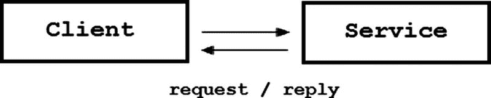
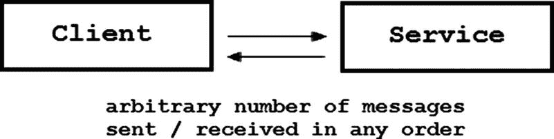
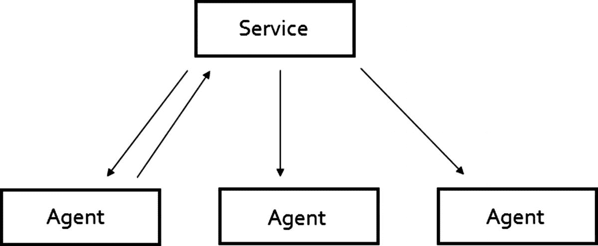
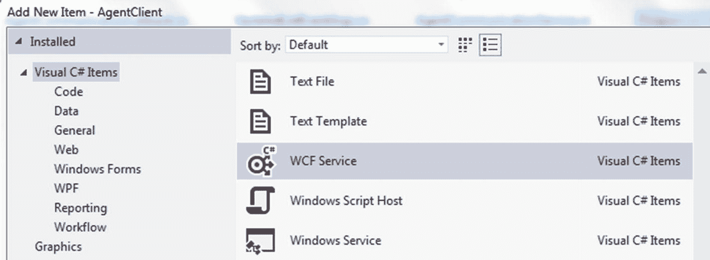
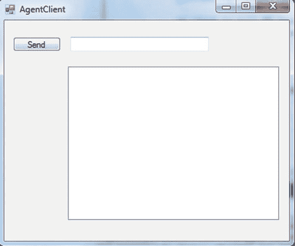
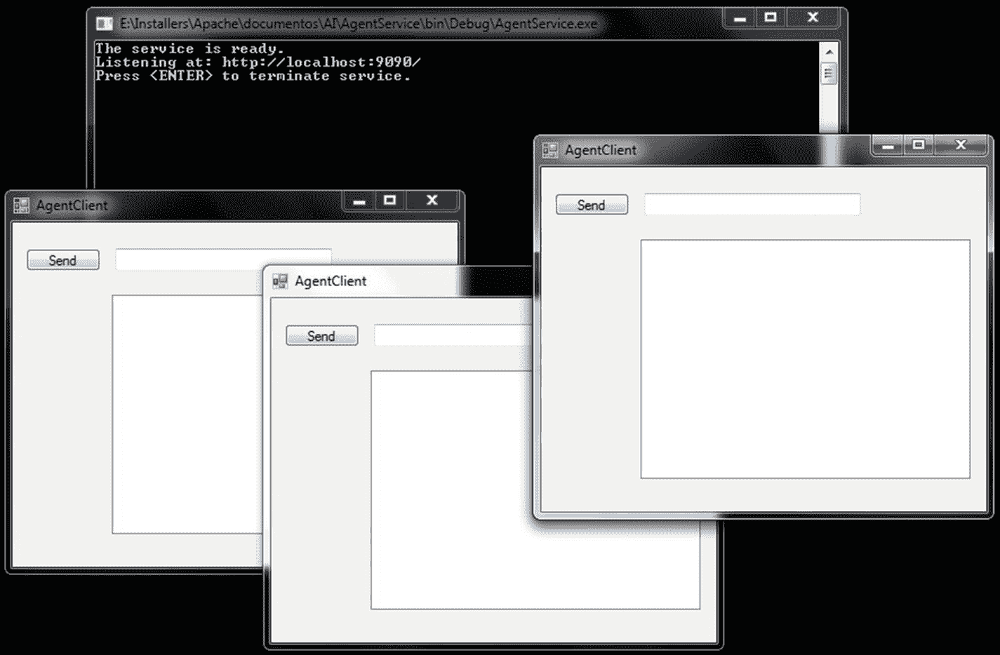
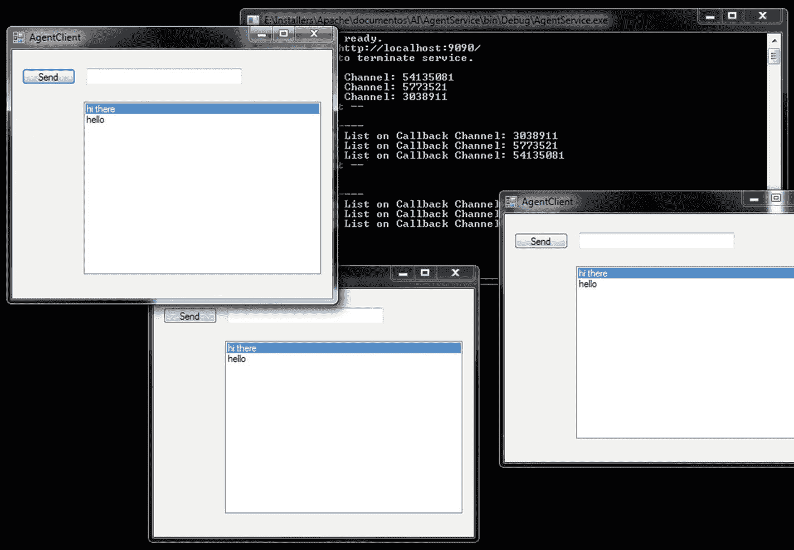

# 6. 使用 WCF 的多智能体系统通信

在上一章中，我们探讨了多智能体系统的基础知识，并熟悉了多智能体系统平台、协调、协作和通信等概念。在本章中，我们将描述一个使用 Windows Communication Foundation 创建智能体网络的应用，该网络中的智能体能够相互交互并传递消息。该应用将采用发布者/订阅者设计模式来构建通信组件，多智能体系统中的每个智能体都将集成该组件。我们将在下一章中再次使用本章描述的应用，将其改造为清洁智能体多智能体系统中每个智能体的通信模块，这些清洁智能体的任务是清理房间内的污垢。

WCF 于 2006 年作为开发工具包问世，并最终成为.NET Framework 的一部分；它是一个应用程序编程接口，用于开发连接系统，能够为组织内部系统之间或互联网上系统之间的任何通信提供安全性和可靠性保障。WCF 旨在为分布式计算提供一种可管理的方法，实现广泛的互操作性，并直接支持面向服务。WCF 是微软针对一个汇集了行业标准（定义不同协议、服务交互、类型转换、封送处理等）的平台所提供的替代方案。它为开发者提供了每个网络应用可能需要的、预先设计好的基础工具，其首个版本就包含了大量用于创建服务的实用功能（托管、服务实例管理、异步调用、可靠性、事务管理、断开连接的队列调用、安全性等）。

使用 WCF 作为运行时环境构建的应用，将允许我们将公共语言运行时类型作为服务使用，并允许我们将其他服务作为公共语言运行时类型来消费。服务、契约、绑定、终结点等概念将在我们开发多智能体系统通信示例的过程中逐一解释。

注意

Windows Communication Foundation (WCF) 是一个用于在 Windows 上开发和部署服务的框架。使用 WCF，我们可以构建面向服务的应用程序。WCF 取代了较旧的 ASMX Web 服务技术。


## 服务

服务是一种功能组件，可通过互联网或本地内部网络等网络供其消费者访问。计算器完全可以作为一项服务，提供给网络中的不同客户端，使它们能够连接到该服务并请求对任意给定数字执行任何运算。在面向服务的应用程序（SOA）中，我们聚合服务的方式，与开发面向对象应用程序时聚合对象的方式相同；在此类应用程序中，服务成为了一等公民。

服务使用任何预先商定的通信协议进行通信，并且它们可以使用任何语言、平台、版本或框架，而无需在这些方面达成任何协议。因此，可以说服务依赖于所应用的通信协议，但在其他任何领域都是独立的。

服务的客户端是利用服务功能的部分。在计算器服务示例中，客户端将是请求该服务求解数学表达式的程序。客户端可以是任何类型的程序，从控制台应用程序到 Windows Forms、ASP.NET MVC 站点、WPF 程序，甚至是另一个服务。在 WCF 中，客户端从不直接与服务交互，即使是本地服务也不例外。相反，客户端始终使用代理将调用转发给服务。代理充当中间人，除了提供一些与代理相关的方法外，还呈现与服务相同的操作。

注意

从以函数为一等公民的应用程序，发展到以对象为一等公民的应用程序（面向对象编程），经历了面向组件的应用程序（组件对象模型，COM），并最终演进到最新的阶段——面向服务的应用程序（SOA）。

WCF 最常使用简单对象访问协议（SOAP）消息进行通信；SOAP 是一种用于数据交换的协议。它可以被视为一组可被调用、发布和发现的组件。这些消息独立于传输协议，并且与 Web 服务不同，WCF 服务可以通过多种传输方式进行通信，而不仅仅是 HTTP。WCF 客户端能够与非 WCF 服务进行互操作，WCF 服务也可以与非 WCF 客户端进行交互。

## 协定

我们在日常生活中经常处理协定，尤其是在与业务相关的事务中，以确保参与关系的各方就各种事项达成一致。在 WCF 中，协定是描述服务功能的标准方式；它是服务消费者和提供者正确关联的一种方式。在 SOA 应用程序中，拥有一个正确定义的协定可以让其消费者很好地了解如何使用该服务，即使他们可能不知道其实现方式。

WCF 定义了多种类型的协定：

*   **服务协定**、**操作协定**：用于表示服务并描述客户端可以在服务上执行的操作。
*   **数据协定**：用于表示对服务与客户端之间将要交换的数据的协定。WCF 为内置类型（如 `int` 和 `string`）定义了隐式协定，并允许您为自定义类型定义显式数据协定。
*   **错误协定**：用于通过将自定义异常类型与特定服务操作相关联，并描述服务如何处理错误以及如何将错误传播给其客户端，来定义服务引发的错误。
*   **消息协定**：由服务用于直接与消息交互，更改其格式或操作服务消息以修改其他特性，如 SOAP 标头等。

在 WCF 中，有多种定义协定的方式或模式；我们可以使用单向模式、请求-响应模式或双工模式来定义它们。这些都是消息交换模式。

*   **单向**：当一个操作没有返回值，并且客户端应用程序不关心调用的成功或失败时，我们可以使用这种“发射后不管”的调用，称为单向。客户端发出调用后，WCF 会生成一个请求消息，但不会有任何回复消息返回给客户端。因此，单向操作不能返回值，并且在服务端抛出的任何异常都不会传回给客户端。


*   **请求-响应**：在此模式中，服务操作调用包括发送一条消息并期望从服务获得一条回复。使用此模式的操作具有输入参数和关联的返回值。客户端始终是发起双方通信的一方。



*   **双工**：此交换模式允许客户端发送任意数量的消息，并以任意顺序接收。它类似于一次对话，其中说出的每个单词都被视为一条消息。任何一方都可以发起通信。



为了在 WCF 中实现服务，通常需要遵循以下步骤：

1.  定义服务协定。服务协定指定了服务的签名、其交换的数据以及其他合同要求的数据。以下代码展示了非常经典的 Hello World 程序的服务版本：

```
    [ServiceContract]
    interface IHelloWorld
    {
    [OperationContract(IsOneWay = true)]
    void HelloMessage();
    }
    ```

2.  通过继承服务协定定义（预先安排的接口）来实现协定，并创建实现该协定的类：

```
    public class Hello: IHelloWorld
    {
    public void HelloMessage()
    {
    Console.WriteLine("Hello World");
    }
    }
    ```

3.  通过指定终结点信息和其他行为信息来配置服务。我们将在下一节中对此进行更多介绍。  
4.  在 IIS 或应用程序中托管服务；它可以是控制台应用程序、Windows Forms、WPF、ASP.NET 等。  
5.  创建客户端应用程序；它可以是控制台应用程序、Windows Forms、WPF、ASP.NET 等。

请注意，在 `IHelloWorld` 服务协定上声明但没有 `OperationContract` 属性的方法将不被视为 WCF 方法；换句话说，它们无法通过 WCF 应用程序进行调用。您可以将非 WCF 方法与 WCF 方法混合使用，以进行一些底层处理，但仅限于此目的。


## 绑定

WCF 允许我们使用不同的传输协议（如 HTTP、HTTPS、TCP、MSMQ 等）以及不同的 XML 表示形式（如文本、二进制或 MTOM（消息传输优化机制））来发送消息；后者在 WCF 中被称为消息编码。此外，我们还可以利用一套 SOAP 协议（例如多种 WS-X 规范，如 `WSHttpBinding`、`WSDualHttpBinding` 等）来改进特定的消息交互。这些改进可能涉及安全性、可靠消息传递和事务处理。这些通信概念（传输、消息编码和协议）对于理解运行时在网络上发生的情况至关重要。

在 WCF 中，绑定由 `System.ServiceModel.Channels.Binding` 类表示，所有绑定类都必须派生自这个基类；表 6-1 展示了 WCF 提供的一些内置绑定。

表 6-1

WCF 内置绑定

| 绑定类 | 传输 | 消息编码 | 消息版本 |
| --- | --- | --- | --- |
| `BasicHttpBinding` | HTTP | 文本 | SOAP 1.1 |
| `WSHttpBinding` | HTTP | 文本 | SOAP 1.2 WS-Addressing 1.0 |
| `WSDualHttpBinding` | HTTP | 文本 | SOAP 1.2 WS-Addressing 1.0 |
| `NetTcpBinding` | TCP | 二进制 | SOAP 1.2 |
| `NetPeerTcpBinding` | P2P | 二进制 | SOAP 1.2 |
| `NetMsmqBinding` | MSMQ | 二进制 | SOAP 1.2 |
| `CustomBinding` | 由你决定 | 由你决定 | 由你决定 |

像 `BasicHttpBinding` 和 `WSHttpBinding` 这样的绑定是为需要互操作性的场景而创建的。因此，它们都使用 HTTP 作为传输协议，并使用简单的文本进行消息编码。另一方面，带有 `Net` 前缀的绑定则针对在两端（服务端、客户端）均使用 .NET Framework 的场景进行了优化。因此，这些绑定并非为互操作性而设计，在 Windows 环境中性能更佳。绑定是 WCF 应用程序中另一个称为终结点的组件的一部分；终结点将是下一节的主题。

注意

自 .NET Framework 4.5 起，`NetPeerTcpBinding` 绑定已被标记为过时，并可能在将来被移除。

## 终结点

WCF 服务通过服务终结点公开，这些终结点为客户端提供了访问点，以便利用 WCF 服务提供的功能。服务终结点由所谓的服务 ABC 组成。A 代表地址（Address），它定义了服务的位置（例如 `http://localhost:9090/mas/`）。B 代表绑定（Binding），它定义了如何与服务通信。C 代表协定（Contract），它定义了服务能做什么。因此，终结点可以看作是一个元组 <A, B, C>：地址、绑定和协定。

我们必须在服务端和客户端应用程序中都定义终结点；这可以通过编程方式或通过 `app.config` 文件来完成，如下一个示例（清单 6-1）所示。

```

清单 6-1
在 app.config 文件中定义两个终结点
```

在 WCF 中，通过编程方式定义终结点与通过 `app.config` 文件的配置设置定义终结点之间没有显著的技术差异。最终，.NET 会解析 `app.config` 文件并以编程方式执行其定义的配置。现在我们已经了解了 WCF 的基础知识，接下来将介绍 WCF 支持的发布者/订阅者模式，我们将在与各种代理通信时使用该模式。

## 发布者/订阅者模式

实时应用程序是指那些提供特定事件实时推送或更新（例如篮球比赛、棒球比赛等）的应用程序，这些事件发生在提供推送之前很短的时间内。实时应用程序实现两种可能的机制之一来向客户端提供更新信息：推送和拉取。

为了理解这些机制的工作原理，让我们设想一个场景：我们希望了解一场棒球比赛的结果。我们是一个网络的一部分，该网络包含一个拥有最新信息（实时更新）的服务器，以及若干其他计算机。假设我们通过 HTTP 在浏览器（客户端）中获取实时推送，并考虑使用拉取机制，那么我们的计算机会不断发送更新请求，并从服务器拉取新信息（如果有的话）。这基本上就像时不时地问服务器：“你有什么新消息给我吗？”另一方面，如果我们采用推送机制，我们的客户端会告诉服务器：“请随时向我更新这场比赛的最新比分”，然后服务器会在有新信息可用时自动将更新“推送”给客户端。发布者/订阅者模型遵循后一种方法，即推送机制；服务器扮演发布者的角色，客户端扮演订阅者的角色，并且它需要在双方之间建立一个双工服务。

双工服务由两个协定组成，一个在服务器端，另一个在客户端。服务器端实现的协定将由订阅者（客户端）用于订阅特定的数据推送。客户端实现的协定将由服务器用于在需要“推送”新数据时进行调用。在客户端实现的协定称为回调协定。在接下来的章节中，我们将通过一个实际问题的示例来进一步了解发布者/订阅者模式、回调协定以及双工服务，该示例将所有这些部分整合到一个完整、可运行的实例中。


## 实际问题：使用 WCF 在多个代理之间进行通信

在本节中，我们将创建一个 WCF 应用程序，其中多个代理共同维护一个共享消息列表，并且每个代理都能获知当前的消息列表；换句话说，每个代理都拥有实际列表的更新副本。此场景中的服务充当消息代理，将来自某个代理的新消息发送给所有其他代理。这是一个明显遵循发布者/订阅者模式的应用程序；在图 6-1 中，我们可以看到其架构。



图 6-1

一个代理向列表添加消息，服务将更新后的列表传达给所有其他代理

从实现过程开始，我们首先需要定义服务协定。由于我们将创建一个双工应用程序，因此服务协定定义需要附带一个回调协定。回调协定指定了服务可以在客户端上调用的操作。要在 Visual Studio 中创建 WCF 服务，请转到解决方案资源管理器，右键单击您希望作为项目容器的项目或文件夹；选择“添加新项”，然后查找“WCF 服务”选项（图 6-2）。



图 6-2

向项目添加 WCF 服务

添加服务后，您会看到两个文件已添加到项目中——一个类（协定实现）和一个接口（服务协定）。您还会注意到添加了对命名空间 `System.ServiceModel` 和 `System.ServiceModel.Description` 的引用，这些命名空间包含绑定类、`ServiceHost` 类等。

注意

双工服务上的操作通常标记为 `OneWay = true` 以防止死锁。当多个单元相互等待对方完成，从而导致任何一方都无法完成时，就会发生死锁。

服务协定和回调协定的实现如代码清单 6-2 所示。

```
[ServiceContract(CallbackContract = typeof(IAgentCommunicationCallback))]
public interface IAgentCommunicationService
{
[OperationContract(IsOneWay = true)]
void Subscribe();
[OperationContract(IsOneWay = true)]
void Send(string from, string to, string message);
}
public interface IAgentCommunicationCallback
{
[OperationContract(IsOneWay = true)]
void SendUpdatedList(List messages);
}
代码清单 6-2
服务协定和回调协定
```

请注意，在前面的代码中，我们通过明确告知服务协定其回调协定是 `IAgentCommunicationCallback` 来定义一种关系。因此，我们告诉服务，每当有新的更新可用时，使用该回调协定来通知客户端（通知将通过调用回调上的 `SendUpdateList()` 方法来实现）。服务协定包含两个操作：`Subscribe()`，用于将代理订阅到服务；以及 `Send()`，用于向消息列表发送新消息。回调协定有一个名为 `SendUpdatedList()` 的操作，用于将最新的消息列表发送给所有代理。

注意

`IAgentCommunicationService` 和 `IAgentCommunicationCallback` 中的所有操作都返回 void，因为这是属性设置 `IsOneWay = true` 的要求。单向操作将阻塞，直到传出数据已写入网络连接。

现在我们已经了解了服务和回调建立的操作协定，让我们来看看它们的具体实现。代码清单 6-3 显示了服务实现。

```
[ServiceBehavior(InstanceContextMode = InstanceContextMode.Single, ConcurrencyMode = ConcurrencyMode.Multiple)]
public class AgentCommunicationService : IAgentCommunicationService
{
private static List _callbackChannels = new List();
private static List _messages = new List();
private static readonly object _sycnRoot = new object();
public void Subscribe()
{
try
{
var callbackChannel =
OperationContext.Current.GetCallbackChannel();
lock (_sycnRoot)
{
if (!_callbackChannels.Contains(callbackChannel))
{
_callbackChannels.Add(callbackChannel);
Console.WriteLine("已添加回调通道: {0}", callbackChannel.GetHashCode());
callbackChannel.SendUpdatedList(_messages);
}
}
}
catch
{
}
}
public void Send(string from, string to, string message)
{
lock (_sycnRoot)
{
_messages.Add(message);
Console.WriteLine("-- 消息列表 --");
_messages.ForEach(listItem => Console.WriteLine(listItem));
Console.WriteLine("------------------");
for (int i = _callbackChannels.Count - 1; i >= 0; i--)
{
if (((ICommunicationObject)_callbackChannels[i]).State != CommunicationState.Opened)
{
Console.WriteLine("检测到非打开的回调通道: {0}", _callbackChannels[i].GetHashCode());
_callbackChannels.RemoveAt(i);
continue;
}
try
{
_callbackChannels[i].SendUpdatedList(_messages);
Console.WriteLine("已在回调通道上推送更新列表: {0}", _callbackChannels[i].GetHashCode());
}
catch (Exception ex)
{
Console.WriteLine("服务在回调通道上通信时引发异常: {0}", _callbackChannels[i].GetHashCode());
Console.WriteLine("异常类型: {0} 描述: {1}", ex.GetType(), ex.Message);
_callbackChannels.RemoveAt(i);
}
}
}
}
}
代码清单 6-3
服务实现
```

请注意，`AgentCommunicationService` 类具有由 `ServiceBehavior` 类定义的属性 `InstanceContextMode = InstanceContextMode.Single` 和 `ConcurrencyMode = ConcurrencyMode.Multiple`；顾名思义，这个类允许我们为服务定义各种行为。第一个属性将其设置为 `Singleton` 类；因此，所有服务调用将由同一个服务实例处理，并且所有代理将引用相同的消息和客户端回调通道列表，因为这些字段被声明为静态的。后一个属性允许并发发生，并允许您拥有一个多线程服务，从而允许每个调用并行处理。服务对象的同步将使用 SyncRoot 模式和 C# 中的 `lock` 语句来处理。

注意

锁定公共对象不是一个好做法。公共对象可以被任何人锁定，从而产生意外的死锁。因此，在锁定暴露给外界的对象时应谨慎行事。SyncRoot 模式通过使用私有的内部对象进行锁定来保证不会发生这种情况。

`lock` 语句充当对象的钥匙。想象一个人想要进入一个房间，从主人那里拿到钥匙，当他在房间里时，其他人无法进入。当他离开时，他将钥匙还给主人，这样排队的下一个人就可以拿到钥匙并进入房间。防止多个线程同时访问和修改数据的代码称为线程安全代码。

`Subscriber()` 方法（操作）获取客户端的回调通道，并检查它是否已添加到回调通道列表中，如果尚未添加则将其添加。如果客户端之前没有访问过该服务，则向其发送 `latestMessage` 列表。

在 `Send()` 方法中，我们必须确保一次只有一个线程能够访问该列表，这就是使用 `lock` 语句的原因。一旦我们添加了消息，我们就遍历每个回调通道，并通过调用它们的 `SendUpdatedList()` 方法来通知其余代理（客户端）新添加的内容。这个迭代过程是反向进行的，因为我们需要移除任何可能已将其状态更改为关闭或引发异常的通道。


如前所述，我们需要创建一个 `Proxy` 类来与服务交互。要创建双工代理，我们需要设计一个继承自 `DuplexClientBase<T>` 的类，然后创建服务协定（清单 6-4）。

```
public class AgentCommunicationServiceClient : DuplexClientBase, IAgentCommunicationService
{
public AgentCommunicationServiceClient(InstanceContext callbackInstance, WSDualHttpBinding binding, EndpointAddress endpointAddress)
: base(callbackInstance, binding, endpointAddress) { }
public void Subscribe()
{
Channel.Subscribe();
}
public void Send(string from, string to, string message)
{
Channel.Send(from, to, message);
}
}
清单 6-4
代理实现
```

从清单 6-4 可以看出，代理类的实现非常直接——只需将所有调用转发给父类 `DuplexClientBase<IAgentCommunicationService>` 提供的 `Channel` 属性（类型为 `IAgentCommunicationService`）。在 `Send` 方法中，我们包含了参数 `string from` 和 `string to`。我们将在下一章中使用这些参数来过滤来自代理和发送给代理的消息。

回调协定类的具体实现如清单 6-5 所示。

```
[CallbackBehavior(UseSynchronizationContext = false)]
public class AgentCommunicationCallback : IAgentCommunicationCallback
{
public event EventHandler ServiceCallbackEvent;
privateSynchronizationContext _syncContext = AsyncOperationManager.SynchronizationContext;
public void SendUpdatedList(List items)
{
_syncContext.Post(new SendOrPostCallback(OnServiceCallbackEvent), new UpdatedListEventArgs(items));
}
private void OnServiceCallbackEvent(object state)
{
EventHandler handler = ServiceCallbackEvent;
var e = state as UpdatedListEventArgs;
if (handler != null)
{
handler(this, e);
}
}
}
清单 6-5
回调协定实现
```

请记住，回调协定是负责处理从服务协定接收到的“推送更新”的。默认情况下，回调协定会在当前同步上下文上同步所有调用。如果你的客户端是 Windows Forms 应用程序，这种行为会导致代码在用户界面线程上执行，这并非一个好主意。

为了将操作线程上获得的结果传达给 UI 线程，我们将使用 `AsyncOperationManager`，这是 .NET 为并发管理而整合的一个类。该类包含一个 `SynchronizationContext` 属性，该属性返回调用它的应用程序的同步上下文。最终，使用这些类的目的是在 UI 线程和操作线程之间共享数据。

注意

同步上下文提供了一种将工作单元排队到特定上下文的方法。它允许工作线程将消息分派到 UI 同步上下文。只有 UI 同步上下文才被允许操作 UI 控件；因此，如果我们尝试从另一个上下文更新 UI，将导致非法操作，从而引发异常。

我们将使用 `SynchronizationContext` 类的 `Post` 方法将消息异步排队到 UI 同步上下文。`Post` 方法接受两个参数：一个名为 `SendOrPostCallback` 的委托，表示消息被分派到 UI 同步上下文后需要执行的回调方法；以及一个提交给该委托的对象。我们通过传入已在 `Callback` 类中实现的 `OnServiceCallbackEvent` 方法来创建 `SendOrPostCallback` 委托。我们还创建了 `UpdatedListEventArgs`（清单 6-6）类的一个实例，并在构造函数中提交新的消息列表。该委托和事件参数类实例被用作 `Post` 方法的参数。通过这种方式，当我们的事件调用方法从工作线程封送到 UI 线程时，它能够获取事件参数。`ServiceCallbackEvent` 的订阅者（例如 Windows Forms、控制台应用程序等客户端）随后可以在事件触发时处理它。

将 `UseSynchronizationContext` 属性设置为 false 允许回调操作在不同线程之间分配。

```
public class UpdatedListEventArgs : EventArgs
{
public List MessageList { get; set; }
public UpdatedListEventArgs(List messages)
{
MessageList = messages;
}
}
清单 6-6
用作事件参数的类，用于更新客户端应用程序（Windows Forms）上的消息列表
```

现在我们已经展示了所有协定的具体实现，接下来展示充当服务主机的应用程序（清单 6-7）。

```
static void Main(string[] args)
{
// 步骤 1 创建一个 URI 作为基地址。
var baseAddress = new Uri("http://localhost:9090/");
// 步骤 2 创建一个 ServiceHost 实例
var selfHost = new ServiceHost(typeof(AgentCommunicationService), baseAddress);
try
{
// 步骤 3 添加服务终结点。
selfHost.AddServiceEndpoint(typeof(IAgentCommunicationService),
new WSDualHttpBinding(WSDualHttpSecurityMode.None), "AgentCommunicationService");
// 步骤 4 启用元数据交换并添加 MEX 终结点
var smb = new ServiceMetadataBehavior { HttpGetEnabled = true };
selfHost.Description.Behaviors.Add(smb);
selfHost.AddServiceEndpoint(ServiceMetadataBehavior.MexContractName,
MetadataExchangeBindings.CreateMexHttpBinding(), baseAddress + "mex");
// 步骤 5 启动服务。
selfHost.Open();
Console.WriteLine("服务已就绪。");
Console.WriteLine("正在监听: {0}", baseAddress);
Console.WriteLine("按 <ENTER> 终止服务。");
Console.WriteLine();
Console.ReadLine();
// 关闭 ServiceHostBase 以关闭服务。
selfHost.Close();
}
catch (CommunicationException ce)
{
Console.WriteLine("发生异常: {0}", ce.Message);
selfHost.Abort();
}
}
清单 6-7
在控制台应用程序中托管服务
```

创建服务的步骤在清单 6-7 中清晰展示。在此例中，我们将服务托管在控制台应用程序中。请注意，我们不会使用或编辑 `app.config` 文件；相反，所有绑定、地址和协定配置都是通过编程方式完成的。

注意

支持双工服务的 WCF 绑定有 `WSDualHttpBinding`、`NetTcpBinding` 和 `NetNamedPipeBinding`。

客户端应用程序将是一个 Windows Forms 应用程序，其代码如清单 6-8 所示。


```
public partial class AgentClient : Form
{
private const string ServiceEndpointUri = "http://localhost:9090/AgentCommunicationService";
public AgentCommunicationServiceClient Proxy { get; set; }
public AgentClient()
{
InitializeComponent();
InitializeClient();
}
private void InitializeClient()
{
if (Proxy != null)
{
try
{
Proxy.Close();
}
catch
{
Proxy.Abort();
}
}
var callback = new AgentCommunicationCallback();
callback.ServiceCallbackEvent += HandleServiceCallbackEvent;
var instanceContext = new InstanceContext(callback);
var dualHttpBinding = new WSDualHttpBinding(WSDualHttpSecurityMode.None);
var endpointAddress = new EndpointAddress(ServiceEndpointUri);
Proxy = new AgentCommunicationServiceClient(instanceContext, dualHttpBinding, endpointAddress);
Proxy.Open();
Proxy.Subscribe();
}
private void HandleServiceCallbackEvent(object sender, UpdatedListEventArgs e)
{
List list = e.MessageList;
if (list != null && list.Count > 0)
messageList.DataSource = list;
}
private void SendBtnClick(object sender, EventArgs e)
{
Proxy.Send("", "", wordBox.Text.Trim());
wordBox.Clear();
}
}
清单 6-8
客户端应用程序
```

正如预期，客户端应用程序（图 6-3）包含一个类型为 `AgentCommunicationServiceClient` 的字段，它代表客户端用于订阅服务并与服务通信的代理。`HandleServiceCallbackEvent` 是当列表中添加新消息时触发的事件；这直接关系到我们之前描述的回调合约和 `OnServiceCallbackEvent` 事件。当用户点击客户端用户界面上的“发送”按钮并发送新消息时，会触发 `SendBtnClick` 事件。



图 6-3

Windows Forms 中的客户端用户界面

现在我们已经将所有部分整合在一起，让我们测试应用程序，看看不同的代理如何通信和接收消息。

首先，让我们运行托管服务的控制台应用程序。

注意

通常需要管理员权限才能启动服务应用程序。如果在运行应用程序时遇到任何问题，请尝试以管理员身份运行。

然后，根据需要运行任意数量的客户端。在本例中，运行三个客户端就足够了。所描述的场景如图 6-4 所示。



图 6-4

运行服务与三个客户端

现在我们可以操作应用程序，从任意客户端发送消息。结果将是一个所有消息的共享列表，如图 6-5 所示。



图 6-5

在 WCF 发布者/订阅者应用程序中交换消息的代理

在下一章中，我们将对前几节介绍的 WCF 通信应用程序稍作修改，使其适应我们的清洁代理多智能体系统示例。在清洁代理 MAS 程序中，客户端将是代理，它们通过充当消息代理（发布者）的 WCF 服务进行通信。第 5 章中探讨的概念，如合作、协调、合同网和社会法则，将在上述示例中再次涉及，并以实践的方式通过 C# 中的类和方法实现。

## 总结

在本章中，我们解释了 WCF 的一些基础知识（服务、合约、地址、绑定和终结点），以及网络应用程序中的一种常见模式——发布者/订阅者模型。我们介绍并描述了双工服务及其一些特性，例如回调合约。我们实现了一个 WCF 程序，该程序模拟了多个代理的通信，使用托管在控制台应用程序上的服务作为消息代理，并使用 Windows Forms 应用程序作为客户端。在下一章中，我们将把这个应用程序集成到一个更大的程序中，该程序模拟一个多智能体系统的过程，其任务是清除一个 n x m 房间内的所有污垢。

