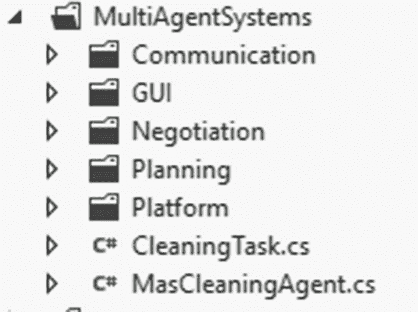
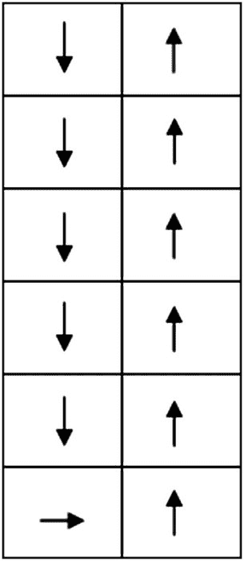

# 7. 清洁代理：一个多智能体系统问题

在第 5 章和第 6 章中，我们学习了多智能体系统（MAS）和多智能体通信。我们介绍了诸如智能体平台、智能体架构、协调、合作、社会法则等概念；我们还详细阐述了一个实际问题，即使用 Windows Communication Foundation（WCF）创建了一个多智能体通信模块。

在本章中，我们将分析一个完整的实际问题，将所有部分整合在一起，开发一个 MAS，其中 n 个清洁代理将负责清理一个 n x m 房间内的污垢。这个问题将使我们能够融入之前学习的许多概念和定义，并将第 6 章中创建的 WCF 通信模块作为系统中每个智能体都将集成的 MAS 通信模块。

清洁问题是一个很好的基准或场景，通过它我们可以理解如何使用 MAS 在更短的时间内、使用比单个智能体更少的资源来解决诸如清洁之类的任务。

注意：清洁问题中的每个机器人将在其通信模块的核心使用 WCF，并使用 Windows Forms 来显示接收到的消息。

## 程序结构

应用程序的结构将如图 7-1 所示。该程序包含通信、GUI（图形用户界面）、协商、规划和平台模块。通信和规划模块（除了通信语言 `FipaAcl` C# 类）将不在本章中分析，因为它们之前已经研究过。如需进一步参考，请下载本书附带的源代码。



图 7-1 程序结构

GUI 模块将包含两个 Windows Forms 应用程序——一个用于图形化表示房间、房间内的每个智能体及其交互，另一个用于表示智能体消息板。

协商模块将包含合同网任务共享方法的一个实现，每个阶段都作为 `ContractNet` 类中的一个静态 C# 方法实现。

平台模块将包含一个智能体平台及其部分功能（通过字典进行智能体定位、用于任务共享的“决定角色”服务、对管理者和承包者的引用等）的实现。它将为其他类提供支持。

在通信模块中，我们将包含智能体通信语言（ACL）模块，该模块包含一个精简版的 `FIPA-ACL`，包括几个执行语。

注意：为了简化此 MAS 示例中的规划任务，我们将假设列数（M）始终能被 MAS 中的智能体数量（S）整除，即 `M % S == 0`。这将使我们能够简单地为每个智能体分配 `M / S` 列进行清洁。

## 清洁任务

为了表示和编码清洁任务，我们创建了清单 7-1 中所示的类。

```csharp
public class CleaningTask
{
    public int Count { get; set; }
    public int M { get; set; }
    public List<Tuple<int, int>> SubDivide { get; set; }
    public IEnumerable<string> SubTasks { get; set; }
    public CleaningTask(int m, int agents)
    {
        M = m;
        Count = agents;
        SubDivide = new List<Tuple<int, int>>();
        Divide();
        SubTasks = BuildTasks();
    }

    /// <summary>
    /// 对于划分，我们假设 M % Count = 0，即
    /// 列数始终能被智能体数量整除。
    /// </summary>
    private void Divide()
    {
        var div = M / Count;
        for (var i = 0; i < Count; i++)
            SubDivide.Add(new Tuple<int, int>(i * div, (i + 1) * div - 1));
    }

    private IEnumerable<string> BuildTasks()
    {
        var result = new string[SubDivide.Count];
        for (var i = 0; i < SubDivide.Count; i++)
            result[i] = "clean(" + SubDivide[i].Item1 + "," + SubDivide[i].Item2 + ")";
        return result;
    }
}
```

清单 7-1 `CleaningTask` 类

该类包含以下字段或属性：

*   `Count`：整数，表示参与清洁任务的智能体数量。
*   `M`：整数，表示房间的列数。
*   `SubDivide`：`List<Tuple<int, int>>`，表示根据智能体数量和列数做出的公平列划分。
*   `SubTasks`：`IEnumerable<string>`，表示为了完成全局任务（清洁整个房间）而需要执行的一组任务。每个任务都使用我们的小型 `FipaAcl` 将要使用的自定义内部语言来定义。

另一方面，`CleaningTask` 类公开了以下方法：

*   `Divide()`：将清洁房间的全局任务划分为更小的子任务。每个子任务将由一组需要清洁的连续列组成。它在 `SubDivide` 属性中存储一组元组，每个元组定义了一个需要清洁的列范围；例如，(0, 2) 表示清洁第 0 列到第 2 列的子任务。
*   `BuildTasks()`：返回一个 `IEnumerable<string>`，其中包含使用自定义语言描述的每个子任务，该语言稍后将用于通过通信模块并使用 FIPA 作为 ACL 来传输信息。

为了保持应用程序的良好模块化，`CleaningTask` 类仅处理与清洁问题相关的操作。在下一节中，我们将介绍清洁智能体平台。

## 清洁智能体平台

清洁智能体平台由 `CleaningAgentPlatform` 类表示，其代码见清单 7-2。

```csharp
public class CleaningAgentPlatform
{
    public Dictionary<string, MasCleaningAgent> Directory { get; set; }
    public IEnumerable<MasCleaningAgent> Agents { get; set; }
    public IEnumerable<MasCleaningAgent> Contractors { get; set; }
    public MasCleaningAgent Manager { get; set; }
    public CleaningTask Task { get; set; }

    public CleaningAgentPlatform(IEnumerable<MasCleaningAgent> agents, CleaningTask task)
    {
        Agents = new List<MasCleaningAgent>(agents);
        Directory = new Dictionary<string, MasCleaningAgent>();
        Task = task;
        foreach (var cleaningAgent in Agents)
        {
            Directory.Add(cleaningAgent.Id, cleaningAgent);
            cleaningAgent.Platform = this;
        }
        DecideRoles();
    }

    public void DecideRoles()
    {
        // 管理者角色
        Manager = Agents.First(a => a.CleanedCells.Count == Agents.Max(p => p.CleanedCells.Count));
        Manager.Role = ContractRole.Manager;

        // 承包者角色
        Contractors = new List<MasCleaningAgent>(Agents.Where(a => a.Id != Manager.Id));
        foreach (var cleaningAgent in Contractors)
            cleaningAgent.Role = ContractRole.Contractor;

        (Contractors as List<MasCleaningAgent>).Add(Manager);
    }
}
```

清单 7-2 `CleaningAgentPlatform` 类

该类包含以下属性或字段：

*   `Directory`：字典，包含智能体的 ID 及其引用，作为键值对。
*   `Agents`：`IEnumerable<MasCleaningAgent>`，包含智能体集合。
*   `Contractors`：`IEnumerable<MasCleaningAgent>`，包含合同网中的承包者集合。
*   `Manager`：对合同网中管理者的引用。
*   `Task`：待执行的清洁任务。

该类包含两个函数：一个构造函数和 `DecideRoles()` 方法。在构造函数中，我们初始化每个属性，然后将每个智能体添加到目录中，并将智能体的 `Platform` 属性引用指向此平台。`DecideRoles()` 方法决定选择哪个智能体作为管理者，而其余智能体则被视为承包者。在此例中，选择管理者的标准是选择清洁单元格数量最多的智能体；这相当于说“选择最有经验的智能体，即工作最多的那个。”

注意：在此例中，我们也将管理者添加到承包者列表中，因为我们希望他不仅指挥操作，还能像其他承包者一样参与其中，清洁房间的某一列范围。

## 合同网

合同网任务分配机制由 `ContractNet` 类表示；每个智能体所扮演的角色在 `ContractRole` 枚举中定义。两者均在代码清单 7-3 中描述。

## 代码清单 7-3 ContractNet 类

```csharp
public class ContractNet
{
    public static IEnumerable<CleaningTask> Announcement(CleaningTask cleaningTask, MasCleaningAgent manager, IEnumerable<MasCleaningAgent> contractors, FipaAcl language)
    {
        var tasks = cleaningTask.SubTasks;
        foreach (var contractor in contractors)
        {
            foreach (var task in tasks)
                language.Message(Performative.Cfp, manager.Id.ToString(), contractor.Id.ToString(), task);
        }
        return tasks;
    }
    public static void Bidding(IEnumerable<CleaningTask> tasks, IEnumerable<MasCleaningAgent> contractors)
    {
        foreach (var contractor in contractors)
            contractor.Bid(tasks);
    }
    public static void Awarding(List<FipaAcl> messages, MasCleaningAgent manager, IEnumerable<MasCleaningAgent> contractors, CleaningTask task, FipaAcl language)
    {
        var agentsAssigned = new List<Tuple<MasCleaningAgent, KeyValuePair<int, int>>>();
        var messagesToDict = messages.ConvertAll(FipaAcl.MessagesToDict);
        // 处理投标
        foreach (var colRange in task.SubDivide)
        {
            var firstCol = colRange.Item1;
            var secondCol = colRange.Item2;
            // 第一列的投标
            var bidsFirstCol = new List<KeyValuePair<MasCleaningAgent, List<Tuple<int, int>>>>();
            // 第二列的投标
            var bidsSecondCol = new List<KeyValuePair<MasCleaningAgent, List<Tuple<int, int>>>>();
            foreach (var contractor in contractors)
            {
                // 跳过已分配的智能体
                if (agentsAssigned.Exists(tuple => tuple.Item1.Id == contractor.Id))
                    continue;
                var c = contractor;
                // 获取当前承包商的投标消息
                var messagesFromContractor = messagesToDict.FindAll(m => m.ContainsKey("from") && m["from"] == c.Id.ToString());
                var bids = FipaAcl.GetContent(messagesFromContractor);
                // 列范围内第一列的投标
                var bidsContractorFirstCol = bids.FindAll(b => b.Item2.Item2 == firstCol);
                // 列范围内第二列的投标
                var bidsContractorSecondCol = bids.FindAll(b => b.Item2.Item2 == secondCol);
                if (bidsContractorFirstCol.Count > 0)
                {
                    bidsFirstCol.Add(
                        new KeyValuePair<MasCleaningAgent, List<Tuple<int, int>>>(contractor,
                        bidsContractorFirstCol));
                }
                if (bidsContractorSecondCol.Count > 0)
                {
                    bidsSecondCol.Add(
                        new KeyValuePair<MasCleaningAgent, List<Tuple<int, int>>>(contractor,
                        bidsContractorSecondCol));
                }
            }
            // 排序，使列表开头为最佳投标者（最近的智能体）
            bidsFirstCol.Sort(Comparison);
            bidsSecondCol.Sort(Comparison);
            var closestAgentFirst = bidsFirstCol.FirstOrDefault();
            var closestAgentSecond = bidsSecondCol.FirstOrDefault();
            // 再次排序以找到最近的端点
            if (closestAgentFirst.Value != null)
                closestAgentFirst.Value.Sort(Comparison);
            if (closestAgentSecond.Value != null)
                closestAgentSecond.Value.Sort(Comparison);
            // 将智能体分配到列范围
            if (closestAgentFirst.Value != null && closestAgentSecond.Value != null)
            {
                if (closestAgentFirst.Value.First().Item1 >= closestAgentSecond.Value.First().Item1)
                    agentsAssigned.Add(new Tuple<MasCleaningAgent, KeyValuePair<int, int>>(closestAgentSecond.Key,
                    closestAgentSecond.Value.First().Item2));
                else
                    agentsAssigned.Add(new Tuple<MasCleaningAgent, KeyValuePair<int, int>>(closestAgentFirst.Key,
                    closestAgentFirst.Value.First().Item2));
            }
            else if (closestAgentFirst.Value == null)
                agentsAssigned.Add(new Tuple<MasCleaningAgent, KeyValuePair<int, int>>(closestAgentSecond.Key,
                closestAgentSecond.Value.First().Item2));
            else
                agentsAssigned.Add(new Tuple<MasCleaningAgent, KeyValuePair<int, int>>(closestAgentFirst.Key,
                closestAgentFirst.Value.First().Item2));
        }
        // 为每个智能体传输接受的提案。
        foreach (var assignment in agentsAssigned)
            language.Message(Performative.Accept, manager.Id.ToString(),
            assignment.Item1.Id.ToString(), "clean(" + assignment.Item2.Item1 + "," + assignment.Item2.Item2 + ")");
    }
    private static int Comparison(Tuple<int, KeyValuePair<int, int>> tupleA, Tuple<int, KeyValuePair<int, int>> tupleB)
    {
        if (tupleA.Item1 > tupleB.Item1)
            return 1;
        if (tupleA.Item1 < tupleB.Item1)
            return -1;
        if (tupleA.Item2.Value > tupleB.Item2.Value)
            return 1;
        if (tupleA.Item2.Value < tupleB.Item2.Value)
            return -1;
        return 0;
    }
    private static int Comparison(KeyValuePair<MasCleaningAgent, List<Tuple<int, int>>> bidsAgentA, KeyValuePair<MasCleaningAgent, List<Tuple<int, int>>> bidsAgentB)
    {
        if (bidsAgentA.Value.Min(p => p.Item1) > bidsAgentB.Value.Min(p => p.Item1))
            return 1;
        if (bidsAgentA.Value.Min(p => p.Item1) < bidsAgentB.Value.Min(p => p.Item1))
            return -1;
        if (bidsAgentA.Value.Min(p => p.Item2) > bidsAgentB.Value.Min(p => p.Item2))
            return 1;
        if (bidsAgentA.Value.Min(p => p.Item2) < bidsAgentB.Value.Min(p => p.Item2))
            return -1;
        return 0;
    }
    public enum ContractRole
    {
        Contractor, Manager, None
    }
}
```

该类包含以下静态方法：

- `Announcement()`：管理者向每个承包商发送消息，宣布所有待完成的任务。
- `Bidding()`：要求每个智能体针对待完成的任务集提交投标。智能体端的投标在`MasCleaningAgent`类的`Bid()`方法中执行。
- `Awarding()`：执行任务分配机制最后阶段的方法。为了将列范围 x - x' 授予某个承包商（智能体），该方法计算每个智能体到该列范围四个端点的距离——即第一列的单元格 `(0, x)` 和 `(n - 1, x)`，以及第二列的单元格 `(0, x')` 和 `(n - 1, x')`——然后将该列范围授予距离这四个端点中任意一个最近的智能体（最小街区距离或曼哈顿距离）。智能体的投标包含一个 `Tuple<int, int>` 用于定义最近的端点，以及一个 `double` 值表示到该端点的距离。更多细节请参考代码注释。
- `Comparison()`：这两个方法均涉及通过考虑表示元素到某列距离的 `double` 值来对元素列表进行排序。

每个方法都被创建为该类的服务；换句话说，它们都是无需创建类实例即可调用的静态方法。

### FIPA-ACL

为了在智能体之间沟通清洁相关问题，我们创建了一种用于处理此类命令的微型语言。这种微型语言类似于`FIPA`语言，并包含一种内部语言，该语言仅包含`clean(x, y)`语句，用于指示智能体清理从 x 到 y 的所有列。`FipaAcl`类和`Performative`枚举均如代码清单 7-4 所示。

```
public class FipaAcl
{
public AgentCommunicationServiceClient Communication { get; set; }
public FipaAcl(AgentCommunicationServiceClient communication)
{
Communication = communication;
}
public void Message(Performative p, string senderId, string receiverId, string content)
{
switch (p)
{
case Performative.Accept:
ThreadPool.QueueUserWorkItem(delegate { Communication.Send(senderId, receiverId, "accept[content:" + content + ";]"); });
break;
case Performative.Cfp:
ThreadPool.QueueUserWorkItem(delegate { Communication.Send(senderId, receiverId, "cfp[content:" + content + ";]"); });
break;
case Performative.Proposal:
ThreadPool.QueueUserWorkItem(delegate { Communication.Send(senderId, receiverId, "proposal[from:" + senderId + ";content:" + content + "]"); });
break;
}
}
public static string GetPerformative(string task)
{
return task.Substring(0, task.IndexOf('['));
}
public static string GetInnerMessage(string task)
{
return task.Substring(task.IndexOf('[') + 1, task.LastIndexOf(']') - task.IndexOf('[') - 1);
}
public static Dictionary MessageToDict(string innerMessage)
{
var result = new Dictionary();
var items = innerMessage.Split(';');
var contentItems = new List();
foreach (var item in items)
if (!string.IsNullOrEmpty(item))
contentItems.AddRange(item.Split(':'));
for (int i = 0; i  MessagesToDict(string message)
{
return MessageToDict(GetInnerMessage(message));
}
public static List>> GetContent(List> messagesFromContractor)
{
var result = new List>>();
foreach (var msg in messagesFromContractor)
{
var content = msg["content"];
var values = content.Split(',');
result.Add(new Tuple>(double.Parse(values[0]),
new Tuple(int.Parse(values[1]), int.Parse(values[2]))));
}
return result;
}
}
public enum Performative
{
Accept, Cfp, Inform, Proposal
}
代码清单 7-4
FipaACL 类
```

请注意，每个智能体之间的通信都是通过`ThreadPool`类的`QueueUserWorkItem`方法执行的。启动一个新线程可能是一项非常昂贵的操作；因此，我们利用线程池的功能来重用线程并降低成本。通过这种方式，我们将方法排队，以便在线程池提供的不同线程上执行。

`FipaAcl`类包含一个`AgentCommunicationServiceClient`通信属性（回顾第 6 章，`AgentCommunicationServiceClient`是建立客户端与服务之间通信的代理），该属性用于向其他智能体发送消息。`FipaAcl`包含了以下方法：

*   `Message()`：根据执行语类型，使用作为参数提供的`senderId`、`receiverId`和`content`字符串创建并发送一条新消息。

*   `GetPerformative()`：获取作为参数提供的消息的执行语；例如，对于像`cfp[content: clean(0,2)]`这样的消息，执行语将是`cfp`。

*   `GetInnerMessage()`：获取内部消息；例如，如果整个消息类似于`cfp[from: 2312; content: clean(0,2)]`，那么`from: 2312; content: clean(0,2)`就代表了内部消息。

*   `MessageToDict()`：假设提供了一个内部消息作为参数，它会将该内部消息转换为一个字典；例如，对于像`from: 2312; content: clean(0,2)`这样的内部消息，生成的字典将是`{ 'from': 2312, 'content': 'clean(0,2)' }`。

*   `MessagesToDict()`：获取作为参数提交的消息的内部消息，并返回由`MessageToDict()`方法生成的字典。

*   `GetContent()`：获取内部消息的 content 标签中包含的一组值。它假设每条消息对应一个承包商的投标；因此，它包含三个元素：一个双精度浮点数距离和一对与列范围匹配的整数；例如，`2.0, 1, 1`将添加元组`<2.0, <0, 2>>`。

本章介绍的多智能体系统清洁示例中，唯一使用`FipaAcl`类的组件是`ContractNet`和`MasCleaningAgent`类；后者将是下一节的主题。

## MAS 清洁代理

清洁 MAS 示例中的代理是`MasCleaningAgent`类的对象，该类包含清单 7-5 所示的属性、字段和构造函数集合。

### 清单 7-5
```csharp
public class MasCleaningAgent
{
    public Guid Id { get; set; }
    public int X { get; set; }
    public int Y { get; set; }
    public bool TaskFinished { get; set; }
    public Timer ReactionTime { get; set; }
    public FipaAcl Language { get; set; }
    public CleaningAgentPlatform Platform { get; set; }
    public List<Tuple<int, int>> CleanedCells;
    public ContractRole Role { get; set; }
    public Color Color;
    public bool AwaitingBids { get; set; }
    public bool AwaitingTaskAssignment { get; set; }
    public bool AnnouncementMade { get; set; }
    public bool TaskDistributed { get; set; }
    public Plan Plan { get; set; }
    public bool InCleaningArea { get; set; }
    public List<Tuple<int, int>> AreaTobeCleaned;
    private readonly int[,] _room;
    private readonly Form _gui;
    private Messaging _messageBoardWin;
    private readonly List<Tuple<double, Tuple<int, int>>> _wishList;

    public MasCleaningAgent(Guid id, int[,] room, Form gui, int x, int y, Color color)
    {
        Id = id;
        X = x;
        Y = y;
        _room = room;
        CleanedCells = new List<Tuple<int, int>>();
        Role = ContractRole.None;
        _wishList = new List<Tuple<double, Tuple<int, int>>>();
        Color = color;
        _gui = gui;
        Run();
    }
}
```
`MasCleaningAgent`类，包含字段、属性和构造函数

该类公开了以下属性和字段：

*   `Id`：表示代理的唯一标识符

*   `X`：表示代理在房间中 x 坐标的整数

*   `Y`：表示代理在房间中 y 坐标的整数

*   `TaskFinished`：指示任务是否已完成的布尔值

*   `ReactionTime`：定义代理反应时间的计时器；即其执行操作的频率

*   `Language`：由`FipaAcl`类表示的 mini-Fipa 语言，用于解析和传输消息

*   `Platform`：用于不同服务（代理位置）以及决定每个代理角色（管理者或承包商）的代理平台。由`CleaningAgentPlatform`类表示。

*   `CleanedCells`：`Tuple<int, int>`列表，指示地形上已被代理清洁过的单元格

*   `Role`：代理承担的角色（承包商、管理者、无）

*   `Color`：代理在房间中使用的颜色；即在表示房间的 Windows 窗体图片框上使用的颜色

*   `AwaitingBids`：指示代理是否正在等待投标的布尔值（针对管理者角色）

*   `AwaitingTaskAssignment`：指示代理是否正在等待任务分配的布尔值（针对承包商角色）

*   `AnnouncementMade`：指示是否已发布公告的布尔值（针对管理者角色）

*   `TaskDistributed`：指示任务是否已分配的布尔值（针对管理者角色）

*   `Plan`：用于执行寻路算法的`Plan`类的实例。这是第 4 章“火星车”中介绍的`Plan`类。

*   `InCleaningArea`：指示代理是否在 Contract Net 任务共享机制执行后由管理者分配的清洁区域内的布尔值

*   `AreaTobeCleaned`：代理必须清洁的单元格列表

*   `_room`：表示待清洁房间的整数矩阵的引用。任何单元格中大于 0 的值表示污垢；值为 0 表示该单元格是干净的。

*   `_gui`：表示房间的 Windows 窗体对象的引用

*   `_messageBoardWin`：表示消息板的 Windows 窗体的引用，代理接收到的所有消息将显示在该消息板上

*   `_wishList`：`Tuple<double, Tuple<int, int>>`列表，表示代理的愿望清单或投标清单（针对承包商角色）。第二个项表示房间的一个单元格，第一个项表示到该单元格的距离。该字段在投标过程中用于查找最近的列末端。

在构造函数中，我们初始化各种字段和属性，并最终调用`Run()`方法（清单 7-6），该方法将设置好一切以启动代理运行。

### 清单 7-6
```csharp
private void Run()
{
    _messageBoardWin = new Messaging(Id.ToString())
    {
        StartPosition = FormStartPosition.WindowsDefaultLocation,
        BackColor = Color,
        Size = new Size(300, 300),
        Text = Id.ToString(),
        Enabled = true
    };

    Language = new FipaAcl(_messageBoardWin.Proxy);
    _messageBoardWin.Show();

    ReactionTime = new Timer { Enabled = true, Interval = 1000 };
    ReactionTime.Tick += ReactionTimeOnTick;
}
```
`Run()`方法通过启用计时器并将 Tick 事件连接到`ReactionTimeOnTick()`方法来启动代理

在`Run()`方法中，我们将`_messageBoardWin`变量初始化为`Messaging`类（`Form`类，将包含代理接收到的所有消息）的一个实例。我们还初始化了`Language`属性，将`Messaging`类中创建的代理作为参数传递。最后，代理的`Timer`被启用并订阅了`ReactionTimeOnTick`（清单 7-7）。该方法将每秒执行一次，促使代理采取行动。

# 执行的 `ReactionTimeOnTick()` 方法

清单 7-7

```csharp
private void ReactionTimeOnTick(object sender, EventArgs eventArgs)
{
    // 没有分配清洁区域
    if (AreaTobeCleaned == null)
    {
        if (Role == ContractRole.Manager && AnnouncementMade && !TaskDistributed)
        {
            ContractNet.Awarding(_messageBoardWin.Messages, Platform.Manager, Platform.Contractors, Platform.Task, Language);
            TaskDistributed = true;
        }
        if (Role == ContractRole.Manager && !AnnouncementMade)
        {
            ContractNet.Announcement(Platform.Task, Platform.Manager, Platform.Contractors,
                Language);
            AnnouncementMade = true;
            Thread.Sleep(2000);
        }
        if (Role == ContractRole.Contractor && AwaitingTaskAssignment || Role == ContractRole.Manager && TaskDistributed)
        {
            AreaTobeCleaned = SetSocialLaw(_messageBoardWin.Messages);
        }
        if (Role == ContractRole.Contractor && !AwaitingTaskAssignment)
        {
            Thread.Sleep(2000);
            ContractNet.Bidding(_messageBoardWin.Messages, Platform.Contractors);
            AwaitingTaskAssignment = true;
        }
    }
    else
    {
        if (!InCleaningArea)
        {
            if (Plan == null)
            {
                Plan = new Plan(TypesPlan.PathFinding, this);
                Plan.BuildPlan(new Tuple(X, Y), AreaTobeCleaned.First());
            }
            else if (Plan.Path.Count == 0)
                InCleaningArea = true;
        }
        Action(Perceived());
    }
    _gui.Refresh();
}
```

请注意，我们将线程休眠 2000 毫秒，以等待其他代理的某些操作完成。随着代理集合基数的增加，此时间可能需要增加。

`ReactionTimeOnTick()` 方法使用的逻辑取决于两种场景：代理已分配清洁区域或未分配区域。如果未分配区域，则表示代理之间尚未完成任务共享，因此必须启动 `Contract Net` 机制。当代理未定义清洁区域时的不同场景如下：

*   如果代理是管理者，并且已发布公告但任务尚未分配，则代理必须进入授标阶段。

*   如果代理是管理者，并且尚未发布公告，则代理必须进入公告阶段。

*   如果代理是承包商并且正在等待任务分配，或者代理是管理者并且任务已分配，则它应通过设置社会法则来分配要清洁的区域；我们稍后将详细说明此社会法则。

*   如果代理是承包商并且正在等待任务分配，则它必须进入投标阶段。

# 智能体的 `Bid` 方法

代理的投标过程遵循清单 7-8 所示代码描述的逻辑。

清单 7-8

```csharp
public void Bid(IEnumerable tasks)
{
    var n = _room.GetLength(0);
    _wishList.Clear();
    foreach (var task in tasks)
    {
        var innerMessage = FipaAcl.GetInnerMessage(task);
        var messageDict = FipaAcl.MessageToDict(innerMessage);
        var content = messageDict["content"];
        var subtask = content.Substring(0, content.IndexOf('('));
        var cols = new string[2];
        switch (subtask)
        {
            case "clean":
                var temp = content.Substring(content.IndexOf('(') + 1, content.Length - content.IndexOf('(') - 2);
                cols = temp.Split(',');
                break;
        }
        var colRange = new Tuple(int.Parse(cols[0]), int.Parse(cols[1]));
        for (var i = colRange.Item1; i <= colRange.Item2; i++)
        {
            var end1 = new Tuple(0, i);
            var end2 = new Tuple(n - 1, i);
            var dist1 = ManhattanDistance(end1, new Tuple(X, Y));
            var dist2 = ManhattanDistance(end2, new Tuple(X, Y));
            _wishList.Add(new Tuple>(dist1, end1));
            _wishList.Add(new Tuple>(dist2, end2));
        }
    }
    _wishList.Sort(Comparison);
    foreach (var bid in _wishList)
        Language.Message(Performative.Proposal, Id.ToString(), Platform.Manager.Id.ToString(), bid.Item1 + "," + bid.Item2.Item1 + "," + bid.Item2.Item2);
}
```

`Bid()` 方法接收任务列表作为输入，解析列表中包含的每个任务消息，然后根据每条传入消息任务中详述的列范围，计算到四个可能列末端的距离。最后，它对包含所有可能到列末端距离的 `_wishList` 进行排序，并将它们（作为提议）按从低到高的顺序发送给管理者。

# `SetSocialLaw()` 方法与清洁路径

当清洁区域被分配后，智能体必须设计一个计划（来自第 4 章的路径查找技术）以到达其清洁区域。一旦进入清洁区域，智能体将遵循由清单 7-9 所示方法定义的社会法则。

清单 7-9

```csharp
private List> SetSocialLaw(List messages)
{
    if (!messages.Exists(m => FipaAcl.GetPerformative(m) == "accept"))
        return null;
    var informMsg = messages.First(m => FipaAcl.GetPerformative(m) == "accept");
    var content = FipaAcl.MessageToDict(FipaAcl.GetInnerMessage(informMsg));
    var directive = content["content"];
    var temp = directive.Substring(directive.IndexOf('(') + 1, directive.Length - directive.IndexOf('(') - 2);
    var pos = temp.Split(',');
    var posTuple = new Tuple(int.Parse(pos[0]), int.Parse(pos[1]));
    var colsTuple = new Tuple(posTuple.Item2, posTuple.Item2 + _room.GetLength(1) / Platform.Directory.Count - 1);
    var result = new List>();
    var startRow = _room.GetLength(0) - 1;
    var dx = -1;
    // 生成清洁路径
    for (var col = colsTuple.Item1; col <= colsTuple.Item2; col++)
    {
        var row = startRow;
        for (; row >= 0; row += dx)
            result.Add(new Tuple(row, col));
        dx = -dx; // 反转垂直方向
    }
    return result;
}
```

在其清洁区域内，为了以有序、统一的方式执行清洁任务，`SetSocialLaw()` 方法将定义智能体在清洁过程中遵循的路径；该社会法则如图 7-2 所示。



图 7-2

智能体遵循的社会法则

如果存在一个活跃的计划（用于前往指定的清洁区域），则执行该计划中的一个移动步骤，并将其从计划路径中删除。根据接收到的感知信息（干净、脏污），智能体将选择更新其状态或清洁脏污单元格。如果待清洁区域仍包含一些未访问的单元格，则移动到该单元格。如果待清洁区域没有更多单元格，则可以认为任务完成。这是由清单 7-10 中所示的 `Action()` 方法执行的过程。

```
public void Action(List>> percepts)
{
    if (Plan.Path.Count > 0)
    {
        var nextAction = Plan.NextAction();
        var percept = percepts.Find(p => p.Item1 == nextAction);
        Move(percept.Item1);
        return;
    }
    if (percepts.Exists(p => p.Item1 == TypesPercept.Clean))
        UpdateState();
    if (percepts.Exists(p => p.Item1 == TypesPercept.Dirty))
    {
        Clean();
        return;
    }
    if (AreaTobeCleaned.Count > 0)
    {
        var nextCell = AreaTobeCleaned.First();
        AreaTobeCleaned.RemoveAt(0);
        Move(GetMove(nextCell));
    }
    else
    {
        if (!TaskFinished)
        {
            TaskFinished = true;
            MessageBox.Show("Task Finished");
        }
    }
}
```

清单 7-10 `Action()` 方法

`MasCleaningAgent` 类的其他方法，例如 `Clean()`、`IsDirty()`、`Move()`、`GetMove()`、`UpdateState()`、`ManhattanDistance()`、`MoveAvailable()` 和 `Perceived()`，与第 2 章示例中定义的同名方法高度相似；因此，本章将不再包含它们的代码。如需进一步参考，请查阅本书附带的源代码。

## GUI

如前所述，我们将在项目中包含两个 Windows Forms 应用程序——一个用于显示智能体接收到的消息列表，另一个用于以图形方式表示房间。消息板的 `Messaging` 类充当客户端；它包含了上一章在客户端 Windows Forms 应用程序中呈现的代码。此处的服务以类似于我们在第 6 章中详述的方式从控制台应用程序调用。尽管 `Room` 类的代码仅仅是 Windows Forms 代码，但我们将其呈现在清单 7-11 中作为参考。

```
public partial class Room : Form
{
    public List CleaningAgents;
    private int _n;
    private int _m;
    private int[,] _room;
    public Room(int n, int m, int[,] room)
    {
        _n = n;
        _m = m;
        _room = room;
        CleaningAgents = new List();
        InitializeComponent();
    }
    private void RoomPicturePaint(object sender, PaintEventArgs e)
    {
        var pen = new Pen(Color.Wheat);
        var cellWidth = roomPicture.Width / _m;
        var cellHeight = roomPicture.Height / _n;
        // 绘制房间网格
        for (var i = 0; i  0)
            e.Graphics.DrawImage(new Bitmap("rock-transparency.png"), j * cellWidth, i * cellHeight, cellWidth, cellHeight);
        }
    }
    private void RoomPictureResize(object sender, EventArgs e)
    {
        Refresh();
    }
}
```

清单 7-11 `Room` 类

在 `Room` 类中，我们实现了 `PictureBox` 的 `Paint` 事件和 `PictureResize` 事件，所有元素（污垢、智能体）都以图形方式呈现。智能体被绘制为由 `Color` 智能体属性定义颜色的椭圆，污垢则被绘制为图像。当智能体清洁脏污单元格时，污垢将消失（不再绘制图像），当没有单元格包含污垢图像时，全局任务将结束。

## 运行应用程序

现在我们已经完成了一个涵盖前三章所述所有主题的 MAS 程序，让我们运行并查看完整的应用程序，以及智能体如何协作、协调，并实际能够清洁一个 n x m 的房间。请记住，我们假设列数能被智能体数量整除，这简化了我们的规划过程。读者可以轻松更改此策略，将其转化为更通用的策略——一种允许他为任意数量的智能体规划清洁任务的策略。

我们将 WCF 服务嵌入到控制台应用程序中，同时在其中声明所有智能体、平台和房间 GUI（清单 7-12）。

```
var room = new [,]
{
    {0, 0, 0, 0, 0, 0, 0, 0, 0, 0},
    {0, 0, 0, 0, 0, 0, 0, 0, 0, 0},
    {0, 0, 0, 0, 0, 0, 1, 0, 0, 0},
    {0, 0, 0, 0, 0, 0, 0, 0, 0, 0},
    {2, 0, 0, 1, 0, 0, 0, 0, 0, 0},
    {0, 0, 0, 0, 0, 0, 0, 0, 0, 1},
    {0, 0, 0, 0, 0, 0, 0, 0, 0, 0},
    {0, 0, 0, 0, 0, 0, 0, 1, 0, 0},
    {0, 0, 0, 0, 0, 0, 0, 0, 0, 0},
    {0, 0, 0, 0, 0, 0, 0, 0, 0, 0}
};
Application.EnableVisualStyles();
Application.SetCompatibleTextRenderingDefault(false);
const int N = 10;
const int M = 10;
var roomGui = new Room(N, M, room);
// 启动 WCF 服务。
InitCommunicationService();
var clAgent1 = new MasCleaningAgent(Guid.NewGuid(), room, roomGui, 0, 0, Color.Teal);
var clAgent2 = new MasCleaningAgent(Guid.NewGuid(), room, roomGui, 1, 1, Color.Yellow);
var clAgent3 = new MasCleaningAgent(Guid.NewGuid(), room, roomGui, 0, 0, Color.Tomato);
var clAgent4 = new MasCleaningAgent(Guid.NewGuid(), room, roomGui, 1, 1, Color.LightSkyBlue);
var clAgent5 = new MasCleaningAgent(Guid.NewGuid(), room, roomGui, 1, 1, Color.Black);
roomGui.CleaningAgents = new List { clAgent1, clAgent2, clAgent3, clAgent4, clAgent5 };
var platform = new CleaningAgentPlatform(roomGui.CleaningAgents, new CleaningTask(M, roomGui.CleaningAgents.Count));
Application.Run(roomGui);
```

清单 7-12 在控制台应用程序项目中设置并启动应用程序

`InitCommunicationService()` 方法包含与第 6 章中智能体服务完全相同的代码行。结果如图 7-3 所示，其中 MAS 应用程序启动时，所有智能体通过合同网机制交换消息。


图 7-3 智能体通过合同网机制交换消息；接收到的消息显示在其消息板窗口中

一旦达成协议，每个智能体都知晓其指定的清洁区域，清洁过程便按照先前描述的社会法则开始。当它们完成子任务时，会显示一个包含“任务完成”消息的消息框（图 7-4）。每个智能体线程在清洁房间中的一单位污垢时会休眠一段时间；这样我们就模拟了现实中可能发生的清洁过程。


图 7-4 智能体清洁其指定区域，并在完成清洁后显示“任务完成”消息

我们终于进入了清洁智能体 MAS 应用程序的收尾阶段。在这个特定示例中，一个 10 x 10 的房间被五个智能体成功清洁，它们将清洁整个房间的全局任务分解为仅清洁部分区域的子任务；这些区域由列范围定义。此外，通过 WCF 服务进行的通信产生了一种协调与合作策略。正如第 4 章中的火星漫游车程序一样，读者可以在实验性应用程序中使用此示例，或通过新策略或方法对其进行改进。本书中开发的清洁 MAS 可以作为基础或基础应用程序，用于解决其他需要多个智能体交互与协作的更高效解决方案的问题。

## 总结

第 7 章至此结束了本书的“智能体”主题，结尾的实际问题不仅涵盖了第 5 章和第 6 章研究的许多要点，而且超出了这些章节的详细范围，成为迄今为止最全面、最精确的一章。回到清洁 MAS 应用程序，你会注意到逻辑、一阶逻辑和智能体等主题被整合为多智能体程序不可或缺的组成部分。在第 8 章中，我们将开始描述一个与概率和统计密切相关的领域——非常有趣的模拟主题。