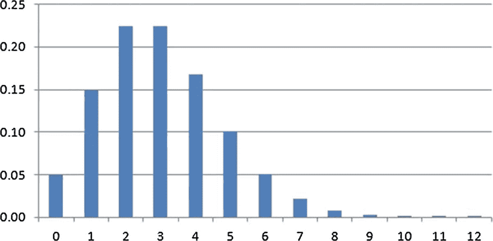
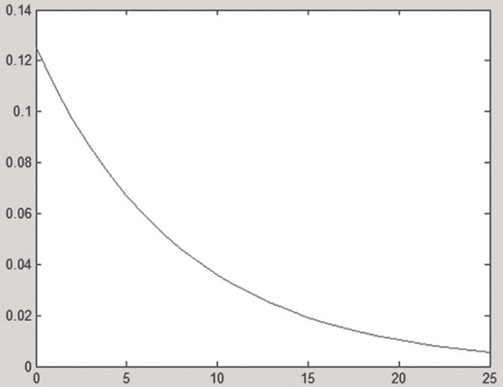
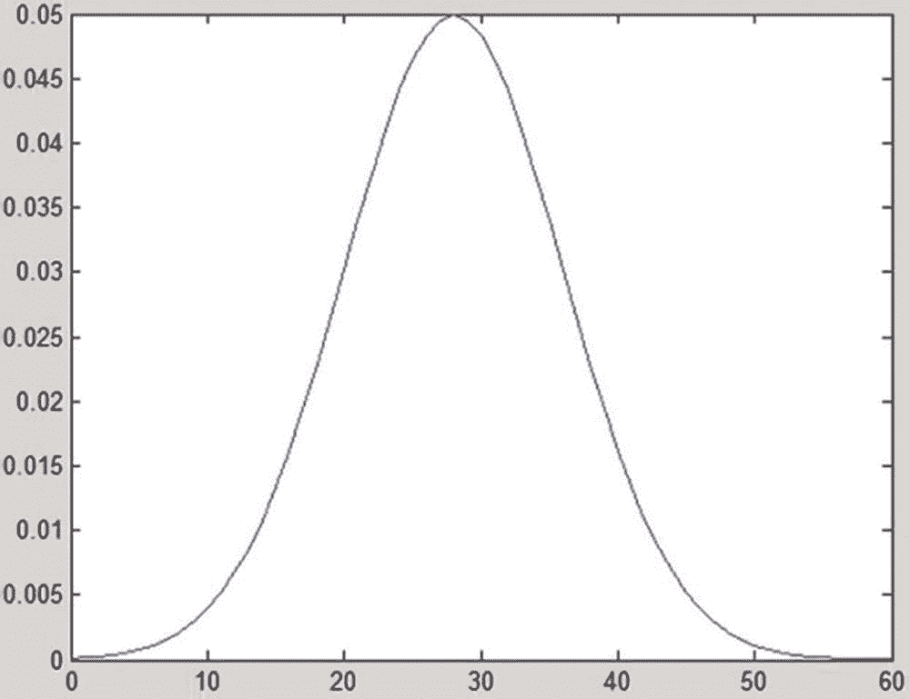
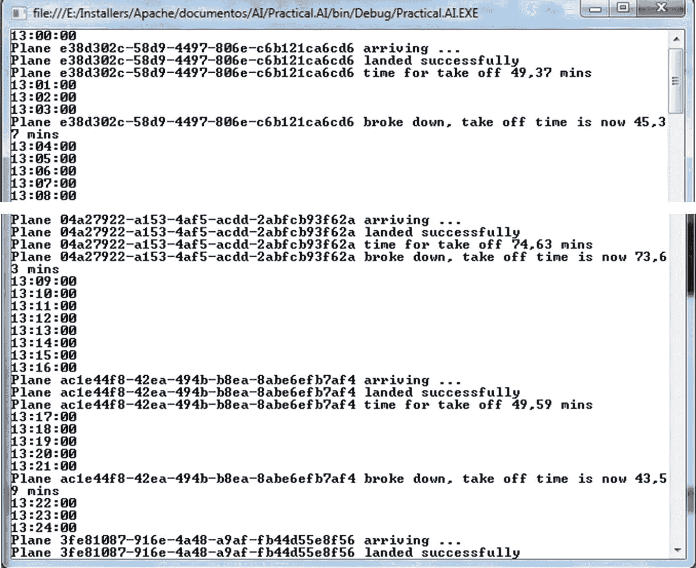

# 8. 模拟

建模是人类思维的基本工具，它使我们能够创建世界或其部分的抽象版本。这些抽象版本可以体现对情境、对象等的便捷、简化表示，并可用于寻找给定问题的解决方案。建模涉及想象力和创造力；它是我们以智能方式交流、概括和表达意义或模式的能力的基础。

人们通常认为，建模是对世界做出决策和预测的一种方式，并且在创建模型之前，必须明确定义并理解模型的目的。模型通常分为描述性模型（解释或描述世界）和规范性模型（为问题制定最优解，与优化领域相关）。第一类模型的例子包括地图、使用计算机图形创建的 3D 对象或视频游戏。后一类模型与数学密切相关，特别是与优化相关；在这些模型中，我们为问题定义一组约束条件和一个待优化的目标函数。

每个模型都具有三个基本特征：

*   **参照**：它代表某物，无论是来自现实世界还是想象世界；例如，建筑物、城市。
*   **目的**：它对其所参照的对象具有逻辑意图；例如，研究、分析。
*   **成本效益**：使用模型比使用参照物更有效，例如蓝图 vs. 真实建筑，地图 vs. 真实城市。

模拟被认为是建模的一种变体，其目的是理解、规划、预测和操控。它可以广义地定义为一种行为或现象学建模方法；也就是说，模拟是其参照物的主动行为模拟。

注意

建模是人类思维中发生的最重要的过程之一。建模时，我们试图创建现实的抽象版本，多次简化现实以帮助我们解决问题。模型的例子包括地图（如谷歌地图），它们代表了世界的抽象版本。


## 什么是仿真？

与逻辑和智能体等术语的情况类似（看来 AI 社区应该聚在一起，尝试就几个定义达成共识），对于“仿真”一词的含义也没有共识。然而，人们普遍认为，仿真是一种模仿性的、动态的建模方式，用于模拟那些因某种原因需要被研究或理解的现象。

当我们通过计算机程序实现仿真时，可以获得高度的灵活性；身处编程语言环境意味着，原则上可以以其他任何环境都难以比拟的方式来优化、维护、演进和扩展计算机仿真。像 C#这样的现代编程语言促进了模块化数据和程序代码的开发，使得可以利用现有仿真的部件或模块来构建新的仿真。

计算机仿真通常分为解析法和离散事件法。解析法涉及数学分析以及那些可以从解析角度理解或近似的问题。例如，如果被建模的现实可以用一组微分方程精确描述（如表面上的热流），那么这些方程的解析解就可以用来生成仿真所需的时间相关行为。解析仿真在数学上的优雅性，使其在许多场景下显得晦涩难懂；通过将现实简化为抽象的数学关系，所需的理解可能会变得模糊。也存在这样的情况：解析解是已知的，但计算这些解的可行方法却不可得。尽管如此，解析仿真在许多情况下仍是不可或缺的，尤其是在处理涉及大量相对较小且相似实体、其个体交互相对简单、且其整体交互遵循“大数定律”的复杂物理现象时；换句话说，它们允许进行统计处理。在这种情况下，解析模型通常至少代表了一种形式的完整理解。

注意

有一大类问题尚未被充分理解到可以用解析法处理的程度——即，不存在正式的数学解。这些问题通过离散事件仿真（DES）进行建模和模拟。

当我们有一个由多个实体组成的系统，我们孤立地理解每个实体以及它们之间的成对交互，但无法理解系统整体的行为和关系时，我们就可以利用仿真来编码这些成对交互，然后运行仿真，试图逼近系统整体的关系或行为；其中一种仿真被称为离散事件仿真（DES）。

## 离散事件仿真

时间在 DES 中至关重要，仿真可以被看作是一系列离散事件，实体在其中进行交互。时间通过固定的时间滴答或模拟时钟以离散方式推进。

DES 通常是建模某些棘手问题的最后选择。其力量在于能够揭示整个系统中无法通过其他方式识别的交互模式。通常，我们可以列举和描述一组实体及其属性、关系和直接交互，而无需知道这些交互会导致什么结果。如果将这些知识编码到 DES 仿真中，并观察所得模型的行为，那么我们就能更好地理解系统及其实体间的交互；这通常是开发 DES 背后的主要目的。

在开发 DES 时，需要考虑六个关键要素：

*   **对象**，代表系统的元素，拥有属性，与事件相关，消耗资源，并随时间进入和离开队列。在机场仿真（稍后将进行探讨）中，对象就是飞机。在医疗系统中，对象可能是病人或器官。在仓库系统中，对象就是库存产品。对象应能相互交互或与系统交互，并且可以在仿真期间的任何时刻被创建。
*   **属性**，是每个对象特有的特征（尺寸、起飞时间、降落时间、性别、价格等），以某种方式存储，并有助于确定对仿真中可能出现的各种场景的响应；这些值可以被修改。
*   **事件**，是系统中可能发生的事件，通常与对象相关，可以是飞机降落、产品到达仓库、某种疾病出现等等。事件可以以任何顺序发生和重复发生。
*   **资源**，是为对象提供服务的元素（例如，机场的跑道、仓库的存储单元、诊所的医生），是有限的。当资源被占用而某个对象需要它时，该对象必须排队等待，直到资源可用。我们将在本章的实际问题中看到这样的场景。
*   **队列**，是组织对象以等待某个当前被占用的资源释放的方式，可以有最大容量，并可以采用不同的调用方式：先进先出（FIFO）、后进先出（LIFO），或基于某些标准或优先级（疾病进展、燃油消耗等）。
*   **时间**（如前所述，如同现实生活一样）在仿真中至关重要。为了测量时间，在仿真开始时启动一个时钟，并可用于跟踪特定的时间段（出发或到达时间、运输时间、出现某些症状的时间等）。这种跟踪至关重要，因为它能让你知道下一个事件应该在何时发生。

离散事件仿真（DES）与概率和统计密切相关，因为它们模拟了随机和概率事件发生的现实场景；DES 必须依赖概率分布、随机变量以及其他统计和概率工具来生成事件。


## 概率分布

离散随机变量是指其取值集合为有限或可数无限的变量；换言之，其值可以列为有限或无限的序列，例如 1, 2, 3……以此类推。离散随机变量的概率分布是任何为每个可能值分配概率的图形、表格或公式。所有概率之和必须为 1，且每个单独的概率必须在 0 到 1 之间。例如，当我们掷一个均匀的骰子（所有面概率相等）时，表示可能结果的离散随机变量 X 将具有概率分布 X(1) = 1/6, X(2) = 1/6, …, X(6) = 1/6。所有面概率相等，因此随机变量每个值的分配概率都是 1/6。

参数 μ 将表示其对应分布中的均值（期望值）。均值表示随机变量平均取到的值。换句话说，它是总和 E=[(每个可能结果) × (该结果的概率)]，其中 E 表示均值。以骰子为例，均值将是 E = 1/6 + 2/6 + 3/6 + 4/6 + 5/6 + 6/6 = 3.5。注意，结果 3.5 实际上位于骰子所有可能值的中间位置；这是当骰子被大量投掷时的期望值。

参数 σ² 将表示分布的方差。方差表示随机变量可能值的离散程度；它始终为非负数。小方差（接近 0）表示数值彼此接近且靠近均值；大方差（接近 1）表示数值之间以及与均值之间距离很大。

泊松分布是一种离散分布，用于表示每单位时间内事件数量的概率（图 8-1）。它通常应用于事件概率较小且事件发生机会数量较大的情况。一本书中的印刷错误数量、到达机场的飞机数量、到达红绿灯处的汽车数量以及特定年龄组每年的死亡人数，都是泊松分布应用的例子。



图 8-1

泊松分布

指数分布表示泊松过程中事件之间的时间（图 8-2）。例如，如果你正在处理一个描述某段时间内到达机场的飞机数量的泊松过程，那么你可能对一个随机变量感兴趣，该变量指示第一架飞机到达前过去了多少时间。指数分布可以满足此目的，它也可以应用于物理过程；例如，表示粒子的寿命，其中 λ 参数将指示粒子老化的速率。



图 8-2

指数分布

正态分布描述围绕中心值收敛的概率，没有左偏或右偏，如图 8-3 所示。正态分布是对称的，具有钟形密度曲线，在均值处有一个单峰。分布的 50% 位于均值左侧，50% 位于右侧。标准差表示钟形曲线的宽度或范围；标准差越小，数据越集中。均值和标准差都必须定义为正态分布的参数。许多自然现象强烈遵循正态分布：血压、人的身高、测量误差等等。



图 8-3

正态分布

到目前为止，我们已经描述了什么是离散事件仿真（DES）、其组成部分，以及一些可应用于此类仿真中事件时间生成的最重要的概率分布。在下一节中，我们将开始研究一个实际问题，我们将看到如何在一个机场仿真示例中将所有部分整合在一起。

## 实际问题：机场仿真

让我们设想一个场景，我们希望模拟一个拥有五条跑道的机场的运作，其中运载一定数量乘客的飞机到达，在机场停留一段时间以加油，并最终在一个时间范围内起飞，该时间范围取决于（除其他因素外）飞机可能发生故障的概率。这就是我们将在本章中实现的机场仿真。未来代码中出现的 `IDistribution`、`Poisson` 和 `Continuous` 类（接口）是 `MathNet.Numerics` 包的一部分。

一架飞机与另一架飞机到达机场的时间间隔服从泊松函数分布，其 lambda 参数由表 8-1 指定。

表 8-1

根据时间段划分的飞机到达机场情况

| 时间 | Lambda |
| --- | --- |
| 06:00–14:00 | 7 分钟 |
| 14:00–22:00 | 10 分钟 |
| 22:00–06:00 | 20 分钟 |

当一架飞机到达机场时，它会降落在一条可用的跑道上，从任何可用跑道中均匀选择。如果没有可用跑道，飞机将进入一个请求着陆许可的飞机队列中。一旦飞机最终着陆，它会在一定时间内处理其货物，该时间服从指数函数分布，其参数值根据飞机上乘客数量确定，如表 8-2 所示。

表 8-2

任何飞机的货物处理时间（取决于乘客数量）

| 乘客数 | Lambda |
| --- | --- |
| 0–150 | 50 分钟 |
| 150–300 | 60 分钟 |
| 300–450 | 75 分钟 |

当飞机处理货物时，它被视为占用跑道。飞机发生故障的概率为 0.15，在这种情况下，维修时间将服从参数 lambda = 80 分钟的指数函数分布。

为了开始分析机场仿真的代码，让我们考虑清单 8-1 中描述的 `Airplane` 类。

```
public class Airplane
{
public Guid Id { get; set; }
public intPassengersCount{ get; set; }
public double TimeToTakeOff{ get; set; }
public intRunwayOccupied{ get; set; }
public bool BrokenDown{ get; set; }
public Airplane(int passengers)
{
Id = Guid.NewGuid();
PassengersCount = passengers;
RunwayOccupied = -1;
}
}
清单 8-1
Airplane 类
```

`Airplane` 类包含以下属性：

*   `Id`：在构造函数中初始化，将唯一标识每架飞机。
*   `PassengersCount`：定义飞机上的乘客数量。
*   `TimeToTakeOff`：定义飞机应从跑道起飞的时间（以分钟为单位）。
*   `RunwayOccupied`：标识飞机是否正在占用机场的跑道，如果是，则此属性与正在占用的跑道索引匹配。当其值小于 0 时，表示飞机未占用任何跑道。
*   `BrokenDown`：如果飞机发生故障，则值为 True，否则为 False。

在清单 8-2 中，我们可以看到 `AirportEvent<T>` 抽象类，它将作为其他三个表示 `AirportSimulation` 中不同事件的类的父类。其目的是缩短代码，将所有可以逻辑压缩或包含在单个父类中的行合并，从而利用 C# 中的继承特性。


```
public abstract class AirportEvent where T: IComparable
{
protected double[] Parameters;
protected List> Frames;
public double[] DistributionValues;
public List Distributions;
protected AirportEvent(params double[] lambdas)
{
Distributions = new List();
DistributionValues = new double[lambdas.Length];
Frames = new List>();
Parameters = lambdas;
}
public virtual void SetDistributionValues(DistributionType type)
{
foreach (var lambda in Parameters)
{
switch (type)
{
case DistributionType.Poisson:
Distributions.Add(new Poisson(lambda));
break;
case DistributionType.Exponential:
Distributions.Add(new Exponential(lambda));
break;
}
}
// 采样分布
for (vari = 0; i= 0 &&elem.CompareTo(Frames[i].Item2) 抽象类
```

注意

在 `AirportEvent<T>` 类中，我们通过 `where` 关键字要求 `T` 参数必须是 `IComparable` 类型。我们需要这个前提条件，以便后续能够以最通用的方式对它们进行比较。

`AirportEvent<T>` 类包含以下属性：

*   `Parameters`：一个双精度浮点数数组，存储用于不同分布的 lambda 参数。
*   `Frames`：一个类型为 `T` 的元组列表，定义了事件的时间范围或数值范围，对应于表 8-1 和 8-2 中所示的概率分布和参数。此列表的基数必须与 `Parameters` 数组以及接下来要列出的两个属性的基数相匹配。
*   `DistributionValues`：双精度浮点数数组，用于在索引 `i` 处存储使用 `Parameters` 数组中的参数 `i` 计算概率分布 `i` 所得的值。
*   `Distributions`：要使用的分布列表；在计算概率分布时，我们考虑某个参数 lambda，计算所得的值存储在 `DistributionValues` 数组中。

除了上述属性，该类还包含以下方法：

*   `SetDistributionValues()`：根据作为参数传入的分布类型，向 `Distributions` 列表添加新的分布，并使用指定的 `Parameters` 对这些分布进行采样，将每个采样值存入 `DistributionValues` 数组。
*   `GetEvtFrequency()`：此方法接收一个类型为 `T`（该类型为 `IComparable`）的参数，并将其与时间或数值范围进行比较，以确定它所属的部分，从而获取对应的分布值。例如，如果范围是 `(0, 100)`、`(100, 200)`、`(200, 250)`，且 `T = 110`，那么 `T` 将落入第二个范围，并匹配第二个（`index=1`）分布值。

此外，我们还有 `DistributionType` 枚举，它指示了本示例中将考虑的两种分布类型（泊松分布、指数分布）。

`AirplaneEvtArrival` 类（清单 8-3）继承自 `AirportEvent<T>`；在此例中，`T` 为 `TimeSpan`。该类表示飞机抵达机场的事件。

```
public class AirplaneEvtArrival :AirportEvent
{
public AirplaneEvtArrival(params double[] lambdas) : base(lambdas)
{
Frames = new List>
{
new Tuple(new TimeSpan(0, 6, 0, 0), new TimeSpan(0, 14, 0, 0)),
new Tuple(new TimeSpan(0, 14, 0, 0), new TimeSpan(0, 22, 0, 0)),
new Tuple(new TimeSpan(0, 22, 0, 0), new TimeSpan(0, 6, 0, 0))
};
}
}
清单 8-3
AirplaneEvtArrival 类
```

该类仅包含一个构造函数，其中 `Frames` 列表被定义为一组元组，每个元组详细描述了一个时间范围。

类似地，`AirplaneEvtProcessCargo` 类（清单 8-4）也继承自 `AirportEvent<int>`，在其构造函数中定义了一个包含整数元组的 `Frames` 列表，这些元组指示了乘客数量的范围。这些范围最终对应某个值（以分钟为单位），即处理该数量乘客所需的时间（回顾表 8-2）。

```
public class AirplaneEvtProcessCargo :AirportEvent
{
public AirplaneEvtProcessCargo(params double[] lambdas) : base(lambdas)
{
Frames = new List>
{
new Tuple(0, 150),
new Tuple(150, 300),
new Tuple(300, 450)
};
}
public double SampleAt(intelem)
{
for (vari = 0; i=0&&elem.CompareTo(Frames[i].Item2) 类
```

该类还包含一个 `SampleAt()` 方法，该方法返回作为参数传入的元素的概率分布值，并考虑由 `Frames` 列表施加给类的范围。

在清单 8-5 中，我们可以看到 `AirplaneEvtBreakdown` 类，它继承自 `AirportEvent<TimeSpan>`；其代码非常简单，因为它只是调用了其父类的构造函数。

```
public class AirplaneEvtBreakdown :AirportEvent
{
public AirplaneEvtBreakdown(params double[] lambdas): base(lambdas)
{
}
}
清单 8-5
AirplaneEvtBreakdown 类
```

最后，`Simulation` 类包含各种属性、字段和构造函数，如清单 8-6 所示。

```
public class Simulation
{
public TimeSpanMaxTime{ get; set; }
private TimeSpan _currentTime;
private readonlyAirplaneEvtArrival _arrivalDistribution;
private readonlyAirplaneEvtProcessCargo _processCargoDistribution;        private readonlyAirplaneEvtBreakdown _airplaneBreakdown;
private readonly bool [] _runways;
private readonlyint _planeArrivalInterval;
private readonly Queue _waitingToLand;
private readonly List _airplanes;
private List _airplanesOnLand;
private static readonly Random Random = new Random();
public Simulation(TimeSpanstartTime, TimeSpanmaxTime, IEnumerable airplanes)
{
MaxTime = maxTime;
_runways = new bool[5];
_arrivalDistribution = new AirplaneEvtArrival(7, 10, 20);
_processCargoDistribution = new AirplaneEvtProcessCargo(50, 60, 75);
_airplaneBreakdown = new AirplaneEvtBreakdown(80);
_waitingToLand = new Queue();
_airplanes = new List(airplanes);
_airplanesOnLand = new List();
_currentTime = startTime;
// 为第一天设置分布值。
_arrivalDistribution.SetDistributionValues(DistributionType.Poisson);
_processCargoDistribution.SetDistributionValues(DistributionType.Exponential);
_airplaneBreakdown.SetDistributionValues(DistributionType.Exponential);
_planeArrivalInterval = (int) _arrivalDistribution.GetEvtFrequency(startTime);
}
}
清单 8-6
Simulation 类的构造函数、字段和属性
```

`Simulation` 类的属性和字段如下：

*   `MaxTime`：模拟将持续的最长时间。
*   `_currentTime`：模拟中的当前时间。
*   `_arrivalDistribution`：描述飞机抵达事件的对象。
*   `_processCargoDistribution`：描述飞机处理货物事件的对象。
*   `_airplaneBreakdown`：描述飞机故障事件的对象。
*   `_runways`：机场的跑道集合。
*   `_planeArrivalInterval`：飞机抵达机场的时间间隔。该值通过 `_arrivalDistribution` 计算得出。
*   `_waitingToLand`：等待可用跑道降落的飞机队列。
*   `_airplanes`：抵达机场的飞机列表。
*   `_airplanesOnLand`：已降落在机场的飞机列表。
*   `Random`：随机变量。


`Simulation` 类的构造函数接收模拟的开始时间、结束时间以及计划降落在机场的飞机列表作为参数。在构造函数内部，我们根据表 8-1 和 8-2 中描述的值来初始化字段和属性。

在 `Execute()` 方法（代码清单 8-7）中，我们执行模拟；所有操作都发生在一个外部 `while` 循环内，该循环会一直运行，直到模拟的当前时间超过允许的最大时间。

在外部 `while` 循环内部，我们首先尝试为已排队等待降落的飞机授予降落许可。我们稍后将详细研究 `TryToLand()` 方法，该方法尝试为某架飞机执行降落操作。然后，我们处理飞机到达事件，首先检查是否还有飞机在等待降落，并且检查当前时间（以分钟为单位）除以飞机预计到达机场的时间间隔后，余数是否为零；这相当于说当前分钟属于先前计算的到达时间间隔值所定义的剩余类。

最后，我们遍历地面上的每一架飞机，检查哪些飞机必须在当前分钟起飞，或者考虑飞机发生故障的可能性。我们还会更新飞机列表、地面上的飞机列表以及任何时刻被占用的跑道列表。为了结束并开始模拟的下一个周期，我们将当前时间增加一分钟。

```
public void Execute()
{
while (_currentTime 0)
{
varnewPlane = _airplanes.First();
_airplanes.RemoveAt(0);
Console.WriteLine("飞机 {0} 正在到达...", newPlane.Id);
if (TryToLand(newPlane))
_airplanesOnLand.Add(newPlane);
}
// 更新地面飞机列表
varnewAirplanesOnLand = new List();
// 更新这一分钟的飞机状态
foreach (var airplane in _airplanesOnLand)
{
airplane.TimeToTakeOff--;
if (airplane.TimeToTakeOff(newAirplanesOnLand);
// 增加一分钟
_currentTime = _currentTime.Add(new TimeSpan(0, 0, 1, 0));
}
}
代码清单 8-7
Execute() 方法
```

在代码清单 8-8 中，我们可以看到 `RunwayAvailable()` 和 `TryToLand()` 方法。第一个方法非常简单，它让我们知道是否有可用的跑道，如果有，则返回其索引。后一个方法尝试为飞机授予降落许可，首先检查是否有可用的跑道。假设有，则更新相应的列表和属性，并设置飞机在机场消耗的时间；即其起飞时间。如果没有可用的跑道，则飞机将排队等待最终降落。

```
public intRunwayAvailable()
{
return _runways.ToList().IndexOf(false);
}
public bool TryToLand(Airplane newPlane)
{
varrunwayIndex = RunwayAvailable();
if (runwayIndex>= 0)
{
_runways[runwayIndex] = true;
newPlane.RunwayOccupied = runwayIndex;
newPlane.TimeToTakeOff = _processCargoDistribution.SampleAt(newPlane.PassengersCount);
Console.WriteLine("飞机 {0} 成功降落", newPlane.Id);
Console.WriteLine("飞机 {0} 起飞时间 {1} 分钟", newPlane.Id, Math.Round(newPlane.TimeToTakeOff, 2));
return true;
}
_waitingToLand.Enqueue(newPlane);
return false;
}
}
代码清单 8-8
RunwayAvailable() 和 TryToLand() 方法
```

为了初始化和测试模拟，我们可以依赖代码清单 8-9 中显示的代码，这对应于一个 C# 控制台应用程序。

```
var airplanes = new List
{
new Airplane(100),
new Airplane(300),
new Airplane(50),
new Airplane(250),
new Airplane(150),
new Airplane(200),
new Airplane(120)
};
var sim = new Simulation.Airport.Simulation(new TimeSpan(0, 13, 0, 0), new TimeSpan(0, 15, 0, 0), airplanes);
sim.Execute();
代码清单 8-9
启动模拟
```

一旦我们执行模拟，我们将看到模拟中发生的各种事件，例如时间、飞机到达、飞机起飞、飞机故障等。所有这些都将打印在控制台应用程序中，如图 8-4 所示。



图 8-4

显示模拟中发生的各种事件的控制台应用程序

在我们的机场模拟中，我们考虑了到达、起飞和故障等事件。像往常一样，建议读者尝试扩展模拟，考虑新的事件，或者调整参数使其更符合现实场景。

## 总结

在本章中，我们介绍了建模和模拟的概念。我们描述了什么是离散事件模拟（DES），并描述了其组成部分（事件、队列等）。我们研究了各种概率分布及其与模拟应用的关系。最后，我们展示了一个完整的示例，其中我们模拟了机场在给定时间内的运行情况，并能够看到各个部分如何组合在一起，创建一个模拟机场工作时间的程序，同时考虑了多个事件（到达、起飞、故障）。在下一章中，我们将开始深入探讨有趣且广阔的监督学习世界。


