# 9. 支持向量机

在本章中，我们将开始研究监督学习，这是机器学习的一个分支，其算法类似于我们在学校中的学习方式——通过经验以及教授在课堂或训练中介绍的众多示例来学习。

许多监督学习算法由两个阶段组成：训练阶段，学习器会接收到一组训练数据，每个数据都是一个向量及其正确的分类；预测阶段，学习器在学习了与训练数据对应的函数后，现在需要预测新输入数据的正确分类或数值。例如，一个训练数据集可以定义如下：

```
{  { (2, 3), 1}, { (1, 1), -1}, { (3, 3), 1}  }
```

请注意，每个 (x, y) 对都附带一个分类或类别，在此例中为 1 或 -1。

训练数据通常表示为一对 (v, c)，其中 v 是一个 n 维向量（通常称为特征向量），代表对象的不同属性；c 是针对当前问题该对象的分类或标签。对象可以是任何东西，从人、花朵、化合物到城市、州，基本上任何我们能想象到或可以分类的事物。向量可以指示对象的各种属性，例如位置、高度、重量、强度、性别、人口、含氧量等等。

通常，分类（我们稍后会探讨在此上下文中分类的含义）监督学习算法的学习过程遵循以下几点：

*   **训练**：从作为输入接收的训练数据中，推断出一个函数 f(x)。该函数描述了数据的结构，并尝试根据从训练数据中学到的结构来分类新的输入数据。
*   **预测**：假设接收到一个新数据 x，将其分类为 f(x)；即使用学习到的函数 f 来分类新的输入数据。

监督学习试图解决的两个最重要的问题是分类和回归。

在第一类问题中，我们将输入数据映射到预定义的、离散的类别数量中。因此，我们通过用某个类别标记输入数据来对其进行分类。在这种情况下，我们称该监督学习算法为**分类器**。在后一类问题中，我们不对对象进行分类或归类；而是对某个变量属于某个类别的可能性进行估计。在这类问题中，我们感兴趣的是找到一个能很好地表示数据集的关系。这种关系可以体现在最能逼近该数据集的直线上，就像在一种称为**线性回归**的回归类型中那样；解决这类问题的方法被称为**回归器**。

> **注意**
>
> 在分类算法中，输出变量取离散的、分类的值。在回归算法中，输出变量取连续的、实数值。回归算法会预测某一天的温度；分类算法则只会告诉我们天气是热还是不热。

在图 9-1 中，我们可以直观地看到分类器和回归器之间的区别。分类器 (b) 能够将空间划分为多个子空间或类别（图 9-1 中为两个类别），而回归器 (a) 则只是试图找到一种结构（图 9-1 中的直线）来最好地逼近当前数据集的形状；由于该数据集具有线性结构，因此线性回归器是一个很好的逼近器。

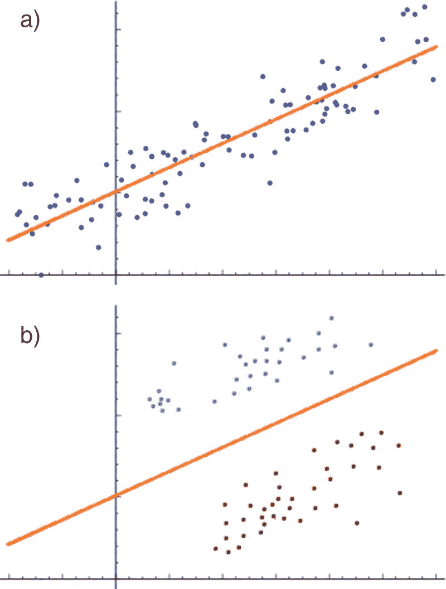

**图 9-1**

a) 表示一个回归器，b) 表示一个分类器

在本章中，我们将研究支持向量机算法，该算法应用于数据分类，因此被视为分类器。本章的目的是描述支持向量机算法，并提供该算法的完整 C# 代码，同时附带一个 Windows Forms 可视化应用程序，以验证所获得的结果（以图形方式显示），并作为测试和说明的工具。在开发支持向量机时，我们将采用两种方法。一种将使用优化库来求解支持向量机试图解决的优化问题，另一种将使用 Platt 的序列最小优化（SMO）算法来求解同一问题。我们很快就会探讨支持向量机提供了什么元素，使我们能够预测新输入数据的类别。

> **注意**
>
> 统计学习理论是机器学习的一个分支，处理基于数据寻找预测函数的问题。统计学习理论已在计算机视觉、语音识别、文本分类、模式识别、生物信息学等领域取得了成功的应用。


## 什么是支持向量机（SVM）？

支持向量机（SVM）是一种通常应用于分类问题的优化技术。它常被称为分类器，但也已适用于回归等其他优化问题；因此，我们可以断言 SVM 既可以作为分类器，也可以作为回归器。SVM 算法由弗拉基米尔·瓦普尼克于 20 世纪 60 年代提出，其基础主要依赖于统计学习理论和数学优化。事实上，SVM 的训练阶段归结为求解一个优化问题，该问题为我们提供一组权重和一个值（偏置），从而能够对新输入的数据进行分类。

与机器学习许多领域的情况一样，SVM 的核心是从数据中学习结构。在二元分类（仅两个类别）的情况下，SVM 算法会找到一个超平面，该超平面相对于每个类别边界上的向量具有最宽的间隔。

n 维空间的超平面是 n-1 维的子空间。例如，当 n = 1 时，我们的空间是一条直线，因此其超平面是点；当 n = 2 时，我们的空间是通常的二维坐标空间，因此其超平面是直线；当 n = 3 时，我们的空间是三维空间，因此其超平面是二维平面，以此类推。图 9-1 b) 展示了一个二维空间，其中橙色线代表该空间中的一个超平面。

注意

SVM 用于文本分类任务，例如类别分配、垃圾邮件检测和情感分析。它也常用于图像识别挑战，在基于方面的识别和基于颜色的分类中表现尤为出色。SVM 在手写数字识别的许多领域也发挥着重要作用，例如邮政自动化服务。

我们还可以注意到，这个超平面将蓝点与红点分开；我们可以说这是一个分类超平面，因为它将空间分成了两个类别。如图 9-2 所示，对于一个给定的分类问题，可能存在多个分类超平面。

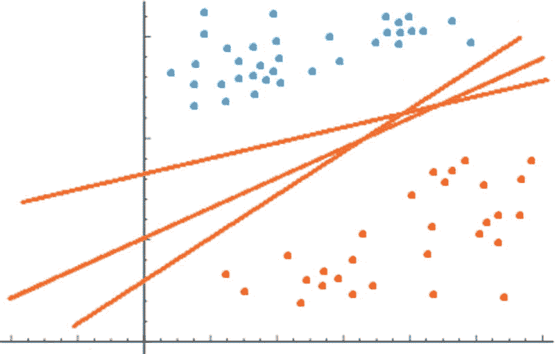

图 9-2

一个分类问题的各种可能的分类超平面

对于未来输入的数据，并非每个超平面都具有相同的效果。直观上，我们希望有一个分类超平面能够在两个类别之间产生最大的间隔，这样待预测的新数据将有更大的机会被正确分类。

超平面与任一侧（蓝点或红点）最近数据点之间的距离称为间隔（图 9-3）。SVM 的目标是选择一个分类超平面，使得该超平面与训练集中任一类别任何点之间的间隔尽可能大。如前所述，这为我们正确分类新输入数据提供了更好的机会；从这个意义上说，我们可以断言 SVM 寻找的是用于分类数据的最优超平面。

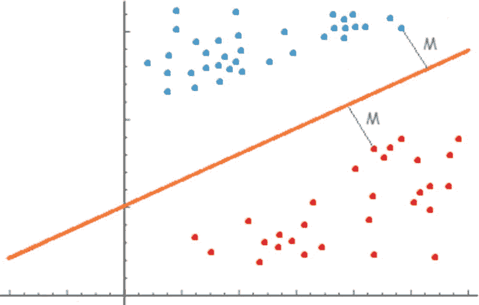

图 9-3

由分类超平面定义的间隔 M

为了找到训练数据集的最优超平面，我们需要找到能够在两个类别之间提供最大可能间隔的分类超平面。因此，SVM 的训练阶段包含一个优化问题（更准确地说，是一个二次规划问题），其中我们最大化值 2 x M；换句话说，两倍的间隔将决定由穿过支持向量集的超平面所定义的“街道”的总宽度（图 9-4）。定义此间隔的向量称为支持向量。

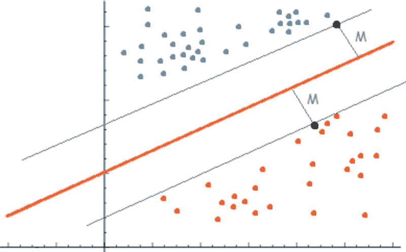

图 9-4

用黑点表示的支持向量

为了得到 M 的公式，首先让我们回顾一下，在二维空间中，直线（二维中的超平面）的公式是 Ax + By + C = 0。这个表达式可以推广，从而推导出任何超平面的一般表达式，其公式为 wx + b = 0，其中 w 是一个称为权重向量的向量，b（与直线方程中的 C 对应）是一个称为偏置或截距的实数值；该值决定了超平面在其空间中原点的偏移。因此，当 b = 0 时，意味着超平面通过原点 (0, 0, … 0)；w 是垂直于超平面的法向量，并定义了其方向。

现在我们有了超平面的公式，可以通过找到支持向量（在图 9-4 中标记为黑点）到超平面的距离来得到 M 的值。回想一下，在二维空间中，点 (x′, y′) 到直线的距离由以下公式给出：

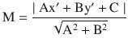

在一般形式下，在 n 维空间中，M 的公式可以推导如下：

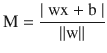

其中 ||w|| 是权重向量 w 的范数。回想一下，对于向量 v = (v1, v2 …vn)，其范数定义如下：

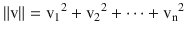

任何超平面都可以通过缩放 w 和 b 以无限多种方式表示。这种归一化或缩放类似于我们有时对百分比使用的缩放类型；我们不将百分比称为 85%，而是简单地使用 [0, 1] 范围内的数字，并找到从 85% 到等效值 0.85 的直接映射。在我们的例子中，我们有分类超平面，以及另外两个平行于分类超平面并穿过每个类别支持向量的超平面。通过归一化，我们可以将这些超平面表示如下：

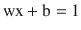

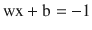

这种表示称为规范超平面；在这种表示下，假设值已归一化，并且我们试图找到分类超平面上的点到由支持向量形成的任一超平面的距离，我们可以调整 M 的方程如下：

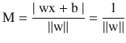

因此，要最大化的总间隔将是 2 x M = 2 / ||w||。请注意，最大化此值等同于最小化以下值：

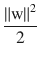

至此，我们知道需要最小化上述函数，以便找到能够最大化分类超平面与两个类别之间间隔的（权重向量，偏置）对。现在我们需要定义这种优化将在哪组约束条件下进行。

我们已经有了穿过支持向量的超平面方程。由于支持向量定义了空间中每个类别的边界，这些超平面决定了我们的约束条件，因为我们需要每个数据点都位于这些超平面的一侧或另一侧（图 9-5）。因此，我们最终得到以下约束条件：

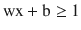

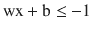


第一个方程适用于数据点 x 的分类等于 yi = 1 的情况；否则适用于 yi = -1 的情况。请记住，对于每个数据点 x，我们在训练数据集中都有其对应的分类。

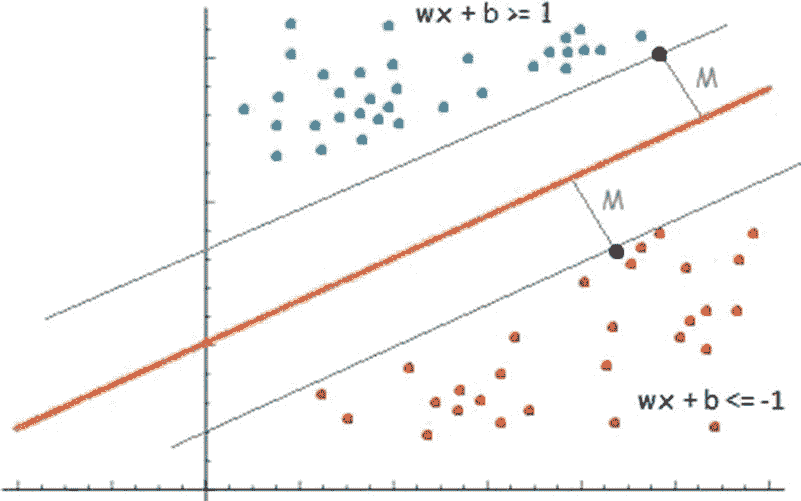

图 9-5

蓝色点满足方程 wx + b >= 1，红色点满足方程 wx + b <= -1

之前的约束条件可以合并为一个：

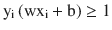

最后，SVM 求解的优化问题表述如下：

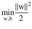

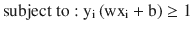

此刻请记住，刚刚提出的优化问题对应于一个线性 SVM 分类器；换句话说，我们假设训练数据集是线性可分的。那么 SVM 分类器函数如下所示：

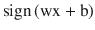


注意，如果 wx + b >= 1，则数据点 x 属于类别 1；否则，x 属于类别 -1。正如我们所见，只要拥有 w 和 b 作为最优分类超平面的权重向量和偏置，我们就能对新的输入数据进行分类。

尽管目前我们已经得到了一个优化问题的公式，其解确实能引导我们找到分类超平面的最大间隔，但这个公式通常会被弃用，转而采用一个更便于计算和优化本身的公式。这个新公式基于拉格朗日乘子和沃尔夫对偶问题等价性。

对偶性在优化理论中扮演着关键角色，许多优化问题都有一个称为对偶问题的关联优化问题。这种问题的替代公式拥有一组解，这些解与原问题（称为原始问题）的解相关。特别是，对于一大类问题，原始解可以很容易地从对偶解中计算出来。此外，在我们本章处理的具体问题中，对偶公式提供了更易于处理的约束条件，这些条件也非常适合核函数（我们很快就会讨论它们）。

像我们这样的约束优化问题可以通过拉格朗日方法求解。该方法允许我们在满足一组约束的条件下，找到多变量函数的最大值或最小值。它通过添加 n + k 个变量（其中 k 是原始问题的约束数量）将约束问题简化为无约束问题。这些新变量被称为拉格朗日乘子。使用这种变换后，得到的问题将包含比原始问题更容易求解的方程。

具有约束条件 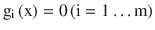 的函数 f(x) 的拉格朗日函数如下：

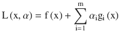

注意，新公式没有约束条件；它们已被封装到当前唯一的函数 L(x, α) 中。在这种情况下，α[i] 代表拉格朗日乘子。让我们将原始问题的目标函数和约束条件代入 L(w, b, α)：

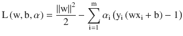

上述表达式使用了广义拉格朗日形式，它不仅包含等式约束，还包含不等式约束 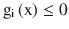 或等价地 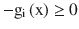。一旦我们引入了拉格朗日乘子，我们只需要找到问题的对偶形式。具体来说，我们将找到问题的沃尔夫对偶形式。为此，我们相对于 w 和 b 最小化 L，这通过求解以下方程来实现，其中 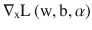 表示 L 相对于 x 的梯度：

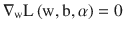

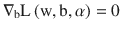

L 相对于 w 的导数得出以下结果：

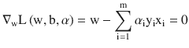

这意味着：

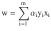

至于相对于 b 的梯度，结果如下：

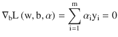

将新得到的 w 公式代入，并考虑到 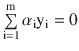，我们可以将 L(w, b, α) 调整如下：


注意，由于 x[i] 和 x[j] 是向量，x[i]x[j] 表示它们的内积。因此，我们最终得到了对偶问题的表达式，实际上这也是大多数 SVM 库和包所求解的优化问题，原因在于前面提到的优势。完整的优化问题如下所示：


![$$ {\displaystyle \begin{array}{l}\underset{\alpha }{\max}\mathrm{L}\left(\mathrm{w},\mathrm{b},\alpha \right)=\sum \limits_{\mathrm{i}=1}^{\mathrm{m}}{\alpha}_{\mathrm{i}}-\frac{1}{2}\sum \limits_{\mathrm{i},\mathrm{j}=1}^{\mathrm{m}}{\mathrm{y}}_{\mathrm{i}}{\mathrm{y}}_{\mathrm{j}}{\alpha}_{\mathrm{i}}{\alpha}_{\mathrm{j}}{\mathrm{x}}_{\mathrm{i}}{\mathrm{x}}_{\mathrm{j}}\\ {}\kern0.50em \ \kern0.50em \ \kern0.50em \ \kern0.50em \ \kern0.50em \ \kern0.50em \ \kern0.50em \ \kern0.50em \ \kern0.50em \ \kern0.50em \ \mathrm{s}.\mathrm{t}\kern0.50em \ \kern0.50em \ \kern0.50em \ \kern0.50em \ \kern0.50em \sum \limits_{\mathrm{i}=1}^{\mathrm{m}}{\alpha}_{\mathrm{i}}{\mathrm{y}}_{\mathrm{i}}=0\\ {}\kern0.50em \ \kern0.50em \ \kern0.50em \ \kern0.50em \ \kern0.50em \ \kern0.50em \ \kern0.50em \ \kern0.50em \ \kern0.50em \ \kern0.50em \ \ {\alpha}_{\mathrm{i}}\ge 0\ \kern0.50em \ \mathrm{i}=1,\dots \mathrm{m}\end{array}} $$](img/A449374_1_En_9_Chapter_Equw.gif)

在下一节中，我们将看到一个实际问题，该问题（对偶问题）将使用 C# 中的优化库来解决。这个问题将帮助我们理解本章介绍的一些概念和思想。

注意

函数 f 的梯度通常用符号 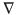 表示，放在函数名之前（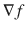）。它是一个向量，由 f 对每个变量的导数构成，并指示了在给定点处 f 的最大增量方向。例如，假设 f 是一个将空间中每个点映射到给定压力的函数，那么梯度将指示从任何点 (x, y, z) 出发，压力变化最快的方向。

## 实际问题：C# 中的线性 SVM

为了开发我们的线性 SVM，我们将创建一个名为 `LinearSvmClassifier` 的类，该类具有以下字段或属性（列表 9-1）。

```
public class LinearSvmClassifier
{
public ListTrainingSamples{ get; set; }
public double[] Weights;
public double Bias;
public List>SetA{ get; set; }
public List>SetB{ get; set; }
public List> Hyperplane { get; set; }
private readonlydouble[] _alphas;
public intModelToUse = 1;
public LinearSvmClassifier(IEnumerabletrainingSamples)
{
TrainingSamples = new List(trainingSamples);
Weights = new double[TrainingSamples.First().Features.Length];
SetA = new List>();
SetB = new List>();
Hyperplane = new List>();
_alphas = new double[TrainingSamples.Count];
}
}
public class TrainingSample
{
public int Classification { get; set; }
public double[] Features { get; set; }
public TrainingSample(double [] features, int classification)
{
Features = new double[features.Length];
Array.Copy(features, Features, features.Length);
Classification = classification;
}
}
列表 9-1
我们的线性 SVM 的属性和字段
```

每个属性或字段描述如下：

*   `TrainingSamples`：`TrainingSample` 对象的列表；每个对象代表一个数据点及其分类。列表 9-1 中展示的 `TrainingSample` 类仅包含一个双精度浮点数数组 `Features` 和一个整数 `Classification`。
*   `Weights`：表示 SVM 模型中权重的双精度浮点数数组。
*   `Bias`：表示 SVM 模型中偏置或截距的双精度浮点数。
*   `SetA`：`Tuple<double, double>` 的列表，表示训练数据中满足 wx + b >= 1 的点。仅在预测阶段使用。
*   `SetB`：`Tuple<double, double>` 的列表，表示训练数据中满足 wx + b <= -1 的点。仅在预测阶段使用。
*   `Hyperplane`：`Tuple<double, double>` 的列表，表示训练数据中满足 wx + b = 0 的点；即位于超平面上的点。仅在预测阶段使用。
*   `_alphas`：表示 SVM 对偶问题中 alpha 值的双精度浮点数数组。
*   `ModelToUse`：确定 SVM 训练阶段所使用的训练方法。

编码了对偶优化问题的 `Training()` 方法如列表 9-2 所示。我们使用 Accord.NET 库作为求解 SVM 模型的优化工具。你可以通过网页或使用 Visual Studio 提供的 Nuget 包管理器从 Nuget 下载 Accord.NET。

```
public void Training()
{
var coefficients = new Dictionary, double>();
ModelToUse = 1;
for (vari = 0; i(i, j),
-1 * TrainingSamples[i].Classification * TrainingSamples[j].Classification *
TrainingSamples[i].Features.Dot(TrainingSamples[j].Features));
}
var q = new double[TrainingSamples.Count, TrainingSamples.Count];
q.SetInitValue(coefficients);
// 此变量包含 (1, 1, ..., 1)
var d = Enumerable.Repeat(1.0, TrainingSamples.Count).ToArray();
var objective = new QuadraticObjectiveFunction(q, d);
// sum(ai * yi) = 0
var constraints = new List
{
new LinearConstraint(d)
{
VariablesAtIndices=Enumerable.Range(0, TrainingSamples.Count).ToArray(),
ShouldBe = ConstraintType.EqualTo,
Value = 0,
CombinedAs = TrainingSamples.Select(t =>t.Classification).ToArray().ToDouble()
}
};
// 0 <= ai
for (vari = 0; i<TrainingSamples.Count; i++)
{
constraints.Add(new LinearConstraint(1)
{
VariablesAtIndices = new[] { i },
ShouldBe = ConstraintType.GreaterThanOrEqualTo,
Value = 0
});
}
var solver = new GoldfarbIdnani(objective, constraints);
if (solver.Maximize())
{
var solution = solver.Solution;
UpdateWeightVector(solution);
UpdateBias();
}
else
Console.WriteLine("错误 ...");
}
列表 9-2
使用 Accord.NET 建模对偶优化问题的 Training() 方法
```


为了解决这个优化问题，我们将使用约束优化问题求解器 `GoldfarbIdnani`；这个求解器以及许多其他求解器都可以在 Accord.NET 库中找到。在 `GoldfarbIdnani` 类的构造函数中，有多种指定目标函数和约束的方式；在本例中，我们选择将目标函数指定为 `QuadracticObjectiveFunction` 类，并将约束集指定为 `LinearConstraint` 类的实例。代表目标函数的 `QuadracticObjectiveFunction` 是通过指定目标函数的 Hessian 矩阵和线性项向量来声明的。从清单 9-2 中可以看出，`Training()` 方法首先将一组值存储到 `Dictionary<Tuple<int, int>, double>` 中，其中第一个项（`Tuple<int i, int j>`）表示 Hessian 矩阵中系数所属的变量 i, j。

注意

n 个变量的函数 f 的 Hessian 矩阵 H 是一个 n x n 矩阵，包含 f 关于每个 n 变量的二阶导数。我们可以说 f 是凸函数当且仅当 H 是半正定矩阵；即，它的所有特征值都是正的。

目标函数关于变量 α[i] 的 Hessian 矩阵具有以下形式：

![$$ -{1}^{\ast }{\left[{\mathrm{y}}_{\mathrm{i}}{\mathrm{y}}_{\mathrm{j}}{\mathrm{x}}_{\mathrm{i}}{\mathrm{x}}_{\mathrm{j}}\right]}_{\mathrm{mxm}} $$](A449374_1_En_9_Chapter_Equx.gif)

这个矩阵是半负定的，这表明我们的问题是凹的，而不是凸的。如果 H 是半正定的，那么我们的问题是凸的，这意味着任何收敛到局部最小值的优化器也会收敛到全局最小值，因为对于凸问题，这两组最小值是重合的。此外，这可以在多项式时间内完成，并且可以利用问题的二次结构；因此，它在实践中会很快。相反，如果 H 至少有一个负特征值，那么你的问题就是非凸的。当 H 至少有一个负特征值时，该问题被认为是 NP 难的。

在 `Training()` 方法中，使用 Accord.NET 的对象和属性可以轻松定义线性约束集，这些对象和属性是不言自明的；唯一可能引起疑问的属性是 `LinearConstraint` 对象的 `CombineAs` 属性。`CombineAs` 允许我们指示伴随 `VariablesAtIndices` 属性中指定变量的标量系数，在本例中为 α[i]y[i]。

清单 9-3 中所示的 `UpdateWeightVector()` 和 `UpdateBias()` 方法负责根据前面描述的公式更新权重向量和偏置。

```
private void UpdateWeightVector(double [] alphas)
{
    var len = TrainingSamples.First().Features.Length;
    for (var i = 0; i < len; i++)
    {
        for (var j = 0; j < TrainingSamples.Count; j++)
            Weights[i] += TrainingSamples[j].Classification * alphas[j] *
                          TrainingSamples[j].Features[i];
    }
}
private void UpdateBias()
{
    var x = TrainingSamples.First().Features;
    Bias = 1;
    for (var i = 0; i < x.Length; i++)
        Bias -= Weights[i] * x[i];
}
清单 9-3
用于更新分类超平面权重和偏置的方法
```

`Training()` 方法中使用的最后一个方法必须解释：`SetInitValue()` 方法，它属于我们创建的一个扩展类，用于简化代码并避免不必要的循环以及与使用它们的方法的核心功能不对应的想法。这个扩展类及其方法在清单 9-4 中进行了说明。

```
public static class ArrayDoubleExtended
{
    public static void SetInitValue(this double[,] q, Dictionary<Tuple<int, int>, double> coefficients, double epsilon = 0.000001)
    {
        for (var i = 0; i < q.GetLength(0); i++)
            for (var j = 0; j < q.GetLength(1); j++)
            {
                q[i, j] = coefficients[Tuple.Create(i, j)];
                if (i == j)
                    q[i, j] -= epsilon;
            }
    }
    public static IEnumerable<int> GetIndicesFromValues(this double[] toCompare, params double[] values)
    {
        var result = new List<int>();
        for (var i = 0; i < toCompare.Length; i++)
            for (var j = 0; j < values.Length; j++)
                if (toCompare[i] == values[j])
                    result.Add(i);
        return result;
    }
    public static double[] RoundValues(this double[] list, int decimals)
    {
        var result = new double[list.Length];
        for (var i = 0; i < list.Length; i++)
            result[i] = Math.Round(list[i], decimals);
        return result;
    }
}
清单 9-4
包含扩展方法的类
```

`SetInitValue()` 方法用之前解释过的系数字典中的值填充 Hessian 矩阵的值。注意 epsilon 值，它从主对角线上的每个值中减去一个微小的量。这是必要的，因为我们的函数不是凸函数；因此，我们稍微改变这些值，试图将其变为半正定矩阵。我们之后必须考虑由这种改变产生的数值误差。如果矩阵不满足这个条件，`GoldfarbIdnani` 求解器将不会给出解。

`GetIndicesFromValues()` 方法保存两个数组中包含的值的索引，而 `RoundValues()` 方法根据指定的小数位数对值数组进行四舍五入。最后，`Predict()` 方法如清单 9-5 所示。

```
public void Predict(IEnumerable<double[]> elems)
{
    var roundWeights = Weights.RoundValues(2).ToArray();
    var roundBias = new[] { Bias }.RoundValues(2).ToArray();
    foreach (var e in elems)
    {
        var @class = Math.Sign(e.Dot(roundWeights) + ModelToUse * roundBias.First());
        if (@class >= 1)
            SetA.Add(new Tuple<double, double>(e[0], e[1]));
        else if (@class <= -1)
            SetB.Add(new Tuple<double, double>(e[0], e[1]));
        else
            Hyperplane.Add(new Tuple<double, double>(e[0], e[1]));
    }
}
清单 9-5
Predict() 方法
```

在 `Predict()` 方法中，我们首先对权重和偏置值进行四舍五入，然后对于每个元素或新的数据点，我们使用我们已经熟知的超平面方程（wx + b）来获取其类别。如果其类别大于或等于 1，我们将其添加到 `SetA`；如果小于或等于 -1，我们将其添加到 `SetB`；否则，它必须满足 wx + b = 0，因此它属于分类超平面。

为了测试我们的超平面方程并查看它如何很好地分离或分类我们的数据点，我们创建了一个 Windows Forms 应用程序，该应用程序使用 OxyPlot 库来绘制图形。你可以通过网络在 Nuget 上获取 OxyPlot，或者使用 Visual Studio 附带的 Nuget 包管理器。清单 9-6 展示了我们 Windows Forms 应用程序的 `SvmGui` 类。

```
public partial class SvmGui : Form
{
    private readonly MainViewModel _plot;
    public SvmGui(double[] weights, double bias, int model, IEnumerable<Tuple<double, double>> setA, IEnumerable<Tuple<double, double>> setB, IEnumerable<Tuple<double, double>> hyperplane = null)
    {
        InitializeComponent();
        _plot = new MainViewModel(weights, bias, model, setA, setB, hyperplane);
        var view = new OxyPlot.WindowsForms.PlotView
        {
            Width = Width,
            Height = Height,
            Parent = this,
            BackColor = Color.WhiteSmoke,
            Model = _plot.Model
        };
    }
}
清单 9-6
SvmGui Windows Forms 类，我们在其中绘制获得的结果
```

正如我们所见，这个类非常简单；我们只需要创建一个 `PlotModel`（由 `MainViewModel` 类完成）和一个显示此模型的 `PlotView`。`MainViewModel` 类如清单 9-7 所示。


```
public class MainViewModel
{
public PlotModel Model { get; set; }
public MainViewModel(double[] weights, double bias, int model, IEnumerable>setA, IEnumerable>setB, IEnumerable> hyperplane = null)
{
Model = new PlotModel{ Title = "SVM by SMO" };
varscatterPointsA = setA.Select(e => new ScatterPoint(e.Item1, e.Item2)).ToList();
varscatterPointsB = setB.Select(e => new ScatterPoint(e.Item1, e.Item2)).ToList();
var h = new List();
if (hyperplane != null)
h = hyperplane.Select(e => new ScatterPoint(e.Item1, e.Item2)).ToList(); ;
varscatterSeriesA = new ScatterSeries
{
MarkerFill = OxyColor.FromRgb(255, 0, 0),
ItemsSource = scatterPointsA,
};
varscatterSeriesB = new ScatterSeries
{
MarkerFill = OxyColor.FromRgb(0, 0, 255),
ItemsSource = scatterPointsB
};
varscatterSeriesH = new ScatterSeries
{
MarkerFill = OxyColor.FromRgb(0, 255, 255),
ItemsSource = h
};
Model.Series.Add(scatterSeriesA);
Model.Series.Add(scatterSeriesB);
Model.Series.Add(scatterSeriesH);
Model.Series.Add(GetFunction(weights, bias, model));
}
public FunctionSeriesGetFunction(double [] w, double b, int model)
{
const int n = 10;
var series = new FunctionSeries();
for (var x = 0.0; x < n; x += 0.01)
{
for (var y = 0.0; y < n; y += 0.01)
{
//根据 x, y 添加点
varfunVal = GetValue(x, y, w, b, model);
if (Math.Abs(funVal) <= 0.001)
series.Points.Add(new DataPoint(x, y));
}
}
return series;
}
public double GetValue(double x, double y, double [] w, double b, int model)
{
w = w.RoundValues(5).ToArray();
b = new [] {b}.RoundValues(5).ToArray().First();
return w[0] * x  + w[1] * y + model * b;
}
}
代码清单 9-7
创建待绘制模型的 MainViewModel 类
```

该类的构造函数接收所有必要的值（权重、偏置等），并创建不同的散点序列：一个用于满足 wx + b >= 1 的点，另一个用于满足 wx + b <= -1 的点，最后一个用于超平面上的点——即满足 wx + b = 0 的点。此外，`GetFunction()` 方法绘制对应于超平面的直线。请注意，在此例中，我们考虑了因向 Hessian 矩阵主对角线添加 epsilon 而引入的数值误差；因此，我们将那些类别值小于等于 0.001 的点视为超平面上的点。`GetValue()` 方法使用我们的 `RoundValues()` 扩展方法来确定输入数据的类别。

我们可以像代码清单 9-8 所示，从控制台应用程序运行该代码。

```
vartrainingSamples = new List
{
new TrainingSample(new double[] {1, 1}, 1),
new TrainingSample(new double[] {1, 0}, 1),
new TrainingSample(new double[] {2, 2}, -1),
new TrainingSample(new double[] {2, 3}, -1),
};
varsvmClassifier = new LinearSvmClassifier(trainingSamples);
svmClassifier.Training();
svmClassifier.Predict(new List
{
new double[] {1, 1},
new double[] {1, 0},
new double[] {2, 2},
new double[] {2, 3},
new double[] {2, 0},
new []   {2.5, 1.5},
new []   {0.5, 1.5},
});
Application.EnableVisualStyles();
Application.SetCompatibleTextRenderingDefault(false);
Application.Run(new SvmGui(svmClassifier.Weights, svmClassifier.Bias, svmClassifier.ModelToUse, svmClassifier.SetA, svmClassifier.SetB, svmClassifier.Hyperplane));
代码清单 9-8
创建并执行 SVM 的控制台应用程序
```

执行上述代码后，得到的结果如图 9-6 所示。

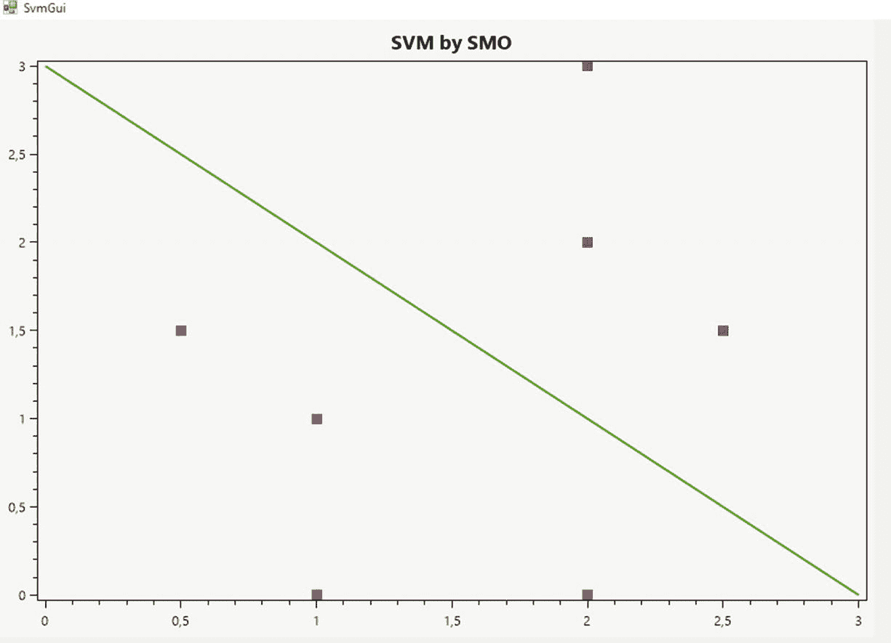

图 9-6

显示分类超平面以及两侧点的图表

到目前为止，我们假设数据集是线性可分的，但如果并非如此，或者两个类别之间没有完美的分隔，该怎么办？这些将是接下来几节的主要话题，我们将探讨 SVM 的非线性可分情况以及非完美分隔情况。

## 非完美分隔

在某些情况下，像我们迄今为止所考虑的那样寻找最优分类超平面并非最合适的选择。例如，图 9-7 展示了离群点对确定最优分类超平面的影响。右侧图形左上角的单个红点导致超平面显著摆动，改变了其方向，并导致比左侧图形小得多的间隔。

为了使算法对离群点敏感，并为了更大的目标（找到一个具有可观间隔的超平面）而接受一些误分类，我们将改变原始问题的表述，引入一组松弛变量和一个常数 C，该常数将控制如何处理误分类。

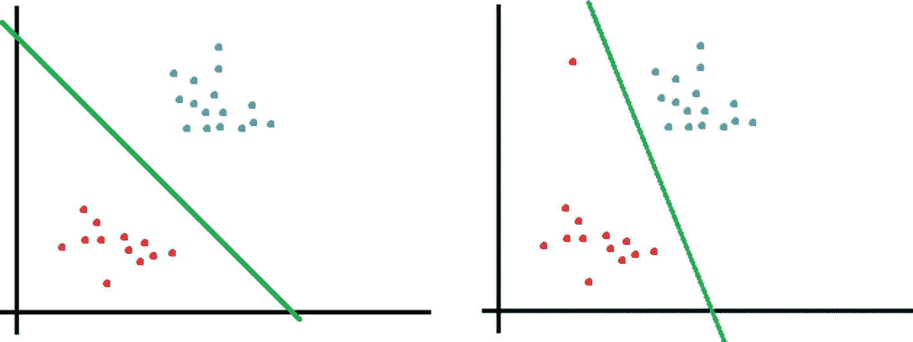

图 9-7

左右图形展示了离群点对最优分类超平面造成的影响

原始问题的新表述如下：


这种重新表述的一个直接结果是，现在允许训练数据的间隔小于 1，并且每当训练数据的函数间隔为 1 − ξ[i] (ξ > 0) 时，该代价或惩罚将在目标函数中支付，即目标函数增加 C * ξ[i]。参数 C 控制着两个目标之间的相对权重：使 ||w||² 尽可能小（正如我们之前所讨论的，这会使间隔变大）以及确保大多数训练数据的间隔至少为 1。

为了再次推导出对偶形式，我们引入拉格朗日形式，并再次将对 w 和 b 的导数设为零。我们将跳过完整的计算过程，留给读者自行完成；最终结果如下：

![$$ {\displaystyle \begin{array}{l}\underset{\alpha }{\max}\mathrm{L}\left(\mathrm{w},\mathrm{b},\alpha \right)=\sum \limits_{\mathrm{i}=1}^{\mathrm{m}}{\alpha}_{\mathrm{i}}-\frac{1}{2}\sum \limits_{\mathrm{i},\mathrm{j}=1}^{\mathrm{m}}{\mathrm{y}}_{\mathrm{i}}{\mathrm{y}}_{\mathrm{j}}{\alpha}_{\mathrm{i}}{\alpha}_{\mathrm{j}}{\mathrm{x}}_{\mathrm{i}}{\mathrm{x}}_{\mathrm{j}}\\ {}\kern0.50em \ \kern0.50em \ \kern0.50em \ \kern0.50em \ \kern0.50em \ \kern0.50em \ \kern0.50em \ \kern0.50em \ \kern0.50em \ \kern0.50em \ \kern0.50em \ \kern0.50em \ \kern0.50em \ \kern0.50em \ \ \mathrm{s}.\mathrm{t}\kern0.50em \ \kern0.50em \ \kern0.50em \ \kern0.50em \ \kern0.50em \sum \limits_{\mathrm{i}=1}^{\mathrm{m}}{\alpha}_{\mathrm{i}}{\mathrm{y}}_{\mathrm{i}}=0\\ {}\kern0.50em \ \kern0.50em \ \kern0.50em \ \kern0.50em \ \kern0.50em \ \kern0.50em \ \kern0.50em \ \kern0.50em \ \kern0.50em \ \kern0.50em \ \kern0.50em \ \kern0.50em \ \kern0.50em \ 0\le {\alpha}_{\mathrm{i}}\le \mathrm{C}\kern0.50em \ \mathrm{i}=1,\dots \mathrm{m}\end{array}} $$](img/A449374_1_En_9_Chapter_Equz.gif)

正如我们所见，重新表述后的问题的对偶形式与之前基本相同；唯一的区别在于，之前的 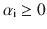 约束现在变成了箱型约束 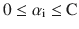。b 的计算也发生了变化；我们稍后在研究 SMO 算法时会看到这一点。

注意

重新表述后的问题被称为软间隔 SVM，以区别于之前描述的硬间隔 SVM。对于软间隔 SVM，我们允许训练数据位于间隔内部，或者被误分类，并且我们希望最小化由松弛变量之和衡量的总体误差。


## 非线性可分情况：核技巧

到目前为止，我们一直假设训练数据集是线性可分的，但如果训练数据集或要学习的函数本身都不具备线性结构，会发生什么呢？图 9-8 展示了这种情况。

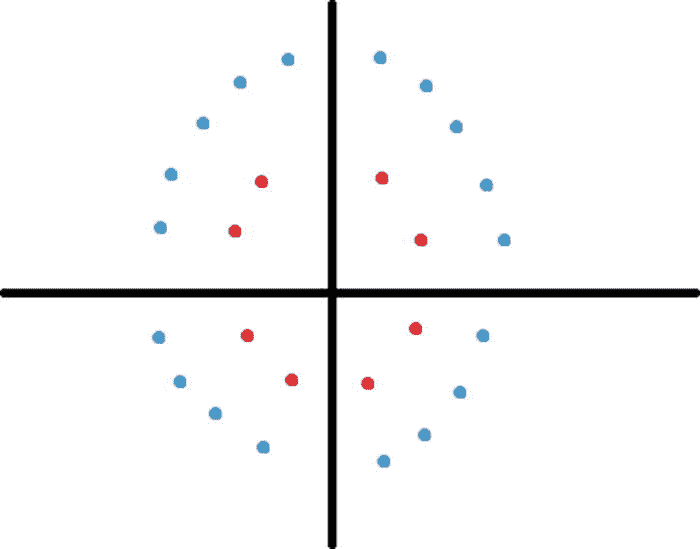

图 9-8

非线性情况

读者可以验证，在图中无法用超平面将这两类（红点和蓝点）分开。这种情况下该如何解决？SVM 的解决方案是将训练数据映射或转换到一个更高维、更丰富的空间；在该高维空间中找到一个分类超平面，然后将结果转换回原始空间。这种映射通过一个特征映射函数实现，该函数从原始空间（上例中的 R²）映射到更高维空间（R³），从而增加了数据的维度（图 9-9）。

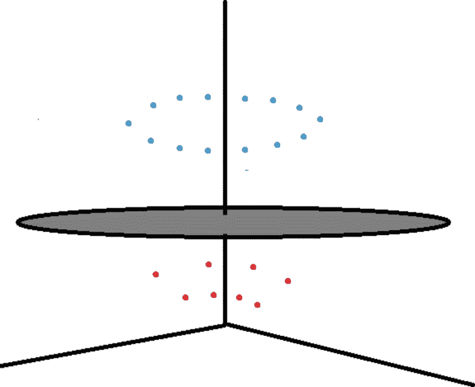

图 9-9

数据从二维空间映射到三维空间

例如，多项式特征映射 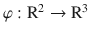 会按如下方式转换数据：

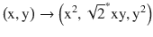

决策函数现在会改变其公式，以适应新的数据维度，如下所示：

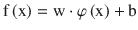

这种方法的一个问题是，在某些情况下 φ(x) 的维度可能会变得非常大；这会使需要求解的二次规划问题变得复杂，同时 w 的显式表示也会变得困难。幸运的是，在前面的章节中，我们已经得到了问题的对偶形式，该形式仅用 α[i] 表示，并且可以作为 w 的替代方案；因此，新的决策方程或分类超平面方程可以表述如下：

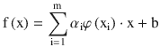

在这种情况下，我们称 K (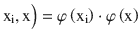 为核函数；该函数将替换我们公式中可能出现的任何内积。使用核函数的关键在于，计算其值的成本可能远低于计算甚至表示 φ(x) 的成本；计算核函数并不需要计算 φ(x)。

例如，多项式核遵循如下公式：

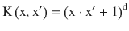

读者可以验证，计算这个核函数将比显式计算 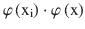 高效得多，尤其是在维度很高的情况下。另一个相关的核是高斯核，其定义如下：

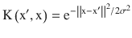

其中 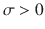，由用户选择。直观地说，如果 φ(x) 和 φ(z) 彼此接近，我们可以预期 K ( 的值会很大。另一方面，如果 φ(x ') 和 φ(x) 相距很远（几乎相互正交），那么 K (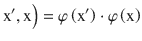 的值就会很小。因此，我们可以将 K (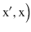 视为衡量 φ(x ') 和 φ(x) 相似程度，或者说衡量 x ' 和 x 相似程度的一种度量。

核函数的应用并不仅限于 SVM。相反，它在人工智能领域有着更广泛的应用。任何计算内积的学习算法都可以用核函数替换内积，从而以更高效的方式处理高维特征空间。

注意

并非所有函数都可以被视为核函数。已有证明（Mercer 定理）表明，一个函数能被视作核函数的充分必要条件是，其核矩阵 K 是对称半正定的。与包含 m 个向量的训练数据集相关联的核矩阵是一个 m x m 的方阵，其中包含所有可能的组合值 Kij = K(xi, xj)。


## 序列最小优化算法（SMO）

序列最小优化（SMO）算法由微软研究院的约翰·普拉特于 1998 年提出；其目的是引入一种高效训练支持向量机的方法。因此，SMO 避免了使用二次规划库，而是通过解析方式求解大量小型优化子问题来解决优化问题，这些子问题涉及先前通过启发式方法选出的任意两个拉格朗日乘子。

理解 SMO 的运行机制需要掌握两个数学结论或定理。首先，作为拉格朗日乘子法的推广，**卡罗需-库恩-塔克条件**为判断优化问题的解是否最优提供了必要且充分的条件。其次，**奥苏纳定理**证明了一个大型二次规划问题可以分解为一系列较小的二次规划子问题。只要在前一个子问题的样本中至少加入一个违反 KKT 条件的样本，每一步都会降低整体目标函数，并维持一个满足所有约束的可行点。因此，一个始终至少添加一个违反者的二次规划子问题序列将保证收敛。奥苏纳定理验证了 SMO 在优化主二次规划问题的子问题时仅选择两个乘子的策略。总的来说，SMO 严重依赖上述两个结果来证明其运行机制。

检查 KKT 条件意味着求解一个方程组，其中目标函数的梯度加上所有约束和拉格朗日乘子等于零。求解这个方程组（留给读者作为练习）后，你将得到以下条件，用于判断α[i]是否为最优解：


在此情况下，u[i]是 SVM 对第 i 个训练数据提供的输出或分类结果。这些条件的几何解释见表 9-1。

表 9-1

拉格朗日乘子值与 KKT 条件的几何解释

| 值 | 解释 |
| --- | --- |
| 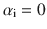 | 第 i 个训练数据被正确分类；可能位于间隔边界上。 |
|  | 第 i 个训练数据被正确分类，且位于间隔边界上（支持向量）。 |
|  | 此场景可能出现三种情况：第 i 个训练数据被正确分类且位于间隔边界上；或第 i 个训练数据被正确分类且位于分类超平面与间隔边界之间；或第 i 个训练数据被错误分类（可能因为它是一个异常值）。 |

一旦所有α[i]在某个预定义的容差（通常为）内满足上述条件，SMO 算法将终止。

注意

在普拉特的原始论文中，他假设分类超平面的公式为 wx - b 而非 wx + b。此外，他没有最大化本章所述对偶问题的目标函数 f(x)，而是最小化了 -f(x)；我们知道这等价于我们的最大化问题，因为 min f(x) = max -f(x)。

如前所述，该算法每次优化两个α[i]。首先，根据奥苏纳定理，我们必须寻找一个违反 KKT 条件的α[i]；设这个α[i]为α[2]。然后，使用启发式方法找到另一个α[i]——设为α[1]。第一个乘子（α[2]）通常从非边界乘子（满足的乘子）集合中选取。

一旦我们选定了α[2]，第二个乘子α[1]的选择目标是最大化，其中是 SVM 在正确分类第 i 个训练数据时产生的误差。这就是我们之前提到的启发式方法，旨在加速流程。如果找不到这样的α[1]，则随机选择一个非边界训练数据点。如果仍然失败，则随机选择任意训练数据；若再次失败，则重新选择α[2]。

选择α[1]和α[2]后，算法的其余部分简化为更新这些值。执行此类更新时，我们必须保证每个α[i]都满足问题的约束条件；即和。由于奥苏纳定理允许我们仅关注由α[1]和α[2]组成的二次规划子问题，我们必须确保这两个拉格朗日乘子始终满足以下约束：


α[1]和α[2]必须满足的约束可以在二维空间中用图形表示，如图 9-10 所示。


图 9-10

情况 a) 发生在 y1 ≠ y2 时；情况 b) 发生在 y1 = y2 时

为了将α[1]和α[2]都保持在约束框内并满足线性约束，我们必须确定下界（L）和上界（H）值。如果 y1 ≠ y2，可以证明α[2]适用以下边界：


如果 y1 = y2，则直线方向改变；因此，


因此，更新后的α[2]——我们称之为α[2]^(new)，稍后将介绍如何计算——在计算后必须根据这些边界进行裁剪，其裁剪后的值如下：


一旦我们获得了α[2]^(new)的最终（必要时裁剪后的）值，就可以使用线性约束方程轻松求得α[1]^(new)，如下几行所示。在α[1]^(new)的公式中，是一个引入的值，其唯一目的是从以下线性约束方程中解出α[1]^(new)：


到目前为止，我们已经掌握了 SMO 算法的几乎所有部分。不过，我们还缺少一个非常重要的组件——α[2] 的学习规则或更新规则。回顾一下，我们要优化的目标函数如下：

![$$ {\displaystyle \begin{array}{l}\underset{\alpha }{\min}\mathrm{L}\left(\mathrm{w},\mathrm{b},\alpha \right)=\frac{1}{2}\sum \limits_{\mathrm{i},\mathrm{j}=1}^{\mathrm{m}}{\mathrm{y}}_{\mathrm{i}}{\mathrm{y}}_{\mathrm{j}}{\alpha}_{\mathrm{i}}{\alpha}_{\mathrm{j}}\mathrm{K}\left({\mathrm{x}}_{\mathrm{i}}\right)\mathrm{K}\left({\mathrm{x}}_{\mathrm{j}}\right)-\sum \limits_{\mathrm{i}=1}^{\mathrm{m}}{\alpha}_{\mathrm{i}}\\ {}\kern0.50em \ \kern0.50em \ \kern0.50em \ \kern0.50em \ \kern0.50em \ \kern0.50em \ \kern0.50em \ \kern0.50em \ \kern0.50em \ \kern0.50em \ \kern0.50em \ \kern0.50em \ \kern0.50em \ \kern0.50em \ \ \mathrm{s}.\mathrm{t}\kern0.50em \ \kern0.50em \ \kern0.50em \ \kern0.50em \ \ \sum \limits_{\mathrm{i}=1}^{\mathrm{m}}{\alpha}_{\mathrm{i}}{\mathrm{y}}_{\mathrm{i}}=0\\ {}\kern0.50em \ \kern0.50em \ \kern0.50em \ \kern0.50em \ \kern0.50em \ \kern0.50em \ \kern0.50em \ \kern0.50em \ \kern0.50em \ \kern0.50em \ \kern0.50em \ \kern0.50em \ \kern0.50em \ \ 0\le {\alpha}_{\mathrm{i}}\le \mathrm{C}\kern0.50em \ \mathrm{i}=1,\dots \mathrm{m}\end{array}} $$](img/A449374_1_En_9_Chapter_Equal.gif)

请注意，这与我们之前定义的问题相同，只是在公式中引入了核函数 K，并将目标从 max f(x) 改为 min -f(x)。这正是 Platt 论文中求解的精确公式。

α[2] 更新规则的表达式是从目标函数推导出来的，方法是先用 α[1] 和 α[2] 重写目标函数，然后仅用 α[2] 表示（利用线性约束条件），固定所有其他 α[i]，并通过计算关于 α[2] 的二阶导数来找到这个重写后目标函数的最小值。用 α[1] 和 α[2] 重写，并将任何其他 α[i] 项固定为常数，会得到以下结果：


其中， 是将 α[1] 与所有其他变量关联起来的项，同样地，v[2]y[2]α[2] 是将 α[2] 与所有其他变量关联起来的项。P 是一个常数，代表与所有其他 α[i] 相关的项。使用如下形式的线性约束条件：


使我们能够从重写后的方程中消去 α[1]，并仅从 α[2] 的角度来审视它。


为了找到上述公式最小值的表达式，我们求其关于 α[2] 的二阶导数，结果如下：


这里考虑到了：


在上式中，每个带有下标的变量都标识了其对应的最优值。

通过将 v[i] 和 w 代入二阶导数公式并重新调整各项，我们最终将得到 α[2] 的更新规则：


其中，，而  被称为 SVM 的学习率。

在深入实现 SMO 算法之前，最后一步是计算偏置项。我们已经知道如何计算 w，但偏置 b 呢？偏置的计算方式如下：


计算这些值的平均值，因此最终的偏置可以计算如下：


如果没有 α[i] 被裁剪，那么可以保证 。b 的新值在 SMO 算法的每一步结束时计算。在详细描述了每一个理论部分之后，现在让我们来看看该算法在 C# 中的实现。


## 实际问题：SMO 算法实现

本节将描述的 C# 算法严格遵循 Platt 在 1998 年发表的原始论文中的伪代码。首先，算法的入口点是清单 9-9 中所示的 `TrainingBySmo()` 方法；该方法用于选择第一个 α[i]。清单 9-9 还展示了一个微小的更新，我们需要对之前章节中介绍的 `LinearSvmClassifier` 类进行此更新，SMO 算法将嵌入其中。此更新包括将常量 C、Epsilon 和 Tolerance 添加为类的属性或字段；此外，所有与 SMO 相关的方法最终也将被添加进来。

```
public class LinearSvmClassifier
{
private const double C = 0.5;
private const double Epsilon = 0.001;
private const double Tolerance = 0.001;
...
}
public void TrainingBySmo()
{
varnumChanged = 0;
varexamAll = true;
ModelToUse = -1;
while (numChanged> 0 || examAll)
{
numChanged = 0;
if (examAll)
{
for (vari = 0; i<TrainingSamples.Count; i++)
numChanged += ExamineExample(i) ?1 : 0;
}
else
{
var subset = _alphas.GetIndicesFromValues(0, C);
foreach (vari in subset)
numChanged += ExamineExample(i) ?1 : 0;
}
if (examAll)
examAll = false;
else if (numChanged == 0)
examAll = true;
}
}
清单 9-9
SMO 算法的起点，在此处我们搜索第一个拉格朗日乘子
```

`TrainingBySmo()` 方法声明了两个变量，用于辅助寻找两个拉格朗日乘子：`numChanged` 和 `examAll`。第一个是整数变量，包含适合与第一个选定的待优化拉格朗日乘子 α[2] 配对的非边界拉格朗日乘子的数量。如果找不到非边界乘子，则 `examAll` 变为 True，这意味着在下一次循环执行中必须检查所有训练数据。

清单 9-10 中所示的 `ExamineExample()` 方法首先检查给定的乘子 (α[2]) 是否违反了 KKT 条件，且违反程度超过了预定义的容差。假设确实违反，则它会寻找第二个拉格朗日乘子，并通过调用 `TakeStep()` 方法对它们进行联合优化。

```
private bool ExamineExample(int i1)
{
varyi = TrainingSamples[i1].Classification;
varai = _alphas[i1];
varerrorI = LFunctionValue(i1) - yi;
varri = yi * errorI;
if ((ri Tolerance &&ai> 0))
{
for (var i2 = 0; i2 <TrainingSamples.Count; i2++)
if (TakeStep(i1, i2))
return true;
}
return false;
}
清单 9-10
ExamineExample() 方法寻找第二个拉格朗日乘子，并通过调用 TakeStep() 方法对它们进行联合优化
```

`TakeStep()` 方法（清单 9-11）接收两个选定的拉格朗日乘子的索引作为参数。

```
private bool TakeStep(inti, int j)
{
if (i == j)
return false;
varyi = TrainingSamples[i].Classification;
varyj = TrainingSamples[j].Classification;
// 检查 aj 的边界
var s = yi*yj;
varerrorI = LFunctionValue(i) - yi;
// 计算 L, H
var l = Math.Max(0, _alphas[j] + _alphas[i] * s - (s + 1) / 2 * C);
var h = Math.Min(C, _alphas[j] + _alphas[i] * s - (s - 1) / 2 * C);
if (l == h)
return false;
double newAj;
// 获取 aj 的新值
var k12 = Kernel.Polynomial(2, TrainingSamples[i].Features, TrainingSamples[j].Features);
var k11 = Kernel.Polynomial(2, TrainingSamples[i].Features, TrainingSamples[i].Features);
var k22 = Kernel.Polynomial(2, TrainingSamples[j].Features, TrainingSamples[j].Features);
var eta = 2*k12 - k11 - k22;
varerrorJ = LFunctionValue(j) - yj;
if (eta  h)
newAj = h;
}
else
{
var c1 = eta/2;
var c2 = yj * (errorI - errorJ) - eta * _alphas[j];
varlObj = c1*Math.Pow(l, 2) + c2*l;
varhObj = c1*Math.Pow(h, 2) + c2*h;
if (lObj>hObj + Epsilon)
newAj = l;
else if (lObj C)
{
newAj += s * (newAi - C);
newAi = C;
}
// 更新偏置和权重向量
UpdateBias(newAi, _alphas[i], newAj, _alphas[j], yi, yj, errorI, errorJ, k11, k12, k22);
UpdateWeightVector(i, j, newAi, _alphas[i], newAj, _alphas[j], yi, yj);
_alphas[i] = newAi;
_alphas[j] = newAj;
return true;
}
清单 9-11
TakeStep() 方法联合优化两个拉格朗日乘子
```

如果 `TakeStep()` 方法成功优化了两个拉格朗日乘子，则返回 True；否则返回 False。`LFunctionValue()` 和 `Kernel.Polynomial()` 方法在清单 9-12 中给出。前者计算目标函数的值，后者是 `Kernel` 类的一个静态方法，表示多项式核。该类旨在包含所有核函数；由于内积被认为是一种核函数，因此也被添加到了该类中。

```
private double LFunctionValue(inti)
{
var result = 0.0;
for (int k = 0; k <TrainingSamples[i].Features.Length; k++)
result += Weights[k] * TrainingSamples[i].Features[k];
result -= Bias;
return result;
}
public class Kernel
{
public static double Polynomial(double degree, double [] v1, double [] v2)
{
return Math.Pow(InnerProduct(v1, v2) + 1, degree);
}
private static double InnerProduct(double [] v1, double [] v2)
{
var result = 0.0;
for (vari = 0; i< v1.Length; i++)
result += v1[i]*v2[i];
return result;
}
}
清单 9-12
LFunctionValue() 方法，用于计算目标函数的值，以及 Kernel 类
```

最后，让我们展示负责更新 SVM 偏置和权重向量的方法（清单 9-13）。

```
private void UpdateBias(double newAi, double oldAi, double newAj,
double oldAj, double yi, double yj, double errorI, double errorJ,
double k11, double k12, double k22)
{
double b1, b2, bNew;
if (newAi> 0 &&newAi 0 &&newAj< C)
bNew = Bias + errorJ + yi * (newAi - oldAi) * k12 + yj * (newAj - oldAj) * k22;
else
{
b1 = Bias + errorI + yi * (newAi - oldAi) * k11 + yj * (newAj - oldAj) * k12;
b2 = Bias + errorJ + yi * (newAi - oldAi) * k12 + yj * (newAj - oldAj) * k22;
bNew = (b1 + b2)/2;
}
}
Bias = bNew;
}
private void UpdateWeightVector(inti, int j, double newAi, double oldAi,
double newAj, double oldAj, double yi, double yj)
{
var t1 = yi * (newAi - oldAi);
var t2 = yj * (newAj - oldAj);
varobjI = TrainingSamples[i].Features;
varobjJ = TrainingSamples[j].Features;
for (var k = 0; k <objI.Length; k++)
Weights[k] += t1 * objI[k] + t2 * objJ[k];
}
清单 9-13
LFunctionValue() 方法，用于计算目标函数的值，以及 Kernel 类
```

现在我们已经实现了整个 SMO 算法，让我们看看该算法得到的分类超平面结果，使用之前用过的相同图形工具（Windows Forms 应用程序，图 9-11）。


图 9-11

通过我们实现的 SMO 算法获得的分类超平面

本章中读者心中必然萦绕的最后一个问题是：如何将 SVM 用于多类别分类？如何从一组 n 个类别中对新输入的数据进行分类或标记？这个问题被称为**多类 SVM**，本书不会详细讨论，因为它涉及的方法最终都依赖于二元 SVM 分类器；我们仅对其做一般性概述。

多类 SVM 分类的方法有很多。两种并非 SVM 特有的经典方案是：

*   **一对多分类（OVA）**：假设有类别 A、B、C 和 D。我们不进行四路分类，而是训练四个不同的二元分类器：A 与 非(A)、B 与 非(B)、C 与 非(C)、D 与 非(D)，从而得到四个超平面。然后，对于任何新输入的数据，选择在计算 wx + b 时给出最大值的超平面所对应的类别。
*   **全配对分类**：训练所有可能的分类配对。根据某种因素（例如被选中的次数）对类别进行排序，并选出最佳类别。

多类 SVM 仍然是一个持续的研究课题，大多数提出的方法通常是通过组合多个二元分类器来构建的。有些方法也会同时考虑所有类别。由于解决多类问题的计算成本更高，因此尚未在大规模问题上对这些方法进行严肃的比较。特别是对于一步解决多类 SVM 的方法，需要解决一个规模大得多的优化问题，因此迄今为止的实验仅限于小数据集。

至此，我们关于 SVM 的章节就结束了；现在，读者可以自行改进本文提出的 C# SVM，将其用作实验工具或根据自身需求进行定制。

## 总结

在本章中，我们描述了支持向量机（SVM）这一非常有趣的主题，将其作为面向解决特定机器学习问题（分类问题）的优化工具。我们主要关注二元分类，尽管在最后几段我们简要提及了一些多类方法。我们展示了如何使用 Accord .NET 库直接求解 SVM 的对偶优化问题，并且还解释并实现了序列最小优化（SMO）算法。我们包含了一个使用 Windows Forms 开发的图形应用程序，该程序利用 OxyPlot 使我们能够显示问题的超平面和数据点。

