# 10. 决策树

数据挖掘是从大型数据集中发现并提取有意义、有用信息（模式）的过程。许多数据挖掘技术继承自人工智能，特别是机器学习及其子领域监督学习；在这些技术中，分类技术是其中之一。

分类是数据挖掘中的一项常见任务，它解决广泛的现实世界问题，例如欺诈检测、垃圾邮件检查、信用评分、破产预测、医疗诊断、模式识别、多媒体分类等。它被认为是公司基于决策模型开发有效知识以获得竞争优势的强大方法。在上一章中，我们学习了第一个分类器——支持向量机。在本章中，我们将介绍一种流行的分类器，它为我们提供了一种非常直观的方式来对一组项目进行分类：决策树。

在本章中，我们将介绍决策树（DT），描述其目的以及如何实现该目的。我们将介绍两种最流行的 DT 生成算法：`ID3`（迭代二分器 3）和 `C4.5`，后者是前者的扩展，包含多项重大改进。`ID3` 和 `C4.5` 均由 J. Ross Quinlan 开发。

此外，正如我们迄今为止所做的那样，我们将使用 Microsoft Automatic Graph Layout 在 Windows Forms 中开发一个图形应用程序，以图形方式表示执行算法后获得的 DT。

> **注意**
>
> Microsoft Automatic Graph Layout (MSAGL) 是一个用于图形布局和查看的 .NET 工具。它由微软的 Lev Nachmanson、Sergey Pupyrev、Tim Dwyer 和 Ted Hart 开发。使用 MSAGL，我们可以构建树和图，可以标记边和节点，甚至可以定义边的方向。除此之外，它还提供了许多其他功能，我们邀请读者自行探索。

## 什么是决策树？

决策树（DT）是决策过程的图形化表示，具有高表达能力且易于人类理解。与支持向量机类似，DT 使用超平面将决策空间划分为不同类别（图 10-1）。

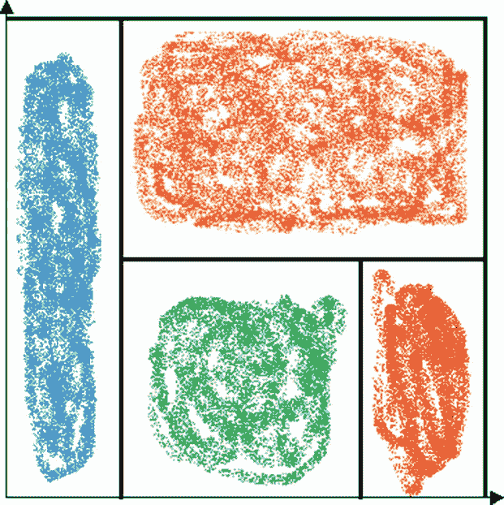

图 10-1 使用 DT 创建的划分

作为一棵树，DT 由根节点、多个内部节点和叶节点组成，这些节点最终决定新输入数据的分类。由于 DT 是从监督学习算法中获取的数据结构，这些算法接收一组训练数据作为输入，并输出一个函数（DT 可视为多元函数），用于对新输入数据进行分类。

与 SVM 或神经网络等其他算法不同，DT 会考虑并使用训练数据集中的属性名称集合，因为它们后续会利用这些名称来构建树。DT 中的每个节点都标有某个属性名称，从该节点出发的边则标有相应的属性值（假设这些值是离散且分类的）；叶节点标有目标属性值。因此，属性集可分为非目标属性和目标属性，其中 `|目标| = 1`。表 10-1 展示了若干属性及其对应值。

表 10-1 属性及其值

| 属性 | 类型 | 值 |
| --- | --- | --- |
| 天气 | 非目标 | 晴天，雨天，多云 |
| 温度 | 非目标 | 温暖，寒冷，温和 |
| 湿度 | 非目标 | 高，正常 |
| 风力 | 非目标 | 强，弱 |
| 打棒球 | 目标 | 是，否 |

表 10-2 展示了一个训练数据集的示例。

表 10-2 训练数据集

| 天气 | 温度 | 湿度 | 风力 | 打棒球 |
| --- | --- | --- | --- | --- |
| 晴天 | 温暖 | 高 | 弱 | 否 |
| 晴天 | 温暖 | 高 | 强 | 否 |
| 多云 | 温暖 | 高 | 弱 | 是 |
| 雨天 | 温和 | 高 | 弱 | 是 |
| 雨天 | 寒冷 | 正常 | 弱 | 是 |
| 雨天 | 寒冷 | 正常 | 强 | 否 |
| 多云 | 寒冷 | 正常 | 强 | 是 |
| 晴天 | 温和 | 高 | 弱 | 否 |
| 晴天 | 寒冷 | 正常 | 弱 | 是 |
| 雨天 | 温和 | 正常 | 弱 | 是 |
| 晴天 | 温和 | 正常 | 强 | 是 |
| 多云 | 温和 | 高 | 强 | 是 |
| 多云 | 温暖 | 正常 | 弱 | 是 |
| 雨天 | 温和 | 高 | 强 | 否 |

应用诸如 `ID3` 等学习方法，并使用表 10-2 中给出的训练数据集，可能得到如下 DT（图 10-2）。

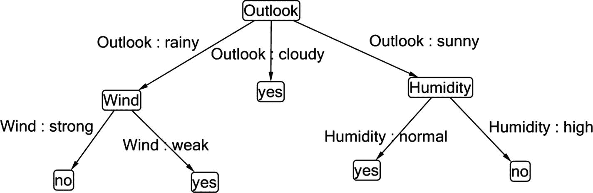

图 10-2 与表 10-2 训练数据匹配并使用 MSAGL 创建的 DT 图形

一旦我们有了 DT，问题就是：如何对新输入数据进行分类？要对新数据进行分类，我们只需遍历这棵树，并将数据向量中的每个属性与其在新输入数据向量中的对应值进行匹配。例如，假设 `x` 是一条新输入数据，且

`X = (多云, 温暖, 正常, 强)`

那么，为了寻找 `X` 的分类，我们从根节点（天气）开始遍历树。因为 `X` 中的天气等于“多云”，我们沿着那条边前进，最终到达叶节点“是”，这意味着在 `X` 的条件或值下，`打棒球 = 是`。

到目前为止，我们了解了 DT 的目的（分类），知道了它们的样子，也知道了在拥有 DT 后如何对新数据进行分类（从根节点遍历树，将输入数据与属性名称匹配）。在下一节中，我们将探讨如何生成 DT，并识别生成 DT 时可能出现的一些问题（例如过拟合）。

> **注意**
>
> 如果我们从根节点到叶节点遍历 DT，就会得到一组描述决策过程的决策规则；例如，`天气 = 晴天 且 湿度 = 正常 => 打棒球 = 是`。每条决策规则由多个陈述的合取组成。

## 生成决策树：`ID3` 算法

构建最优决策树是监督学习中的一个关键问题。通常，从给定的属性集中可以构建出多个决策树。虽然有些树比其他树更准确，但由于搜索空间呈指数级增长，寻找最优树的问题在计算上是不可行的。

大多数为学习决策树而开发的算法都是核心算法（亨特算法）的变体，该算法采用自顶向下、贪心的方式在可能的决策树空间中进行搜索。亨特算法通过将训练数据集递归地划分为更细粒度的子集来生长决策树。假设 `TrainingData` 表示节点 `N` 处的当前训练数据集（仅考虑与非目标属性匹配的列），那么亨特算法的伪代码将遵循以下步骤：

1.  如果 `TrainingData` 包含的所有记录都属于同一类别 `C`，则 `N` 将是一个标记为 `C` 的叶节点。
2.  如果 `TrainingData` 是一个空集，则 `N` 将是一个叶节点，标记为最常见的类别 `C`。请记住，`TrainingData` 仅包含非目标属性列；因此，`C` 取自目标属性列。
3.  如果 `TrainingData` 包含属于多个类别的记录，则使用一个测试来选择用于将数据分割成更小子集的属性，并继续在每个子集上递归地应用相同的过程。

`ID3` 算法使用了与亨特算法相同的思路；事实上，如果我们查看 `ID3` 的伪代码，它几乎与亨特算法的伪代码相同。主要区别在于属性分割测试。`ID3` 使用信息增益和熵的概念来选择具有最高信息增益的属性，然后，如同亨特算法中那样，创建一个以该属性名称标记的新节点。接着，它创建从该新节点出发的边，每个选定属性的值对应一条边，并在每条新边上继续递归。

> **注意**
>
> 熵和信息增益是源自信息论的概念，信息论是一门科学领域，其起源可追溯到被称为“信息时代之父”的克劳德·香农在 1948 年发表的一篇论文。它是一门关于数据操作（如压缩、存储、统计信号处理和通信）的科学。

生成决策树时需要考虑的一个重要点是训练数据集的大小。回顾一下，学习可以被视为逼近一个最能描述训练数据集的函数。这不仅仅发生在机器学习领域，在人类现实生活中也是如此。当我们学习驾驶时，我们学习一个函数，该函数通过某人（教练）提供的一组数据来描述给我们；这些数据包括：你不能撞到人，你不能在红灯时继续行驶，你必须遵守规定的限速，你这样操作方向盘，你用这个装置刹车，等等。利用这些数据，我们最终学会了一个过程或函数，它允许我们在接收到“驾驶”函数的输入（如“红灯”或“街上有人”）后，采取一个行动或输出（如“停车”、“继续”）。合理地，我们接收到的数据质量越高，我们就越能更好地学习逼近该训练数据集所属的函数。在图 10-3 中，我们可以看到一张描述训练数据集大小与生成的决策树所提供的预测质量之间关系的图表。如前所述，训练数据集越大，正确逼近其所属函数的机会就越高。

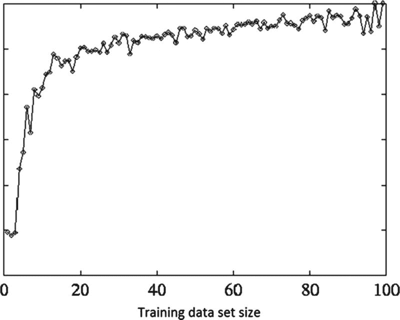

图 10-3 描述预测质量如何随着训练数据集大小的增加而提高的图表

在下一小节中，我们将探讨熵和信息增益这两个概念背后的思想，这两个概念源自信息论，构成了 `ID3` 及其后续算法中使用的分割标准。

### 熵与信息增益

熵是混沌和不确定性的度量；高熵意味着高度无序或混沌，而低熵意味着低不确定性或混沌（图 10-4）。熵函数通常表示为 `H(x)`，其中 `x` 是一个包含概率的向量；即，`x = p_1, p_2, ..., p_n`。

# 熵函数

观察图 10-4，我们可以看到当概率`p[i]`处于中间值时会发生什么；即，大约为 0.5。在这种情况下，我们得到高熵（接近 1）。由于每个`p[i]`都存在高度不确定性，因为它们的概率接近 0.5（或 50% 的几率），这意味着它们可能均匀地（以相同概率）发生或不发生，那么全局的不确定性或混沌也会很高。当每个`p[i]`接近 0 或 1 时，它们的熵会很低，因为元素概率表明发生几率低或高，从而降低了不确定性。熵函数如下：

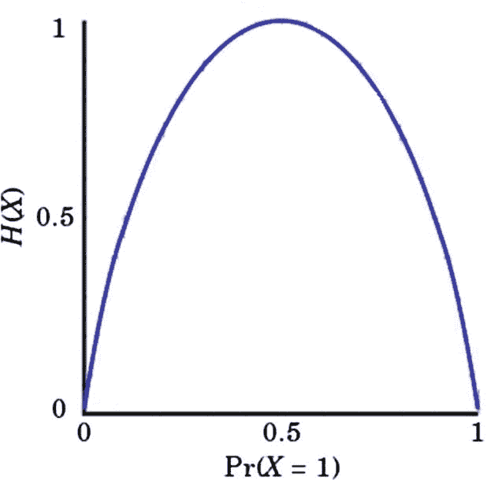

**图 10-4**

![ $$ \mathrm{H}\left(\mathrm{X}\right)=\mathrm{H}\left(\left[{\mathrm{p}}_1,\dots, {\mathrm{p}}_{\mathrm{n}}\right]\right)=-\sum \limits_{\mathrm{i}=1}^{\mathrm{n}}\kern0.38em {\mathrm{p}}_{\mathrm{i}}\ast {\log}_2{\mathrm{p}}_{\mathrm{i}} $$ ](A449374_1_En_10_Chapter_Equa.gif)

它满足以下一组性质：

1.  ![ $$ \mathrm{H}\left(\mathrm{X}\right)=\mathrm{H}\left(\left[{\mathrm{p}}_1,\dots, {\mathrm{p}}_{\mathrm{n}}\right]\right)\ge 0 $$ ](A449374_1_En_10_Chapter_IEq2.gif)。
2.  如果存在某个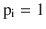，则![ $$ \mathrm{H}\left(\mathrm{X}\right)=\mathrm{H}\left(\left[{\mathrm{p}}_1,\dots, {\mathrm{p}}_{\mathrm{n}}\right]\right)=0 $$ ](A449374_1_En_10_Chapter_IEq3.gif)。
3.  ![ $$ \mathrm{H}\left(\mathrm{X}\right)=\mathrm{H}\left(\left[{\mathrm{p}}_1,\dots, {\mathrm{p}}_{\mathrm{n}}\right]\right)\le \mathrm{H}\left(\left[\frac{1}{\mathrm{n}},\dots, \frac{1}{\mathrm{n}}\right]\right) $$ ](A449374_1_En_10_Chapter_IEq5.gif)，最大的熵对应于等概率情况。
4.  ![ $$ \mathrm{H}\left(\mathrm{X}\right)=\mathrm{H}\left(\left[{\mathrm{p}}_1,\dots, {\mathrm{p}}_{\mathrm{n}},0\right]\right)=\mathrm{H}\left(\left[{\mathrm{p}}_1,\dots, {\mathrm{p}}_{\mathrm{n}}\right]\right). $$ ](A449374_1_En_10_Chapter_IEq6.gif)

回到 ID3 算法，我们在分割树时的目标是选择能够实现熵（无序、混沌、不确定性）最大程度降低的属性。我们如何衡量这种预期的降低？我们使用一个源自信息论的概念，称为信息增益，其公式如下：


其中，`S`是决策树中当前节点的训练数据集，`Values(A)`表示对应于属性`A`的值集，而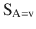是`S`中属性`A`的值等于`v`的子集。

信息增益可以定义为由于按属性`A`排序而导致`S`中熵的预期减少量。它回答了这样一个问题：如果我们选择属性`A`，结果集将如何形成或排序？增益的计算方式是整个集合`S`的熵减去`S`中`A=v`的概率之和；即 (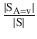) 乘以子集 的熵。

这是 ID3 算法用于选择分裂树属性的测试标准，它将选择提供最高增益的那个属性。现在我们已经收集了构建 ID3 算法所需的所有必要部分，从下一节开始，我们将深入探讨实现问题，并用 C# 开发我们的 ID3 方法。

> 注意：理想的属性会将训练数据集划分为全部为正例或全部为负例（相对于目标属性）的子集；即提供最大信息增益。

## 实际问题：实现 ID3 算法

为了开始实现我们的 ID3 算法，我们首先创建两个类（清单 10-1）来处理属性和训练数据集。

```csharp
public class Attribute
{
public string Name { get; set; }
public string[] Values { get; set; }
public TypeAttrib Type { get; set; }
public TypeValTypeVal{ get; set; }
public Attribute(string name, string [] values, TypeAttrib type, TypeValtypeVal)
{
Name = name;
Values = values;
Type = type;
TypeVal = typeVal;
}
}
public enumTypeAttrib
{
Goal, NonGoal
}
public enumTypeVal
{
Discrete, Continuous
}
public class TrainingDataSet
{
public string [,] Values { get; set; }
public Attribute GoalAttribute{ get; set; }
public ListNonGoalAttributes{ get; set; }
public TrainingDataSet(string [,] values, IEnumerablenonGoal, Attribute goal)
{
Values = new string[values.GetLength(0), values.GetLength(1)];
Array.Copy(values, Values, values.GetLength(0) * values.GetLength(1));
NonGoalAttributes = new List(nonGoal);
GoalAttribute = goal;
if (NonGoalAttributes.Count + 1 != Values.GetLength(1))
throw new Exception("Number of attributes must coincide");
}
}
```
清单 10-1：`Attribute` 和 `TrainingDataSet` 类

`Attribute` 类包含以下字段和属性：
*   `Name`：定义属性名称的属性
*   `Values`：定义属性值集合的属性
*   `Type`：定义属性类型的属性，可以是目标属性或非目标属性
*   `TypeVal`：定义属性值类型的属性，可以是离散型或连续型。我们将在研究 C4.5 算法时探讨连续属性。

`TrainingDataSet` 类包含以下属性和字段：
*   `Values`：详细描述训练数据集值的矩阵
*   `GoalAttribute`：定义训练数据集的目标属性
*   `NonGoalAttribute`：定义非目标属性的集合

正如我们所见，`TrainingDataSet` 类依赖于 `Attribute` 类；`DecisionTree` 类的第一部分如清单 10-2 所示。

```csharp
public class DecisionTree
{
    public TrainingDataSet DataSet { get; set; }
    public string Value { get; set; }
    public List<DecisionTree> Children { get; set; }
    public string Edge { get; set; }

    public DecisionTree(TrainingDataSet dataSet)
    {
        DataSet = dataSet;
    }

    public static DecisionTree Learn(TrainingDataSet dataSet, DtTrainingAlgorithm algorithm)
    {
        if (dataSet == null)
            throw new Exception("Data Set cannot be null");

        switch (algorithm)
        {
            default:
                return Id3(dataSet.Values, dataSet.NonGoalAttributes, "root");
        }
    }

    public DecisionTree(string value, string edge)
    {
        Value = value;
        Children = new List<DecisionTree>();
        Edge = edge;
    }

    public void Visualize()
    {
        var form = new Form();
        //创建一个查看器对象
        var viewer = new GViewer();
        //创建一个图形对象
        var graph = new Graph("Decision Tree");
        //创建图形内容
        CreateNodes(graph);
        //将图形绑定到查看器
        viewer.Graph = graph;
        //将查看器与窗体关联
        form.SuspendLayout();
        viewer.Dock = DockStyle.Fill;
        form.Controls.Add(viewer);
        form.ResumeLayout();
        //显示窗体
        form.ShowDialog();
    }

    private void CreateNodes(Graph graph)
    {
        var queue = new Queue();
        queue.Enqueue(this);
        graph.CreateLayoutSettings().EdgeRoutingSettings.EdgeRoutingMode = EdgeRoutingMode.StraightLine;
        var id = 0;
        while (queue.Count > 0)
        {
            var currentNode = queue.Dequeue();
            Node firstEnd;
            if (graph.Nodes.Any(n => n.LabelText == currentNode.Value))
                firstEnd = graph.Nodes.First(n => n.LabelText == currentNode.Value);
            else
                firstEnd = new Node((id++).ToString()) { LabelText = currentNode.Value };
            graph.AddNode(firstEnd);
            foreach (var decisionTree in currentNode.Children)
            {
                var secondEnd = new Node((id++).ToString()) { LabelText = decisionTree.Value };
                graph.AddNode(secondEnd);
                graph.AddEdge(firstEnd.Id, decisionTree.Edge, secondEnd.Id);
                queue.Enqueue(decisionTree);
            }
        }
    }
}

public enum DtTrainingAlgorithm
{
    Id3,
}
```
清单 10-2 `DecisionTree` 类

该类包含以下属性：

*   `DataSet`：此方法接收训练数据集作为输入，同时也接收学习阶段使用的学习算法类型。
*   `Value`：定义代表此决策树根节点的值
*   `Children`：定义当前决策树的子节点集合
*   `Edge`：以字符串形式定义连接此节点与其父节点的边的标签

此外，`DecisionTree` 类包含以下方法：

*   `Learn()`：此方法接收训练数据集作为输入，同时也接收学习阶段使用的学习算法类型。
*   `Visualize()`：此方法使用 MSAGL 图形工具在学习阶段完成后可视化生成的树。
*   `CreateNodes()`：此方法执行 BFS 算法来遍历由 ID3 算法创建的决策树，并在遍历过程中使用 MSAGL 工具创建一个带有标签的等效树。

ID3 算法及其支持方法（均属于`DecisionTree`类）如图 10-3 所示。

在代码清单 10-3 中，我们使用了多个扩展方法，其中一些属于 Accord .NET 包，另一些属于我们创建的扩展类，用于支持 ID3 算法中必须处理的某些操作。如果将这些操作直接包含在方法代码中，会降低代码的可理解性、可读性和清晰度。此外，由于类中的每个方法都具有自描述性，并且与之前展示的伪代码相匹配，我们将重点解释代码清单 10-4 中展示的扩展方法；这些方法属于一个扩展类。

上述扩展方法的详细说明如下：

*   `GetMostFrequent()`：返回作为参数接收的字符串数组中出现频率最高的元素；`string []` 的扩展方法

*   `GetFreqPerDistinctElem()`：返回指定列和指定行集（可选参数）中元素的频率（出现次数）；`string [,]` 的扩展方法

*   `GetRowIndex()`：返回满足比较条件的行索引集合，这些行在作为参数接收的列索引处的值满足由 `ComparisonType` 定义的比较标准，并考虑作为参数传入的比较字符串；`string [,]` 的扩展方法

```
public static DecisionTree Id3(string [,] values, List attributes, string edge)
{
// 所有训练数据具有相同的目标属性
vargoalValues = values.GetColumn(values.GetLength(1) - 1);
if (goalValues.DistinctCount() == 1)
return new DecisionTree(goalValues.First(), edge);
// 不存在非目标属性
if (attributes.Count == 0)
return new DecisionTree(goalValues.GetMostFrequent(), edge);
// 将信息增益最高的属性设为根节点
varattrIndexPair = HighestGainAttribute(values, attributes);
varattr = attrIndexPair.Item1;
varattrIndex = attrIndexPair.Item2;
var root = new DecisionTree(attr.Name, edge);
foreach (var value in attr.Values)
{
varsubSetVi = values.GetRowIndex(attrIndex, value, ComparisonType.Equality);
if (subSetVi.Count == 0)
root.Children.Add(new DecisionTree(goalValues.GetMostFrequent(), value));
else
{
varnewAttrbs = new List(attributes);
newAttrbs.RemoveAt(attrIndex);
varnewValues = values.GetMatrix(subSetVi).RemoveColumn(attrIndex);
root.Children.Add(Id3(newValues, newAttrbs, attr.Name + " : " + value));
}
}
return root;
}
private static TupleHighestGainAttribute(string [,] values, IEnumerable attributes)
{
Attribute result = null;
varmaxGain = double.MinValue;
var index = -1;
vari = 0;
foreach (varattr in attributes)
{
double gain = Gain(values, i);
if (gain >maxGain)
{
maxGain = gain;
result = attr;
index = i;
}
i++;
}
return new Tuple(result, index);
}
private static double Gain(string [,] values, intattributeIndex)
{
varimpurityBeforeSplit = Entropy(values.GetFreqPerDistinctElem(values.GetLength(1) - 1).GetProbabilities());
varimpurityAfterSplit= SubsetEntropy(values, attributeIndex);
return impurityBeforeSplit - impurityAfterSplit;
}
private static double Entropy(IEnumerableprobs)
{
return -1 * probs.Sum(d =>LogEntropy(d));
}
private static double LogEntropy(double p)
{
return p >0 ? p * Math.Log(p, 2) : 0;
}
private static double SubsetEntropy(string[,] values, intcolumnIndex)
{
varfreqDicc = values.GetFreqPerDistinctElem(columnIndex);
var result = 0.0;
var sum = freqDicc.Values.Sum();
foreach (var key in freqDicc.Keys)
{
varrowIndex = values.GetRowIndex(columnIndex, key, ComparisonType.Equality);
varfrequencyPerClass = values.GetFreqPerDistinctElem(values.GetLength(1) - 1, rowIndex.ToArray());
result += (freqDicc[key] / (double) sum) * Entropy(frequencyPerClass.GetProbabilities());
}
return result;
}
}
代码清单 10-3
ID3 算法
```

```
public static string GetMostFrequent(this string[] values)
{
vardicc = new Dictionary();
foreach (var v in values)
{
if (!dicc.ContainsKey(v))
dicc.Add(v, 1);
else
dicc[v] += 1;
}
varmaxVal = dicc.Max(e =>e.Value);
return dicc.First(p =>p.Value == maxVal).Key;
}
public static DictionaryGetFreqPerDistinctElem(this string [,] values, intcolumnIndex, int [] rowIndex = null )
{
varfreqDicc = new Dictionary();
for (vari = 0; iGetRowIndex(this string[,] values, intcolumnIndex, string toCompare, ComparisonTypecomparisonType)
{
var result = new List();
for (vari = 0; idouble.Parse(toCompare))
result.Add(i);
break;
}
}
return result;
}
public static string[,] GetMatrix(this string[,] values, ListrowIndex)
{
var result = new string[rowIndex.Count, values.GetLength(1)];
var j = 0;
foreach (vari in rowIndex)
{
result.SetRow(j, values.GetRow(i));
j++;
}
return result;
}
public static IEnumerableGetProbabilities(this Dictionarydicc)
{
var probabilities = new List();
var sum = dicc.Values.Sum();
foreach (var e in dicc)
probabilities.Add((e.Value / (double) sum));
return probabilities;
}
public enumComparisonType
{
Equality, NumericGreaterThan, NumericLessThan
}
代码清单 10-4
扩展方法
```

# 决策树算法与实现

`GetMatrix()`：返回一个新矩阵，仅包含原始矩阵中索引与作为参数接收的列表中的整数相匹配的行。它使用属于 Accord .NET 的 `SetRow()` 方法；`string[,]` 的扩展方法。

`GetProbabilities()`：返回输入字典中每个元素 x 的概率，计算公式为 `value(x) / total(S)`，其中 `total(S)` 是输入字典中所有元素值的总和；`Dictionary<string, int>` 的扩展方法。

现在我们已经详细介绍了 ID3 实现的每个组成部分，接下来让我们看看如何通过在控制台应用程序中包含代码清单 10-5 中所示的代码来测试我们的算法。

### ID3 算法测试

```
var values = new[,]
{
    { "sunny", "warm", "high", "weak", "no" },
    { "sunny", "warm", "high", "strong", "no" },
    { "cloudy", "warm", "high", "weak", "yes" },
    { "rainy", "temperate", "high", "weak", "yes" },
    { "rainy", "cold", "normal", "weak", "yes" },
    { "rainy", "cold", "normal", "strong", "no" },
    { "cloudy", "cold", "normal", "strong", "yes" },
    { "sunny", "temperate", "high", "weak", "no" },
    { "sunny", "cold", "normal", "weak", "yes" },
    { "rainy", "temperate", "normal", "weak", "yes" },
    { "sunny", "temperate", "normal", "strong", "yes" },
    { "cloudy", "temperate", "high", "strong", "yes" },
    { "cloudy", "warm", "normal", "weak", "yes" },
    { "rainy", "temperate", "high", "strong", "no" },
};
var attribs = new List<Attribute>
{
    new Attribute("Outlook", new[] { "sunny", "cloudy", "rainy" }, TypeAttrib.NonGoal, TypeVal.Discrete),
    new Attribute("Temperature", new[] { "warm", "temperate", "cold" }, TypeAttrib.NonGoal, TypeVal.Discrete),
    new Attribute("Humidity", new[] { "high", "normal" }, TypeAttrib.NonGoal, TypeVal.Discrete),
    new Attribute("Wind", new[] { "weak", "strong" }, TypeAttrib.NonGoal, TypeVal.Discrete),
};
var goalAttrib = new Attribute("Play Baseball", new[] { "yes", "no" }, TypeAttrib.Goal, TypeVal.Discrete);
var trainingDataSet = new TrainingDataSet(values, attribs, goalAttrib);
var dtree = DecisionTree.Learn(trainingDataSet, DtTrainingAlgorithm.Id3);
dtree.Visualize();
```

*代码清单 10-5 在控制台应用程序中测试我们的 `DecisionTree` 类和 ID3 算法*

执行清单 10-5 中代码后得到的结果如图 10-5 所示；读者可以验证，该结果与图 10-2 中展示的决策树完全一致。清单 10-5 中的训练数据集与表 10-2 中所示的数据集也呈现相同情况。

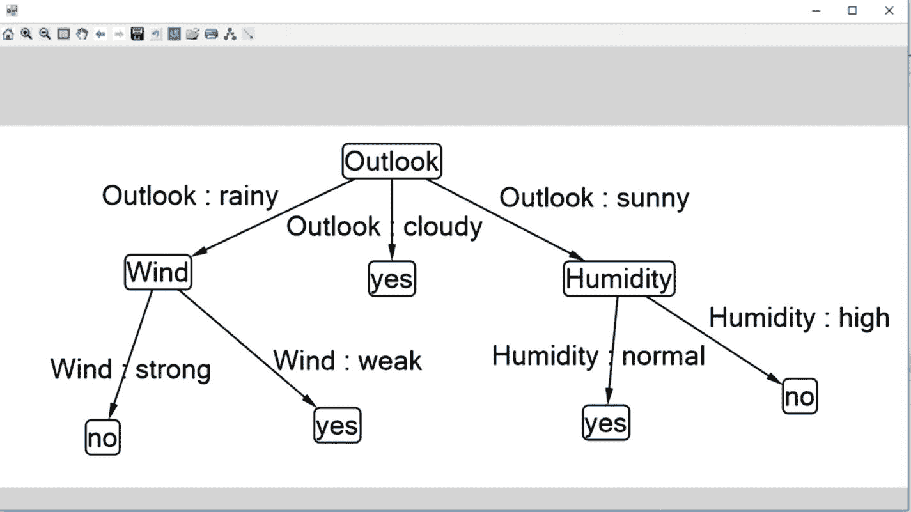

*图 10-5 执行控制台应用程序后得到的决策树*

至此，我们已经涵盖了决策树的基础知识，解释了 ID3 算法的工作原理，并介绍了一个实现 ID3 算法的实际问题。在接下来的章节中，我们将解释 ID3 算法的一些难点或缺点，以及其改进版本 C4.5 算法如何克服这些困难，通过应用剪枝技术来处理缺失值和值可以是连续而非离散的属性，从而提供更高效的决策树。

### C4.5 算法

C4.5 算法（Quinlan, 1993）是对 ID3 算法缺陷的扩展或增强。其改进主要体现在三个要点：处理连续属性（请记住 ID3 仅处理分类属性）、处理缺失值，以及通过最终对树进行剪枝来解决过拟合问题。

过拟合是指生成的决策树对训练数据集拟合得过于完美时出现的问题。其结果是，决策树最终对新输入数据的预测效果很差，因为它对已学习的训练数据集建立了一种不恰当的依赖关系或过拟合结构。为了更好地理解过拟合问题，让我们考虑一个实验：我们想要预测掷骰子的结果，而训练数据集包含掷骰子的日期、时间以及骰子的颜色。这里可能发生的情况是，学习器构建了一棵拟合数据的决策树，但考虑了诸如颜色等与结果无关的属性。这种情况通常出现在包含大量属性或特征的数据中。当处理拥有大量属性的训练数据或对象时，我们可能会发现许多无意义的属性，这些属性与最终决定后续数据结果的真正重要属性相比是无关的。

我们该如何处理这个问题？存在两种主要方法来应对过拟合问题。第一种方法是在生成过程的早期阶段，在决策树达到能完美分类训练数据集之前，就停止树的生长。第二种方法是在树生成之后对其进行剪枝。第二种方法比第一种更成功，主要是因为知道何时停止树的生长可能是一项棘手的任务。一旦我们开始剪枝过程，一个基本问题是如何判断一个子树是否值得剪枝；换句话说，我们应该使用什么标准进行剪枝，以及应该如何执行这个过程？

尽管有多种策略来执行决策树的剪枝过程，但最流行的方法依赖于**交叉验证**，这是一种统计技术，它将训练数据集 S 划分为子集 `S[1]` 和 `S[2]`，然后使用第一个子集进行训练并生成决策树，使用第二个子集来测试生成的决策树在分类来自验证集 `S[2]` 的数据时的表现如何。交叉验证与一种**后剪枝**度量相结合，该度量可以评估生成的决策树在剪枝后的表现。最常见的度量是**错误率降低**和**规则剪枝**。

错误率降低准则的伪代码如下：

*   使用决策树对验证集 `S[2]` 中的训练数据进行分类（图 10-6）。

*   对于每个节点 X：

    *   找出以 X 为根的整个子树的错误总和。

    *   计算相同训练数据的错误，但此时 X 已被转换为叶节点，并分配了其所有后代中最常见的类别。

*   比较这两个值，并剪枝掉错误率降低最多的那个子树。

*   重复此过程，直到错误不再降低。

图 10-6 展示了一个子树，其中加号表示正确分类的训练数据，减号表示错误分类的训练数据。

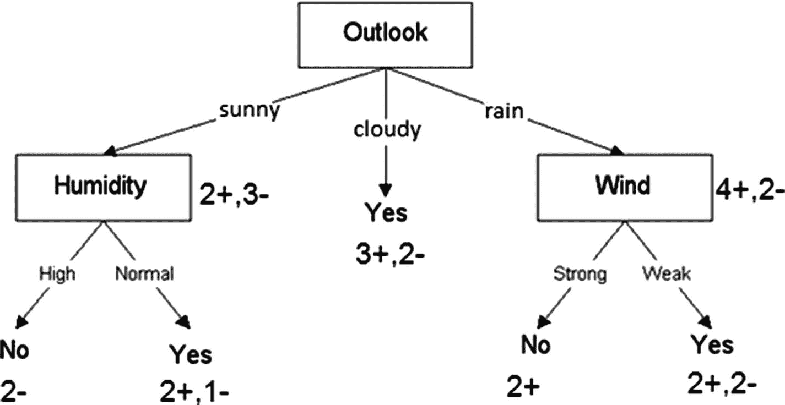

*图 10-6 由决策树分类的包含 16 个训练数据的验证集。正数表示决策树正确分类的训练数据，负数表示分类错误*

错误减少措施通常与一种称为子树替换的子树简化操作或剪枝技术结合使用。在这种自底向上的方法中，决策树的每个内部节点都可能成为剪枝的候选节点，该方法仅在检查其子树后才会对树进行剪枝。从这个意义上说，如之前的伪代码所述，剪枝可以理解为删除决策树的一个子树，并用一个叶子节点替换它，该叶子节点的值对应于该子树所有叶子节点中出现频率最高的类别。

当生成的决策树在验证集 `S[2]` 上测试时，如果其表现不如之前的决策树，则该子树最终会被剪枝。决策树中的节点会被迭代地剪枝，始终选择那些能提高生成决策树在验证集上效率的节点。这将导致任何基于训练数据集学习时偶然出现的规律而创建的叶子节点，在验证集上复核时被剪枝，因为同样的偶然规律不太可能在验证集上也出现。

另一个标准是规则剪枝，它将学习到的决策树转换为一组规则，每条规则对应从根节点到叶子节点的一条可能路径。它包含以下步骤：

*   使用决策树（图 10-6）对验证集 `S[2]` 中的训练数据进行分类。

*   将学习到的决策树转换为一组规则，每条规则对应从根节点到叶子节点的一条可能路径。

*   通过剪枝那些能提高其估计准确率的前置条件来剪枝或泛化每条规则。

*   根据估计准确率对剪枝后的规则进行排序，并在对新传入数据进行分类时按此顺序考虑它们。

# C4.5 决策树算法

## 规则表示与剪枝

从这个意义上说，规则的前置条件代表从根节点到叶子节点的属性测试，而该叶子节点的值或分类则成为规则的后置条件或结果。例如，如果 `(outlook = sunny ^ humidity = normal)` 是一个前置条件，而 `playBaseball = yes` 是结果。之后，如果移除某个前置条件不影响剪枝前决策树的估计准确率，则通过移除该前置条件来剪枝每条规则。

## C4.5 算法特征

`C4.5` 算法的另一个显著特征是它使用不同的度量标准来选择用于分裂的属性；它不使用信息增益，而是使用增益率，其公式如下：

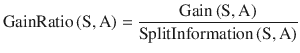

其中


其中 `S[i]` 是根据包含 `n` 个可能值的属性 `A` 对 `S` 进行划分后得到的子集。增益率度量克服了信息增益的缺点，信息增益的主要缺点是偏向于具有最多取值的属性。例如，考虑一个包含许多可能值的 `Date` 属性；由于这个集合的大小可能非常巨大，它很可能会将整个训练数据集划分成更小的子集，这些子集的熵会非常低；因此，信息增益会非常高。增益率会惩罚那些具有均匀分布的多个取值的属性。

### 处理连续属性

处理连续属性是 `C4.5` 相对于其前身 `ID3` 的主要优势之一。为了处理连续属性，`C4.5` 将值的集合划分成一组离散的区间。它创建一个二元决策节点，将可能值的范围分成两个子集：满足 `< X` 的和满足 `>= X` 的，其中 `X` 是一个待确定的阈值。这个过程假设连续值的集合存在一个全序关系。关键点在于找到进行划分的阈值 `X`。最常见的方法是按升序对训练数据集的值进行排序；遍历排序后的值列表，同时比较连续元素 `(i, i + 1)` 的目标属性；当且仅当它们的目标属性不同时，计算阈值为这两个连续元素的平均值（即 `X'=(L[i] + L[i+1])/2`）；计算在阈值 `X'` 上划分属性所获得的信息增益（考虑小于 `X'` 和大于 `X'` 的元素子集）；并选择提供最高信息增益的那个阈值。请注意，我们仅在连续元素的类别不同时才考虑它们。如果连续元素 `L[i]` 和 `L[i+1]`（其中 `L` 是连续属性上排序后的值列表）都具有相同的类别 `C`，我们永远不会考虑它们（图 10-7）。

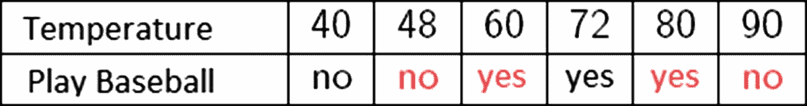

图 10-7 在增量排序值后，我们检查那些目标属性不同的连续值

### 处理缺失值

对于处理缺失值，存在不同的策略，并且该过程通常在任何决策树学习算法执行之前进行。最简单的策略是直接忽略缺失值，在计算熵时不考虑它们。一个更聪明的策略是将训练数据集中该属性最常见的值分配给缺失值。最后，一种更复杂的方法是为缺失属性 `A` 的每个可能值分配概率，然后根据计算出的每个概率在该节点上创建分支。例如，假设我们有一个二元属性 `A`，其值为 `P`、`Q`，该属性有十个已知值，其中六个为属性 `P`，四个为值 `Q`，那么这种方法将创建两个分支，一个对应属性值为 `P` 的 0.6 概率，另一个对应属性值为 `Q` 的概率。

## 实践问题：实现 C4.5 算法

在本节中，我们将展示 `C4.5` 算法的一个实现，该实现将包含处理连续属性和增益率度量等不同特性。剪枝技术和处理缺失值的策略将留给读者作为练习，同时也是对本文所提供代码的补充。从 `ID3` 迁移到 `C4.5` 的主要编码任务在于适应对连续值的处理；因此，我们将在本节中介绍这部分内容。

正如预期的那样，`ID3` 和 `C4.5` 共享几乎相同的代码。基础条件相同，主要区别在于主体部分。代码清单 10-6 展示了 `C4.5` 算法的入口点；请记住，此方法将添加到我们本章一直在开发的 `DecisionTree` 类中。

```
public static DecisionTreeC45(string [,] values, List attributes, string edge)
{
// 所有训练数据具有相同的目标属性
vargoalValues = values.GetColumn(values.GetLength(1) - 1);
if (goalValues.DistinctCount() == 1)
return new DecisionTree(goalValues.First(), edge);
// 没有非目标属性
if (attributes.Count == 0)
return new DecisionTree(goalValues.GetMostFrequent(), edge);
// 将提供最高信息增益的属性设为根节点
varattrIndexPair = HighestGainAttribute(values, attributes);
varattr = attrIndexPair["attrib"] as Attribute;
varattrIndex = (int) attrIndexPair["index"];
var threshold = (int) attrIndexPair["threshold"];
var less = (List) attrIndexPair["less"];
var greater = (List) attrIndexPair["greater"];
var root = new DecisionTree(attr.Name, edge);
varsplittingVals = attr.TypeVal == TypeVal.Discrete ? attr.Values
: new [] { "less" + threshold, "greater" + threshold } ;
foreach (var value in splittingVals)
{
ListsubSetVi;
if (attr.TypeVal == TypeVal.Discrete)
subSetVi = values.GetRowIndex(attrIndex, value, ComparisonType.Equality);
else
subSetVi = value.Contains("less") ? less : greater;
if (subSetVi.Count == 0)
root.Children.Add(new DecisionTree(goalValues.GetMostFrequent(), value));
else
{
varnewAttrbs = new List(attributes);
newAttrbs.RemoveAt(attrIndex);
varnewValues = values.GetMatrix(subSetVi).RemoveColumn(attrIndex);
root.Children.Add(Id3(newValues, newAttrbs, attr.Name + " : " + value));
}
}
return root;
}
```
代码清单 10-6 `C4.5` 算法主体

在此例中，`TypeVal` 是附加到 `Attribute` 类的一个枚举，它使我们能够知道一个属性是离散的还是连续的。请注意，代码与 `ID3` 非常相似，但一个显著的区别体现在 `HighestGainAttribute()` 方法中，该方法现在为我们提供了更多信息，主要与连续属性处理相关。该方法如代码清单 10-7 所示。

```
# C4.5 算法中的连续属性处理

在 `HighestGainAttribute()` 方法（代码清单 10-7）中，我们根据属性是离散还是连续进行了区分。还要注意，在这种情况下，该方法返回一个字典，其中包含所选属性、其索引，并且如果所选属性是连续的，则包含两个索引位置列表（`less`, `greater`）以及双精度阈值。为了计算连续属性的增益，它使用了代码清单 10-8 中所示的 `GainContinuous()` 方法。

## 代码清单 10-7：用于连续属性的 `HighestGainAttribute()` 方法
```csharp
private static Dictionary<string, object> HighestGainAttribute(string[,] values, IEnumerable<Attribute> attributes)
{
    Attribute result = null;
    var maxGain = double.MinValue;
    var index = -1;
    double threshold = -1.0;
    var i = 0;
    List<string> bestLess = null;
    List<string> bestGreater = null;
    foreach (var attr in attributes)
    {
        double gain = 0;
        Dictionary<string, object> gainThreshold = null;
        if (attr.TypeVal == TypeVal.Discrete)
            gain = Gain(values, i);
        if (attr.TypeVal == TypeVal.Continuous)
        {
            gainThreshold = GainContinuous(values, i);
            gain = (double)gainThreshold["gain"];
        }
        if (gain > maxGain)
        {
            maxGain = gain;
            result = attr;
            index = i;
            if (gainThreshold != null)
            {
                threshold = (double)gainThreshold["threshold"];
                bestLess = (List<string>)gainThreshold["less"];
                bestGreater = (List<string>)gainThreshold["greater"];
            }
        }
        i++;
    }
    return new Dictionary<string, object> {
        { "attrib" , result },
        { "index" , index },
        { "less" , bestLess },
        { "greater" , bestGreater },
        { "threshold" , threshold },
    };
}
```

在 `GainContinuous()` 方法（代码清单 10-8）中，我们对连续属性的可能值集合进行划分，并在阈值上创建一个二元区分，正如我们回忆的那样，该阈值是产生最高信息增益的连续对（在排序后的值列表中）的平均值。此情况下的输出是一个字典，包含增益、双精度阈值以及 `less` 和 `greater` 列表。

## 代码清单 10-8：用于计算连续属性增益的 `GainContinuous()` 方法
```csharp
private static Dictionary<string, object> GainContinuous(string[,] values, int i)
{
    var column = values.GetColumn(i);
    var columnVals = column.Select(double.Parse).ToList();
    var bestGain = double.MinValue;
    var bestThreshold = 0.0;
    List<string> bestLess = null;
    List<string> bestGreater = null;
    columnVals.Sort();
    for (var j = 0; j < columnVals.Count - 1; j++)
    {
        var threshold = (columnVals[j] + columnVals[j + 1]) / 2;
        var less = columnVals.Where(v => v <= threshold).ToList();
        var greater = columnVals.Where(v => v > threshold).ToList();
        var gain = Gain(values, i, threshold, less, greater);
        if (gain > bestGain)
        {
            bestGain = gain;
            bestThreshold = threshold;
            bestLess = less;
            bestGreater = greater;
        }
    }
    return new Dictionary<string, object>
    {
        { "gain" , bestGain },
        { "threshold" , bestThreshold },
        { "less", bestLess },
        { "greater", bestGreater },
    };
}
```

请记住，在 C4.5 中，我们使用 `GainRatio` 标准来选择用于分裂的属性；计算该度量的 C# 方法如代码清单 10-9 所示。在同一清单中，我们可以看到 `GainRatio` 所依赖的 `SplitInformation` 过程，如前几节所述。

## 代码清单 10-9：`GainRatio()` 和 `SplitInformation()`
```csharp
private static double GainRatio(string[,] values, int attributeIndex, double threshold = -1, List<string> less = null, List<string> greater = null)
{
    return Gain(values, attributeIndex, threshold, less, greater) / SplitInformation(values, attributeIndex);
}

private static double SplitInformation(string[,] values, int attributeIndex)
{
    var freq = values.GetFreqPerDistinctElem(attributeIndex);
    var total = freq.Sum(t => t.Value);
    var result = 0.0;
    foreach (var f in freq)
        result += (double)f.Value / total * Math.Log((double)f.Value / total, 2);
    return -result;
}
```

由于 `GainRatio()` 需要计算 `Gain()`，我们需要对其进行一些调整以适应连续情况——即我们有两组值的情况，一组小于计算出的阈值，另一组大于该阈值。代码清单 10-10 展示了 `Gain()` 方法的调整，该调整包含在 `if(threshold >= 0)` 语句中。

## 代码清单 10-10：`Gain()` 方法对连续情况的适配
```csharp
private static double Gain(string[,] values, int attributeIndex, double threshold = -1, List<string> less = null, List<string> greater = null)
{
    var impurityBeforeSplit = Entropy(values.GetFreqPerDistinctElem(values.GetLength(1) - 1).GetProbabilities());
    double impurityAfterSplit = 0;
    if (threshold >= 0)
    {
        var freq = new Dictionary<string, int> { { "less", less.Count }, { "greater", greater.Count } };
        for (var i = 0; i < freq.Count; i++)
            impurityAfterSplit += SubsetEntropy(values, attributeIndex, freq, less, greater);
    }
    else
        impurityAfterSplit = SubsetEntropy(values, attributeIndex);
    return impurityBeforeSplit - impurityAfterSplit;
}
```

`SubsetEntropy()` 是另一个我们需要稍作修改以使其适应连续情况并考虑 `less` 和 `greater` 值集合的方法。此修改如代码清单 10-11 所示。
```

## 总结

在本章中，我们研究了决策树，这是一种分类模型的实现，具有树状数据结构，通过从根节点遍历到任意叶节点可以找到决策规则。我们描述了生成决策树最基本、最流行的算法（ID3），并详细介绍了其在 C# 中的实现；该实现包括一个 Windows Forms 应用程序，该应用程序使用 MSAGL 以图形方式显示生成的决策树。

我们还解释了 C4.5 算法，它是 ID3 的改进版本，处理了连续属性、训练数据集中的缺失值以及过拟合问题。该算法的 C# 实现包含了最重要的编码细节，主要在于处理连续属性的特性。剪枝技术的实现留给读者作为练习。

## 代码实现与测试

以下是 `SubsetEntropy` 方法的实现：

```csharp
private static double SubsetEntropy(string[,] values, int columnIndex, Dictionary<string, int> freqContinous = null,
    List<int> less = null, List<int> greater = null)
{
    var result = 0.0;
    var freqDicc = freqContinous ?? values.GetFreqPerDistinctElem(columnIndex);
    var total = freqDicc.Values.Sum();
    foreach (var key in freqDicc.Keys)
    {
        List<int> rowIndex;
        switch (key)
        {
            case "less":
                rowIndex = less;
                break;
            case "greater":
                rowIndex = greater;
                break;
            default:
                rowIndex = values.GetRowIndex(columnIndex, key, ComparisonType.Equality);
                break;
        }
        var frequencyPerClass = values.GetFreqPerDistinctElem(values.GetLength(1) - 1, rowIndex.ToArray());
        result += (freqDicc[key] / (double) total) * Entropy(frequencyPerClass.GetProbabilities());
    }
    return result;
}
```

**代码清单 10-11** 对 `SubsetEntropy()` 方法的修改

## 注意

`??` 运算符称为空合并运算符。如果左操作数不为 `null`，则返回左操作数；否则返回右操作数。

为了测试我们的 C4.5 算法，我们可以将代码清单 10-12 中的代码添加到控制台应用程序中。

```csharp
var values = new [,]
{ { "sunny", "12", "high", "weak", "no" },
{ "sunny", "12", "high", "strong", "no" },
{ "cloudy", "14", "high", "weak", "yes" },
{ "rainy", "12", "high", "weak", "yes" },
{ "rainy", "20", "normal", "weak", "yes" },
{ "rainy", "20", "normal", "strong", "no" },
{ "cloudy", "20", "normal", "strong", "yes" },
{ "sunny", "12", "high", "weak", "no" },
{ "sunny", "14", "normal", "weak", "yes" },
{ "rainy", "20", "normal", "weak", "yes" },
{ "sunny", "14", "normal", "strong", "yes" },
{ "cloudy", "20", "high", "strong", "yes" },
{ "cloudy", "20", "normal", "weak", "yes" },
{ "rainy", "14", "high", "strong", "no" }, };
var attribs = new List<Attribute>
{
    new Attribute("Outlook", new[] { "sunny", "cloudy", "rainy" }, TypeAttrib.NonGoal, TypeVal.Discrete),
    new Attribute("Temperature", new[] { "12", "14", "20" }, TypeAttrib.NonGoal, TypeVal.Continuous),
    new Attribute("Humidity", new[] { "high", "normal" }, TypeAttrib.NonGoal, TypeVal.Discrete),
    new Attribute("Wind", new[] { "weak", "strong" }, TypeAttrib.NonGoal, TypeVal.Discrete),
};
var goalAttrib = new Attribute("Play Baseball", new[] { "yes", "no" }, TypeAttrib.Goal, TypeVal.Discrete);
var trainingDataSet = new TrainingDataSet(values, attribs, goalAttrib);
var dtree = DecisionTree.Learn(trainingDataSet, DtTrainingAlgorithm.C45);
dtree.Visualize();
```

**代码清单 10-12** 在控制台应用程序中测试我们的 C4.5 算法

## 测试结果

执行代码清单 10-12 中的代码后得到的结果如图 10-8 所示。

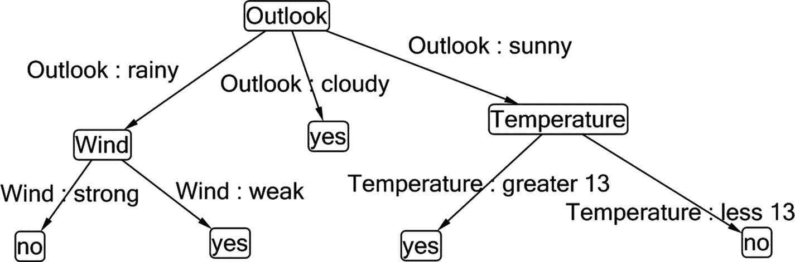

图 10-8 执行代码清单 10-12 中的代码后得到的决策树

我们没有包含任何与处理缺失值特性相关的代码，但使用忽略它们的非常简单的策略，我们可以创建一个 C# 方法，该方法接收训练数据集作为输入，并检查矩阵的每个单元格，将任何未知值替换为 0，使其不参与熵计算。如前所述，剪枝技术留给读者作为补充练习来实现。