# 11. 神经网络

在本章中，我们将讨论人工神经网络，这是一类在监督学习领域（也适用于无监督学习和强化学习）非常流行的算法，它试图模仿或建模人脑的功能，以解决那些依赖于学习或逼近由训练数据表（以（数据，分类）对的形式定义）定义的函数 F 的问题，这与支持向量机和决策树类似。这个函数 F 是学习过程的结果，被称为近似函数或学习函数。它随后被用于对新输入数据进行分类或预测其类别。

正如我们目前所见，人工智能中使用的许多算法、方法和工具——尤其是在监督学习中——与其他知识领域密切相关，例如代数、数学分析和数学优化。因为生活中的学习涉及一个我们在时间线上“改进”或学习如何做某些事情的过程（考虑时间因素），而这正是优化算法的目标——通过迭代过程优化（最小化或最大化）一个函数——那么神经网络也不例外，我们将保持使用优化技术来学习和构建一个预测输入数据类别的函数的相同模式。

在本章中，我们将介绍神经网络，描述其工作原理以及它们如何模拟我们的神经元协同工作的方式。我们将实现感知器算法，这是最古老、最简单的神经网络模型之一。我们还将实现 Adaline 神经网络模型，因为它将是对多层神经网络主题的有用介绍；它使用的优化技术类似于本章将要考察的最后一个算法，即用于多层神经网络学习的流行反向传播算法。

注意

神经网络可应用于多种问题，其中值得提及的有模式、形状、人脸和手写识别、自动驾驶汽车等。脑式计算风格的研究源于 McCulloch 和 Pitts（1943 年）的工作，以及后来 Hebb 著名的《行为的组织》（1949 年）。


## 什么是神经网络？

神经元是神经系统的一种细胞（图 11-1），它拥有一层质膜，使其能够接收来自外部元素的刺激，并将信号传递给其他神经元或人脑中不同类型的细胞。它们接收或发送的信号是电化学信号；因此，神经元负责收集、处理并传递电化学信号。当多个神经元通过其突触连接时，就称它们构成了一个神经网络。在这个网络中，当从所有与之相连的其他神经元接收到的电化学信号的激发强度足够高时，神经元就会触发或发送一个信号。

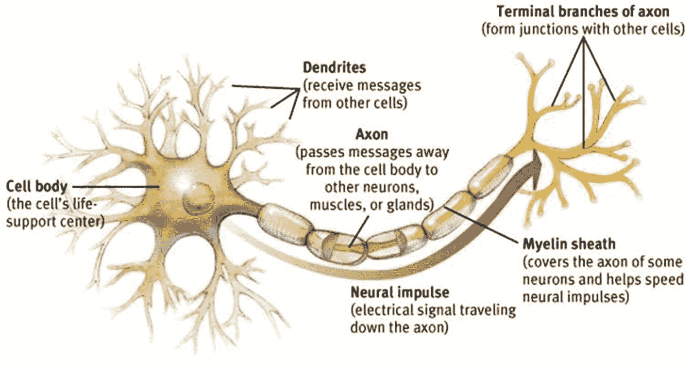

图 11-1

生物神经元；树突代表来自其他神经元的信号输入，轴突代表我们神经元的输出。我们可以将神经元的结构理解为：输入节点称为树突，输出节点称为轴突，连接边称为突触。

在数学人工智能世界中寻找一个类比模型，可以将神经元视为一个数学对象或函数，它接收所有与之相连的神经元输入的数值 x1, x2, …, xn，并将这些值组合起来，通过为每个连接关联权重值 w1, w2, …, wn 来计算加权和，以此赋予每个连接一定的“相关性”。因此，X = w1 * x1 + w2 * x2 + … + wn * xn 就是到达神经元胞体的值。最终输出的值可以是一个信号，也可以是零（无信号）。为了确定信号（输出）的强度，我们通常使用一种称为**激活函数**的东西；该函数决定了输出值，并且会根据所用神经元的类型而变化。

因此，神经网络（NN）就是上述神经元的集合；这些神经元之间的关系可以描述为形成一个图，其中从神经元 i 到神经元 j 的边表示对神经元 j 的输入，以及从神经元 i 到神经元 j 的输出（图 11-2）。

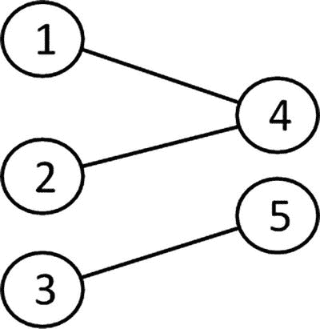

图 11-2

神经网络作为图；神经元 4 和 5 接收来自神经元 1、2 和 3 的输入，而神经元 1、2 和 3 则与神经元 4 和 5 有输出连接。

在接下来的章节中，我们将研究单单元神经网络，即由单个神经元组成的网络。在单神经元网络中，可以认为输入来自某些未知的神经元，其值与表示训练数据的向量相匹配。输出则用于对输入训练数据进行分类。

注意

一个人工神经元可以看作是一个数学函数 F = A(x1 * w1 + … + xn * wn)，其中 xi 是输入；wi 是用于增强或削弱与其他神经元连接的权重，而 A 是最终决定输出信号强度的激活函数。

## 感知机：单一神经网络

感知机是一个单一神经网络单元，遵循前述相同的过程：它接收 n 个输入 x1, …, xn，然后计算加权和 x1 * w1 + … + xn * wn，最后应用一个激活函数来获得输入数据的输出或分类。对于感知机，该函数通常如下所示：

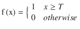

T 是一个称为阈值的值；它用于将加权和与阈值进行比较，以确定是否应该发送信号。因此，感知机可以表示为图 11-3 所示。

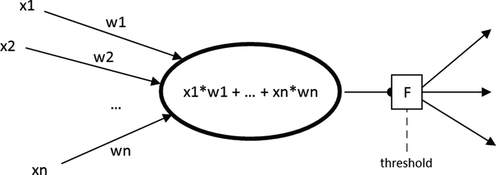

图 11-3

感知机计算输入和权重的加权和，将该值提交给激活函数 F，并且当且仅当 F 大于或等于给定阈值时，才将信号传输给其他神经元。

我们已经了解了信息在感知机中的流动方式；请记住，所分析流程的目的是为输入数据提供分类。那么，我们如何训练它来正确预测新的输入数据呢？

注意

感知机由弗兰克·罗森布拉特于 20 世纪 50 年代创建，旨在将视网膜建模为人工神经网络。

首先，感知机是一个线性分类器（回顾第 9 章，支持向量机也是线性分类器）；它试图找到一个权重向量和一个阈值，使得问题的空间被划分为 A 类和 B 类。权重向量和阈值将定义其中一个可能的分类超平面。如果我们在二维空间中，那么超平面就是一条线；如果在三维空间中，超平面就是一个平面，以此类推。如果训练数据集是线性可分的，那么训练数据中的所有点将始终位于分类超平面的一侧或另一侧。

正如我们在第 9 章中所做的那样，让我们考虑一条直线的方程 y = mx + b，其中 m 是直线的斜率——或者更一般地说，是直线的梯度——而 b 是决定直线向左或向右偏移的偏置——即直线与 y 轴的截距（图 11-4）。

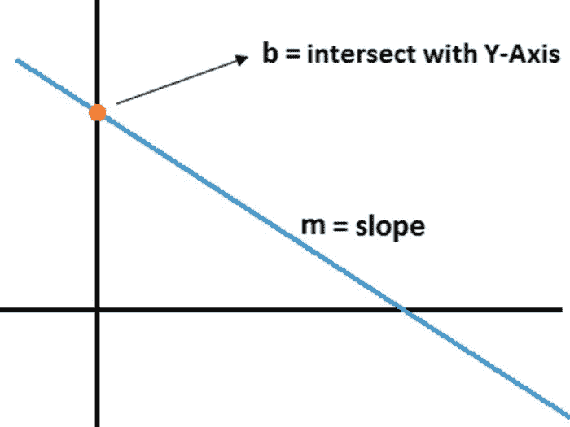

图 11-4

考虑直线方程 mx + b = y，那么 m 定义了直线的斜率，b 定义了直线与 y 轴的截距，或者等价地，定义了直线的左右偏移

因此，感知机中的训练或学习过程将包括对权重（直线的斜率）以及偏置进行调整（通过多次迭代随时间进行），以尝试找到一条直线或一般情况下找到一个超平面，能够正确地对所有训练数据进行分类；换句话说，就是找到一条将训练数据集划分为两个类别的直线。

感知机算法首先为权重向量（通常在 [0, 1] 范围内）和偏置设置随机值。这将导致构建一个随机的分类超平面，或者在二维情况下（权重向量有两个分量），这将导致构建一条可能正确也可能不正确地对训练数据集进行分类的直线。然后，为了优化分类超平面并迫使其正确地对所有样本进行分类，会遍历整个训练数据集，并且每次检测到单个训练数据分类错误时，都会通过增加或减少与该训练数据分量相关的权重来进行修正；请记住，对于任何训练数据 (x1, …, xn) 中的每个分量 xi，我们都有与之关联的某个 wi，并且所有这些都组合在加权和 x1 * w1 + … + xn * wn 中。

注意


感知机收敛定理指出，对于任何线性可分的数据集，感知机学习规则保证能在有限次迭代内找到解。

因此，感知机的学习过程本质上是一种优化技术，我们通过缓慢改变分类超平面的斜率（或梯度）和偏置，将其移动到能正确分类所有训练数据的位置，从而改进分类超平面（图 11-5）。

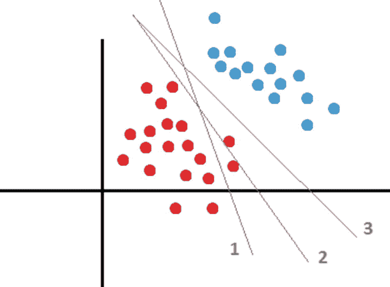

图 11-5

在图中，直线 1 错误分类了两个红点；因此，我们修改权重和偏置，将其稍微向右移动；然后分类超平面 2 也错误分类了一个红点。最终，分类超平面 3 没有犯任何错误，正确地将红点和蓝点分开。

感知机算法的伪代码如下：

1.  将权重和偏置初始化为 [0, 1] 范围内的随机值。
2.  如果满足停止条件，则结束。
3.  遍历整个训练数据集，每次选取一个训练数据 (x, y)，其中 x 是特征向量，y 是其分类。
4.  计算感知机对训练数据 x 的输出 y[x]。
5.  如果 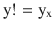，则：按照以下规则修正每个权重：

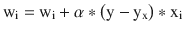

同时使用以下公式修正偏置：

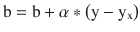

6.  转到步骤 2。

伪代码的第 5 步包含了所谓的感知机学习规则；算法中完成的所有学习都封装在修改权重的公式中。为了理解这个学习公式，让我们从头开始重构它。

首先，注意到当 w · x < 0（其中 · 表示点积，即前面提到的加权和）且 x 的正确分类为正时，从几何上可以解释为向量 w 和 x 之间的夹角大于 90 度，因此我们需要将 w 向 x 的方向旋转，使其进入正空间。同样地，如果 w · x > 0 且 x 的正确分类为负（或小于零），则向量 w 和 x 之间的夹角小于 90 度，必须将 w 旋转远离 x。

注意

a • b 运算表示向量 a 和 b 之间的点积。当 a 和 b 垂直时，a • b = 0。

因此，我们已经知道，将权重更新为 w + x 或 w - x 可以几何解释为将 w 向 x 的方向或相反方向移动；此操作旨在为训练数据 x 获得正确的分类。现在，为了将上述两种情况合并为一个，我们将添加项 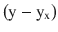 作为 x 的乘数。让我们分析这个项的可能取值，以理解它总能为我们提供 x 的正确符号。

*   如果 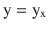，则 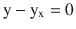，这意味着权重没有变化，因为 x 的分类是正确的。
*   如果 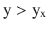，则 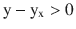，这意味着需要增加权重，因为 ；即，我们需要增加权重，使得 w · x 为我们提供更高的值，从而训练数据将其分类为 1 而不是 0。
*   如果 ，则 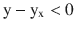，这意味着需要减少权重，因为 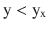。解释与上一点类似。

因此，我们现在有了更新规则 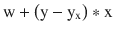 的合理解释，并且我们得出结论，将最后一项乘以 α，α 是 (0, 1) 范围内的一个值，称为学习率。

学习率控制感知机学习的速度，或者等价地说，控制我们在每一步改变权重和偏置的程度。从几何角度来看，它可以看作是将 w 向量向训练数据向量 x 旋转或远离其旋转的程度。为了保证收敛并且不越过问题的解，我们必须为学习率选择较小的值；通常选择 0.05。

使用类似的方法，我们可以推导出更新偏置的公式，但这留给读者作为练习。


### 实际问题：实现感知器神经网络

为了在 C# 中实现感知器，我们将创建一个名为 `SingleNeuralNetwork` 的抽象类，该类将使我们能够轻松开发感知器以及任何我们需要实现的单单元神经网络，因为它们在结构上具有相似的特征，主要变化仅在于其学习规则。此类如清单 11-1 所示。

```
public abstract class SingleNeuralNetwork
{
public List<TrainingSample> TrainingSamples{ get; set; }
public int Inputs { get; set; }
public List<double> Weights { get; set; }
public readonly Random Random = new Random();
protected readonly double LearningRate;
protected double Bias= 0.5;
protected SingleNeuralNetwork(IEnumerable<TrainingSample> trainingSamples, int inputs, double learningRate)
{
TrainingSamples = new List<TrainingSample>(trainingSamples);
Inputs = inputs;
Weights = new List<double>();
for (var i = 0; i < inputs; i++)
Weights.Add(Random.NextDouble());
LearningRate = learningRate;
}
public abstract void Training();
public int Predict(IList<double> objects)
{
var sum = 0.0;
for (var i = 0; i < Inputs; i++)
sum += Weights[i] * objects[i];
return sum + Bias > 0 ? 1 : 0;
}
public List<int> PredictSet(IEnumerable<IList<double>> objects)
{
var result = new List<int>();
foreach (var obj in objects)
result.Add(Predict(obj));
return result;
}
}
清单 11-1
SingleNeuralNetwork 抽象类
```

该类包含以下字段或属性：

*   `TrainingSamples`：与 SVM 章节中使用的类相同；它包含一个表示训练数据的特征向量（双精度值）和一个定义该训练数据正确分类的整数。
*   `Inputs`：表示感知器输入数量的整数。
*   `Weights`：表示单单元神经网络权重向量的双精度值列表。
*   `Random`：用于获取随机值的字段。
*   `LearningRate`：感知器的学习率。
*   `Threshold`：感知器的阈值；初始值设为 0.5。

在类构造函数中，我们将权重初始化为 [0, 1] 范围内的随机值；构造函数之后是一组方法，详细说明如下：

*   `Training()`：一个虚方法，每个继承自 `SingleNeuralNetwork` 的类都将实现该方法以提供训练算法实现。我们将其标记为 `virtual` 而非 `abstract`，是因为我们考虑到您可能不希望为单单元神经网络包含训练方法，而只想使用其包含的字段和属性。
*   `Predict()`：计算加权和 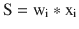 并检查 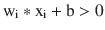 或等价地检查 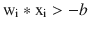。
*   `PredictSet()`：使用前一个方法，预测作为参数传入的列表中每个数据的分类。

请记住，感知器的目标是找到一个分类超平面，将数据点集划分为 A 类和 B 类。这种划分必须保证 A 类中的每个元素都位于超平面的一侧，而 B 类中的每个元素都位于另一侧。该超平面将满足方程 wx + b = 0（如第 9 章所述）。因此，在 `Predict()` 方法中，我们将任何满足 wx + b > 0 的数据点 x 分类为属于类别 1；否则，将其设置为类别 0 的成员。

最后，继承自 `SingleNeuralNetwork` 抽象类的 `Perceptron` 类如清单 11-2 所示。

```
public class Perceptron :SingleNeuralNetwork
{
public Perceptron(IEnumerable<TrainingSample> trainingSamples, int inputs, double learningRate)
: base(trainingSamples, inputs, learningRate)
{ }
public override void Training()
{
while (true)
{
var missclasification = false;
foreach (var trainingSample in TrainingSamples)
{
var output = Predict(trainingSample.Features);
var features = trainingSample.Features;
if (output != trainingSample.Classification)
{
missclasification = true;
for (var j = 0; j < Inputs; j++)
Weights[j] += LearningRate*(trainingSample.Classification - output)*features[j];
Bias+= LearningRate * (trainingSample.Classification - output);
}
}
if (!missclasification)
break;
}
}
}
清单 11-2
Perceptron 类
```

正如我们所见，`Perceptron` 类中 `Training()` 方法的实现几乎是前面详细描述的伪代码的直接翻译。

为了测试我们的算法，我们将使用清单 11-3 中的代码创建一个控制台应用程序。

```
var trainingSamples = new List<TrainingSample>
{
new TrainingSample(new double[] {1, 1}, 0, new List<int> { 0 } ),
new TrainingSample(new double[] {1, 0}, 0, new List<int> { 0 } ),
new TrainingSample(new double[] {0, 1}, 0, new List<int> { 0 } ),
new TrainingSample(new double[] {0, 0}, 0, new List<int> { 0 } ),
new TrainingSample(new double[] {1, 2}, 1, new List<int> { 0 } ),
new TrainingSample(new double[] {2, 2}, 1, new List<int> { 1 } ),
new TrainingSample(new double[] {2, 3}, 1, new List<int> { 1 } ),
new TrainingSample(new double[] {0, 3}, 1, new List<int> { 1 } ),
new TrainingSample(new double[] {0, 2}, 1, new List<int> { 1 } ),};
var perceptron = new Perceptron(trainingSamples, 2, 0.01);
perceptron.Training();
var toPredict = new List<double[]>
{
new double[] {1, 1},
new double[] {1, 0},
new double[] {0, 0},
new double[] {0, 1},
new double[] {2, 0},
new[] {2.5, 2},
new[] {0.5, 1.5},
};
var predictions = perceptron.PredictSet(toPredict);
for (var i = 0; i<predictions.Count; i++)
Console.WriteLine("Data: ( {0} , {1} ) Classified as: {2}", toPredict[i][0], toPredict[i][1], predictions[i]);
清单 11-3
在控制台应用程序中测试 Perceptron 类
```

执行清单 11-3 中的代码后得到的结果如图 11-6 所示。

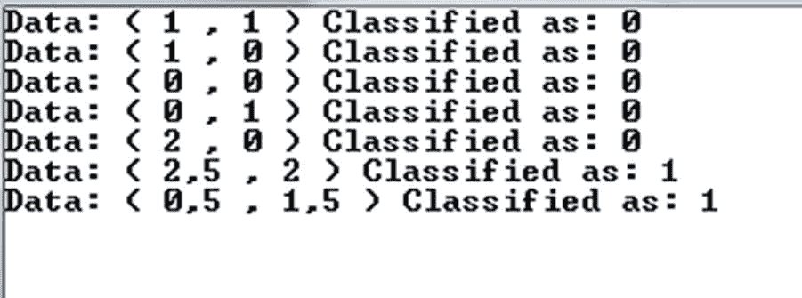

图 11-6

我们的感知器输出的分类结果，考虑了清单 11-3 中定义的数据集

在实现神经网络或任何监督学习方法时，请始终记住，训练数据集越大，算法就越能更好地从训练集中定义的表格函数近似或映射到使用权重向量和偏置构建的函数。在清单 11-3 中，我们的训练数据集非常小，因此感知器很可能会对新输入的数据做出错误分类。在这个例子中没有发生这种情况，但当添加与那个小训练集中的数据类型显著不同的数据时，这种情况就可能发生。


### Adaline 与梯度下降搜索

Adaline（自适应线性神经元）是 Bernard Widrow 于 1960 年提出的一种神经网络模型，其网络结构与感知机相同。感知机与 Adaline 的区别在于所使用的学习规则。Adaline 算法使用一种具有多个名称的学习规则：**Delta 规则**、**梯度下降**或**最小均方**。该学习规则通常被用于多层网络，尤其是反向传播算法中。因此，Adaline 是了解多层网络和流行的反向传播算法的良好入门。

Delta 规则的主要思想是最小化对训练数据 x 进行分类时产生的平方误差：

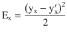

在此公式中，y[x] 是训练数据 x 的正确分类，而 y'[x] 是神经网络输出的分类结果。

Adaline 是一个无阈值的神经网络，这意味着它在学习阶段不考虑偏置或阈值。因此，在训练过程中，其输出（对于数据点 x）简单地计算为 w[i]x[i] 的总和。为了实现对训练数据 x 进行分类时产生的平方误差的最小化，该算法依赖于这样一个事实：函数的梯度（由所有偏导数组成的向量）指明了 E 的最陡峭增加方向（图 11-7）。因此，通过将梯度乘以 -1，我们将从任意点获得 E 的最陡峭递减方向，这将引导我们达到所产生的最小误差。

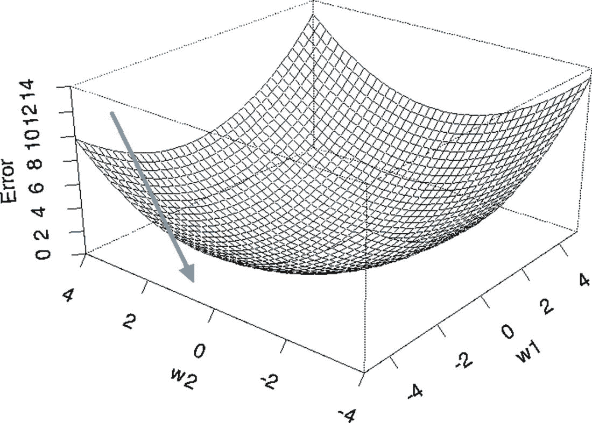

图 11-7

梯度表示函数最大增量的方向；其相反数（蓝色箭头）表示最大减量的方向

因此，Adaline 的训练方法是一种梯度下降搜索算法，它通过最小化全局误差 E（请记住 E[x] 仅与对训练数据 x 进行分类时产生的误差有关）来确定最佳权重向量。在 Adaline 中，权重向量最初包含随机变量，然后这些权重将通过迈出小步并向下移动来修改，直到我们到达误差曲面上一个我们认为“可接受”的点；通常，对于任何训练数据点，最大误差的一个小值被认为是可接受的。梯度下降搜索能够找到可微函数的全局最小值。

为了更好地理解梯度下降方法，让我们通过查看下图（图 11-8）来了解其工作原理。同时，让我们考虑在一个函数 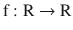 中，即一个单变量 x 的函数，梯度下降方法寻找最小值的更新公式将是 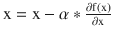。

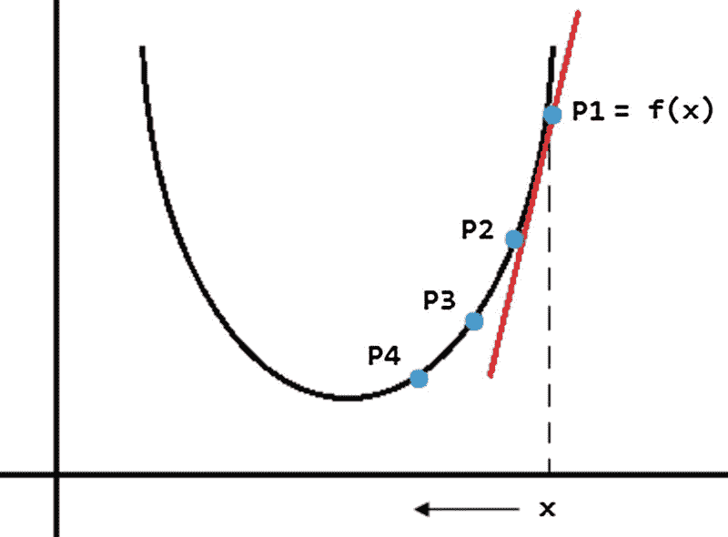

图 11-8

梯度下降方法的运行机制

在图 11-8 中，梯度下降搜索从点 p1 = f(x) 开始。根据更新公式，它计算在点 x 处评估的 f 的导数，并乘以学习率 α。由于导数表示 f 的斜率——并且在这个特定情况下，红线（即点 p1 处的切线）具有正斜率——那么 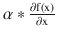 将是一个正值（回想一下 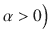）。因此，x 的新值（设为 x'）将向左移动，新的 p2 = f(x') 将满足 p2 < p1。这个过程将持续进行，直到我们达到最小值，假设 α 足够小，并且随着接近最小值，步长会变得更小；换句话说，x 将在新的迭代中缓慢地向左移动。

回到一般情况，为了找到误差的最陡峭递减，我们将 E（对所有训练数据进行分类时产生的误差总和）表示为 w（权重向量）的函数。请注意，将 E 表示为 w 的函数总是可能的，因为对于任何给定的训练数据 x，有 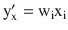；因此，要最小化的函数如下：

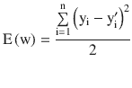

因此，我们将找到 E(w) 的梯度——设为 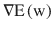——并将其纳入 Adaline 的学习规则中，该规则如下：

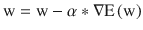

请注意，规则中的符号是减号而不是加号。这是因为我们必须对梯度取反，即 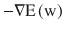，以便最小化 E(w)。正如之前在感知机中定义的，α 是学习率，它控制着我们向解决方案移动的速度。前面的公式涉及我们更新权重向量 w 的方式，但我们应该如何更新单个权重呢？单个权重的规则如下：

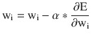

我们用其等价形式——关于每个权重 w[i] 的偏导数——替换了梯度。在通过计算一些导数并应用链式法则来展开项 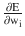 之后，我们最终将得到梯度下降搜索的完整学习规则：

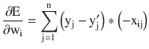

和之前一样，y[j] 表示训练数据 j 的正确分类，y[j]^′ 表示神经网络输出的分类，而 x[ij] 表示训练数据 j 的第 i 个输入值——即与权重 w[i] 相关联的训练数据 j 的输入。

尽管从理论或数学角度来看，梯度下降搜索是一种寻找函数局部最小值的优雅方法，但在实践中它往往相当缓慢。请注意，要更新单个权重，您需要遍历整个训练数据集，其中可能包含数万个训练样本，这意味着大量的计算。因此，出于这个实际原因，我们通常使用梯度下降搜索的一种近似变体作为 Adaline 的学习规则；这种变体将在下一节中介绍。


### 随机逼近

随机梯度下降（SGD）或增量梯度下降是 GDS 的一种补充逼近过程，它在计算每个训练数据的误差后增量更新权重。因此，它使我们免于必须遍历整个训练数据集来计算每个权重值的计算麻烦。实际上，这是 Adaline 和其他通过考虑训练数据的正确分类及其在 NN 中的输出来最小化平方误差的 NN 算法（反向传播）中使用的方法。使用随机逼近的学习规则被称为 Delta 规则、Adaline 规则或 Widrow-Hoff 规则（以其创建者命名）。在图 11-9 中，我们可以非常直观地了解 GDS 和 SGD 之间的差异。在第一种方法中，我们直接移动到误差曲面的最小值，因此我们沿着一条直线路径前进；而在后一种方法中，我们像醉汉一样移动；有时我们会失去平衡并移动到错误的位置，但最终我们会到达与 GDS 相同的点。

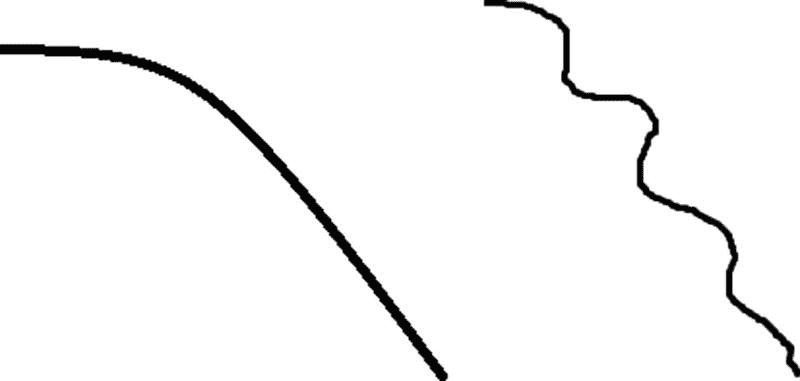

图 11-9

左侧是 GDS 在误差曲面上到达最小值所遵循的直接路径；右侧是 SGD 所遵循的“不平衡”路径

使用 SGD 的更新规则如下：

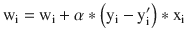

请注意此学习规则与之前为感知器描述的学习规则之间的相似性——它们看起来非常相似。主要区别是什么？主要区别在于训练时 NN 的输出。在 Adaline 中，我们不考虑任何阈值或激活函数；因此，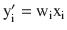。

注意

当你在多层网络中组合多个 Adaline 时，你会得到所谓的 Madaline。

### 实际问题：实现 Adaline NN

在研究了 Adaline 算法背后的理论之后，是时候在 C# 中最终实现该过程了。为此，我们将创建 `Adaline` 类，如清单 11-4 所示。

```
public class Adaline :SingleNeuralNetwork
{
public Adaline(IEnumerabletrainingSamples, int inputs, double learningRate)
: base(trainingSamples, inputs, learningRate)
{ }
public override void Training()
{
double error;
do
{
error = 0.0;
foreach (vartrainingSample in TrainingSamples)
{
var output = LinearFunction(trainingSample.Features);
varerrorT = Math.Pow(trainingSample.Classification - output, 2);
if (Math.Abs(errorT)  0.25);
}
public double LinearFunction(double [] values)
{
var summation = (from i in Enumerable.Range(0, Weights.Count)
select Weights[i]*values[i]).Sum();
return summation;
}
public override double Predict(double[] features)
{
return LinearFunction(features) >0.5 ?1 : 0;
}
}
清单 11-4
Adaline 类
```

此类继承自 `SingleNeuralNetwork` 并包含三个方法。第二个方法是 `LinearFunction()`，它简单地计算加权和 w[i]x[i]。请记住，Adaline 中的预测阶段和训练阶段之间存在差异。在训练或学习阶段，我们将 NN 的输出计算为加权和，但在预测阶段，我们必须使用分类函数来分类新传入的数据；因此，预测函数与学习函数不同。在这种情况下，我们的预测函数计算新数据的加权和，并根据加权和的结果是大于 0.5 还是小于 0.5 输出 1 或 0。

`Training()` 方法包含一个 `do ... while()` 语句，我们在其中验证分类任何训练数据时产生的最大误差是否超过 0.25。如果超过，循环将继续；否则，我们将认为自己满意，方法将结束。此外，如果分类训练数据时的误差低于 0.001，我们将不会改变权重。在图 11-10 中，我们可以看到在小型数据集上执行 Adaline 后获得的结果。

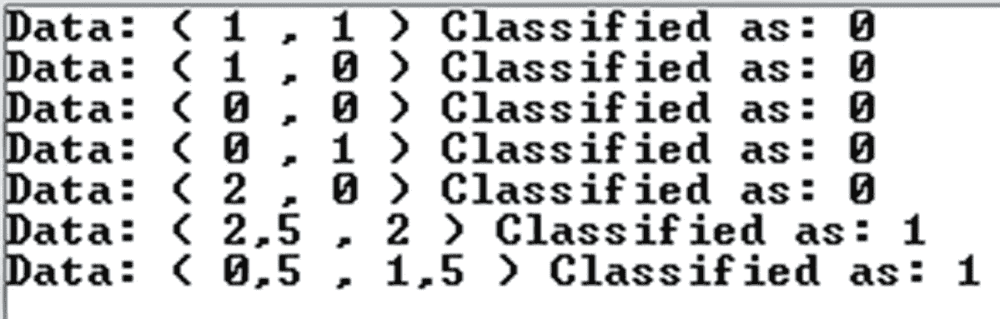

图 11-10

在小型数据集上执行 Adaline 后获得的结果

如果我们对算法的运行方式感到好奇，可以在 `while (error > 0.25);` 这一行设置一个断点，然后观察每次迭代后最大误差如何减小。以下是在与感知器实现中使用的相同训练数据集上执行 Adaline 时，在一系列迭代中获得的值：3.2386、1.7957、1.0569、0.6973、0.5822、0.5050、0.4523、0.4144、0.3861、0.3640、0.3463、0.3315、0.3189、0.3078、0.2980、0.2891、0.2810、0.2735、0.2676、0.2614、0.2552 和 0.2491。


### 多层网络

多层网络是一种神经网络，其中多个神经网络按层分组，并逐层连接。我们之前描述的神经网络（感知机、Adaline）由两层构成：一个包含多个节点的输入层和一个包含单个节点的输出层。图 11-11 所示的多层神经网络由三层组成：输入层、隐藏层和输出层。它也是一种前馈神经网络；换句话说，所有信号都从一层的节点流向下一层的节点。因此，多层神经网络是通过将许多简单的“神经元”组合成层，并将一个神经元的输出作为下一层另一个神经元的输入而构建的。

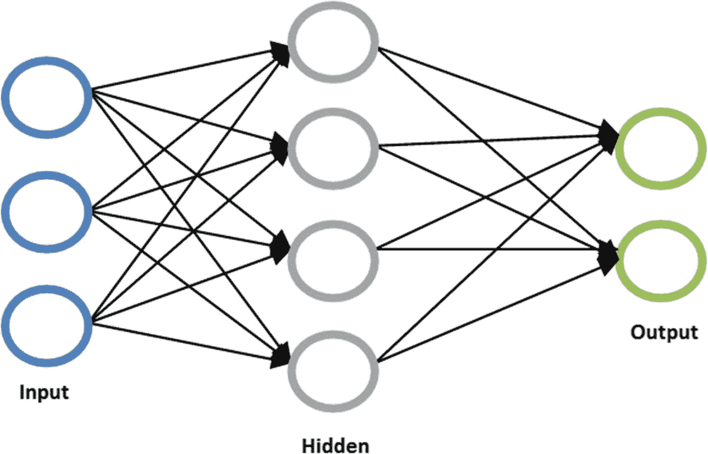

图 11-11

由三层组成的多层、前馈、全连接神经网络：一层为输入单元，一层为隐藏单元（灰色），一层为输出单元（绿色）。有时输入层不被视为一层。

除了从训练数据的分量（xi）接收输入的输入层外，所有其他层都从前一层的激活函数接收输入。多层网络中的每条边都代表一个权重，离开某个节点的任何边，其权重值都会乘以该节点出发的激活函数值。因此，来自层 L（其中 L > 0，即非输入层）的任何节点，其输入或激活值将按如下方式计算：

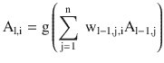

其中 n 是层 L - 1 中的单元总数，A[l,i] 表示层 L 中单元 i 的激活值，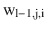 是从层 L – 1 的单元 j 到层 L 的单元 i 的权重或边，g 是神经网络中应用的激活函数。通常，g 被选为技术上符合逻辑的 sigmoid 函数，其值范围在区间 [0, 1] 内，计算方式如下：

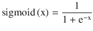

sigmoid 函数一个非常重要的性质是它是可微且连续的；请记住，这个性质对我们很重要，因为我们将要计算梯度，进而计算导数。

多层神经网络的一个关键要素是它们能够对非线性可分的数据集进行分类。因此，像 XOR（图 11-12）这样无法被线性神经网络（如感知机）分类的函数，可以通过一个仅包含一个隐藏层的简单多层神经网络正确分类。

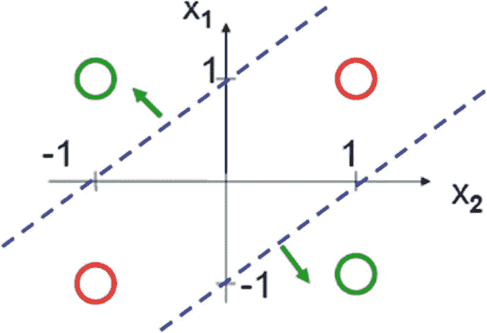

图 11-12

XOR 函数；不存在一条直线可以将红点与绿点分开

我们可以将多层神经网络视为强大的数学函数，能够逼近训练数据集中可能存在的任何表格函数。每个隐藏层代表一个函数，而层的组合可以看作是数学中的函数复合。因此，拥有 n 个隐藏层可以看作是拥有数学函数 o(h1, h2 ( … hn(i(x)) … ))，其中 o 是输出层，i 是输入层，hi 是隐藏层。

传统的神经网络只有一个隐藏层，当它们有多个隐藏层时，我们就在处理深度神经网络和深度学习。表 11-1 说明了隐藏层数量与所得神经网络能力之间的关系。

表 11-1

层数与神经网络能力的关系

| 隐藏层数量 | 结果 |
| --- | --- |
| 无 | 仅能表示线性可分的函数或决策 |
| 1 | 可以逼近任何包含从一个有限空间到另一个有限空间连续映射的函数 |
| 2 | 可以使用有理激活函数以任意精度表示任意决策边界，并能以任意精度逼近任何平滑映射 |
| >2 | 额外的层可以学习复杂的表示（一种自动特征工程）。 |

已有证明，具有单个隐藏层的多层神经网络能够学习任何函数。因此，人们可能会问，既然一个隐藏层就能学习任何函数，那为什么还需要深度学习呢？关键在于，虽然通用逼近定理证明了拥有一个隐藏层确实足以学习任何连续函数，但它并未说明完成这种学习有多容易。因此，出于效率和准确性的考虑，我们可能需要增加神经网络架构的复杂性，并包含额外的隐藏层，以便在合理的时间内获得一个不错的解决方案。

在决定神经网络架构时，隐藏层中神经元的数量是另一个需要考虑的重要问题。尽管这些层不直接与外部环境交互，但它们确实对最终输出有着显著影响。隐藏层的数量以及隐藏层中神经元的数量都必须仔细斟酌。

在隐藏层中使用过少的神经元会导致所谓的欠拟合。当隐藏层中的神经元太少，无法有效感知复杂数据集中的信号时，就会发生欠拟合。在隐藏层中使用过多的神经元则会导致若干问题，其中最著名的是过拟合，即权重对训练数据集调整得过于完美，导致神经网络无法正确预测新的输入数据。

注意

通用逼近定理指出，具有一个包含有限数量神经元的隐藏层的前馈网络可以逼近任何连续函数；这使得神经网络可以被视为通用逼近器。


### 反向传播算法

与 Adaline 神经网络类似，采用反向传播的多层神经网络通常依赖梯度下降法，更具体地说是随机梯度近似法，来调整网络的权重。它们也追求与 Adaline 算法相同的目标——最小化数据真实分类与网络输出之间二次差值的误差。

反向传播算法的核心思想在于，它作为一种机制，将输出层产生的误差传递到最后一个隐藏层（沿途调整权重），再从那里传递到前一个隐藏层，依此类推，向后传播；换句话说，如果 o 是输出层，h[1], h[2], …, h[n]表示隐藏层，那么反向传播算法会将误差从输出层（相当于调整权重或最小化误差）传递到 h[n]，然后从 h[n]传递到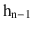，如此继续，直到误差调整过程到达 h[1]。这种运作方式解释了“反向传播”名称的由来，因为输出是从输入层经过 h[1], h[2], …, h[n]层计算得出，最终到达输出层；然后，一旦获得输出，权重就从输出层向后调整到第一个隐藏层。

如前所述，反向传播算法与 Adaline 方法一样，都依赖于梯度下降法。我们可以指出的这两种过程的第一个区别是，在 Adaline 中我们只有一个输出节点，但在多层神经网络中，因此在反向传播中，我们可能处理的是排列在输出层中的多个输出节点；因此，总误差必须按如下方式计算：

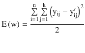

其中 n 是训练数据集的大小，k 是输出层中的单元数量，y[ij]是训练数据 i 在输出层节点 j 位置上的正确分类，而 y'[ij]是我们的神经网络在输出层节点 j 处为训练数据 i 输出的分类。

反向传播过程中每个节点的学习规则类似于感知机和 Adaline。根据随机近似法，该规则如下：

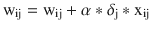

在这种情况下，w[ij]表示从节点 i 到节点 j 的权重，α是学习率，x[ij]是从节点 i 到节点 j 的激活值（在输入层，这些值与输入值一致），δ[j]是节点 j 处的误差。之前描述的学习规则在反向传播算法的权重更新规则中并没有像现在这样有两个下标（w[ij]）。让我们回想一下，反向传播旨在用于多层神经网络；因此，我们将有许多节点连接到其他节点，所以每条边 ij 都有一个关联的 w[ij]。

所以，在权重更新公式中，我们最初拥有除δ[j]之外的所有变量；这个项代表分类误差，我们需要对其关于权重求导以找到梯度，从而在误差曲面上找到相对于 w 的最陡下降方向。正如随机近似法所做的那样，我们每次迭代一个训练数据，这证明了

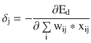

其中 E[d]是与分类训练数据 d 相关的误差，w[ij]是与单元 j 相关的权重。我们知道全局误差 E(w)的公式，但这不是我们为了最小化 w 而求导的公式。请记住，随机近似法每次只处理一个训练数据；因此，我们对以下方程求导：

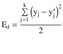

在这种情况下，k 是输出层中节点的总数，y[j]是节点 j 的正确分类，y'[j]是我们的神经网络输出的值。应用链式法则，并考虑到我们计算误差项的节点是输出单元还是隐藏单元，我们可以得到以下公式：

*   对于输出层中的节点，


这意味着，


*   对于隐藏层中的节点，


在这种情况下，Stream 是输入对应于节点 j 输出的一组节点。前面的公式意味着


请注意，所获得的权重更新公式假设我们使用的是 S 型单元；换句话说，我们在神经网络的每个节点中都使用 S 型函数作为激活函数。输出层和隐藏层权重更新规则的通用形式分别如下：


其中 G(y[j]^′)表示在激活函数输出值处评估的激活函数的导数，我们知道这个值可以用 w 来表示。回想一下，S 型函数的导数是 F(x) * (1 - F(x))；这非常容易计算和使用，也是 S 型函数成为多层神经网络经典激活函数的主要原因之一。


图 11-13 展示了另一种流行的激活函数——双曲正切函数，这是一种对称函数，其输出范围在 [-1;1] 之间，其表示和计算公式如下：


**图 11-13**

双曲正切函数，其输出值范围在 (-1;1) 之间

如今，一种正在取代 Sigmoid 函数及其他类似平滑函数的流行激活函数是修正线性单元，即 ReLU（图 11-14）。与 Sigmoid 和平滑函数不同，ReLU 不存在深度学习中的梯度消失问题，例如在训练超过三层的神经网络时。其公式极其简单：


换句话说，ReLU 让所有正值原封不动地通过，但将所有负值设置为 0。尽管更新的激活函数正逐渐受到关注，但目前大多数深度神经网络仍使用 ReLU 或其[密切相关的变体](https://en.wikipedia.org/wiki/Rectifier_%28neural_networks%29)。


**图 11-14**

ReLU 函数

为了更好地理解反向传播算法中的反向传播流程以及变量所在的节点或边，让我们来审视图 11-15。


**图 11-15**

反向传播算法中的反向传播流程。权重 wij 通过考虑节点 j 中的误差项进行更新。

现在我们已经掌握了反向传播算法运行的理论基础，在下一节中，我们将实现一个代表多层神经网络的 `MultiLayerNetwork` 类，并将我们的反向传播算法作为该类的一个方法进行开发。

### 实践问题：实现反向传播与解决 XOR 问题

为了正确编码多层神经网络范式，我们将创建如代码清单 11-5 所示的类。我们还将采用面向对象的方法，包含一个 `Layer` 类，用于表示所有排列成 Sigmoid 单元列表的节点。

```
public class MultiLayerNetwork
{
public List Layers { get; set; }
public ListTrainingSamples{ get; set; }
public intHiddenUnits{ get; set; }
public intOutputUnits{ get; set; }
public double LearningRate{ get; set; }
private double _maxError;
public MultiLayerNetwork(IEnumerabletrainingSamples, int inputs, inthiddenUnits, int outputs, double learningRate)
{
Layers = new List();
TrainingSamples = new List(trainingSamples);
LearningRate = learningRate;
HiddenUnits = hiddenUnits;
OutputUnits = outputs;
CreateLayers(inputs);
}
private void CreateLayers(int inputs)
{
Layers.Add(new Layer(HiddenUnits, TrainingSamples, LearningRate, inputs, TypeofLayer.Hidden));
Layers.Add(new Layer(OutputUnits, TrainingSamples, LearningRate, HiddenUnits, TypeofLayer.OutPut));
}
public ListPredictSet(IEnumerable objects)
{
var result = new List();
foreach (varobj in objects)
result.Add(Predict(obj));
return result;
}
public Layer OutPutLayer
{
get { returnLayers.Last(); }
}
public Layer HiddenLayer
{
get { returnLayers.First(); }
}
}
public class Layer
{
public List Units { get; set; }
public TypeofLayer Type { get; set; }
public Layer(int number, ListtrainingSamples, double learningRate, int inputs, TypeofLayertypeofLayer)
{
Units = new List();
Type = typeofLayer;
for (vari = 0; i< number; i++)
Units.Add(new SigmoidUnit(trainingSamples, inputs, learningRate));
}
}
public enumTypeofLayer
{
Hidden, OutPut
}
代码清单 11-5
MultiLayerNetwork 和 Layer 类
```

`Layer` 类包含两个属性：一个 `SigmoidUnit` 的 `List`（我们稍后将详细研究此类）和一个 `TypeofLayer Type`，这是一个枚举，包含两个可能的值：`Hidden` 和 `OutPut`。在类的构造函数中，我们只需根据 `number` 参数指定的数量向层中添加节点。在 `MultiLayerNetwork` 类中，我们包含了一些属性，用于获取 `HiddenLayer`（如果存在多个隐藏层，则获取第一个隐藏层）和 `OutputLayer`。

`MultiLayerNetwork` 类的构造函数接收训练数据集、输入数量、隐藏节点数量、输出数量以及学习率作为参数。它通过调用 `CreateLayers()` 方法来创建层集合。最后，`PredictSet()` 方法用于预测或分类作为参数接收的一组数据。该类还包含一些属性或字段，其中大部分都是自描述的。`_maxError` 字段将用于指示在反向传播算法的一次迭代或一个周期中，对任何训练数据进行分类时的最大误差。

注意

神经网络学习算法中的一次迭代通常被称为一个周期。

`SigmoidUnit` 类继承自 `SingleNeuralNetwork`，其代码非常简单（代码清单 11-6）。它仅重写了 `Predict()` 方法，以利用输入数据的特征和权重向量来计算 Sigmoid 函数的值。

```
public class SigmoidUnit :SingleNeuralNetwork
{
public double ActivationValue{ get; set; }
public double ErrorTerm{ get; set; }
public SigmoidUnit(IEnumerabletrainingSamples, int inputs, double learningRate)
: base(trainingSamples, inputs, learningRate)
{ }
public override double Predict(double [] features)
{
var result = 0.0;
for (vari = 0; i<features.Length; i++)
result += features[i] * Weights[i];
return ActivationValue = 1/(1 + Math.Pow(Math.E, -result));
}
}
代码清单 11-6
SigmoidUnit 类，继承自 SingleNeuralNetwork 抽象类
```


代表反向传播算法的 `Training()` 方法如代码清单 11-7 所示。在该方法中，我们迭代训练数据集，直到预测任何训练数据时的最大误差小于 0.001。我们预测神经网络的输出，并且由于我们使用的是 `SigmoidUnit` 节点，结果值将如代码清单 11-8 所示，存储在公共属性 `ActivationValue` 中。一旦计算出该值，我们便遍历输出单元，计算它们的误差项，然后遍历隐藏层中的节点，同样计算它们的误差项。回顾上一节，它们的计算方式是不同的。在 `UpdateWeight()` 方法中，我们更新权重，并在循环结束时更新分类任何训练数据时的最大误差。

```
public void Training()
{
_maxError = double.MaxValue;
while (Math.Abs(_maxError) > .001)
{
foreach (vartrainingSample in TrainingSamples)
{
Predict(trainingSample.Features);
// 输出层的误差项 ...
for (vari = 0; iu.Weights[i]).ToList();
var product = (from j in Enumerable.Range(0, outputUnitWeights.Count)
select outputUnitWeights[j]*OutPutLayer.Units[j].ErrorTerm).Sum();
HiddenLayer.Units[i].ErrorTerm = FunctionDerivative(HiddenLayer.Units[i].ActivationValue, TypeFunction.Sigmoid) * product;
}
UpdateWeight(trainingSample.Features, OutPutLayer);
UpdateWeight(trainingSample.Features, HiddenLayer);
_maxError = OutPutLayer.Units.Max(u =>Math.Abs(u.ErrorTerm));
}
}
代码清单 11-7
代表反向传播算法的 Training() 方法
```

为了使我们的方法尽可能灵活，并能轻松地与不同的激活函数交互，我们编写了 `FunctionDerivative()` 方法（代码清单 11-8），该方法接收一个激活值和一个函数类型（编码为枚举），并输出在激活值处评估的激活函数的导数。

```
private double FunctionDerivative(double v, TypeFunctionfunction)
{
switch (function)
{
case TypeFunction.Sigmoid:
return v*(1 - v);
case TypeFunction.Tanh:
return 1 - Math.Pow(v, 2);
case TypeFunction.ReLu:
return Math.Max(0, v);
default:
return 0;
}
}
public enumTypeFunction
{
Sigmoid, Tanh, ReLu
}
代码清单 11-8
FunctionDerivative() 方法及之前提到的激活函数的枚举声明
```

通过将前述方法与 `SigmoidUnit` 类（如代码清单 11-6 所示）的以下同级类（代码清单 11-9）结合，我们可以轻松地将模型从一种单元类型（Sigmoid、Tanh、ReLU）切换到另一种，并试验不同类型的激活函数。

```
public class TanhUnit :SingleNeuralNetwork
{
public double ActivationValue{ get; set; }
public double ErrorTerm{ get; set; }
public TanhUnit(IEnumerabletrainingSamples, int inputs, double learningRate)
: base(trainingSamples, inputs, learningRate)
{ }
public override double Predict(double [] features)
{
var result = 0.0;
for (vari = 0; itrainingSamples, int inputs, double learningRate)
: base(trainingSamples, inputs, learningRate)
{ }
public override double Predict(double [] features)
{
var result = 0.0;
for (vari = 0; i<features.Length; i++)
result += features[i] * Weights[i];
return Math.Max(0, result);
}
}
代码清单 11-9
双曲正切和 ReLU 单元
```

请注意，所有“单元”类都可以根据所使用的层次模型进行更好的分组。例如，所有类都包含 `ActivationValue` 和 `ErrorTerm` 属性，这些属性可以封装在一个上层类中，从而获得更好的类设计。这个面向对象的设计任务将留给读者完成。

`UpdateWeight()` 方法（代码清单 11-10）是上一节中介绍的权重更新规则的直接翻译。该方法使用我们在 `SigmoidUnit` 类中加入的 `ErrorTerm` 公共属性来存储神经网络每个节点的误差。

```
private void UpdateWeight(double[] features, Layer layer)
{
varactivationValues =
layer.Type == TypeofLayer.Hidden ? features : HiddenLayer.Units.Select(u =>u.ActivationValue).ToArray();
foreach (var unit in layer.Units)
{
for (vari = 0; i<unit.Weights.Count; i++)
unit.Weights[i] += LearningRate * unit.ErrorTerm * activationValues[i];
}
}
代码清单 11-10
UpdateWeight() 方法
```

最后，为了对多层神经网络中的新输入数据进行预测和分类，我们编写了 `Predict()` 方法（代码清单 11-11），该方法从输入节点开始，以前馈方式计算每一层节点的激活值，直到到达输出层。然后，为了输出分类结果，它考虑输出层的值集，并输出映射到一组值（本例中为 0 或 1，取决于输出值是否大于 0.5）的分类，或者简单地输出输出层中具有最高值的节点的索引；这就是 `ReturnIndexByHalf()` 和 `ReturnIndexByMax()` 方法的目的，它们也分别展示在代码清单 11-11 中。请注意，第一个方法的开发考虑的是输出层只有一个节点的神经网络。

```
public double Predict(double[] features)
{
for (vari = 0; iu.ActivationValue).ToArray();
unit.Predict(activationValues);
}
}
return ReturnIndexByHalf();
}
private intReturnIndexByHalf()
{
var unit = OutPutLayer.Units.First();
return unit.ActivationValueu.ActivationValue);
return OutPutLayer.Units.FindIndex(0, unit =>unit.ActivationValue == max);
}
代码清单 11-11
分类相关方法
```

为了测试我们的多层神经网络，我们将通过一个由三个节点的隐藏层和一个节点的输出层组成的神经网络结构，观察它如何正确地对异或问题的数据进行分类。我们还将对 `TrainingSample` 类进行一点修改，以考虑训练数据可能具有分类向量而不是单个值的情况。分类向量可以是二进制的；例如，(1, 0, 0) 可以表示与之关联的训练数据被分类为红色，而不是绿色或蓝色。

新的 `TrainingSample` 类以及在异或问题上测试多层神经网络的设置如代码清单 11-12 所示。


```
public class TrainingSample
{
public int Classification { get; set; }
public List Classifications { get; set; }
public double[] Features { get; set; }
public TrainingSample(double [] features, int classification, IEnumerableclasifications = null )
{
Features = new double[features.Length];
Array.Copy(features, Features, features.Length);
Classification = classification;
if (clasifications != null)
Classifications = new List(clasifications);
}
}
vartrainingSamplesXor = new List
{
new TrainingSample(new double[] {0, 0}, -1, new List { 0 } ),
new TrainingSample(new double[] {1, 1}, -1, new List { 0 } ),
new TrainingSample(new double[] {0, 1}, -1, new List { 1 } ),
new TrainingSample(new double[] {1, 0}, -1, new List { 1 } ),
};
var multilayer = new MultiLayerNetwork(trainingSamplesXor, 2, 3, 1, 0.01);
vartoPredict = new List
{
new double[] {1, 1},
new double[] {1, 0},
new double[] {0, 0},
new double[] {0, 1},
new double[] {2, 0},
new[] {2.5, 2},
new[] {0.5, 1.5},
};
var predictions = multilayer.PredictSet(toPredict);
for (vari = 0; i<predictions.Count; i++)
Console.WriteLine("Data: ( {0} , {1} ) Classified as: {2}", toPredict[i][0], toPredict[i][1], predictions[i]);
清单 11-12
对 TrainingSample 类的轻微修改，以及为测试 XOR 问题的 MultiLayerNetwork 类进行设置
```

在 C# 控制台应用程序中执行清单 11-12 中的代码后，得到的结果如图 11-16 所示。


图 11-16

执行清单 11-12 中的代码后得到的结果

到目前为止，我们已经研究了不同的神经网络模型；我们研究了感知机模型，该模型无法区分超过两个类别且无法被超平面分隔的场景。我们知道 Adaline 基于梯度下降搜索方法，这使得它们能够区分非线性可分的数据集，并且它们的学习规则为反向传播算法提供了学习范式。最后，我们学习了多层神经网络，它采用多层结构——模拟数学函数的复合——并被视为通用逼近器。在下一章中，我们将研究神经网络一个非常有趣的应用，即人工智能能够理解我们手写的数字；这种应用被称为手写数字识别。

## 总结

在本章中，我们研究了人工神经网络，这是一种强大的人工智能设备，能够通过学习从带标签的训练数据集中获取的模式，并通过逼近训练数据集所表示的表格函数，来解决多种问题。我们描述了学习本质上如何与优化问题高度相关，因为它可以被视为持续改进某项任务的过程。同样地，它也可以被视为一种最小化学习阶段中产生的误差的方式，该阶段在经历若干轮次或迭代后结束，或者在达到合适的学习误差后结束，该误差使我们最终能够以较小的误差因子预测新输入数据的分类。我们从描述感知机开始，然后转向 Adaline，其学习规则类似于多层神经网络，并提出了一种面向对象的方法来实现所有这些神经网络。

