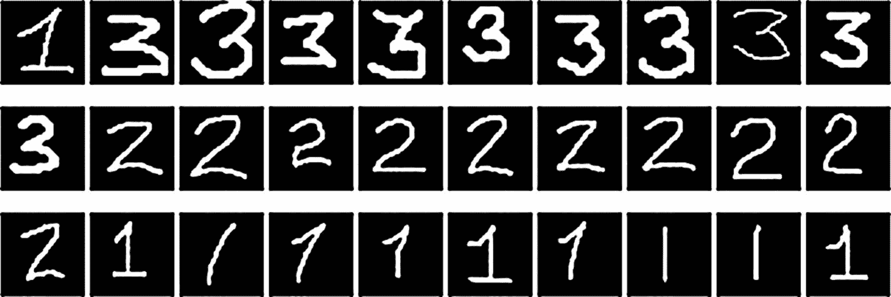
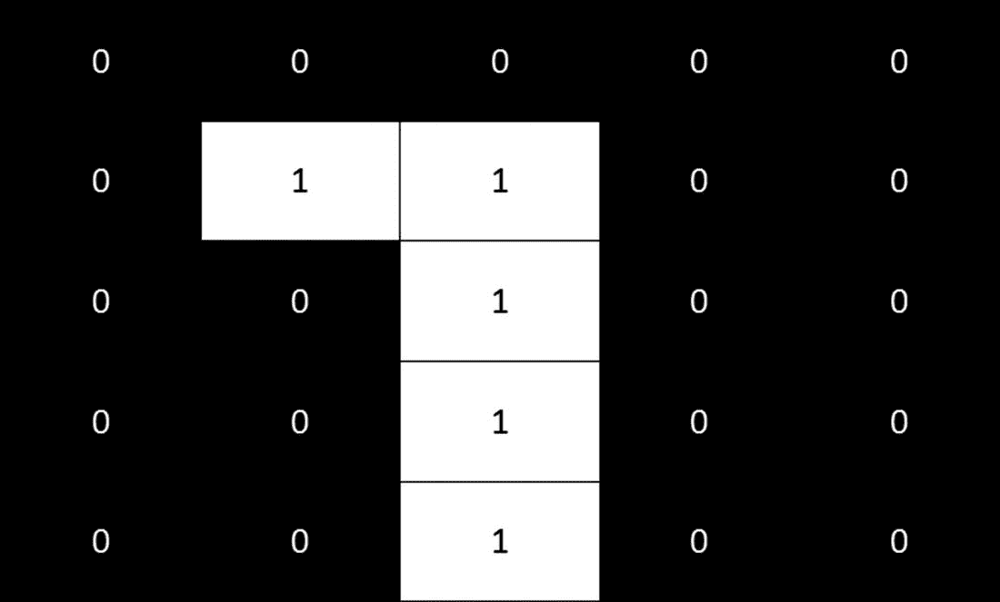
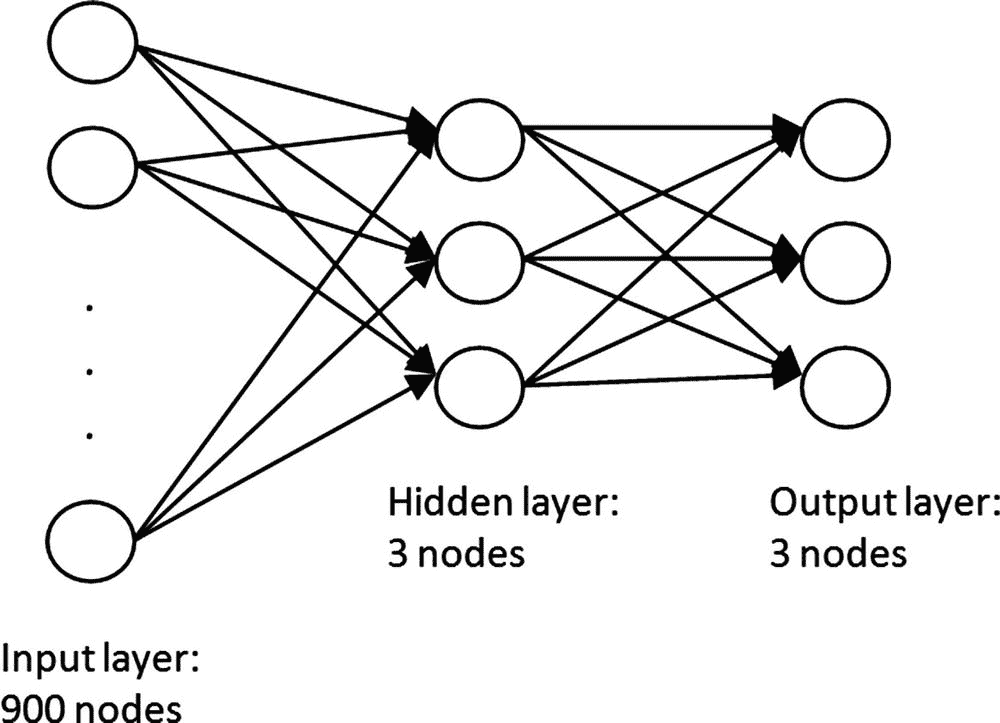
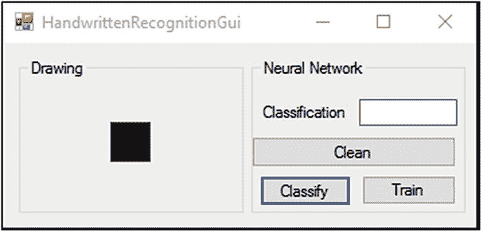
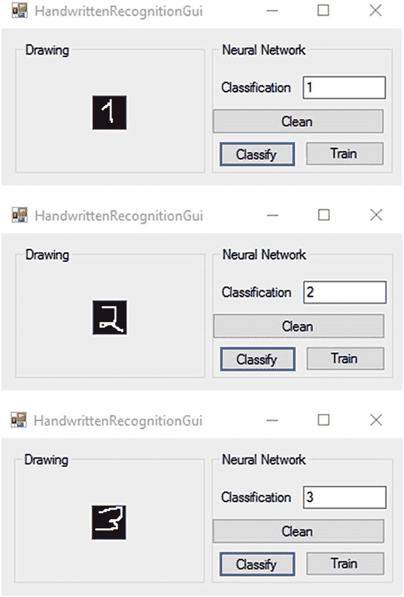
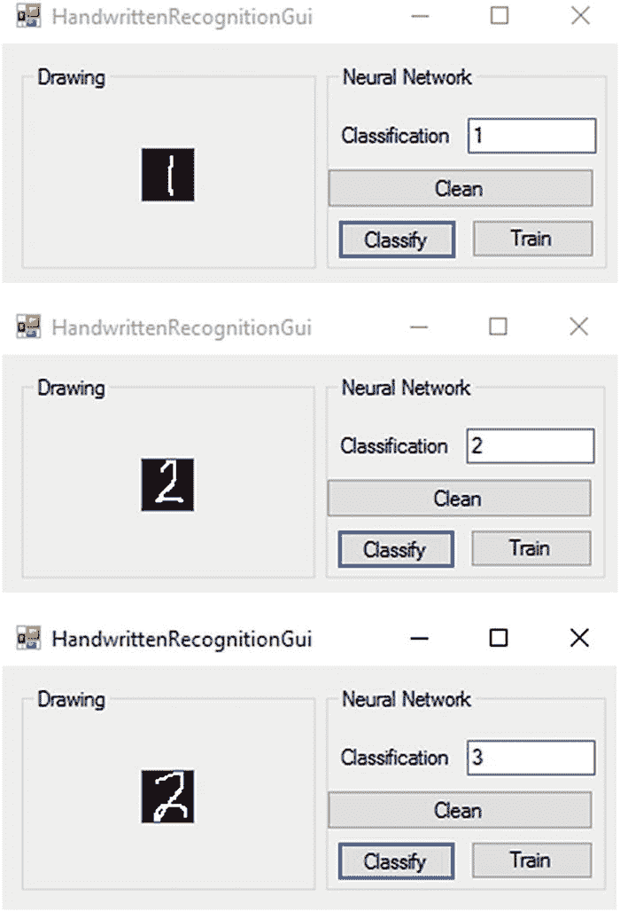

# 12. 手写数字识别

在第 11 章中，我们研究了人工神经网络，这是一种监督学习范式，模拟了我们大脑中神经元的工作方式。神经网络中的学习过程包括通过包含对象特征（待逼近函数的输入）及其对应分类（函数的输出）的训练数据集，以表格形式逼近一个函数。

如前所述，神经网络能够通过调整连接其神经元的权重集，来学习训练数据集中描述的函数。同时，神经元可以排列在不同的层中，每一层的目的是提高神经网络的数学能力。回想一下，神经网络本质上是一个数学函数，而添加层类似于数学中函数复合的运算；换句话说，每一层都可以看作一个函数，而神经网络则视为 F(L1(L2( … (LN(x))))，其中 F 是神经网络，Li 是神经网络中的层。

神经网络可应用于多个科学问题。在这些问题中，值得一提的是人脸识别，这在当今非常流行，并被集成到手机和其他电子设备中；还有模式识别、形状识别、自动驾驶车辆，以及本章将重点讨论的问题——光学字符识别，更具体地说，是光学字符识别的一个子问题——手写数字识别。

为什么在所有可能的问题中选择手写数字识别作为神经网络的示例？首先，手写数字识别与你可能想象的我们在第 11 章中研究的实际问题相差并不远。此外，手写数字识别的训练数据集通常由低分辨率图像组成，任何人都可以轻松复现，并且特征提取过程非常容易完成。正如我们很快将看到的，整个图像将被视为神经网络的输入，并且对于这个问题，图像处理阶段并不复杂，因此不会偏离我们的核心主题——神经网络。

在本章中，我们将实现一个 Windows Forms 应用程序，该应用程序允许我们“手绘”一个数字，并给出该绘制数字的正确分类。例如，如果绘制的数字是 1，则输出应为 1；如果是 2，则输出应为 2，依此类推。在后台，该应用程序将使用第 11 章中介绍的多层神经网络的略微修改版本。

注意

神经网络不仅可以用作监督学习方法，还可以用作无监督学习和强化学习方法，这是机器学习的其他范式。


## 什么是手写数字识别？

近期的数字革命极大地改变了我们对通信和连接等概念的认知。如今，生物识别技术——即基于生理或行为特征来识别或验证个人身份的科学——在身份验证问题中扮演着关键角色。生理特征可能包括指纹、虹膜、手部几何形状或面部图像。行为特征则可以是个人以特定方式进行的动作，可能包括签名识别、机器打印字符识别、手写识别和语音识别。

OCR（光学字符识别）的一些应用包括邮政地址系统、签名验证系统、表格填写应用中的字符识别等。OCR 基本上分为两种类型：离线字符识别和在线字符识别。在第一种情况下，通常接受来自扫描仪的图像作为输入，由于缺乏上下文信息以及文本位置、文本大小、笔画顺序、起点、终点等先验知识，其识别过程往往比后一种情况更困难。在在线字符识别中，系统从硬件设备（如图形输入板、光笔等）的笔开始工作时起就开始接受输入；在输入过程中会获得大量信息，例如当前位置、当前方向、起点、终点和笔画顺序。手写字符识别通常属于这一类，尽管也存在其他类型的应用。

手写是人类使用书面媒介相互交流的方式。随着技术的进步和科学的发展，通过手写与计算机进行通信的技术也发生了许多变化。如今，通常需要一种能够接收并识别手写数据形式输入的计算机程序；这就是所谓的手写识别。

手写数字识别是手写识别的一个子集，其主要目的是识别手写数字；因此，HDR（手写数字识别）中的字符集严格限定为 {0, 1, 2, 3, 4, 5, 6, 7, 8, 9}，任何其他字符都不会被正确识别。

注意

HDR 最流行的数据集之一是 MNIST；它分为两个子集，一个用于训练你的神经网络，另一个用于测试其准确性。可以从 [`http://yann.lecun.com`](http://yann.lecun.com) 下载。

## 训练数据集

为了训练我们的多层神经网络来识别手写数字，我们创建了如图 12-1 所示的训练数据集。



图 12-1

由 30 张 30 x 30 分辨率的图像组成的小型训练数据集

这个自行创建的训练数据集仅包含 30 张图像，其中包含 [1, 3] 范围内的手写数字，每个数字有十张图像。在这个实际问题中，我们不会涉及所有数字的识别；相反，我们将专注于识别数字 1、2 和 3。我们很快就会看到，将本文详述的神经网络扩展以识别所有数字，对于读者未来的工作来说并不会增加任何复杂性。

我们选择将所有图像的分辨率设为 30 x 30，因为这简化了我们神经网络的输入层，并且颜色选择（黑色背景，白色字体）简化了我们的特征提取阶段。

## 用于 HDR 的多层神经网络

我们为解决 HDR 问题而建模的神经网络，与第 11 章中提出的多层神经网络模型不会有太大差异。回想一下，根据通用近似定理，我们知道在多层神经网络中拥有一个隐藏层总是足以学习或逼近任何连续函数。同时，也请记住，深度学习（涉及多个隐藏层的神经网络）并非无的放矢，其目的是在那些仅有一个隐藏层无法提供足够准确或可行结果的问题中，提供更准确、更高效的结果。拥有多个隐藏层可以帮助我们在更短的时间内获得更准确、更高效的解决方案。对于当前的问题，我们将采用一个带有一个隐藏层的多层神经网络。

输入层将图像像素直接映射到该层的节点；因此，如果我们有一张 30 x 30 的图像，我们的输入层将包含 900 个节点，每个像素对应一个节点，如果像素颜色为黑色，则其值为 0，否则为 1（图 12-2）。这并不是我们可以用来提取特征并输入到神经网络的最精确策略，但对于这个简单的例子来说已经足够了。其他特征提取策略会考虑获取像素强度值，并将这些值缩放到 [0, 1] 范围内。



图 12-2

通过将每个黑色像素映射为 0，其他任何像素映射为 1 来进行特征提取

输出层将包含三个节点，分别对应正在考虑识别的三个数字（1、2、3）。所提出的多层神经网络的最终结构如图 12-3 所示。



图 12-3

所提出的多层神经网络的结构

此时，读者可能会想，我们如何根据输出层来决定神经网络正在分析的数据的分类。这一层有三个节点并非巧合；每个节点应该对应我们将要识别的三个数字中的一个。第一个节点匹配（如果被激活则输出）数字 1，第二个节点匹配数字 2，第三个节点输出数字 3。那么，我们如何选择一个节点作为网络的输出，或者对于给定的训练数据，如何选择一个节点被激活？很简单——具有最高激活值的节点将被选为输出节点。

训练数据的正确分类将表示为一个由三个分量组成的向量；其中两个分量的值为 0，一个分量的值为 1。值为 1 的分量表示训练数据的正确分类。例如，向量 (1, 0, 0) 表示训练数据的正确分类是 1，向量 (0, 1, 0) 表示正确分类是 2，而 (0, 0, 1) 表示正在分析的训练数据的正确分类是 3。

最后，必须提到的是，在我们提出的神经网络中，我们不会将权重初始化为 [0, 1] 范围内的随机值；相反，我们会将它们设置为 [-0.5, 0.5] 范围内的随机值。这种改变背后的原因是数值上的，也与性能有关。因为我们的输入层会有很多节点，这些输入值的加权和将导致 sigmoid 激活值非常接近 1，这会削弱我们神经网络的性能，阻止我们收敛到误差的最小化，从而妨碍我们获得一个像样的解决方案。作为一条建议，请记住，在设计神经网络时，即使是权重的初始化也是一个需要考虑的问题，因为它会影响神经网络的整体性能。


## 实现

如前所述，我们将开发一个 Windows Forms 应用程序，它允许我们在图片框上绘制一个数字，然后通过点击“分类”按钮来获取所绘制数字的分类结果。为了使代码更加优雅且富有表现力，我们将使用以下类（清单 12-1），该类直接继承自第 11 章介绍的 `MultiLayerNetwork` 类。

```
public class HandwrittenDigitRecognitionNn : MultiLayerNetwork
{
public HandwrittenDigitRecognitionNn(IEnumerable trainingDataSet, int inputs, int hiddenUnits, int outputs, double learningRate)
:base(trainingDataSet, inputs, hiddenUnits, outputs, learningRate)
{
}
}
清单 12-1
表示用于手写数字识别的神经网络的 HandwrittenDigitRecognitionNn 类
```

该类的实例将被添加到 `HandwrittenRecognitionGui` 类中，后者继承自 `Windows.Forms.Form`，并包含本章详述的大部分代码。该类中声明字段和属性的部分如清单 12-2 所示。

```
public partial class HandwrittenRecognitionGui : Form
{
private bool _mouseIsDown;
private Bitmap _bitmap;
private const int NnInputs = 900;
private const int NnHidden = 3;
private const int NnOutputs = 3;
private HandwrittenDigitRecognitionNn _handwrittenDigitRecogNn;
private bool _weightsLoaded;
public HandwrittenRecognitionGui()
{
InitializeComponent();
_bitmap = new Bitmap(paintBox.Width, paintBox.Height);
}
}
清单 12-2
表示可视化应用程序的 HandwrittenRecognitionGui 类
```

这些字段或属性的描述如下：

*   `_mouseIsDown`：用于鼠标相关事件，判断鼠标按钮（左键单击）是否已被按下。
*   `_bitmap`：位图图像，用于存储用户在图片框上绘制的内容，然后将其提交给神经网络进行分类。
*   `NnInputs`：神经网络输入层的节点数。
*   `NnHidden`：神经网络隐藏层的节点数。
*   `NnOutputs`：神经网络输出层的节点数。
*   `_handwrittenDigitRecogNn`：神经网络类的实例。
*   `_weightsLoaded`：判断权重集是否已加载到应用程序中。一旦我们训练完神经网络，找到的权重集将被保存到文件中以备将来使用；因此，该变量将控制包含这些权重的文件的读取。

`HandRecognitionGui` 类将通过添加不同的方法来完善，这些方法用于处理我们在设计模式下添加到应用程序中的图片框控件中的鼠标相关事件。我们很快就会看到应用程序的外观。这些与鼠标事件相关的方法如清单 12-3 所示。

```
private void PaintBoxMouseDown(object sender, MouseEventArgs e)
{
if (e.Button == MouseButtons.Left)
_mouseIsDown = true;
}
private void PaintBoxMouseMove(object sender, MouseEventArgs e)
{
if (_mouseIsDown)
{
var point = paintBox.PointToClient(Cursor.Position);
DrawPoint((point.X), (point.Y), Color.FromArgb(255, 255, 255, 255));
}
}
private void PaintBoxMouseUp(object sender, MouseEventArgs e)
{
_mouseIsDown = false;
}
public void DrawPoint(int x, int y, Color color)
{
var pen = new Pen(color);
var gPaintBox = paintBox.CreateGraphics();
var gImg = Graphics.FromImage(_bitmap);
gPaintBox.DrawRectangle(pen, x, y, 1, 1);
gImg.DrawRectangle(pen, x, y, 1, 1);
}
清单 12-3
图片框中的鼠标事件方法，我们将在此绘制待分类的数字
```

从清单 12-3 中我们可以看到，我们捕获了三个鼠标事件：`MouseDown`（当用户在控件上按下鼠标按钮时）、`MouseMove`（当用户在控件上移动鼠标时）和 `MouseUp`（当用户停止按下控件上的按钮时）。这三个事件与 `_mouseIsDown` 变量相结合，为我们提供了必要的工具，以构建一个简单直接的机制，用于判断用户何时在控件上绘制，并将该绘制内容同时保存到图片框和辅助位图图像中，我们最终会将此图像提交给神经网络进行分类。一旦用户在图片框控件上绘制了一个数字并点击了“分类”按钮（我们稍后会查看最终的图形用户界面），就会开始一个图像处理阶段，在此阶段我们使用以下方法（清单 12-4）从图像中提取特征。

```
private double [,] GetImage(Bitmap bitmap)
{
var result = new double[bitmap.Width, bitmap.Height];
for (var i = 0; i < bitmap.Width; i++)
{
for (var j = 0; j < bitmap.Height; j++)
{
var pixel = bitmap.GetPixel(i, j);
result[i, j] = pixel.R + pixel.G + pixel.B == 0 ? 0 : 1;
}
}
return result;
}
清单 12-4
提取特征
```

在 `GetImage()` 方法中，我们构建了一个二进制值矩阵；结果矩阵中给定 (i, j) 坐标处的值为 0 表示图片框关联图像中的像素为黑色，而值为 1 则表示任何其他颜色。

在我们的可视化应用程序中，我们将包含一个“训练”按钮，其点击事件的方法如清单 12-5 所示。在此方法中，我们加载构成训练数据集的 30 x 30 图像集；处理每张图像并创建一个等效的 `TrainingSample` 对象。然后，我们启动训练过程，并将得到的权重集保存到 `weights.txt` 文件中。

```
private void TrainBtnClick(object sender, EventArgs e)
{
var trainingDataSet = new List();
var trainingDataSetFiles = Directory.GetFiles(Directory.GetCurrentDirectory() + "\\Digits");
foreach(var file in trainingDataSetFiles)
{
var name = file.Remove(file.LastIndexOf(".")).Substring(file.LastIndexOf("\\") + 1);
var @class = int.Parse(name.Substring(0, 1));
var classVec = new[] {0.0, 0.0, 0.0};
classVec[@class - 1] = 1;
var imgMatrix = GetImage(new Bitmap(file));
var imgVector = imgMatrix.Cast().Select(c => c).ToArray();
trainingDataSet.Add(new TrainingSample(imgVector, @class, classVec));
}
_handwrittenDigitRecogNn = new HandwrittenDigitRecognitionNn(trainingDataSet, NnInputs, NnHidden, NnOutputs, 0.002);
_handwrittenDigitRecogNn.Training();
var fileWeights = new StreamWriter("weights.txt", false);
foreach (var layer in _handwrittenDigitRecogNn.Layers)
{
foreach (var unit in layer.Units)
{
foreach (var w in unit.Weights)
fileWeights.WriteLine(w);
fileWeights.WriteLine("*");
}
fileWeights.WriteLine("-");
}
fileWeights.Close();
MessageBox.Show("Training Complete!", "Message");
}
清单 12-5
加载训练数据集，训练神经网络，并保存得到的权重
```

为了对图片框上绘制的数字进行分类，我们添加了“分类”按钮。点击事件触发的方法如清单 12-6 所示。在此方法中，我们检查 `weights.txt` 文件是否存在，如果文件存在则加载权重集，否则输出警告消息。如果权重尚未加载，则运行 `ReadWeights()` 方法，最终执行神经网络的 `Predict()` 方法，并将分类结果保存到 `classBox` 文本框中。


```
private void ClassifyBtnClick(object sender, EventArgs e)
{
if (Directory.GetFiles(Directory.GetCurrentDirectory()).Any(file => file == Directory.GetCurrentDirectory() + "weights.txt")) {
MessageBox.Show("Warning", "No weights file, you need to train your NN first");
return;
}
if (!_weightsLoaded)
{
ReadWeights();
_weightsLoaded = true;
}
var digitMatrix = GetImage(_bitmap);
var prediction = _handwrittenDigitRecogNn.Predict(digitMatrix.Cast().Select(c => c).ToArray());
classBox.Text = (prediction + 1).ToString();
}
代码清单 12-6
点击“分类”按钮后执行的方法
```

`ReadWeights()` 方法充当一个辅助性的微型解析器，负责读取权重文件并将权重分配给神经网络中的每个节点（代码清单 12-7）。权重在文件中每行存储一个，不同单元的权重之间用包含“*”符号的行分隔，该符号标记了当前单元权重分配的结束和下一个单元权重分配的开始。同样的情况也适用于“-”符号，但这是在层级层面。

```
private void ReadWeights()
{
_handwrittenDigitRecogNn = new HandwrittenDigitRecognitionNn(new List(), NnInputs, NnHidden, NnOutputs, 0.002);
var weightsFile = new StreamReader("weights.txt");
var currentLayer = _handwrittenDigitRecogNn.HiddenLayer;
var weights = new List();
var j = 0;
while (!weightsFile.EndOfStream)
{
var currentLine = weightsFile.ReadLine();
// 当前单元的权重结束。
if (currentLine == "*")
{
currentLayer.Units[j].Weights = new List(weights);
j++;
weights.Clear();
continue;
}
// 当前层结束。
if (currentLine == "-")
{
currentLayer = _handwrittenDigitRecogNn.OutPutLayer;
j = 0;
weights.Clear();
continue;
}
weights.Add(double.Parse(currentLine));
}
weightsFile.Close();
}
代码清单 12-7
ReadWeights() 方法
```

最后，让我们运行并查看我们的手写数字识别可视化应用程序（图 12-4）。



图 12-4

手写数字识别可视化应用程序

现在我们已经完全开发了这个应用程序，让我们看看在向神经网络输入数字 1、2 和 3 的不同手写样本后，它的表现如何。

## 测试

回到图 12-4，我们可以看到应用程序中的绘图区域是一个黑色背景的图片框控件；正是在这个图片框中，我们将绘制不同的数字，最终通过点击“分类”按钮获得分类结果。让我们检查一些测试（图 12-5）。



图 12-5

手写数字的分类

正如我们在这个应用程序中可以对许多手写数字获得正确分类一样，也可能对其他一些数字得到错误分类。正如读者此时可能预料到的，这种不准确性的原因是训练神经网络时使用的训练数据集非常小。要获得更高的准确率，我们需要更多不同书写风格的样本。

## 总结

在本章中，我们介绍了手写数字识别的问题，并开发了一个 Windows 窗体应用程序，允许用户在其中绘制数字，并最终获得对所绘数字的分类。我们只考虑了数字集合 {1, 2, 3}，但该应用程序可以轻松扩展以包含所有可能的数字，只需向输出层添加新节点即可。我们测试了结果，如前所述，由于训练样本数量较少，应用程序可能会错误分类一些输入数据。因此，建议添加新的训练数据。本章介绍的可视化应用程序是神经网络强大能力与潜力的真实体现。

