# 13. 聚类与多目标聚类

到目前为止，我们已经讨论了与监督学习相关的几种方法。在这些方法中，我们通过包含标记数据的训练数据集来逼近一个函数。在本章中，我们将开始探讨无监督学习，这是机器学习的一种范式，我们从未标记的数据集中推断函数和数据结构。

无监督学习方法不再拥有“训练”数据集。因此，无监督学习中的训练阶段消失了，因为数据没有关联的分类；正确的分类被认为是未知的。因此，无监督学习比监督学习主观得多，因为分析没有简单的目标，比如预测响应。无监督学习方法的一般目标，尽管听起来可能不精确，是找到描述被分析数据结构的模式。由于从实验室仪器或任何测量设备获取未标记数据通常比获取标记数据更容易，无监督学习方法正越来越多地应用于需要学习数据结构的多种问题。

在本章中，我们将探讨与无监督学习相关的最重要的学习任务之一——聚类，以及它的一个变体，即同时考虑多个要最小化或最大化的目标函数，这被称为多目标聚类。本章将描述并实现一个广泛聚类算法家族中的方法；具体来说，我们将实现 k-means 方法。此外，还将实现一些用于确定对象和聚类相似度的度量方法。

注意：监督学习和无监督学习算法都代表了数据挖掘应用中常用的知识提取技术。

## 什么是聚类？

聚类是一大类算法的统称，其目标是将一组对象划分成多个组或簇，力求使同一组内的对象具有尽可能高的相似性，而不同组之间的对象具有尽可能高的差异性。此处的相似性与对象的某种属性相关；它可以是高度、重量、颜色、勇气，或数据集中包含的任何其他特征，通常以数值形式呈现。图 13-1 展示了基于对象颜色的聚类。

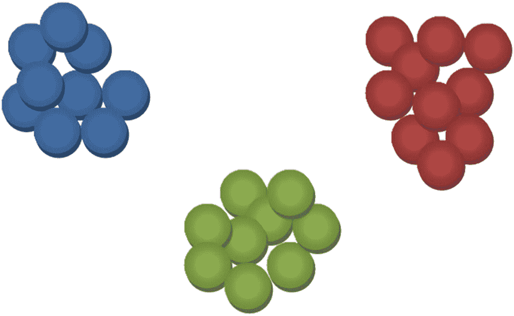

图 13-1 根据颜色对一组对象进行聚类

聚类在科学和商业的多个领域都有应用，例如天文学、心理学、医学、经济学、欺诈防范、建筑学、人口统计分析、图像分割等。

一个聚类算法通常由三个要素组成：

*   **相似性度量**：用于确定两个对象之间相似度的函数。在图 13-1 的例子中，一个相似度函数可以是 `Color(x, y)`，它输出一个整数，用于判断对象 x 和 y 在颜色上的等同程度。通常，输出的值越大，表示 x 和 y 之间的差异越大；输出的值越小，表示 x 和 y 越相似。
*   **准则函数或目标函数**：用于评估聚类质量的函数。
*   **优化算法或聚类算法**：用于最小化或最大化准则函数的算法。

以下是一些最常用的相似性度量：

*   n 维向量 a, b 的**欧几里得距离**：
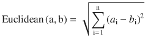
这是空间中两点之间的普通距离。

*   n 维向量 a, b 的**曼哈顿距离**：
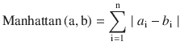
这是欧几里得距离的一种近似，计算成本更低。

*   属于 n x m 矩阵 T 的单元格的**闵可夫斯基距离**；p 是一个正整数，是前述距离的泛化形式：
![ $$ {\mathrm{Minkowski}}_{\mathrm{p}}\left({T}_{\mathrm{k}},{T}_{\mathrm{h}}\right)=\sqrt[\mathrm{p}]{\sum \limits_{\mathrm{i}=1}^{\mathrm{m}}{\left({T}_{\mathrm{k}\mathrm{i}}-{T}_{\mathrm{h}\mathrm{i}}\right)}²} $$ ](A449374_1_En_13_Chapter_Equc.gif)

在用于确定或评估聚类质量的准则函数或目标函数中，我们可以找到以下两种：

*   **类内距离**，也称为**紧致性**：顾名思义，其前缀“intra”（内部的，在内的）表示它衡量的是簇（组）内数据点与簇质心之间的距离。簇质心是簇内所有数据点的平均向量。通常使用**误差平方和**作为衡量该距离的数学函数。
*   **类间距离**，也称为**隔离度或分离度**：顾名思义，其前缀“inter”（之间的）表示它衡量的是不同簇之间的远近程度。

聚类算法家族可以分为层次聚类算法、划分聚类算法和贝叶斯聚类算法。图 13-2 展示了不同聚类算法家族之间的关系。

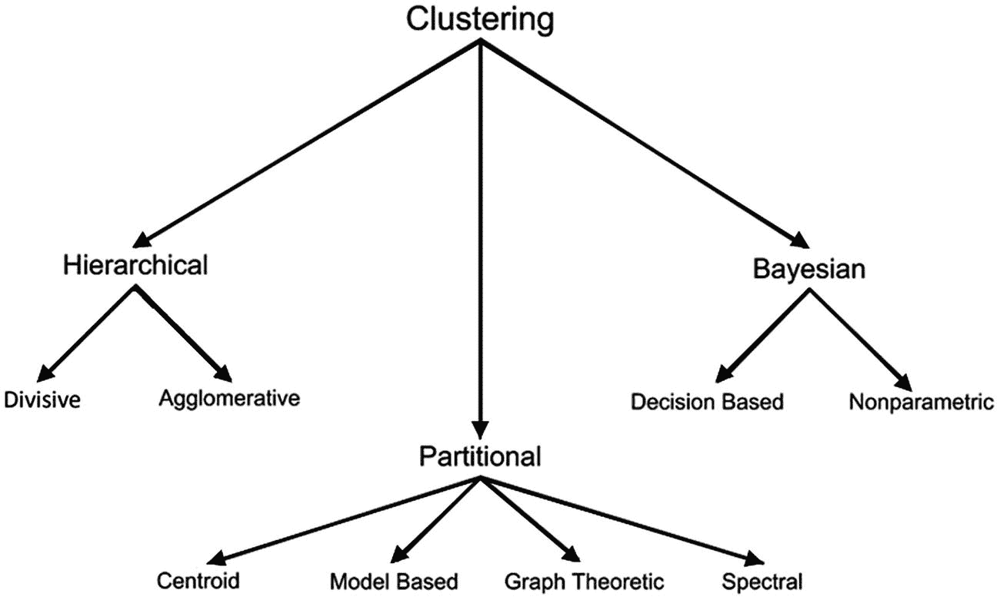

图 13-2 聚类算法家族

在本书中，我们将讨论层次聚类算法和划分聚类算法；贝叶斯聚类算法试图在数据点所有可能划分的集合上生成后验分布。这类算法与概率论和统计学等领域高度相关，因此留给读者作为补充研究。

注意：聚类是一个众所周知的 NP 难问题，这意味着在确定性机器上无法开发或设计出该问题的多项式时间解法。

## 层次聚类

层次算法会从先前发现的簇中发掘新的簇；因此，新簇在嵌套于父簇之后便成为其子代，层次关系由此建立。层次算法可分为凝聚式与分裂式两种。

### 凝聚式层次算法

凝聚式（又称自底向上）层次算法开始时，每个对象都是一个独立的单元素簇，随后不断合并最相似的簇，形成规模递增的簇，直至所有对象归入一个簇为止。

### 分裂式层次算法

分裂式（又称自顶向下）层次算法开始时，所有对象同属一个簇，每一步从当前簇集合中选择一个组进行分裂，当每个对象都成为独立簇时停止。

层次算法可以输出树状图——一种用于说明簇排列方式的二叉树状图。在树状图中，每一层代表一种不同的聚类结果。图 13-3 展示了一个对由点 a、b、c、d、e 构成的数据集执行凝聚式聚类的示例，包括最终生成的簇以及对应的树状图。

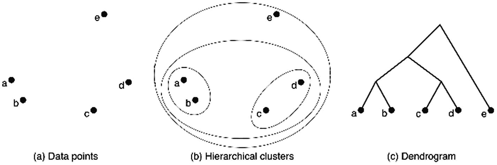

图 13-3 凝聚式聚类示例

由于点 a 与 b、c 与 d 分别距离最近，它们被聚为一簇。随后，距离最近的簇 `{a, b}` 与 `{c, d}` 被合并，`{e}` 则作为另一个簇保留。最后，所有数据点被合并为一个包含全部数据点的簇；在此过程中，我们执行的是自底向上的操作。如何确定簇的相似度或距离？前面详述的度量或距离给出了两个数据点之间的相似度，但簇之间的相似度又如何衡量？下面介绍的度量方法可输出簇之间的相似度：

*   **平均连接聚类**：通过计算所有配对 (x, y) 的相似度或距离来确定簇 `C1` 与 `C2` 的相似度，其中 x 属于 `C1`，y 属于 `C2`。将这些值相加，最终除以 `C1` 和 `C2` 中对象的总数。因此，我们计算的是 `C1` 与 `C2` 之间距离的平均值。
*   **质心连接聚类**：通过计算配对 (x, y) 的相似度或距离来确定簇 `C1` 与 `C2` 的相似度，其中 x 是 `C1` 的质心，y 是 `C2` 的质心。
*   **全连接聚类**：通过输出所有配对 (x, y) 中的最大相似度或距离来确定簇 `C1` 与 `C2` 的相似度，其中 x 是 `C1` 中的对象，y 是 `C2` 中的对象。
*   **单连接聚类**：通过输出所有配对 (x, y) 中的最小相似度或距离来确定簇 `C1` 与 `C2` 的相似度，其中 x 是 `C1` 中的对象，y 是 `C2` 中的对象。

凝聚式层次聚类的伪代码展示了实现此类算法在原理上有多么简单：

```
AgglomerativeClustering(dataPoints)
{
    将 dataPoints 中的每个数据点初始化为一个独立簇
    while (簇数量 > 1)
        根据簇相似度度量找到最近的两个簇 C1、C2
        合并(C1, C2)
    end
}
```

凝聚式算法比分裂式算法效率更高，但后者通常能提供更精确的解。请注意，分裂式算法从整个数据集开始操作；因此，它能在原始数据集中找到最佳的二簇划分，并在此基础上在每个簇内找到最佳的可能划分。而凝聚式方法在合并时并不考虑数据的全局结构，因此仅限于分析成对结构。

注意：19 世纪 50 年代霍乱流行期间，伦敦医生约翰·斯诺运用聚类技术在地图上标出霍乱死亡病例的位置。聚类结果表明，死亡病例集中在受污染的水井附近。

## 划分式聚类

划分式算法将 n 个对象组成的集合划分为 k 个簇或类别。在这种情况下，k（簇或类别的数量）可以预先固定，也可以在优化目标函数时由算法自行确定。划分式聚类算法家族中最著名的代表是 k-means 算法（[MacQueen, 1967](https://home.deib.polimi.it/matteucc/Clustering/tutorial_html/kmeans.html#macqueen)）。

# K-Means 算法详解

K-means 是最简单的无监督学习方法之一，用于对一组对象进行聚类。它遵循一个简单的过程，将给定的数据集划分为 `k` 个簇，其中 `k` 是预先固定的数字。在其初始化阶段，它会定义 `k` 个质心，每个簇一个。定义质心有不同的方法。我们可以从数据集中选择 `k` 个随机对象作为质心（朴素方法），或者通过选择彼此尽可能远离的质心，以更复杂的方式选择它们。所做的选择可能会影响后续的性能，因为初始质心会影响最终结果。

## 算法过程

k-means 算法的主体由一个外层循环构成，该循环检查是否达到停止条件；这个外层循环包含一个内层循环，该循环遍历所有数据点。在这个内层循环中——在检查数据点 `P` 时——我们通过比较 `P` 到每个簇质心的距离来决定 `P` 应该被添加到哪个簇，最终将其添加到关联质心最近的簇中。

一旦所有数据点被首次检查完毕——换句话说，内层循环首次结束——算法的第一阶段就完成了，并获得了初步的聚类结果。此时，我们需要优化我们的聚类；因此，我们重新计算上一步得到的 `k` 个质心（回想一下，质心是其各自簇的平均向量），这将为我们提供新的质心。如果停止条件尚未满足，则再次执行内层循环，将每个数据点添加到关联新质心最近的簇中。这就是 k-means 的主要过程；请注意，`k` 个质心会逐步改变它们的位置，直到不再发生变化。换句话说，算法的一个停止条件是质心集合在两次迭代之间不再改变。

k-means 的伪代码如下所示：

```python
K-Means(dataPoints, k)
{
cList = InitializeKCentroids()
clusters = CreateClusters()
while (!stoppingCondition)
{
foreach (pj in dataPoints)
{
dj = Calculate distance from pj to every centroid cList_j
Assign pj to clusters_jwhose dj is minimum
}
UpdateCentroids()
}
}
```

## 目标函数与停止条件

被优化的目标函数（在此情况下为最小化）是误差平方和（SSE），也称为类内距离或紧致度：

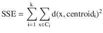

其中 `k` 是簇的数量，`C[i]` 是第 `i` 个簇，`centroid[i]` 表示与第 `i` 个簇关联的质心，`d(a, b)` 是 `x` 与 `centroid[i]` 之间的距离或相似性度量（通常是欧几里得距离）。因此，k-means 的另一个可能的停止条件是 SSE 达到一个非常小的值。

## 算法示意图

在图 13-4 中，我们可以看到 k-means 算法的第一步——选择 `k` 个质心。在此图中，蓝点表示数据点，黑点表示质心。

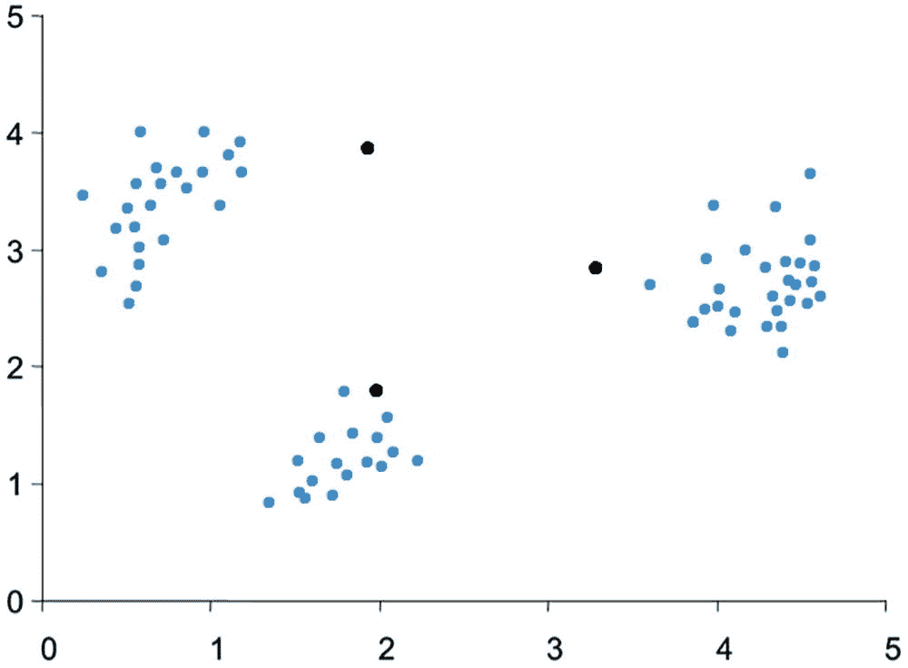

图 13-4：k-means 的第一步，选择 `k = 3` 个随机对象或数据点作为质心

图 13-5 显示了从第一步中选择质心集合后得到的 `k = 3` 个簇。

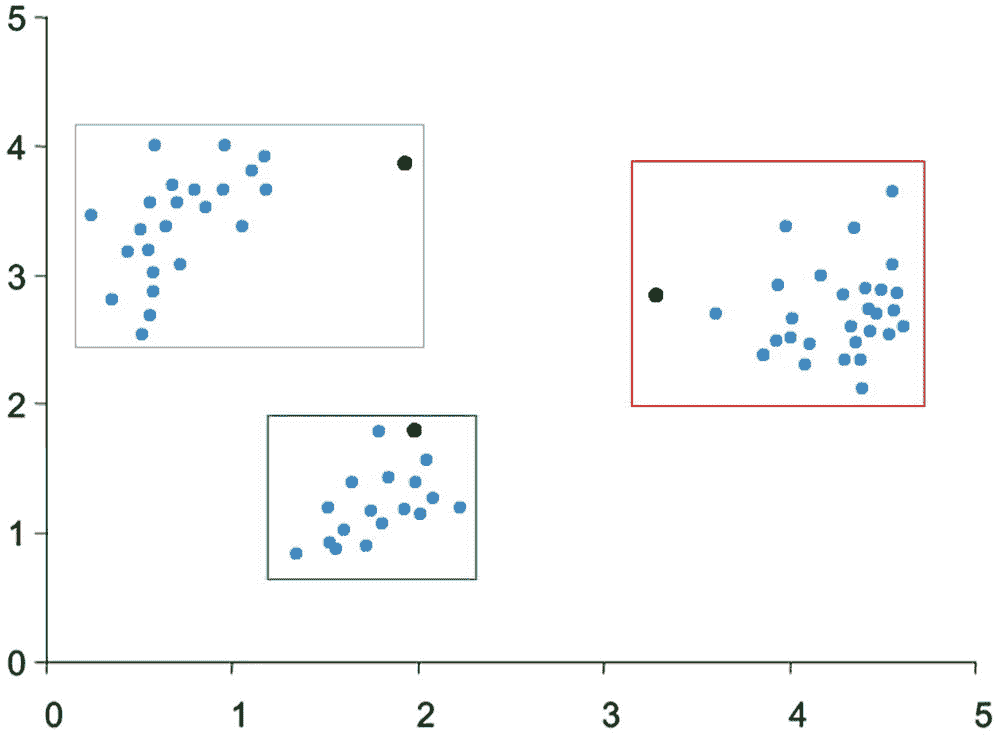

图 13-5：在第一步中选择质心集合后，并考虑使用距离度量来确定数据点之间的相似性，从而得到的聚类结果

循环的最后一步是重新计算簇或质心的中心；此过程如图 13-6 所示。

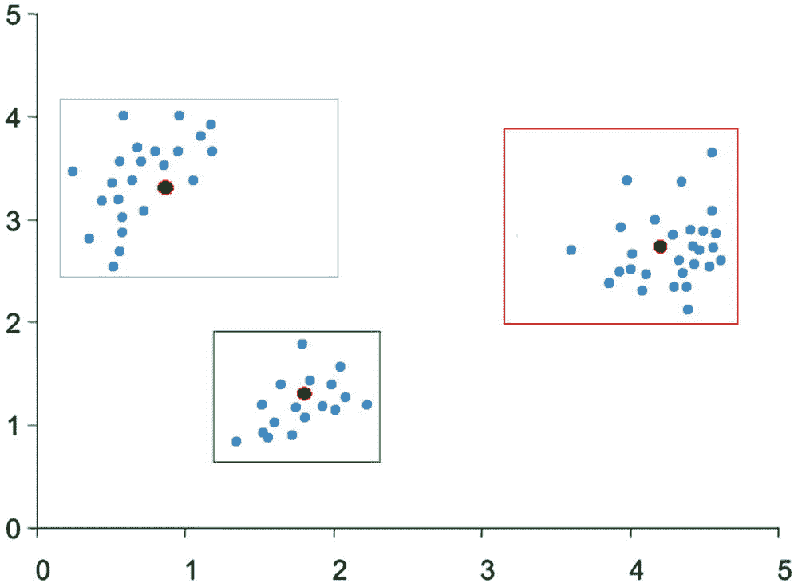

图 13-6：质心被重新计算为其所代表簇的平均向量

前面图中所示的步骤会重复执行，直到满足停止条件。总而言之，k-means 是一种简单、高效的算法，如果使用非常小的 SSE 值作为停止条件，它可能会收敛到局部最小值。它的主要缺点是对异常值（孤立数据点）高度敏感，这可以通过移除那些与其他数据点相比距离质心集合更远的数据点来缓解。

## 实践问题：K-Means 算法

在本节中，我们将实现一种可能是有史以来最流行的聚类算法：k-means。为了在实现中采用面向对象的方法，我们将创建 `Cluster` 和 `Element` 类，它们将包含与簇和对象（数据点）相关的所有操作和属性；`Cluster` 类如代码清单 13-1 所示。

```csharp
public class Cluster
{
    public List<Element> Objects { get; set; }
    public Element Centroid { get; set; }
    public int ClusterNo { get; set; }

    public Cluster()
    {
        Objects = new List<Element>();
        Centroid = new Element();
    }

    public Cluster(IEnumerable<double> centroid, int clusterNo)
    {
        Objects = new List<Element>();
        Centroid = new Element(centroid);
        ClusterNo = clusterNo;
    }

    public void Add(Element e)
    {
        Objects.Add(e);
        e.Cluster = ClusterNo;
    }

    public void Remove(Element e)
    {
        Objects.Remove(e);
    }

    public void CalculateCentroid()
    {
        var result = new List<double>();
        var toAvg = new List<Element>(Objects);
        var total = Total;
        if (Objects.Count == 0)
        {
            toAvg.Add(Centroid);
            total = 1;
        }
        var dimension = toAvg.First().Features.Count;
        for (var i = 0; i < dimension; i++)
        {
            result.Add(toAvg.Average(e => e.Features[i]));
        }
        Centroid.Features = new List<double>(result);
    }

    public double AverageLinkageClustering(Cluster c)
    {
        var result = 0.0;
        foreach (var c1 in c.Objects)
        {
            result += Objects.Sum(c2 => Distance.Euclidean(c1.Features, c2.Features));
        }
        return result / (Total + c.Total);
    }

    public int Total
    {
        get { return Objects.Count; }
    }
}
```
代码清单 13-1：`Cluster` 类

`Cluster` 类包含以下属性：
*   `Objects`：簇中包含的对象集合
*   `Centroid`：簇的质心
*   `ClusterNo`：簇的 ID，用于与其他簇区分
*   `Total`：组或簇中的元素数量

该类还包含以下方法：
*   `Add()`：向簇中添加一个元素
*   `Remove()`：从簇中移除一个元素
*   `CalculateCentroid()`：计算簇的质心
*   `AverageLinkageClustering()`：计算簇之间的 `AverageLinkageClustering` 相似度度量，如前所述

表示待聚类对象的 `Element` 类如代码清单 13-2 所示。

```csharp
public class Element
{
    public List<double> Features { get; set; }
    public int Cluster { get; set; }

    public Element(int cluster = -1)
    {
        Features = new List<double>();
        Cluster = cluster;
    }

    public Element(IEnumerable<double> features)
    {
        Features = new List<double>(features);
        Cluster = -1;
    }
}
```
代码清单 13-2：`Element` 类

该类包含一个 `Cluster` 属性，用于指示对象所属簇的 `clusterID`；两个构造函数的代码不言自明。代表同名算法的 `KMeans` 类如代码清单 13-3 所示。

### KMeans 和 DataSet 类实现

```csharp
public class KMeans
{
    public int K { get; set; }
    public DataSet DataSet { get; set; }
    public List<Cluster> Clusters { get; set; }
    private static Random _random;
    private const int MaxIterations = 100;

    public KMeans(int k, DataSet dataSet)
    {
        K = k;
        DataSet = dataSet;
        Clusters = new List<Cluster>();
        _random = new Random();
    }

    public void Start()
    {
        InitializeCentroids();
        var i = 0;
        while (i < MaxIterations)
        {
            foreach (var obj in DataSet.Objects)
            {
                var oldCluster = obj.Cluster;
                var cluster = MinDistCentroid(obj);
                if (oldCluster != null)
                    Clusters[oldCluster].Remove(obj);
                Clusters[cluster].Add(obj);
            }
            UpdateCentroids();
            i++;
        }
    }

    private void InitializeCentroids()
    {
        RandomCentroids();
    }

    private void RandomCentroids()
    {
        var indices = Enumerable.Range(0, DataSet.Objects.Count).ToList();
        Clusters.Clear();
        for (var i = 0; i < K; i++)
        {
            var index = indices[_random.Next(indices.Count)];
            indices.Remove(index);
            Clusters.Add(new Cluster(i));
            Clusters[i].Add(DataSet.Objects[index]);
        }
    }

    private int MinDistCentroid(DataSetObject obj)
    {
        var minDist = double.MaxValue;
        var minCluster = 0;
        for (var i = 0; i < Clusters.Count; i++)
        {
            var d = Distance(obj, Clusters[i].Centroid);
            if (d < minDist)
            {
                minDist = d;
                minCluster = i;
            }
        }
        return minCluster;
    }

    private double Distance(DataSetObject obj, double[] centroid)
    {
        var d = 0.0;
        for (var i = 0; i < obj.Features.Length; i++)
            d += Math.Pow(obj.Features[i] - centroid[i], 2);
        return Math.Sqrt(d);
    }

    private void UpdateCentroids()
    {
        foreach (var cluster in Clusters)
            cluster.CalculateCentroid();
    }
}

public class DataSet
{
    public List<DataSetObject> Objects { get; set; }

    public DataSet()
    {
        Objects = new List<DataSetObject>();
    }

    public void Load(List<DataSetObject> objects)
    {
        Objects = new List<DataSetObject>(objects);
    }
}
```

这些属性或字段不言自明；在本例中，我们决定使用最大迭代次数作为停止条件。该类的方法描述如下：

-   `InitializeCentroids()`：创建此方法时考虑了采用不同质心初始化过程的可能性。
-   `RandomCentroids()`：质心初始化过程，我们将 k 个随机选择的对象指定为 k 个簇的质心。
-   `MinDistCentroid()`：返回输入对象距离最近的簇的`clusterID`，即距离最小的簇。
-   `UpdateCentroids()`：通过调用`Cluster`类的`CalculateCentroid()`方法来更新 k 个质心。

现在所有组件都已就绪，让我们通过创建一个测试应用程序来测试我们的聚类算法，并在其中创建一个数据集；代码清单 13-4 展示了这段代码。

```csharp
var elements = new List<UnsupervisedLearning.Clustering.Element>
{
    new UnsupervisedLearning.Clustering.Element(new double[] {1, 2}),
    new UnsupervisedLearning.Clustering.Element(new double[] {1, 3}),
    new UnsupervisedLearning.Clustering.Element(new double[] {3, 3}),
    new UnsupervisedLearning.Clustering.Element(new double[] {3, 4}),
    new UnsupervisedLearning.Clustering.Element(new double[] {6, 6}),
    new UnsupervisedLearning.Clustering.Element(new double[] {6, 7})
};

var dataSet = new DataSet();
dataSet.Load(elements);
var kMeans = new KMeans(3, dataSet);
kMeans.Start();

foreach (var cluster in kMeans.Clusters)
{
    Console.WriteLine("Cluster No {0}", cluster.ClusterNo);
    foreach (var obj in cluster.Objects)
        Console.WriteLine("({0}, {1}) in {2}", obj.Features[0], obj.Features[1], obj.Cluster);
    Console.WriteLine("--------------");
}
```

执行代码清单 13-4 中代码后得到的结果如图 13-7 所示。请注意，在这种情况下，我们得到了三个容易区分的组，如图所示。

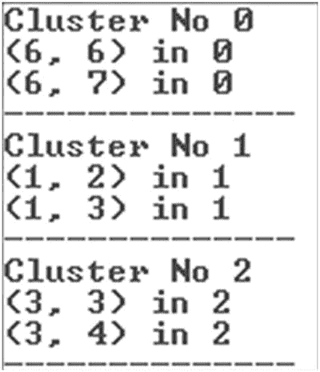

图 13-7 `k = 3` 时 k-means 算法的执行结果

到目前为止，我们研究了单目标聚类算法，即优化单个目标函数的算法。在 k-means 的情况下，这个目标函数是误差平方和，也称为类内距离（最小化组内对象之间的距离）。我们可能尝试优化的另一个函数是类间函数（最大化不同组对象之间的距离）。在下一节中，我们将开始研究多目标聚类，其中我们不仅考虑优化单个函数，而是考虑多个函数，并尝试同时优化它们。

## 多目标聚类

如今，许多现实问题迫使我们不仅要考虑给定函数的最佳可能值，还要考虑与当前问题相关的多个函数的值。例如，属于城市研究领域的区划技术，首次出现于 19 世纪，旨在将住宅区与工业区分隔开来。这种城市化中最流行的技术，其主要思想是根据多个变量或标准，划分出同质区域。这些变量可能是人口统计方面的——例如，20 岁以上的人口数量、10 岁以下的人口数量，等等。找到这样的划分显然是一个涉及优化不同函数的聚类问题。因此，我们可能试图找到一个具有最低类内距离（也称为紧致性）的聚类，同时优化类间距离或任何其他函数，这些函数很可能本质上是人口统计相关的。一个完美的聚类是同时具有最小类内距离和最大类间距离的聚类；因此，可以说聚类本质上是一个多目标优化问题。本节我们将首先探讨与多目标聚类相关的几个重要概念或定义。

许多优化问题通常涉及同时优化多个目标函数；这类问题被称为多目标优化问题（MOPs）。它们可以表述如下：

$$
\operatorname{minimize} \ \mathrm{F}(\mathrm{x}) = (\mathrm{f}_1(\mathrm{x}), \mathrm{f}_2(\mathrm{x}), \dots, \mathrm{f}_{\mathrm{n}}(\mathrm{x})) \quad \mathrm{x} \in \mathrm{A}
$$

在这种情况下，`A` 代表问题的可行空间——即所有可行解的集合，这些解满足问题的所有约束条件。

如果一个向量 $\mathrm{u} = (\mathrm{u}_1, \mathrm{u}_2, \dots \mathrm{u}_{\mathrm{n}})$ 被另一个向量 $\mathrm{v} = (\mathrm{v}_1, \mathrm{v}_2, \dots \mathrm{v}_{\mathrm{n}})$ 所支配，记作 $\mathrm{u} \prec \mathrm{v}$，当且仅当对于所有索引 $i$，我们都能验证 $\mathrm{u}_{\mathrm{i}} \le \mathrm{v}_{\mathrm{i}}$。在任何其他情况下，$\mathrm{u}$ 被称为非支配向量。请注意，“支配”关系取决于我们是要最小化还是最大化目标函数；请记住，我们总是可以将最小化问题转化为最大化问题，反之亦然。

拥有多个目标意味着一个显著的问题——一个目标函数的改进可能导致另一个目标函数的恶化。因此，几乎不存在能优化所有目标的解；我们寻找的是一种权衡方案，而非那种解。帕累托最优解就代表了这种权衡。

# 帕累托最优与帕累托前沿

一个可行解 `x` 被称为帕累托最优，如果不存在解 `y` 使得 `F(x) < F(y)`。换句话说，不存在解向量 `y`，其评估向量 (`f1`, `f2`, … `fn`) 能够支配 `x` 的评估向量 (`f1`, `f2`, … `fn`)。所有帕累托最优解的集合称为帕累托集，其像称为帕累托前沿。大多数多目标优化问题算法的目标是为给定问题构建一个帕累托前沿；这类方法通常是启发式或元启发式算法（我们将在下一章中探讨它们）。

> **注意**
>
> 帕累托最优性是一个以维尔弗雷多·帕累托（1848–1923）命名的概念，他是一位意大利工程师和经济学家。该概念已被应用于经济学、工程学和生命科学等学术领域。

## 帕累托前沿构建器

通过查阅科学文献，我们可以找到多种发现帕累托前沿的方法。在本书中，我们将介绍作者独创的一种方法，名为帕累托前沿构建器。它适用于双目标优化——即你需要优化两个函数的情况。这种二元情况非常适合聚类问题，因为存在两个函数（类内和类间）可以为我们提供最优解。

对于二元情况，两个函数与帕累托前沿之间的关系可以如图 13-8 所示。

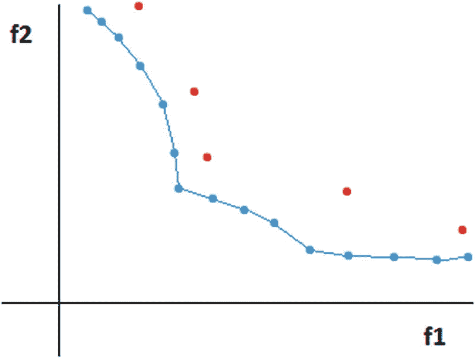
**图 13-8**

蓝色点构成帕累托前沿，红色点被蓝色点支配；因此，它们不被视为帕累托前沿的一部分。这是一个最小化问题。

前沿构建器方法的策略分为不同阶段。其主要思想是按区域构建帕累托前沿，如图 13-9 所示。

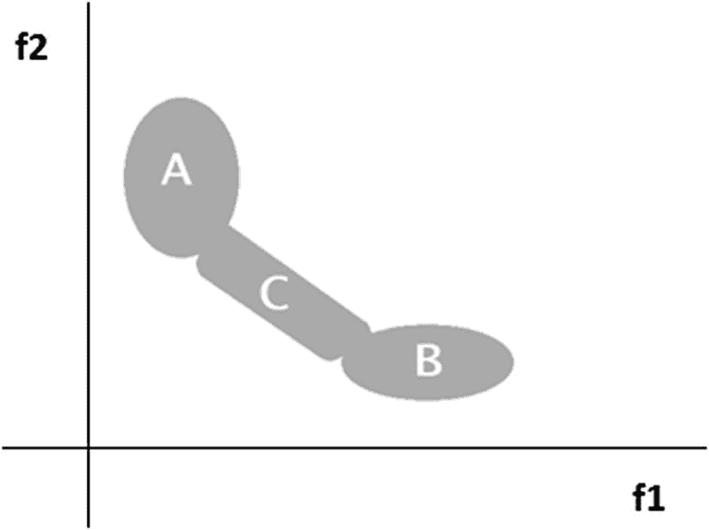
**图 13-9**

区域 A 由最小化目标函数 `f2` 后得到的点构成；区域 B 由最小化目标函数 `f1` 后得到；区域 C 则通过连接区域 A 和 B 的链接机制形成。

*   **区域 A**：该区域的点将通过最小化第二个目标函数 (`f2`) 获得；此优化产生的点将最接近 `y` 轴。
*   **区域 B**：该区域的点将通过最小化第一个目标函数 (`f1`) 获得；此优化产生的点将最接近 `x` 轴。
*   **区域 C**：旨在充当链接机制，连接区域 A 和 B，并将帕累托前沿整合在一起。一个称为帕累托前沿链接的过程将找到区域 A 和 B 之间的桥梁。

按这些步骤来看，这个策略显得非常简单。我们将 `f2` 的优化与 `f1` 的优化分开，构建区域 A 和 B，然后通过在区域 C 中寻找非支配解来连接它们。

帕累托前沿链接是用于构建区域 C 的机制。它需要一个步长参数，该参数定义了帕累托前沿中非支配解之间的期望距离。当解 `x` 和 `y` 之间的距离超过此步长时，链接机制便会启动搜索机制，以在 `x` 和 `y` 之间寻找非支配解并构建桥梁。该机制包括对最左侧的解（即桥梁左侧的解，根据图 13-10 中的 `x`）进行微小变动。

变动过程如下：
1.  选择最左侧的解。
    *   修改当前解。对于聚类问题，将一个元素从其当前簇移动到另一个簇，确保 `f2` 增加 `currentDistance` + `k`，其中 `k <= step`，然后评估并存储这个新解。
2.  重复步骤 1，并移动最左侧解中的所有元素，以提高簇在 `f2` 值范围 `in[currentDistance,currentDistance + step]` 内找到非支配解的机会；此策略逐步构建桥梁并完善帕累托前沿。

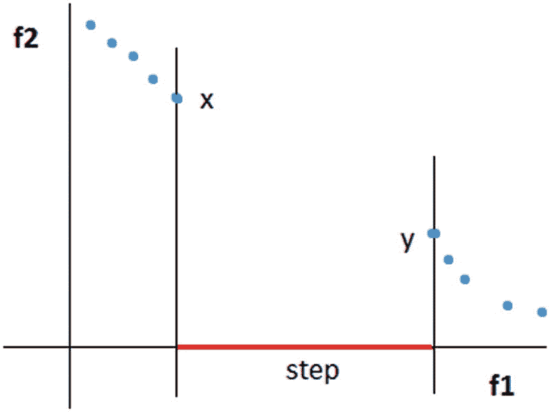
**图 13-10**
连接点 `x`, `y` 的步骤

该方法被嵌入到一种禁忌搜索元启发式算法中（我们将在下一章讨论），并应用于一个实际的区域划分问题。选择不同步长值后获得的结果如图 13-11 所示。

经过 300 次迭代，`step` = 2.0。
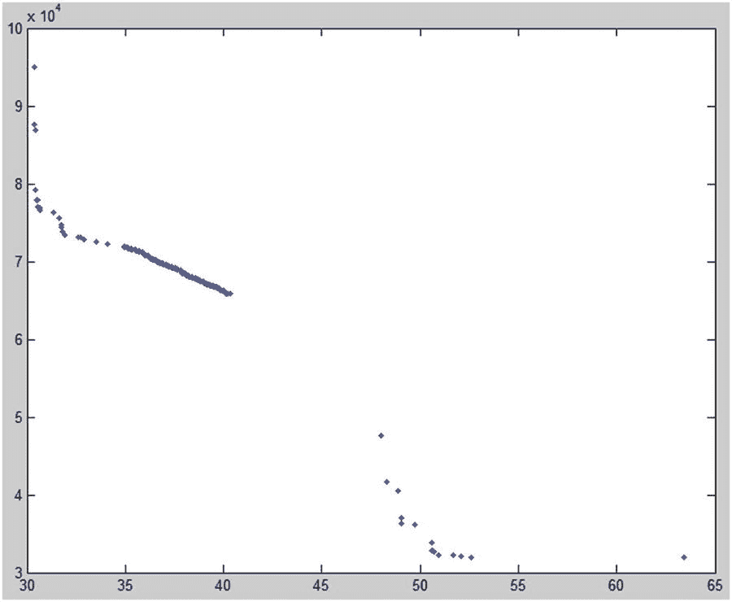

经过 500 次迭代，`step` = 2.0。
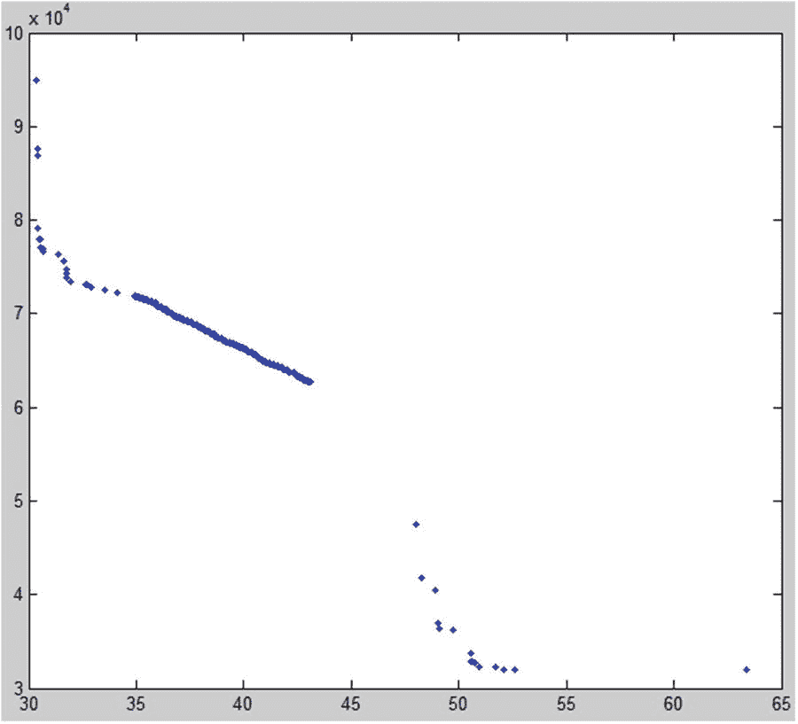

`step` = 1.2，经过 500 次迭代。
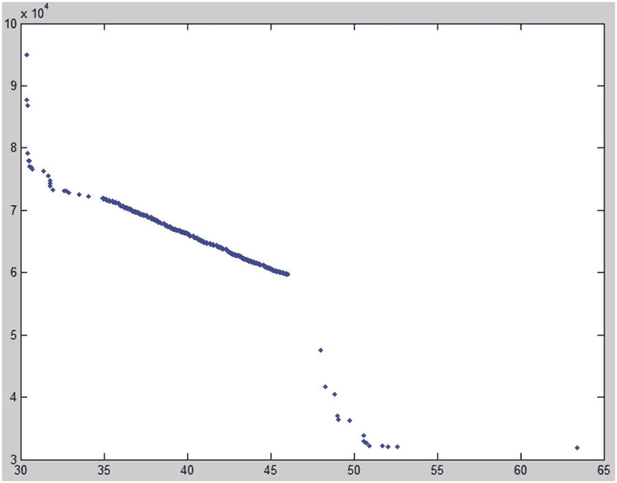

最后，`step` = 0.5，500 次迭代。
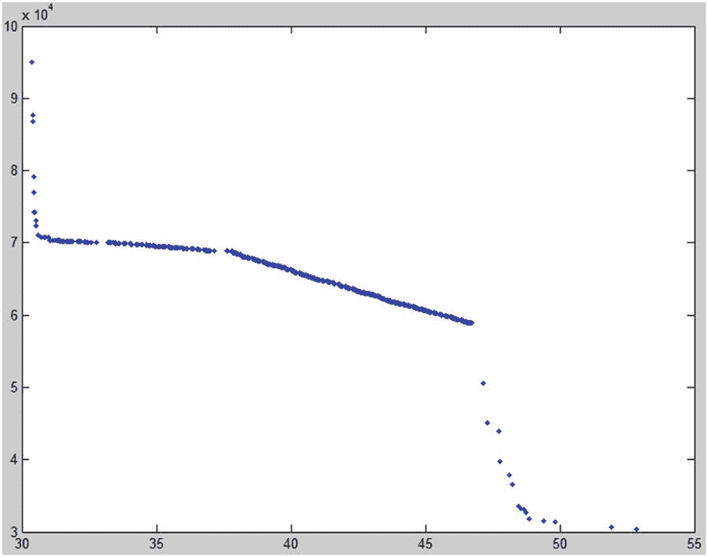
**图 13-11**
使用不同步长并执行不同迭代次数时的前沿构建器机制

从构成上图的图像集合中，我们可以看到帕累托前沿定义良好；步长越小，定义越清晰，并且能填补帕累托前沿中更多的空洞。对此策略的一个有趣改进是，不仅沿 `f2` 轴执行步长，还沿 `f1` 轴应用 `FrontierBuilder` 机制，从而提供对帕累托前沿更精确的近似。

## 总结

在本章中，我们讨论了计算机科学的经典问题之一：聚类。我们通过提供不同的度量标准来确定对象相似性和簇相似性来对其进行描述。我们还介绍了聚类方法的家族，并介绍和开发了最流行且最可靠的聚类算法之一——k-means。在最后几节中，我们将多目标聚类作为多目标优化问题的一个特例进行了研究，并详细介绍了作者独创的一种构建帕累托前沿的方法；该方法就是帕累托前沿构建器。