# 14. 启发式算法与元启发式算法

到目前为止，我们已经多次提到“启发式”这个词。我们在“火星车”章节中使用它来引入一种看似合乎逻辑且简单的方法，该方法运用了我们对现实的实用知识，并帮助我们为机器人实现了合理的移动。这种方法主要基于我们的经验，而非任何经过科学验证的程序。

在计算机科学中，我们通常面临的挑战是设计算法，使其既能提供良好的时间复杂度，又能为给定问题提供良好的解（如果可能的话，最优解）。启发式算法是一种可以轻易放弃上述任一前提，甚至两者都放弃的方法。例如，一个启发式算法可以为一个问题找到许多解，其中一些解可能不正确或不可行，而另一些可能是最优的。同样，它可以在短时间内执行，为问题提供可行解，但可能这些解中没有一个是全局最优的。这类算法通常应用于本质上困难的问题；例如，`NP-难`问题，如旅行商问题、聚类、车辆路径规划等。由于这些问题的性质及其高复杂性，我们必须依赖那些能够输出问题解（或部分解）的方法，以帮助我们最终获得尽可能接近最优解的确定解。

一种非常特殊的启发式算法是元启发式算法，它是一个与问题无关的迭代过程，其中通过各种策略或准则组合多种启发式算法，试图引导搜索找到优质解。元启发式算法已变得非常流行；其中一些算法基于生物或化学过程，因其能够通过应用在合理时间内执行的简单算法来找到复杂问题的优质解而引起了极大兴趣。

在本章中，我们将讨论启发式算法，特别是爬山法，并将介绍两种著名的元启发式算法；即，我们将研究遗传算法和禁忌搜索。还将包含实现前两种方法的实际问题。

注意
`人工智能`中的许多算法本质上是启发式的，或者在其执行过程中使用了启发式规则。一个判断给定电子邮件是否为垃圾邮件的应用程序会使用许多启发式规则来最终做出决策。

## 什么是启发式方法？

启发式方法是一种源自经验、常识或基于专业知识的推测的方法，旨在为通常极难求解（`NP-难`）的问题提供或帮助提供实用的解决方案，因为最优或良好的可行解过于复杂而难以获得。启发式方法可以通过提供捷径来加速寻找良好可行解的过程。这种加速过程通常通过搜索算法实现，我们在其中遍历一棵表示可能解空间的树。应用特定问题的启发式方法可以显著减少树搜索的范围。滑动拼图（如图 14-1 所示）就是这样一个例子，这款流行游戏的状态空间（所有可能的游戏配置）可以用一棵树来表示，树中的节点表示游戏的不同状态或配置。每个父节点最多有四个子节点，分别代表将一块拼图移动到空白区域的四种可能移动方式。

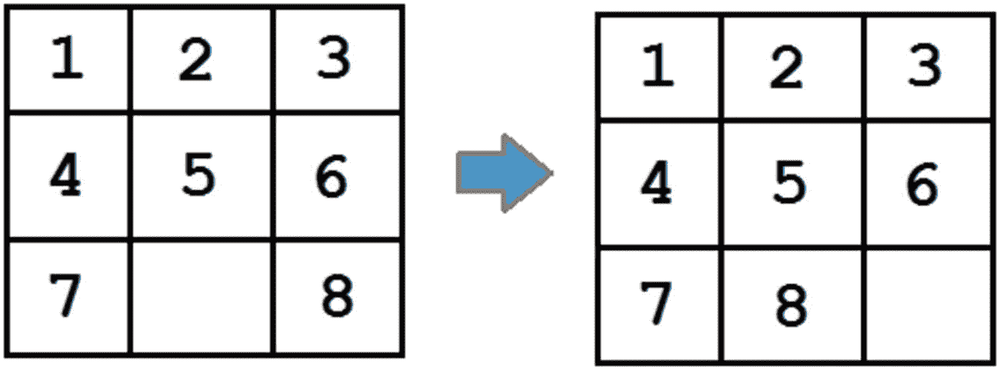

图 14-1

滑动拼图。左侧棋盘显示游戏未完成的状态，右侧棋盘显示目标状态。

启发式方法掌握关于每个状态与目标状态接近程度的一些信息，这使得它们能够优先探索最有希望的路径。概括来说，启发式方法的一些最普遍特征如下：

*   它们不保证一定能找到解，即使解可能存在。

*   如果找到了解，也不保证该解是最优的（最小或最大）。

*   有时（无法预先定义）会在合理的时间内找到一个良好的解。

我们通常通过启发式函数来使用启发式方法。该函数为问题的每个状态分配一个数值，并定义该状态在从给定点（节点）尝试到达目标状态方面的前景如何；它通常记为`H(e)`。启发式函数有两种解释。它可以指示状态`e`与目标状态的接近程度，这意味着我们偏好启发式值最低的状态；或者它可以指示状态`e`与目标状态的距离，这意味着我们偏好启发式值最高的状态。在这两种情况下，我们分别是在最小化或最大化启发式函数。

注意
对于拼图游戏，当前棋盘上某块拼图的位置与目标棋盘上同一块拼图的位置之间计算的曼哈顿距离之和，就是一个启发式函数。

## 爬山法

在爬山法或启发式方法中，我们从一个初始的随机解开始，并将其设为当前解。我们找出当前解的所有邻居解，然后执行一个步骤，将当前解定义为对要最小化（或最大化）的函数提供最大减少（或增加）的那个邻居解。爬山法是一种优化技术，可能会陷入局部最小值；因此，它很容易无法找到全局最优解。尽管存在局部性问题，它仍被广泛应用于`人工智能`中那些时间限制严格、且肯定可以利用短执行时间算法的问题。

存在两种类型的爬山法：

*   不可逆式：如果某条路径被证明无益，我们避免返回该状态集的子集。

*   试探式：如果我们确定所选路径不合适，可以回溯到旧路径。

在本书中，我们将重点讨论第一种方法（不可逆式），它与本节开头描述的爬山法最为相似。

在不可逆爬山法中，我们通过两种备选方案来确定下一步要处理的解：

*   简单爬山：我们选择处理或扩展当前邻居集中第一个比当前解更优的解。因此，过程在此停止，并且不会扫描当前解的所有邻居。

*   最大坡度爬山：我们选择处理或扩展当前邻居集中所有解中最优的那个解。因此，过程在扫描完当前解的所有邻居后停止。

在这两种情况下，如果当前邻居集中的每个解都比当前解更差或相等，则过程结束。

注意
爬山法是一种迭代改进的优化技术，是最佳优先搜索算法的一种变体，属于贪心算法家族。

图 14-2 展示了爬山法如何找到局部最优解，用蓝点表示。

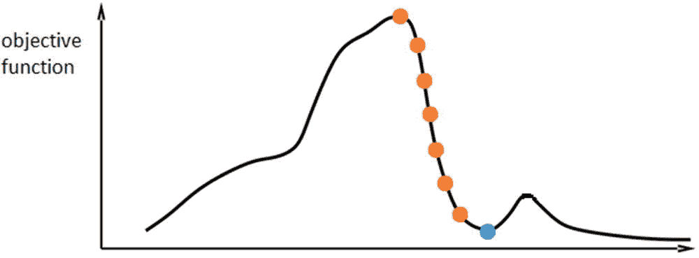

图 14-2

在这种情况下，我们最小化目标函数，并沿着橙色点的路径“下山”，直到到达蓝点，即局部最小值。我们正在最小化，因此蓝点是局部最小值。

该算法的伪代码如下：

```
HillClimbing(function F)
{
currentSolution = RandomSolution();
while (No Improvement)
vicinity = Neighbors(currentSolution);
nextEval = -INF;
nextSolution = null;
for all x in vicinity
{
if (Evaluate(x) >nextEval)
{
nextSolution= x;
nextEval = Evaluate (x);
}
}
if nextEval<= Evaluate (currentSolution)
return currentSolution;
currentNode = nextSolution;
}
```

爬山法属于局部搜索算法家族。事实上，爬山法和局部搜索这两个术语有时可以互换使用，意味着它们被视为同一种算法，并且它们代表了一类称为基于单一解的元启发式算法，其中包括模拟退火、禁忌搜索等基于局部搜索的流行方法。

注意
局部搜索是一种用于解决计算上困难的优化问题的启发式方法；它通过在候选解空间（搜索空间）中从一个解移动到另一个解，应用局部变化，直到找到被认为最优的解、达到最大迭代次数或时间限制耗尽为止。

## 实践问题：实现爬山算法

在本节中，我们将实现一个用于优化（最小化）连续目标函数的爬山算法。该过程中的邻域是通过考虑围绕当前解的半径为`R`的`n`维球面上的点集来计算的（图 14-3）。

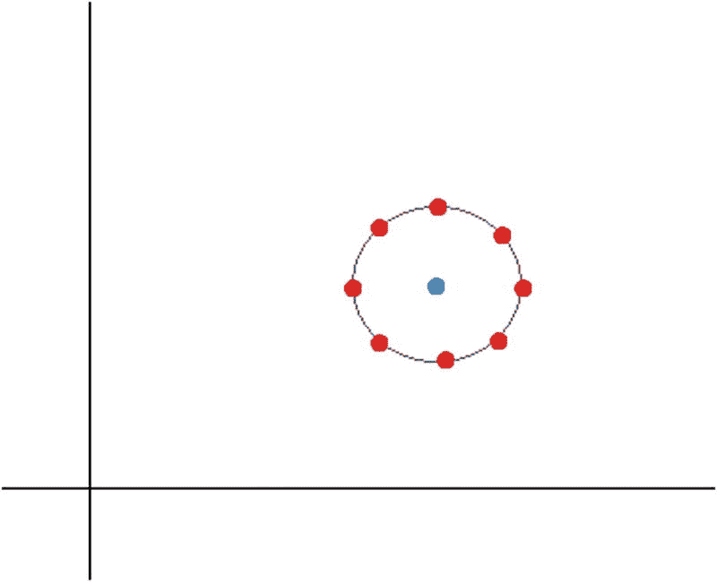

图 14-3

当前解（蓝色点）的邻域由围绕它的`n`维球面上的所有红色点构成。在此例中，`n = 1`；即，1 维球面是一个圆。

`n`维球面（球体的一般化形式）的坐标可根据以下公式获得：

$$ {\displaystyle \begin{array}{c}{\mathrm{x}}_1=\mathrm{r}\ast \cos \left({\phi}_1\right)\\ {}{\mathrm{x}}_2=\mathrm{r}\ast \sin \left({\phi}_1\right)\ast \cos \left({\phi}_2\right)\\ {}{\mathrm{x}}_3=\mathrm{r}\ast \sin \left({\phi}_1\right)\ast \sin \left({\phi}_2\right)\ast \cos \left({\phi}_3\right)\\ {}\dots \\ {}{\mathrm{x}}_{\mathrm{n}-1}=\mathrm{r}\ast \sin \left({\phi}_1\right)\ast \dots \ast \sin \left({\phi}_{\mathrm{n}-2}\right)\ast \cos \left({\phi}_{\mathrm{n}-1}\right)\\ {}{\mathrm{x}}_{\mathrm{n}}=\mathrm{r}\ast \sin \left({\phi}_1\right)\ast \dots \ast \sin \left({\phi}_{\mathrm{n}-2}\right)\ast \sin \left({\phi}_{\mathrm{n}-1}\right)\end{array}} $$

其中 `r` 是 n 维球面的半径，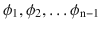 是一组角度坐标，前 n - 2 个坐标的取值范围为 [0; π]，最后一个坐标的取值范围为 [0; 2π]。

为了简化数学函数方面的工作，我们将添加对 `MathParser` NuGet 包的引用。通过使用此包，我们可以将函数定义为字符串，并在任意所需点对其进行求值。因此，我们将在 `HillClimbing` 类中拥有一个 `Function` 公共属性，如代码清单 14-1 所示。

```csharp
public class HillClimbing
{
    public Function Function{ get; set; }
    public double Step { get; set; }
    public double Radius { get; set; }
    private static readonly Random Random = new Random();
    public HillClimbing(Function function, double step, double radius)
    {
        Function = function;
        Step = step;
        Radius = radius;
    }
}
```
**代码清单 14-1**
`HillClimbing` 类

该类包含以下属性或字段：

*   `Function`：待优化的函数
*   `Step`：双精度值，表示计算解邻域时使用的步长或角度
*   `Radius`：双精度值，表示围绕当前解的 n 维球面（邻域）的半径
*   `Random`：用于计算随机值的变量

在代码清单 14-2 中，我们可以看到负责执行爬山算法某些组件的三个方法。

```csharp
private List<double> InitialSolution(int dimension)
{
    var result = new List<double>();
    for (var i = 0; i < dimension; i++)
    {
        result.Add(Random.NextDouble() * 100);
    }
    return result;
}

private List<List<double>> Neighborhood(List<double> currentSolution, int dimension)
{
    var result = new List<List<double>>();
    var newSolutions = NSpherePoints(currentSolution, dimension);
    result.AddRange(newSolutions);
    return result;
}

private IEnumerable<List<double>> NSpherePoints(List<double> currentSolution, int dimension)
{
    var result = new List<List<double>>();
    var angles = Enumerable.Repeat(Step, dimension).ToList();
    while (angles.First() < 2 * Math.PI)
    {
        var newSolution = new List<double>(currentSolution);
        var prod = 1.0;
        for (var j = 0; j < dimension; j++)
        {
            newSolution[j] += j > 0
                ? Radius * (prod) * Math.Sin(angles[i])
                : Radius * (prod) * Math.Cos(angles[i]);
            result.Add(newSolution);
        }
        angles = angles.Select(ang => ang + Step).ToList();
    }
    return result;
}
```
**代码清单 14-2**
`HillClimbing` 类的 `InitialSolution()`、`Neighborhood()` 和 `NSpherePoints()` 方法

在 `InitialSolution()` 方法中，我们创建一个 n 维的随机解，其随机值范围在 [0, 100] 之间。在 `Neighborhood()` 方法中，我们利用 `NSpherePoints()` 方法计算构成当前解邻域的新点。最后一个方法是前面给出的坐标方程组的直接翻译。代码清单 14-3 展示了 `Execute()` 方法，它将所有其他组件整合在一起。

```csharp
public List<double> Execute()
{
    var currentSolution = InitialSolution(Function.getArgumentsNumber());
    var bestEval = double.MaxValue;
    List<double> bestSolution = null;
    while (true)
    {
        var neighbors = Neighborhood(currentSolution, Function.getArgumentsNumber());
        var bestCurrentEval = double.MaxValue;
        List<double> bestCurrentSolution = null;
        foreach (var neighbor in neighbors)
        {
            var eval = Function.calculate(neighbor.ToArray());
            if (eval < bestCurrentEval)
            {
                bestCurrentEval = eval;
                bestCurrentSolution = neighbor;
            }
        }
        if (bestCurrentEval == bestEval)
            break;
        if (bestCurrentEval < bestEval)
        {
            bestEval = bestCurrentEval;
            bestSolution = bestCurrentSolution;
        }
    }
    return bestSolution;
}
```
**代码清单 14-3**
`HillClimbing` 类的 `Execute()` 方法

我们在一个控制台应用程序中测试了该算法，考虑的函数是 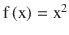，这是一个抛物线函数，其图形如图 14-4 所示。

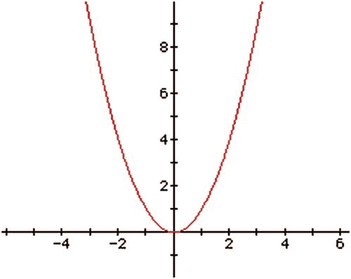

**图 14-4**
抛物线函数

显然，该函数的最小值在 x = 0 时取得。那么，让我们测试一下算法，看看它如何从一个可能为 100 的高值下降到非常接近 0 的值（代码清单 14-4）。

```csharp
var f = new Function("f", "(x1)²", "x1");
var hillClimbing = new HillClimbing(f, 5, 4);
var result = hillClimbing.Execute();
Console.WriteLine("Result: {0}", result[0]);
```
**代码清单 14-4**
测试爬山算法

执行此代码并设置断点以发现算法开始处理时的初始解后，我们得到了如图 14-5 所示的结果。

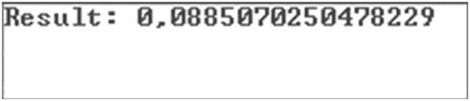

**图 14-5**
执行爬山算法后获得的结果

算法从一个值为 95.14 的点开始，能够沿着下降路径一直工作，直到达到一个非常接近全局最优值 (0) 的点，该点在此例中与局部最优值重合。

在接下来的章节中，我们将研究 S 元启发式算法（基于单一解）和 P 元启发式算法（基于种群）。第一种类型由一系列算法组成，其中每个成员都继承自局部搜索 (LS) 或爬山算法，并试图通过创建逃离局部最优的机制来克服其困难，从而在状态空间的其他有前景区域继续搜索。后一种类型是一个庞大的元启发式算法群体，由那些在执行过程中包含种群的算法组成；其最著名的代表无疑是遗传算法家族。

> **注意**
> 一些最流行的 S 元启发式算法包括 `TS`、`SA`、`ILS` 和 `VNS`。

## 种群元启发式算法：遗传算法

# 基于种群的元启发式算法与遗传算法

基于种群的元启发式算法（又称 P-元启发式算法）包含一个迭代改进过程，该过程作用于一组被聚合成种群的解。在这类元启发式算法中，我们通常首先生成一个初始种群，随后利用某些选择标准，用另一个种群替换该初始种群。诸如进化算法（EA）、分散搜索（SS）、分布估计算法（EDA）、粒子群优化（PSO）、蜂群算法（BC）以及人工免疫系统（AIS）等算法均属于此类元启发式算法。在本节中，我们将重点介绍一种被称为遗传算法（GA）的进化算法。

## 遗传算法简介

遗传算法代表了一类受自然选择过程启发的元启发式算法；它们由约翰·霍兰德在 20 世纪 70 年代提出，通常通过依赖受生物启发的算子（如变异、交叉和选择）来为优化和搜索问题生成高质量的解。染色体、基因和适应度等概念在遗传算法文献中很常见，它们试图在生物学、化学等领域找到与之对应的类比。

> **注意**
> 遗传算法广泛应用于计算机科学和运筹学领域。在运筹学领域，遗传算法处理的是应用高级分析方法来帮助做出更优决策的问题。

在遗传算法中，我们通常需要以“遗传”方式对解进行编码，以便后续能够高效地应用变异和交叉算子。我们还需要一个适应度函数，该函数接收一个编码后的解作为参数，并为我们提供对该编码解的评估或评价。一种流行的解编码方式是使用二进制字符串；这种编码方式使得应用几乎任何算子都变得非常容易。

## 遗传算法的工作原理

元启发式算法试图在两个方向上实现优化：通过应用强化机制和多样化机制。强化指的是算法进一步探索已发现且有前景的状态空间区域的能力。这意味着要利用那些我们已经发现优质解的状态空间区域。另一方面，多样化指的是在尝试发现新的高质量解的同时，探索状态空间中未探索区域的能力。

变异算子试图通过创建一个存在于状态空间不同区域的新解来改变原有解；因此，它使搜索过程多样化。交叉算子通常作用于两个适应度值被认为是迄今为止最优的解。然后，它在一个交叉点上混合它们的值；这是一个强化算子，因为我们试图混合两个优质解，以期找到一个更优的解。图 14-6 展示了这些算子如何在二进制染色体（解）上运作。

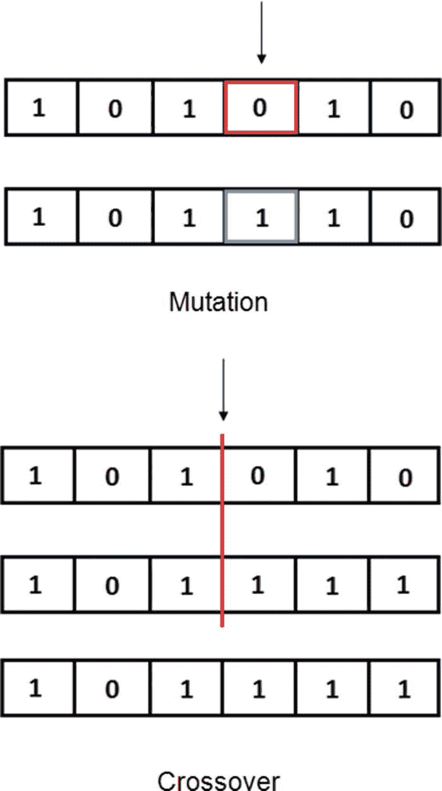
*图 14-6*

变异算子修改染色体（解）中的单个比特位，而交叉算子则在两个父代染色体上指定一个断点，通过从第一个染色体取一半基因，并从第二个染色体的后半部分取一半基因来创建一个新解。从图 14-6 我们可以很容易地推断出，变异算子是一元的，而交叉算子是二元的。

尽管选择、变异和交叉方法可能因具体实现（问题相关）而异，但遗传算法的通用伪代码如下所示：

```
GA ()
{
初始化种群();
评估种群();
while(!停止条件)
{
选择最适合繁殖的个体;
通过对先前选择的个体应用变异、交叉算子获得后代;
评估后代;
通过从后代和当前种群中选择最适合的个体获得新种群;
}
}
```

从这个伪代码中，我们可以看到遗传算法如何被视为基于“适者生存”这一生物学类比优化方法。通过遗传繁殖、交叉和变异的生物学类比，平均种群和个体的质量在几代中得到改善。原则上，种群的平均质量应随着每一代而增加。然而，这在很大程度上取决于某些参数（例如，变异概率）以及适应度（质量、概率）函数的性质。

在接下来的部分中，我们将针对计算机科学中一个非常流行的问题——旅行商问题（TSP）实现一个遗传算法。我们将定制我们的遗传算法（解编码、适应度函数等），使其适应 TSP 模型，并据此提供解决方案。

## 实际问题：为旅行商问题实现遗传算法

我们已经讨论过遗传算法（GA），并且知道它们的灵感来源于一个类似于种群随时间进化的生物过程，其中适应性更强的个体对我们来说代表着更好的解决方案。遗传算法本身仅仅是等待被适配到特定问题的蓝图。在本节中，我们将适配一个遗传算法来寻找解决方案并优化旅行商问题（TSP）。

旅行商问题（TSP）是指：一位销售员需要遍历 n 个城市，同时力求最小化从一个城市到另一个城市所花费的时间，并最终访问到每一个城市。图 14-7 展示了一幅美国地图，其中销售员必须访问多个城市（黑色点）；紫色线条表示一条可能的最小成本路径。

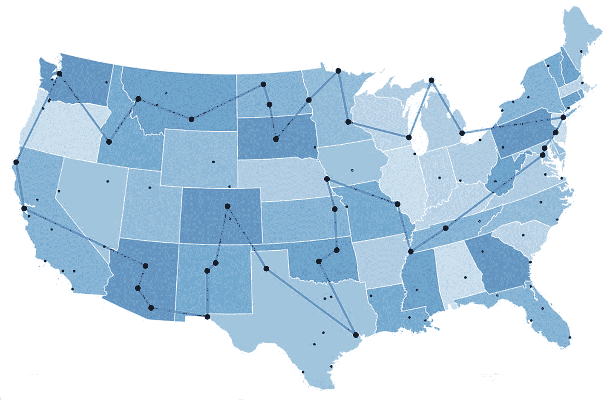
*图 14-7*
*美国地图，显示了销售员可能经过多个城市的一条路径。在此例中，路径的终点与起点相同。*

TSP 是一个 NP-困难问题，这意味着我们必须依赖近似方法或启发式方法才能在合理的时间内获得解决方案。精确解意味着要开发一个组合算法，其执行时间复杂度为 `O(n!)`——即阶乘时间——这意味着当 `n = 20` 时，我们将有 `2,432,902,008,176,640,000` 个可能的解需要检查。

因为在 TSP 中，我们试图找到能产生适应度函数最优值的城市排列，所以使用这种表示方式作为我们遗传算法的编码似乎非常合乎逻辑，而这正是我们将要采用的策略。因此，我们将拥有染色体，它们是取值范围为 `[0, n - 1]` 的列表；列表中的每个值代表一个城市，而列表定义的顺序就是销售员要走的路线。图 14-8 展示了我们面向 TSP 求解的遗传算法中一个染色体的示例。

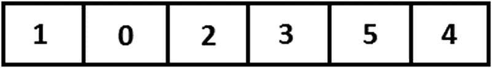
*图 14-8*
*TSP 的染色体或解编码*

为了与我们设计的面向对象方法保持一致，我们将包含一个 `Tsp` 类，该类将处理所有与问题直接相关的操作以及与特定问题相关的事项（列表 14-5）。

```
public class Tsp
{
    public static double[,] Map { get; set; }
    public Tsp(double [,] map)
    {
        Map = map;
    }
    public static void Evaluate(Solution solution)
    {
        var result = 0.0;
        for (vari = 0; i<solution.Ordering.Count - 1; i++)
            result += Map[solution.Ordering[i], solution.Ordering[i + 1]];
        solution.Fitness = result;
    }
}
// 列表 14-5 处理特定问题事项的 Tsp 类
```

在这个类中，我们存储了 `double[,]` 矩阵 `Map`，它表示距离地图；换句话说，这个矩阵存储了任意两个城市 `i`, `j` 之间的距离。我们编写了一个 `Evaluate()` 方法，用于计算输入解的适应度值。同样，我们还包含了一个 `Solution` 类，所有与解相关的操作都在其中开发（列表 14-6）。

## Solution 类

```csharp
public class Solution
{
    public List<int> Ordering { get; set; }
    public double Fitness { get; set; }
    public Solution(IEnumerable<int> ordering)
    {
        Ordering = new List<int>(ordering);
        Tsp.Evaluate(this);
    }
    public Solution Mutate(Random random)
    {
        var i = random.Next(0, Ordering.Count);
        var j = random.Next(0, Ordering.Count);
        if (i == j)
            return this;
        var newOrdering = new List<int>(Ordering);
        var temp = newOrdering[i];
        newOrdering[i] = newOrdering[j];
        newOrdering[j] = temp;
        return new Solution(newOrdering);
    }
    public Solution CrossOver(Random random, Solution solution)
    {
        var ordinal = Ordinal();
        var ordinalSol = solution.Ordinal();
        var parentA = new List<int>(ordinal);
        var parentB = new List<int>(ordinalSol);
        var cut = parentA.Count/2;
        var firstHalf = parentA.GetRange(0, cut);
        var secondHalf = parentB.GetRange(cut, parentB.Count - cut);
        firstHalf.AddRange(secondHalf);
        return DecodeOrdinal(firstHalf);
    }
    public List<int> Ordinal()
    {
        var result = new List<int>();
        var canonic = new List<int>(Canonic);
        foreach (var currentVal in Ordering)
        {
            var indexCanonical = canonic.IndexOf(currentVal);
            result.Add(indexCanonical);
            canonic.RemoveAt(indexCanonical);
        }
        return result;
    }
    public Solution DecodeOrdinal(List<int> ordinal)
    {
        var result = new List<int>();
        var canonic = new List<int>(Canonic);
        for (var i = 0; i < ordinal.Count; i++)
        {
            result.Add(canonic[ordinal[i]]);
            canonic.RemoveAt(ordinal[i]);
        }
        return new Solution(result);
    }
    public List<int> Canonic
    {
        get { return Enumerable.Range(1, Ordering.Count).ToList(); }
    }
}
```
列表 14-6 Solution 类

一个解由两个主要字段或属性组成：一个名为 `Ordering` 的整数列表，以及一个名为 `Fitness` 的双精度值属性，表示该解的适应度。它还包含一个 `Canonic` 属性，该属性输出一个按递增顺序排列的整数列表 {1, …, n}，其中 n 是城市的总数。例如，当 n = 5 时，其规范形式将为 {1, 2, 3, 4, 5}。我们使用规范形式来计算解的序数形式。为什么我们需要解的序数形式呢？

为了理解为什么将解转换为其序数形式，请考虑图 14-9 中如果将交叉算子应用于两个解可能会发生的情况。

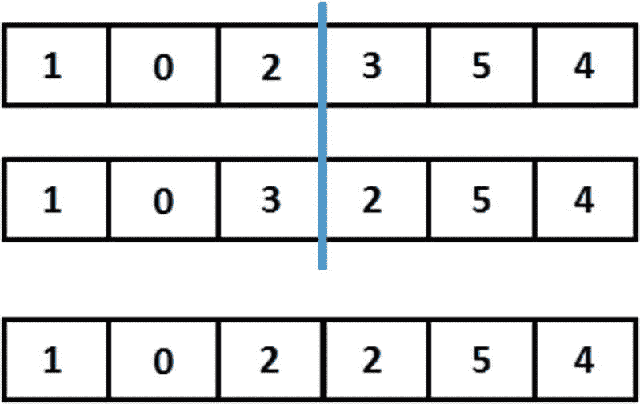
图 14-9

将交叉算子应用于父代后，产生的子代是不可行的，因为它代表了一条经过城市编号 2 两次的路线

从上图可以看出，将交叉算子应用于父代会产生一个不可行的子代，该子代包含一条经过同一个城市（城市编号 2）两次的路线。为了避免这个问题，我们使用解的序数表示，其计算方法如图 14-10 所述。

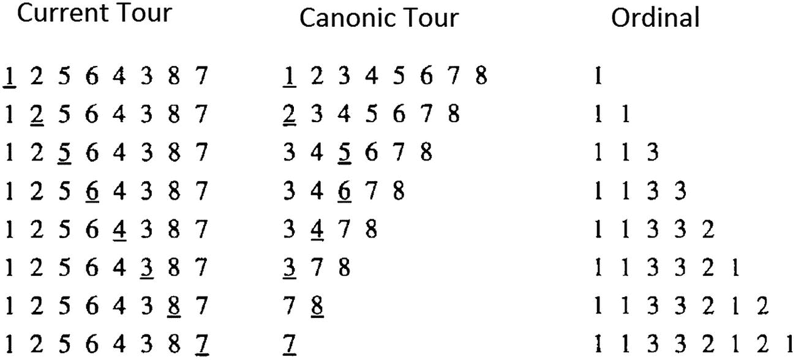
图 14-10

为了计算序数形式，我们遍历规范形式，在当前路线中查找被分析值的位置，并将该位置保存在构成序数表示的列表中

有趣的事实是，虽然交叉算子应用于常规 TSP 表示时会产生不可行的解，但当我们将这些表示转换为序数形式后，交叉算子会产生一个可行的解（以序数形式）。我们只需要将该序数解解码回常规的 TSP 形式（范围为 1 … n 的整数排列）即可继续遗传算法流程。

`Solution` 类包含以下方法：

*   `Mutate()`：在此方法中，我们通过选择解排序中的两个随机索引位置并交换它们对应的值来变异一个解。

*   `CrossOver()`：在此方法中，我们将交叉算子应用于输入解的序数形式，并最终将获得的序数解解码为常规的 TSP 解。切割点在排序长度的一半处执行。

*   `Ordinal()`：在此方法中，我们将常规的 TSP 解转换为序数形式。

*   `DecodeOrdinal()`：在此方法中，我们将序数解转换为常规的 TSP 解。

### 遗传算法主体

最后，在 `GeneticAlgorithmTsp` 类（清单 14-7）中，我们整合了遗传算法的不同阶段。该类包含以下字段或属性：

*   `Iterations`：算法将执行的迭代次数

*   `Tsp`：先前介绍的 `Tsp` 类的实例

*   `Population`：个体集合，每个个体都是先前描述的 `Solution` 类的一个实例

*   `Size`：种群规模

*   `Random`：随机变量

清单 14-8 中所示的 `Selection()` 方法所编码的选择策略，包括按适应度函数值的升序对种群进行排序，并选择前 `Size/2` 个个体。

```csharp
public class GeneticAlgorithmTsp
{
    public int Iterations { get; set; }
    public Tsp Tsp { get; set; }
    public List<Solution> Population { get; set; }
    public int Size;
    private static readonly Random Random = new Random();
    public GeneticAlgorithmTsp(int iterations, Tsp tsp, int size)
    {
        Iterations = iterations;
        Tsp = tsp;
        Population = new List<Solution>();
        Size = size;
    }
}
```
清单 14-7 GeneticAlgorithmTsp 类

### 执行方法

清单 14-8 展示了遗传算法的主要执行方法。在同一清单中，我们还可以看到 `InitialPopulation()` 方法，我们在其中创建了 `Size` 个随机解。在 `NewPopulation()` 方法中，我们将新生的后代添加到种群中，并根据个体的适应度值对其进行排序，在排序 `Population` 列表后，将前 `Size` 个解保留到下一代。在 `OffSprings()` 方法中，我们以小于等于 0.4 的概率变异一个染色体（解），并以 0.6 的概率进行重组或应用交叉算子。

```markdown
## 清单 14-8 GeneticAlgorithmTsp 类

```csharp
public Solution Execute()
{
    InitialPopulation();
    vari = 0;
    while (i);
    NewPopulation(offSprings);
    i++;
}
return Population.First();
}

private void NewPopulation(IEnumerable offSprings)
{
    Population.AddRange(offSprings);
    Population.Sort((solutionA, solutionB) => solutionA.Fitness >= solutionB.Fitness ? 1 : -1);
    Population = Population.GetRange(0, Size);
}

private IEnumerable OffSprings(List selected)
{
    var result = new List();
    for (vari = 0; i < selected.Count; i++)
    {
        var child = CrossOver(selected[i], selected[selected.Count - 1 - i]);
        result.Add(child);
    }
    return result;
}

private Solution CrossOver(Solution solution1, Solution solution2)
{
    var result = new List();
    for (var i = 0; i < solution1.Ordering.Count; i++)
    {
        if (Random.Next(2) == 0)
        {
            if (!result.Contains(solution1.Ordering[i]))
                result.Add(solution1.Ordering[i]);
            else
                result.Add(solution2.Ordering[i]);
        }
        else
        {
            if (!result.Contains(solution2.Ordering[i]))
                result.Add(solution2.Ordering[i]);
            else
                result.Add(solution1.Ordering[i]);
        }
    }
    return new Solution(result);
}

private List Selection()
{
    Population.Sort((solutionA, solutionB) => solutionA.Fitness >= solutionB.Fitness ? 1 : -1);
    return Population.GetRange(0, Size / 2);
}

private void InitialPopulation()
{
    vari = 0;
    while (i < Size)
    {
        var newSolution = CreateRandomSolution();
        Population.Add(newSolution);
        i++;
    }
}

private Solution CreateRandomSolution()
{
    var n = map.GetLength(0);
    var result = new List();
    var range = Enumerable.Range(0, n).ToList();
    while (range.Count > 0)
    {
        var index = Random.Next(0, range.Count);
        result.Add(range[index]);
        range.RemoveAt(index);
    }
    return new Solution(result);
}
}
```

现在，我们已经具备了遗传算法的所有要素，可以在控制台应用程序中对其进行测试，就像我们对其他算法所做的那样。

```csharp
var map = new double[,] {
    {1, 2, 3, 1, 5},
    {5, 1, 1, 1, 8},
    {1, 7, 2, 1, 9},
    {1, 1, 6, 1, 8},
    {1, 1, 4, 1, 2},
};
varga = new GeneticAlgorithmTsp(100, new Tsp(map), 100);
var best = ga.Execute();
Console.WriteLine("Solution:");
foreach (var d in best.Ordering)
    Console.Write("{0},", d);
Console.WriteLine('\n' + "Fitness: {0}", best.Fitness);
```

## 清单 14-9 测试我们的遗传算法以求解旅行商问题

在本例中，我们选择进行 100 次迭代或进化周期，地图由五个城市组成，其距离如清单 14-9 中的矩阵所示。获得的结果如图 14-11 所示。

### 图 14-11 我们的遗传算法对上述旅行商问题输出的解

算法输出的解是 (4, 1, 2, 0, 3)；换句话说，首先访问 4 号城市，然后移动到 1 号、2 号、0 号城市，最后是 3 号城市。这条路径的成本为 4，由于从一个城市到另一个城市的旅行成本至少为 1，我们可以高度确信输出的路径是最优的。还要注意，算法输出的解是种群列表中的第一个，这似乎非常合理，因为我们保持其按个体适应度值的升序排序。

在下一节中，我们将研究 S-元启发式算法；我们已经讨论了所有 S-元启发式算法所源自的启发式算法——爬山法，也称为局部搜索——并且很快我们将探讨这样一个主题：S-元启发式算法的代表如何通过强化和多样化机制逃离局部最优，并保留到给定点的搜索记忆。

## S-元启发式算法：禁忌搜索

基于单一解的元启发式算法，也称为 S-元启发式算法，包含一个迭代过程，在每一步中改进单一解。它们可以被视为通过邻域创建的路径，或穿过给定问题状态空间的搜索轨迹。这些路径或轨迹是通过迭代方法构建的，这些方法从当前解移动到状态空间中的另一个解。S-元启发式算法可以非常高效，并为多种优化问题提供良好的解。

禁忌搜索（TS）是一种由弗雷德·格洛弗在 20 世纪 80 年代首次描述的元启发式算法，它利用自适应记忆和响应式探索。它继承自爬山法（HC），这可能是迄今为止创建的最古老、最简单的启发式方法。可以说，禁忌搜索只是对爬山法进行了一些重大改进或升级。其核心功能与爬山法相同；它从一个给定的初始解（通常是随机生成的）开始，运行直到达到停止规则，并且在每次迭代中，当前解被另一个在邻域中找到的、能改进目标函数的解所替代。爬山法的停止规则是当当前解没有邻域解能改进目标函数时触发，表明已找到局部最优解。正如我们从前面章节所知，这是爬山法的主要缺点；它可能陷入局部最优，而禁忌搜索没有这个缺点，因为它包含了防止陷入局部最优的多样化机制。

顾名思义，禁忌搜索通过在状态空间中未被标记为“禁忌”或禁止的区域进行搜索。这种标记意味着在一段时间（迭代次数）内，这些区域将不会被考虑在搜索中，以避免在短时间内试图在同一区域寻找解而浪费时间和精力。

自适应记忆可能是禁忌搜索最重要的特征。它是记住搜索演变过程的能力，并通过使用数据结构来实现。禁忌列表代表了这些数据结构之一。它传统上用于保存先前交换过的数据对，避免在一段时间内围绕相同解循环的可能性（由于记忆是有限的，此列表的长度必须是有限的）。强化（Intensification）是指许多元启发式算法实现的一种机制，旨在优先利用迄今为止找到的最佳解；在这种情况下，会彻底探索更有希望的区域。另一方面，多样化（Diversification）指的是对搜索空间的探索，试图访问未探索的解。

除了与爬山法相关的组件（初始解、邻域等）之外，禁忌搜索还包括以下特定组件：

*   **禁忌列表**：也称为短期记忆，其目的是防止搜索重新访问先前访问过的解，以防止循环。如前所述，出于效率问题，存储所有已访问解的列表并不实际，因此禁忌列表通常包含一个预先定义的最大大小，我们最多存储该大小所定义的解数量。此外，我们通常不在禁忌列表中存储整个解，而是存储移动或解属性，这大大减少了数据存储。一个移动在一定的迭代次数内保持禁忌状态，这被称为禁忌期限（Tabu tenure）。

*   **渴望准则**：一种常用的渴望准则是，如果一个禁忌移动能生成比当前找到的最佳解更好的解，则选择该移动；另一种渴望准则可能是，一个禁忌移动能从包含给定属性的一组解中产生一个更好的解。

为了避免陷入局部最优，禁忌搜索包含了强化和多样化机制；这些机制由中期和长期记忆表示：

*   **强化（中期记忆）**：中期记忆存储搜索过程中发现的精英（例如，最佳）解。其思想是优先考虑来自精英解集的属性，通常采用加权概率的方式。搜索会偏向这些属性。它通常由一种近期记忆表示，其中记录了各种解特征连续出现在当前解中而未中断的迭代次数。

*   **多样化（长期记忆）**：长期记忆存储关于搜索过程中访问过的解的信息。它探索解空间中未访问的区域。例如，它会在生成的解中抑制精英解的属性，以将搜索多样化到状态空间的其他区域。它通常由一种频率记忆表示，该记忆为每个组件记录该组件在所有已访问解中出现的次数。

该算法的伪代码如下所示：

```
TS ()
{
    currentSolution = InitialSolution();
    /* TabuList, Medium-Term and Long-Term memories */
    InitDataStructures();
    while (!stopping_criteria_met)
    {
        neighborhood = GetNeighborhood(currentSolution);
        /∗ Non tabu or aspiration criterion holds ∗/
        currentSolution= GetBestNeighbor(neighborhood);
        /* Update tabu list, aspiration conditions, medium, long term memories */
        Update();
        If (intensificationCriterion)
            Intensification();
        If (diversificationCriterion)
            Diversification();
    }
    return bestSolutionFound;
}
```

让我们考察一个现实生活中的例子，以便更好地理解禁忌搜索算法的工作原理。再次考虑第 13 章中的分区问题，以及一个多目标优化问题，在该问题中，我们将最小化紧凑度（类内距离）和同质性函数。后一个函数涉及人口统计变量；因此，它可以告诉我们两个区域在年龄、性别、失业率或任何其他人口统计变量方面的相似程度。
```

在分区问题中，基本地理统计区域（BGA）是我们指代要聚类的基本或原始区域的方式。任何BGA都由一对（位置，变量值）组成，其中位置标记了该区域在空间中的位置（通常是两个坐标），变量值表示问题中每个人口统计变量值的列表。这些是禁忌搜索在分区问题中将要聚类的元素或对象。

在数学中，当`|x - y| = 0`时，元素`x`、`y`之间具有同质性。如果我们将变量列表视为空间中的向量，则可以通过考虑`EuclideanDistance(x,y)`值以及它们在聚类内部有多小来衡量区域`x`、`y`的相似程度。`EuclideanDistance(x,y)`越接近0，区域`x`、`y`彼此就越接近。这就是我们将用来衡量同质性的方法，就好像变量向量是空间中的向量，它们的同质性通过它们彼此接近的程度来实现。因此，要优化的第二个函数类似于类内函数，但在这种情况下，它考虑了同质性相异度矩阵。紧凑度和同质性函数都将根据相异度矩阵计算，该矩阵确定任意两个区域之间的相似程度，并与任何变量相关联。

由于我们处理的是一个多目标问题，我们将使用第13章中介绍的帕累托前沿构建器，以便在多样化阶段获得前沿的一个合理近似。

解被编码为（元素，中心）对，其中元素是一个`n - k`数组，`n`是BGA的数量，`k`是簇的数量，`x[i]`表示对象（此处指区域）`i`位于簇`x[i]`中。长度为`k`的中心数组包含每个中心。给定解`x`的邻域（记为`N(x)`）是通过交换所有元素对`(i, j)`获得的，其中`i`是任意中心，`j`是任意元素，因此若解为`s=((e_1,e_2,..., e_{n-k}),(c_1,c_2,..., c_k))`，则意味着`((c_1,e_2,..., e_{n-k}),(e_1,c_2,..., c_k))∈N(s)`。邻域解中的每个元素`(c_1,e_2,..., e_{n-k})`将被聚类到其最近的中心或簇中。

我们针对分区问题（多目标优化问题加聚类问题）的TS伪代码如下：

```
TsZoning()
{
currentSolution = InitialSolution();
while(!stoppingConditionMet)
{
neighborhood = GetNeighborhoodSetTabu(currentSolution);
/*选择当前解作为邻域集中具有最小类内值且不在禁忌表中的解*/
currentSolution = BestFittingNeighbor(neighborhood);
If (intensificationTime){
/*为当前解生成邻域，最小化第二个目标*/
MinimizeSecondObjective();
}
If (diversificationTime) {
FrontierBuilder();
}
UpdateParetoFrontier();
}
}
```

初始解将通过取前`k`个数据集元素作为中心，然后将剩余元素聚类到其最近的中心来生成。请注意，通常每个新的聚类或解都是在邻域中形成的，要么通过选择`k`个中心然后将剩余的`n - k`个元素聚类到其最近的中心，要么通过对已形成的解进行逐步变化。

本书提出的TS使用了一种哈希集合列表形式的禁忌表数据结构，该结构将解的中心存储为哈希集合。如果一个解包含中心`c = (1,2,3)`，而另一个解包含中心`c'=(3,4,2)`，那么禁忌表将包含`T = ((1,2,3),(3,4,2))`。哈希集合列表便于处理、插入和搜索。此外，可以高效地检查一个中心为`(1,2,3)`的解是否在禁忌表中，并且由于集合数据结构会将`(1,2,3)`、`(2,3,1)`、`(1,3,2)`、`(2,1,3)`视为相等，因此可以防止重复。我们的禁忌表将禁止在一段时间内使用某些中心元组。

为了测试该算法，我们使用了一个现实世界的问题。具体描述如下：托卢卡山谷大都市区的BGA将被聚类为五个同质组，这些组仅包含变量值在以下指定范围内的元素：

*   6岁以下男性人口 (`X001`)。
*   6至11岁男性人口 (`X003`)。
*   15至17岁男性人口 (`X007`)。

所有三个变量都将实现同质性。禁忌搜索运行了多次迭代，其中`intensificationTime` = 3，`diversificationTime` = 5。在此示例中，我们获得了以下结果（为简洁起见，我们决定不包含找到的整个帕累托前沿，而仅包含其子集）：

```
(50.5901261076844,32885.0892241763)
(50.5758416315104,33770.2868646186)
(52.0662659720778,32047.9735370572)
(52.6236863193259,31963.3459865693)
(50.9352052335638,32227.1149958513)
(51.7073149394271,32224.293243894)
(50.6297645146784,32796.6211680751)
(50.7327985199368,32648.7098303008)
(63.4052030689118,31953.3511763935)
(31.7646782813892,74764.1984211605)
(32.6995744158722,73074.7519844055)
(31.7734798863389,74355.8623848788)
(31.776816796024,73910.6355371396)
(31.9216141687552,73353.8052604555)
(32.6187235737901,73079.8864057969)
(35.171800392375,71677.0312411241)
(35.1767441367242,71676.5767247979)
(35.1343494585806,71697.8434007592)
(35.147462667771,71697.7558703676)
(35.2879720849387,71676.5396553831)
(35.3225361349416,71541.4393240582)
(35.323587070021,71541.1602760788)
...
(35.5212138666,71384.7335594089)
(35.5222648016794,71384.4545114295)
(35.5310228433471,71384.2874695704)
(35.5614827835752,71363.55569029)
...
(40.0890479612853,66076.8575353262)
(40.1225133591276,66076.6462691529)
(40.1281553068144,66056.6499667925)
(40.0820569677191,66076.9379156809)
(40.0951701769095,66076.8503852894)
(40.1358379144876,66056.5493872965)
(40.1373651695288,65921.6511332184)
(40.1384161046082,65921.3720852389)
(40.1471741462759,65921.2050433798)
(40.1806395441182,65920.9937772065)
(40.186281491805,65900.9974748462)
(40.1401831527096,65921.2854237345)
(40.1532963619001,65921.197893343)
(40.21572345198,65900.924086982)
(40.3387179536343,65900.9141882557)
```

这些结果与图14-12中显示的图形相符。

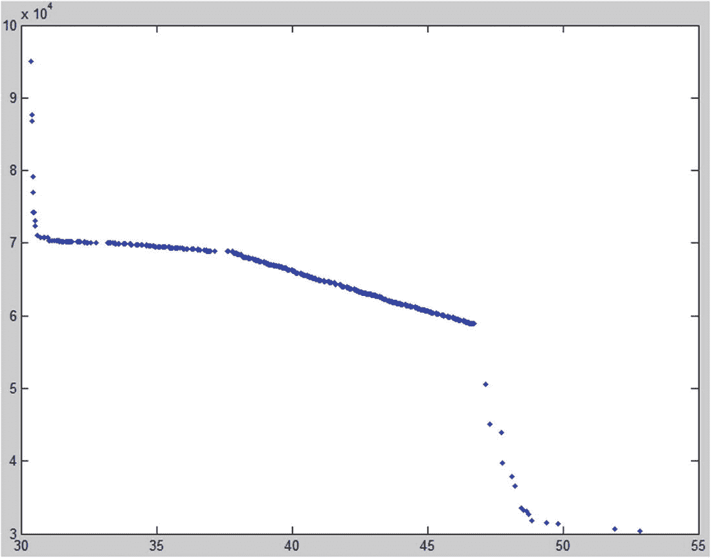

图 14-12

我们的 TS 在分区问题上输出的帕累托前沿

总而言之，我们将 TS 应用于一个有趣的聚类相关问题，并通过将其与前沿构建器相结合，获得了帕累托前沿的一个相当不错的近似解。

使用元启发式算法来解决分区问题、TSP、二次分配问题以及许多其他问题是强制性的，因为它们具有 NP 完全性质。事实上，大多数时候我们找到的不是最优解，而是这些最优解的近似解，有时如果运气好，这些近似解可能等于某个最优解。诸如遗传算法之类的元启发式算法可以与其他 AI 方法相结合，目的是从一个已经优化过的解开始启动某个 AI 过程，从而最终获得更好的结果。

## 总结

在本章中，我们研究了启发式算法和元启发式算法；我们实现了流行的爬山算法，它是所有基于单解的元启发式算法（S-元启发式算法）的鼻祖，并且我们还分析了遗传算法，作为基于种群的元启发式算法（P-元启发式算法）的代表。我们提供了这两种方法的实现，并在最后描述了一种 S-元启发式算法的代表；具体来说，我们描述了禁忌搜索，并提出了一种嵌入多目标框架、面向解决第 13 章介绍的分区问题的 TS 方法。