# 15. 游戏编程

如今，电子游戏产业是美国经济中一个价值数十亿美元的领域。全美五十个州有数千家公司从事游戏的开发和发行，每款游戏的开发都涉及数十种[职业](https://en.wikipedia.org/wiki/Job#Job)门类，其组成部分在全球范围内雇佣了成千上万的人员。这确实是一个全球性的竞争市场。该行业通常需要具备多个不同领域高级技能的专业人才。电子游戏公司必须在创新、创造力、独创性以及对行业的了解方面处于领先地位，并且必须不断适应和改变市场。在其短暂的历史中，电子游戏在图形和逼真度方面取得了巨大的进步；相应地，现代[个人电脑](https://en.wikipedia.org/wiki/Personal_computer#Personal%20computer)的许多进步和创新都归功于游戏产业：[声卡](https://en.wikipedia.org/wiki/Sound_card#Sound%20card)、[显卡](https://en.wikipedia.org/wiki/Graphics_card#Graphics%20card)和[3D 图形加速器](https://en.wikipedia.org/wiki/3D_graphic_accelerator#3D%20graphic%20accelerator)、更快的[CPU](https://en.wikipedia.org/wiki/CPU#CPU)以及像[PhysX](https://en.wikipedia.org/wiki/PhysX#PhysX)这样的专用协处理器，都是其中一些最显著的贡献。

该行业持续增长，随之而来的是越来越多的就业机会。据《福布斯》杂志报道，2016 年游戏产业对美国 GDP 的经济影响超过 110 亿美元，并且在可预见的未来，这个数字肯定会增长。像动视暴雪（《使命召唤》）、Take-Two Interactive（《NBA 2K》系列）、育碧（《刺客信条》）和 Crytek（《孤岛危机》）这样的全球性公司，正通过那些影响我们社会和经济生活的、逼真且令人叹为观止的游戏，塑造并改变着我们在数字世界中对现实的看法。

游戏产业也雇佣在其他传统行业有经验的人，但大多数被雇佣的人拥有针对游戏行业的经验。该行业特有的一些专业领域包括[游戏程序员](https://en.wikipedia.org/wiki/Game_programmer#Game%20programmer)（包括 AI）、[游戏设计师](https://en.wikipedia.org/wiki/Game_designer#Game%20designer)、[关卡设计师](https://en.wikipedia.org/wiki/Level_designer#Level%20designer)、[游戏制作人](https://en.wikipedia.org/wiki/Game_producer#Game%20producer)、[游戏美术师](https://en.wikipedia.org/wiki/Game_artist#Game%20artist)和[游戏测试员](https://en.wikipedia.org/wiki/Game_tester#Game%20tester)。这些专业人士大多受雇于[电子游戏开发商](https://en.wikipedia.org/wiki/Video_game_developer#Video%20game%20developer)或[电子游戏发行商](https://en.wikipedia.org/wiki/Video_game_publisher#Video%20game%20publisher)。在电子游戏开发流程中，一个关键要素是 AI 游戏开发者。

本章的主要目标是描述一些最重要的游戏相关 AI 方法，特别是那些涉及在领域空间中进行搜索的方法，这是几乎所有游戏都必须处理的基本任务。我们将研究诸如 BFS、DFS、DLS、IDS、双向搜索和 A*等搜索算法，并了解在为游戏开发 AI 时如何使用它们。本章将包含实现上述所有算法的实际问题；对于双向搜索和 A*，我们将描述它们如何用于解决滑块拼图问题。

> **注意**
>
> 索尼、任天堂和微软等公司几乎每年都在改进他们的游戏机（PlayStation、Nintendo、Xbox），为保持全球范围内的游戏热潮做出了贡献。

## 什么是电子游戏？

与任何其他软件一样，游戏也要经历一个称为软件开发的过程，在此过程中，它被构思、明确规格、设计、编码、[文档化](https://en.wikipedia.org/wiki/Software_documentation#Software%20documentation)、测试和[修复错误](https://en.wikipedia.org/wiki/Software_bugs#Software%20bugs)。因此，电子游戏是一种软件或计算机程序（图 15-1），它使一个人或多个人能够在尽可能真实的环境中进行互动并玩数字电子游戏，这种环境通过显示器（屏幕、镜片等）感知，通过控制器（摇杆、游戏手柄等）交互，并由一个平台（计算机、游戏机、手机等）执行——该平台负责向显示器发送图像和声音，并使控制器能够进行交互。


**图 15-1**

《光环》系列（微软旗下）是有史以来最受欢迎的“射击游戏”（第一人称）和科幻游戏之一

该平台执行游戏引擎，这是一个由图形和动画、物理、控制器交互、AI、声音、网络等组成的复合体，它遵循由开发者编码的电子游戏所定义的逻辑。

电子游戏的设计阶段通常包括一个由计算机科学家、历史学家、心理学家、音乐家、艺术家和数字营销人员以及其他专业人士组成的多学科团队的参与。他们共同努力，旨在为玩家提供他们所能拥有的最逼真的游戏，前提是游戏需要这种类型的逼真度。

AI 游戏开发团队将负责为游戏创建 AI。游戏的 AI 是什么？游戏的 AI 定义了我们在游戏中的对手有多聪明；例如，在足球、篮球或类似的体育游戏中，为电脑方实现的 AI 将包含一系列策略、战术、行为、动作等，这些最终定义了电脑玩家的复杂程度，使其对我们来说具有挑战性和娱乐性，让我们能够享受游戏。

AI 游戏开发的主要课题之一是为游戏中的搜索创建算法。游戏中的搜索将是下一节的重点，在那里我们最终将开始深入探讨与游戏相关的 AI 算法。

> **注意**
>
> 电子娱乐博览会（又称 E3）展会是世界上最大的游戏展会之一。它是游戏行业领导者展示其最新作品的聚会点。


## 游戏中的搜索

许多游戏必须依赖搜索过程才能达到获胜状态。棋盘游戏可能是这类场景的最佳代表；在诸如滑块拼图（图 15-2）这样的棋盘游戏中，我们必须在所有可能状态的树中进行搜索，以找到实际上的获胜或目标状态。

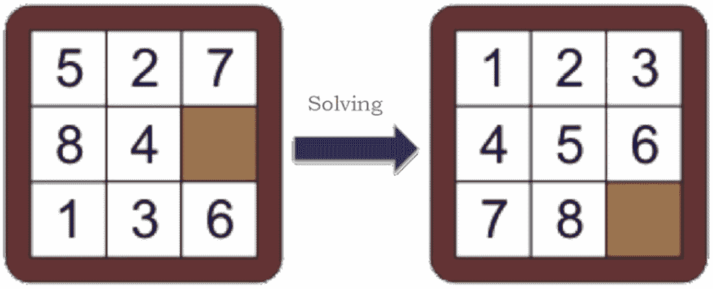

**图 15-2**

滑块拼图；一种依赖人工智能搜索方法的棋盘游戏

树是用于表示状态空间（所有可能状态的集合）的非常常见的结构。树的定义或生成方式因具体问题而异；对于滑块拼图而言，空白方块可以交换到的四个位置中的每一个都代表当前节点的子节点。因此，我们会得到一棵包含所有可能状态的树，其子树类似于图 15-3 中描绘的那样。

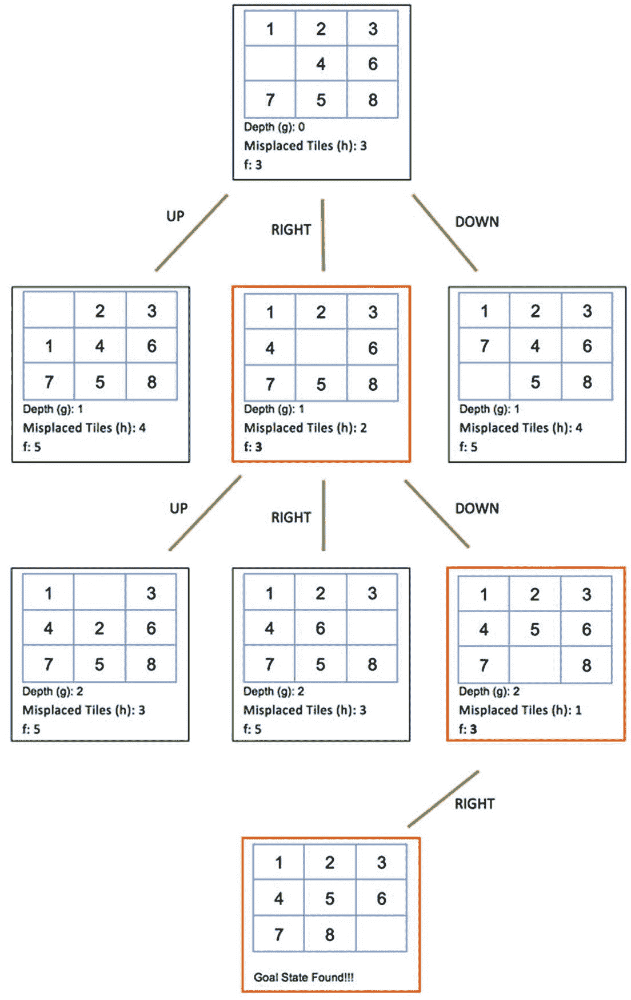

**图 15-3**

在滑块拼图中进行搜索，直到找到目标状态。在此示例中，我们使用启发式方法（错位方块数）来确定到达目标状态的最短路径（橙色方框）。

搜索生成的树为我们提供了一系列移动步骤——从根节点或起始状态，一路向下直至目标状态——从而为我们提供了游戏的解决方案。在图 15-3 中，解决方案将由移动步骤 {右，下，右} 表示；因此，从根节点出发的一条长度为 3 的路径将我们带到了目标状态。正如我们将看到的，将搜索方法与启发式方法结合的目的是缩短到达目标节点的搜索路径长度。

搜索策略可以根据以下标准进行分类：

*   **系统性**：这是一种将状态空间结构化为树形结构的策略；当且仅当满足以下条件时，我们认为该策略是系统性的：
    *   只要未找到解决方案且仍有待检查的候选节点，搜索就会继续；并且
    *   每个候选节点只被检查一次。
*   **信息利用**：它指的是搜索是否使用了领域特定知识；即，在搜索过程中对问题的了解。它可以分为：
    *   知情搜索（最佳优先搜索、A*）；或
    *   不知情或盲目搜索（广度优先搜索、深度优先搜索、迭代加深搜索）。

在本书中，我们将重点讨论系统性策略，并且还将讨论知情和不知情的搜索方法。在后续章节中评估搜索算法的性能时，将考虑以下特征：

*   **b**（分支因子）：一个节点的最大子节点数
*   **d**（深度）：从根节点到叶节点的所有路径的最大长度
*   **m**：从根节点到目标状态的任何路径的最小长度

此外，我们将断言，如果一个搜索总能找到解决方案，则它是完备的；如果它总能找到到达目标状态的最低路径成本，则它是最优的。

注意

最古老的滑块拼图类型是十五数码拼图，由诺伊斯·查普曼于 1880 年发明。

## 不知情搜索

在不知情搜索方法中，前沿中的所有非目标节点对算法来说看起来都是一样的；因此，这种类型的搜索也被称为盲目搜索。该过程无法确定从节点 X 出发的路径是否会比从节点 Y 出发的另一条路径更好。

不知情搜索算法本质上是图算法；它们在树上运行，而树是一种特殊的图。因此，本文描述的算法也是图论工具箱的一部分。

广度优先搜索（BFS）是最流行的基于图的搜索算法之一。在这种方法中，节点按层级被发现；算法在发现距离根节点为 k+1 的任何节点之前，会先发现所有距离根节点为 k 的节点（图 15-4）。

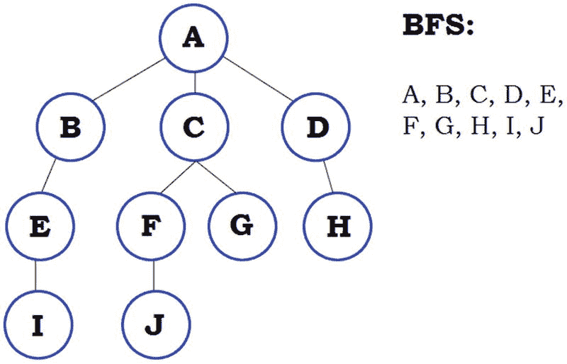

**图 15-4**

使用 BFS 过程遍历树；我们从节点 A 开始，然后发现下一层的所有节点，即节点 B、C、D。我们继续这样操作，发现下一层的节点，即节点 E、F、G、H。最后，我们在最后一层发现节点 I 和 J。

当 b 有限时，BFS 是完备的，其时间和空间复杂度均为 O(b^d)，并且当边成本等于 1 时（即，在搜索中每前进一步的代价为 1），它是最优的。

深度优先搜索（DFS）是另一种非常流行的基于图的搜索算法，并且是许多其他此类搜索过程的原型。在 DFS 中，节点按其向下距离被发现；算法从根节点开始，沿着最左侧子节点的路径前进，直到到达叶节点，然后“回溯”到先前访问过的节点 N，并继续发现 N 的下一个未访问的子节点。因此，它总是深入构建一条路径，寻找最左侧、未访问、最深的节点，并在整个树或图上递归地重复此过程（图 15-5）。请注意，在可能遇到循环的图中，DFS 必须保证已访问的节点被标记为“已访问”。

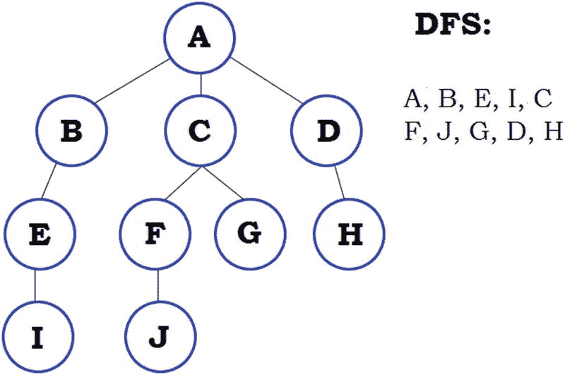

**图 15-5**

使用 DFS 过程遍历树；我们从节点 A 开始，然后沿着通向最左侧、未访问节点的路径前进；因此，我们构建了由节点 A、B、E、I 组成的路径，然后一路回溯到根节点（构建的路径中唯一有子节点待发现的节点），并移动到最左侧、未访问的子节点，即 C。它在 C 上递归执行相同的过程，并最终在节点 D 上执行，从而得到图中所示的路径。

假设我们实现了某种控制机制来确定沿途哪些节点已被访问，并且假设我们处理的是一个有限空间，那么我们可以断言 DFS 将是完备的；否则，它是不完备的，因为它可能陷入无限循环。其时间复杂度为 O(b^m)，如果 m 远大于 d，则可能比 O(b^d) 差得多。其空间复杂度为 O(b * m)，并且它不是一种最优的搜索算法。

为了比较 BFS 和 DFS，第一种方法通常应用于以下场景：可能存在无限路径，可以在短路径内找到解决方案，或者可以轻松丢弃不成功的路径。另一方面，DFS 更适用于状态空间受限、存在许多长路径的可能解决方案，或者错误路径通常很快终止且搜索可以相应调整的场景。

BFS 和 DFS 是许多其他搜索算法衍生出来的主要构建块。许多这些衍生算法试图减少其前身的某些缺点；深度受限搜索和迭代加深搜索就是这种情况。


深度受限搜索（DLS）本质上是一种设置了深度限制 L 的 DFS（图 15-6）；即深度为 L 的节点没有后继节点，因此相当于我们在深度 L 处截断了树，从而消除了无限路径问题。如果 L = d，我们将获得最优解；如果 L < d，我们将得到不完整的解；而当 L > d 时，我们将得到非最优解。

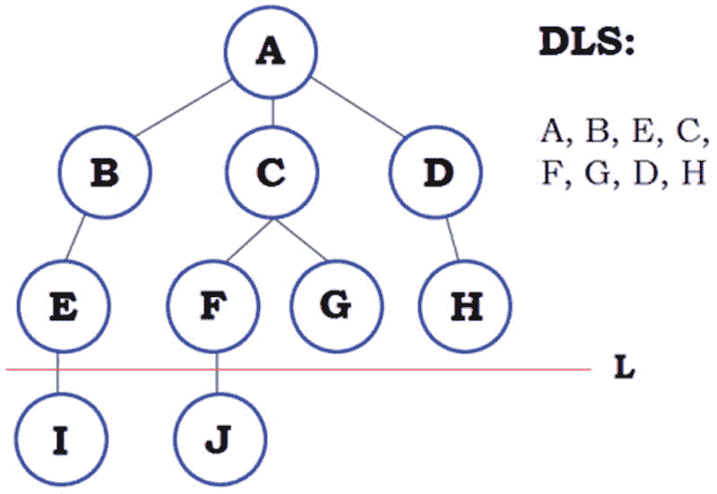

图 15-6

DLS 是一种施加了深度限制 L 的 DFS

迭代加深搜索（IDS）是一种用于发现最佳深度限制 L 的策略；其主要思想是将 DLS 作为子方法，并逐步将深度限制从 1 增加到预定义的最大深度。该算法是完备且最优的；它总能发现最浅的目标节点。

另一种依赖于 BFS 或 DFS 的无信息搜索过程是双向搜索（BS）。在 BS 中，我们同时执行两个搜索：一个从初始状态到目标状态，另一个从目标状态反向到初始状态。我们希望这两个搜索能在某一点相遇。因此，在此过程中，我们必须在每一步检查向前扩展的节点集是否与向后扩展的节点集相交。BS 背后的关键动机是时间复杂度，因为 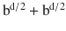 在复杂度上小于 b^d。因此，该方法可以为我们提供一种更高效、更快速的方式来找到目标状态。此外，如果两个搜索（向前和向后）都是 BFS 算法，并且 b 是有限的，那么 BS 保证既是最优的也是完备的。

## 实践问题：实现 BFS、DFS、DLS 和 IDS

为了开发我们的无信息搜索策略，我们将使用 `Tree<T>` 类，该类出现在代码清单 15-1 中。这个泛型类包含一个表示根节点可能值（整数、字符串、数组、矩阵等）的 `State` 属性和一个子节点列表。其中还包含了几个构造函数。

```
public class Tree
{
public T State { get; set; }
public List> Children { get; set; }
public Tree()
{
Children = new List>();
}
public Tree(T state, IEnumerable> children)
{
State = state;
Children = new List>(children);
}
public Tree(T state)
{
State = state;
Children = new List>();
}
public bool IsLeaf {
get {  return Children.Count == 0; }
}
}
代码清单 15-1
Tree 类
```

为了实现良好的面向对象设计，我们将 `UninformedMethod<T>` 抽象类（代码清单 15-2）编码为本节描述的所有无信息搜索策略的父类和共享字段的容器。

```
public abstract class UninformedMethod
{
public Tree Tree { get; set; }
protected UninformedMethod(Tree tree)
{
Tree = tree;
}
public abstract ListExecute();
}
代码清单 15-2
UninformedMethod 类
```

在 `Bfs<T>` 类（代码清单 15-3）中，我们使用 `Queue` 数据结构编码了 BFS 策略。该数据结构通过将子节点入队并最终将最先入队的节点出队来扩展节点；因此 `Queue` 的 FIFO（先进先出）特性使我们能够按层级遍历树。

```
public class Bfs: UninformedMethod
{
public Bfs(Tree tree):base(tree)
{ }
public override ListExecute()
{
var queue = new Queue>();
queue.Enqueue(Tree);
var path = new List();
while (queue.Count> 0)
{
var current = queue.Dequeue();
path.Add(current.State);
foreach (var c in current.Children)
queue.Enqueue(c);
}
return path;
}
}
代码清单 15-3
Bfs 类
```

代码清单 15-4 中实现的 DFS 依赖于栈数据结构，该结构用于模拟 DFS 本质上递归的特性；因此它帮助我们避免使用函数递归，并允许我们将编码简化为一个简单的循环。请记住：栈是 LIFO（后进先出）数据结构，因此我们按相反顺序将子节点压入栈中，如下代码所示。

```
public class Dfs :UninformedMethod
{
public Dfs(Tree tree):base(tree)
{
}
public override ListExecute()
{
var path = new List();
var stack = new Stack>();
stack.Push(Tree);
while (stack.Count> 0)
{
var current = stack.Pop();
path.Add(current.State);
for (vari = current.Children.Count - 1; i>= 0; i$$)
stack.Push(current.Children[i]);
}
return path;
}
}
代码清单 15-4
Dfs 类
```

任何其他无信息搜索策略基本上都是前述策略（DFS 和 BFS）的变体。代码清单 15-5 中展示的深度受限搜索类是 DFS 的直接后代。在这个类中，我们包含了两个属性：

*   `DepthLimit`：定义达到的最大深度
*   `Value`：确定要在状态树中查找的值

在这种情况下，我们实现了 DFS 算法的递归版本；如果使用递归，我们更容易构建从根节点到 `Value` 节点的路径。请注意，算法中有三个停止条件：已找到 `Value` 节点、已达到深度限制或已到达叶节点。


```
public class Dls: UninformedMethod
{
public intDepthLimit{ get; set; }
public T Value { get; set; }
public Dls(Tree tree, intdepthLimit, T value) : base(tree)
{
DepthLimit = depthLimit;
Value = value;
}
public override ListExecute()
{
var path = new List();
if (RecursiveDfs(Tree, 0, path))
return path;
return null;
}
private bool RecursiveDfs(Tree tree, int depth, ICollection path)
{
if (tree.State.Equals(Value))
return true;
if (depth == DepthLimit || tree.IsLeaf)
return false;
path.Add(tree.State);
if (tree.Children.Any(child =>RecursiveDfs(child, depth + 1, path)))
return true;
path.Remove(tree.State);
return false;
}
}
清单 15-5
Dls 类
```

最后，如前所述，**迭代加深搜索**将深度限制搜索作为子方法，用于找到通往目标状态的最浅深度（清单 15-6）。

```
public class Ids :UninformedMethod
{
public DlsDls{ get; set; }
public intMaxDepthSearch{ get; set; }
public intDepthGoalReached{ get; set; }
public T Value { get; set; }
public Ids(Tree tree, intmaxDepthSearch, T value)
: base(tree)
{
MaxDepthSearch = maxDepthSearch;
Value = value;
}
public override ListExecute()
{
for (var depth = 1; depth (Tree, depth, Value);
DepthGoalReached = depth;
var path = Dls.Execute();
if (path != null)
return path;
}
DepthGoalReached = -1;
return null;
}
}
清单 15-6
Ids 类
```

`Ids<T>` 泛型类包含与在树中搜索的 `Value` 对应的属性，以及用于确定找到的目标节点深度（`DepthGoalReached`）和搜索将到达的最大深度（`MaxDepthSearch`）的属性。从 `Execute()` 方法中，我们可以看到该算法由一个循环组成，该循环在深度 0、1、……、`MaxDepthSearch` 上应用 DLS。

让我们在控制台应用程序中测试我们的算法，并声明一个树，如清单 15-7 所示。

```
var tree = new Tree{ State = "A" };
tree.Children.Add(new Tree { State = "B",
Children = new List>
{
new Tree("E")
} });
tree.Children.Add(new Tree { State = "C",
Children = new List>
{
new Tree("F")
}
});
tree.Children.Add(new Tree { State = "D" });
varbfs = new Bfs(tree);
vardfs = new Dfs(tree);
vardls = new Dls(tree, 21, "E");
var ids = new Ids(tree, 10, "F");
var path = bfs.Execute();
//var path = dfs.Execute();
// var path = dls.Execute();
//var path = ids.Execute();
foreach (var e in path)
Console.Write(e + ", ");
清单 15-7
测试无信息搜索算法
```

取消每个方法中 `Execute()` 行的注释，我们将得到图 15-7 中所示的结果，按 BFS、DFS、DLS、IDS 的顺序显示。

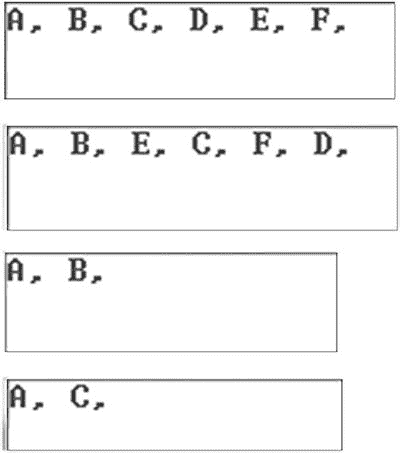

图 15-7

执行 BFS、DFS、DLS 和 IDS 后获得的结果

请注意，在这种情况下，按照实现方式，BFS 和 DFS 都按其定义的顺序遍历树，而 DLS 和 IDS 则通过查找特定值在树上执行搜索。

## 实际问题：在滑动拼图上实现双向搜索

我们多次提到**滑动拼图**作为一个棋盘游戏的例子，可以使用到目前为止讨论的搜索策略来解决，在本节中，我们将实现一个双向搜索来解决 8 数码问题（3 x 3 网格）。将双向搜索应用于滑动拼图的积极方面在于，计算交换操作的逆操作非常容易；换句话说，计算目标状态的前驱非常容易。我们只需要向每个可能的方向移动空白块。因此，为了从目标状态向后移动，我们不需要实现任何额外的功能，而是稍微调整我们用于前向搜索的相同扩展过程。

首先，让我们检查一下我们将用于处理节点扩展和游戏相关逻辑的 `SlidingTilesPuzzle` 和 `Board` 类（清单 15-8）。`SlidingTilesPuzzle` 类非常简单，其唯一目的是提供一种有意义的方式来引用“游戏”并组织程序逻辑。开发 AI 的关键支持类是 `Board<T>`。

```
public class SlidingTilesPuzzle
{
public Board Board { get; set; }
public Board Goal { get; set; }
public SlidingTilesPuzzle(Board initial, Board goal)
{
Board = initial;
Goal = goal;
}
}
public class Board :IEqualityComparer>
{
public T[,] State { get; set; }
public T Blank { get; set; }
public string Path { get; set; }
private readonly Tuple _blankPos;
private readonlyint _n;
public Board() {}
public Board(T[,] state, T blank, TupleblankPos, string path)
{
State = state;
Blank = blank;
_n = State.GetLength(0);
_blankPos = blankPos;
Path = path;
}
public List>Expand(bool backwards = false)
{
var result = new List>();
var up = Move(GameProgramming.Move.Up, backwards);
var down = Move(GameProgramming.Move.Down, backwards);
varlft = Move(GameProgramming.Move.Left, backwards);
varrgt = Move(GameProgramming.Move.Right, backwards);
if (up._blankPos.Item1 >= 0 && (string.IsNullOrEmpty(Path) || Path.Last() != (backwards ? 'U' : 'D')))
result.Add(up);
if (down._blankPos.Item1 >= 0 && (string.IsNullOrEmpty(Path) || Path.Last() != (backwards ? 'D' : 'U')))
result.Add(down);
if (lft._blankPos.Item1 >= 0 && (string.IsNullOrEmpty(Path) || Path.Last() != (backwards ? 'L' : 'R')))
result.Add(lft);
if (rgt._blankPos.Item1 >= 0 && (string.IsNullOrEmpty(Path) || Path.Last() != (backwards ? 'R' : 'L')))
result.Add(rgt);
return result;
}
public BoardMove(Move move, bool backwards = false)
{
varnewState = new T[_n, _n];
Array.Copy(State, newState, State.GetLength(0) * State.GetLength(1));
varnewBlankPos = new Tuple(-1, -1);
var path = "";
switch (move)
{
case GameProgramming.Move.Up:
if (_blankPos.Item1 - 1 >= 0)
{
// 交换空白块和 x 块的位置
var temp = newState[_blankPos.Item1 - 1, _blankPos.Item2];
newState[_blankPos.Item1 - 1, _blankPos.Item2] = Blank;
newState[_blankPos.Item1, _blankPos.Item2] = temp;
newBlankPos = new Tuple(_blankPos.Item1 - 1, _blankPos.Item2);
path = backwards ? "D" : "U";
}
break;
case GameProgramming.Move.Down:
if (_blankPos.Item1 + 1 (_blankPos.Item1 + 1, _blankPos.Item2);
path = backwards ? "U" : "D";
}
break;
case GameProgramming.Move.Left:
if (_blankPos.Item2 - 1 >= 0)
{
var temp = newState[_blankPos.Item1, _blankPos.Item2 - 1];
newState[_blankPos.Item1, _blankPos.Item2 - 1] = Blank;
newState[_blankPos.Item1, _blankPos.Item2] = temp;
newBlankPos = new Tuple(_blankPos.Item1, _blankPos.Item2 - 1);
path = backwards ? "R" : "L";
}
break;
case GameProgramming.Move.Right:
if (_blankPos.Item2 + 1 (_blankPos.Item1, _blankPos.Item2 + 1);
path = backwards ? "L" : "R";
}
break;
}
return new Board(newState, Blank, newBlankPos, Path + path);
}
public bool Equals(Board x, Board y)
{
if (x.State.GetLength(0) != y.State.GetLength(0) ||
x.State.GetLength(1) != y.State.GetLength(1))
return false;
for (vari = 0; iobj)
{
return 0;
}
}
public enum Move
{
Up, Down, Left, Right
}
清单 15-8
滑动拼图和棋盘类
```

`Board<T>` 类包含以下属性和变量：

*   `State`：T 值的矩阵；回想一下 T 是泛型的，因此它可以是任何类型，例如整数、字符串或任何其他类型
*   `Blank`：确定棋盘上要使用的空白元素
*   `Path`：从根节点到代表此棋盘的节点所构建的路径
*   `_blankPos`：确定棋盘上空白块位置的整数元组
*   `_n`：棋盘的行（列）数


在 `Expand()` 方法中，我们生成当前节点的邻域；换句话说，我们生成相邻棋盘状态的集合（通过向每个可能方向移动空白方块获得）。由于我们可以在正向或反向搜索中生成移动，因此我们定义了 `Boolean` 变量 `backward` 来标识生成的移动是正向还是反向。利用这个变量，我们控制节点生成的多个方面，并考虑从根节点到目标节点（正向）或从目标节点到根节点（反向）执行搜索的情况。这实际上是双向搜索的意图——执行两次搜索，并使它们在路径上的某一点相遇。这个相遇点决定了解决谜题所需的路径或移动序列。语句 `Path.Last() != (backwards ? 'U' : 'D')` 保证了在正向或反向搜索中，我们避免在连续移动中重复状态。例如，如果我们在正向搜索中移动，我们不会希望将空白方块向右移动，然后在扩展同一节点时又将其移回左侧，因为那样会使我们回到相同状态，从而导致算法消耗更多计算时间。

在 `Move()` 方法中，我们利用清单 15-8 中所示的 `Move` 枚举来开发空白方块移动背后的逻辑，并确定在棋盘边界条件下某些移动是否可行。同样，语句 `path = backwards ? "R" : "L"` 的目的是决定当前步骤执行的移动类型，并确定我们是否在进行反向搜索；然后，此决定作为已“走过”路径的扩展，添加到生成节点的 `Path` 变量中。请记住，从正向视角看，当反向移动时，右意味着左，左意味着右，上意味着下，下意味着上。因为最终我们希望将这个反向路径与正向路径连接起来，所以我们决定从一开始就将其转换为“正向”版本。为了实现这种转换，我们使用了前面的语句 `(path = backwards ? "R" : "L")`。

由于我们需要比较不同的棋盘状态来确定正向和反向搜索是否相遇，我们在 `Board<T>` 类上实现了 `IEqualityComparer<Board<T>>` 接口，这迫使我们实现 `Equals()` 和 `GetHashCode()` 方法。后一个方法将留给读者作为练习，在本书中我们简单地让它返回 0。第一个方法比较每个棋盘的 `State` 矩阵，如果每个单元格都一致则输出 true；否则输出 false。

双向搜索类如清单 15-9 所示。

```
public class Bs
{
public SlidingTilesPuzzle Game { get; set; }
public Bs(SlidingTilesPuzzle game)
{
Game = game;
}
public string BidirectionalBfs()
{
varqueueForward = new Queue>();
queueForward.Enqueue(Game.Board);
varqueueBackward = new Queue>();
queueBackward.Enqueue(Game.Goal);
while (queueForward.Count> 0 &&queueBackward.Count> 0)
{
varcurrentForward = queueForward.Dequeue();
varcurrentBackward = queueBackward.Dequeue();
varexpansionForward = currentForward.Expand();
varexpansionBackward = currentBackward.Expand(true);
foreach (var c in expansionForward)
{
if (c.Path.Length == 1 &&c.Equals(c, Game.Goal))
return c.Path;
queueForward.Enqueue(c);
}
foreach (var c in expansionBackward)
queueBackward.Enqueue(c);
var path = SolutionMet(queueForward, expansionBackward);
if (path != null)
return path;
}
return null;
}
private string SolutionMet(Queue>expansionForward, List>expansionBackward)
{
for (vari = 0; i()))
{
var first = expansionForward.First(b =>b.Equals(b, expansionBackward[i]));
return first.Path + new string(expansionBackward[i].Path.Reverse().ToArray());
}
}
return null;
}
}
清单 15-9
Bs 类
```

我们的 BS 算法将执行两次搜索，每次搜索由一个 BFS 过程组成，该过程使用队列按层级遍历状态树。我们实现一个 BFS 进行正向搜索，另一个进行反向搜索，这两个搜索相遇的点由 `SolutionMet()` 方法迭代检查。循环检查每个 `Path` 长度为 1 的扩展节点是否与目标状态匹配，这作为目标状态距离初始棋盘一步之遥情况的基础案例。图 15-8 以图形方式描述了双向搜索算法的运行机制。

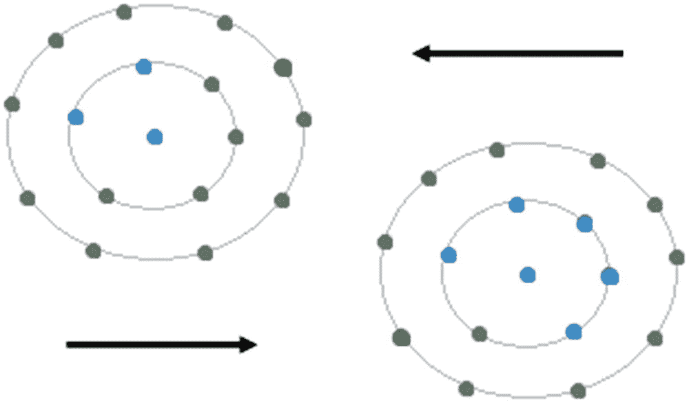

图 15-8

正向搜索（左侧）和反向搜索（右侧）。中间的点表示 BFS 中当前正在处理的节点，其周围的圆圈代表树的不同层级。蓝色点表示搜索过程中已发现并处理的节点，灰色点表示已入队的节点。绿色点表示两次搜索相遇的节点。

两次搜索在绿色点相遇。为了找到正向和反向搜索之间的这种链接或关系，我们使用 `SolutionMet()` 方法检查已扩展节点的集合（图中的灰色点）。此方法的目的是将正向搜索中所有已入队的点与反向搜索中所有已扩展的节点（距离中间处理节点最近的圆圈中的点）进行比对，查找它们状态或棋盘上的匹配项。如果找到完全匹配，则输出由两次搜索相遇的节点（正向和反向）的子路径相加得到的路径。

为了测试我们的 BS，我们将创建如清单 15-10 所示的实验。

```
var state = new[,]
{
{6, 4, 7},
{8, 5, 0},
{3, 2, 1}
};
vargoalState = new[,]
{
{1, 2, 3},
{4, 5, 6},
{7, 8, 0}
};
var board = new Board(state, 0, new Tuple(1, 2), "");
var goal = new Board(goalState, 0, new Tuple(2, 2), "");
varslidingTilesPuzzle = new SlidingTilesPuzzle(board, goal);
varbidirectionalSearch = new Bs(slidingTilesPuzzle);
varstopWatch = new Stopwatch();
stopWatch.Start();
var path = bidirectionalSearch.BidirectionalBfs();
stopWatch.Stop();
foreach (var e in path)
Console.Write(e + ", ");
Console.WriteLine('\n' + "Total steps: " + path.Length);
Console.WriteLine("Elapsed Time: " + stopWatch.ElapsedMilliseconds / 1000 + " segs");
清单 15-10
在最难的 8 数码配置上测试我们的双向搜索算法
```

在这个实验中，我们使用了最难的 8 数码配置之一；在最优情况下，它需要 31 步才能解决。我们还使用了一个 `Stopwatch` 类型的对象来测量算法在寻找解决方案时消耗的时间。执行上述代码后的结果如图 15-9 所示。

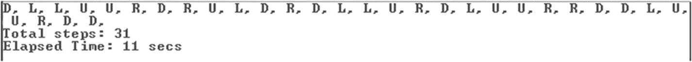

图 15-9

在 11 秒内获得的解决方案

为了验证解决方案的正确性，我们可以简单地遍历获得的路径或移动列表，并从初始棋盘执行等效的移动，检查最终获得的棋盘是否与目标状态匹配。

注意

在输出 BS 算法的移动序列之前，我们必须反转在反向搜索中获得的路径字符串。请记住，这个路径是通过将移动添加到字符串的末尾（而不是开头）构建的；因此，我们必须反转它，才能获得通往目标节点的正确路径。


## 知情搜索

在知情`搜索`中，我们利用问题定义之外的领域知识，旨在尽可能高效地解决问题。因此，在知情搜索算法中，我们会尝试智能地选择要探索的路径。知情搜索方法的一般方法由一系列算法表示，这些算法统称为最佳优先搜索。

最佳优先搜索类型的方法始终依赖于一个评估函数 F(n)，该函数为状态树中的每个节点 n 关联一个值。这个值旨在表示给定节点距离达到目标节点有多近；因此，最佳优先搜索方法通常会选择具有最低 F(n) 值的节点 n 来继续搜索过程（图 15-10）。尽管我们将这类算法称为“最佳优先”，但实际上并没有确定的方法来找到通往目标节点的最低成本路径。如果可能的话，我们就能始终获得最优解，而无需付出任何额外努力（启发式等）。

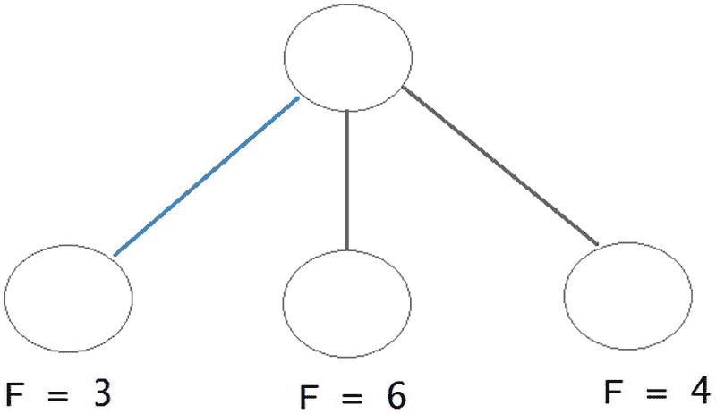

图 15-10

在最佳优先搜索方法中，我们总是选择具有尽可能低的 F(n) 值的节点 n 来继续搜索。在此例中，F = 3，因此搜索从该节点继续。

由于知情搜索策略会优先搜索状态空间中最有希望的分支，因此它们能够：

*   更快地找到解决方案；
*   即使在时间有限的情况下也能找到解决方案；以及
*   找到更好的解决方案，因为可以检查状态空间中更有利可图的部分，同时忽略无利可图的部分。

最佳优先搜索是一种搜索策略，并且如前所述，它是一个算法家族，其主要代表是贪婪最佳优先搜索和 A* 搜索。

贪婪最佳优先搜索本质上是一种最佳优先搜索，其中评估函数 F(n) 是一个启发式函数；即 F(n) = H(n)。针对不同问题的启发式函数示例包括地图上两点之间的直线距离、错位元素的数量等。它们代表了一种在问题求解过程中嵌入额外知识的方法。当 H(n) = 0 时，意味着我们已经到达了一个目标节点。贪婪最佳优先搜索会扩展看似最接近目标的节点，但它既不是最优的，也不是完备的（可能会陷入无限循环）。该方法的一个明显问题是它没有考虑到当前节点的成本，因此如前所述，它并非最优，并且可能会像深度优先搜索一样走入死胡同。在使用启发式的方法中，如果我们采用一个智能的启发式，能够在几步之内引导我们走向正确的方向，那么就可以大幅降低复杂度。

注意

当状态空间过大时，无信息的盲目搜索可能耗时过长而不实用，或者会严重限制我们探索空间的深度。因此，我们必须寻找那些通过沿途做出智能决策来缩小状态空间区域的方法；也就是说，我们必须寻找知情方法。

A* 搜索（Hart、Nilsson 和 Raphael，1968 年）是一种非常流行的方法，也是最佳优先搜索算法家族中最著名的成员。该方法背后的主要思想是避免扩展那些已经代价高昂的路径（考虑到从根节点遍历到当前节点的成本），并始终优先扩展最有希望的路径。该方法的评估函数是两个函数之和；即 F(n) = G(n) + H(n)，其中：

*   G(n) 是到达节点 n 的（迄今为止的）成本；以及
*   H(n) 是一个启发式函数，用于估计从节点 n 到达目标状态的成本。

因为我们实际上是在寻找初始状态与某个目标状态之间的最优路径，所以衡量一个状态有多有希望的一个更好的指标是：迄今为止的成本加上从该节点到最近目标状态的最佳估计成本之和（图 15-11）。

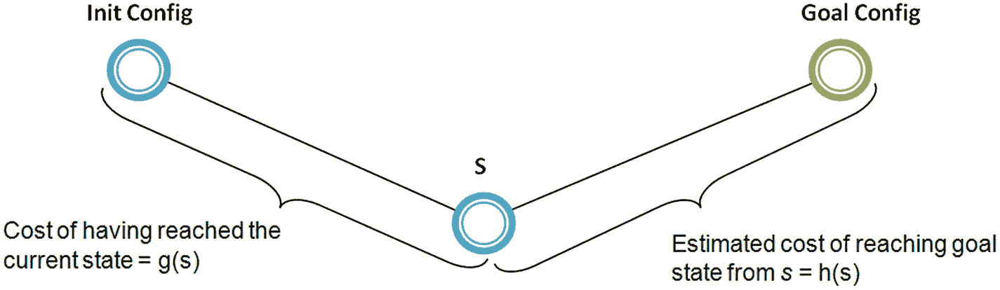

图 15-11

显示 G(s) 和 H(s) 之间关系的示意图

为了在巨大的状态空间中引导搜索，我们使用启发式方法。启发式方法提供的信息旨在帮助我们找到一条可行且较短的路径，通往目标状态或配置。

在开发启发式方法时，确保其满足可采纳性标准非常重要。如果一个启发式方法不会高估从当前状态到达目标状态的最小成本，那么它就是可采纳的；如果可采纳，那么 A* 搜索算法将始终找到最优解。


## 滑动拼图游戏的 A* 算法

表示滑动拼图游戏状态空间的树结构与双向搜索中开发的树结构相同。当前节点的邻域将由空白方块已交换到所有可能位置的棋盘组成。

滑动拼图游戏最常用的启发式函数是**错位方块数**，它可能也是该谜题最简单的启发式函数。顾名思义，错位方块数启发式函数返回的是错位方块的数量——即当前棋盘中的位置与目标状态或棋盘中的位置不匹配的方块数量。它是可采纳的，因为返回的数字不会高估到达目标状态所需的最小移动次数。你至少需要将每个错位的方块移动一次，才能将它们交换到目标位置；因此，它是可采纳的。

需要指出的是，在计算滑动拼图游戏的任何启发式函数时，我们绝不应考虑空白方块。如果在启发式计算中考虑了空白方块，那么我们可能会高估到达目标状态最短路径的实际代价，这将使启发式函数变得不可采纳。考虑一下，如果我们在一个距离目标状态仅一步之遥的棋盘中考虑了空白方块，会发生什么，如图 15-12 所示。

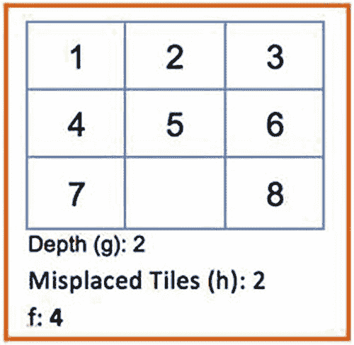

图 15-12

如果我们考虑空白方块，到达目标状态的路径将是 2，但实际上它是 1；因此，我们高估了到达目标状态最短路径的实际代价。

使用错位方块数启发式函数的 A* 算法大约需要 2.5 秒才能找到目标状态。实际上，我们可以做得更好，所以让我们尝试找到一个更巧妙的启发式函数，以缩短时间并减少访问的节点数。

注意

关于此问题的完整 C# 代码，请参考作者撰写的以下文章：[`https://visualstudiomagazine.com/Articles/2015/10/30/Sliding-Tiles-C-Sharp-AI.aspx`](https://visualstudiomagazine.com/Articles/2015/10/30/Sliding-Tiles-C-Sharp-AI.aspx) 。

**曼哈顿距离**，或称**街区距离**，点 A=(x1, y1) 和 B=(x2, y2) 之间的启发式函数定义为它们对应坐标之差的绝对值之和：

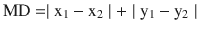

曼哈顿距离是可采纳的，因为它为每个方块返回将该方块移动到其目标位置所需的最小步数。曼哈顿距离是比错位方块数更精确的启发式函数；因此，在时间复杂度和访问节点数上的减少将是显著的。我们提供了更好的信息来指导搜索，因此目标能更快地被找到。使用此启发式函数，我们在 172 毫秒内得到了一个最优解（有关完整的 C# 代码，请参考前面详述的文章）。

**线性冲突**启发式函数提供了曼哈顿距离未计数的必要移动信息。如果两个方块 tj 和 tk 在同一行，tj 和 tk 的目标位置都在该行，tj 在 tk 的右侧，并且 tj 的目标位置在 tk 的目标位置的左侧，则称 tj 和 tk 处于线性冲突中。


图 15-13

方块 3 和 1 位于正确的行，但列错误

要将它们移动到目标位置，我们必须将其中一个向下移动，然后再向上移动；这些移动在曼哈顿距离中并未考虑。一个方块不能出现在多个冲突中，因为解决一个确定的冲突可能意味着同一行或列中其他冲突的解决。因此，如果方块 1 与方块 3 存在冲突关系，那么它就不能再与方块 2 存在冲突关系，因为这可能会高估到达目标状态的最短路径，并使我们的启发式函数变得不可采纳。

为了测试**线性冲突 + 曼哈顿距离**组合启发式函数，我们将使用图 15-14 中所示的 4 × 4 棋盘；该棋盘需要 55 步才能到达目标状态。节点 n 的值将由 F(n) = Depth(n) + MD(n) + LC(n) 给出。组合这些启发式函数是可能的，因为它们所代表的移动不会相交，因此我们不会高估到达目标状态最短路径的代价。

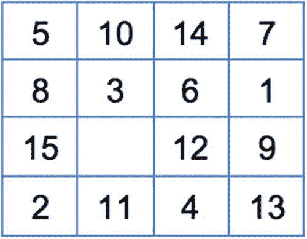

图 15-14

用于测试曼哈顿距离 + 线性冲突启发式函数的 4 × 4 棋盘。15 方块问题的状态空间比 8 方块问题要广阔得多。

在完成一次遍历了超过一百万个节点、耗时 124199 毫秒（略多于 2 分钟）的执行后，该算法为我们提供了一个解。

**模式数据库**启发式函数由一个包含游戏不同状态的数据库定义。每个状态都与将一个模式（方块的子集）移动到其目标位置所需的最小移动次数相关联。在这种情况下，我们通过从 8 方块目标状态开始进行逆向广度优先搜索，构建了一个小型模式数据库。结果保存在一个仅有 60,000 条记录的 `.txt` 文件中。为数据库选择的模式通常被称为“边缘”，在这种情况下，它包含顶行和最左列的方块。

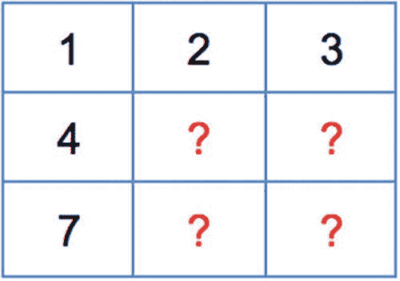

图 15-15

在 3 × 3 棋盘中使用的模式

模式数据库启发式函数通过一个表查找函数来计算。在这种情况下，它是一个包含 60,000 个存储模式的字典查找。它在哲学上类似于分治法和动态规划技术。

使用**模式数据库**技术，我们可以在 50 毫秒内解决最难的 8 方块问题或配置。

我们向数据库添加的条目越多，算法找到目标状态所消耗的时间就越少。在这种情况下，内存与时间之间的权衡有利于前者，并帮助我们获得良好的运行时间。这通常是其工作方式；你使用更多内存来减少算法的执行时间。当你想要解决 4 x 4 谜题或 n 和 m 都大于 3 的 m x n 谜题时，模式数据库启发式函数代表了最终的替代方案。给读者的最后建议是将本节介绍的 A* 搜索和启发式函数与双向搜索结合起来，并比较结果。

## 总结

在本章中，我们介绍了游戏编程，更具体地说，是游戏中的搜索。我们分析了在状态空间中搜索的基本方法，包括归类为无信息搜索的方法——广度优先搜索、深度优先搜索、深度限制搜索、迭代加深搜索和双向搜索——以及归类为有信息搜索的方法：最佳优先搜索和 A*。我们实现了一个针对滑动拼图游戏定制的、使用广度优先搜索作为子过程的双向搜索。最后，我们展示了如何使用不同的启发式函数为滑动拼图游戏开发 A* 搜索，如何组合其中一些启发式函数，以及如何通过使用 C# 的 `Stopwatch` 类来评估它们在时间复杂度方面的性能。


