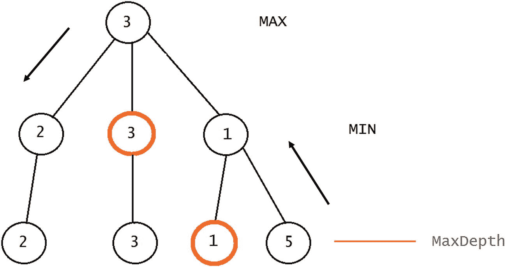
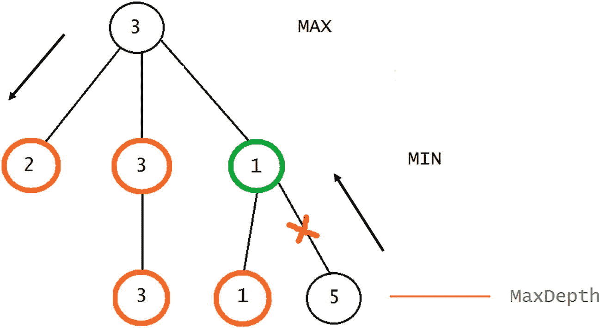
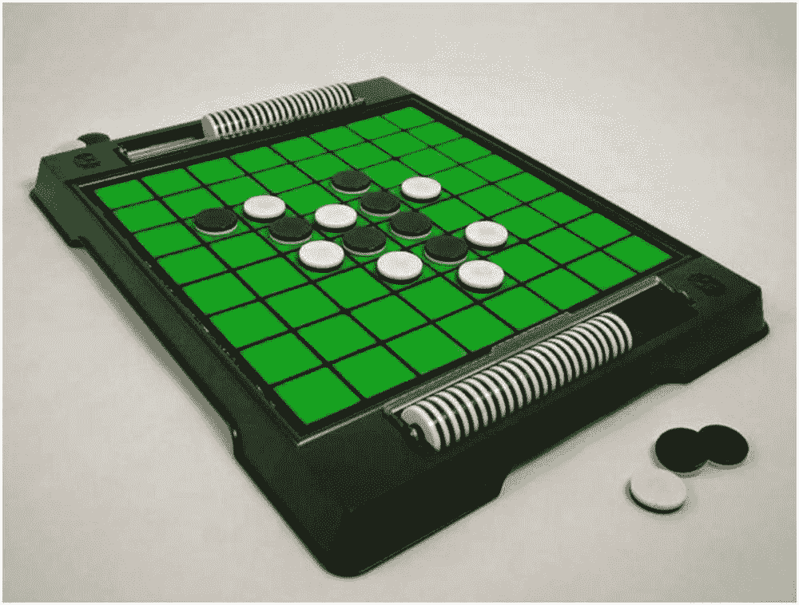
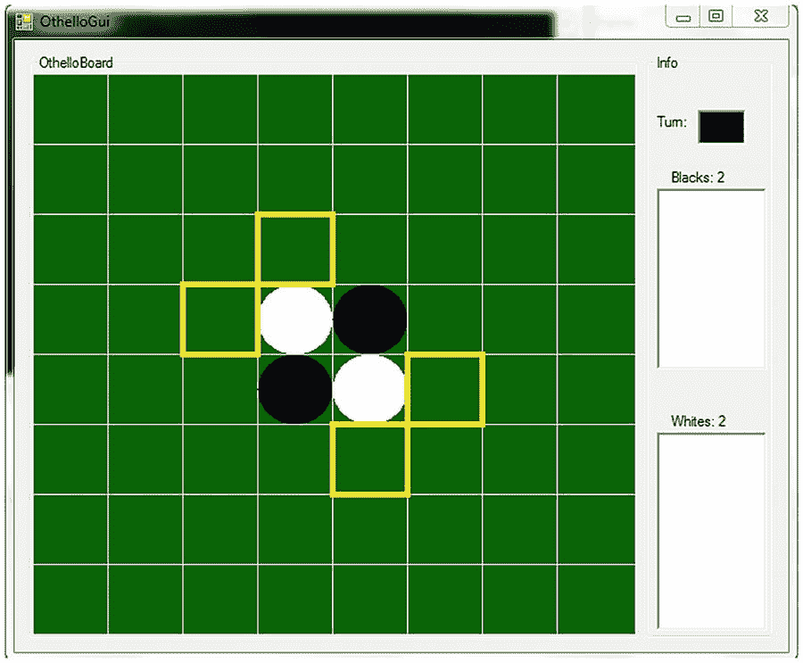
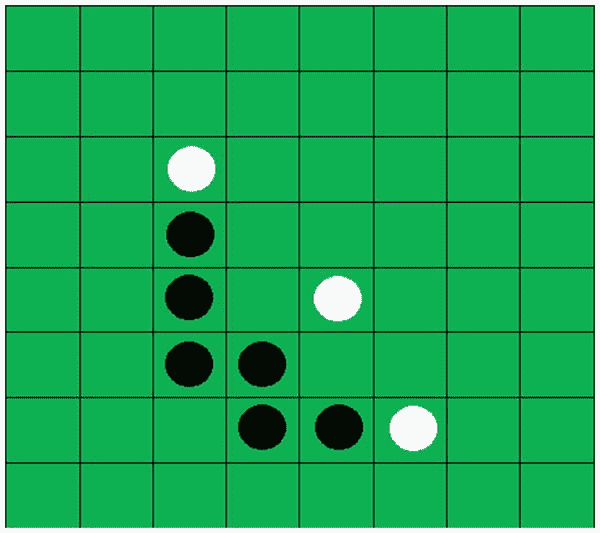
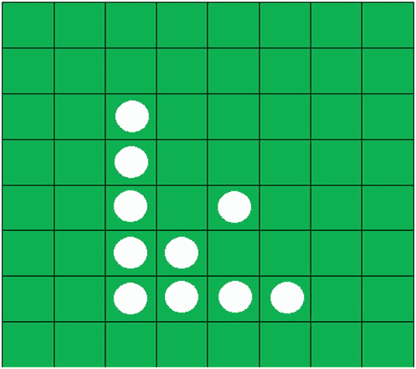
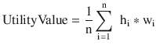
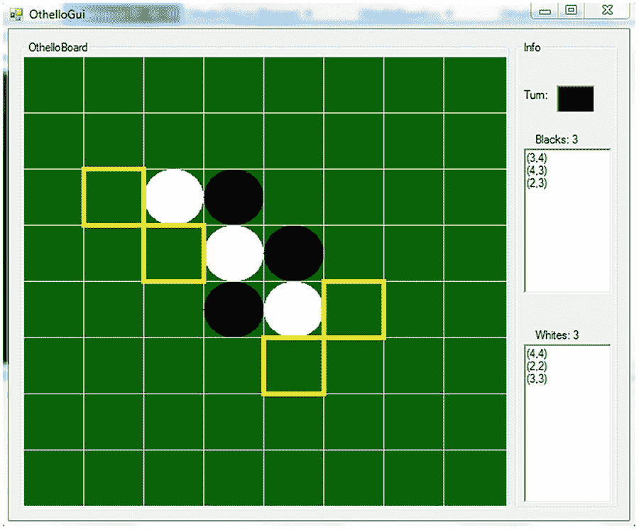

# 16. 博弈论：对抗性搜索与黑白棋

与博弈论关系最密切的人物，毫无疑问是约翰·冯·诺依曼，这位匈牙利裔美国数学家——二十世纪最伟大的数学家之一。尽管在他之前也有人提出了与博弈论相关的概念（尤其是埃米尔·博雷尔），但正是冯·诺依曼在 1928 年发表了为两人零和博弈理论奠定基础的论文。他的研究成果最终体现在与奥斯卡·摩根斯坦合著的一本博弈论重要著作中，书名为《博弈论与经济行为》（1944 年）。

冯·诺依曼和摩根斯坦发展的理论与一类被称为**两人零和博弈**的游戏高度相关，即只有两名玩家，且一方赢得的正是另一方输掉的游戏。他们的数学框架最初使得该理论仅在特殊且有限的条件下适用。在过去的六十年里，这种情况发生了巨大变化，该框架得到了加强和推广。自 20 世纪 70 年代末以来，可以断言博弈论已成为许多科学领域，尤其是经济学中，最重要且最有用的工具之一。在 20 世纪 50 年代和 60 年代，博弈论在理论上得到扩展，并应用于战争和政治问题。此外，它还在社会学和心理学中找到了应用，并与进化论和生物学建立了联系。1994 年，约翰·纳什、约翰·海萨尼和莱因哈德·泽尔腾共同获得诺贝尔经济学奖，使博弈论受到了特别关注。

约翰·纳什，2001 年奥斯卡获奖影片《美丽心灵》的主角，将博弈论转变为一种更通用的工具，使其能够分析双赢、双输以及输赢的情景。纳什使博弈论能够解决一个核心问题：我们应该竞争还是合作？

在本章中，我们将讨论从博弈论中衍生出的各种概念和思想。我们将探讨博弈论的一个分支，称为对抗性搜索，并描述极小化极大算法，该算法通常应用于确定性环境中、具有完美信息的两人零和博弈。

> **注**
>
> 1950 年，约翰·纳什证明了有限博弈总是存在一个均衡点，在该点上，所有玩家都选择在对手选择下对自己最有利的行动。纳什均衡，也称为策略均衡，是一个策略列表，每个玩家对应一个策略，其特性是任何玩家都不能单方面改变自己的策略并获得更好的收益。

## 什么是博弈论？

博弈是一组结构化的任务，定义在娱乐性的环境和方式中，以吸引一个或多个玩家遵守逻辑规则，如果正确执行这些规则，游戏即告完成。

博弈论是关于如何分析博弈以及如何最优地进行博弈的数学理论；它也是一种将多种人类行为视为博弈一部分的观察方式。博弈论中可以分析的一些最流行的游戏包括黑白棋、二十一点、扑克、国际象棋、井字棋、双陆棋等等。实际上，博弈论分析的主题不仅仅是我们所熟知或认为的游戏。相反，还有许多其他情况可以被构建为博弈。每当理性的人必须在严格且已知的规则框架内做出决策，并且每个玩家根据其他玩家的决策获得收益时，我们就有了一个博弈。例子包括拍卖、谈判、军事战术等等。该理论由数学家在上世纪上半叶创立，但自那以后，博弈论的许多研究已在数学领域之外进行。

博弈论的关键方面围绕着识别过程参与者及其各种可量化的选项（选择），以及考虑他们的偏好和随后的反应。如果所有这些因素都经过仔细考虑，那么通过博弈论对问题进行建模——同时识别所有可能的情况——就会变得更容易。

科学文献中用来描述如何在博弈论中分析博弈的经典例子之一是**囚徒困境**。这个博弈的名称源于以下通常用于举例说明的情景。

假设警方逮捕了两名他们知道一起犯下持械抢劫罪的人。不幸的是，他们缺乏足够的可采纳证据来让陪审团定罪。然而，他们确实有足够的证据以盗窃逃跑车辆的罪名将每名囚犯判刑两年。警察局长现在向每名囚犯提出以下条件：如果你承认抢劫，并牵连你的同伙，而他不认罪，那么你将获得自由，他将被判十年。如果你们都认罪，你们每人将被判五年。如果你们都不认罪，那么你们每人将因盗窃汽车被判两年。表 16-1 说明了这个问题中的收益或利益矩阵。

**表 16-1**

**囚徒困境收益矩阵**

|  | 囚犯 B，保持沉默 | 囚犯 B，背叛 |
| --- | --- | --- |
| 囚犯 A，保持沉默 | 2, 2 | 0, 10 |
| 囚犯 A，背叛 | 10, 0 | 5, 5 |

矩阵的单元格定义了每个玩家在每种行动组合下的收益。在每一对 (a, b) 中，玩家 A 的收益等于 a，玩家 B 的收益等于 b。

*   如果两个玩家都保持沉默，那么他们每人获得收益 2。这出现在左上角的单元格中。
*   如果两人都不保持沉默，他们每人获得收益 5；这出现在右下角的单元格中。
*   如果玩家 A 背叛而玩家 B 保持沉默，那么玩家 A 获得收益 10（获得自由），玩家 B 获得收益 0（十年监禁）；这出现在左下角的单元格中。
*   如果玩家 B 背叛而玩家 A 保持沉默，那么玩家 B 获得收益 10，玩家 A 获得 0；这出现在右上角的单元格中。

每个玩家通过比较自己在每一列中的个人收益来评估自己的两个可能行动，因为这显示了对于同伙的每个可能行动，哪个行动对自己更有利。因此，如果玩家 B 背叛，那么玩家 A 如果也背叛则获得收益 5，如果保持沉默则获得收益 0。如果玩家 B 保持沉默，那么玩家 A 如果也保持沉默则获得收益 2，如果背叛玩家 B 则获得收益 10。因此，无论玩家 B 做什么，玩家 A 背叛都会更好。另一方面，玩家 B 通过比较自己在每一行中的收益来评估自己的行动，并且他得出与玩家 A 完全相同的结论。当一个玩家的某个行动相对于对手的每个可能行动都更优时，我们说第一个行动严格支配第二个行动（回顾第 13 章中的术语，如帕累托集和帕累托最优性）。在囚徒困境中，认罪对两个玩家来说都严格支配了拒绝。双方都知道对方的这一点，完全消除了任何偏离严格支配路径的诱惑。因此，两个玩家都会背叛，并且两人都将入狱五年。

如今，已经创造出能够在国际象棋、跳棋和双陆棋等游戏中击败人类冠军的人工智能。最近（2016 年 3 月），谷歌 DeepMind 的 AlphaGo 程序，使用自学习算法（我们将在第 17 章“强化学习”中探讨），成功击败了围棋世界冠军[李世石](https://en.wikipedia.org/wiki/Lee_Sedol#Lee%20Sedol)（图 16-1）。


## 对抗性搜索

在本书中，我们将重点介绍博弈论的一个分支——对抗性搜索，它通常应用于棋盘游戏。在对抗性搜索中，我们研究当试图提前规划或展望一个存在其他智能体与我们对抗的世界时出现的问题。因此，在存在冲突目标和多个智能体的竞争环境中，对抗性搜索变得必不可少。

棋盘游戏分析是人工智能最古老的分支之一（Shannon, Turing, Wiener, and Shanon 1950）。这类游戏呈现出两个对手之间非常抽象和纯粹的竞争形式，并且明确需要一种“智能”。游戏的状态易于表示，玩家的可能动作也定义明确。尽管这是一个偶然性问题，但世界状态是完全可访问的，因为对手的特征无法预先知晓。棋盘游戏不仅因其偶然性而困难，还因为搜索树可能变得极其庞大。


图 16-1

李世石 vs AlphaGo，2016 年 3 月

我们需要达成共识的博弈论领域概念如下所示：

*   **确定性游戏环境**：如果一个游戏不涉及任何随机过程（如掷骰子），则称其为确定性游戏；即玩家的行动会导致完全可预测的结果。诸如跳棋、国际象棋和黑白棋等游戏都是确定性的。
*   **随机性游戏环境**：如果一个游戏涉及某些随机过程（如掷骰子），则称其为随机性游戏。诸如西洋双陆棋和多米诺骨牌等游戏都是随机性的。
*   **效用函数**：是从世界状态到实数的映射。这些数字被解释为智能体在给定状态下幸福程度的度量。
*   **常和博弈**：一个双人博弈是常和的，如果存在一个常数 c，使得对于每个策略 s ∈ A1 × A2，都有 u1(s) + u2(s) = c，其中 A1 是一个玩家的动作集合，A2 是另一个玩家的动作集合。
*   **零和博弈**：c = 0 的常和博弈；即游戏结束时的效用值绝对值总是相等，符号相反。
*   **不完全信息博弈**：玩家不掌握关于其他玩家状态的全部信息的游戏。诸如扑克、拼字游戏和桥牌等游戏的信息是不完全的。
*   **完全信息博弈**：其环境对所有玩家完全可观察的游戏；即每个玩家都了解其他玩家的状态。诸如黑白棋、跳棋和国际象棋等游戏都是完全信息的。

考虑到上述详细概念，我们可以创建表 16-2，该表按行和列标题详细说明了解决依赖于所定义条件的游戏所需的方法。

表 16-2

解决不同类型游戏的方法

|   | 零和 | 非零和 |
| --- | --- | --- |
| 完全信息 | 极小化极大算法，Alpha-Beta 剪枝 | 逆向归纳法，回溯分析 |
| 不完全信息 | 概率极小化极大算法 | 纳什均衡 |

在本书中，我们将重点讨论双人零和博弈——即一个玩家获得的价值，会以相同的数量被另一个玩家损失的游戏。因此，从下一节开始，我们将讨论应用于此类游戏的最相关算法。

注意

美国特勤机构运行的一项名为“棱镜”的国际项目，使用基于博弈论的软件模型来确定恐怖活动、身份和可能地点的可预测性。

## 极小化极大搜索算法

极小化极大搜索是一种应用于双人、零和、确定性、完全信息游戏的算法，用于确定玩家（MAX）在游戏给定阶段的最优策略，并假设另一个玩家（MIN）也会做出最优玩法。它应用于国际象棋、黑白棋、井字棋等游戏中。执行此算法时，我们遍历状态空间树，并根据其中一个玩家的损失或收益来表示每一步棋。因此，此方法只能用于在零和博弈中做出决策，其中一个玩家的损失就是另一个玩家的收益。理论上，此搜索算法基于冯·诺依曼的极小化极大定理，该定理指出，在这类游戏（零和、确定性、完全信息）中，总存在一组策略使得双方获得相同的价值，并且鉴于这是人们可以期望获得的最佳可能价值，因此应该采用这组策略。

注意

一个极小化极大玩家（MAX）是一个进行最优玩法的玩家，它假设其对手（MIN）也在进行最优玩法，但方向相反；即一个最大化结果，另一个最小化结果。

因此，在极小化极大算法中，我们假设有两个玩家：即 MAX 和 MIN。搜索树以深度优先的方式生成，从当前游戏位置开始，一直延伸到游戏结束位置。当我们到达叶节点（代表游戏实际结束的节点）或达到最大深度（搜索将进行的最大深度）的节点时，就到达了游戏结束位置。由于大多数游戏拥有巨大的状态搜索空间，我们通常无法到达叶节点。因此，通常是在最大深度节点处，DFS 停止并开始回溯。在回溯之前，该过程从游戏结束位置节点获取一个效用值。该值通过启发式方法获得，告诉我们从该点开始离获胜有多近。

之后，效用值被回溯，并且根据父节点 N 是属于 MAX 玩家还是 MIN 玩家的树层级或深度，节点 N 的效用值从其子节点 c1, c2, … , cm 中获取，为 Max(c1, c2, …, cm)（其中 Max() 是返回其参数最大值的函数）或 Min(c1, c2, …, cm)（其中 Min() 是返回其参数最小值的函数）。图 16-2 说明了该算法的运行过程。



图 16-2

执行最大深度为 2 的极小化极大算法。该方法首先计算最大深度节点的值，然后根据节点是最大节点还是最小节点将这些值向上传递。以橙色标记的节点是被选中将其值在树中提升的节点。

该算法的伪代码如下：

```
Minimax(Node n): output Real-Value
{
if (IsLeaf(n)) then return Evaluate(n);
if (MaxDepth) then return Heuristics(n);
if (n is a MAX node) {
v = NegativeInfinity
foreach (child of n)
{
v' = Minimax (child)
if (v' > v) v= v'
}
return v
}
if (n is a MINnode)  {
v = PositiveInfinity
foreach (child of n)
{
v' = Minimax (child)
if (v' < v)  v= v'
}
return v
}
}
```

注意在伪代码中，我们区分了两种评估游戏结束节点（叶节点或达到最大深度）的方法。如果到达叶节点，评估过程将根据根玩家是 MAX 还是 MIN 输出 H 或 L。这些值对应于节点可能取值的范围 [L; H]。H 表示 MAX 获胜，L 表示 MIN 获胜；因为这是一个零和博弈，我们知道 L + H = 0；即 L = -H。如果到达最大深度节点，则输出范围 [L; H] 内的一个值，指示从该点开始该路径有多好。

注意

每个单智能体问题都可以被视为双人博弈的一个特例，只需将环境视为其中一个玩家，并赋予其一个常数效用函数；例如，始终为 0。


## Alpha-Beta 剪枝

极小化极大算法可能会探索生成树中的大量节点，而这些节点的路径最终会被算法舍弃，因为其他节点的值（更高或更低）会超越它们。让我们在图 16-3 所示的极小化极大树中考虑这一场景。



图 16-3

剪除效用值为 1 的 MIN 节点的子节点

在这棵极小化极大树中，有一个子树可以被剪枝。请记住：极小化极大算法通过深度优先搜索遍历树；因此，在某个时刻，它会回溯到绿色的 MIN 节点——我们将其称为 G。一旦到达 G，它已经发现并更新了 MIN 节点 2 和 3 的值。在更新 G 时，所有已发现且值已被更新的节点都标记为橙色。因为在更新 G 时，算法已经知晓其兄弟节点及其对应的效用值 2 和 3，并且考虑到它已知 G 是一个 MIN 节点，其值将始终低于已发现的值（1），那么根据简单的逻辑推理，根节点（MAX 节点）的最终值必定是 3。因此，对 G 子节点的任何进一步探索都是徒劳的，这些分支可以在搜索中被剪除。

为了确定哪些分支或子树可以被剪枝，极小化极大算法进行了轻微修改，增加了两个值：Alpha 和 Beta。前者会持续更新在树的一层中找到的最高值，而后者会持续更新找到的最低值。以这些值为参考，我们就能决定是否应该剪除某个子树。该算法的伪代码如下所示：

MinimaxAlphaBetaPruning(节点 n, 实数 beta, 实数 alpha): 输出 实数

```
{
if (IsLeaf(n)) then return Evaluate(n);
if (MaxDepth) then return Heuristics(n);
if (n 是 max 节点) {
v = beta
foreach (n 的子节点) {
v' = minimax (子节点, v, alpha)
if (v' > v) v = v'
if (v > alpha) return alpha
}
return v
}
if (n 是 min 节点) {
v = alpha
foreach (n 的子节点) {
v' = minimax (子节点, beta, v)
if (v' < v) v = v'
if (v < beta) return beta
}
return v
}}
```

Alpha-Beta 剪枝如何影响我们的极小化极大搜索？这取决于子节点的访问顺序。如果子节点以最差的顺序被访问，那么可能永远不会进行任何剪枝。对于 MAX 节点，我们希望首先访问最佳子节点。对于 MIN 节点，我们希望首先访问最差子节点（从我们的角度来看，而非对手的角度）。

当每次都能选择最佳子节点时，Alpha-Beta 剪枝会导致树的每隔一层中的其余子节点被剪除；只有那个子节点会被探索。这意味着平均而言，树的搜索深度可以比以前增加一倍，这代表了搜索性能的显著提升。

## 奥赛罗游戏

奥赛罗（又名翻转棋、阳棋）是一款棋盘游戏，于 19 世纪末在伦敦创作，并于 1971 年由日本发明家长谷川五郎（图 16-4）修改，他将其注册为奥赛罗（取自莎士比亚的同名戏剧），并在过程中更改了几条规则。


图 16-4

长谷川五郎，我们今天所知的奥赛罗的创造者

奥赛罗在一个 8x8 的棋盘上进行（图 16-5），有两名玩家。一方控制白子，另一方控制黑子。棋子总数为 64 枚，游戏结束后，棋盘上自己颜色棋子数量较多的玩家获胜。这是一款策略性的抽象游戏，与其他棋盘游戏（如围棋）类似。



图 16-5

奥赛罗棋盘

棋盘的初始配置如图 16-6 所示。



图 16-6

奥赛罗棋盘的初始配置以及我们将在本章中开发的 Windows 窗体应用程序的图形用户界面

控制黑子的玩家先手，走出第一步。该玩家的可行走法在图 16-6 中用棋盘上的黄色方块表示。奥赛罗中的一步棋包括将一枚棋子放在棋盘上某个格子中，使其在水平、垂直或对角线方向上夹住对手的棋子。在图 16-7 中，我们可以看到棋盘上棋子的一种假想布局。



图 16-7

假想的奥赛罗棋盘布局

假设轮到白方走棋，一种可能的走法是将一枚棋子放在第 6 行、第 2 列（行列编号从 0 开始，从上到下），如图 16-8 所示（根据奥赛罗的走棋规则）。



图 16-8

在 (6, 2) 放置一枚白子后的棋盘结果

在 (6, 2) 放置一枚白子后，所有黑子将在所有方向（水平、垂直、对角线）上被夹住；因此，这些棋子被翻转，变成白子。

如果一名玩家无法移动其任何棋子（无法夹住对手的任何棋子），则其回合权交给另一名玩家。如果两名玩家都没有可行的走法，则游戏结束，棋盘上棋子数量最多的玩家获胜；当所有 64 枚棋子都放在棋盘上时也是如此。这显然是一个确定性的、完美信息的、零和游戏。因此，可以在极小化极大搜索下开发一个人工智能。

应用于此游戏的启发式方法旨在提高搜索（极小化极大）的性能；其中一些启发式方法如下：


*   **棋子差**：在黑白棋中，分析和构建启发式函数的一个基本特征是棋子差，即黑白棋子数量之差。最终得到的值是棋盘上黑子（B）或白子（W）所占的百分比，但当 W = B 时除外。其计算方式如下：
    *   (B > W)：100 * B / (W + B)
    *   (B < W)：100 * W / (W + B)
    *   (B = W)：0
*   **角落占据**：角落是黑白棋游戏中的关键位置；控制角落的玩家在很大程度上控制了比赛。角落占据衡量的是每个玩家占据了多少个角落。要计算角落占据得分，我们统计角落中黑子的数量 B 和白子的数量 W。然后，角落占据得分计算公式为：
    *   25B − 25W
*   **角落邻近**：如果角落为空，则与角落相邻的格子可能非常危险；它们可能为对手创造占据角落的机会。因此，角落邻近衡量的是那些与空角落相邻的“危险”棋子。要计算角落邻近得分，我们统计与角落相邻的黑子数量和与角落相邻的白子数量。最终得分计算公式为：
    *   -12.5B + 12.5W
*   **机动性**：黑白棋中最糟糕的情况之一是玩家无棋可下而被迫跳过回合；因此，这个启发式函数衡量的是玩家有多少步可走。与棋子差启发式函数类似，它也是以百分比形式计算的，具体如下：
    *   (B > W)：100 * B / (W + B)
    *   (B < W)：100 * W / (W + B)
    *   (B = W, W = 0, B = 0)：0

还有其他启发式函数，但我们只采用本书中刚刚描述的几个。请注意，所有这些函数输出的值都在 [-100; 100] 范围内。这是我们为黑白棋实现所设定的值范围，因此，一个叶子节点（假设我们能在某个时刻到达它）如果 B > W，将获得 100 的奖励值；如果 W > B，将获得 -100 的奖励值；平局则返回 0。

为了组合上述启发式函数，我们可以制定一个加权和，其权重在 [0, 1] 范围内，仿佛它们代表了每个启发式函数所获得的优先级百分比。一个节点的最终效用值将是：



其中 n 是组合的启发式函数数量，w[i] 是与第 i 个启发式函数相关的权重，h[i] 是第 i 个启发式函数的值。请注意，通过上述公式，我们保证节点的效用值始终在 [-100, 100] 范围内。在下一节中，我们将开始在 Windows Forms 中编写黑白棋游戏代码，以及代表其 AI 组件的 Minimax 算法。

## 实践问题：在 Windows Forms 中实现黑白棋游戏

在本节中，我们将在 Windows Forms 中实现黑白棋游戏。稍后，我们将使用遵循前述思想的 Minimax AI 来增强此程序，这应该能让我们轻松测试和改进代码。首先，我们将检查清单 16-1 中所示的 `OthelloBoard` 类。

```
public class OthelloBoard
{
public int[,] Board { get; set; }
public int N { get; set; }
public int M { get; set; }
public int Turn { get; set; }
public List> Player1Pos { get; set; }
public List> Player2Pos { get; set; }
public TupleMoveFrom{ get; set; }
internal double UtilityValue{ get; set; }
internal readonly Dictionary, List>> Flips;
public OthelloBoard(int n, int m)
{
Board = new int[n, m];
Turn = 1;
Flips = new Dictionary, List>>();
Player1Pos = new List>
{
new Tuple(n / 2 - 1, m / 2),
new Tuple(n / 2, m / 2 - 1)
};
Player2Pos = new List>
{
new Tuple(n / 2 - 1, m / 2 - 1),
new Tuple(n / 2, m / 2)
};
// 初始位置
Board[n / 2 - 1, m / 2 - 1] = 2;
Board[n / 2, m / 2] = 2;
Board[n / 2 - 1, m / 2] = 1;
Board[n / 2, m / 2 - 1] = 1;
N = n;
M = m;
}
private OthelloBoard(OthelloBoardothelloBoard)
{
Board = new int[othelloBoard.N, othelloBoard.M];
M = othelloBoard.M;
N = othelloBoard.N;
Turn = othelloBoard.Turn;
Flips = new Dictionary, List>>(othelloBoard.Flips);
Array.Copy(othelloBoard.Board, Board, othelloBoard.N * othelloBoard.M);
Player1Pos = new List>(othelloBoard.Player1Pos);
Player2Pos = new List>(othelloBoard.Player2Pos);
}
}
清单 16-1
OthelloBoard 类、属性和构造函数
```

在 `OthelloBoard` 类中，我们包含了两个构造函数；一个用于初始化游戏，另一个用于克隆作为参数接收的黑白棋游戏。该类包含以下属性：

*   `Board`：表示黑白棋棋盘
*   `N`：行数
*   `M`：列数
*   `Turn`：应在棋盘上走下一步的玩家；黑方玩家等于 1，白方玩家等于 2
*   `Player1Pos`：棋盘上黑子位置的列表，详细表示为 (x, y) 对
*   `Player2Pos`：棋盘上白子位置的列表，详细表示为 (x, y) 对
*   `MoveFrom`：表示生成当前棋盘的走法。它可以用来构建从根节点到当前节点的完整路径。
*   `UtilityValue`：表示棋盘在 Minimax 树上的效用值。回想一下，这个值会随着算法回溯并根据树中较低层级计算出的值而更新。
*   `Flips`：一个字典，其键是一个 (x, y) 对，表示轮到走棋的玩家可以在棋盘上放置自己棋子的位置；值 (f1, f2, .., fm) 是在 (x, y) 处放置棋子后需要翻转的棋子列表。

该类还包含清单 16-2 中所示的方法。

```
public bool EmptyCell(inti, int j)
{
return Board[i, j] == 0;
}
public ListExpand(int player)
{
var result = new List();
var moves = AvailableMoves(player);
foreach (var m in moves)
{
varnewBoard = SetPieceCreatedBoard(m.Item1, m.Item2, player);
newBoard.MoveFrom = m;
result.Add(newBoard);
}
return result;
}
public List>AvailableMoves(int player)
{
var result = new List>();
varoppPlayerPositions = player == 1 ? Player2Pos : Player1Pos;
foreach (varoppPlayerPos in oppPlayerPositions)
result.AddRange(AvailableMovesAroundPiece(oppPlayerPos, player));
return result;
}
private bool IsLegalMove(inti, int j)
{
return i>= 0 &&i= 0 && j < M &&EmptyCell(i, j);
}
清单 16-2
方法 EmptyCell()、Expand()、AvailableMoves() 和 IsLegalMove()
```

对上述方法的描述如下：


*   `EmptyCell()`: 判断棋盘上的某个格子是否为空
*   `Expand()`: 此方法主要用于极小化极大算法。它展开当前棋盘，返回一个棋盘列表，该列表代表当前玩家所有可能走法对应的棋盘状态。
*   `AvailableMoves()`: 输出当前玩家所有可行走法的列表
*   `IsLegalMove()` : 如果根据棋盘规则，移动到格子 (i, j) 是有效的，则返回 true

`Expand()` 和 `AvailableMoves()` 的实现都依赖于其他方法；这些方法在代码清单 16-3 中进行了描述。

```
private IEnumerable<Tuple<int, int>> AvailableMovesAroundPiece(Tuple<int, int> oppPlayerPos, int player)
{
    var result = new List<Tuple<int, int>>();
    var tempFlips = new List<Tuple<int, int>>();
    // 检查下方
    if (IsLegalMove(oppPlayerPos.Item1 + 1, oppPlayerPos.Item2))
    {
        var up = CheckUpDown(oppPlayerPos, player, (i => i >= 0), -1, tempFlips);
        if (up)
        {
            UpdateFlips(new Tuple<int, int>(oppPlayerPos.Item1 + 1, oppPlayerPos.Item2), tempFlips);
            result.Add(new Tuple<int, int>(oppPlayerPos.Item1 + 1, oppPlayerPos.Item2));
        }
    }
    // 检查上方
    if (IsLegalMove(oppPlayerPos.Item1 - 1, oppPlayerPos.Item2))
    {
        tempFlips.Clear();
        var down = CheckUpDown(oppPlayerPos, player, (i => i < 8), 1, tempFlips);
        if (down)
        {
            UpdateFlips(new Tuple<int, int>(oppPlayerPos.Item1 - 1, oppPlayerPos.Item2), tempFlips);
            result.Add(new Tuple<int, int>(oppPlayerPos.Item1 - 1, oppPlayerPos.Item2));
        }
    }
    // 检查左方
    if (IsLegalMove(oppPlayerPos.Item1, oppPlayerPos.Item2 - 1))
    {
        tempFlips.Clear();
        var rgt = CheckLftRgt(oppPlayerPos, player, (i => i < 8), 1, tempFlips);
        if (rgt)
        {
            UpdateFlips(new Tuple<int, int>(oppPlayerPos.Item1, oppPlayerPos.Item2 - 1), tempFlips);
            result.Add(new Tuple<int, int>(oppPlayerPos.Item1, oppPlayerPos.Item2 - 1));
        }
    }
    // 检查右方
    if (IsLegalMove(oppPlayerPos.Item1, oppPlayerPos.Item2 + 1))
    {
        tempFlips.Clear();
        var lft = CheckLftRgt(oppPlayerPos, player, (i => i >= 0), -1, tempFlips);
        if (lft)
        {
            UpdateFlips(new Tuple<int, int>(oppPlayerPos.Item1, oppPlayerPos.Item2 + 1), tempFlips);
            result.Add(new Tuple<int, int>(oppPlayerPos.Item1, oppPlayerPos.Item2 + 1));
        }
    }
    // 检查左上
    if (IsLegalMove(oppPlayerPos.Item1 - 1, oppPlayerPos.Item2 - 1))
    {
        tempFlips.Clear();
        var downRgt = CheckDiagonal(oppPlayerPos, player, (i => i < 8), (j => j < 8), 1, 1, tempFlips);
        if (downRgt)
        {
            UpdateFlips(new Tuple<int, int>(oppPlayerPos.Item1 - 1, oppPlayerPos.Item2 - 1), tempFlips);
            result.Add(new Tuple<int, int>(oppPlayerPos.Item1 - 1, oppPlayerPos.Item2 - 1));
        }
    }
    // 检查左下
    if (IsLegalMove(oppPlayerPos.Item1 + 1, oppPlayerPos.Item2 - 1))
    {
        tempFlips.Clear();
        var upRgt = CheckDiagonal(oppPlayerPos, player, (i => i >= 0), (j => j < 8), -1, 1, tempFlips);
        if (upRgt)
        {
            UpdateFlips(new Tuple<int, int>(oppPlayerPos.Item1 + 1, oppPlayerPos.Item2 - 1), tempFlips);
            result.Add(new Tuple<int, int>(oppPlayerPos.Item1 + 1, oppPlayerPos.Item2 - 1));
        }
    }
    // 检查右上
    if (IsLegalMove(oppPlayerPos.Item1 - 1, oppPlayerPos.Item2 + 1))
    {
        tempFlips.Clear();
        var downLft = CheckDiagonal(oppPlayerPos, player, (i => i < 8), (j => j >= 0), 1, -1, tempFlips);
        if (downLft)
        {
            UpdateFlips(new Tuple<int, int>(oppPlayerPos.Item1 - 1, oppPlayerPos.Item2 + 1), tempFlips);
            result.Add(new Tuple<int, int>(oppPlayerPos.Item1 - 1, oppPlayerPos.Item2 + 1));
        }
    }
    // 检查右下
    if (IsLegalMove(oppPlayerPos.Item1 + 1, oppPlayerPos.Item2 + 1))
    {
        tempFlips.Clear();
        var upLft = CheckDiagonal(oppPlayerPos, player, (i => i >= 0), (j => j >= 0), -1, -1, tempFlips);
        if (upLft)
        {
            UpdateFlips(new Tuple<int, int>(oppPlayerPos.Item1 + 1, oppPlayerPos.Item2 + 1), tempFlips);
            result.Add(new Tuple<int, int>(oppPlayerPos.Item1 + 1, oppPlayerPos.Item2 + 1));
        }
    }
    return result;
}

public OthelloBoard SetPieceCreatedBoard(int i, int j, int player)
{
    var newOthello = new OthelloBoard(this);
    newOthello.Board[i, j] = player;
    FlipPieces(i, j, player, newOthello);
    newOthello.Flips.Clear();
    return newOthello;
}
代码清单 16-3
方法 AvailableMovesAroundPiece() 和 SetPieceCreatedBoard()
```

与之前的模式相同，我们通过以下几点来描述代码清单 16-3 中的方法集：

*   `AvailableMovesAroundPiece()`: 此方法从对手棋子的位置开始，检查其所有相邻格子，试图放置一枚可以夹击对手棋子的棋子。
*   `SetPieceCreatedBoard()`: 在棋盘上放置一枚棋子，并翻转所有被这枚新棋子夹击的对手棋子。

为了处理和分析从对手棋子出发的每一个可能方向，我们包含了 `CheckUpDown()`、`CheckLftRgt()` 和 `CheckDiagonal()` 方法。为了避免或尽量减少重复代码，我们将向上和向下的搜索合并到了一个方法中。这些搜索在编码上非常相似；唯一的区别在于循环的条件和方向（递增或递减）。因此，我们使用匿名函数和一个定义循环方向的整数“direction”来编写 `CheckUpDown()` 方法。`CheckLftRgt()` 和 `CheckDiagonal()` 也采用了类似的方法，如代码清单 16-4 所示。你可以在代码清单 16-3 中查看这些方法设置的条件。

```
private bool CheckUpDown(Tuple<int, int> oppPlayerPos, int player, Func<int, bool> condition, int direction, List<Tuple<int, int>> tempFlips)
{
    for (var i = oppPlayerPos.Item1; condition(i); i += direction)
    {
        if (Board[i, oppPlayerPos.Item2] == player)
        {
            UpdateFlips(oppPlayerPos, tempFlips);
            return true;
        }
        if (EmptyCell(i, oppPlayerPos.Item2))
        {
            tempFlips.Clear();
            break;
        }
        tempFlips.Add(new Tuple<int, int>(i, oppPlayerPos.Item2));
    }
    return false;
}

private void UpdateFlips(Tuple<int, int> oppPlayerPos, IEnumerable<Tuple<int, int>> tempFlips)
{
    if (!Flips.ContainsKey(oppPlayerPos))
        Flips.Add(oppPlayerPos, new List<Tuple<int, int>>(tempFlips));
    else
        Flips[oppPlayerPos].AddRange(tempFlips);
}

private bool CheckLftRgt(Tuple<int, int> oppPlayerPos, int player, Func<int, bool> condition, int direction, List<Tuple<int, int>> tempFlips)
{
    for (var i = oppPlayerPos.Item2; condition(i); i += direction)
    {
        if (Board[oppPlayerPos.Item1, i] == player)
        {
            UpdateFlips(oppPlayerPos, tempFlips);
            return true;
        }
        if (EmptyCell(oppPlayerPos.Item1, i))
        {
            tempFlips.Clear();
            break;
        }
        tempFlips.Add(new Tuple<int, int>(oppPlayerPos.Item1, i));
    }
    return false;
}

private bool CheckDiagonal(Tuple<int, int> oppPlayerPos, int player, Func<int, bool> conditionRow, Func<int, bool> conditionCol, int directionRow, int directionCol, List<Tuple<int, int>> tempFlips)
{
    var i = oppPlayerPos.Item1;
    var j = oppPlayerPos.Item2;
    while (conditionRow(i) && conditionCol(j))
    {
        if (Board[i, j] == player)
        {
            UpdateFlips(oppPlayerPos, tempFlips);
            return true;
        }
        if (EmptyCell(i, j))
        {
            tempFlips.Clear();
            break;
        }
        tempFlips.Add(new Tuple<int, int>(i, j));
        i += directionRow;
        j += directionCol;
    }
    return false;
}

public void SetPiece(int i, int j, int player)
{
    Board[i, j] = player;
    FlipPieces(i, j, player, this);
}

private void FlipPieces(int i, int j, int player, OthelloBoard othello)
{
    var piecesToFlip = Flips[new Tuple<int, int>(i, j)];
    UpdatePiecePos(new Tuple<int, int>(i, j), player, othello);
    foreach (var pair in piecesToFlip)
    {
        othello.Board[pair.Item1, pair.Item2] = player;
        UpdatePiecePos(pair, player, othello);
    }
}

private void UpdatePiecePos(Tuple<int, int> pair, int player, OthelloBoard othello)
{
    var removeFrom = player == 1 ? othello.Player2Pos : othello.Player1Pos;
    var addTo = player == 1 ? othello.Player1Pos : othello.Player2Pos;
    if (!addTo.Contains(pair))
        addTo.Add(pair);
    removeFrom.Remove(pair);
}
代码清单 16-4
方法 CheckUpDown()、CheckLftRgt()、CheckDiagonal()、UpdateFlips()、SetPiece()、FlipPieces() 和 UpdatePiecePos()
```

上述列出的方法中，有些尚未讨论过；因此，通过以下几点对其进行描述：


*   `UpdateFlips()`：在棋盘上放置一枚己方棋子后，添加需要翻转的对方棋子的坐标。
*   `SetPiece()`：在棋盘上放置一枚棋子，并翻转所有被这枚新棋子夹住的对方棋子。
*   `FlipPieces()`：使用之前描述的 `Flips` 字典，并考虑新放置棋子的坐标，翻转一组对方棋子。
*   `UpdatePiecePos()`：当棋子被翻转或添加到棋盘时，更新 `Player1Pos` 和 `Player2Pos` 属性。

最后，为了给极小化极大算法树中的每个节点分配一个 `UtilityValue`，我们将依赖于清单 16-5 中展示的一组方法。

```
internal double HeuristicUtility()
{
return PieceDifference();
}
private intPieceDifference()
{
if (Player1Pos.Count == Player2Pos.Count)
return 0;
if (Player1Pos.Count > Player2Pos.Count)
return 100 * Player1Pos.Count / (Player1Pos.Count + Player2Pos.Count);
return -100 * Player2Pos.Count / (Player1Pos.Count + Player2Pos.Count);
}
internal double LeafNodeValue()
{
if (Player1Pos.Count > Player2Pos.Count)
return 100;
if (Player1Pos.Count < Player2Pos.Count)
return -100;
return 0;
}
清单 16-5
为游戏结束节点（叶节点或达到最大深度）获取效用值的方法
```

`HeuristicUtility()` 是我们想要计算给定棋盘的启发式值时调用的方法。其他方法代表了之前解释过的启发式方法（本例中我们将包含 `onlyPieceDifference`）以及同样之前详述过的叶节点评估。

`OthelloBoard` 类承担了大部分游戏功能的实现，但我们仍然缺少一个组件——GUI（图形用户界面），这是黑白棋游戏为了让用户更容易、更愉快地游玩所必需的。如前所述，这个 GUI 将在一个 Windows 窗体应用程序中编码，其主类可见于清单 16-6。GUI 将包含诸如 `turnBoxColor`（一个图片框，其背景色将根据当前回合设置为黑色或白色）、`board`（一个代表黑白棋棋盘的图片框）、`aiPlayTimer`（一个用于 AI 检查是否轮到其回合的计时器）、`blackCountLabel` 和 `whiteCountLabel`（两个分别显示黑白棋棋盘上黑子和白子数量的标签），以及 `blacksList` 和 `whiteList`（显示每个玩家占据的单元格的富文本框）等控件。所有这些控件将在后续的清单中看到。

```
public partial class OthelloGui : Form
{
private readonlyint _n;
private readonlyint _m;
private readonlyOthelloBoard _othelloBoard;
private List> _availableMoves;
private int _cellWidth;
private int _cellHeight;
private Minimax _minimax;
public OthelloGui(OthelloBoardothelloBoard)
{
InitializeComponent();
_othelloBoard = othelloBoard;
_n = _othelloBoard.N;
_m = _othelloBoard.M;
_availableMoves = _othelloBoard.AvailableMoves(_othelloBoard.Turn);
turnBox.BackColor = _othelloBoard.Turn == 1 ?Color.Black :Color.White;
_minimax = new Minimax(3, false);
aiPlayTimer.Enabled = true;
}
}
清单 16-6
代表黑白棋游戏可视化应用程序的 OthelloGui 类
```

该类的构造函数接收要使用 Windows 窗体功能进行可视化的 `OthelloBoard` 实例。其字段也在构造函数中初始化；这些字段如下：

*   `_n`：棋盘的行数
*   `_m`：棋盘的列数
*   `_othelloBoard`：`OthelloBoard` 类的实例
*   `_availableMoves`：表示当前回合玩家可行走步的坐标对 (x, y) 列表
*   `_cellWidth`：棋盘在图形化表示时的单元格宽度
*   `_cellHeight`：棋盘在图形化表示时的单元格高度
*   `_minimax`：`Minimax` 类的实例（将在下一节中描述）

在这个类中，我们还实现了处理绘制和鼠标点击事件的方法（清单 16-7）；前者绘制所有图形元素（定义棋盘的线条、黑白棋子），后者允许用户通过点击将己方颜色的棋子放置在点击发生的单元格上（假设该单元格与一个可行走步匹配）来与棋盘交互。

```
private void BoardPaint(object sender, PaintEventArgs e)
{
var pen = new Pen(Color.Wheat);
_cellWidth = board.Width / _n;
_cellHeight = board.Height / _m;
for (vari = 0; i(e.Y / _cellWidth, e.X / _cellHeight);
if (_availableMoves.Contains(click))
{
_othelloBoard.SetPiece(click.Item1, click.Item2, _othelloBoard.Turn);
UpdateBoardGui();
}
}
}
清单 16-7
处理绘制和鼠标点击事件的方法
```

请注意，与可行走步匹配的单元格在棋盘上被标记为黄色方块。在鼠标点击事件中调用的 `UpdateBoardGui()` 方法（清单 16-8）负责更新不同的 GUI 和游戏元素；例如，更改标签文本、修改富文本框以显示黑白棋子的位置、将回合切换回另一位玩家、为新一轮游戏清空翻转字典、计算新的可行走步，以及检查是否为空。如果刚获得回合权的玩家没有可行走步，则其回合将传递给另一位玩家。如果两位玩家都没有任何可行走步，则游戏结束；确定该场景是长度为 2 的最终循环的目标。

```
private void UpdateBoardGui()
{
blackCountLabel.Text = "Blacks: " + _othelloBoard.Player1Pos.Count;
whiteCountLabel.Text = "Whites: " + _othelloBoard.Player2Pos.Count;
var blacks = "";
var whites = "";
foreach (var black in _othelloBoard.Player1Pos)
blacks += "(" + black.Item1 + "," + black.Item2 + ")" + '\n';
foreach (var white in _othelloBoard.Player2Pos)
whites += "(" + white.Item1 + "," + white.Item2 + ")" + '\n';
whitesList.Text = whites;
blacksList.Text = blacks;
board.Invalidate();
for (vari = 0; i 0)
return;
}
MessageBox.Show("Game Ended", "Result");
}
private void AiPlayTimerTick(object sender, EventArgs e)
{
if (_othelloBoard.Turn == 2)
{
var move = _minimax.GetOptimalMove(_othelloBoard, false);
_othelloBoard.SetPiece(move.Item1, move.Item2, _othelloBoard.Turn);
UpdateBoardGui();
}
}
清单 16-8
用于处理计时器滴答事件的 UpdateBoardGui() 方法和 AiPlayTimerTick() 方法
```

为了允许 AI 进行游戏，我们使用一个每 1.5 秒检查一次是否轮到 AI 的计时器；如果是，则执行极小化极大算法（该算法将在下一节中编码），将输出的走步放置在棋盘上，并像刚才详述的那样使用 `UpdateBoardGui()` 方法更新游戏组件。


## 实践问题：使用极小化极大算法实现黑白棋游戏 AI

至此，我们已拥有一个完整且可运行的黑白棋游戏，如图 16-9 所示。



图 16-9

使用 Windows Forms 开发的黑白棋游戏

我们还缺少一个核心组件：游戏的 AI。如前所述，我们的 AI 将由一个极小化极大玩家构成——该玩家假设对手同样采取最优策略，并据此尝试做出最优决策。`Minimax`类及其属性、字段和构造函数如代码清单 16-9 所示。

```
public class Minimax
{
public intMaxDepth{ get; set; }
public bool Max { get; set; }
private Tuple _resultMove;
public Minimax(intmaxDepth, bool max)
{
MaxDepth = maxDepth;
Max = max;
}
}
代码清单 16-9
Minimax 类、属性和字段
```

`Minimax`类仅包含三个属性或字段。`MaxDepth`属性表示我们在搜索树中探索的深度，`Max`定义我们是要最大化还是最小化结果，`_resultMove`是一个私有变量，用于存储执行`Minimax`算法时找到的最佳路径的第一步。此外，我们还将包含以下方法（代码清单 16-10）。

```
public TupleGetOptimalMove(OthelloBoard board, bool max)
{
Execute(board, max, 0);
return _resultMove;
}
private double Execute (OthelloBoard board, bool max, int depth)
{
if (depth == MaxDepth)
return board.HeuristicUtility();
var children = board.Expand(max ? 1 : 2);
if (children.Count == 0)
return board.LeafNodeValue();
var result = !max ? double.MaxValue : double.MinValue;
foreach (varothelloBoard in children)
{
var value = Execute(othelloBoard, !max, depth + 1);
othelloBoard.UtilityValue = value;
result = max ?Math.Max(value, result) :Math.Min(value, result);
}
if (depth == 0)
_resultMove = children.First(c =>c.UtilityValue == result).MoveFrom;
return result;
}
代码清单 16-10
Minimax 类的 GetOptimalMove() 和 Execute() 方法
```

极小化极大算法编码在`Execute()`方法中。`GetOptimalMove()`方法是该算法在图形用户界面中使用的简化公开接口。这是一个简单的设计问题，因为它使我们无需在公开方法中包含初始深度及其他参数；这些参数对于 GUI 组件来说是不必要的信息。

现在，读者需要自行补充此处提供的代码。你可以添加更多启发式函数，将它们以加权和的形式组合，试验权重值，优化极小化极大算法（通过 Alpha-Beta 剪枝技术），并为黑白棋游戏打造最强的 AI——本章已为此奠定了所有基础。

## 本章小结

在本章中，我们简要提及并研究了博弈论的一些基本要素和问题。最终，我们深入探讨了博弈论的一个子分支——对抗性搜索，并考察了其最著名的代表之一：极小化极大算法。我们描述了一种针对该算法的优化技术——Alpha-Beta 剪枝技术。接着，我们介绍了著名的黑白棋游戏，并为其提出了多种启发式函数。本章还包含了在 Windows Forms 中实现的完整黑白棋游戏，以及使用单一启发式函数（`PieceDifference`）为该游戏实现的非常简单的 AI。

