# 17. 强化学习

到目前为止，本书已经探讨了监督学习和无监督学习算法。在本章中，我们将讨论强化学习算法。请记住：在监督学习中，我们有一个由样本 `(x, y)` 组成的数据集，其中 `x` 通常是某个对象（房屋、飞机、人物、城市等）的特征向量，而 `y` 是 `x` 的正确分类。因此，监督学习是从表格数据中学习或逼近一个函数的过程。这种方法更接近计算机分析数据的方式，而非人类的方式。监督学习模拟了你教某人认识世界上各种不同对象的过程；例如，你可以向某人展示一个具有所有属性（颜色、大小等）的物体图像，并为其指定一个名称 `y`，因此像（黄色，10 厘米，可食用，水果）这样的东西就是香蕉。

在无监督学习中，我们不像监督学习那样拥有带标签的数据。在这种情况下，我们不使用任何外部信息（数据的正确标签）。在无监督学习中，我们的目标是利用数据本身提供或内在拥有的信息来学习数据的结构，而不像监督学习中那样借助任何外部帮助。从这个意义上说，可以认为无监督学习更独立于外部实体或信息，更依赖于数据结构或数据关系。第 13 章讨论的聚类，就是无监督学习算法的一个典型例子。

在本章中，我们将学习强化学习，这种机器学习范式被认为是人类思维方式的最佳近似。该范式允许我们创建随时间演化的 AI；这种“心智”的演化是通过对智能体执行错误或正确行为给予惩罚和奖励来实现的。因此，在本章中，我们将描述马尔可夫决策过程（MDP），描述诸如 `Q` 学习和时序差分（TD）等强化学习方法，并提供一个编码示例，展示强化学习如何让我们设计出一个随时间推移提升性能、并学会以最少步数走出迷宫的智能体。

注意：`AlphaGo` 是由谷歌 `Deep Mind` 创建的 AI，它在 2016 年 3 月击败了复杂围棋游戏的世界冠军李世石，正是通过强化学习算法学会了围棋。

## 什么是强化学习？

强化学习（RL）与监督学习和无监督学习一样，并非单一方法或算法，而是遵循共同思想或范式的一大类算法。实际上，上述三种范式代表了构建人工智能方法的蓝图，而算法则是实现蓝图所详述过程的体现。

在强化学习范式中，学习通过试错进行，结果要么是奖励，要么是惩罚（负奖励），其目标是实现长期累积奖励最大化。可以说，强化学习是随时间推移的持续进化或优化过程。图 17-1 展示了强化学习算法的基本流程。智能体与环境交互并对其施加动作，随后环境更新智能体的状态，并根据其进入新状态给予奖励（可能为负值）。

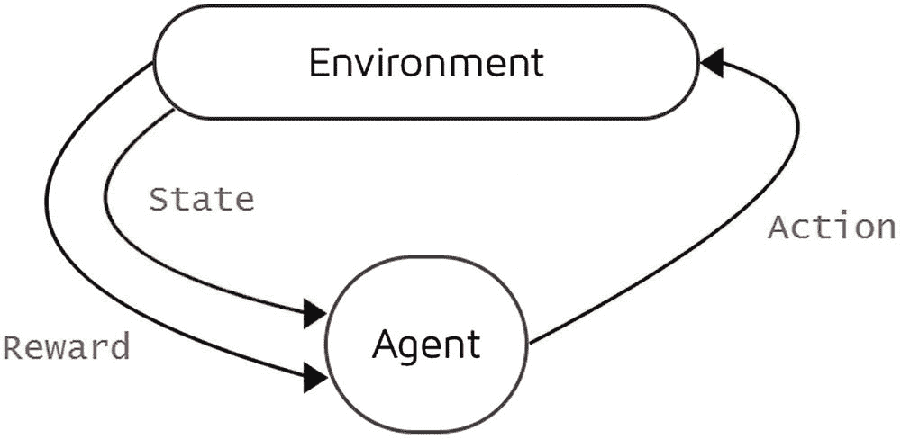

**图 17-1**
强化学习算法的基本流程。智能体观察环境，执行动作与环境交互，并接收正奖励、负奖励或零奖励。

需要重点考虑的是，奖励并非总是即时生效；可能存在奖励为零的状态，这等同于没有奖励。在开发强化学习方法时，我们需要对环境、状态、智能体动作和奖励进行建模；因此，整个问题本质上是一个马尔可夫决策过程（我们稍后将讨论此主题）。

强化学习基于`奖励假说`，该假说认为所有目标都可以通过最大化期望累积奖励来描述。

一个强化学习智能体可能包含不同组件：定义智能体行为的`策略`、评估每个状态和/或动作优劣的`价值函数`，以及作为环境表征的`模型`。

> **注意**
> 与人类相似，强化学习智能体可以直接从原始输入（例如视觉信息）中构建和学习自身知识，无需任何硬编码特征或领域特定的启发式规则。

## 马尔可夫决策过程

马尔可夫决策过程（MDP）是正式描述强化学习环境最常用的方法，许多问题都可以建模为 MDP。MDP 是一个离散状态-时间转移系统，包含一组可能的世界状态 `s`、一组可能的动作 `a`、一个实值奖励函数 `R(s, a)`、每个状态下每个动作效果的描述 `T`，以及一个初始状态 `s[0]`。

为了理解现实问题中的 MDP，我们考虑一个环境：一只机器鼠被困其中，必须找到走出迷宫的路，如图 17-2 所示。

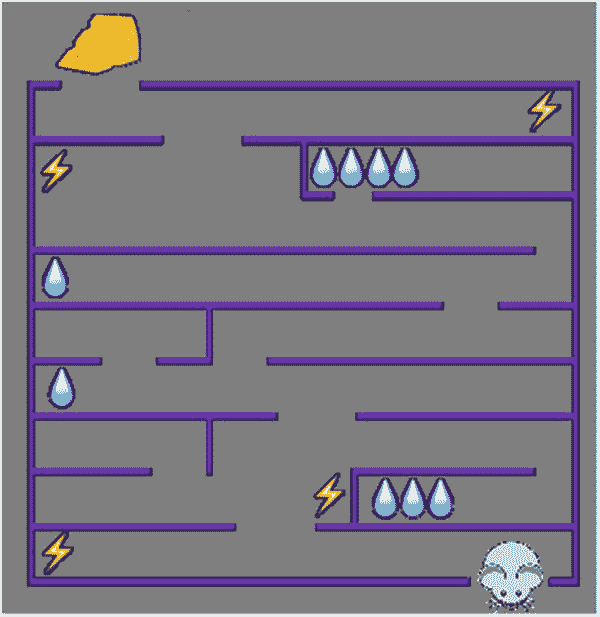

**图 17-2**
机器鼠必须找到走出迷宫的路。找到水源位置奖励 +100，找到奶酪奖励 +10000，而触电位置则导致惩罚或负奖励 -1000。

假设机器鼠试图到达迷宫尽头的终极奖励——奶酪（+10000 分），或沿途的次要奖励——水源（+100 分），同时希望避开会触电的位置（-1000 分）。老鼠在迷宫中的游走可以形式化为一个 MDP，这是一个具有指定状态间转移概率的过程。该问题的 MDP 可建模如下：

*   **有限状态集**：老鼠在迷宫中的可能位置

*   **每个状态下可用的动作集**：老鼠在每个状态下所有可能的移动，即 `{上、下、左、右}`，以及何时可用；例如，在角落时只有两个移动方向可用

*   **状态间的转移**：当前状态（迷宫中的特定格子）与某个动作（向左移动）的组合，使机器鼠进入新位置（状态）。转移可能与一组概率相关联，这些概率涉及多个可能的状态。

*   **与转移相关的奖励**：在迷宫场景中，对于机器鼠而言，大多数奖励为 0，但到达有水源或奶酪的位置时为正奖励，到达有电的格子时为负奖励

*   **折扣因子 γ**，取值范围 `[0, 1]`：量化即时奖励与未来奖励之间的重要性差异。例如，当 `γ` 等于 0.7，且三步后有一个 5 的奖励时，该奖励的现值为 `0.7³ × 5`。

*   **无记忆性或马尔可夫性质**：一旦当前状态已知，老鼠在迷宫中的历史轨迹可以被清除，因为当前马尔可夫状态包含了历史中的所有有用信息。换句话说，“给定当下，未来独立于过去”。这也被称为马尔可夫性质。

现在，我们在强化学习中的目标是最大化长期累积奖励，其公式如下：

```
$$ \sum \limits_{\mathrm{t}=0}^{\mathrm{t}=\infty }\ {\gamma}^t\ast r\left(x(t),a(t)\right) $$
```

其中 `t` 是时间步，`r(x, a)` 是奖励函数，`x(t)` 表示智能体在时间 `t` 的状态，`a(t)` 表示在该状态及时间 `t` 时执行的动作。这是强化学习算法试图解决的主要问题，本质上是一个优化时间的问题。我们越早获得奖励，其价值就越大，因为折扣因子会随时间降低奖励的价值。我们使用折扣因子有以下几个原因：

*   偏好更早的奖励

*   表示未来的不确定性

*   动物/人类行为表现出对即时奖励的偏好

*   避免循环马尔可夫过程中的无限回报（我们稍后将定义什么是回报）

*   在处理财务奖励时，即时奖励可能比延迟奖励获得更多利息

我们在不同教科书中可能遇到的其他类型奖励包括：

*   **总奖励**：

```
$$ \sum \limits_{t=1}^{\infty}\kern0.38em {r}_t $$
```

*   平均奖励：

```
$$ \underset{n\to \infty }{\lim}\frac{r_1+\kern0.28em {r}_2+\dots +{r}_n}{n} $$
```

我们也可以将 MDP 视为马尔可夫奖励过程（MRP）与决策的结合。一个马尔可夫奖励过程由一组状态 `S`、一个状态转移矩阵 `T`（如前所述）、一个奖励函数 `R` 以及一个折扣因子 `γ` 组成。

同时，MRP 可以被看作是一个带有数值的马尔可夫链。马尔可夫链（又称马尔可夫过程）由一组状态 `S` 和一个状态转移矩阵 `T` 组成。图 17-3 展示了一个 MRP，其中我们简要模拟了一个机器人的工作日（它正在查看 `Facebook`）。范围在 `[0.0; 1.0]` 内的实数表示从一个状态转移到另一个状态的概率；圆圈表示状态，箭头表示从一个状态到另一个状态的转移。在此例中，最左侧的状态是初始状态。

在该图中，所有动作要么是随机的——即 `T : S x A -> Prob(S)`，其中 `Prob(S)` 是一个概率分布——要么是确定性的，即 `T : S x A -> S`。

注意：规划问题和 MDP 都被视为搜索问题，区别在于前者处理的是显式动作和子目标，而后者处理的是不确定性和效用。

在 MDP 中，时间范围（horizon）决定了我们的决策过程是无限时间、有限时间还是不定时间（直到满足某个条件）。无限时间范围的 MDP 更容易求解，因为它们没有截止期限；此外，由于在许多情况下，一个过程会执行多久并不明确，因此考虑无限时间范围的最优性模型很常见。

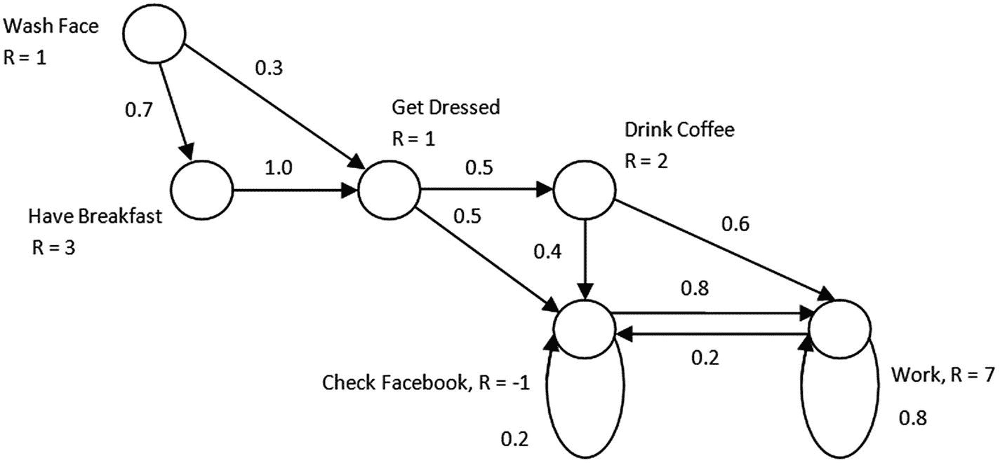

**图 17-3**
模拟机器人工作日的 MRP

无限时间范围的回报 `v[t]` 是从时间步 `t` 到无穷远的折扣奖励总和：

# 折扣因子与价值函数

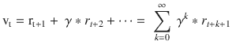

再次注意折扣因子的便利性。如果我们将所有奖励累加到无穷远，总和通常是无限的。为了使数学计算更简洁，并给智能体施加压力，使其尽早获得奖励，我们使用了折扣因子。

## 价值/动作-价值函数与策略

在 MRP 和 MDP 中引入奖励，使我们能够根据关联的奖励来定义状态的价值。这些表格化的价值是价值函数、状态价值函数的一部分，或者简称为 MRP 中某个状态的价值。它是指从状态 `s` 开始的期望回报：

![$$ \mathrm{V}\left(\mathrm{s}\right)=\mathrm{R}\left(\mathrm{s}\right)+\kern0.28em \gamma \ast \sum \limits_{s^{\prime}\in N(s)}^{\mid N(s)\mid }T\left[s,\kern0.28em {s}^{\prime}\right]\ast V\left({s}^{\prime}\right) $$](A449374_1_En_17_Chapter_Eque.gif)

在上述公式中，我们通过对所有可能的下一个状态或邻居状态 `s'` 进行求和，计算从 `s` 转移到 `s'` 的概率与 `s'` 的无限时间范围期望折扣奖励（即 `s'` 的价值）的乘积，从而得到下一个状态的期望长期价值。该公式基于贝尔曼方程（1957），也称为动态规划方程，及其最优性原理。该原理指出，一个最优策略具有这样的性质：无论初始状态和初始决策是什么，剩余的决策必须构成一个关于由第一个决策产生的状态的最优策略。在这种情况下，价值函数可以分解为即时奖励 `R` 和后续邻居状态 `s'` 的折扣价值，即 `γ * V(s′)`。

**注意**

在计算机科学中，一个可以分解为子问题，并且这些子问题能产生全局最优解的问题（例如使用贝尔曼原理），被称为具有最优子结构。

为了了解如何计算这个方程，我们假设折扣因子 `γ = 0.9` 以及前面图中所示的 MDP；我们可以按如下方式计算最左侧状态（洗脸）的价值：
```
V('洗脸') = 1 + 0.9 * (0.7 * V('吃早餐') + 0.3 * V('穿好衣服'))
```
注意，如果我们设置 `γ = 0`，那么每个状态对应的价值将与其奖励相等。要完全计算所有 `s` 的 `V(s)`，我们需要求解 `n` 个方程中的 `n` 个未知数，其中 `n` 是 MRP 中的状态数量。

在经典规划中，我们创建的计划要么是一个有序的动作列表，要么是一个部分有序的动作集合（我们在之前的章节中讨论过），这些动作旨在不参考环境状态的情况下执行。在 MDP 中，假设你有可能一步之内从任何状态转移到任何其他状态。因此，为了做好准备，通常的做法是计算一个完整的策略，而不是一个简单的计划。

策略是从状态到动作的映射，它定义了智能体在环境中将遵循的行动方针或动作序列。通常用希腊字母 `π` 表示：`π(s)`。由于马尔可夫性质，我们会发现动作的选择只需要依赖于当前状态（可能还有当前时间），而不依赖于任何先前的状态。我们将尝试找到一种策略，对于每个状态，该策略在该状态下执行时能最大化期望奖励。我们将这样的策略称为最优策略，并记为 `π*(s)`。

策略可以是确定性的，为每个状态输出一个单一动作；也可以是随机的，根据各种概率输出一个动作。

**注意**

由于策略是一个动作序列，当你采用一个 MDP 并固定一个策略时，所有动作都已选定，剩下的就是一个马尔可夫链。

在 MDP 中，遵循策略 `π` 的状态-价值函数 `V_π` 是指从状态 `s` 开始，然后遵循策略 `π` 的期望回报：

![$$ {\mathrm{V}}_{\pi}\left(\mathrm{s}\right)={\mathrm{R}}_{\pi}\left(\mathrm{s}\right)+\gamma \ast \sum \limits_{s^{\prime}\in N(s)}^{\mid N(s)\mid }{T}_{\pi}\left[s,{s}^{\prime}\right]\ast {V}_{\pi}\left({s}^{\prime}\right) $$](A449374_1_En_17_Chapter_Equf.gif)

最优状态-价值函数是所有策略中的最大价值函数，如下所示：

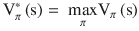

动作-价值函数 `Q(s, a)`，或简称为 `Q` 函数，是指从状态 `s` 出发，采取动作 `a`，然后遵循策略 `π` 所得到的期望回报，其定义如下：

![$$ {\mathrm{Q}}_{\pi}\left(\mathrm{s},\mathrm{a}\right)=\mathrm{R}\kern0.38em \left(\mathrm{s},\mathrm{a}\right)+\gamma \ast \sum \limits_{s^{\prime}\in N(s)}^{\mid N(s)\mid }{T}_{\pi}^a\left[s,{s}^{\prime}\right]\ast {V}_{\pi}\left({s}^{\prime}\right) $$](A449374_1_En_17_Chapter_Equh.gif)

请注意，`Q(s, a)` 可以用 `V(s)` 来表示，并且它不仅考虑了状态，还考虑了导致状态转移的动作。

**注意**

`Q` 函数表示在给定状态下，某个特定动作的质量。

最优动作-价值函数是所有策略中最大的动作-价值函数，其定义如下：

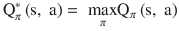

强化学习智能体的目标是什么？其目标应是通过优化 `V(s)` 或 `Q(s, a)` 来学习一个最优策略；已有证明表明，所有最优策略都能达到最优的状态-价值函数和动作-价值函数，如下所示：

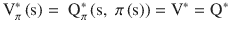

其中 `V*` 和 `Q*` 分别代表 `V(s)` 和 `Q(s, a)` 的最优值。因此，尝试优化这些函数之一以获得智能体的最优策略似乎是合乎逻辑的。请记住，这是我们在马尔可夫决策过程（MDP）中，尤其是在强化学习（RL）中的主要目标。

如果奖励和转移函数对智能体是已知的，那么它可以使用一种称为**值迭代**的基于模型（model-based）的算法来计算 `V*` 并获得最优策略。

另一种获得最优策略并解决 MDP 的方法是**策略迭代**算法。这也是一种基于模型的方法，它直接操作策略，而不是通过最优价值函数间接找到策略。与值迭代方法一样，它假设智能体已知奖励和转移函数。

稍后，我们将讨论 **Q 学习**，这是一种无模型（model-free）的学习方法，适用于智能体最初只知道某些状态和动作是可能的，但不知道转移和奖励概率函数的情况。在 Q 学习中，智能体通过从与环境的交互历史中学习来改进其行为。只有当它执行某个动作并从状态 A 转移到状态 B 并收到奖励时，它才会发现存在这样的奖励。同样，它只有通过最终处于某个状态并查看其可选动作，才能弄清楚从该状态可以进行哪些转移。如果状态转移是随机的，它通过观察不同转移发生的频率来学习状态之间的转移概率。

**注意**

在基于模型的方法中，智能体拥有环境的内置模型（奖励和转移函数），因此可以模拟环境以做出正确决策。在无模型方法中，智能体知道如何行动，但并不明确了解环境的任何信息。

### 值迭代算法

# 值迭代

在值迭代中，我们将通过应用一个迭代过程来计算所有状态`s`的`V*(s)`，在这个过程中，我们对`V*(s)`的当前近似值会随着时间的推移逐渐接近最优值。我们首先将所有状态的`V(s)`初始化为0。实际上，我们可以初始化为任何我们想要的值，但最简单的方法是从0开始。该算法使用`V(s)`的更新规则；该方法的伪代码如下所示：
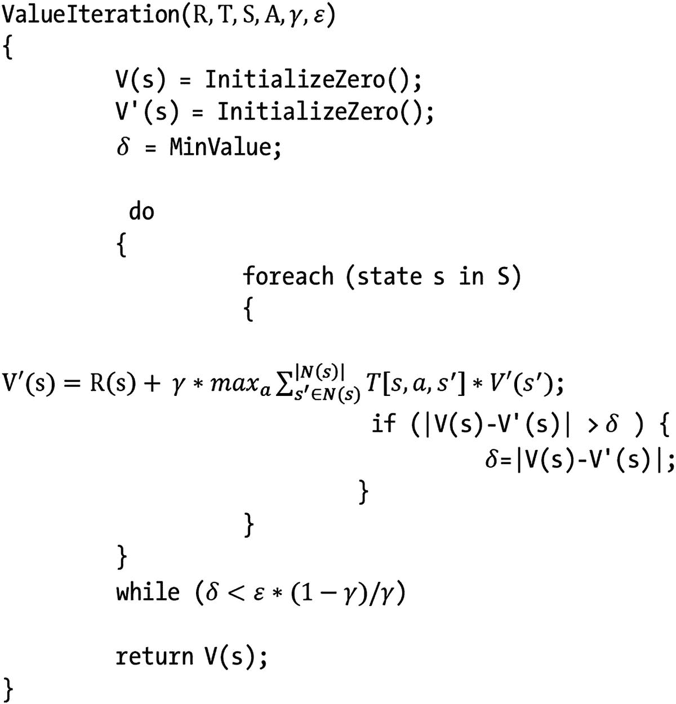

该问题的一个常见停止条件是，从步骤`t`到步骤`t + 1`的值变化小于或等于一个预定义的`epsilon`乘以折扣因子变量，如前面的伪代码所示。在这种情况下，`δ`表示某次迭代中`V(s)`的最大变化。`V`和`V′`表示效用向量，`ε`表示状态效用中允许的最大误差。该算法会随着时间的推移收敛到正确的效用值。

# 策略迭代算法

在策略迭代算法中，我们同时搜索最优策略和效用值；因此，我们直接操作策略，而不是通过最优价值函数间接找到策略。该算法的伪代码如下所示：
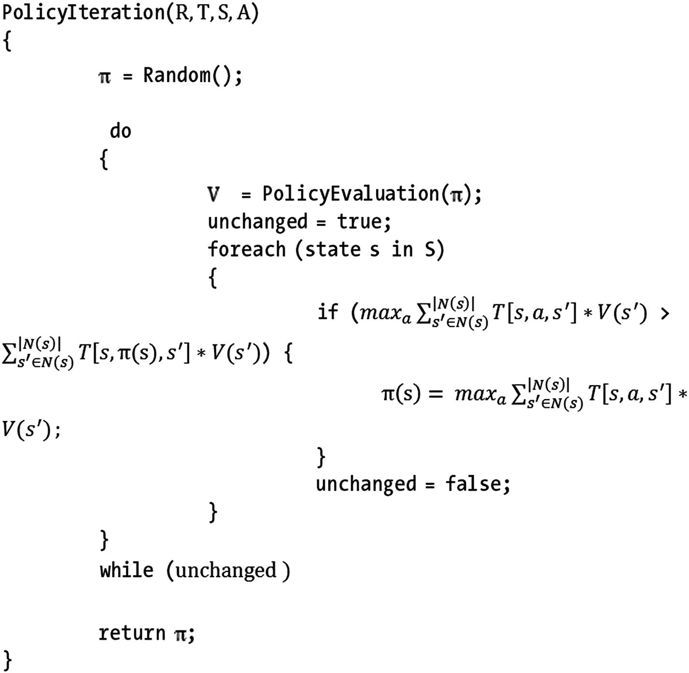

其中`V`是效用向量，`π`表示算法输出的策略，并用随机值初始化。`PolicyEvaluation()`子程序用于求解以下线性方程组：
![$$ \mathrm{R}\left({\mathrm{s}}_{\mathrm{i}}\right)+\kern0.28em \gamma \ast ma{x}_a\sum \limits_{s^{\prime}\in N\left({s}_i\right)}^{\mid N\left({s}_i\right)\mid }T\left[{s}_i,\kern0.28em \pi \left({\mathrm{s}}_{\mathrm{i}}\right),{s}^{\prime}\right]\ast {V}^{\prime}\left({s}^{\prime}\right) $$](A449374_1_En_17_Chapter_Equk.gif)

策略迭代（PI）选择一个初始策略，通常只是将状态上的奖励作为其效用，并根据最大期望效用原则计算出一个策略。然后，它迭代地执行两个步骤：值确定，即根据当前策略计算每个状态的效用；以及策略改进，即如果可能进行任何改进，则更新当前策略。当策略稳定时，算法终止。策略迭代通常会在几次迭代内收敛，但每次迭代的计算成本很高；请记住，该方法需要求解大型线性方程组。

# Q学习与时间差分

值迭代和策略迭代算法在确定最优策略方面表现出色，但它们假设我们的智能体拥有大量特定于问题的知识。具体来说，它们假设智能体能够准确知道环境中的转移函数和所有状态的奖励。这实际上包含了相当多的信息；在许多情况下，我们的智能体可能无法获取这些信息。

幸运的是，有一种方法可以学习这些信息。本质上，我们可以用学习时间来换取先验知识。其中一种方法是通过一种称为Q学习的强化学习形式。Q学习是一种无模型学习形式，这意味着智能体不需要拥有任何环境模型；它只需要知道存在哪些状态，以及在每个状态下可以执行哪些动作。其工作原理如下：我们为每个状态分配一个估计值，称为Q值。当我们访问一个状态并获得奖励时，我们利用这个信息来更新对该状态价值的估计。（由于我们的奖励可能是随机的，我们可能需要多次访问一个状态。）

考虑到 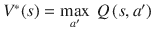，我们可以仅用Q函数重写之前详细描述的`Q(s, a)`公式。

![$$ {\mathrm{Q}}_{\pi}\left(\mathrm{s},\kern0.28em \mathrm{a}\right)=\kern0.28em \mathrm{R}\kern0.28em \left(\mathrm{s},\kern0.28em \mathrm{a}\right)+\kern0.28em \gamma \ast \sum \limits_{s^{\prime}\in N(s)}^{\mid N(s)\mid }{T}_{\pi}^a\left[s,\kern0.28em {s}^{\prime}\right]\ast {Q}_{\pi}\left({s}^{\prime },\kern0.28em a\right) $$](A449374_1_En_17_Chapter_Equl.gif)

上述公式是Q学习算法中使用的更新规则，如下所述：
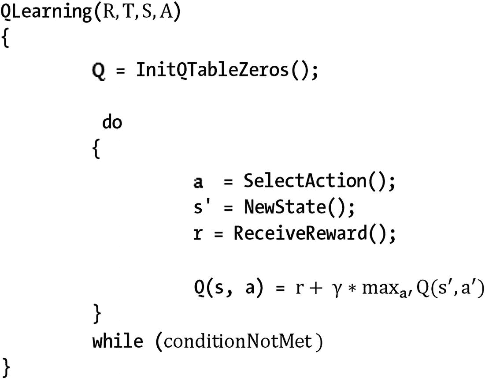

为了使Q学习收敛，我们必须保证每个状态都被无限次访问；一个人无法从没有经历过的事情中学习，因此，为了确保收敛并找到最优策略，必须无限次地访问每个状态。

Q学习属于一类称为时间差分算法的方法。在时间差分算法（TDA）中，我们通过减小不同时间帧（`t`, `t′`）估计值之间的差异来学习。Q学习是TDA的一个特例，我们减小一个状态及其后续状态（也称为邻居或后继状态）的Q值估计之间的差异。我们同样可以设计一种算法来减小当前状态与更远后代或祖先状态之间的差异。

最流行的TD算法可能是`TD(λ)`（Sutton 1988），它是TDA的一个通用版本，其核心思想是我们可以按如下方式计算Q：


请注意，在上述公式中，我们不仅像在Q学习中那样只包含一步前瞻，而是考虑了未来`n`步。`TD(λ)`使用一个 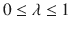 参数，以如下方式混合了各种前瞻距离：
![$$ {\mathrm{Q}}^{\lambda}\left({\mathrm{s}}_{\mathrm{t}},\kern0.28em {\mathrm{a}}_{\mathrm{t}}\right)=\left(1-\lambda \right)\ast \left[{\mathrm{Q}}¹\left({\mathrm{s}}_{\mathrm{t}},\kern0.28em {\mathrm{a}}_{\mathrm{t}}\right)+\lambda \ast {\mathrm{Q}}²\left({\mathrm{s}}_{\mathrm{t}},\kern0.28em {\mathrm{a}}_{\mathrm{t}}\right)\kern0.28em +{\lambda}²\ast {\mathrm{Q}}³\left({\mathrm{s}}_{\mathrm{t}},\kern0.28em {\mathrm{a}}_{\mathrm{t}}\right)+\kern0.28em \dots \right] $$](A449374_1_En_17_Chapter_Equn.gif)

当考虑 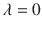 时，我们最终得到Q学习规则，即仅向前看一步的规则。随着λ的增加，算法更加侧重于基于更远前瞻的差异。当达到 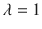 时，仅考虑观察到的 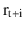 值，当前Q估计值不再贡献。采用`TD(λ)`方法的动机在于，在某些场景下，如果考虑更远的前瞻，训练效率会更高。

# 实践问题：使用 Q-Learning 解决迷宫

在本实践问题中，我们将通过一个非常简单直观的场景来演示Q-Learning方法的应用：解决迷宫问题。在迷宫中，智能体从单元格 `(0, 0)` 出发，必须找到位于单元格 `(n - 1, m - 1)` 的出口，其中`n`表示行数，`m`表示列数，矩阵索引从零开始。图17-4展示了本章需要解决的迷宫。
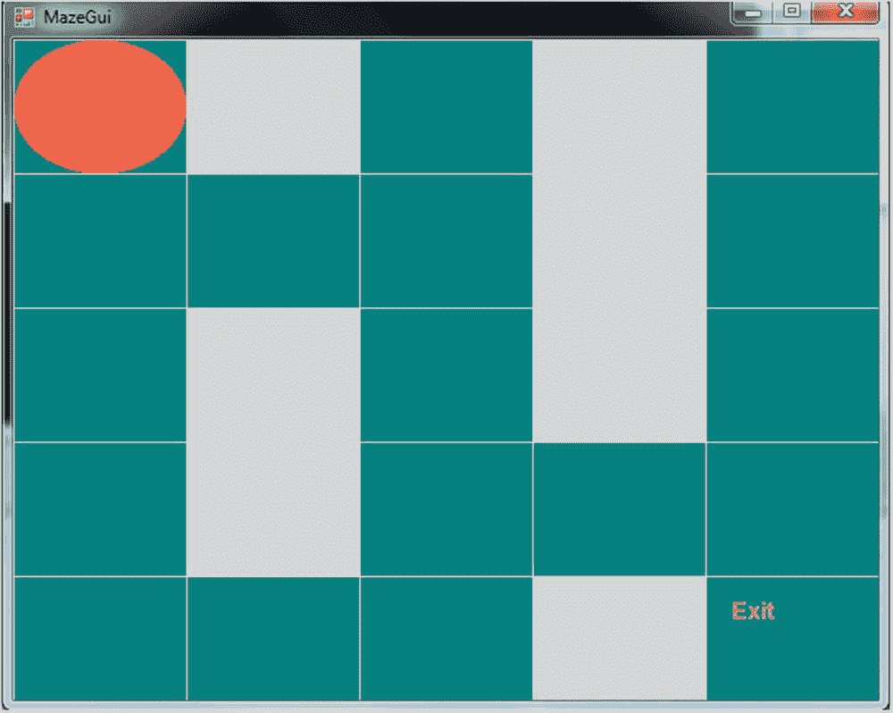

**图 17-4**
待解决的迷宫

请注意，在上述迷宫中，智能体可以遵循多种策略到达出口单元格，但只有一种最优策略（图 17-5）。

由于学习会随时间推移而发生（如同现实生活中的情况），我们必须保证在每个回合中持续访问每一个状态（单元格）；这是 Q-Learning 收敛的必要条件。回合（Episode）指的是智能体完成一次迷宫的过程，每当迷宫被完成，我们就说智能体从回合 E 进入回合 E + 1。

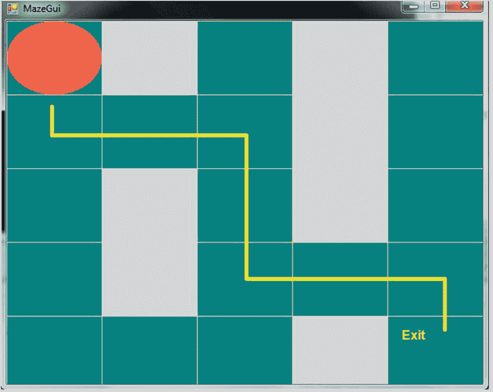

**图 17-5**

智能体解决迷宫所遵循的最优策略

我们将要使用的 Q-Learning 智能体，称为 `Qagent`，由清单 17-1 所示的类表示。

```
public class QAgent
{
    public int X { get; set; }
    public int Y { get; set; }
    public Dictionary<Tuple<int, int>, List<double>> QTable { get; set; }
    public double Randomness { get; set; }
    public double[,] Reward { get; set; }
    private readonly bool[,] _map;
    private readonly int _n;
    private readonly int _m;
    private readonly double _discountFactor;
    private static readonly Random Random = new Random();
    private readonly Dictionary<Tuple<int, int>, int> _freq;

    public QAgent(int x, int y, double discountFactor, int n, int m, double [,] reward, bool [,] map, double randomness)
    {
        X = x;
        Y = y;
        Randomness = randomness;
        InitQTable(n, m);
        _n = n;
        _m = m;
        Reward = reward;
        _map = map;
        _discountFactor = discountFactor;
        _freq = new Dictionary<Tuple<int, int>, int> {{new Tuple<int, int>(0, 0), 1}};
    }
}
```

**清单 17-1**

`QAgent` 类的属性、字段和构造函数

该类包含以下属性或字段：

*   `X`：表示智能体在棋盘上位置的行坐标。
*   `Y`：表示智能体在棋盘上位置的列坐标。
*   `QTable`：以表格形式表示 Q 函数的矩阵，即 Q(s, a) 函数，其中行表示状态，列表示动作。它被编码为一个字典，键为 `Tuple<int, int>`（状态），值为一个包含四个 `double` 值的列表（分别对应上、下、左、右四个动作）。
*   `Randomness`：由于我们需要时不时地随机游走，以尝试让智能体访问每一个状态，因此我们使用 `Randomness` 变量来表示一个 [0, 1] 范围内的值，该值对应生成随机动作的概率。
*   `Reward`：表示每个状态的奖励矩阵。
*   `_ map`：表示环境（迷宫）地图的变量。
*   `_n`：环境的行数。
*   `_m`：环境的列数。
*   `_discountFactor`：折扣因子，如前所述，用于 Q-Learning 更新规则。
*   `_freq`：详细记录每个状态访问频率的字典；它将用于所采用的策略，以确保智能体无限频繁地访问每个状态，并力求获得最优策略。

类构造函数中包含的 `InitQTable()` 方法（清单 17-2）旨在初始化 `QTable`；即初始化（状态，{`actionUp`, `actionDown`, `actionLeft`, `actionRight`}）条目的字典。初始时，对于所有可能的动作 a，`Q(s, a) = 0`。

```
private void InitQTable(int n, int m)
{
    QTable = new Dictionary<Tuple<int, int>, List<double>>();
    for (var i = 0; i < n; i++)
    {
        for (var j = 0; j < m; j++)
        {
            QTable.Add(new Tuple<int, int>(i, j), new List<double> { 0, 0, 0, 0});
        }
    }
}
```

**清单 17-2**

`InitQTable()` 方法

Q-Learning 过程发生在以下方法中（清单 17-3）；`actionByFreq` 参数将决定我们是使用基于频率和随机性的状态访问策略，还是仅依赖 Q 值来完成迷宫。由于每个学习过程都需要一定时间，我们将需要仅依赖频率加随机性策略来尝试“学习”——即足够频繁地访问每个状态，以便从这些经验中学习，并最终能够学习到一条最优策略，从而以最短时间和最少步数引导我们到达迷宫出口。

```
public void QLearning(bool actionByFreq = false)
{
    var currentState = new Tuple<int, int>(X, Y);
    var action = SelectAction(actionByFreq);
    if (!_freq.ContainsKey(ActionToTuple(action)))
        _freq.Add(ActionToTuple(action), 1);
    else
        _freq[ActionToTuple(action)]++;
    ActionToTuple(action, true);
    var reward = Reward[currentState.Item1, currentState.Item2];
    QTable[currentState][(int) action] = reward + _discountFactor * QTable[new Tuple<int, int>(X, Y)].Max();
}
```

**清单 17-3**

`QLearning()` 方法

非常重要的动作选择策略将引导智能体学习到最优策略，该策略编码在清单 17-4 所示的 `SelectAction()` 方法中。如果 `actionByFreq` 变量被激活（设置为 `True`），智能体将根据频率加随机性策略执行动作；否则，它将始终选择具有最高值的 `Q(s', a)`。

```
private QAgentAction SelectAction(bool actionByFreq)
{
    var bestValue = double.MinValue;
    var bestAction = QAgentAction.None;
    var availableActions = AvailableActions();
    if (actionByFreq)
        return FreqStrategy(availableActions);
    for (var i = 0; i < availableActions.Count; i++)
    {
        var value = QTable[new Tuple<int, int>(X, Y)][i];
        if (value > bestValue)
        {
            bestAction = ActionSelector(i);
            bestValue = value;
        }
    }
    return bestAction;
}
```

**清单 17-4**

`SelectAction()` 方法

上述方法使用了清单 17-5 中的 `FreqStrategy()` 方法。在该方法中，我们以 0.5 的概率应用随机动作，或者进行基于频率的访问；即，根据 `_freq` 字典，访问相邻状态中访问次数最少的那一个。

```
private QAgentAction FreqStrategy(List<QAgentAction> availableActions)
{
    var newPos = availableActions.Select(availableAction => ActionToTuple(availableAction)).ToList();
    var lowest = double.MaxValue;
    var i = 0;
    var bestIndex = 0;
    if (Random.NextDouble() <= Randomness)
        return availableActions[Random.Next(availableActions.Count)];
    foreach (var tuple in newPos)
    {
        if (!_freq.ContainsKey(tuple))
        {
            bestIndex = i;
            break;
        }
        if (_freq[tuple] <= lowest)
        {
            lowest = _freq[tuple];
            bestIndex = i;
        }
        i++;
    }
    return availableActions[bestIndex];
}
```

**清单 17-5**

`FreqStrategy()` 方法

为了确定智能体可用的动作集（即不会导致智能体撞墙的动作），我们在`QAgent`类中包含了`AvailableActions()`方法，如清单17-6所示。

```csharp
private List<QAgentAction> AvailableActions()
{
    var result = new List<QAgentAction>();
    if (X - 1 >= 0 && _map[X - 1, Y])
        result.Add(QAgentAction.Up);
    if (X + 1 < _n && _map[X + 1, Y])
        result.Add(QAgentAction.Down);
    if (Y - 1 >= 0 && _map[X, Y - 1])
        result.Add(QAgentAction.Left);
    if (Y + 1 < _m && _map[X, Y + 1])
        result.Add(QAgentAction.Right);
    return result;
}
```

`AvailableActions()`方法

我们采用约定，将动作按顺序{上, 下, 左, 右}与从0开始的整数匹配；因此，上=0，下=1，左=2，右=3。清单17-7中所示的`ActionSelector()`方法将一个整数转换为其对应的动作（我们稍后将看到`QAgentAction`枚举）。

在清单17-7中，我们还可以看到`ActionToTuple()`方法，该方法将`QAgentAction`转换为`Tuple<int,int>`，表示执行该动作后得到的结果状态。

```csharp
public QAgentAction ActionSelector(int action)
{
    switch (action)
    {
        case 0:
            return QAgentAction.Up;
        case 1:
            return QAgentAction.Down;
        case 2:
            return QAgentAction.Left;
        case 3:
            return QAgentAction.Right;
        default:
            return QAgentAction.None;
    }
}

public Tuple<int, int> ActionToTuple(QAgentAction action, bool execute = false)
{
    switch (action)
    {
        case QAgentAction.Up:
            if (execute) X--;
            return new Tuple<int, int>(X - 1, Y);
        case QAgentAction.Down:
            if (execute) X++;
            return new Tuple<int, int>(X + 1, Y);
        case QAgentAction.Left:
            if (execute) Y--;
            return new Tuple<int, int>(X, Y - 1);
        case QAgentAction.Right:
            if (execute) Y++;
            return new Tuple<int, int>(X, Y + 1);
        default:
            return new Tuple<int, int>(-1, -1);
    }
}
```

清单17-7

`ActionSelector()`和`ActionToTuple()`方法

为了完成`QAgent`类，我们添加了`Reset()`方法（清单17-8），该方法通过将智能体设置到起始位置并清空`_frequency`字典，来重置或为新一轮训练准备智能体。描述智能体可能动作的`QAgentAction`枚举如清单17-8所示。

```csharp
public void Reset()
{
    X = 0;
    Y = 0;
    _freq.Clear();
}

public enum QAgentAction
{
    Up, Down, Left, Right, None
}
```

清单17-8

`Reset()`方法和`QAgentAction`枚举

我们已经展示了程序的机器学习代码，但还缺少一个组件：Windows Forms上的图形用户界面。

`Form`类的继承者`MazeGui`将直观地呈现迷宫，如清单17-9所示。请记住，我们正在编写一个Windows Forms应用程序。

```csharp
public partial class MazeGui : Form
{
    private readonly int _n;
    private readonly int _m;
    private readonly bool[,] _map;
    private readonly QAgent _agent;
    private Stopwatch _stopWatch;
    private int _episode;

    public MazeGui(int n, int m, bool[,] map, double[,] reward)
    {
        InitializeComponent();
        timer.Interval = 100;
        _n = n;
        _m = m;
        _map = map;
        _agent = new QAgent(0, 0, 0.9, _n, _m, reward, map, .5);
        _stopWatch = new Stopwatch();
    }
}
```

清单17-9

`MazeGui`类的字段和构造函数

该类包含以下属性或字段：

-   `_n`：迷宫的行数
-   `_m`：迷宫的列数
-   `_map`：布尔值矩阵，指示单元格是否为墙壁
-   `_agent`：`QAgent`类的实例
-   `_stopWatch`：用于测量Q-learning过程中每一轮训练所耗时间的秒表
-   `_episode`：Q-learning过程中已执行的训练轮数

为了在迷宫上绘制所有元素，我们为绘图控件（Picture Box）实现了`Paint`事件，如清单17-10所示。

```csharp
private void MazeBoardPaint(object sender, PaintEventArgs e)
{
    var pen = new Pen(Color.Wheat);
    var cellWidth = mazeBoard.Width / _n;
    var cellHeight = mazeBoard.Height / _m;
    for (var i = 0; i < _n; i++)
    {
        for (var j = 0; j < _m; j++)
        {
            if (!_map[i, j])
            {
                e.Graphics.FillRectangle(new SolidBrush(Color.Gray), j * cellWidth, i * cellHeight, cellWidth, cellHeight);
            }
            else
            {
                e.Graphics.DrawRectangle(pen, j * cellWidth, i * cellHeight, cellWidth, cellHeight);
                e.Graphics.DrawString(
                    String.Format("{0:0.00}", _agent.QTable[new Tuple<int, int>(i, j)][0].ToString(CultureInfo.GetCultureInfo("en-US"))) + "," +
                    String.Format("{0:0.00}", _agent.QTable[new Tuple<int, int>(i, j)][1].ToString(CultureInfo.GetCultureInfo("en-US"))) + "," +
                    String.Format("{0:0.00}", _agent.QTable[new Tuple<int, int>(i, j)][2].ToString(CultureInfo.GetCultureInfo("en-US"))) + "," +
                    String.Format("{0:0.00}", _agent.QTable[new Tuple<int, int>(i, j)][3].ToString(CultureInfo.GetCultureInfo("en-US")))
                    , new Font("Arial", 8, FontStyle.Bold), new SolidBrush(Color.White), j * cellWidth, i * cellHeight);
            }
        }
    }
    e.Graphics.FillEllipse(new SolidBrush(Color.Tomato), _agent.Y * cellWidth, _agent.X * cellHeight, cellWidth, cellHeight);
    e.Graphics.DrawString("Exit", new Font("Arial", 12, FontStyle.Bold), new SolidBrush(Color.Yellow), (_m - 1) * cellWidth + 15, (_n - 1) * cellHeight + 15);
}
```

清单17-10

表示迷宫的Picture Box的Paint事件

我们将智能体绘制为椭圆，将墙壁绘制为灰色单元格；我们还会在每个可通行的单元格上绘制四个值：状态s下所有可能动作的Q(s, a)值。

为了从智能体获取并执行动作，我们包含了一个每秒触发一次的计时器，并在当前训练轮数小于 20 时，使用频率加随机性策略调用智能体的 `QLearning()` 方法。同样是在处理 tick 事件的方法（清单 17-11）中，我们重置了秒表和智能体的状态，并将每轮训练的耗时写入一个文件。

### 注意

当处于目标状态 `s` 时，我们不应用 Q-learning 规则来更新 `Q(s, a)`；相反，我们取目标状态的奖励值，并将其直接赋给 `Q(s, a)`。

最后，我们刷新 `mazeBoard` 以在 GUI 上显示新的变化集合。

### 清单 17-11 处理 Tick 事件的方法

```csharp
private void TimerTick(object sender, EventArgs e)
{
    if (!_stopWatch.IsRunning)
        _stopWatch.Start();
    if (_agent.X != _n - 1 || _agent.Y != _m - 1)
        _agent.QLearning(_episode < 20);
    else
    {
        _agent.QTable[new Tuple(_n - 1, _m - 1)] = new List<double>
        {
            _agent.Reward[_n - 1, _m - 1],
            _agent.Reward[_n - 1, _m - 1],
            _agent.Reward[_n - 1, _m - 1],
            _agent.Reward[_n - 1, _m - 1]
        };
        _stopWatch.Stop();
        _agent.Reset();
        var file = new StreamWriter("E:/time_difference.txt", true);
        file.WriteLine(_stopWatch.ElapsedMilliseconds);
        file.Close();
        _stopWatch.Reset();
        _episode++;
    }
    mazeBoard.Refresh();
}
```

现在所有组件都已就位，让我们尝试测试并运行该应用程序，就像本书中一直做的那样，在控制台应用程序中创建必要的地图和奖励矩阵（清单 17-12）。

### 清单 17-12 测试 MazeGui 应用程序

```csharp
var map = new [,]
{
    {true, false, true, false, true},
    {true, true, true, false, true},
    {true, false, true, false, true},
    {true, false, true, true, true},
    {true, true, true, false, true}
};
var reward = new [,]
{
    {-0.01, -0.01, -0.01, -0.01, -0.01},
    {-0.01, -0.01, -0.01, -0.01, -0.01},
    {-0.01, -0.01, -0.01, -0.01, -0.01},
    {-0.01, -0.01, -0.01, -0.01, -0.01},
    {-0.01, -0.01, -0.01, -0.01, 1},
};
Application.EnableVisualStyles();
Application.SetCompatibleTextRenderingDefault(false);
Application.Run(new MazeGui(5, 5, map, reward));
```

执行清单 17-12 中的代码后得到的结果，将是本章开发的 Windows Forms 应用程序的一个实例（图 17-6）。奖励函数为目标状态赋予奖励值 1，为其他任何状态赋予 -0.01。一旦智能体完成第一轮训练，目标状态（Exit）的每个动作都将包含奖励值 1；即 `Q('Exit', {up, down, left, right}) = 1`。

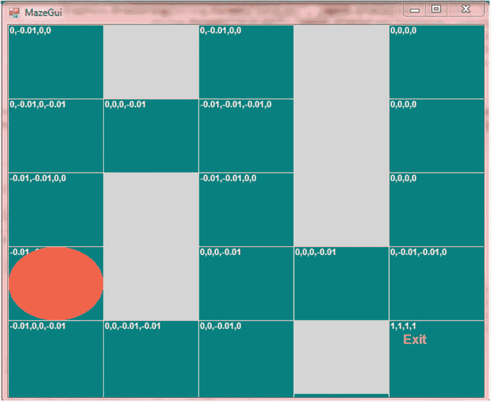

图 17-6 第 2 轮训练，QAgent 正在学习并更新 Q 值，这些值显示在每个单元格的左上角

使用前面描述的探索策略（即混合使用访问单元格的频率和随机性来执行动作的策略），我们在每一轮训练中持续访问每个状态。完成 20 轮训练后，智能体开始仅依赖已学习的 Q 值来采取动作，并且始终执行对应最高 `Q(s', a)` 值的动作。在这种情况下，我们能够找到最优策略，如图 17-5 所示。

图 17-7 展示了经过 20 轮训练后最终计算出的 `Q(s, a)` 值。读者可以验证，从单元格 `(0, 0)` 开始，始终选择具有最高 Q 值的动作（记住它们按 `up`, `down`, `left`, `right` 的顺序出现），将引导智能体走向最优策略——即以最少步数到达出口（目标状态）的策略。

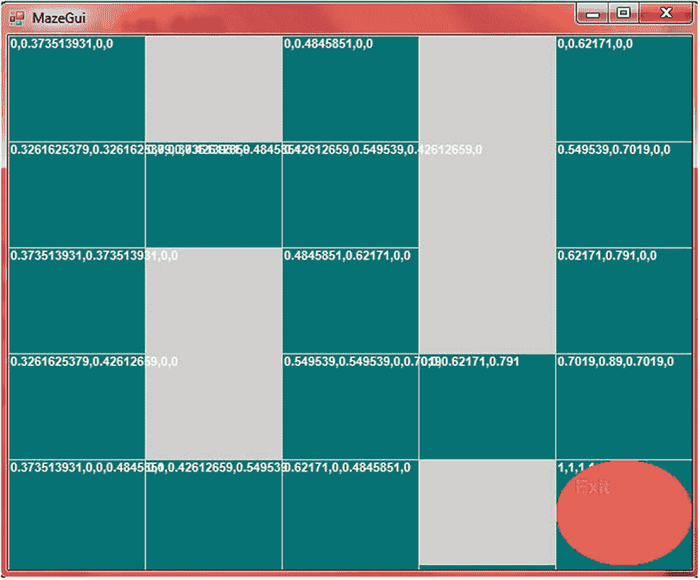

图 17-7 智能体找到并执行的最优策略

回想一下，我们在 Q 学习中的目标是实际学习 Q 函数 `Q(s, a)`。在这种情况下，我们以表格形式学习该函数，其中状态作为行，动作作为表格或矩阵的列。在某些场景中，由于我们可能拥有巨大的状态空间，采用这种方式可能难以处理。在这种情况下，我们可以依赖诸如神经网络之类的函数逼近器来近似 Q 函数。这实际上是 Tesauro 在其著名的西洋双陆棋智能体中所采用的方法，该智能体能够击败当时的西洋双陆棋世界冠军。

## 总结

在本章中，我们描述了强化学习这一有趣的主题，它是与监督学习和无监督学习并列的最重要的机器学习范式之一。我们首先定义了马尔可夫决策过程，这是强化学习中用于建模现实世界问题的数学框架。我们描述了价值函数 (V) 和动作价值函数 (Q)，并展示了这些函数之间的关系以及它们在获得最优策略中的重要性。本章还包含了策略的概念。我们提供了几种求解马尔可夫决策过程的方法。具体来说，我们详细介绍了价值迭代和策略迭代算法。最后，我们讨论了 Q 学习，并实现了一个实际问题，在该问题中我们使用它来让智能体学习如何以最短步数走出迷宫。

# 索引 A

* 《美丽心灵》
* 动视暴雪（《使命召唤》）
* 对抗性搜索
    * 智能体
    * 棋盘游戏分析
    * 常和博弈
    * 确定性博弈环境
    * 不完全信息博弈
    * 李世石 vs. AlphaGo
    * 方法，博弈类型
    * 极小化极大搜索算法
        * 参见极小化极大搜索算法
    * 完美信息博弈
    * 随机博弈环境
    * 效用函数
    * 零和博弈
* 智能体架构
    * deliberative 架构
        * 备选方案生成
        * BDI 架构
            * 参见信念-愿望-意图 (BDI) 架构
            * 图示
            * 过滤
            * 基于目标的行为
            * 逻辑推理
            * 手段-目的推理
            * 规划组件
            * 实践推理
            * 问题
        * 混合架构
            * 基于目标的组件
            * 水平和垂直分层
            * 中介函数
            * 反应式和 deliberative 组件
            * InteRRaP
            * 属性
        * 反应式架构（包容架构）
            * 基于行为
            * Brooks 架构
            * 特性
            * 清洁智能体
            * 图示
            * 原则
            * 反应式智能体
    * touring machines
* 智能体通信语言 (ACL)
    * FIPA
        * 参见智能物理代理基金会 (FIPA)
    * KQML
* 智能体
    * 执行器
    * 自主性
    * 机器人
    * 清洁机器人
        * 优势
        * `AgentAction<List<Percepts>>(percepts)`
        * 清洁智能体
            * 构造函数和字段
            * `List<Tuple<int, int>>`
            * 循环，智能体函数
            * 方法
                * `Clean()`, `IsDirty()`, `MoveAvailable(int x, int y)`, 和 `Print()` 方法
            * `Percepts` 枚举和 `Perceived()` 方法
            * `UpdateState()` 方法
        * 定义
    * 环境
        * 可访问的
        * 连续的
        * 决策过程
        * 确定性的
        * 离散的
        * 动态的
        * episodic
        * 不可访问的

# 非确定性的

# 静态的

# 基础 AI 实体

## 智能的

## 主动的

## 主动性

## 属性

## 纯粹反应式的

## 理性

## 反应式智能体

### 优势

### 清洁机器人

#### 决策过程

### 劣势

### 反应性

## 传感器

## 社交能力

## 基于状态的

# 凝聚层次聚类

# 机场模拟

## `Airplane` 类

## `AirplaneEvtArrival<TimeSpan>` 类

## `AirplaneEvtBreakdown<TimeSpan>` 类

## `AirplaneEvtProcessCargo<int>` 类

## `AirportEvent<T>` 抽象类

### 方法

### 属性

## `arrivals`, `time` 和 `lambda` 参数

## 控制台应用程序

## `Simulation` 类的构造函数、字段和属性

## `Execute()` 方法

## 初始化并测试模拟

## 乘客，货物

## `RunwayAvailable()` 和 `TryToLand()` 方法

# Alpha-Beta 剪枝

## 分支/子树

## 极小化极大树

## 最优子节点

## 伪代码

# 应用程序编程接口 (`API`)

# 人工免疫系统 (`AIS`)

# 原子命题

# 自动定理证明 (`ATP`)

## 应用

## 自动化

## 二叉决策树

## 布尔值

## 经典应用

## 描述

## 流程图

## 硬件验证

## 逻辑语言

## 证明助手

## 证明检查

## 证明生成

## 可满足性 (`SAT`)

## 软件验证

## 字符串匹配算法

# 平均连接聚类

# B

# 反向传播算法

## `ActivationValue` 和 `ErrorTerm` 属性

## 链式法则

## 分类相关方法

## 分类向量

## `CreateLayers()` 方法

## 流程

### 反向

## `FunctionDerivative()` 方法

## 梯度下降搜索方法

## 手写数字识别

## 双曲正切和 `ReLU` 单元

## `List` of `SigmoidUnit`

## `MultiLayerNetwork` 和 `Layer` 类

## `Predict()` 方法

## `PredictSet()` 方法

## `ReLU` 函数

## `ReturnIndexByHalf()` 和 `ReturnIndexByMax()` 方法

## `SigmoidUnit` 类

## 随机逼近

## 训练数据集

## `Training()` 方法

## `TrainingSample` 类

## `UpdateWeight()` 方法

## 权重更新公式

# 基本地理统计区域 (`BGA`)

# `BDT`

## 参见二叉决策树 (`BDT`)

# 蜂群算法 (`BC`)

# 信念-愿望-意图 (`BDI`) 架构

## 智能体的行动函数

## 信念

## 大胆智能体

## 谨慎智能体

## 组件

## 愿望

## 图示

## 意图

## 实践推理

# 最佳优先搜索

# 双向搜索 (`BS`)

## 同时搜索

## 滑动拼图

### 参见滑动拼图

# 二进制比较器电路

# 二叉决策树 (`BDT`)

## 优势

## `AI` 数据结构

## 条件

## 构造函数和属性

## 决策过程

## 叶节点和非叶节点

## 递归结构

## 静态方法

## `varIndex` 变量

## 可视化表示

# 广度优先搜索 (`BFS`)

## `Bfs<T>` 类

## 推导

## 基于图的搜索算法

## 过程

## 时间和空间复杂度

# C

# `C4.5` 算法

## 二叉决策节点

## 误差减少

## `Gain()` 方法

## `GainContinuous()` 方法

## 增益率

## `GainRatio()` 和 `SplitInformation()`

## 处理连续属性

## 处理缺失值

## `HighestGainAttribute()` 方法

## 实现

## 主体

## 过拟合

## 剪枝

### 过程，交叉验证

### 规则剪枝

## `SubsetEntropy()` 方法

## 测试，控制台应用程序

## 验证集，训练数据

# 规范超平面

# 质心连接聚类

# `Clause` 类

## 方法

# 清洁智能体

## `CleaningAgentPlatform` 类

## `CleaningTask` 类

### 字段/属性

### 方法

## `Contract Net`

### 静态方法

## `FipaAcl` 类

### 方法

## `GUI`, `Room` 类

## `MasCleaningAgent` 类

### `Action()` 方法

### `Bid()` 方法

### 字段，属性，和构造函数

### 方法

### 属性和字段

### `ReactionTimeOnTick()` 方法

### `Run()` 方法

### `SetSocialLaw()` 方法

## 程序结构

## 运行应用程序

### 智能体交换消息，`Contract Net`

### 控制台应用程序

### `InitCommunicationService()` 方法

### “任务完成”消息

# 清洁机器人

## `CleaningRobot` `C#` 类

## 创建

## 特性

## 网格

## 谓词和函数

## `print()` 方法

## `Start()` 方法

## 地形

# 聚类算法

## 家族

## 应用

## 紧凑性

## 准则/目标函数

## 定义

## 欧几里得距离

## 层次聚类

### 参见层次聚类

## 隔离/分离

## 曼哈顿距离

## 闵可夫斯基距离

## 对象颜色

## 优化

## 划分算法

### 参见 `K-means` 算法

## 相似性度量

# `Cnf` 类

## `DPLL` 算法

## `Formula` 层次结构

## `Literals()` 方法

## 方法

## `RemoveParenthesis(And and)` 方法

# 公共语言运行时 (`CLR`)

# 通信

## `ACL`

### 参见智能体通信语言 (`ACL`)

## 黑板系统

## 分类，智能体

## 消息传递

## 言语行为理论

## `WCF`

### 参见 Windows Communication Foundation (`WCF`)

# 完全连接聚类

# 复合命题

# 合取

## 逻辑连接词

# 合取范式 (`CNF`)

## `And` 类，带 `ToCnf()` 方法重写

## `DISTRIBUTE-CNF` 函数

## `Or` 类，带 `ToCnf()` 方法重写

## `ToCnf()` 和 `DistributeCnf()` 方法

## `ToCnf()` 方法重写，`Not` 和 `Variable` 类

## 转换算法

## 变量

# `Contract Net`

## 公告

## 授标

## 投标

## 承包商

## 加速

## `FIPA-ACL` 规范

## 管理者

## 过程

# 协调与合作

## 方法

## 基础

## 策略

## 善意的

## 连贯性

## `Contract Net`

### 参见 `Contract Net`

## 决策制定

## 描述

## 设计

## 利益，个人、组织、公司

## 可能性

## 结果

## 共享

## 社会规范和社群

## `Subscribe/Notify` 模式

## 任务共享

### 问题分解

### 解决方案综合

### 子问题解决方案

# `Crytek`（《孤岛惊魂》）

# D

# 数据契约

# 数据挖掘

# `Davis-Putnam-Logemann-Loveland` (`DPLL`) 算法

## 辅助方法

## `Dpll(Cnfcnf)` 方法

## `OneLiteral(Cnfcnf)` 方法

## `PureLiteralRule()` 方法

## `Split()` 方法

## 二叉决策树

## `CNF` 公式

## 定义

## 启发式和元启发式

## `OneLiteral`

## 伪代码

## `PureLiteral`

## `SAT` 问题

## `Split` 树构建

# 决策树 (`DT`)

## 属性和值

## 数据分类

## `DecisionTree` 类

### 方法

### 属性

## 定义

## 生成

## `Hunt` 算法

# ID3 算法

训练数据集

大小

叶节点

多个内部节点

分区

根节点

SVM/神经网络

训练数据集

# 深度优先搜索 (DFS)

回溯

推导

`Dfs<T>` 类

DLS

基于图的搜索算法

无限路径

过程

时间和空间复杂度

已访问节点

# 有限深度搜索 (DLS)

DFS

`Dls<T>` 类

# 数字信息流

# 狄利克雷抽屉原理

# 离散事件模拟 (DES)

事件

知识

对象

概率和统计

属性

队列

资源

时间

# 析取

逻辑连接词

# 析取范式 (DNF)

# DPLL 算法

参见 `Davis-Putnam-Logemann-Loveland (DPLL)` 算法

# E

# 熵

定义

函数

ID3 算法

# 等价

逻辑连接词

# 分布估计算法 (EDA)

# 进化算法 (EA)

# 扩展方法

# F

# 错误契约

# 一阶逻辑 (FOL)

组件

评估

公式

解释

谓词

`Dog` 类

过滤和获取对象

属性

命题逻辑

量词

要求

解释规则

FOL 语法

参见一阶逻辑 (FOL)

# 智能物理代理基金会 (FIPA)

组件

`inform` 执行语

参数

执行语

`request` 执行语

结构

# G

# 游戏编程

AI 方法

开发

学科

具体

经济影响

知情搜索

A* 搜索

最佳优先搜索

贪婪最佳优先搜索

搜索过程

特性

信息使用

滑动拼图

系统性

不知情搜索

参见不知情搜索算法

视频游戏 AI

游戏开发公司

设计阶段

游戏引擎

《光环》系列

软件开发

# 博弈论

《美丽心灵》

对抗性搜索

参见对抗性搜索

社会学和心理学中的应用

定义

识别

过程参与者

数学框架

诺贝尔经济学奖

奥赛罗

参见奥赛罗游戏

流行游戏

囚徒困境 (PD)

两人零和

# 高斯核

# 遗传算法 (GA)

# 梯度下降搜索 (GDS)

# 贪婪最佳优先搜索

# H

# 手写数字识别 (HDR)

分类，手写数字

`Classify` 按钮

从图像提取特征

手写

`HandwrittenDigitRecognitionNn` 类

`HandwrittenRecognitionGui` 类

低分辨率图像

`Mouse-Event` 方法

多层神经网络

隐藏层

图像像素

权重初始化

结构

训练数据

OCR 应用

生理/行为特征

`ReadWeights()` 方法

测试

训练数据集

字符集

可视化应用

权重，训练数据集

Windows Forms 应用

# 海森矩阵

# 启发式

特性

火星车

NP-Hard 问题

问题无关的迭代过程

滑动拼图

加速过程

# 层次聚类

凝聚的

分裂的

度量

# 爬山法

多样化

强化

`Execute()` 方法

GA

遗传方式

`InitialSolution()`， `Neighborhood()` 和 `NSpherePoints()` 方法

局部最优

局部搜索 (LS)

`MathParserNuget` 包

变异算子

n-球体周围

优化方法

抛物线函数

属性/字段

算法伪代码

公共属性

选择，变异和交叉方法

测试

TSP

参见旅行商问题 (TSP)

类型

# Hunt 算法

# I, J

# 蕴含

逻辑连接词

# 增量梯度下降

# 信息增益

计算

定义

公式

# 继承和 C# 运算符

抽象 `Formula` 类

`AND` 类

`BinaryGate` 类

创建和评估公式

`Or`， `Not` 和 `Variable` 类

结果，执行代码

结构递归

# 理性反应行为与规划集成 (InteRRaP)

# 智能体

# 交互式二分器 3 (ID3) 算法

属性和训练数据集

字段和属性

属性分割测试

`DecisionTree` 类

控制台应用程序

方法

属性

熵

扩展方法

实现

信息增益

树分割

# 迭代加深搜索 (IDS)

# K

# Karush-Kuhn-Tucker (KKT) 条件

# K-means 算法

质心

`Cluster` 类

方法

属性

数据点和质心

描述

`Element` 类

欧几里得距离

执行

初始化阶段

内层和外层循环

孤立数据点

`KMeans` 和 `DataSet` 类

属性和字段

伪代码

SSE

测试

无监督学习方法

# 知识交换格式 (KIF)

# 知识查询与操作语言 (KQML)

# L

# 拉格朗日乘数

# 拉格朗日方法

# 命题逻辑定律

# 最小均方 (LMS)

# 线性回归

# 线性 SVM

分类超平面

控制台应用程序

`GetIndicesFromValues()` 方法

`Predict()` 方法

属性和字段

`SetInitValue()` 方法，扩展类

`SvmGui` Windows Forms 类

`Training()` 方法，对偶优化问题

`UpdateWeightVector()` 和 `UpdateBias()` 方法

# 局部搜索 (LS) 算法

# 逻辑电路

参见逻辑电路

计算

定义

DPLL

基础

哲学家

# 逻辑连接词

合取

析取

等价

蕴含

否定

符号

一元/二元函数

# 逻辑门

# 逻辑电路

二进制比较器

二值函数

计算机

合取组件 (AND)

合取门

析取组件 (OR)

电子元件

信息流

逻辑门

否定组件 (NOT)

# M

# 曼哈顿距离

# 马尔可夫决策过程 (MDP)

决策过程

折扣因子

离散状态–时间转移系统

水平

无限水平

马尔可夫链

MRP

优化问题

概率分布

奖励类型

机器人老鼠

奖励总和

转移概率

安卓工作日

# 马尔可夫性质

# 马尔可夫奖励过程 (MRP)

# 火星车

架构

BDI 层

信念

BFS

深思过程

启发式

混合层

寻路算法

规划层

反应层

相对频率

总相对频率

BDI

经典火星车

编码

`Action()` 方法

`BDI` 类

信念，愿望，感知，计划和行动

BFS 算法

`Brf()` 方法

`ExistsPlan()` 和 `ExecuteAction()` 方法

字段，变量，和构造函数

`Filter()` 和 `ChoosePlan()` 方法

`FulFill()` 方法

`GetCurrentTerrain()` 方法

`GetPercepts()` 方法

## InjectBelief() 方法
## InjectBelief(), SetRelativeFreq(), 和 RelativeFreq() 方法
## 曼哈顿距离
## `Mars` 类
## MoveAvailable() 和 LookAround() 方法
## Options() 方法
## Percept 和 Plan 类
## RandomMove() 方法
## UpdateBelief() 方法
## UpdatePerceivedCellsDicc() 和 CheckTerrain() 方法

## 定义
## 图示
## 地球
## 移动
## 障碍物
## 航天机构
## 太空探索
## 勇气号和机遇号
## 可视化应用 (Visual application, Mars Rover)

## MasCleaningAgent 类
### Action() 方法
### Bid() 方法
### 方法
### 属性和字段
### ReactionTimeOnTick() 方法
### Run() 方法
### SetSocialLaw() 方法

## 消息契约
## 极小化极大搜索算法
### Alpha-Beta 剪枝
#### 参见 Alpha-Beta 剪枝
### 回溯
### 描述
### 终局位置评估
### 执行过程
### 博弈类型
### 伪代码
### 搜索树
### 效用值
### 零和博弈

## 错位拼图
## 多智能体组织
### 描述
### 扁平/民主
### 层次化
### 混合
### 模块化
### 包容

## 多智能体系统 (MAS)
### 智能体架构
### 空中交通管制场景
### 自主清洁智能体
### 联盟
### 通信
#### 参见通信
### 定义
### 离散
### 分布式人工智能
### 效率
### 灵活性
### 模块化
### 多智能体组织
### 平台
### 问题解决
### 现实世界应用
### 可靠性
### 可重用性
### 策略

## 多层网络
### 深度学习
### 深度神经网络
### 隐藏层
### 层
### 层和幂
### sigmoid 函数
### 欠拟合
### XOR 函数

## 多目标聚类
### 类间距离
### 类内距离
### MOP
### 非支配向量
### 目标函数
### Pareto 前沿构建器
#### 参见 Pareto 前沿构建器
### Pareto 最优
### 分区

## 多目标优化问题 (MOP)

## N
## 否定
### 逻辑连接词
## 否定范式 (NNF)
### Nnf() 函数重写
#### Not 类
#### Variable 类
### ToNnf() 抽象方法
#### Formula 抽象类
#### And, Or 类
### 转换算法

## 神经细胞
## 神经网络 (NN)
### 激活函数
### Adaline 和 GDS
#### Adaline 类
### 人工
### 人工智能
### 生物神经元
### 电化学信号
### 人脸识别
### 图
### HDR
#### 参见手写数字识别 (HDR)
### 迭代过程
### 学习过程
### 多层
### 神经元
### Perceptron 算法
#### 参见 Perceptron 算法
### 单神经元网络
### 随机逼近
### 训练数据集

## 神经元
## 范式
## O
## 离线字符识别
## 一对多分类 (OVA)
## 在线字符识别
## 操作契约
## 光学字符识别 (OCR)
## Osuna 定理
## 奥赛罗游戏
### 8x8 棋盘
### 创造者，五子棋大师长谷川五郎
### 启发式
#### 角落接近度
#### 角落占据
#### 机动性
#### 棋子差异
#### 值范围
#### 效用值
### 虚构排列
### 初始配置
### Minimax 类
#### GetOptimalMove() 和 Execute() 方法
#### 属性和字段
#### 白棋
### Windows Forms
#### AvailableMovesAroundPiece() 和 SetPieceCreatedBoard() 方法
#### CheckUpDown(), CheckLftRgt(), CheckDiagonal(), UpdateFlips(), SetPiece(), FlipPieces(), 和 UpdatePiecePos() 方法
### 开发
#### EmptyCell(), Expand(), AvailableMoves() 和 IsLegalMove() 方法
#### 处理绘制和鼠标点击事件
#### HeuristicUtility()
#### OthelloBoard 类
#### OthelloGui 类
#### UpdateBoardGui() 和 AiPlayTimerTick() 方法
#### UtilityValue

## P
## Pareto 前沿构建器
### 双目标优化
### 描述
### 函数
### 迭代，步长值
### 链接机制
### 阶段
### 策略
### 变体

## Pareto 前沿链接
## Pareto 最优
## 粒子群优化 (PSO)

## Perceptron 算法
### 激活函数
### 类构造函数
### 控制台应用程序
### 数据集
### 点积
### 直线方程
### 字段/属性
### 超平面
### 学习过程
### 学习率
### 学习规则
### 线性分类器
### 伪代码
### 设置随机值
### SingleNeuralNetwork 抽象类
#### 字段和属性
#### 方法
### Perceptron 类
### 训练数据集
### 训练/学习过程
### 权重向量和偏置

## 鸽巢原理
## 策略迭代算法
## 多项式核
## Prism
## 囚徒困境 (PD)
## 证明助手
## 证明检查
## 证明生成

## 命题逻辑
### ATP
### 复合
### CNF
### 矛盾/不可满足
### 定义
### 示例
#### 公式 (p ˅ q) ˄ (p ˅ ¬q) ˄ (¬p ˅ q) ˄ (¬p ˅ ¬r)
#### 公式 (p ˅ q ˅ ¬r) ˄ (p ˅ q ˅ r) ˄ (p ˅ ¬q) ˄ ¬p
#### 公式 (p ˅ q ˅ r) ˄ (p ˅ q ˅ ¬r) ˄ (p ˅ ¬q ˅ r) ˄ (p ˅ ¬q ˅ ¬r) ˄ (¬p ˅ q ˅ r) ˄ (¬p ˅ q ˅ ¬r) ˄ (¬p ˅ ¬q ˅ r)
### 解释
### Name 属性添加到 Variable 类，以及 Variable, Not, And, Or, 和 Cnf 类的 ToString() 重写
### 鸽巢原理
### 简单/原子
### 语法
### 重言式/逻辑定律

## 命题变量

## 剪枝过程
### 误差减少
### 伪代码
### 子树替换
### 规则剪枝
### 属性测试
### 步骤

## Q

## Q-learning
### 智能体，行为
### 无模型学习
### 最优策略
### 问题特定知识
### Q 值
### 解决迷宫
#### ActionSelector() 和 ActionToTuple() 方法
#### AvailableActions() 方法
#### 字段和构造函数，MazeGui 类
#### FreqStrategy() 方法
#### InitQTable() 方法
#### 方法处理，tick 事件
#### 神经网络
#### 最优策略
#### Paint 事件 of Picture Box
#### QAgent 和 Q 值
#### QAgent 类
#### Reset() 方法和 QAgentAction 枚举
#### SelectAction() 方法
#### 测试，MazeGui 应用
#### 状态转移

## R

## 强化学习 (RL)
### 动作-价值函数
### 基本流程
### 贝尔曼方程
### 经典规划
### 组件
### 定义
### 发展
### 动态规划方程
### 机器学习范式
### MDP
#### 参见马尔可夫决策过程 (MDP)
### 最优动作-价值函数
### 最优策略

# 最优状态-价值函数

## 最优值

## 策略

## 策略迭代

## 最优性原理

## Q-learning
### 参见 Q-learning

## 奖励假设

## 状态-价值函数

## 表格值

## TDA

## 试错

## 价值函数

## 价值迭代

# S

## 可满足性 (SAT)

## 分散搜索 (SS)

## 序列最小优化 (SMO)
### 全部 vs. 全部

### 偏置

### 分类超平面

### 裁剪值

### 描述

### `ExamineExample()` 和 `TakeStep()` 方法

### KKT 条件

### 拉格朗日乘数，约束

### 学习率

### 学习/更新规则

### `LFunctionValue()` 和 `Kernel.Polynomial()` 方法

### `LFunctionValue()` 方法，偏置和权重向量

### 线性约束

### 多类

### Osuna 定理

### OVA

### `TakeStep()` 方法

### `TrainingBySmo()` 方法，`LinearSvmClassifier` 类

### 训练数据

## 服务契约

## 面向服务的应用 (SOA)

## 简单对象访问协议 (SOAP)

## 简单命题

## 模拟
### 机场
#### 参见机场模拟

### 分析方法

### 定义

### DES
#### 参见离散事件模拟 (DES)

### 灵活性

### 建模
#### 分类

#### 定义

#### 特性

### 概率分布
#### 离散随机变量

#### 指数分布

#### 正态分布
##### 参数 `μ`

##### 参数 `σ2`

#### Poisson 过程

## 单连接聚类

## 滑动拼图
### A* 搜索算法

### 最短路径成本

### 线性冲突

### 线性冲突 + 曼哈顿距离

### 启发式
#### 曼哈顿距离

#### 错位拼图

#### 模式数据库

### 树结构

### AI 搜索方法，棋盘游戏

### `Board` 类

### `Bs<T>` 类

### `Expand()` 方法

### 正向和反向搜索

### 最难 8 数码配置

### `IEqualityComparer<Board<T>>` 接口

### `Move()` 方法

### 节点生成

### 路径变量

### 交换操作的逆

### `SolutionMet()` 方法

### 状态和树

# S-元启发式算法
## 自适应记忆

## BGA

## 聚类相关问题

## 多样化

## HC 相关组件

## 同质性

## 迭代

## 迭代方法

## k 数据集元素

## 中短期记忆

## 多目标优化问题

## Pareto 前沿构建器

## 禁忌表数据结构

## 托卢卡谷分区问题

# 社会承诺

# 社会规范/法律

# 言语行为理论

# 随机梯度下降 (SGD)

# 子树替换

# 误差平方和 (SSE)

# 监督学习
## 分类器

## 数据集
### 图像，属性

## 线性回归

## 阶段

## 预测

## 回归器

## 表格数据

## 训练数据

# 支持向量机 (SVM)
## 分类器和回归器

## 对偶性

## 广义拉格朗日函数

## 超平面
### 偏置/截距

### 规范

### 类别

### 分类

### 约束

### 归一化

### 优化问题

### 支持向量

### 权重向量

## 拉格朗日乘数

## 拉格朗日方法

## 线性
### 参见线性 SVM

## 非线性情况
### 数据从 2D 到 3D 空间映射

### 特征映射

### 高斯核

### 超平面

### 核函数

### 多项式特征映射

### 多项式核

### 二次问题

### 训练数据

## 最优分类超平面
### 优化问题

### 重新表述，训练数据

## SMO
### 参见序列最小优化 (SMO)

## 软间隔和硬间隔

## 文本分类任务

# T

## 禁忌搜索 (TS)
### 参见 S-元启发式算法

# Take-Two Interactive（《NBA 2K》系列）

# 时序差分算法 (TDA)

# 时序差分 (TD)

# 《博弈论与经济行为》

# Touring machines

# 旅行商问题 (TSP)
## 生物过程

## 规范性质

## 染色体/解编码

## 交叉算子

## `GeneticAlgorithmTsp` 类
### `InitialPopulation()` 方法

### `NewPopulation()` 方法

## NP-Hard 问题

## `OffSprings()` 方法

## 问题特定问题

## `Solution` 类

## 美国地图

# 两人零和博弈

# U

# 育碧（《刺客信条》）

# 不知情搜索算法
## BFS

## 盲目搜索

## BS

## DFS

## DLS

## `Execute()` 行，结果

## 图论

## 工具箱

## IDS

## 测试，控制台应用程序

## `Tree<T>` 类

## `UninformedMethod<T>` 抽象类

# 无监督学习
## 数据结构

## 方法

# V

## 价值迭代算法

# 可视化应用，火星车
## 实际水源位置

## 多样化

## 探索-利用权衡

## 强化阶段

## 左下角，水源位置

## 新水源位置信念

## 计划（动作序列）

## `SenseRadius` 参数

## 设置，火星车和世界

## `WanderThreshold`

## 水源位置信念

## 水源位置信念和障碍物位置信念

## Windows Form

# W, X, Y, Z

# Windows Communication Foundation (WCF)
## 智能体
### 添加，WCF 服务

### `AgentCommunicationService` 类

### 回调契约

### 实现类与接口

### 客户端应用

### 客户端 UI in Windows Forms

### 控制台应用

### 创建 WCF 服务

### 交换消息

### 执行服务与客户端

### 实现过程

### `lock` 语句

### 代理实现

### Publisher/Subscriber 模式

### `Send()` 方法

### 服务与回调契约

### 服务实现

### `Subscriber()` 方法

### 同步上下文

### `UpdatedListEventArgs`

## API

## 绑定

## CLR 类型

## 契约
### 描述

### Duplex 模式

### `IHelloWorld` 服务

### One-Way 模式

### Request–Response 模式

### 服务实现

### 类型

## 端点

## .NET Framework

## 网络应用

## Publisher/Subscriber 模式

## 服务