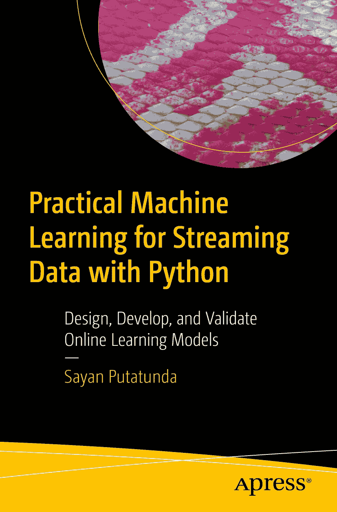

ISBN 978-1-4842-6866-7 e-ISBN 978-1-4842-6867-4 [`doi.org/10.1007/978-1-4842-6867-4`](https://doi.org/10.1007/978-1-4842-6867-4) © Sayan Putatunda 2021 Apress Standard

本出版物中使用的通用描述性名称、注册商标名称、商标、服务标志等，即使未作明确声明，也不意味着这些名称不受相关保护性法律和法规的约束，因此可自由使用。出版商、作者和编辑假定本书中的建议和信息在出版之日是真实准确的。出版商、作者或编辑均不对本书所含材料或可能存在的任何错误或遗漏提供明示或暗示的保证。出版商对已出版地图中的管辖权主张和机构隶属关系保持中立。本书由 Springer Science+Business Media LLC 在全球图书贸易中发行，地址：1 New York Plaza, Suite 4600, New York, NY 10004。电话：1-800-SPRINGER，传真：(201) 348-4505，电子邮件：orders-ny@springer-sbm.com，或访问 www.springeronline.com。Apress Media, LLC 是加利福尼亚州的有限责任公司，其唯一成员（所有者）是 Springer Science + Business Media Finance Inc (SSBM Finance Inc)。SSBM Finance Inc 是一家特拉华州公司。

*献给我的家人*

*——萨扬·普塔通达博士*

# 引言

技术的进步使得持续收集数据成为可能。我们在各种日常交易（例如，沃尔玛、塔吉特等零售店的 `POS` 交易）、传感器数据、网络数据、社交媒体数据、股票价格、搜索查询、点击流数据等中都被数据淹没。这些都是高速数据的来源；即，流数据。

本书是一本面向初学者的快速入门指南，旨在帮助读者学习、理解并使用 Python 在流数据上实现各种机器学习模型，以生成实时洞察。流数据被定义为高速、无限且持续的数据流入。我们处理的大多数机器学习模型都是批处理模式。然而，批处理学习模型不适合处理流数据，因为无法对数据进行多次遍历。由于 `概念漂移`（即数据分布随时间变化），批处理模型可能很快过时。流数据的其他挑战包括内存限制和数据积累的高速性，这导致了另一类方法的发展，即 `增量学习` 或 `在线学习方法`。

多年来，业界对各种在线学习/增量学习方法的采用一直相当缓慢，但由于实时机器学习的广泛应用，情况正在迅速改变。因此，这些技术应该成为数据科学家技能库的一部分！

本书适合数据科学家、机器学习工程师、研究人员、软件工程师、学者以及具备 Python 基础编程技能并热衷于探索流数据机器学习以用于职业发展或企业/学术项目的数据科学爱好者。

本书侧重于端到端的加速路径，深入探讨一种整体方法，以开发概念漂移检测算法、监督学习算法（用于回归和分类任务）以及用 Python 实现的无监督学习算法。总体而言，本书包含四个章节。

## 第 1 章

介绍了流数据的概念、其各种挑战、一些现实世界的商业应用以及各种窗口技术。本章还介绍了增量学习和在线学习算法的概念以及 Python 中的 `scikit-multiflow` 框架。

## 第 2 章

涵盖了各种变化检测/概念漂移检测算法，以及如何使用 `scikit-multiflow` 在各种数据集上实现这些算法。

## 第 3 章

讨论了流数据的各种回归和分类算法（包括集成学习）及其在各种数据集上的实现。

## 第 4 章

介绍了流数据的无监督学习。它还简要概述了其他用于处理流数据的开源工具，例如 `Spark Streaming`、大规模在线分析（`MOA`）等。

# 致谢

我要感谢所有为本书出版做出贡献的人，感谢他们的帮助、支持和意见。我衷心感谢我的母亲（米莉·普塔通达夫人）和我的父亲（苏普里亚·普塔通达先生）在我生活的各个方面给予我终生的爱、支持和鼓励。特别感谢我的妻子（斯里贾尼·普塔通达夫人）的支持和鼓励。我感谢我的论文导师，阿纳布·库马尔·拉哈教授，感谢他在我在印度管理学院艾哈迈德巴德分校攻读博士期间向我介绍这个精彩的研究课题（即流数据分析），并感谢他与我进行无数次引人入胜且耐心的交谈。

我还要感谢并赞赏本书编辑，Apress/Springer 的塞莱斯廷·约翰、詹姆斯·马克汉姆和什里坎特·维什瓦卡玛的努力，感谢他们给予的重要鼓励。

> 萨扬·普塔通达博士

> 印度加尔各答

> 2021 年 1 月

## 关于作者与技术审稿人