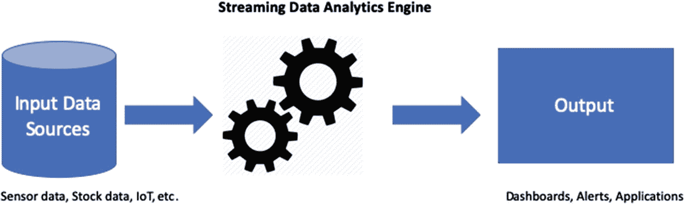
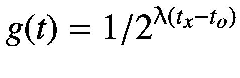
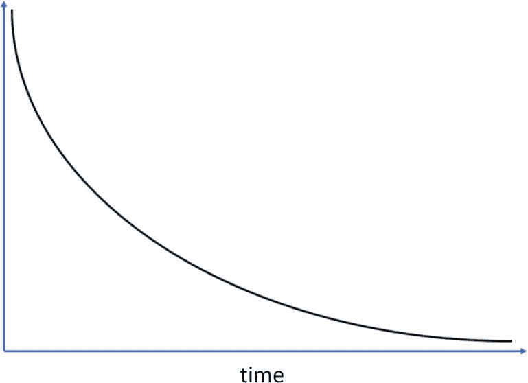
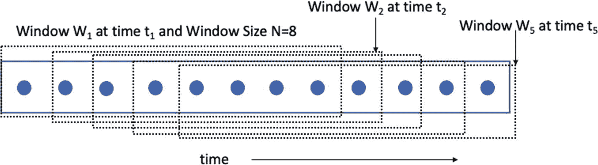
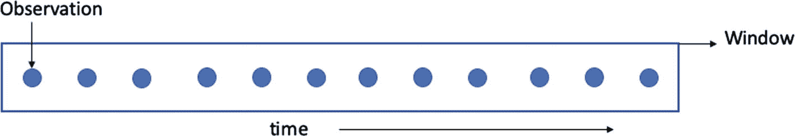
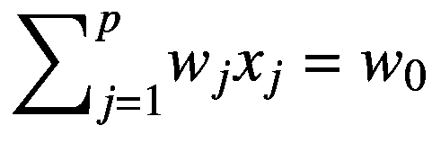
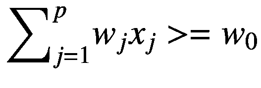
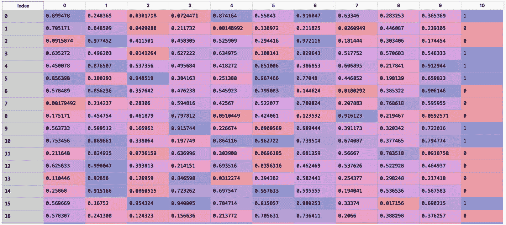
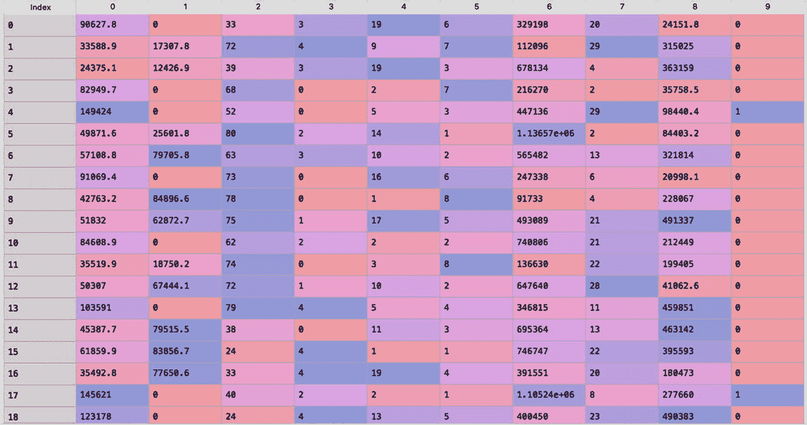
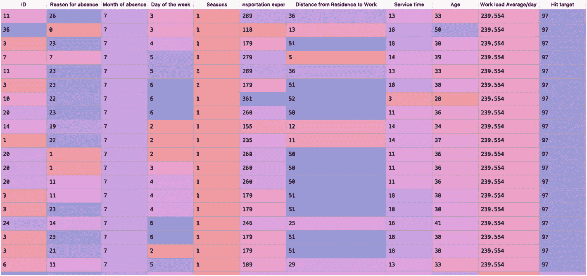

# 流数据简介

本章将向你介绍流数据、其各种挑战、一些现实世界的商业应用、各种窗口技术，以及增量学习和在线学习算法的概念。本章还将介绍 Python 中的 `scikit-multiflow` 框架和一些流数据生成器。

请注意，Python 中还有其他一些可用于流数据机器学习的框架。本书使用 `scikit-multiflow` 框架，因为我坚信这个包（鉴于其广泛实现的技术和出色的文档）是 Python 用户学习流数据在线/增量机器学习技术的一个良好起点。

## 流式数据

近年来，世界见证了数据的洪流。从各种来源生成的数据量大幅增长。主要数据来源包括互联网、日志数据、传感器数据、电子邮件、`RFID`、`POS` 交易数据等。从这些来源收集的数据可分为结构化、半结构化和非结构化数据。近期的技术进步是这场“数据爆炸”的主要原因，它使数据存储成本更低，并使得持续收集数据成为可能。几乎所有零售、社交媒体和 `IT` 等行业的公司都面临着数据爆炸。他们正试图找到处理和分析自身产生的海量数据的方法，并从中获得可操作的见解。

### 大数据

我们大多数人都听说过*大数据*这个术语。麦肯锡全球研究院将大数据定义为“其规模超出了典型数据库软件工具捕获、存储、管理和分析能力的数据集”[1]。大数据的基本特征可以用四个以字母 `V` 开头的词来定义：体量（`Volume`）、速度（`Velocity`）、多样性（`Variety`）和真实性（`Veracity`）。大数据中的“大”不仅仅指数据的大小或体量——其他几个“`V`”也需要考虑。

技术的进步使得持续收集数据成为可能。我们在各种日常交易（例如，沃尔玛、塔吉特等零售店的 `POS` 交易）、传感器数据、网络数据、社交媒体数据、股票价格、搜索查询、点击流数据等中都被数据淹没。这些都是高速数据的来源；也就是流式数据。其他持续数据流的来源包括运营监控、在线广告、移动数据和物联网（`IoT`）。

流式数据，或称数据流，是从源头以极快速度到达的、无限且连续的数据流。因此，流式数据是大数据的一个子集，它处理的是大数据的*速度*方面。流式数据与静态数据之间的一些区别特征在于数据的松散结构化、始终在线和持续流动的特性[2]。与静态数据不同，流式数据的结构并非严格定义。它是“始终在线”的；也就是说，由于新数据不断生成，数据始终可用。

作为流式数据如何在商业中应用的例子，我们来看看在线广告。像 `Facebook` 这样的社交媒体巨头实时收集用户行为数据。`Facebook` 每月有超过 20 亿活跃用户[4]，这让你对正在收集的数据规模有所了解。

`Facebook` 的大部分收入来自向用户展示广告。许多广告商入驻该平台。`Facebook` 利用用户行为数据来选择与其用户相关的广告（即，那些最有可能以点击或购买形式产生互动的广告）。他们在在线广告中执行其他重要步骤（例如，在“拍卖”中“出价”）。所有这些几乎都是实时发生的（例如，当你加载 `Facebook` 的新闻推送页面或与 `Messenger` 或 `Instagram` 等其他应用互动时）。

### 处理和分析流式数据的必要性

流式数据提供实时或近实时的分析。由于它持续产生且永无止境，存储这些海量数据然后对其进行分析（如同批处理中所做的那样）是不可行的。流式数据必须“即时”分析，以便实时或近实时地获取洞察。

图 1-1 展示了流式数据分析处理流程。来自各种来源（传感器数据、股票报价数据等）的高速数据由流式数据分析引擎实时或近实时地摄取、处理和分析。生成的输出通过仪表盘、应用程序或任何其他方式显示。



图 1-1

流式数据分析处理流程

流式数据分析和洞察使组织的决策者能够实时做出增值决策。这就是为什么学术界和工业界的许多研究人员正在研究实时分析的新方法。传统的机器学习算法不起作用，因为流式数据带来了一系列新的挑战。

下一节将讨论处理流式数据的挑战。

## 流式数据的挑战

以下是处理流式数据的一些主要挑战。

*   无法再对数据进行多次遍历。数据需要一次遍历处理完毕。

*   数据流可能随时间演变，这种行为称为`概念漂移`。用于流式数据的挖掘算法需要解决这个问题，以免模型迅速过时。

*   流式数据所需的高速处理能力。

*   更高的内存需求。

用于流式数据的机器学习和数据挖掘算法需要新的方法论。用于静态数据的批处理算法不起作用。让我们看一个简单的线性回归方法。在批处理中，整个训练数据集都是可用的。使用 `OLS`（普通最小二乘法）将线性回归应用于整个数据集，以获得贝塔系数，从而找到因变量和自变量之间的关系（即，贝塔系数表示自变量（`x`）每变化一个单位，因变量（`y`）平均变化的量）。

然而，在流式数据中，这是不可行的。你永远无法访问所有数据，因为数据是持续流入的。这里需要在线学习或增量学习算法，这些算法在数据（每个样本或元组）到来时进行处理，并更新参数（在本例中为贝塔系数）。一种这样的实现是使用 `SGD`（随机梯度下降）的线性回归。后续章节将更深入地探讨在线学习/增量学习技术。

重要的是，与典型的大数据分析不同，流式数据不需要更多存储空间，因为旧数据在一段时间后会被丢弃。需要更智能、更快速的算法来处理和分析快速流入的流式数据。算法应能够在任何被查询时生成输出。

你现在应该理解为什么使用流式数据的机器学习与使用批处理数据的不同了。下一节将讨论流式数据的一些实际应用。

## 流式数据的应用

在大数据时代，利用流式数据进行实时分析将带来颠覆性变革。实时分析的核心要义是快速获得优质解决方案。以下是流式数据实时分析的一些应用场景或用例。

*   **实时或近实时欺诈检测**。以亚马逊为例，其网站每日交易量约达十亿笔，但并非所有交易都是真实的。

*   **实时推荐**能够激发用户的冲动消费，这对电商企业而言至关重要。

*   **实时天气监测**可用于灾害预警系统。

*   **实时网络管理**涉及对网络硬件和软件的监控与配置，以确保其平稳运行。用例包括实时故障检测、实时监控链路带宽使用率、提升网络资源利用率等。

*   **实时运营管理**包括供应链决策，例如何时补充燃料或重新订货。

*   **基于股票行情数据的算法交易**。实时监控股票趋势有助于做出交易相关决策。

*   **实时体育分析**。相关用例包括利用视频流和传感器数据等流式数据源进行球员运动轨迹追踪和表现分析。

*   **精准农业**。一个简单的用例是收集基于传感器的农机设备健康数据，通过预测设备故障发生的时间和地点并做出替代安排，来最大限度地减少停机时间。

*   **安全事件监控**包括实时监控日志数据、主机系统及安全设备，以标记（例如发送警报）登录失败、恶意软件活动及其他可疑行为等事件。

*   **实时趋势**是 `Twitter` 和 `Google Trends` 中的一项功能。

*   **自动标注**。对实时视频流中的对象进行实时标注是一个相关用例。该技术同样适用于图像流或语音数据流。

下一节，您将了解用于分析流式数据的各种窗口技术。

## 窗口技术

窗口可以定义为数据的快照——可以是基于观测计数或基于时间的快照[3]。这在流式数据上下文中是一项非常有用的技术，因为在任何时间点你都无法获得“完整数据”。窗口可以有效地处理`概念漂移`，因为它更重视最近的数据点；较旧的数据点会被定期丢弃。通过使用`窗口技术`，可以将批处理方法转换为增量方法[5]。窗口技术的类型包括滑动窗口模型、衰减窗口模型和地标窗口模型[6]。以下是对每种窗口技术的解释。

*   `地标窗口模型`。不会丢弃较旧的数据点。所有数据点都累积在窗口中。图 1-2 描绘了此模型。矩形代表窗口，蓝色圆圈代表数据。

*   `滑动窗口模型`。这是一种流行的丢弃较旧数据点、仅考虑最近数据点进行分析的方法。图 1-3 描绘了此模型。

*   `衰减窗口模型`。数据点被赋予权重。较新的数据点被赋予更高的权重。使用`指数衰减策略`来丢弃旧数据。使用一个老化函数 `g(t)`。



`λ` 是衰减因子，`tx` 是当前时间戳，`to` 是起始时间戳（即窗口创建的时间）。你可以通过改变 `λ` 的值来影响丢弃较旧数据点的策略[7]。`λ` 值越高，意味着赋予较旧数据点的权重越低。图 1-4 显示了衰减窗口模型中数据点随时间呈指数衰减的情况。



图 1-4

衰减窗口模型中数据点的指数衰减



图 1-3

滑动窗口模型



图 1-2 地标窗口模型

图 1-2 显示地标窗口会随时间累积数据点。随着更多数据点的到达，窗口大小会增加。这种窗口技术需要大量的内存资源，尤其是在处理大型数据流时。

## 滑动窗口模型

在滑动窗口模型中，如图 1-3 所示，“时间”是 x 轴，观测值（即蓝点）从左到右依次到达。最左边的观测值是最旧的数据，最新的观测值在右侧。

图 1-3 显示较旧的点被持续丢弃；窗口中只考虑最近的点。图 1-3 还显示了一个大小为 8 的窗口（即它在某个时间点包含八个数据点）。窗口以步长 = 1 移动（即窗口以步长 1 滑动，丢弃最旧的数据）。

同样在图 1-3 中，时间 `t[1]` 处的窗口 `W[1]` 包含八个数据点。当新数据点在时间 `t[2]` 到达时，`W1` 中最旧的数据点被丢弃，形成包含八个数据点（包括最新数据点）的窗口 `W[2]`。滑动窗口模型只考虑最近的数据点；它丢弃较旧的数据点。

滑动窗口在 Python 3 中实现，如代码清单 1-1 所示。它创建一个大小为 4 的窗口，并以步长 1 移动。输入数组 (`y`) 包含从 0 到 9 的十个整数。滑动窗口实现的输出如代码清单 1-2 所示。末尾的滑动窗口包含 `None`，表示空值，因为没有新数据点到达，但窗口大小固定为 4。

```
###############################################################
[0, 1, 2, 3]
[1, 2, 3, 4]
[2, 3, 4, 5]
[3, 4, 5, 6]
[4, 5, 6, 7]
[5, 6, 7, 8]
[6, 7, 8, 9]
[7, 8, 9, None]
[8, 9, None, None]
[9, None, None, None]
###############################################################
代码清单 1-2
滑动窗口函数输出
```

```
###############################################################
# 导入相关库
import itertools
from itertools import tee
from itertools import zip_longest as zip

def window(iterations, size):
    n = tee(iterations, size)
    for i in range(1, size):
        for each in n[i:]:
            next(each, None)
    return zip(*n)

y=range(10)
for each in window(y, 4):
    print(list(each))
###############################################################
代码清单 1-1
滑动窗口实现
```

## 衰减窗口模型

与滑动窗口技术不同，衰减窗口模型赋予较新的数据点更高的权重。较旧的数据点使用指数衰减策略丢弃，如图 1-4 所示。相对较旧的数据点比较新的数据点被丢弃得更快。这样，窗口同时存储了较旧和较新的数据点。然而，在流式数据上下文中，滑动窗口技术更为流行。它是本书中主要的窗口技术。

下一节，您将了解增量学习和在线学习算法。

# 增量学习与在线学习

大多数标准机器学习技术（监督式或无监督式）都属于 `批量学习` 方法。也就是说，它们通常处理静态/批量数据集（即非流式数据集），其中所有数据都是可用的，并且可以对任何算法进行多次遍历。然而，当这些批量学习方法应用于流式数据时，由于概念漂移，它们会随着时间的推移而过时。在流式数据场景下，需要一种不同的机器学习算法来应对其挑战。这类算法被称为 `增量学习` 或 `在线学习算法`。

增量学习算法在资源有限的情况下运行，每当新的一批/小批量数据到达时，就会频繁更新模型参数。增量学习算法能够处理流式数据中固有的概念漂移。在线学习算法与增量学习算法的不同之处在于，每当有新观测数据到达时，模型参数就会更新。在在线学习算法中，你无需等待一小批数据到达后再更新模型参数。

可以通过使用带有滑动窗口的批量学习器来近似实现增量学习算法 [5]。在这种情况下，每当新窗口（包含数据点）到达时，模型就会重新训练。你可以将任何批量学习器（例如线性回归或逻辑回归算法）与滑动窗口结合应用于数据流，以近似实现增量学习算法。

让我们来看一下小批量梯度下降法和 `随机梯度下降`（SGD）法。梯度下降法是一种非常流行的寻找函数最小值的技术，在此上下文中，该函数即为代价函数。以下内容解释了如何执行梯度下降算法。

1.  用随机值初始化参数。
2.  计算目标函数的梯度。
3.  使用梯度更新参数。
4.  每个特征的步长计算：步长 = 梯度 * `学习率`。`学习率`是一个直接影响算法收敛性的超参数。学习率非常小会导致梯度下降算法收敛需要很长时间。学习率值非常高会使算法沿着斜率迈出大步，从而可能错过全局最小值。
5.  计算新参数：新参数 = 旧参数 – 步长。
6.  重复步骤 2-5，直到梯度接近零。

梯度下降法是一种批量学习方法。在沿着梯度方向迈出一步之前，会考虑整个训练数据。在大型数据集中，单次参数更新需要很长时间。然而，小批量梯度下降算法是一种增量学习算法，其中每次处理一个小批量时都会更改参数。但 SGD 算法总是针对每个训练观测值更新模型参数。SGD 技术是在线学习算法的一个例子。

现在让我们来看一下线性回归方法，这是一种线性模型，通过使用 `普通最小二乘法`（OLS）计算每个预测变量的 beta 系数，来理解目标变量（Y）与预测变量（X）之间的关系。

你可以使用梯度下降优化技术来实现线性回归方法。线性回归是一种批量学习技术，其中梯度下降算法应用于整个训练集以更新模型参数。但是，你可以通过使用小批量梯度下降算法将此方法转换为增量学习器。

清单 1-3 使用 Python 实现了带有小批量梯度下降算法的线性回归函数 [8]。然后将这些函数应用于模拟数据集。

```markdown
## 清单 1-3：使用小批量梯度下降实现线性回归

```python
# 导入库
import numpy as np
import matplotlib.pyplot as plt
import pandas as pd
from pandas import read_csv
np.random.seed(111)
# 创建数据
mean = np.array([6.0, 7.0])
covariance = np.array([[1.0, 0.94], [0.95, 1.2]])
df = np.random.multivariate_normal(mean, covariance, 500)
df.shape
# 输出- (10000, 2)
df
#输出-
#array([[6.97833668, 8.30414776],
#       [4.66509294, 5.31806407],
#       [6.88804517, 7.71734893],
#       ...,
#       [5.75153443, 6.73145512],
#       [4.93357924, 6.72570148],
#       [7.31794626, 8.4076224 ]])
X = df[:,:-1]
Y = df[:,-1]
# 添加一列全为 1 的列
X_new = np.c_[np.ones((500, 1)), X]
# 随机初始化估计值 "reg_coef"
np.random.seed(333)
reg_coef = np.random.randn(2,1)
# 这里，size_batch_mini= 小批量大小
# lr= 学习率
#  max_iters= 使用的批次数
lr=0.01
num = 100
max_iters = 100
size_batch_mini = 50
t0, t1 = 400, 1200
def lrs(step):
return t0 / (step + t1)
reg_coef_all = []
step = 0
for j in range(max_iters):
batches_index  = np.random.permutation(num)
X_batches = X_new[batches_index]
y_batches = Y[batches_index]
for i in range(0, num, size_batch_mini):
step += 1
Yi = y_batches[i:i+size_batch_mini]
Xi = X_batches[i:i+size_batch_mini]
# 计算梯度
gradient = 2/size_batch_mini * Xi.T.dot(Xi.dot(reg_coef) - Yi)
lr = lrs(step)
# 更新
reg_coef = reg_coef - lr * gradient
reg_coef_all.append(reg_coef)
# 输出
reg_coef
reg_coef_all
```

类似地，线性回归方法可以通过使用 SGD 方法转换为在线学习方法。我鼓励你利用到目前为止讨论的思路，使用 SGD 实现线性回归函数。你可以参考清单 1-3，但要确保更新步骤针对每个观测值进行。

scikit-learn 库有一个 `SGDRegressor()` 函数，用于应用带有 SGD 的线性回归。清单 1-4 是在模拟数据集上使用 SGD 应用线性回归的代码片段。

## 清单 1-4：使用 scikit-learn 实现随机梯度下降

```python
# 导入相关库
import numpy as np
import pandas as pd
from sklearn.model_selection import train_test_split
from sklearn.linear_model import SGDRegressor
from sklearn.metrics import mean_squared_error, r2_score
np.random.seed(111)
# 创建数据集
mean = np.array([6.0, 7.0])
covariance = np.array([[1.0, 0.94], [0.95, 1.2]])
df = np.random.multivariate_normal(mean, covariance, 10000)
df.shape
# 输出 - (10000, 2)
df
#输出 -
#array([[6.97833668, 8.30414776],
#       [4.66509294, 5.31806407],
#       [6.88804517, 7.71734893],
#       ...,
#       [5.75153443, 6.73145512],
#       [4.93357924, 6.72570148],
#       [7.31794626, 8.4076224 ]])
X = df[:,:-1]
Y = df[:,-1]
## 分割为训练集和测试集
train_X, test_X, train_y, test_y = train_test_split(X, Y, test_size=0.20, random_state=333)
### 使用 SGD 回归器
mod = SGDRegressor()
### 拟合模型
mod.fit(train_X, train_y)
#SGDRegressor(alpha=0.0001, average=False, early_stopping=False, epsilon=0.1,
#             eta0=0.01, fit_intercept=True, l1_ratio=0.15,
#             learning_rate='invscaling', loss="squared_loss", max_iter=1000,
#             n_iter_no_change=5, penalty="l2", power_t=0.25, random_state=None,
#             shuffle=True, tol=0.001, validation_fraction=0.1, verbose=0,
#             warm_start=False)
### 打印系数和截距值
print("系数: \n", mod.coef_)
#系数: [0.95096598]
print("截距", mod.intercept_)
#截距 [1.17712595]
### 在测试数据上进行预测
pred = mod.predict(test_X)
# 计算预测误差
error = np.sum(np.abs(test_y - pred) / test_y.shape[0])
print("平均绝对误差 (MAE) = ", error)
# 平均绝对误差 (MAE) =  0.4493164833335055
```

本节解释了增量学习和在线学习算法，并在线性回归背景下使用 Python 实现了其中几种算法。下一节将介绍 `scikit-multiflow`。

## Scikit-Multiflow 框架简介

`scikit-multiflow` 是一个用于在 Python 中分析流数据的框架 [9]。它是一个根据 BSD 许可证分发的开源软件。业界需要一个用于流数据的 Python 开源机器学习库，类似于 scikit-learn 库 [10] 多年来为静态/批量数据所做的工作。`scikit-multiflow` 框架建立在其他著名的开源框架之上，例如 scikit-learn、MOA [11] 和 MEKA [12]。

MOA 是历史最悠久、最流行的数据流挖掘开源软件之一。它包含一系列用于监督学习（分类、回归等）和无监督学习（聚类等）的流数据算法。MOA 使用 Java 开发。

MEKA 是一个用于多标签学习和评估的开源软件。`scikit-multiflow` 补充了 scikit-learn（其主要关注点是批量学习），并有助于流数据研究中的机器学习。

`scikit-multiflow` 网站 ([https://scikit-multiflow.github.io/](https://scikit-multiflow.github.io/)) 提供了官方文档和用户指南。
```

API 参考文档可在 [`https://scikit-multiflow.readthedocs.io/en/stable/api/api.html`](https://scikit-multiflow.readthedocs.io/en/stable/api/api.html) 获取。

`scikit-multiflow` 包的源代码可在 [`https://github.com/scikit-multiflow/scikit-multiflow`](https://github.com/scikit-multiflow/scikit-multiflow) 公开获取。

在安装 `scikit-multiflow` 之前，需要先安装两个依赖项：`numpy` 和 `cython`。

`scikit-multiflow` 仅适用于 Python 3.5+ 版本。

要从 Python 包索引 (PyPI) 安装 `scikit-multiflow`，请在命令提示符/终端中使用以下命令。

```
$ pip install -U scikit-multiflow
```

也可以使用以下命令从 `conda-forge` 安装 `scikit-multiflow`。

```
$ conda install -c conda-forge scikit-multiflow
```

本书使用 2020 年 6 月发布的 0.5.3 版本包。

在下一节中，您将了解 `scikit-multiflow` 框架中可用的各种流数据生成器。

## 流式数据生成器

`scikit-multiflow` 框架包含许多流式数据生成器，用于创建模拟数据流，以支持实验和研究相关工作。其中一种流行的流式数据生成器是超平面生成器。`p` 维空间中的超平面是满足以下条件的点集 (`x`)。



`x[j]` 是 `x` 的第 `j` 个坐标。`w` 是权重 [13]。

对于目标变量，以下类型的观测值被标记为正类。



以下类型的观测值被标记为负类。


超平面在模拟随时间变化的概念（如方向）方面非常有用。通过调整权重的相对大小，可以改变超平面的位置。代码清单 1-5 使用 `scikit-multiflow` 生成了一个包含十个特征和一个目标变量的数据流。它生成了 10,000 个观测值，然后将模拟数据存储在一个 `CSV` 文件中。图 1-5 是生成数据集的快照。



图 1-5

使用超平面生成器生成的数据集快照

```
#############################################################
# 导入相关库
from skmultiflow.data import HyperplaneGenerator
import pandas as pd
import numpy as np
# 应用 HyperplaneGenerator() 函数
create = HyperplaneGenerator(random_state = 888, n_features= 10, noise_percentage = 0)
create.prepare_for_use()
X , Y = create.next_sample(10000)
data = pd.DataFrame(np.hstack((X, np.array([Y]).T)))
data.shape
# 输出 - (10000, 11)
print(data.head())
# 输出：
#         0         1         2         3   ...        7         8         9    10
#0  0.899478  0.248365  0.030172  0.072447  ...  0.633460  0.283253  0.365369  1.0
#1  0.705171  0.648509  0.040909  0.211732  ...  0.026095  0.446087  0.239105  0.0
#2  0.091587  0.977452  0.411501  0.458305  ...  0.181444  0.303406  0.174454  0.0
#3  0.635272  0.496203  0.014126  0.627222  ...  0.517752  0.570683  0.546333  1.0
#4  0.450078  0.876507  0.537356  0.495684  ...  0.606895  0.217841  0.912944  1.0
#
#[5 rows x 11 columns]
# 将数据存储为 csv
data.to_csv('data_stream_hyperplane.csv', index=False)
###############################################################
代码清单 1-5
使用超平面生成器生成流式数据
```

另一种流行的流式数据生成器是 `Agarwal` 生成器。`Agarwal` 流生成器是用于训练决策树学习器的最早数据源之一 [14]。

代码清单 1-6 使用 `Agarwal` 生成器生成了一个数据流。该数据集的快照如图 1-6 所示。该数据集有十列。最右边一列是二元目标变量（0 或 1）。数据集中有九个特征。目标变量表示贷款是否应被批准。该数据集中的一些特征或预测变量包括年龄、薪水、教育水平、贷款金额、房屋价值、邮政编码、佣金、汽车制造商以及房屋拥有年限。



图 1-6

使用 `Agarwal` 生成器生成的数据集快照

## 导入相关库

```
###############################################################
# 导入相关库
from skmultiflow.data import HyperplaneGenerator
import pandas as pd
import numpy as np
# 应用 HyperplaneGenerator() 函数
create = HyperplaneGenerator(random_state = 888, n_features= 10, noise_percentage = 0)
create.prepare_for_use()
X , Y = create.next_sample(10000)
data = pd.DataFrame(np.hstack((X, np.array([Y]).T)))
data.shape
# 输出 - (10000, 11)
print(data.head())
# 输出：
#         0         1         2         3   ...        7         8         9    10
#0  0.899478  0.248365  0.030172  0.072447  ...  0.633460  0.283253  0.365369  1.0
#1  0.705171  0.648509  0.040909  0.211732  ...  0.026095  0.446087  0.239105  0.0
#2  0.091587  0.977452  0.411501  0.458305  ...  0.181444  0.303406  0.174454  0.0
#3  0.635272  0.496203  0.014126  0.627222  ...  0.517752  0.570683  0.546333  1.0
#4  0.450078  0.876507  0.537356  0.495684  ...  0.606895  0.217841  0.912944  1.0
#
#[5 rows x 11 columns]
# 将数据存储为 csv
data.to_csv('data_stream_hyperplane.csv', index=False)
###############################################################
```
代码清单 1-6
Agarwal 流式数据生成

以下是 scikit-multiflow 框架中可用的许多其他流式数据生成器中的一部分。
* LED 流生成器和带概念漂移的 LED 流生成器
* 正弦生成器和异常正弦生成器
* 混合数据流生成器
* 随机径向基函数流生成器和带概念漂移的随机径向基函数流生成器
* SEA 流生成器
* 随机树流生成器
* STAGGER 概念流生成器
* 波形流生成器
* 回归生成器
本节讨论了各种流式数据生成器。在下一节中，你将学习如何从 CSV 文件创建数据流。

## 从 CSV 文件创建数据流

scikit-multiflow 数据模块中的 `FileStream` 方法可从文件源创建数据流。截至 2020 年 9 月，仅支持 CSV 文件。你可以将任何静态/批量数据集转换为流式数据。

作为演示，我们来看一个来自 UCI 机器学习库 [16] 的公开工作场所缺勤数据集 [15]。该数据集为 CSV 格式，包含多种属性：员工 ID、缺勤原因、缺勤月份/日期/季节、员工年龄、日均工作量、教育程度、身体质量指数、缺勤时长（小时）等。该数据集共有 21 个属性和 740 条观测值。

图 1-7 展示了该数据集的一个快照，包含 19 行和 11 列。代码清单 1-7 使用 `FileStream` 方法加载缺勤 CSV 文件，并将其转换为数据流。`next_sample()` 函数用于获取下一个样本。此外，内置函数 `has_more_samples()` 和 `n_remaining_samples()` 分别用于判断是否还有更多样本以及剩余样本数量。


图 1-7
工作场所缺勤数据集快照（未显示所有列）

```
###############################################################
# 导入相关库
from skmultiflow.data.file_stream import FileStream
# 设置数据流
data_stream= FileStream('./Absenteeism_at_work.csv')
# 获取一个样本
data_stream.next_sample()
# 输出-
#(array([[ 11\.  ,  26\.  ,   7\.   ,   3\.  ,   1\.  , 289\.  ,  36\.  ,
#          13\.  ,  33\.  , 239.554,  97\.  ,   0\.  ,   1\.  ,   2\.  ,
#           1\.  ,   0\.  ,   1\.   ,  90\.  , 172\.  ,  30\.  ]]), array([4]))
# 获取 5 个样本
data_stream.next_sample(5)
# 输出-
#(array([[ 36\.  ,   0\.  ,   7\.   ,   3\.  ,   1\.  , 118\.  ,  13\.  ,
#          18\.  ,  50\.  , 239.554,  97\.  ,   1\.  ,   1\.  ,   1\.  ,
#           1\.  ,   0\.  ,   0\.   ,  98\.  , 178\.  ,  31\.  ],
#        [  3\.  ,  23\.  ,   7\.   ,   4\.  ,   1\.  , 179\.  ,  51\.  ,
#          18\.  ,  38\.  , 239.554,  97\.  ,   0\.  ,   1\.  ,   0\.  ,
#           1\.  ,   0\.  ,   0\.   ,  89\.  , 170\.  ,  31\.  ],
#        [  7\.  ,   7\.  ,   7\.   ,   5\.  ,   1\.  , 279\.  ,   5\.  ,
#          14\.  ,  39\.  , 239.554,  97\.  ,   0\.  ,   1\.  ,   2\.  ,
#           1\.  ,   1\.  ,   0\.   ,  68\.  , 168\.  ,  24\.  ],
#        [ 11\.  ,  23\.  ,   7\.   ,   5\.  ,   1\.  , 289\.  ,  36\.  ,
#          13\.  ,  33\.  , 239.554,  97\.  ,   0\.  ,   1\.  ,   2\.  ,
#           1\.  ,   0\.  ,   1\.   ,  90\.  , 172\.  ,  30\.  ],
#        [  3\.  ,  23\.  ,   7\.   ,   6\.  ,   1\.  , 179\.  ,  51\.  ,
#          18\.  ,  38\.  , 239.554,  97\.  ,   0\.  ,   1\.  ,   0\.  ,
#           1\.  ,   0\.  ,   0\.   ,  89\.  , 170\.  ,  31\.  ]]),
# array([0, 2, 4, 2, 2]))
data_stream.has_more_samples()
# 输出-
# True
data_stream.n_remaining_samples()
# 输出-
# 734
###############################################################
```
代码清单 1-7
从 CSV 文件创建数据流

## 本章小结

在本章中，你学习了流式数据及其相关的各种挑战、实际业务应用、窗口技术以及增量学习和在线学习算法。你还了解了 Python 中的 scikit-multiflow 框架。

下一章将讨论概念漂移检测和异常检测算法，以及如何使用 scikit-multiflow 框架在各种数据集上实现这些算法。