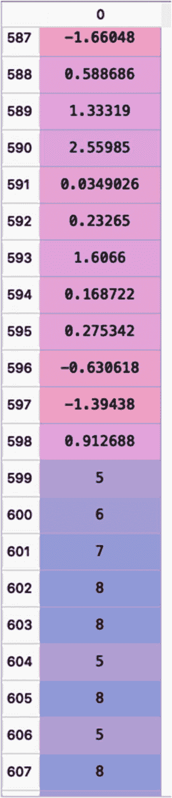
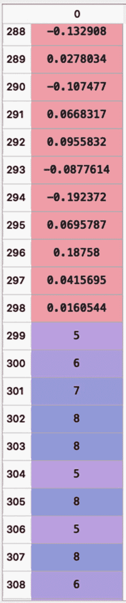

# 2. 数据流中的概念漂移检测

在上一章中，你了解了流式数据、其应用、窗口技术以及增量学习和在线学习算法。你还了解了 Python 中的 scikit-multiflow 框架以及各种流式数据生成器。本章将讨论在流式数据上下文中进行概念漂移检测的算法，并探讨相关技术以及如何使用 Python 的 scikit-multiflow 框架实现它们。

注意

本章应用了 scikit-multiflow 框架（版本 0.5.3）漂移检测模块中的部分函数。此外，本章提供的代码参考了 scikit-multiflow 框架的 API 参考文档（[`https://scikit-multiflow.readthedocs.io/en/stable/api/api.html`](https://scikit-multiflow.readthedocs.io/en/stable/api/api.html)）。

## 概念漂移

第 1 章讨论了流式数据的各种挑战。其中一个主要挑战是概念漂移，即数据流的分布可能随时间发生变化。过去数据中存在的特定模式，在当前数据中可能变成另一种模式。因此，任何在历史数据上训练的批量学习模型都会因概念漂移而过时。

在机器学习中，*概念* 指的是机器学习模型试图预测的变量或数量。*概念漂移* 指的是目标概念的统计属性随时间变化的现象 [1]。

数据流的变化或概念漂移模式可以是渐变的，也可以是突变的 [2]。数据流的突变或突变概念漂移，意味着数据特征发生突然变化，例如均值变化、方差变化等。检测这些变化非常重要，因为它们在质量控制、系统监控、故障检测等方面有许多实际应用。然而，数据流的渐变或渐变概念漂移，指的是在比突变长得多的时间尺度上发生的*数据分布变化*。渐变相对更难识别。

其他类型的数据流或概念漂移变化包括*增量概念漂移*和*循环概念漂移* [3]。在增量概念漂移中，数据流中的旧模式随时间逐步转变为新模式；然而，其转变时间远短于渐变概念漂移。在循环概念漂移中，你会看到旧数据流的特定特征在一段时间后再次出现。

概念漂移检测算法有多种类型。本章重点介绍以下概念漂移检测算法：(a) 用于概念漂移检测的自适应窗口方法 (ADWIN)，(b) 漂移检测方法 (DDM)，(c) 早期漂移检测方法 (EDDM)，(d) 基于霍夫丁界与移动平均检验的漂移检测方法 (HDDM_A)，(e) 基于霍夫丁界与移动加权平均检验的漂移检测方法 (HDDM_W)，以及 (f) 使用 Page-Hinkley 方法的漂移检测。


## 用于概念漂移检测的自适应窗口方法

在用于概念漂移检测的自适应窗口方法（ADWIN）中，使用了一个动态大小的滑动窗口；也就是说，窗口的大小不是固定的，而是根据从窗口内数据观察到的变化率在线计算得出的 [4]。我在第 1 章中已经讨论过滑动窗口的概念，即维护一个包含数据流中最新数据点的窗口，并不断丢弃较旧的数据点。窗口内的数据点会获取数据流的更新统计信息，检测概念漂移，并更新模型。

通常建议使用可变大小的窗口。其理念是尽可能长时间地保留数据点或观测值，因为用户并不知道变化的时间尺度 [4]。ADWIN 算法在未检测到数据流发生变化时会增大窗口大小，而在检测到数据流发生变化时则会减小窗口大小。其核心思想是追踪窗口 W 中数据点的均值。零假设是窗口 W 内的均值没有变化。当有足够证据表明新数据点的均值与窗口其余部分的均值不同时，窗口中的较旧数据点就会被丢弃 [5]。

为了进一步深入探讨 ADWIN 算法的实现，会执行一个统计检验，以检查两个子窗口（W[1] 和 W[2]）的均值之差是否超过某个阈值。W[1] 和 W[2] 是主窗口 W 的子窗口。如果子窗口的均值存在显著差异，则丢弃窗口 W 中较旧的数据点。然而，如果子窗口的均值没有显著差异，则假定数据流的分布没有发生变化 [4]。

清单 2-1 展示了在模拟数据流上使用 ADWIN 进行概念漂移检测的过程。`drift_detection` 模块用于 scikit-multiflow 框架中。清单 2-1 模拟了一个来自标准正态分布、大小为 1000 的数据流，然后从索引 599 开始改变数据概念（即，将值替换为 5 到 8 之间的整数），如图 2-1 所示。接着，它调用 ADWIN() 对象，并使用 `detected_change()` 函数来识别数据流中的概念漂移。最终输出如清单 2-2 所示。



图 2-1

从索引 599 开始概念发生变化的数据流

```
###############################################################
### 输出：
在数据中检测到概念漂移：8.0 - 位于索引：607
在数据中检测到概念漂移：5.0 - 位于索引：639
在数据中检测到概念漂移：6.0 - 位于索引：671
###############################################################
清单 2-2
使用 ADWIN 进行概念漂移检测的输出
```

```
###############################################################
# 导入相关库
import numpy as np
from skmultiflow.drift_detection.adwin import ADWIN
# 设置随机种子以确保结果可重现
np.random.seed(123)
# 模拟一个来自标准正态分布、大小为 1000 的数据流
stream = np.random.randn(1000)
stream[:10]
# 输出：
#array([-1.0856306 ,  0.99734545,  0.2829785 , -1.50629471, -0.57860025,
#        1.65143654, -2.42667924, -0.42891263,  1.26593626, -0.8667404 ])
# 从索引 599 到 999 改变数据概念
for j in range(599, 1000):
stream[j] = np.random.randint(5, high=9)
# 初始化 ADWIN 对象
A = ADWIN(delta=0.002)
# 将数据流元素添加到 ADWIN 并检查是否发生漂移
for j in range(1000):
A.add_element(stream[j])
if A.detected_change():
print('在数据中检测到概念漂移：' + str(stream[j]) + ' - 位于索引：' + str(j))
###############################################################
清单 2-1
在 scikit-multiflow 中使用 ADWIN 进行概念漂移检测的示例
```

## 漂移检测方法

漂移检测方法（DDM）由 Gama 等人首次提出 [6]。DDM 方法可以应用于任何学习算法；也就是说，既可以用于增量/在线学习算法，也可以用于批量学习算法。其核心思想是追踪学习算法的错误率。在一个包含 *n* 个样本的样本集中，学习算法产生的错误数量是一个来自伯努利试验的随机变量。你可以使用二项分布来对 *n* 个样本中的错误数量进行建模。在时刻 j，错误率记为 p[j]，标准差为 σ[j] = sqrt(pj/j)。

DDM 方法在训练学习算法时会记录 p[min] 和 σ[min] [6]。如果 p[j] + σ[j] >= p[min] + 2 * σ[min]，则会发出警告，这意味着数据流发生了变化。但如果 p[j] + σ[j] >= p[min] + 3 * σ[min]，则声明数据流发生了改变 [5]。

清单 2-3 展示了使用 DDM 进行概念漂移检测的过程。它模拟了一个来自标准正态分布、大小为 1000 的数据流，然后从索引 299 到 599 改变数据概念（即，将值替换为 5 到 9 之间的整数）。接着，它调用 DDM() 对象，并使用 `detected_change()` 和 `detected_warning_zone()` 函数分别识别数据流中的概念漂移并提供关于数据流变化的警告。最终输出如清单 2-4 所示。

```
###############################################################
### 输出：
在数据中检测到概念漂移：1.0693159694243486 - 位于索引：55
在数据中检测到概念漂移：2.0871133595881854 - 位于索引：88
在数据中检测到概念漂移：0.8123413299768204 - 位于索引：126
在数据中检测到警告：1.3772574828673068 - 位于索引：158
在数据中检测到警告：-0.1431759743261871 - 位于索引：159
在数据中检测到警告：0.02031599823462459 - 位于索引：160
在数据中检测到警告：-0.19396387055266243 - 位于索引：161
在数据中检测到警告：0.13402679274666512 - 位于索引：162
在数据中检测到警告：0.7044740740436035 - 位于索引：163
在数据中检测到概念漂移：0.6656534379123312 - 位于索引：164
在数据中检测到概念漂移：8.0 - 位于索引：302
###############################################################
清单 2-4
使用 DDM 检测到的概念漂移和警告区域的输出
```

```
###############################################################
# 导入相关库
import numpy as np
from skmultiflow.drift_detection import DDM
# 设置随机种子以确保结果可重现
np.random.seed(123)
# 模拟一个来自标准正态分布、大小为 1000 的数据流
stream = np.random.randn(1000)
stream[:10]
## 输出-
#array([-1.0856306 ,  0.99734545,  0.2829785 , -1.50629471, -0.57860025,
#        1.65143654, -2.42667924, -0.42891263,  1.26593626, -0.8667404 ])
# 从索引 299 到 599 改变数据概念
for j in range(299, 600):
stream[j] = np.random.randint(5, high=9)
# 初始化 DDM 对象
d2m = DDM()
# 将数据流元素添加到 DDM 并检查是否发生漂移
for j in range(1000):
d2m.add_element(stream[j])
if d2m.detected_change():
print('在数据中检测到概念漂移：' + str(stream[j]) + ' - 位于索引：' + str(j))
if d2m.detected_warning_zone():
print('在数据中检测到警告：' + str(stream[j]) + ' - 位于索引：' + str(j))
###############################################################
清单 2-3
在 scikit-multiflow 中使用 DDM 进行概念漂移检测的示例
```


## 早期漂移检测方法

早期漂移检测方法（EDDM）是对 DDM 方法的改进，尤其适用于检测数据流中缓慢、渐进的变化。在之前讨论的 DDM 方法中，其思路是跟踪学习算法中的错误数量，而在 EDDM 中，则跟踪两次错误之间的平均距离 [7]。因此，EDDM 会存储两次错误之间的平均距离（p′[j]及其标准差σ′[j]），以及最大值 p′[max]和σ′[max]。与 DDM 类似，根据特定阈值，系统会声明发生了概念漂移或进入警告区域。有关 EDDM 的详细回顾，请参阅 Baena-Garcia 等人的文献 [7]。

使用 EDDM 进行概念漂移检测的实现方式与清单 2-3 相同。不过，你需要使用`EDDM()`方法，而不是`DDM()`方法。建议你更改数据流的分布，并观察输出结果。

## 使用 HDDM_A 和 HDDM_W 进行漂移检测

基于移动平均检验的漂移检测方法（HDDM_A）以霍夫丁界 [10] 为基础。霍夫丁不等式不假设概率函数，它假设随机变量是独立且有界的 [8]。HDDM_A 执行一种*A 检验*，在给定一系列随机变量的情况下，通过监测移动平均值之间的差异，可以检测总体均值的变化 [8]。HDDM_A 方法已在 scikit-multiflow 中实现，其实现基于 MOA [9]。

清单 2-5 演示了如何在 scikit-multiflow 中使用 HDDM_A 方法进行概念漂移检测和警告区域检测。该示例模拟了一个来自二项分布、大小为 1000 的数据流，并将索引 299 至 499 之间的数据概念进行了更改。最终输出结果如清单 2-6 所示。


```
###############################################################
### 输出：
数据中检测到概念漂移：8 - 索引：13
数据中检测到警告：7 - 索引：26
数据中检测到概念漂移：7 - 索引：27
数据中检测到概念漂移：8 - 索引：65
数据中检测到警告：8 - 索引：70
数据中检测到概念漂移：9 - 索引：74
数据中检测到概念漂移：8 - 索引：78
数据中检测到概念漂移：7 - 索引：92
数据中检测到概念漂移：8 - 索引：96
数据中检测到概念漂移：8 - 索引：103
数据中检测到警告：7 - 索引：111
数据中检测到概念漂移：7 - 索引：112
数据中检测到概念漂移：10 - 索引：118
数据中检测到概念漂移：7 - 索引：121
数据中检测到概念漂移：7 - 索引：126
数据中检测到概念漂移：8 - 索引：131
数据中检测到概念漂移：8 - 索引：147
数据中检测到概念漂移：8 - 索引：150
数据中检测到警告：8 - 索引：163
数据中检测到概念漂移：8 - 索引：171
数据中检测到概念漂移：8 - 索引：175
数据中检测到概念漂移：7 - 索引：190
数据中检测到概念漂移：9 - 索引：194
数据中检测到概念漂移：9 - 索引：196
数据中检测到概念漂移：8 - 索引：199
数据中检测到概念漂移：8 - 索引：206
数据中检测到概念漂移：8 - 索引：209
数据中检测到概念漂移：8 - 索引：225
数据中检测到警告：8 - 索引：231
数据中检测到概念漂移：10 - 索引：240
数据中检测到概念漂移：9 - 索引：258
数据中检测到概念漂移：10 - 索引：272
数据中检测到概念漂移：9 - 索引：279
数据中检测到概念漂移：9 - 索引：281
数据中检测到概念漂移：6 - 索引：290
数据中检测到概念漂移：7 - 索引：292
数据中检测到概念漂移：8 - 索引：294
数据中检测到概念漂移：8 - 索引：298
数据中检测到概念漂移：8 - 索引：365
数据中检测到警告：8 - 索引：380
数据中检测到概念漂移：8 - 索引：381
数据中检测到概念漂移：8 - 索引：411
数据中检测到概念漂移：8 - 索引：417
数据中检测到概念漂移：8 - 索引：423
数据中检测到概念漂移：8 - 索引：445
数据中检测到警告：8 - 索引：451
数据中检测到警告：7 - 索引：452
数据中检测到概念漂移：8 - 索引：468
数据中检测到概念漂移：8 - 索引：497
数据中检测到警告：8 - 索引：503
数据中检测到概念漂移：9 - 索引：547
数据中检测到警告：9 - 索引：561
数据中检测到警告：9 - 索引：566
数据中检测到警告：8 - 索引：567
数据中检测到警告：5 - 索引：568
数据中检测到警告：6 - 索引：569
数据中检测到警告：6 - 索引：570
数据中检测到警告：7 - 索引：571
数据中检测到警告：7 - 索引：572
数据中检测到概念漂移：9 - 索引：586
数据中检测到警告：8 - 索引：593
数据中检测到概念漂移：9 - 索引：598
数据中检测到警告：6 - 索引：604
数据中检测到概念漂移：6 - 索引：605
数据中检测到概念漂移：8 - 索引：619
数据中检测到概念漂移：6 - 索引：622
数据中检测到概念漂移：7 - 索引：628
数据中检测到概念漂移：8 - 索引：640
数据中检测到概念漂移：9 - 索引：644
数据中检测到概念漂移：8 - 索引：655
数据中检测到概念漂移：8 - 索引：660
数据中检测到概念漂移：7 - 索引：662
数据中检测到概念漂移：8 - 索引：670
数据中检测到概念漂移：8 - 索引：688
数据中检测到概念漂移：7 - 索引：697
数据中检测到概念漂移：7 - 索引：701
数据中检测到概念漂移：9 - 索引：703
数据中检测到概念漂移：8 - 索引：705
数据中检测到概念漂移：9 - 索引：716
数据中检测到概念漂移：9 - 索引：719
数据中检测到概念漂移：8 - 索引：723
数据中检测到概念漂移：7 - 索引：750
数据中检测到警告：8 - 索引：756
数据中检测到概念漂移：7 - 索引：772
数据中检测到概念漂移：7 - 索引：775
数据中检测到概念漂移：8 - 索引：782
数据中检测到概念漂移：8 - 索引：788
数据中检测到概念漂移：9 - 索引：802
数据中检测到概念漂移：7 - 索引：806
数据中检测到概念漂移：6 - 索引：808
数据中检测到概念漂移：7 - 索引：824
数据中检测到概念漂移：8 - 索引：826
数据中检测到警告：7 - 索引：830
数据中检测到警告：7 - 索引：836
数据中检测到概念漂移：7 - 索引：837
数据中检测到概念漂移：6 - 索引：839
数据中检测到概念漂移：9 - 索引：847
数据中检测到概念漂移：8 - 索引：853
数据中检测到概念漂移：6 - 索引：855
数据中检测到概念漂移：9 - 索引：864
数据中检测到概念漂移：8 - 索引：867
数据中检测到概念漂移：8 - 索引：870
数据中检测到概念漂移：9 - 索引：874
数据中检测到概念漂移：8 - 索引：882
数据中检测到概念漂移：7 - 索引：894
数据中检测到概念漂移：7 - 索引：910
数据中检测到概念漂移：9 - 索引：921
数据中检测到概念漂移：8 - 索引：925
数据中检测到概念漂移：9 - 索引：927
数据中检测到概念漂移：7 - 索引：929
数据中检测到警告：9 - 索引：933
数据中检测到概念漂移：9 - 索引：934
数据中检测到概念漂移：9 - 索引：938
数据中检测到概念漂移：7 - 索引：944
数据中检测到概念漂移：8 - 索引：950
数据中检测到概念漂移：9 - 索引：960
数据中检测到警告：7 - 索引：983
数据中检测到警告：7 - 索引：987
数据中检测到概念漂移：10 - 索引：998
###############################################################
清单 2-6
使用 HDDM_A 检测到的概念漂移和警告区域输出
```

```
###############################################################
# 导入相关库
import numpy as np
from skmultiflow.drift_detection.hddm_a import HDDM_A
# 初始化 HDDM_A 对象
HA = HDDM_A()
# 设置随机种子以确保可重复性
np.random.seed(123)
# 从二项分布模拟一个大小为 1000 的数据流
# 这里，n= 试验次数，p= 每次试验的概率
n, p = 10, 0.6
stream = np.random.binomial(n, p, 1000)
stream[:10]
# 输出- array([5, 7, 7, 6, 5, 6, 3, 5, 6, 6])
# 数据概念从索引 299 到 499 发生变化
for j in range(299, 500):
stream[j] = np.random.randint(5, high=9)
# 将流元素添加到 DDM 并检查是否发生漂移
for j in range(1000):
HA.add_element(stream[j])
if HA.detected_change():
print('数据中检测到概念漂移：' + str(stream[j]) + ' - 索引：' + str(j))
if HA.detected_warning_zone():
print('数据中检测到警告：' + str(stream[j]) + ' - 索引：' + str(j))
###############################################################
清单 2-5
在 scikit-multiflow 中使用 HDDM_A 进行概念漂移检测的示例
```

使用移动加权平均检验（HDDM_W）进行漂移检测基于 McDiarmid 界 [11]。McDiarmid 界是 Hoeffding 界的一种推广。HDDM_W 涉及 *W 检验*，该检验使用加权移动平均值 [8]。

清单 2-7 展示了在 scikit-multiflow 中使用 HDDM_W 进行概念漂移检测和警告区域检测。实验设置与清单 2-5 相同。唯一的区别在于此处使用的是 HDDM_W() 方法，而非 HDDM_A()。最终输出如清单 2-8 所示。


```
###############################################################
### 输出：
在数据 8 中检测到概念漂移 - 索引：13
在数据 8 中检测到警告 - 索引：30
在数据 6 中检测到警告 - 索引：31
在数据 8 中检测到概念漂移 - 索引：41
在数据 8 中检测到警告 - 索引：65
在数据 9 中检测到概念漂移 - 索引：74
在数据 8 中检测到概念漂移 - 索引：96
在数据 10 中检测到概念漂移 - 索引：118
在数据 7 中检测到警告 - 索引：122
在数据 6 中检测到警告 - 索引：123
在数据 4 中检测到警告 - 索引：124
在数据 3 中检测到警告 - 索引：125
在数据 7 中检测到概念漂移 - 索引：126
在数据 8 中检测到警告 - 索引：135
在数据 8 中检测到警告 - 索引：140
在数据 7 中检测到警告 - 索引：141
在数据 8 中检测到概念漂移 - 索引：147
在数据 8 中检测到概念漂移 - 索引：150
在数据 8 中检测到概念漂移 - 索引：155
在数据 8 中检测到概念漂移 - 索引：163
在数据 8 中检测到警告 - 索引：171
在数据 8 中检测到概念漂移 - 索引：175
在数据 9 中检测到概念漂移 - 索引：194
在数据 9 中检测到概念漂移 - 索引：196
在数据 8 中检测到概念漂移 - 索引：199
在数据 8 中检测到警告 - 索引：206
在数据 8 中检测到警告 - 索引：209
在数据 8 中检测到概念漂移 - 索引：225
在数据 9 中检测到概念漂移 - 索引：235
在数据 10 中检测到概念漂移 - 索引：240
在数据 9 中检测到概念漂移 - 索引：258
在数据 10 中检测到概念漂移 - 索引：272
在数据 9 中检测到警告 - 索引：279
在数据 9 中检测到警告 - 索引：281
在数据 8 中检测到警告 - 索引：282
在数据 9 中检测到警告 - 索引：284
在数据 8 中检测到警告 - 索引：294
在数据 8 中检测到概念漂移 - 索引：298
在数据 8 中检测到警告 - 索引：353
在数据 8 中检测到警告 - 索引：355
在数据 8 中检测到警告 - 索引：378
在数据 7 中检测到警告 - 索引：379
在数据 8 中检测到警告 - 索引：380
在数据 8 中检测到概念漂移 - 索引：381
在数据 8 中检测到警告 - 索引：464
在数据 6 中检测到警告 - 索引：465
在数据 8 中检测到警告 - 索引：469
在数据 7 中检测到警告 - 索引：470
在数据 8 中检测到概念漂移 - 索引：471
在数据 8 中检测到警告 - 索引：486
在数据 8 中检测到警告 - 索引：496
在数据 8 中检测到警告 - 索引：497
在数据 6 中检测到警告 - 索引：498
在数据 7 中检测到警告 - 索引：499
在数据 7 中检测到警告 - 索引：500
在数据 6 中检测到警告 - 索引：501
在数据 8 中检测到概念漂移 - 索引：523
在数据 9 中检测到警告 - 索引：530
在数据 9 中检测到概念漂移 - 索引：547
在数据 8 中检测到警告 - 索引：554
在数据 9 中检测到概念漂移 - 索引：561
在数据 9 中检测到概念漂移 - 索引：566
在数据 9 中检测到概念漂移 - 索引：586
在数据 9 中检测到概念漂移 - 索引：598
在数据 9 中检测到概念漂移 - 索引：644
在数据 8 中检测到警告 - 索引：670
在数据 10 中检测到概念漂移 - 索引：671
在数据 6 中检测到概念漂移 - 索引：673
在数据 9 中检测到概念漂移 - 索引：703
在数据 8 中检测到概念漂移 - 索引：705
在数据 9 中检测到概念漂移 - 索引：716
在数据 8 中检测到概念漂移 - 索引：723
在数据 6 中检测到警告 - 索引：751
在数据 7 中检测到警告 - 索引：752
在数据 5 中检测到警告 - 索引：753
在数据 7 中检测到警告 - 索引：754
在数据 5 中检测到警告 - 索引：755
在数据 8 中检测到概念漂移 - 索引：756
在数据 7 中检测到警告 - 索引：771
在数据 7 中检测到警告 - 索引：772
在数据 7 中检测到警告 - 索引：776
在数据 8 中检测到警告 - 索引：777
在数据 8 中检测到概念漂移 - 索引：788
在数据 9 中检测到概念漂移 - 索引：802
在数据 8 中检测到概念漂移 - 索引：814
在数据 8 中检测到警告 - 索引：826
在数据 9 中检测到概念漂移 - 索引：864
在数据 8 中检测到概念漂移 - 索引：867
在数据 7 中检测到警告 - 索引：873
在数据 9 中检测到警告 - 索引：874
在数据 7 中检测到警告 - 索引：875
在数据 6 中检测到概念漂移 - 索引：876
在数据 8 中检测到警告 - 索引：905
在数据 9 中检测到概念漂移 - 索引：934
在数据 9 中检测到概念漂移 - 索引：960
在数据 9 中检测到概念漂移 - 索引：975
在数据 9 中检测到概念漂移 - 索引：982
在数据 10 中检测到概念漂移 - 索引：998
###############################################################
清单 2-8
使用 HDDM_W 检测到的概念漂移和警告区域输出
```

```
###############################################################
# 导入相关库
import numpy as np
from skmultiflow.drift_detection.hddm_w import HDDM_W
# 初始化 HDDM_W 对象
HW = HDDM_W()
# 设置随机种子以确保结果可复现
np.random.seed(123)
# 从二项分布模拟一个大小为 1000 的数据流
# 这里，n= 试验次数，p= 每次试验的概率
n, p = 10, 0.6
stream = np.random.binomial(n, p, 1000)
stream[:10]
# 输出 - array([5, 7, 7, 6, 5, 6, 3, 5, 6, 6])
# 数据概念从索引 299 到 500 发生变化
for j in range(299, 500):
stream[j] = np.random.randint(5, high=9)
# 将流元素添加到 DDM 并检查是否发生漂移
for j in range(1000):
HW.add_element(stream[j])
if HW.detected_change():
print('在数据 ' + str(stream[j]) + ' 中检测到概念漂移 - 索引：' + str(j))
if HW.detected_warning_zone():
print('在数据 ' + str(stream[j]) + ' 中检测到警告 - 索引：' + str(j))###############################################################
清单 2-7
在 scikit-multiflow 中使用 HDDM_W 进行概念漂移检测的示例
```

A 检验更擅长检测突变或突然的概念漂移；然而，W 检验在渐进式概念漂移中表现更佳。


## 使用 Page-Hinkley 方法进行漂移检测

基于 Page-Hinkley (PH) 检验 [12] 的漂移检测方法是一种序贯分析方法，用于检测高斯信号均值的突变 [13]。该方法追踪观测值与其截至当前时刻的均值之间的累积差异 [14]。通常，当某一时刻的观测均值大于给定阈值 λ 时，该方法会发出概念漂移警报。λ 的值由可接受的误报率决定。如果增大 λ 的值，可能会减少误报，但也会遗漏数据分布变化的一些实例。

清单 2-9 展示了使用 Page-Hinkley 方法进行概念漂移检测。它模拟了一个来自正态分布、大小为 1000 的数据流，然后将索引 299 到 799 的数据概念进行了更改（即，将值替换为 5 到 8 之间的整数），如图 2-2 所示。然而，与前面讨论的一些方法不同，Page-Hinkley 方法不会输出警告区域。它仅显示概念漂移的实例，如清单 2-10 所示。



图 2-2

从索引 299 到 799 概念发生更改的数据流

```
###############################################################
### 输出：
在数据中检测到概念漂移：5.0 - 位于索引：306
###############################################################
清单 2-10
使用 Page-Hinkley 方法检测到概念漂移的输出
```

```
###############################################################
# 导入相关库
import numpy as np
from skmultiflow.drift_detection import PageHinkley
# 初始化 PageHinkley 对象
ph = PageHinkley()
# 设置随机种子以确保可重复性
np.random.seed(123)
# 模拟一个来自正态分布、大小为 1000 的数据流
# 均值为 0，标准差为 0.1
stream = np.random.normal(0, 0.1, 1000)
# 数据概念从索引 299 到 799 被更改
for j in range(299, 800):
stream[j] = np.random.randint(5, high=9)
# 将数据流元素添加到 PageHinkley 漂移检测器，并验证是否发生漂移
for j in range(1000):
ph.add_element(stream[j])
if ph.detected_change():
print('在数据中检测到概念漂移：' + str(stream[j]) + ' - 位于索引：' + str(j))
###############################################################
清单 2-9
在 scikit-multiflow 中使用 Page-Hinkley 方法进行概念漂移检测的示例
```

## 总结

本章讨论了在流数据环境下用于概念漂移检测的各种算法。同时，也探讨了相关技术，并使用 Python 中的 scikit-multiflow 框架对其进行了实现。

下一章将讨论流数据的各种监督学习技术，并使用 scikit-multiflow 框架实现其中的一些技术。

