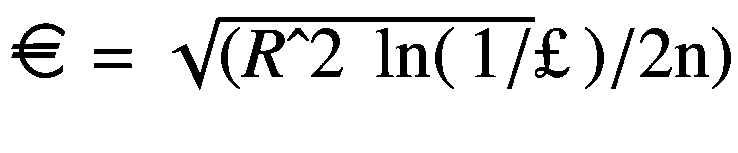
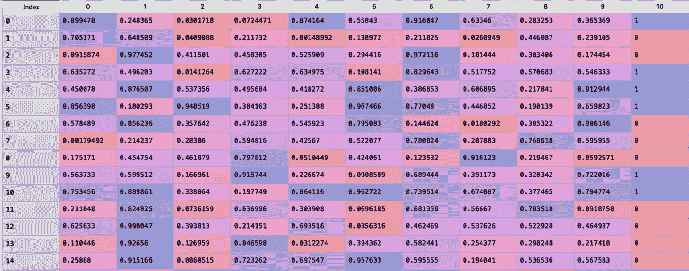

# 3. 流数据的监督学习

在上一章中，你学习了一些概念漂移检测算法。本章将重点介绍流数据环境下的监督学习算法（用于分类任务和回归任务）。在监督学习中，存在一个目标变量或响应变量，以及一些预测变量。学习器/模型的目标是理解目标变量与预测变量之间的关系。然后，这可用于对预测变量的未来观测值进行目标变量的预测 [1]。（我假设你已经熟悉了批处理环境中使用的监督学习技术。）

第 1 章涵盖了流数据的挑战，以及流数据算法与批处理学习算法的不同之处。本章将深入探讨一些用于流数据的机器学习技术及其使用 scikit-multiflow 框架的实现。

在第 1 章中，你了解了数据流生成器以及如何从源文件（CSV 格式）创建数据流。这些思想几乎被用于本章的所有工作示例中。

本章首先介绍流数据环境中使用的评估方法。然后讨论监督学习方法——基于树的方法、惰性学习、朴素贝叶斯等。最后，解释了流数据环境下的集成学习技术。

本章仅限于二分类方法和单目标回归（即，多类分类和多目标回归技术超出了本书的范围）。本章的所有实验均在配置为 1.6 GHz 双核 Intel Core i5 处理器、4 GB RAM 和 macOS 的系统上执行。然而，代码应在类似或更高配置的系统或操作系统上运行，无需任何更改或修改。本书使用 2020 年 6 月发布的 scikit-multiflow 包版本 0.5.3。

## 评估方法

本节介绍在流数据环境中评估监督学习方法性能时常用的模型评估方法。这些方法被称为*保留评估方法*和*序贯评估方法*（也称为*交错测试-训练方法*）。

在保留评估方法中，性能评估在每批一定数量的样本或观测值之后进行。学习器或模型的性能是在由未见过的样本组成的测试数据集上进行评估的。这些未见过的样本仅用于评估目的，不用于训练模型。同一个测试数据集可以在多次评估运行中使用。然而，也可以创建动态测试数据集。可以使用 scikit-multiflow 框架评估模块中的 `EvaluateHoldout()` 函数来应用保留评估方法。

序贯评估方法，或称交错测试-训练方法，是专门为评估流数据环境中的模型而设计的。每个样本都根据其到达顺序进行分析。在这种评估方法中，数据流中新到的未见样本首先用于测试（即，模型/学习器进行预测）。这些未见过的样本也用于在下一轮测试之前训练模型。可以使用 scikit-multiflow 框架评估模块中的 `EvaluatePrequential()` 函数来应用序贯评估方法。

scikit-multiflow 框架中还有另一种评估方法（*序贯延迟评估方法*）；然而，本书坚持使用保留评估方法和序贯评估方法，并更侧重于后者。

本章使用这些评估方法来跟踪接下来几节中讨论的各种监督学习算法的性能。在使用 `EvaluateHoldout()` 函数或 `EvaluatePrequential()` 函数时，你需要指定评估指标。

在本章中，分类问题通常使用预测准确率和 F1 分数（精确率和召回率的调和平均值）等指标。对于回归问题，则使用均方误差和平均绝对误差等指标。

## 流数据的决策树

本节讨论流数据环境下用于分类和回归任务的一些基于树的技术。它涵盖了 Hoeffding 树、Hoeffding 自适应树分类器、极速决策树分类器、Hoeffding 树回归器和 Hoeffding 自适应树回归器，这些技术使用 scikit-multiflow 应用于不同的数据集。


### 霍夫丁树分类器

流式数据面临的挑战之一在于内存需求：不可能存储所有数据。在批量处理场景中，决策树会重复使用实例或观测值来计算最佳分裂属性。因此，使用诸如 CART 和 CHAID 这类通常用于批量数据的决策树方法，在流式数据环境中效果不佳。为了解决这个问题，Domingos 和 Hulten [2] 提出了霍夫丁树，这是一种增量式决策树学习器，它利用新实例来构建树，因此更适合流式数据环境。霍夫丁树也被称为极速决策树（VFDT）算法。

当数据量足够大时，霍夫丁树会收敛到由批量学习器构建的树。因此，霍夫丁树利用了这样一个思想：小样本通常足以选择最优分裂属性 [3]。这一思想得到了被称为*霍夫丁界*的统计结果的支持。霍夫丁界指出（概率为 1–£），在对一个取值范围为 *R* 的实值随机变量 x 进行 n 次独立观测后，x 的真实均值至少为 μ − €，其中 μ 是随机变量 x 的观测均值，且  [4]。

VFDT 方法是霍夫丁树的一种实现。VFDT 是一棵使用霍夫丁界的决策树，它在将树叶节点转换为树节点时，会累积数据流中新到达观测值的充分统计量。然而，流式数据可能噪声很大，这会影响 VFDT 的性能（就预测准确率而言）。此外，面对带有噪声的流式数据，VFDT 还会面临树规模爆炸的问题 [5]。已有文献记载了解决这些 VFDT 问题的技术。

清单 3-1 使用第 1 章讨论的超平面生成器创建了一个合成数据集。图 3-1 是该合成数据流的一个快照。



图 3-1

合成数据集快照

使用 scikit-multiflow 框架将霍夫丁树方法应用于该合成数据集，如清单 3-2 所示。性能评估中采用了前置评估方法（以预测准确率作为指标）。清单 3-3 展示了前置评估的输出结果。获得的准确率为 92.07%。

```
###############################################################
# 导入相关库
from skmultiflow.data import HyperplaneGenerator
import pandas as pd
import numpy as np
create = HyperplaneGenerator(random_state = 888, n_features= 10, noise_percentage = 0)
create.prepare_for_use()
X , Y = create.next_sample(10000)
data = pd.DataFrame(np.hstack((X, np.array([Y]).T)))
data.shape
# 输出 - (10000, 11)
print(data.head())
# 将其存储为 csv 文件
data.to_csv('data_stream.csv', index=False)
###############################################################
清单 3-1
使用超平面生成器创建合成数据集
```

```
###############################################################
前置评估
正在评估 1 个目标。
在 400 个样本上进行预训练。
正在评估...
##------------------ [10%]
#################### [100%] [3.95s]
已处理样本数：10000
平均性能：
M0 - 准确率     : 0.9207
###############################################################
清单 3-3
霍夫丁树分类器的前置评估输出
```

```
###############################################################
from skmultiflow.trees import HoeffdingTreeClassifier
from skmultiflow.evaluation import EvaluatePrequential
from skmultiflow.data.file_stream import FileStream
import pandas as pd
import numpy as np
# 加载合成数据流
dstream = FileStream('data_stream.csv')
dstream.prepare_for_use()
# 创建模型实例
ht_class = HoeffdingTreeClassifier()
# 执行前置评估
evaluate1 = EvaluatePrequential(show_plot=False,
pretrain_size=400,
max_samples=10000,
metrics=['accuracy']
)
evaluate1.evaluate(stream=dstream, model=ht_class)
###############################################################
清单 3-2
在合成数据流上应用霍夫丁树
```


### 霍夫丁自适应树分类器

第 2 章介绍了用于概念漂移检测的自适应窗口方法（ADWIN），该方法使用一个动态大小的滑动窗口。窗口大小并非固定不变，而是根据窗口中数据观察到的变化率在线计算得出。如果数据流未检测到任何变化，ADWIN 算法会增大窗口大小；若检测到数据流发生变化，则会减小窗口大小。

霍夫丁自适应树采用了 ADWIN 方法，是霍夫丁树的一个改进版本。首先，你需要理解概念自适应极速决策树（CVFDT）方法 [6]。CVFDT 方法更适用于存在固有概念漂移的数据流。它会在内部节点和叶节点更新统计信息。其核心思想是：每当在某个子树检测到变化时，就生成一个候选子树，并最终丢弃当前子树或候选子树。

当节点的分裂测试不再适用时，霍夫丁自适应树会生成一个备选决策树 [6]。旧的树会被更准确的新树所取代。在叶节点上做出的决策基于一个近期样本/观测窗口。需要为样本窗口分配内存；然而，CVFDT 并没有严格的性能保证。

霍夫丁自适应树是对使用 ADWIN 的 CVFDT 的轻微修改。ADWIN 的目的是监控每个子树和备选树的误差。霍夫丁自适应树方法利用 ADWIN 的估计值来在叶节点做出决策，并决定是生长新树还是备选树。该方法无需为样本窗口分配内存；其准确率几乎与 CVFDT 相当，有时甚至表现更优。此外，还能提供严格的性能保证。

清单 3-4 使用 Agrawal 生成器模拟了一个带有概念漂移的合成数据流。将霍夫丁自适应树分类器应用于该合成数据流，并通过预评估和留出评估两种方式评估模型性能。

清单 3-5 展示了预评估方法的输出结果。获得的准确率为 99.72%，而在留出评估方法中，获得的准确率为 99.09%（如清单 3-6 所示）。

```
###############################################################
留出评估
正在评估 1 个目标。
正在评估...
######-------------- [30%] [6.87 秒]正在分离 5000 个留出样本。
################---- [80%] [15.71 秒]正在分离 5000 个留出样本。
已处理样本数：30000
平均性能：
M0 - 准确率     : 0.9909
###############################################################
清单 3-6
霍夫丁自适应树分类器的留出评估输出
```

```
###############################################################
预评估
正在评估 1 个目标。
正在对 400 个样本进行预训练。
正在评估...
#################### [100%] [342.55 秒]
已处理样本数：300000
平均性能：
M0 - 准确率     : 0.9972
###############################################################
清单 3-5
霍夫丁自适应树分类器的预评估输出
```

```
###############################################################
# 导入相关库
from skmultiflow.trees import HoeffdingAdaptiveTreeClassifier
from skmultiflow.data import ConceptDriftStream
from skmultiflow.evaluation import EvaluatePrequential
from skmultiflow.evaluation import EvaluateHoldout
# 模拟一个样本数据流
ds = ConceptDriftStream(random_state=777, position=30000)
ds
# 输出：
#ConceptDriftStream(alpha=0.0,
#         drift_stream=AGRAWALGenerator(balance_classes=False,
#                                       classification_function=2,
#                                       perturbation=0.0,
#                                       random_state=112),
#         position=30000, random_state=777,
#         stream=AGRAWALGenerator(balance_classes=False,
#                                 classification_function=0,
#
#                     perturbation=0.0, random_state=112),
#         width=1000)
# 实例化模型对象
model_hat = HoeffdingAdaptiveTreeClassifier()
# 预评估
eval1 = EvaluatePrequential(pretrain_size=400, max_samples=300000,batch_size=1,n_wait=100, max_time=2000,show_plot=False, metrics=['accuracy'])
eval1.evaluate(stream=ds, model=model_hat)
# 留出评估
eval2 = EvaluateHoldout(max_samples=30000,
max_time=2000,
show_plot=False,
metrics=['accuracy'],
dynamic_test_set=True)
eval2.evaluate(stream=ds, model=model_hat)
###############################################################
清单 3-4
在合成数据流上应用霍夫丁自适应树分类器
```


### 极速决策树分类器

极速决策树（EFDT）（霍夫丁任意时刻树的一个实例）是一种增量式决策树。霍夫丁任意时刻树的运行方式与霍夫丁树几乎相同，但区别在于它们在节点上进行分裂的方式。霍夫丁树会延迟节点分裂，直到确定最佳分裂点，并且不会重新审视该决策。而霍夫丁任意时刻树一旦某个分裂看起来有用，就会立即进行节点分裂，并且在出现更好的分裂点时，会重新审视之前的决策。霍夫丁任意时刻树在计算效率上不如霍夫丁树，但在统计效率上更高[7]。

清单 3-7 使用了与清单 3-4 相同的合成数据流。它将 EFDT 分类器应用于该合成数据集，并使用预评估方法和留存评估方法来评估模型性能。清单 3-8 展示了预评估方法的输出结果。获得的准确率为 96.07%，而在留存评估方法中，获得的准确率为 96.75%（参见清单 3-9）。

```
###############################################################
留存评估
正在评估 1 个目标。
评估中...
######-------------- [30%] [267.24 秒]正在分离 5000 个留存样本。
################---- [80%] [505.29 秒]正在分离 5000 个留存样本。
已处理样本数：30000
平均性能：
M0 - 准确率     : 0.9675 ###############################################################
清单 3-9
极速决策树分类器的留存评估输出
```

```
###############################################################
预评估
正在评估 1 个目标。
正在对 400 个样本进行预训练。
评估中...
#####--------------- [25%] [1820.77 秒]
已达到时间限制（2000.00 秒）。评估已停止。
已处理样本数：80949
平均性能：
M0 - 准确率     : 0.9607 ###############################################################
清单 3-8
极速决策树分类器的预评估输出
```

```
###############################################################
# 导入相关库
from skmultiflow.trees import ExtremelyFastDecisionTreeClassifier
from skmultiflow.data import ConceptDriftStream
from skmultiflow.evaluation import EvaluatePrequential
from skmultiflow.evaluation import EvaluateHoldout
# 模拟一个样本数据流
ds = ConceptDriftStream(random_state=777, position=30000)
ds
# 输出：
#ConceptDriftStream(alpha=0.0,
#       drift_stream=AGRAWALGenerator(balance_classes=False,
#                                     classification_function=2,
#                                     perturbation=0.0,
#                                     random_state=112),
#       position=30000, random_state=777,
#       stream=AGRAWALGenerator(balance_classes=False,
#                               classification_function=0,
#                               perturbation=0.0, random_state=112),
#       width=1000)
# 实例化模型对象
model_hat = ExtremelyFastDecisionTreeClassifier()
# 预评估
eval1 = EvaluatePrequential(pretrain_size=400, max_samples=300000,batch_size=1,
n_wait=100, max_time=2000,
show_plot=False, metrics=['accuracy'])
eval1.evaluate(stream=ds, model=model_hat)
# 留存评估
eval2 = EvaluateHoldout(max_samples=30000,
max_time=2000,
show_plot=False,
metrics=['accuracy'],
dynamic_test_set=True)
eval2.evaluate(stream=ds, model=model_hat) ###############################################################
清单 3-7
在合成数据流上应用极速决策树分类器
```

### 霍夫丁树回归器

霍夫丁树回归器与霍夫丁树分类器类似。它使用霍夫丁界来做出分裂决策。霍夫丁树回归器通过减少目标空间中的方差来决定分裂候选。它通过拟合线性感知器模型或计算样本平均值来进行预测。

清单 3-10 使用 scikit-multiflow 框架中的 `RegressionGenerator()` 函数创建了一个用于回归的合成数据流。该数据流（dstream）包含 800 个观测值、九个特征和一个目标变量。由于这是一个回归场景，目标变量是连续的。你可以使用 `next_sample()` 函数查看 dstream 对象中的特定样本。霍夫丁树回归器被应用于该数据流，并进行了预评估。

回归场景中使用的评估指标是*均方误差*（MSE）和*平均绝对误差*（MAE）。清单 3-11 展示了预评估的输出结果。MSE 为 6665.2407，MAE 为 62.974944。

```
###############################################################
预评估
正在评估 1 个目标。
正在对 400 个样本进行预训练。
评估中...
#################### [100%] [0.69 秒]
已处理样本数：799
平均性能：
M0 - MSE          : 6665.2407
M0 - MAE          : 62.974944 ###############################################################
清单 3-11
霍夫丁树回归器的预评估输出
```

```
###############################################################
# 导入相关库
from skmultiflow.trees import HoeffdingTreeRegressor
from skmultiflow.data import RegressionGenerator
import pandas as pd
from skmultiflow.evaluation import EvaluatePrequential
# 设置数据流
dstream = RegressionGenerator(n_features=9, n_samples=800,n_targets=1, random_state=456)
dstream
dstream.next_sample()
#(array([[ 0.72465838, -1.92979924, -0.02607907,  2.35603757, -0.37461529,
#         -0.38480019,  0.06603468, -2.1436879 ,  0.49182531]]),
# array([61.302191]))
# 实例化霍夫丁树回归器对象
htr = HoeffdingTreeRegressor()
# 预评估
eval1 = EvaluatePrequential(pretrain_size=400, max_samples=800, batch_size=1, n_wait=100, max_time=2000, show_plot=False, metrics=['mean_square_error', 'mean_absolute_error'])
eval1.evaluate(stream=dstream, model=htr)
###############################################################
清单 3-10
在合成数据流上应用霍夫丁树回归器
```


### 霍夫丁自适应树回归器

霍夫丁自适应树可用于回归场景。该回归器采用 ADWIN 方法，可视为霍夫丁树回归器的改进版本。

清单 3-12 使用了与清单 3-10 相同的合成数据集。将霍夫丁自适应树回归器应用于该数据集，并执行预排序评估。预排序评估的输出如清单 3-13 所示。MSE 为 6222.9041，MAE 为 61.320054。

```
###############################################################
Prequential Evaluation
Evaluating 1 target(s).
Pre-training on 400 sample(s).
Evaluating...
#################### [100%] [1.23s]
Processed samples: 799
Mean performance:
M0 - MSE          : 6222.9041
M0 - MAE          : 61.320054 ###############################################################
Listing 3-13
Prequential Evaluation Output of the Hoeffding Adaptive Tree Regressor
```

```
###############################################################
# Import the relevant libraries
from skmultiflow.trees import HoeffdingAdaptiveTreeRegressor
from skmultiflow.data import RegressionGenerator
import pandas as pd
from skmultiflow.evaluation import EvaluatePrequential
# Setup a data stream
dstream = RegressionGenerator(n_features=9, n_samples=800,n_targets=1, random_state=456)
dstream
dstream.next_sample()
#(array([[ 0.72465838, -1.92979924, -0.02607907,  2.35603757, -0.37461529,
#         -0.38480019,  0.06603468, -2.1436878 ,  0.49182531]]),
# array([61.302191]))
# Instantiate the Hoeffding Tree Regressor object
model_hatr = HoeffdingAdaptiveTreeRegressor()
# Prequential evaluation
eval1 = EvaluatePrequential(pretrain_size=400, max_samples=800, batch_size=1, n_wait=100, max_time=2000, show_plot=False, metrics=['mean_square_error', 'mean_absolute_error'])
eval1.evaluate(stream=dstream, model=model_hatr)
###############################################################
Listing 3-12
Applying the Hoeffding Adaptive Tree Regressor to a Synthetic Data Stream
```

本节讨论了流数据场景中一些主流的基于树的分类与回归技术。下一节将重点介绍一些懒惰学习技术。

## 流数据的懒惰学习方法

我们先来谈谈批量场景中用于分类和回归的 k 近邻（KNN）方法。KNN 是一种非参数方法，它将所有观测值保存在内存中，并基于相似度度量/距离函数对新的输入观测值进行分类 [9]。欧几里得距离、马氏距离和曼哈顿距离是三种常用的距离函数。

对于一个新的观测值，KNN 算法会根据距离函数在数据集中选择最近的 k 个邻居，然后结合这 k 个最近邻的值进行预测（即在回归场景中取平均值，在分类场景中执行多数投票）。

scikit-multiflow 提供了用于流数据分类场景的 KNN 方法实现（KNNClassifier()）。该技术的运作模式与 KNN 相同，并增加了对训练样本的窗口处理。用户可以固定窗口的最大大小。KNNClassifier() 方法将数据流中的所有特征视为连续型，不推荐用于混合了类别型和连续型特征的数据集。

清单 3-14 将 KNN 分类器（其中 K = 10）应用于一个合成数据集，并执行了预排序评估。使用清单 3-1 中的 HyperplaneGenerator() 生成的相同合成数据集被导出为 CSV 文件（data_stream.csv）。数据集的快照如图 3-1 所示。预排序评估的输出如清单 3-15 所示。获得的准确率为 87.99%。

```
###############################################################
Prequential Evaluation
Evaluating 1 target(s).
Pre-training on 1000 sample(s).
Evaluating...
##------------------ [10%]
#################### [100%] [7.31s]
Processed samples: 10000
Mean performance:
M0 - Accuracy     : 0.8799
###############################################################
Listing 3-15
Prequential Evaluation Output of the KNN Classifier
```

```
###############################################################
# Import the relevant libraries
from skmultiflow.lazy import KNNClassifier
from skmultiflow.evaluation import EvaluatePrequential
from skmultiflow.data.file_stream import FileStream
import pandas as pd
import numpy as np
dstream = FileStream('data_stream.csv')
dstream.prepare_for_use()
# Instantiate the KNN Classifier method
knn_class = KNNClassifier(n_neighbors=10, max_window_size=1000)
# Prequential Evaluation
evaluate1 = EvaluatePrequential(show_plot=False,
pretrain_size=1000,
max_samples=10000,
metrics=['accuracy']
)
# Run the evaluation
evaluate1.evaluate(stream=dstream, model=knn_class)
###############################################################
Listing 3-14
Applying the KNN Classifier to a Synthetic Data Stream
```

KNN 分类器的一个改进是 KNN ADWIN 分类器（即 KNNADWINClassifier()），它比 KNN 分类器能更有效地处理数据流中的概念漂移。该技术使用自适应窗口方法进行概念漂移检测（ADWIN）。

清单 3-16 使用 scikit-multiflow 框架中提供的 SEA 生成器创建了一个合成数据集。SEA 生成器创建一个带有概念漂移的数据流，并生成三个数值特征和一个二元目标变量。SEA 是 *streaming ensemble algorithm*（流式集成算法）的缩写 [10]。清单 3-16 展示了模拟数据流的五个观测值输出。将 KNN ADWIN 分类器（K = 10）应用于该数据流，并执行预排序评估。预排序评估的输出如清单 3-17 所示。获得的准确率为 65.93%。


```
###############################################################
预序评估
正在评估 1 个目标。
在 1000 个样本上进行预训练。
正在评估...
#################### [100%] [11.22s]
已处理样本数：10000
平均性能：
M0 - 准确率     : 0.6593 ###############################################################
代码清单 3-17
KNN ADWIN 分类器的预序评估输出
```

```
###############################################################
# 导入相关库
from skmultiflow.lazy import KNNADWINClassifier
from skmultiflow.evaluation import EvaluatePrequential
from skmultiflow.data.sea_generator import SEAGenerator
# 模拟数据流
dstream = SEAGenerator(classification_function = 2, balance_classes = True, noise_percentage = 0.3, random_state = 333)
# 获取五个样本
dstream.next_sample(5)
# 输出：
#(array([[3.68721825, 0.48303666, 1.04530188],
#        [2.45403315, 8.73489354, 0.51611639],
#        [2.38740114, 2.03699194, 1.74533621],
#        [9.41738118, 4.66915281, 9.59978205],
#        [1.05404748, 0.42265956, 2.44130999]]), array([1, 0, 0, 1, 1]))
# 实例化 KNN ADWIN 分类器方法
adwin_knn_class = KNNADWINClassifier(n_neighbors=10, max_window_size=1000)
# 预序评估
evaluate1 = EvaluatePrequential(show_plot=False,
pretrain_size=1000,
max_samples=10000,
metrics=['accuracy'])
# 运行评估
evaluate1.evaluate(stream=dstream, model=adwin_knn_class) ####################################################################
代码清单 3-16
将 KNN ADWIN 分类器应用于合成数据流
```

现在，让我们来看另一种基于 KNN 的分类器：KNN 算法的自调整记忆（SAM）模型 [11]。在本章后续部分，该方法被称为 SAM-KNN。SAM-KNN 技术能有效处理异质性概念漂移，且无需优化元参数。该技术的灵感来源于人类记忆研究中的双存储模型，在该模型中，知识被划分为短期记忆（STM）和长期记忆（LTM）[12]。

在 SAM-KNN 中，记忆被划分为 STM 和 LTM。STM 包含动态滑动窗口中与近期概念相关的数据。LTM 则维护过去信息的知识。存在一个清理过程来控制 STM 的大小。此外，经过筛选的知识会从 STM 转移到 LTM。LTM 确保其存储的压缩信息与 STM 的信息不冲突。组合记忆（CM）是 STM 和 LTM 的并集。

其思想是组合/集成针对最新概念和所有过去概念的专用模型（距离加权 KNN），以最大化预测准确率。

代码清单 3-18 应用了 SAM-KNN 分类器，并对代码清单 3-16 中使用的相同数据流进行了预序评估。在代码清单 3-19 中，获得的准确率为 64.66%。

```
###############################################################
预序评估
正在评估 1 个目标。
在 1000 个样本上进行预训练。
正在评估...
#################### [100%] [8.53s]
已处理样本数：10000
平均性能：
M0 - 准确率     : 0.6466
###############################################################
代码清单 3-19
SAM-KNN 分类器的预序评估输出
```

```
###############################################################
# 导入相关库
from skmultiflow.lazy import SAMKNNClassifier
from skmultiflow.evaluation import EvaluatePrequential
from skmultiflow.data.sea_generator import SEAGenerator
# 模拟数据流
dstream = SEAGenerator(classification_function = 2, balance_classes = True, noise_percentage = 0.3, random_state = 333)
# 获取五个样本
dstream.next_sample(5)
# 实例化 SAM-KNN 分类器方法
sam_knn_class = SAMKNNClassifier(n_neighbors=10, weighting="distance", stm_size_option="maxACCApprox", max_window_size=1000,use_ltm=True)
# 预序评估
evaluate1 = EvaluatePrequential(show_plot=False,
pretrain_size=1000,
max_samples=10000,
metrics=['accuracy']
)
# 运行评估
evaluate1.evaluate(stream=dstream, model=sam_knn_class)
###############################################################
代码清单 3-18
将 SAM-KNN 分类器应用于合成数据流
```

scikit-multiflow 在流数据上下文中实现了用于回归的 KNN 方法（KNNRegressor()）。与 KNN 分类器类似，它使用训练样本上的一个窗口。然而，与 KNN 分类器相比，它取 k 个最近邻的平均值进行预测。

代码清单 3-20 将 KNN 回归器应用于一个合成数据集。它使用了与代码清单 3-10 中相同的合成数据集。应用了预序评估，输出如代码清单 3-21 所示。MSE 为 4195.3502，MAE 为 50.132250。

```
###############################################################
预序评估
正在评估 1 个目标。
在 400 个样本上进行预训练。
正在评估...
#################### [100%] [0.34s]
已处理样本数：799
平均性能：
M0 - MSE          : 4195.3502
M0 - MAE          : 50.132250
###############################################################
代码清单 3-21
KNN 回归器的预序评估输出
```

```
###############################################################
# 导入相关库
from skmultiflow.lazy import KNNRegressor
from skmultiflow.data import RegressionGenerator
import pandas as pd
from skmultiflow.evaluation import EvaluatePrequential
# 设置数据流
dstream = RegressionGenerator(n_features=9, n_samples=800,n_targets=1, random_state=456)
dstream
dstream.next_sample()
#(array([[ 0.72465838, -1.92979924, -0.02607907,  2.35603757, -0.37461529,
#         -0.38480019,  0.06603468, -2.1436878 ,  0.49182531]]),
# array([61.302191]))
# 实例化 KNN 回归器对象
knn_reg = KNNRegressor()
# 预序评估
eval1 = EvaluatePrequential(pretrain_size=400, max_samples=800, batch_size=1, n_wait=100, max_time=2000, show_plot=False, metrics=['mean_square_error', 'mean_absolute_error'])
eval1.evaluate(stream=dstream, model=knn_reg)
###############################################################
代码清单 3-20
将 KNN 回归器应用于合成数据流
```

下一节将重点介绍流数据的集成学习。

## 流数据的集成学习

集成学习通过组合多个模型来提高对样本外数据的预测准确率。通常（尽管不能保证），集成学习器的表现优于独立的基方法。集成学习是机器学习中一种非常流行的技术，既可用于回归也可用于分类。在批量数据上下文中，一些著名的集成学习技术包括随机森林、装袋和提升。本节重点介绍 scikit-multiflow 框架中实现的一些用于流数据的集成学习技术。


### 自适应随机森林

*随机森林*是一种非常流行且广泛使用的批处理（非流式）数据机器学习技术。在随机森林中，多棵决策树（使用重采样数据构建，并采用随机特征子集）被组合在一起，以提高模型在预测准确性方面的性能。然而，随机森林无法处理概念漂移，并且需要对数据集进行多次遍历。它不适用于流式数据上下文中的分析。

*自适应随机森林*（ARF）是随机森林技术在流式数据上下文中的一种改编形式 [13]。ARF 方法使用在线装袋来近似有放回的重采样。但是，与在线装袋中使用 (λ = 1) 泊松分布不同，ARF 使用 (λ = 6) 泊松分布。（本章后面将介绍在线装袋方法的概述。）

ARF 中的基础模型（即随机森林树训练（RFTreeTrain））基于霍夫丁树算法，但存在一些差异。一个区别是 RFTreeTrain 不允许早期树剪枝。另一个区别是，每当创建新节点时，都会创建一个随机特征子集，并且分裂仅限于这些特征。ARF 在基础树中使用漂移检测器，一旦发生漂移就会触发重置。ARF 允许训练后台树，如果检测到漂移，这些后台树将替换活动树。

ARF 技术可用于分类任务和回归任务。清单 3-22 演示了将 ARF 分类器应用于合成数据流（与清单 3-18 中使用的数据流相同）。ARF 分类器的超参数是估计器/树的数量为 100。最大特征数是数据流中总特征数的平方根。应用了前置评估。清单 3-23 显示预测准确率为 70.18%。

```
###############################################################
Prequential Evaluation
Evaluating 1 target(s).
Pre-training on 1000 sample(s).
Evaluating...
#################### [100%] [1526.63s]
Processed samples: 10000
Mean performance:
M0 - Accuracy     : 0.7018
###############################################################
清单 3-23
ARF 分类器的前置评估输出
```

```
###############################################################
# 导入相关库
from skmultiflow.meta import AdaptiveRandomForestClassifier
from skmultiflow.evaluation import EvaluatePrequential
from skmultiflow.data.sea_generator import SEAGenerator
# 模拟数据流
dstream = SEAGenerator(classification_function = 2, balance_classes = True, noise_percentage = 0.3, random_state = 333)
# 实例化 KNN ADWIN 分类器方法
ARF_class = AdaptiveRandomForestClassifier(n_estimators=100, max_features="sqrt", random_state=333)
# 前置评估
evaluate1 = EvaluatePrequential(show_plot=False,
pretrain_size=1000,
max_samples=10000,
metrics=['accuracy']
)
# 运行评估
evaluate1.evaluate(stream=dstream, model=ARF_class)
###############################################################
清单 3-22
将 ARF 分类器应用于合成数据流
```

清单 3-24 将 ARF 应用于回归上下文，数据源为清单 3-20 中生成的相同合成数据流。估计器数量为 100，最大特征数为总特征数的平方根。应用了前置评估，输出如清单 3-25 所示。MSE 为 3661.6862，MAE 为 46.579340。

```
###############################################################
Prequential Evaluation
Evaluating 1 target(s).
Pre-training on 400 sample(s).
Evaluating...
#################### [100%] [77.83s]
Processed samples: 800
Mean performance:
M0 - MSE          : 3661.6862
M0 - MAE          : 46.579340
###############################################################
清单 3-25
ARF 回归器的前置评估输出
```

```
###############################################################
# 导入相关库
from skmultiflow.meta import AdaptiveRandomForestRegressor
from skmultiflow.data import RegressionGenerator
from skmultiflow.evaluation import EvaluatePrequential
# 设置数据流
dstream = RegressionGenerator(n_features=9, n_samples=800,n_targets=1, random_state=456)
# 实例化 ARF 回归器对象
ARF_reg = AdaptiveRandomForestRegressor(n_estimators=100, max_features="sqrt", random_state=333)
# 前置评估
eval1 = EvaluatePrequential(pretrain_size=400, max_samples=800, batch_size=1, n_wait=100, max_time=2000, show_plot=False, metrics=['mean_square_error', 'mean_absolute_error'])
eval1.evaluate(stream=dstream, model=ARF_reg)
###############################################################
清单 3-24
将 ARF 回归器应用于合成数据流
```


### 在线装袋法

装袋法是一种在批量（非流式）学习中广泛使用的集成学习技术。在此方法中，X 个基模型在大小为 N 的自助样本集上进行训练。这些自助样本集是通过从原始训练数据集中进行有放回抽样创建的。

每个基模型的训练集包含原始训练样本 K 次，其中 P(K = k)服从二项分布。当 N 趋于无穷大时，K 的分布趋于泊松(1)分布（即 K ~ exp(–1)/k!）[15]。Oza 和 Russell [15]利用这一思想提出了装袋算法的在线学习版本，该版本适用于流数据场景。

在在线装袋法中，当一个新的训练样本到达时，算法会为每个基模型选择该样本 K ~ 泊松(1)次，并相应地更新基模型。新实例通过 X 个基模型的多数投票进行分类。这一步在批量装袋法和在线装袋法中都是相同的。在线装袋法被认为是批量装袋法的一个良好近似 [15]。

在 scikit-multiflow 中，可以使用`OzaBaggingClassifier()`方法应用在线装袋分类技术。清单 3-26 将 Oza 装袋分类器应用于清单 3-16 中使用的合成数据集。KNN ADWIN 分类器模型作为基模型。清单 3-26 构建了六个基模型。KNN ADWIN 分类器的超参数与清单 3-16 中使用的相同（即邻居数为 10，最大窗口大小为 1000）。应用了预排序评估，输出结果如清单 3-27 所示。获得的准确率为 66.21%。

```
###############################################################
Prequential Evaluation
Evaluating 1 target(s).
Pre-training on 1000 sample(s).
Evaluating...
#################### [100%] [61.53s]
Processed samples: 10000
Mean performance:
M0 - Accuracy     : 0.6621
###############################################################
Listing 3-27
Prequential Evaluation Output of the Oza Bagging Classifier
```

```
###############################################################
# Import the relevant libraries
from skmultiflow.meta import OzaBaggingClassifier
from skmultiflow.lazy import KNNADWINClassifier
from skmultiflow.evaluation import EvaluatePrequential
from skmultiflow.data.sea_generator import SEAGenerator
# Simulate the data stream
dstream = SEAGenerator(classification_function = 2, balance_classes = True, noise_percentage = 0.3, random_state = 333)
# Instantiate the Oza Bagging classifier method with KNN ADWIN classifier as the base model
oza_class = OzaBaggingClassifier(base_estimator=KNNADWINClassifier(n_neighbors=10, max_window_size=1000), n_estimators=4, random_state = 333)
# Prequential Evaluation
evaluate1 = EvaluatePrequential(show_plot=False,
pretrain_size=1000,
max_samples=10000,
metrics=['accuracy']
)
# Run the evaluation
evaluate1.evaluate(stream=dstream, model=oza_class)
###############################################################
Listing 3-26
Applying the Oza Bagging Classifier to a Synthetic Data Stream
```

现在，我们来谈谈被称为*杠杆装袋法*的在线装袋方法，该方法由 Bifet 等人提出 [16]。这里，通过增加重采样和使用输出检测码来增强装袋效果。在 Oza 装袋技术中，有放回抽样使用(λ = 1)的泊松分布。但在杠杆装袋法中，λ的值更大。例如，它不使用(λ = 1)的泊松分布，而是使用(λ = 6)的泊松分布。输出检测码有助于纠正错误。每个类别被分配一个长度为 L 的二进制字符串，然后构建一个由 L 个二元分类器组成的集成。这能在多分类任务中带来更好的性能。此外，杠杆装袋算法使用 ADWIN 窗口技术来处理数据流中固有的概念漂移。

在 scikit-multiflow 中，可以使用`LeveragingBaggingClassifier()`方法应用杠杆装袋分类技术。清单 3-28 重复了清单 3-26 中进行的相同实验（即相同的数据流和六个基模型（KNN ADWIN 分类器）的超参数）。但是，`OzaBaggingClassifier()`方法被替换为`LeveragingBaggingClassifier()`方法。执行了预排序评估，输出结果如清单 3-29 所示。获得的准确率为 58.68%。

```
###############################################################
Prequential Evaluation
Evaluating 1 target(s).
Pre-training on 1000 sample(s).
Evaluating...
#################### [100%] [310.46s]
Processed samples: 10000
Mean performance:
M0 - Accuracy     : 0.5868
###############################################################
Listing 3-29
Prequential Evaluation Output of the Leveraging Bagging Classifier
```

```
###############################################################
# Import the relevant libraries
from skmultiflow.meta import LeveragingBaggingClassifier
from skmultiflow.lazy import KNNADWINClassifier
from skmultiflow.evaluation import EvaluatePrequential
from skmultiflow.data.sea_generator import SEAGenerator
# Simulate the data stream
dstream = SEAGenerator(classification_function = 2, balance_classes = True, noise_percentage = 0.3, random_state = 333)
# Instantiate the Leveraging Bagging classifier method with KNN ADWIN classifier as the base model
leverage_class = LeveragingBaggingClassifier(base_estimator=KNNADWINClassifier(n_neighbors=10, max_window_size=1000), n_estimators=6, random_state = 333)
# Prequential Evaluation
evaluate1 = EvaluatePrequential(show_plot=False,
pretrain_size=1000,
max_samples=10000,
metrics=['accuracy']
)
# Run the evaluation
evaluate1.evaluate(stream=dstream, model=leverage_class)
###############################################################
Listing 3-28
Applying the Leveraging Bagging Classifier to a Synthetic Data Stream
```


### 在线提升（Online Boosting）

另一种著名的集成学习技术是*提升法*。其基本原理是顺序组合一组“弱学习器”，以创建一个“强学习器”。AdaBoost 技术是最早用于批量数据的提升技术之一 [17]。（AdaBoost 是*自适应提升*的缩写。）首先，使用加权样本在训练数据上准备一个弱分类器（即决策树），然后计算训练模型的误分类错误率。当前分类器误分类的样本在下一个分类器的训练数据集中会被赋予更高的权重。后续的学习器会更关注这些困难样本，这个过程一直持续到算法性能不再有显著提升为止。

Wang 和 Pineau [18] 提出了*在线提升分类器*，这是 AdaBoost 算法的在线版本。在在线学习环境中，每个到达的样本会根据二项分布被训练 K 次。由于数据流中样本数量巨大（趋于无穷），二项分布趋近于泊松(λ)分布，其中 λ 的值通过跟踪误分类和正确分类样本的权重来计算。在线提升算法使用 ADWIN 窗口技术来处理数据流中固有的概念漂移。

可以使用 scikit-multiflow 框架中实现的 `OnlineBoostingClassifier()` 方法来应用在线 AdaBoost 算法。代码清单 3-30 将在线提升分类器应用于代码清单 3-28 中使用的相同数据流。执行了预序评估，输出结果如代码清单 3-31 所示。获得的准确率为 58%。

```
###############################################################
Prequential Evaluation
Evaluating 1 target(s).
Pre-training on 1000 sample(s).
Evaluating...
#################### [100%] [669.82s]
Processed samples: 10000
Mean performance:
M0 - Accuracy     : 0.5800
###############################################################
代码清单 3-31
在线提升分类器的预序评估输出
```

```
###############################################################
# 导入相关库
from skmultiflow.meta import OnlineBoostingClassifier
from skmultiflow.evaluation import EvaluatePrequential
from skmultiflow.data.sea_generator import SEAGenerator
# 模拟数据流
dstream = SEAGenerator(classification_function = 2, balance_classes = True, noise_percentage = 0.3, random_state = 333)
# 实例化在线提升分类器方法
boost_class = OnlineBoostingClassifier(random_state = 333)
# 预序评估
evaluate1 = EvaluatePrequential(show_plot=False,
pretrain_size=1000,
max_samples=10000,
metrics=['accuracy']
)
# 运行评估
evaluate1.evaluate(stream=dstream, model=boost_class) ###############################################################
代码清单 3-30
将在线提升分类器应用于合成数据流
```

至此，我们已经涵盖了流数据上下文中大多数重要的监督学习算法。下一节将简要介绍一些数据流预处理方法。

## 数据流预处理

到目前为止，本章涵盖了数据流上回归和分类问题的算法。所有实验都使用了干净的数据集（即不需要进行数据预处理）。然而，在现实世界中，你无法期望得到干净的数据流，因此需要进行一些基本的数据流预处理。以下是 scikit-multiflow 框架中提供的一些可应用于数据流的数据预处理方法。

*   **缺失值清理器**：`MissingValueCleaner()` 方法可以使用诸如用零、均值、中位数或众数替换缺失值等策略来清理数据流中的缺失值。

*   **独热编码**：`OneHotToCategorical()` 方法对数据流中的分类变量执行独热编码。

*   **窗口化最小-最大缩放器**：`WindowedMinmaxScaler(window_size=200)` 方法用于数据流的特征变换。每个特征都被缩放到一个给定的范围（0 到 1 之间）。窗口大小由用户输入，用于计算最小值和最大值。

*   **窗口化标准缩放器**：`WindowedStandardScaler(window_size=200)` 方法用于标准化特征。窗口大小由用户输入，用于计算均值和标准差。

## 总结

本章涵盖了 scikit-multiflow 框架中用于数据流挖掘的大多数重要的在线监督学习技术。然而，你应该探索本章未讨论的两种方法：scikit-multiflow 的贝叶斯模块中的朴素贝叶斯分类器，以及 scikit-multiflow 框架的神经网络模块中的感知机分类器。

下一章将讨论一些用于流数据无监督学习的在线/增量学习算法。同时还将讨论其他一些可用于流数据分析的工具。

