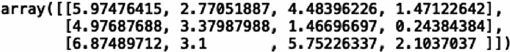
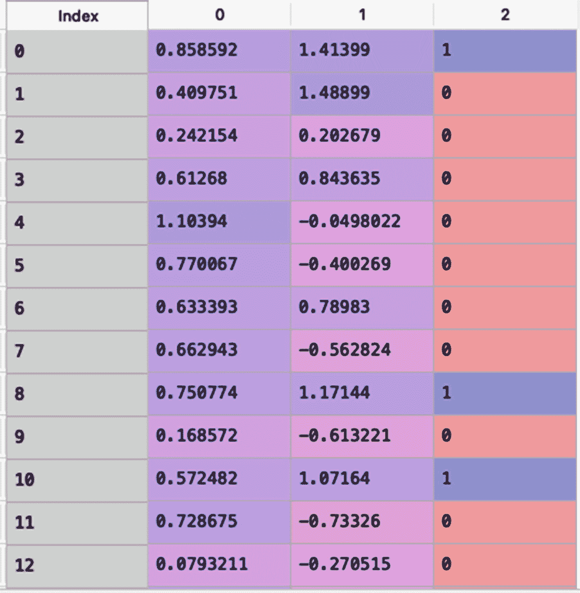
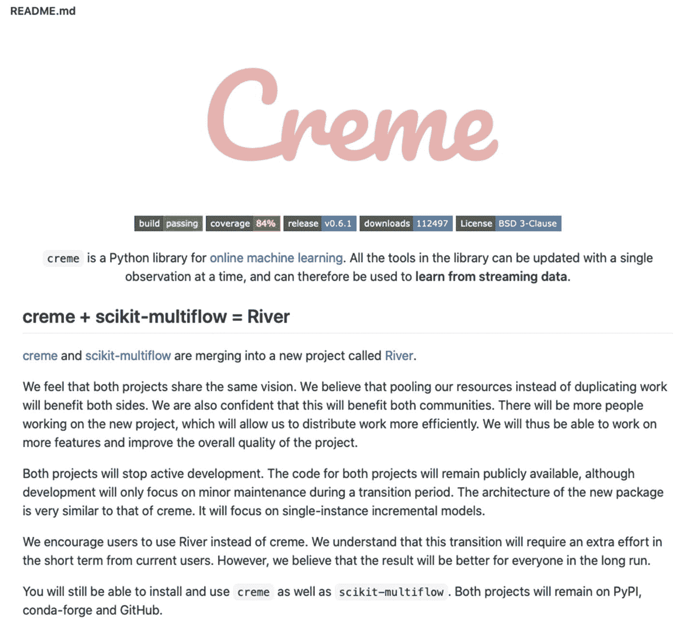
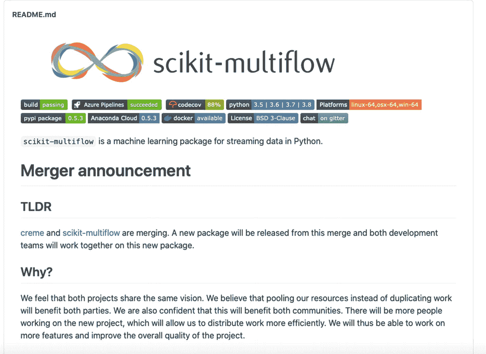

# 4. 用于数据流挖掘的无监督学习及其他工具

在第 3 章中，你学习了流数据上下文中用于回归和分类问题的监督机器学习技术。本章从流数据的无监督学习开始，然后概述其他一些可用于数据流挖掘的软件环境。

## 流数据的无监督学习

在前面的章节中，你学习了用于流数据的概念漂移检测和监督机器学习的各种方法。现在，让我们通过首先关注聚类，然后转向异常检测来了解无监督学习。


### 聚类

k-means 聚类是一种适用于批量数据的流行聚类算法。它将数据划分为 k 个互不重叠的独立簇。其目标是使*簇内变异* [1] 非常低。该算法会为每个观测值随机分配一个 1 到 k 之间的数字，从而创建初始的簇集合。然后，为这 k 个簇分别计算簇质心。接着，根据观测值与簇质心的接近程度（即距离度量，如欧氏距离）重新分配观测值。这些步骤会重复进行。当簇的分配不再发生变化时，迭代停止。（请注意，k 值由用户提供。）

*小批量 k-means 聚类方法*是 k-means 聚类算法的一种增量学习版本，可直接应用于数据流。它是 k-means 算法的一个变体，处理的是数据的小批量样本，而非整个数据集。由于在任何时间点都无法获得完整数据集，因此它特别适用于流式数据。小批量是输入数据流的子集，每次训练迭代时都会从中随机采样。

小批量 k-means 聚类算法会选择一个由随机采样样本组成的小批量。然后执行通用的 k-means 算法，为每个样本分配最近的质心。下一步，针对小批量中的每个样本更新已分配的质心。重复执行这些步骤，直到达到收敛或指定的迭代次数。

此外，除了使用随机采样来选择初始簇中心集，还可以使用 k-means++ 算法 [3] 作为一种随机播种技术来选择初始簇中心的初始值，这能实现更快的收敛。

小批量 k-means 聚类算法可在 scikit-learn (sklearn) 库中找到。更多信息请访问 [`https://scikit-learn.org/stable/modules/generated/sklearn.cluster.MiniBatchKMeans.html`](https://scikit-learn.org/stable/modules/generated/sklearn.cluster.MiniBatchKMeans.html)。

代码清单 4-1 将小批量 k-means 聚类应用于鸢尾花数据集。该数据集在 sklearn 库中公开可用，包含四个特征：花萼长度（厘米）、花萼宽度（厘米）、花瓣长度（厘米）和花瓣宽度（厘米）。代码清单 4-1 应用了 **MiniBatchKMeans()**，并将簇数量指定为 3，小批量大小指定为 50。该代码清单在鸢尾花数据集上训练了小批量 k-means 聚类模型，并在图 4-1 中展示了簇中心。



图 4-1
小批量 k-means 聚类模型的簇中心

```
###############################################################
# 导入相关库
from sklearn import datasets
from sklearn.preprocessing import StandardScaler
from sklearn.cluster import MiniBatchKMeans
# 加载数据
iris = datasets.load_iris()
X = iris.data
# 数据快照
X[0:6,]
# 输出
#array([[5.1, 3.5, 1.4, 0.2],
#       [4.9, 3\. , 1.4, 0.2],
#       [4.7, 3.2, 1.3, 0.2],
#       [4.6, 3.1, 1.5, 0.2],
#       [5\. , 3.6, 1.4, 0.2],
#       [5.4, 3.9, 1.7, 0.4]])
# 特征名称
iris.feature_names
# 输出:
#['sepal length (cm)',
# 'sepal width (cm)',
# 'petal length (cm)',
# 'petal width (cm)']
# 创建 k-means 对象
clust_kmeans = MiniBatchKMeans(n_clusters=3, batch_size=50, random_state=333)
# 训练模型
model = clust_kmeans.fit(X)
# 找出簇中心
model.cluster_centers_
###############################################################
代码清单 4-1
在鸢尾花数据集上进行小批量 k-means 聚类
```

scikit-learn 提供了小批量 k-means 聚类的一种替代方法，称为 *Birch 聚类* [7]。这是一种在线学习算法，它创建一种树形数据结构，簇质心可从叶子节点读取。建议您将此技术作为练习进行探索。有关 scikit-learn 中 Birch 聚类的更多信息，请阅读官方文档：[`https://scikit-learn.org/stable/modules/generated/sklearn.cluster.Birch.html`](https://scikit-learn.org/stable/modules/generated/sklearn.cluster.Birch.html)。

Apache Spark 的机器学习库 MLlib 中提供了*流式 k-means 聚类算法*。该算法能够动态估计簇，并在新数据到达时更新簇。该算法包含一个名为*半衰期*的参数，用于控制估计值的“衰减”。衰减因子决定了需要赋予历史数据多少权重。流式 k-means 聚类算法使用了小批量 k-means 更新规则的泛化形式。

本书不涉及其他增量聚类算法。

一些最早的流式数据在线聚类算法已在 MOA 软件中实现。一种经过充分研究的数据流聚类方法是微聚类算法，它包含两个阶段。第一阶段是在线阶段，将数据流总结为局部模型（微簇）。第二阶段则根据这些微簇生成全局聚类模型。CluStream 和 DenStream 是 MOA 中可用的两种基于微簇的在线聚类算法。

接下来将讨论 Apache Spark、MOA 以及其他一些数据流挖掘工具。


### 异常检测

*异常检测*（或*离群点检测*）是一门识别与常态相异的事件或样本的科学 [4]（这些样本被称为*异常值*）。机器学习文献中充满了异常检测技术，尤其是在批量学习场景下。这些异常值的一些独特特征包括：它们在数据集中很少出现，并且其特征与正常样本不同。异常检测的一些实际应用包括入侵检测、欺诈检测、监控分析、医疗应用以及数据泄露防护。

本章重点介绍用于流数据上下文中的异常检测的*流式半空间树*（SHST）技术。SHST 算法是一种用于流数据的增量式单类异常检测器 [5]。该算法最有用的特性之一是，它仅使用真实或正常的实例进行训练，即使在异常值极其罕见的情况下也能表现良好。该方法是一个由半空间树组成的随机集成。深度为 d 的半空间树（HS-tree）被定义为一棵具有 2^(d+1) − 1 个节点的满二叉树，其中所有叶子节点都位于同一深度（即 d）。

流式半空间树可以仅从数据空间的维度创建树结构，并且不需要实际的训练样本。因此，该方法无需执行任何模型重构来适应流数据。该模型可以在流数据到达之前部署。此外，SHST 算法具有恒定的内存需求和恒定的均摊时间复杂度。

清单 4-2 使用 scikit-multiflow 框架中提供的 `AnomalySineGenerator` 生成了一个包含异常值的数据流。它生成了一个包含 500 个观测值的数据流，其中 100 个是异常值。生成的数据流快照如图 4-2 所示。最右侧的列指示一个样本是否为异常值（即，如果为 1，则为异常值；如果为 0，则为正常值）。然后，它使用 scikit-multiflow 框架中提供的 `HalfSpaceTrees()` 方法，将 SHST 算法应用于此数据流。它训练模型并执行预测，如清单 4-2 所示。



图 4-2
包含异常值的数据流快照

```
###############################################################
# 导入相关库
import pandas as pd
from skmultiflow.anomaly_detection import HalfSpaceTrees
from skmultiflow.data import AnomalySineGenerator
# 生成包含异常值的数据流
dstream = AnomalySineGenerator(n_samples=500, n_anomalies=100, random_state=333)
# 实例化半空间树估计器
HS_trees = HalfSpaceTrees(random_state=333)
# 准备数据流
dstream.prepare_for_use()
X, Y = dstream.next_sample(500)
data = pd.DataFrame(np.hstack((X, np.array([Y]).T)))
data.head()
# 增量拟合模型
HS_trees_model= HS_trees.partial_fit(X, Y)
# 预测传入观测值的类别
pred = HS_trees_model.predict(X)
# 估计样本为异常值或真实值的概率
prob = HS_trees_model.predict_proba(X)
###############################################################
清单 4-2
使用流式半空间树进行异常检测
```

## 用于数据流挖掘的其他工具和技术

本节将高层次介绍八种用于数据流挖掘的开源软件工具：MOA、Apache Spark、Apache Flink、Apache Storm、Apache Kafka、Faust、Creme 和 River。还有其他可用于数据流挖掘的工具（包括商业和开源工具），但它们不在本书的讨论范围之内。

### 大规模在线分析（MOA）

大规模在线分析（MOA）是一个用 Java 开发的开源数据流挖掘框架。MOA 是一个基于 GUI 的工具。它包含一系列用于监督学习（分类、回归等）和无监督学习（聚类等）的流数据算法，以及模型评估工具 [6]。本书讨论的大多数监督和无监督学习方法都可以在 MOA 中找到。

由于 MOA 基于 GUI 且主要用 Java 开发，它可能对 Python 开发者/用户没有吸引力。我建议你探索一下这个工具。可以从 [`https://moa.cms.waikato.ac.nz`](https://moa.cms.waikato.ac.nz) 下载。

### Apache Spark

Apache Spark 是一个用于对批处理和流数据进行高速处理和分析的软件环境。它支持多种语言，如 Java、Python 和 R。这就是为什么 Spark（或 pyspark）对于 Python 用户来说是一个很好的替代选择。Spark 可以访问多种数据源。它可以在云上或 Mesos、Hadoop 和 Kubernetes 上运行。Spark 的库栈包括 Spark SQL、Spark Streaming、MLlib（用于机器学习）和 GraphX（用于图分析）。要下载最新版本并访问文档，请访问 [`https://spark.apache.org`](https://spark.apache.org)。

Spark Streaming 是核心 Spark API 的扩展。它是一个用于大规模处理数据流的强大工具。它包含许多高级函数，例如 `map`、`reduce`、`join` 和 `window`，用于处理高速数据流。Spark Streaming 支持 MLlib 操作（即流式 k-means 聚类、流式线性回归（一种对每个数据批次使用随机梯度下降拟合的线性回归模型）等）。官方 Spark Streaming 指南位于 [`https://spark.apache.org/docs/latest/streaming-programming-guide.html`](https://spark.apache.org/docs/latest/streaming-programming-guide.html)。

### Apache Flink

Apache Flink 是一个统一的批处理和流数据分析引擎。它为连续流模型提供了高度灵活的流式窗口。它可以大规模执行内存计算。Flink 与许多其他开源数据处理生态系统集成，例如 YARN 和 Mesos。Flink 对于事件驱动型应用非常有用，例如异常检测、基于规则的警报、欺诈检测和业务流程监控。请访问 [`https://flink.apache.org`](https://flink.apache.org) 了解更多关于 Apache Flink 的信息。

### Apache Storm

Apache Storm 是一个开源的分布式流处理计算框架。它主要用 Clojure 开发，但也支持多种语言，如 Java 和 Python。Apache Storm 是一个对流数据进行实时处理的非常强大的工具。它是一个不支持批处理的流处理引擎。它是一个真正的实时处理框架，将流作为完整的事件而不是一系列小批量来处理。它具有可扩展性，并且可以在跨机器集群运行的并行计算上工作。

Storm 集群类似于 Hadoop 集群对批数据的作用。要在 Storm 中执行实时计算，你需要创建一个*拓扑*，它是一个有向无环计算图。拓扑由*流*（即，一个无界的元组管道）和*喷口*（即，数据流的来源）组成。一个 Storm 集群包含两种节点：主节点和工作节点。主节点将任务分配给机器并监控其性能。工作节点将任务分配给其他工作节点。

要下载最新版本的 Apache Storm 并访问官方文档，请访问 [`https://storm.apache.org/index.html`](https://storm.apache.org/index.html)。


### Apache Kafka

Apache Kafka 是一个开源的分布式事件流平台。什么是*事件流*？它是一种从各种来源（数据库、传感器等）捕获实时数据流，然后进行存储和处理以生成洞察的现象。事件流的一些实际应用场景包括处理证券交易所的金融交易、分析物联网设备数据、自动驾驶应用、网络分析、日志聚合以及实时患者健康监测。官方文档位于 [`https://kafka.apache.org/documentation/`](https://kafka.apache.org/documentation/)。

Apache Kafka 引入了一个名为 Kafka Streams 的强大但轻量级的数据流处理库。开发者可以使用 Kafka Streams 大规模构建 Java 和 Scala 应用程序。使用它构建的应用程序可以部署到虚拟机、容器或云端。Kafka Streams 的文档位于 [`https://kafka.apache.org/documentation/streams/`](https://kafka.apache.org/documentation/streams/)。

### Faust

Faust 是一个用于在 Python 中构建流式应用程序的库。它适用于事件流处理，并且与 Kafka Streams 类似。但 Faust 允许你使用 Python 语法以及 Python 中的其他流行库（如 NumPy、TensorFlow 和 Django）来处理数据流。官方文档位于 [`https://faust.readthedocs.io/en/latest/`](https://faust.readthedocs.io/en/latest/)。你也可以访问其 GitHub 页面 [`https://github.com/robinhood/faust`](https://github.com/robinhood/faust)。

### Creme

Creme 是一个用于 Python 在线机器学习的开源库。它是一个用于从流式数据中学习的强大工具。它与 scikit-multiflow 框架有许多相似之处。Creme 可以通过以下命令从 PyPI 安装。

```
>>> pip install creme
```

请访问 Creme 的 GitHub 页面以进一步探索此工具——[`https://github.com/MaxHalford/creme`](https://github.com/MaxHalford/creme)。

### River

River [8] 是一个用于使用 Python 对流式数据进行在线机器学习的新库。它是 Creme 和 scikit-multiflow 合并的成果。在撰写本章时（2020 年 11 月），这两个包（Creme 和 scikit-multiflow）的开发者宣布了合并，并证实了共同的愿景和目标。图 4-3 和图 4-4 显示了 scikit-multiflow 和 Creme GitHub 页面上的合并公告。这两张截图/图片均拍摄于 2020 年 11 月 22 日。



图 4-4

Creme GitHub 页面上合并公告的截图



图 4-3

scikit-multiflow GitHub 页面上合并公告的截图

合并产生的新包名为 River。Creme 和 scikit-multiflow 仍保留在 PyPI、GitHub 和 conda-forge 上。River 包在 GitHub 上的地址为 [`https://github.com/online-ml/river`](https://github.com/online-ml/river)。API 参考文档位于 [`https://riverml.xyz/latest/api/overview/`](https://riverml.xyz/latest/api/overview/)。

在撰写本章时，River 包还太新，无法进一步讨论。许多功能仍有待开发。我相信 River 有潜力成为 Python 中用于流式数据在线机器学习的一站式解决方案。也许我可以在本书的下一版中重点关注这个包。

## 结论与未来方向

本书旨在介绍使用 Python 对流式数据进行在线/增量机器学习。实时或近实时分析是*下一件大事*（尤其是在物联网设备、可穿戴设备、传感器等出现之后）。许多组织和研究机构都在关注这一点。

第 1 章解释了流式数据的机器学习有何不同。我们大多数人在批处理环境中日常使用的许多机器学习方法对于数据流挖掘并不有效。

本书介绍了用于概念漂移检测、监督学习和无监督学习的各种在线/增量学习算法，这些算法均适用于流式数据。鉴于对这些技能的需求，我坚信这些技术应该成为任何数据科学家、研究员、机器学习工程师、分析专业人士或数据科学爱好者的必备技能。

本书主要关注一个基于 Python 的数据流处理库（即 scikit-multiflow 框架）。考虑到 Python 是数据科学家使用最广泛的语言，这是合理的。我在本章中讨论了不少其他工具，并且有大量的书籍和其他资源可用（尤其是关于 Spark、Kafka 和 MOA 的）。然而，很少有书籍涉及流式数据的机器学习。本书正是朝着这个方向迈出的一步。

Scikit-multiflow 是一个用于流式数据在线/增量机器学习的非常强大的工具。你在本书中使用了它来实现流式数据环境下的各种监督和无监督学习技术。

我建议你从 scikit-multiflow 开始，学习和探索本书中讨论的在线/增量机器学习技术。再次提醒，该包已与 Creme 库合并，新包名为 River。我建议，一旦你熟悉了 scikit-multiflow 框架的细节，就过渡到 River 库。请注意，你在 scikit-multiflow 框架中学到的大多数技术都应该已集成到 River 包中。

再次说明，在撰写本章时，River 包还太新，无法更详细地讨论。但我可能会在本书的下一版中介绍这个包，或者任何其他作为 scikit-multiflow 合适替代品出现的包。

未来的方向是，使用 scikit-multiflow 框架在各种数据流上学习各种在线/增量机器学习算法的细微差别，然后继续探索其他基于 Python 的数据流挖掘工具，例如 River、Spark 和 Faust。

祝学习愉快！☺
