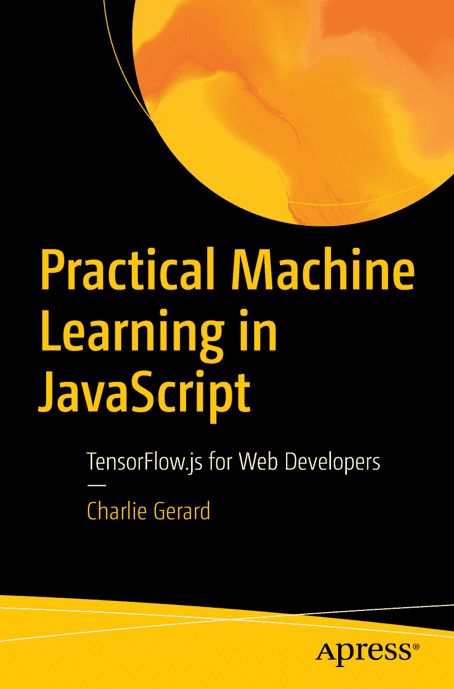

ISBN 978-1-4842-6417-1 e-ISBN 978-1-4842-6418-8 [`doi.org/10.1007/978-1-4842-6418-8`](https://doi.org/10.1007/978-1-4842-6418-8)

Apress 标准 © Charlie Gerard 2021

本作品受版权保护。出版商保留所有权利，无论涉及材料的全部或部分，具体包括翻译、重印、插图复用、朗诵、广播、微缩胶片复制或其他任何物理形式、信息存储与检索的传输与电子化改编、计算机软件，或目前已知及未来开发的类似或不同方法的权利。本书中通用描述性名称、注册商标、商标、服务标志等的使用，即使未作明确声明，也不意味着这些名称可免于相关保护法律和法规的约束，因此可自由通用。出版商、作者及编辑假定本书中的建议和信息在出版时是真实准确的。出版商、作者及编辑对本书所含材料或可能存在的任何错误或遗漏不作任何明示或暗示的担保。出版商对已出版地图中的管辖权主张及机构归属保持中立。本书通过 Springer Science+Business Media New York 在全球图书贸易中发行，地址：1 NY Plaza, New York, NY 10014。电话：1-800-SPRINGER，传真：(201) 348-4505，电子邮件：orders-ny@springer-sbm.com，或访问[`www.springeronline.com`](http://www.springeronline.com)。Apress Media, LLC 是一家加利福尼亚有限责任公司，其唯一成员（所有者）为 Springer Science + Business Media Finance Inc (SSBM Finance Inc)。SSBM Finance Inc 是一家特拉华州公司。

*献给乔尔、杰克和黛西，只因如此。献给我自己，为了熬过艰难的一年，并仍竭尽全力写下这本书。*

# 引言

尽管机器学习（ML）并非新技术，但过去几年中技术和算法的改进已将其推向技术前沿，使其成为解决复杂问题最令人兴奋且最有前景的工具之一。

通常，大多数生产级机器学习应用由研究人员、机器学习工程师和数据科学家使用 Python 或 R 等编程语言开发；然而，近年来，为了降低机器学习门槛，让更广泛的开发者能够使用，新工具不断涌现。

本书将聚焦于 TensorFlow.js，这是谷歌开发的一款多功能 JavaScript 库，使 Web 开发者能够在浏览器或 Node.js 中构建支持机器学习的应用。

你可能会想：“如果大多数支持机器学习的应用在生产环境中使用 Python 或 R，我为什么要读一本关于 JavaScript 机器学习的书？”或者“作为一名 Web 开发者，我为什么要学习机器学习？”这些问题合情合理，尤其是考虑到机器学习与 Web 开发是截然不同的学科。然而，在技术领域，我们的部分工作是紧跟时代步伐——并非成为每一项新技术或工具的专家，但至少了解其可能性与局限性。在我看来，这正是 TensorFlow.js 这类工具的重要性所在。无需学习另一种编程语言就能探索新领域，这大大降低了门槛。此外，考虑到技术发展之快、这些工具日益强大，我们可以预见未来“JavaScript 机器学习工程师”将成为热门职位。毕竟，我从未想过“未来学家”会成为一个职业。

总而言之，本书旨在以更平易近人的方式介绍机器学习，打破障碍，希望让你对这项技术感到更自在。阅读后，你将充分理解 JavaScript 机器学习框架当前提供的功能。为此，我们将定义一些常见术语和概念，讲解使用 TensorFlow.js 进行机器学习的基础知识，并通过构建多个项目来了解当前可实现的功能及常见陷阱。最终，你不仅能理解理论，还能构建支持机器学习的 Web 应用。

但需要特别说明的是，本书不会深入探讨不同机器学习算法的开发原理。我们不会钻研其源代码，而是学习识别其用例及实现方法。本书旨在为希望以实践方式了解机器学习、又不想深入高级主题的读者提供入门指导。

最后，更重要的是，我力求让本书尽可能引人入胜。你将构建的不同项目涉及多种输入，如图像、网络摄像头视频流、电脑麦克风音频、可替换的文本数据，甚至运动数据！

机器学习可以很有趣——如果你对此感兴趣，希望你会喜欢这本书。

# 致谢

首先，感谢所有参与本书创作的人，包括我的出版商、编辑和技术审阅者，感谢你们给予我这次机会。此外，感谢 TensorFlow.js 团队创建了本书所依赖的框架。他们致力于让机器学习更易被 Web 开发者使用，这对过去几年我的研究和工作的至关重要。最后，特别感谢多年来一直支持我的挚友们，以及关注我的工作、与我分享创造无用（但并非无价值）项目热情的社区成员。没有你们，这一切都不可能实现，我永远心怀感激。

## 关于作者

## 关于技术审阅者