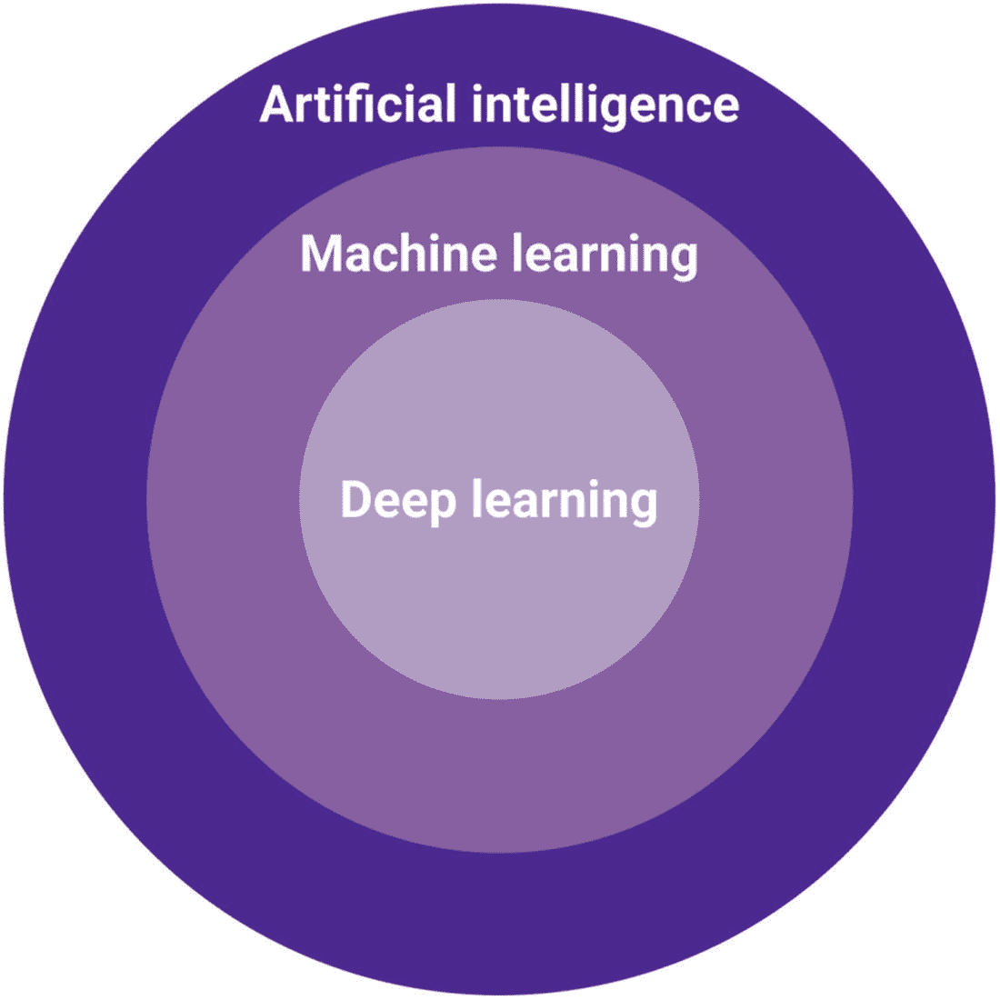
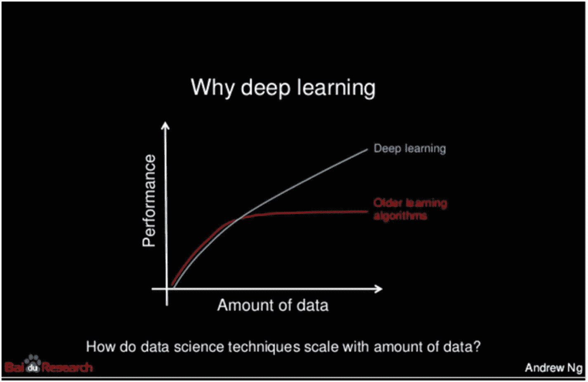
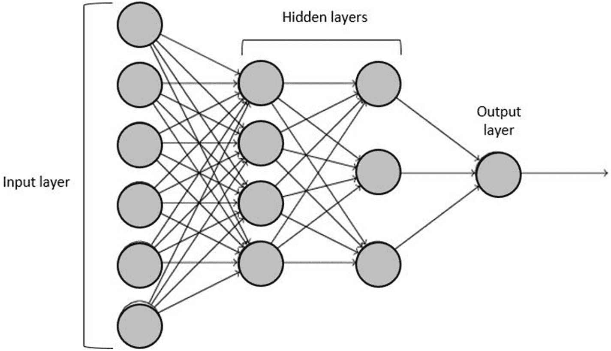
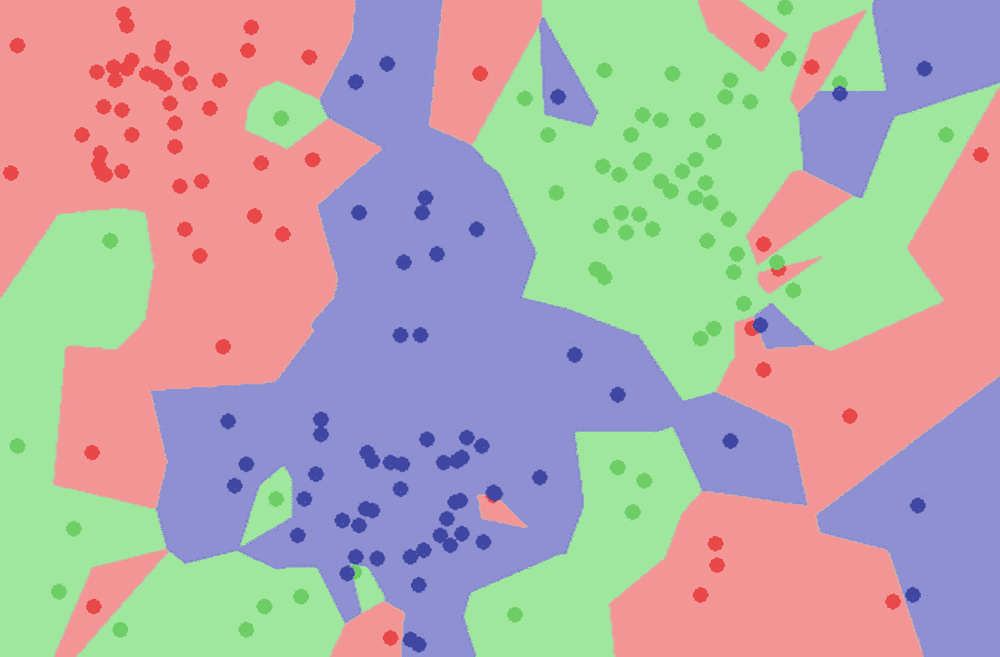
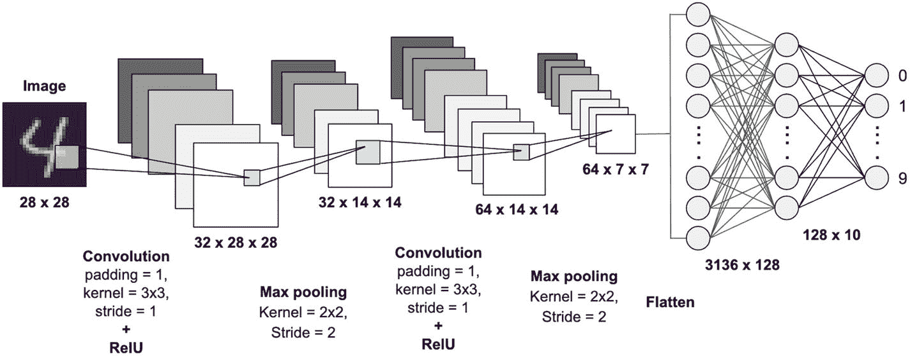
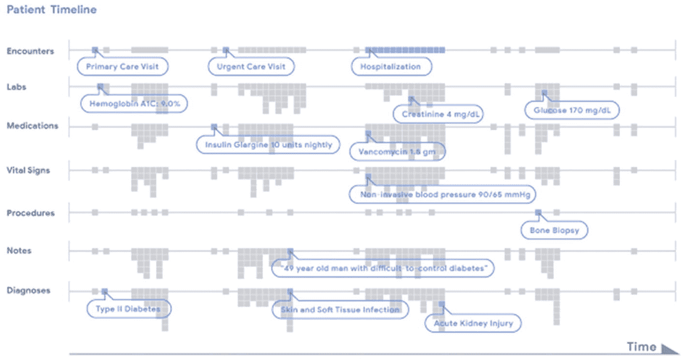
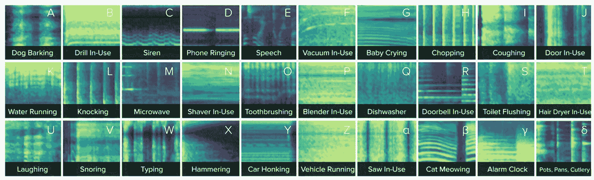
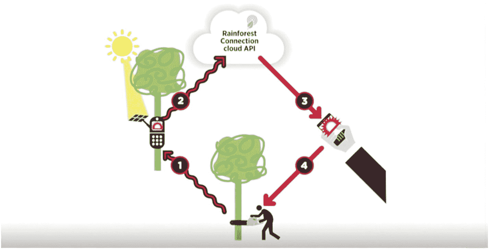

# 1. 机器学习基础

## 1.1 什么是机器学习？

在过去的几年里，你可能已经多次听到“机器学习”这个词，但它到底是什么？它和人工智能是一回事吗？深度学习呢？神经网络呢？模型呢？

在深入探讨工具、算法以及能构建什么之前，我们先来定义其中一些术语，以便对机器学习是什么、不是什么达成共识。

人工智能、机器学习和深度学习都是相关的术语。然而，它们并不完全相同，更像是彼此的子集。

图 1-1

此图展示了人工智能、机器学习和深度学习之间的关系

**人工智能**是一个总称，涵盖与计算机展现“智能”相关的所有内容。这包括语音识别（对人类语言的理解）、自动驾驶汽车或策略游戏（计算机玩围棋或国际象棋等策略游戏的能力）。

**机器学习**代表技术本身：所有实践和工具集，用于赋予计算机在没有明确编程的情况下从数据中发现模式的能力。

这包括不同类型的学习和可用算法，例如监督学习、朴素贝叶斯、K-近邻等，我们将在接下来的几章中介绍这些内容。

这项技术用于训练计算机，使其基于对历史数据的理解来做出自己的预测。

这意味着我们并不是告诉计算机要寻找什么；相反，我们向算法提供大量先前收集的数据，让它们在这个数据集中发现模式和相关性，以便在获得新数据时得出未来的结论和概率。

例如，如果我们想利用机器学习来帮助我们根据一个人的 CT 扫描结果计算其患癌概率，我们会构建一个包含来自全球不同患者的数十万甚至数百万份 CT 扫描结果的数据集。我们会将这些数据标记为癌症患者的 CT 扫描和健康患者的扫描。然后，我们将所有这些数据输入机器学习算法，让它们在这些医学图像中寻找模式，试图对癌症扫描图像的样子形成准确的理解。

然后，利用通过所有这些训练生成的模型，我们就能将其应用于一份不属于训练数据的新扫描结果，并生成患者是否患癌的概率。

最后，**深度学习**是一种特定的工具或方法。它与你可能熟悉的另一个术语有关，即**人工神经网络**。深度学习是机器学习的一个子集，它使用的算法灵感来源于大脑的结构和功能。

机器学习中神经网络的概念并不新鲜，但“深度学习”这个术语是最近才出现的。

本质上，这种方法允许训练大型神经网络，旨在推动机器学习和人工智能领域的革命性进步。

深度学习在过去几年中蓬勃发展，主要得益于计算能力的提升以及我们现在收集的数据量。

与其他机器学习算法相比，深度学习算法的性能会随着我们输入数据量的增加而持续提升，这使得它们在其它算法达到瓶颈时更具可扩展性。

在 Andrew Ng 于 2015 年 ExtractConf 上题为“数据科学家应该了解的深度学习知识”的演讲幻灯片中可以找到这种关系的体现。

图 1-2

这张幻灯片说明了深度学习与其他机器学习算法相比的可扩展性。来源：[`​www.​slideshare.​net/​ExtractConf`](https://www.slideshare.net/ExtractConf)

如上图所示，深度学习算法的主要区别特征在于它们能够随着数据量的增加而扩展并提升性能。

“深度”学习通常指神经网络中使用的层数。如果现在还不能完全理解，我们将在本书稍后部分介绍层的概念。

既然我们已经更清楚地了解了这些术语之间的区别，本书将主要关注机器学习这项技术。在探讨不同技术时，我们会稍微涉足深度学习，但也会触及该技术的更广泛方面。

我们已经定义了那些有时被互换使用、用来描述计算机展现智能的不同术语，但其他重要的术语如“神经网络”、“算法”和“模型”呢？

我们可能会在本书中多次提到它们，所以接下来用几段话来定义它们。

我们从**算法**开始，因为这是你可能最熟悉的一个，它已经在传统编程中使用了。

算法可以定义为一组规则或指令，用于解决特定问题或执行计算。

在软件工程中，你可能听说过或使用过的算法示例包括快速排序算法、迪杰斯特拉算法、二分查找等。每个算法都是为了解决特定问题而创建的。

对于机器学习算法而言，它们解决不同类型的问题，但概念是相同的；每个算法，无论是支持向量机（SVM）还是长短期记忆网络（LSTM）算法，都只是一个解决特定问题的数学函数。

**神经网络**是一组旨在模仿大脑工作方式的深度学习算法。

就像大脑由巨大的互联神经元网络组成一样，神经网络由称为人工神经元的互联节点层组成。

这些网络的可视化表示可能如下图所示。

图 1-3

此图展示了神经网络中的不同层

在神经网络中，通常有三个主要部分：一个**输入层**，代表你想要为其生成预测的输入数据（例如，你想要应用目标检测的图像，你想要获取情感倾向的文本等）；一定数量的**隐藏层**；以及一个代表你预测结果的**输出层**。

这是对神经网络工作原理的非常高级的解释，但需要理解的最重要部分是，它们由大量互联节点组成，这些节点按层组织，在训练过程中会根据前一层神经元产生的结果而被激活或不激活，类似于大脑中不同的神经元在接收到特定输入时会触发。

最后是**模型**。在机器学习中，模型代表一次训练过程的输出。当训练过程进行时，算法正在“学习”从数据中发现的模式中得出结论；一旦训练步骤完成，输出就是一个模型。

模型是数学函数，可以将新的输入作为参数，并产生预测作为输出。

例如，图像分类模型通过数千张带标签的图像进行训练，以识别数据中的模式并预测某些实体（如猫、狗、汽车、人等）的存在。当在新应用中使用图像分类模型时，你可以输入一张可能不属于训练数据集的新图像，模型会根据训练过程中的学习成果，对这张它从未“见过”的图像中的内容生成预测。

在训练过程结束时，你通常会使用不属于训练数据集的新输入来测试模型，以检验所生成预测的有效性。

既然我们已经定义了几个在深入机器学习时会遇到的重要术语，我认为有必要快速说明一下机器学习**不是**什么。

希望前几段内容已经更清楚地表明，机器学习在未输入预先收集的数据时，是无法生成预测的。

就像我们人类无法识别从未接触过的新物体或实体一样，算法也需要先获得某种信息，才能识别新的输入。

例如，我第一次听说 3D 打印机时，很难想象它是什么样子。当我真正看到并操作了一台之后，我才理解了它是什么，并且能够识别出未来的同类物品。

人脑处理这个过程非常迅速，但算法需要更多的数据进行训练，才能逐步理解物体是什么。

由于算法本质上是数学函数，因此对于未来人工智能发展的相关报道，我们应当持保留态度。

尽管人工智能系统性能强大，但它们仍然需要在我们预先收集的大量数据上进行训练。因此，我认为机器学习应用的机会在于**增强**人类，而非**取代**人类。

医疗领域就是一个例子。我并不特别相信人工智能系统会取代医生，但我们已经看到机器学习如何通过处理海量医学图像，在 CT 扫描和核磁共振成像中识别和诊断疾病来帮助医生，有时其准确率甚至超过医疗专业人员。

通过这种方式依赖机器学习模型，我们有望更快地诊断和帮助患者。

同样重要的是要记住，计算机并不真正理解其所处理信息的上下文。从社会角度来看，某些需要解决的问题非常复杂，可能不应该仅依靠机器学习来解决。我们将在本书末尾更详细地讨论伦理与人工智能的话题。

## 1.2 机器学习的类型

通过机器学习解决的问题通常属于三大类别之一：监督学习、无监督学习和强化学习。

你可能也听说过半监督学习，但本书不会涉及。

了解你试图解决的问题类型很重要，因为它将决定你要使用哪些算法、如何准备数据以及会得到什么样的输出。

首先，让我们从最流行的一种开始：**监督学习**。

### 1.2.1 监督学习

监督学习是利用**特征**和**标签**在数据中发现模式的能力。

这里我们引入了两个与数据相关的新术语，在继续之前需要先定义它们。

使用数据集时，**特征**代表每个条目的特性，而**标签**则是你如何定义这些条目。让我们用一个例子来实践一下。

假设你想卖掉自己的房子，但不确定市场上最具竞争力的价格是多少，而你恰好拥有一个大型数据集，其中包含你所在城市所有房屋及其价格的信息。

在这种情况下，**特征**就是每栋房屋的详细信息（卧室数量、浴室数量、楼层数、房屋类型、是否有阳台、花园等），而**标签**就是它们的价格。

它可能看起来像下面这样。

表 1-1

此表展示了一个带标签数据集的示例

| 价格 | 卧室数量 | 浴室数量 | 楼层数 | 阳台 | 花园 |
| --- | --- | --- | --- | --- | --- |
| **$1,500,000** | 3 | 2 | 2 | 无 | 有 |
| **$500,000** | 1 | 1 | 1 | 有 | 无 |
| **$750,000** | 1 | 1 | 1 | 无 | 有 |
| **$1,700,000** | 4 | 2 | 2 | 无 | 有 |
| **$700,000** | 2 | 1 | 1 | 无 | 无 |
| **$850,000** | 2 | 1 | 1 | 有 | 有 |
| **$525,000** | 1 | 1 | 1 | 无 | 无 |
| **$2,125,000** | 5 | 3 | 3 | 有 | 有 |
| **$645,000** | 1 | 1 | 1 | 有 | 有 |

真实的数据集会有更多的条目和更多的特征，但这只是一个用来解释特征和标签概念的示例。

利用这些带标签的数据，我们可以使用机器学习来预测你的房子应该以什么价格挂牌上市。

例如，根据上述数据，如果你的房子有 1 间卧室、1 间浴室、没有阳台但有花园，那么它的价格会更接近 75 万美元，而不是 100 万美元。

在这个简单的例子中，我们可以通过查看数据手动完成，但在实际情况下，数据量会大得多，使用机器学习能够比人类更快地完成计算。

监督学习问题的其他例子包括：预测一封电子邮件是否为垃圾邮件、根据历史比赛数据预测一支运动队获胜的概率、预测保险索赔欺诈的概率。

总之，监督学习是基于**带标签的数据**进行预测。

### 1.2.2 无监督学习

另一种常见的学习类型称为**无监督学习**。与监督学习相反，无监督学习是基于**未标记数据**进行预测。这意味着我们**仅依赖特征集**。

回想一下之前关于房屋的数据集，这意味着我们要移除“价格”这一列，最终只保留每栋房屋特征的数据。

如果沿用预测房屋售价的场景，你可能会疑惑：如果数据没有标签（不包含任何价格信息），我们该如何预测价格呢？

这正是思考你要解决的问题以及关注你所拥有数据的重要性所在。

在无监督学习中，我们并非试图预测单一结果或回答特定问题，而是识别趋势。

在我们的房屋问题中，问题是“我的房子能卖多少钱？”，我们期望得到一个具体的价格作为结果。然而，正如本书前面提到的，如果训练时输入的数据集不包含任何价格信息，机器学习算法实际上无法预测价格。

因此，这种情况并不适合使用无监督学习。

由于无监督学习旨在识别趋势并将数据分类到不同组别，一个适合此类问题的典型例子是**预测客户行为**。

对于这类问题，我们并非试图回答一个具有特定答案的问题；相反，我们试图将数据分类到不同类别，以便创建具有相似特征的实体集群。

以预测客户行为为例，通过收集每位客户的数据，我们可以利用机器学习来发现客户之间的行为相关性，并找出购买模式，这些模式有助于广告等应用。

收集并使用关于你在哪里购物、什么时间购物、每周购物几次、购买什么商品等数据，我们可以推断出你的性别、年龄、社会经济背景等信息，然后根据你所属的客户群体来预测你可能购买的商品。

如果你接触过 Spotify 上的音乐推荐或 Amazon 上的产品推荐，你可能对这类预测的实际应用有所了解。

根据你的收听和购买习惯，公司收集数据并利用机器学习将客户分群，然后根据与你相似的其他人的收听或购买记录，向你推荐你可能喜欢的歌曲或产品。

### 1.2.3 强化学习

第三种学习类型称为**强化学习**。如果你正在阅读本书，很可能刚开始接触机器学习，所以一开始可能不会用到它。

强化学习主要用于自动驾驶汽车、带有 AI 玩家的游戏等应用场景，这些场景的结果更多地涉及一种行为或一系列动作。

它依赖于奖励和惩罚的概念，以及“智能体”与“环境”之间的关系。

我们可以想象一个乒乓球游戏的场景：环境是游戏本身，智能体是玩家。玩家的动作会改变游戏的状态。改变球拍的位置会影响球的走向，并最终导致玩家获胜或失败。

当一系列动作导致玩家获胜时，系统会获得某种奖励，以表明这组特定的交互实现了训练过程的目标，从而创建一个能够自主赢得比赛的 AI 玩家。

训练过程会持续进行，迭代不同的交互组合，在获胜时获得奖励（+1 分），在失败时受到惩罚（-1 分），并自我修正，逐渐学会如何在与另一个玩家的对战中获胜。

这种学习类型不依赖于预先存在的数据集来输入算法。

相反，它使用一组目标和规则（例如，球拍只能上下移动，目标是击败对手等），通过自主学习正确的行为，以最大化实现设定目标的机会。

强化学习让系统能够探索环境并自行做出决策。

这种学习类型通常需要非常漫长的训练过程，涉及海量的步骤。其中一个问题在于，当因输掉游戏而受到惩罚时，系统会假定该回合中采取的所有动作序列都导致了失败。因此，它会避免再次采取所有这些步骤，而不是识别出动作序列中哪些步骤导致了失败。

### 1.2.4 半监督学习

最后，我们简要谈谈半监督学习。

半监督学习介于监督学习和无监督学习之间。正如前几页所述，监督学习处理标记数据，而无监督学习使用未标记数据。

有时，当使用一个大型未标记数据集时，我们可以先对其中的一部分进行标记，然后利用半监督学习进行所谓的**伪标记**。

这意味着我们将手动标记数据集的一部分，然后让算法标记剩余部分，最终得到一个完全标记的数据集。

例如，如果我们有数十万张未标记的猫和狗的图片集合，我们可以自己标记其中一部分，然后将其输入半监督学习算法。该算法会在这些图片中寻找模式，并能够将剩余的未标记数据集作为输入，为每张新图片贴上“猫”或“狗”的标签，从而使所有数据都被标记。

这种技术使我们能够比完全手动标记更快地生成标记数据集，然后我们就可以在此基础上进行监督学习。

理解你的问题属于哪种学习类型通常是第一步。

现在我们已经介绍了主要的几种类型，接下来让我们看看一些最著名的算法。

## 1.3 算法

与标准编程一样，机器学习使用算法来帮助解决问题。

然而，在使用算法之前，并不一定要理解所有算法的实现细节。最重要的是要了解它们属于哪种学习类型，以及它们最擅长处理哪种数据类型。

如果将其与 Web 编程进行比较，市面上有很多不同的 JavaScript 框架，你并不一定需要理解它们的源代码才能使用它们构建应用程序。然而，你需要知道的是，它们是否支持你所需的功能。

在机器学习领域，有些算法非常擅长处理图像数据，而另一些则更擅长处理文本数据。

让我们深入了解其中一些算法。

### 1.3.1 朴素贝叶斯

朴素贝叶斯算法是一种监督学习分类算法。

它基于各种属性和先验知识来预测不同类别的概率。

该算法主要用于文本分类以及涉及多类别的问题。它被认为具有高度可扩展性，并且相比其他算法所需的训练数据更少。

一个可以用朴素贝叶斯解决的实际问题示例，与电视剧拍摄有关。

除非所有剧情都发生在室内，否则剧集制作会受到环境因素的影响，例如天气、湿度、温度、风力、季节等。

由于电视剧的各个部分并非按顺序拍摄，我们可以利用机器学习，根据特定场景的要求，帮助我们找到最适合拍摄某些剧集的日子。

通过收集包含天气属性以及是否拍摄了室外场景的数据集，我们就能预测未来某天拍摄新场景的可能性。

该算法之所以被称为“朴素”，是因为它假设数据集中的所有变量彼此之间都不相关。

例如，下雨天不一定伴有大风，高湿度也不一定与高温相关。

### 1.3.2 K-近邻算法

另一种流行的算法称为**K-近邻算法**。

这是一种分类算法，它假设相似的事物彼此邻近存在。

用一个示例图表可以很好地说明这一点。在处理机器学习问题时，你可以像这样将数据可视化。

图 1-4

此图展示了使用 K-近邻分类算法生成的可视化结果。来源：[`​machinelearningm​astery.​com/​tutorial-to-implement-k-nearest-neighbors-in-python-from-scratch/​`](https://machinelearningmastery.com/tutorial-to-implement-k-nearest-neighbors-in-python-from-scratch/)

在上面的可视化图中，我们可以看到绘制的数据最终形成了某种有组织的聚类。相似的数据点彼此靠近。

K-近邻算法（KNN）正是基于这种相似性思想来对新数据进行分类。

使用此算法时，我们需要定义一个“K”值，该值代表我们将考虑用来帮助分类新条目的最近数据点（邻居）的数量。

例如，如果我们选择 K = 10，那么当我们想要预测一个新条目的类别时，我们会查看其最近的 10 个邻居及其类别。在我们的新数据点中，拥有最多邻居的那个类别，就是被预测为正确的类别。

这方面的一个实际例子是预测客户行为或购买特定商品的可能性。

一家连锁超市可以获取人们的购买数据，并可以使用无监督学习根据客户的购买习惯将其组织成不同的聚类。

聚类的例子可能包括单身客户与有家庭的客户，或者属于特定年龄段（年轻与年长）的客户。

考虑到人们通常与同一聚类中的人具有相似的购买习惯，使用 K-近邻算法将有助于预测人们可能倾向于购买哪种类型的产品，并利用这些信息进行广告宣传。

### 1.3.3 卷积神经网络

卷积神经网络，也称为 ConvNet 或 CNN，是一种在图像分类方面表现非常出色的算法。它可用于解决诸如物体检测和人脸识别等问题。

与人类不同，计算机将图像处理为像素数组，其长度等于高度 * 宽度 * 维度。一张 16x16 像素的 RGB 图像将被解释为一个 16*16*3 的矩阵，即一个包含 768 个值的数组。

使用 CNN 解决的一个经典示例是利用 MNIST 手写数字数据集。

图 1-5

这是卷积网络工作原理的示意图，从输入图像到隐藏层，最后输出一个数字。来源：[`​towardsdatascien​ce.​com/​mnist-handwritten-digits-classification-using-a-convolutional-neural-network-cnn-af5fafbc35e9`](https://towardsdatascience.com/mnist-handwritten-digits-classification-using-a-convolutional-neural-network-cnn-af5fafbc35e9)

上图说明了卷积神经网络如何预测输入图像中手写的数字。

它首先将图像转换为一个包含 2352 个值（28*28*3）的数组，从而将 3D 输入转换为 1D 输入。然后，它将数据送入神经网络的不同层和滤波器，最终得到一个包含 10 个选项的输出层，因为要预测的数字在 0 到 9 之间。

预测的输出将是输出层中每个条目的概率，概率最高的条目即为正确结果。

如果你要解决的问题涉及图像数据集，那么你可能需要尝试使用 CNN 算法。

这三种算法分属不同类别。朴素贝叶斯属于贝叶斯算法，K-近邻属于基于实例的算法，而卷积神经网络（CNN）属于深度学习算法。

还有更多类别的算法有待探索；然而，涵盖所有算法并非本书的目标。随着你更深入地研究机器学习并构建自己的应用程序，在实验过程中，你绝对应该进一步了解它们。一个问题通常不止一种解决方案，因此学习不同的算法将使你能够找到最适合你目标的那一种。

## 1.4 应用

在本书前几页尝试用示例说明概念时，已经提到了一些应用；然而，机器学习在各个领域还有更多的用例。

### 1.4.1 医疗保健

在介绍系统如何用于检测 CT 扫描中的疾病时，我曾提到一个在医疗保健领域应用机器学习的例子。

除了通过图像分析进行诊断外，该领域的其他应用还包括个性化治疗和个人记录的“数据整理”。

临床数据并非总是数字化的，许多表格和处方仍然是手写的；即使数据是数字化的，每个医疗系统也会定制自己的电子健康记录（EHR），导致一家医院收集的数据与另一家医院收集的数据存在差异。

数据整理是指捕获、组织和分类数据的概念。利用光学字符识别（OCR），系统可以扫描手写文档、解析单词，并使用一种称为“实体提取”的技术来理解这些单词及其之间的语义关系。

这样一来，医疗文档可以自动保存到数据库中，并遵循统一的格式，从而便于将来进行搜索、分析或使用。

一些最大的科技公司将其研究中心的很大一部分用于开发该领域的创新解决方案。

例如，微软正在开展一些研究项目，如 Project InnerEye，该项目旨在将放射影像转化为测量工具。该项目的目标是利用机器学习算法，在 3D 放射影像中自动检测肿瘤，并生成精确的手术计划和导航。

IBM 有一个名为 IBM Watson for Oncology 的项目，可帮助医生识别患者病历中的关键信息，从而探索个性化的治疗方案。

谷歌为快速医疗互操作性资源（FHIR）标准开发了一种协议缓冲区，旨在统一医疗数据的存储方式，以便开发人员能够构建可供任何医疗机构使用的机器学习系统。

图 1-6

使用患者健康记录构建的时间线示例。来源：[*https://ai.googleblog.com/2018/05/deep-learning-for-electronic-health.html*](https://ai.googleblog.com/2018/05/deep-learning-for-electronic-health.html)

上述可视化图表展示了患者健康记录数据的时间线。每个灰色圆点代表存储在开放数据标准 FHIR 中的一条数据。深度学习模型随后可以分析这些数据以进行预测。

### 1.4.2 家庭自动化

你可能最熟悉的机器学习应用是在家庭自动化领域。

你可能听说过，甚至可能拥有一些使用机器学习的物联网设备，例如 Amazon Alexa 或 Google Home。

这些设备使用语音识别算法和自然语言处理（NLP）来识别你所说的词语、分析意图，并提供尽可能准确的响应。

值得一提的是，“联网”设备和“智能”设备之间存在区别。物联网可以定义为一个由“物”组成的互联网络，意味着设备之间通常通过 Wi-Fi 或蓝牙相互连接。

然而，有些设备仅仅是联网的，例如 Philips Hue 灯泡，你可以通过手机远程控制它。它不使用任何机器学习算法来产生输出；它只能开关或改变颜色。

另一方面，像 Nest 恒温器这样的设备则属于“智能设备”的范畴。它实现了更复杂的功能，因为它会随着时间的推移真正学习你的行为。当你在一段时间内（有时甚至是在同一天内）改变家里的温度时，它会学习你的习惯并自动适应。

就像 Philips Hue 一样，它也可以让你使用手机在任何地方进行控制，但额外的学习部分是机器学习在家庭自动化中应用的一个例子。

一些研究中心正在致力于改进像 Google Home 这样的设备，使其超越语音识别，迈向活动识别。

利用设备的麦克风，你可以使用机器学习算法和声音数据来预测用户当前正在做什么，或者他们身处哪个房间。获取这些信息将使我们能够构建更个性化的智能系统。你可以想象一下，用 Google Home 听一个菜谱，一步步跟着做，当设备识别出你正在切东西、使用打蛋器等动作时，它能够根据接收到的声音数据中的模式识别，自动暂停播放。

图 1-7

代表不同活动产生的声音数据的声谱图示例。来源：[*www.gierad.com/projects/ubicoustics/*](http://www.gierad.com/projects/ubicoustics/)

### 1.4.3 社会公益

对于使用机器学习解决某些问题（例如在司法系统中）的后果，人们日益感到担忧；然而，将其用于社会公益也潜力巨大。

无论是用于动物保护还是防止森林砍伐，机器学习在这一领域的应用都非常令人兴奋。

一些项目旨在保护濒危物种，例如从不列颠哥伦比亚省到华盛顿州的萨利希海中的虎鲸（也称为逆戟鲸）。由于仅剩约 73 头，谷歌与加拿大渔业和海洋部（DFO）以及雨林连接组织合作，利用深度神经网络追踪和监测虎鲸的行为。

通过训练机器学习模型识别虎鲸的声音，系统可以实时检测到这种动物的存在并向专家发出警报。例如，这种系统可以帮助监测动物的健康状况，并在发生石油泄漏等事件时保护它们。

雨林连接组织的另一个项目旨在利用机器学习和旧手机来防止非法砍伐森林。

这些设备全天候监控森林的声音，将所有音频数据发送到云端，并使用 TensorFlow 实时分析，以识别电锯、运木卡车以及所有非法活动的声音，从而向当地人发出警报。

图 1-8

雨林连接组织反非法砍伐项目工作原理的可视化表示。来源：[www.​ted.​com/​talks/​topher_​white_​what_​can_​save_​the_​rainforest_​your_​used_​cell_​phone#t-289131](http://www.ted.com/talks/topher_white_what_can_save_the_rainforest_your_used_cell_phone%2523t-289131)

还有更多有趣的项目专注于利用机器学习的可能性来帮助社会公益事业。尽管这不是本书的重点，但如果你有意为此做出贡献，我鼓励你进行更深入的研究。

### 1.4.4 艺术

当你想深入了解机器学习时，艺术可能并非你首先关注的领域；然而，我确实认为其重要性在技术领域被严重低估了。

艺术领域往往比其他任何领域都更快地尝试最新的技术创新。

关注机器学习如何以创意方式被运用，能让我们了解这项技术能走多远。

不仅要让自己接触艺术家的作品，我还建议你亲自尝试构建创意应用。

花些时间以创意方式将某项技术应用到你的项目中，会让你有机会探索该工具中你可能从未想过的部分。

图 1-9

来自 Memo Akten 艺术项目“学习观看”的样本。来源：[*www.memo.tv/portfolio/gloomy-sunday/*](http://www.memo.tv/portfolio/gloomy-sunday/)

创造力可以帮助你发现所使用工具的新用例、机遇和局限。

尤其是在机器学习这样一个仍有大量未知的领域，提出关于可能性的新想法有着巨大的潜力。

机器学习以创意方式运用的一些例子，体现在 Memo Akten 等艺术家的作品中。在他的项目“学习观看”中，他使用深度神经网络和实时摄像头输入，试图根据其之前所见来理解当前所见。

一个模型已经用海洋图像进行了训练。它从摄像头输入（左侧）获得新数据，进行分析，并尝试根据其训练数据来理解其含义。结果就是模型“看到”了什么，即模型如何根据其已知信息来理解新输入。

另一个例子是谷歌 Magenta 团队的工作，他们致力于构建能够自行生成音乐片段的机器学习模型。这类工作可以彻底改变人类在音乐制作中使用技术的方式。

## 1.5 总结

在介绍了机器学习的一些通用理论概念之后，是时候开始深入一些更实际的内容，并讨论作为前端开发者如何开始构建人工智能项目了。

