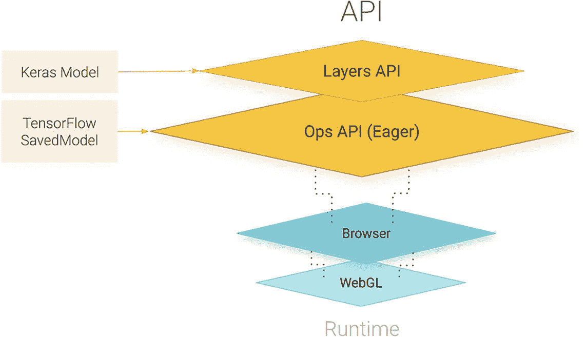
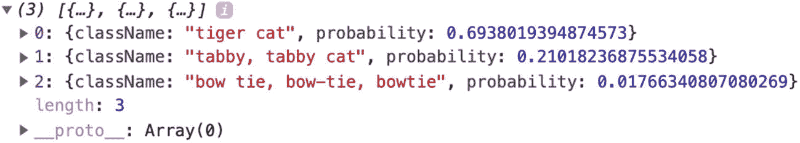
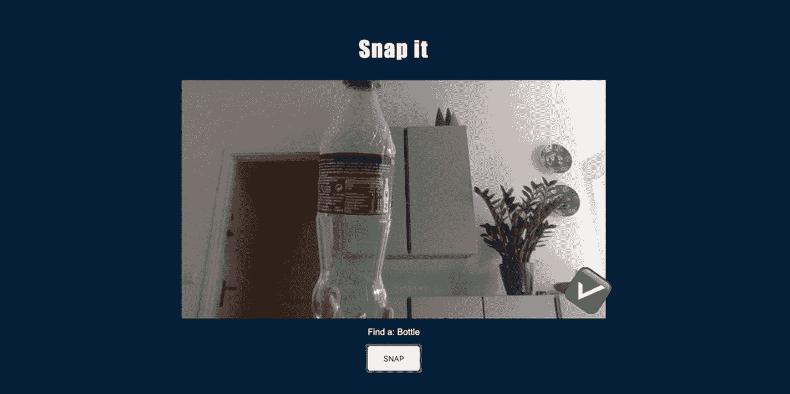
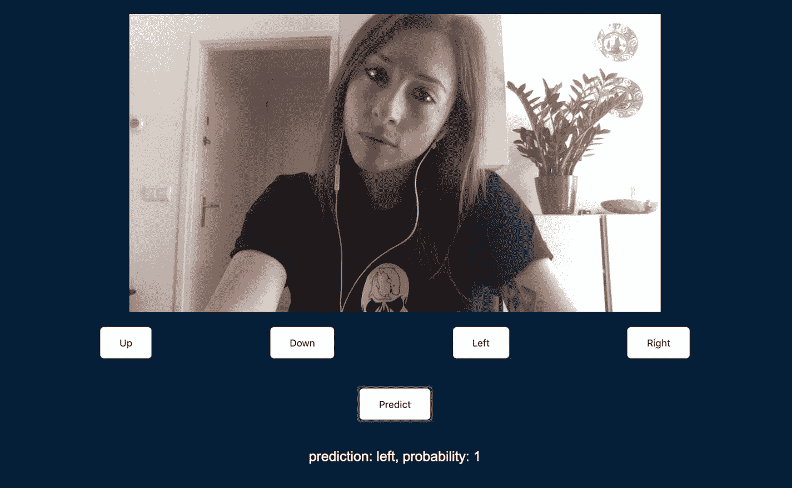
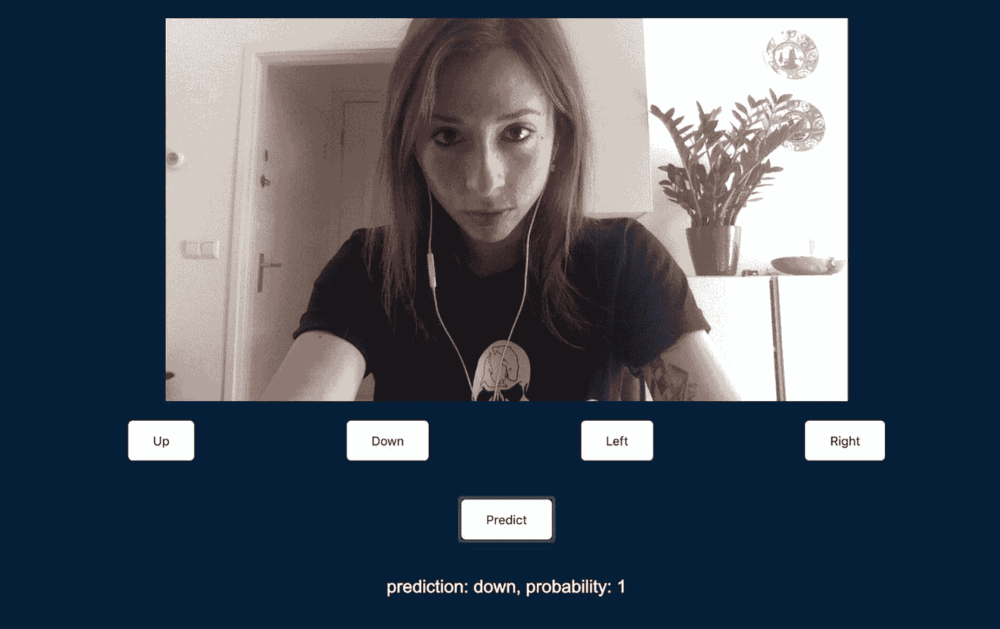
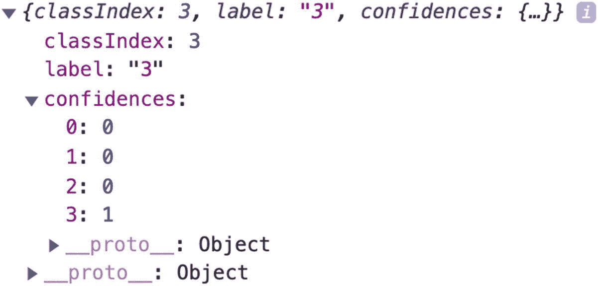

# 2. TensorFlow.js

TensorFlow.js 是一个用于机器学习的开源 JavaScript 库。它由谷歌开发，是 Python 版 TensorFlow 的配套库。这个工具使你能够构建可在浏览器或 Node.js 中运行的机器学习应用。这样，用户无需安装任何软件或驱动程序。只需打开一个网页，就能与程序进行交互。

## 2.1 TensorFlow.js 基础

TensorFlow.js 由 WebGL 驱动，并提供了用于定义模型的高级 `layers` API 和用于线性代数的低级 API（原 `deeplearn.js`）。



图 2-1 TensorFlow.js API 的可视化表示。来源：[`blog.tensorflow.org/2018/03/introducing-tensorflowjs-machine-learning-javascript.html`](https://blog.tensorflow.org/2018/03/introducing-tensorflowjs-machine-learning-javascript.html)

它还支持导入从 TensorFlow 和 Keras 保存的模型。

TensorFlow 的核心是`张量`。张量是一种数据单元，是一组被塑造成一个或多个维度数组的值。它类似于多维数组。

### 2.1.1 创建张量

例如，想象以下二维数组示例。

```javascript
const data = [
[0.456, 0.378, 0.215],
[0.876, 0.938, 0.276],
[0.629, 0.287, 0.518]
];
```

代码清单 2-1 二维数组示例

将其转换为张量以便与 TensorFlow.js 一起使用的方法是，用内置方法 `tf.tensor` 将其包裹起来。

```javascript
const data = [
[0.456, 0.378, 0.215],
[0.876, 0.938, 0.276],
[0.629, 0.287, 0.518]
];
const dataTensor = tf.tensor(data);
```

代码清单 2-2 从数组创建张量

现在，变量 `dataTensor` 可以与其他 TensorFlow 方法一起使用，来训练模型、生成预测等。

在 `tf.tensor` 中可以访问一些额外的属性，例如 `rank`、`shape` 和 `dtype`。

*   `rank`：表示张量包含的维度数量
*   `shape`：定义数据每个维度的大小
*   `dtype`：定义张量的数据类型

```javascript
const tensor = tf.tensor([[1, 2, 3], [4, 5, 6], [7, 8, 9]]);
console.log("shape: ", tensor.shape); // [3,3]
console.log("rank: ", tensor.rank); // 2
console.log("dtype: ", tensor.dtype); // float32
```

代码清单 2-3 记录张量的 `shape`、`rank` 和 `dtype`

在所示的示例张量中，`shape` 返回 `[3, 3]`，因为我们看到 3 个数组，每个包含 3 个值。`rank` 属性打印出 `2`，因为我们处理的是一个二维数组。如果我们给数组增加另一个维度，`rank` 就会变成 3。最后，`dtype` 是 `float32`，因为这是默认数据类型。

张量也可以使用其他数据类型创建，如 `bool`、`int32`、`complex64` 和 `string` 类型。为此，我们需要将 `shape` 作为第二个参数，`dtype` 作为第三个参数传递给 `tf.tensor`。

```javascript
const tensor = tf.tensor([[1, 2], [4, 5]], [2,2], "int32");
console.log("shape: ", tensor.shape); // [2,2]
console.log("rank: ", tensor.rank); // 2
console.log("dtype: ", tensor.dtype); // int32
```

代码清单 2-4 创建不同类型的张量

在到目前为止展示的示例代码中，我们使用 `tf.tensor` 来创建张量；然而，还有更多方法可用于创建不同维度的张量。根据你处理的数据，你可以使用从 `tf.tensor1d` 到 `tf.tensor6d` 的方法来创建最多六维的张量。

如果你要转换的数据是一个六层的多维数组，你可以同时使用 `tf.tensor` 和 `tf.tensor6d`；不过，使用 `tf.tensor6d` 能让代码更具可读性，因为你可以自动知道维度的数量。

```javascript
const tensor = tf.tensor6d([
[
[
[
[[1], [2]],
[[3], [4]]
],
[
[[5], [6]],
[[7], [8]]
]
]
]
]);
// 等同于
const sameTensor = tf.tensor([
[
[
[
[[1], [2]],
[[3], [4]]
],
[
[[5], [6]],
[[7], [8]]
]
]
]
]);
```

代码清单 2-5 创建多维张量

创建张量时，你也可以传入一个扁平数组，并指定你希望张量具有的形状。

```javascript
const tensor = tf.tensor2d([
[1, 2, 3],
[4, 5, 6]
]);
// 等同于
const sameTensor = tf.tensor([1, 2, 3, 4, 5, 6], [2, 3]);
```

代码清单 2-6 从扁平数组创建张量

一旦张量被实例化，就可以使用 `reshape` 方法改变其形状。

### 2.1.2 访问张量中的数据

创建张量后，你可以使用 `tensor.array()` 或 `tensor.data()` 获取其值。`array()` 返回值的多维数组，而 `data()` 返回扁平化后的数据。

```javascript
const tensor = tf.tensor2d([[1, 2, 3], [4, 5, 6]]);
const array = tensor.array().then(values => console.log("array: ", values));
// array: [ [1, 2, 3], [4, 5, 6] ]
const data = tensor.data().then(values => console.log("data: ", values));
// data: Float32Array [1, 2, 3, 4, 5, 6];
```

清单 2-7 访问张量中的数据

如上述示例所示，这两个方法返回一个 `Promise`。在 JavaScript 中，`Promise` 是一个值的代理，该值在 `Promise` 被调用时尚未创建。`Promise` 表示尚未完成的操作，因此它们与异步操作一起使用，以便在操作完成后的未来某个时间点提供值。

不过，也提供了使用 `arraySync()` 和 `dataSync()` 的同步版本。

```javascript
const tensor = tf.tensor2d([[1, 2, 3], [4, 5, 6]]);
const values = tensor.arraySync();
console.log("values: ", values); // values: [ [1, 2, 3], [4, 5, 6] ]
const data = tensor.dataSync();
console.log("data: ", data); // data: Float32Array [1, 2, 3, 4, 5, 6];
```

清单 2-8 同步访问张量中的数据

不建议在生产应用中使用它们，因为这会导致性能问题。

### 2.1.3 张量上的操作

在上一节中，我们了解到张量是一种数据结构，允许我们以 TensorFlow.js 可以处理的方式存储数据。我们学习了如何创建、重塑张量以及访问其值。现在，让我们来看看一些允许我们操作张量的不同操作。

这些操作可以按类别组织。其中一些允许你对张量进行算术运算，例如将多个张量相加；其他操作侧重于逻辑运算，例如评估一个张量是否大于另一个张量；还有一些操作提供了进行基本数学运算的方法，例如计算张量中所有元素的平方。完整的操作列表可在 [`https://js.tensorflow.org/api/latest/#Operations`](https://js.tensorflow.org/api/latest/#Operations) 找到。

以下是如何使用这些操作的示例。

# 2.1.3 张量操作

```
const tensorA = tf.tensor([1, 2, 3, 4]);
const tensorB = tf.tensor([5, 6, 7, 8]);
const tensor = tf.add(tensorA, tensorB); // [6, 8, 10, 12]
// 或
// const tensor = tensorA.add(tensorB);
```
清单 2-9 张量操作示例

在这个示例中，我们将两个张量相加。如果你查看`tensorA`的第一个值（即 1）和`tensorB`的第一个值（即 5），1 + 5 的结果确实是 6，也就是最终张量的第一个值。

要使用这类操作，你的张量必须具有相同的`形状`，但不一定需要相同的`秩`。

如果你还记得前几页的内容，形状是张量每个维度中的值的数量，而秩是维度的数量。

让我们用另一个示例来说明这一点。

```
const tensorA = tf.tensor2d([[1, 2, 3, 4]]);
const tensorB = tf.tensor([5, 6, 7, 8]);
const tensor = tf.add(tensorA, tensorB); // [[6, 8, 10, 12],]
```
清单 2-10 张量操作示例

在这种情况下，`tensorA`现在是一个二维张量，但`tensorB`仍然是一维的。

两者相加的结果现在是一个张量，其值与之前相同，但维度数量不同。

然而，如果我们尝试添加具有不同形状的多个张量，将会导致错误。

```
const tensorA = tf.tensor([1, 2, 3, 4]);
const tensorB = tf.tensor([5, 6, 7]);
const tensor = tf.add(tensorA, tensorB);
// 错误：操作数无法与形状 3 和 4 一起广播。
```
清单 2-11 使用错误形状时生成的错误

这个错误告诉我们，这个操作数不能与这两个张量一起使用，因为其中一个有四个元素，而另一个只有三个。

张量是不可变的，因此这些操作不会改变原始张量，而是始终返回一个新的`tf.Tensor`。

### 2.1.4 内存

最后，在使用张量时，你需要使用`dispose()`或`tf.dispose()`显式清理内存。

```
const tensor = tf.tensor([1, 2, 3, 4]);
tensor.dispose();
// 或
tf.dispose(tensor);
```
清单 2-12 使用 dispose 方法

另一种管理内存的方法是在链式操作时使用`tf.tidy()`。

由于张量是不可变的，每个操作的结果都是一个新张量。为了避免对你生成的所有张量调用 dispose，使用`tf.tidy()`允许你只保留所有操作中生成的最后一个张量，并释放所有其他张量。

```
const tensorA = tf.tensor([1, 2, 3, 4]);
const tensor = tf.tidy(() => {
return tensorA.square().neg();
});
console.log(tensor.dataSync()); // [-1, -4, -9, -16]
```
清单 2-13 使用 tidy 方法

在这个示例中，`square()`的结果将被释放，而`neg()`的结果则不会，因为它返回了函数的值。

现在我们已经介绍了 TensorFlow.js 的核心内容以及如何使用张量，接下来让我们看看该库提供的不同功能，以便更好地了解其可能性。

## 2.2 功能

在本小节中，我们将探讨 TensorFlow.js 当前可用的三个主要功能。这包括使用预训练模型；进行迁移学习，即使用自定义输入数据重新训练模型；以及完全在 JavaScript 中完成所有操作，即在浏览器中创建模型、训练模型并运行预测。

我们将按照从最简单到最复杂的顺序介绍这些功能。

### 2.2.1 使用预训练模型

在本书的第一章中，我们将“模型”一词定义为一个数学函数，它可以根据训练过的数据，接收新参数来进行预测。

如果这个定义对你来说仍然有些令人困惑，那么在讨论这第一个特性时将其置于具体语境中，希望能让它变得更清晰一些。

在机器学习中，为了能够预测结果，我们需要一个模型。然而，并不需要你自己构建这个模型。完全可以使用所谓的“预训练模型”。

“预训练”一词意味着该模型已经使用特定类型的输入数据进行了训练，并且是为特定目的而开发的。

例如，你可以找到一些专注于目标检测和识别的开源预训练模型。这些模型已经输入了数百万张物体图像，经历了完整的训练过程，并且在预测新实体时应该具有令人满意的准确度。

创建这些模型的公司或机构将其开源，以便开发者可以在他们的应用程序中使用它们，并有机会更快地构建机器学习项目。

正如你可以想象的，收集数据、格式化数据、标注数据、尝试不同算法和参数的过程可能需要大量时间，因此能够通过使用预训练模型来替代这项工作，可以腾出大量时间来专注于构建应用程序。

目前可用于 TensorFlow.js 的预训练模型包括身体分割、姿态估计、目标检测、图像分类、语音命令识别和情感分析。

在你的应用程序中使用预训练模型相对容易。

在下面的代码示例中，我们将使用 mobilenet 目标检测模型来预测新图像中的实体。

```
const img = document.getElementById("img");
const model = await mobilenet.load();
const predictions = await model.classify(img);
return predictions;
```
清单 2-14 使用 mobilenet 模型对图像进行分类

在实际应用中，这段代码需要事先引入 TensorFlow.js 库和 mobilenet 预训练模型，但在接下来的几章中，当我们深入构建实际项目时，会展示更完整的代码示例。

前面的示例首先获取应包含我们要预测图像的 HTML 元素。下一步是异步加载 mobilenet 模型。

模型可能体积相当大，有时达几兆字节，因此需要使用`async/await`来加载，以确保在你运行预测时，此操作已完全完成。

一旦模型准备就绪，你就可以在其上调用`classify()`方法，并将你的 HTML 元素传入，该方法将返回一个预测数组。

在一个使用猫的图像的示例中，预测的输出将类似于这样。


图 2-3 将 mobilenet 模型应用于前面猫的图片后，图像分类的结果


图 2-2 一张猫的图片

使用`classify()`的结果始终是一个包含三个对象的数组，每个对象包含两个键：`className`和`probability`。

`className`是一个字符串，包含模型根据其先前训练过的数据对新输入进行分类的标签或类别。

`probability`是一个介于 0 和 1 之间的浮点值，表示输入数据属于该`className`的可能性，0 表示不可能，1 表示非常可能。

它们按降序排列，因此数组中的第一个对象是最有可能为真的预测。

在前面的输出中，模型预测图像包含一只“虎斑猫”的可能性为 70%。

其余预测的概率值下降得相当显著，有 21% 的可能性包含一只“斑猫”，以及大约 0.02% 的可能性包含一个“领结”。

通常，你会关注预测中返回的第一个值，因为它具有最高的概率；然而，70% 实际上并不算高。

在机器学习中，你的目标是使用预测时获得尽可能高的概率。在这种情况下，我们只是预测了图像中存在一只猫，但在实际应用中，你可以想象，有 30% 的概率预测出错误的结果是不可接受的。

为了改进这一点，通常我们会进行所谓的“超参数调优”并重新训练模型。

**超参数调优**是调整和优化生成模型时所用参数的过程。它可能包括在神经网络中添加层、改变批量大小等等，并观察这些变化对模型性能和准确度的影响。

然而，当使用预训练模型时，你将无法做到这一点，因为你唯一能访问的是输出的模型，而不是用于创建它的代码。

这是使用预训练模型带来的局限性之一。

当使用这些模型时，你无法控制它们是如何创建的以及如何修改它们。你通常无法访问训练过程中使用的数据集，因此无法确定它是否能满足你应用程序的要求。

此外，你还面临着继承该公司或机构偏见的风险。

如果你的应用程序涉及实现面部识别，并且你决定使用一个开源的预训练模型，你无法确定这个模型是在一个多样化的人群数据集上训练的。结果，你可能会在不知情的情况下，通过使用它们来支持某些偏见。

过去曾出现过问题，面部识别模型仅在白种人身上表现良好，而忽略了大量深色皮肤的用户群体。

尽管已经做了工作来修复这个问题，但我们仍经常听到机器学习模型做出有偏见的预测，因为用于训练它们的数据不够多样化。如果你决定在生产应用程序中使用预训练模型，我认为事先做一些研究是很重要的。

## 2.2 关键特性

### 2.2.2 迁移学习

`TensorFlow.js` 中可用的第二个特性称为“迁移学习”。

`迁移学习`是指能够重复使用为某项任务开发的模型，并将其作为另一项任务模型的起点。

想象一个对象识别模型，它已经在一个你无法访问的数据集上进行了预训练，该模型的核心功能是识别图像中的实体。利用迁移学习，你可以利用这个模型创建一个新模型，其功能相同，但使用你自定义的输入数据进行训练。

迁移学习是一种生成半定制化模型的方法。你仍然无法修改模型本身，但可以向其提供你自己的数据，这可以提高预测的准确性。

如果我们沿用上一节中使用的例子，即使用一个预训练模型来检测图片中是否存在猫，我们可以看到预测结果返回了标签“虎斑猫”。这意味着该模型是用标记为“虎斑猫”的图像进行训练的。但是，如果我们想检测一些非常不同的东西，比如金合欢（澳大利亚花卉）呢？

第一步是搜索该模型可以预测的类别列表，看看是否包含这些花卉。如果包含，则意味着可以直接使用该模型，就像上一节展示的那样。

然而，如果模型没有用金合欢的图像进行训练，那么在我们使用迁移学习生成新模型之前，它将无法检测到它们。

为此，部分代码与上一节展示的示例类似，因为我们仍然需要从预训练模型开始，但我们会引入一些新的逻辑。

我们需要首先将 `K` 近邻分类器导入到我们的应用程序中，同时导入 `TensorFlow.js` 和 `mobilenet` 预训练模型。

```
清单 2-15
导入 TensorFlow.js、mobilenet 和 KNN 分类器
```

这样做使我们能够访问一个 `knnClassifier` 对象。要实例化它，我们需要调用 `create` 方法。

```
const classifier = knnClassifier.create();
清单 2-16
实例化 KNN 分类器
```

这个分类器将用于使我们能够根据自定义输入数据进行预测，而不仅仅是使用预训练模型。

此过程的主要步骤包括对模型进行所谓的`推理`，这意味着将 `mobilenet` 模型应用于新数据，将这些示例添加到分类器，并预测类别。

```
const img = await webcam.capture();
const activation = model.infer(img, 'conv_preds');
classifier.addExample(activation, classId);
清单 2-17
向 KNN 分类器添加示例数据
```

上面的代码示例是不完整的，但我们将在后续章节中更深入地介绍它，届时我们将专注于在应用程序中实现迁移学习。

这里最重要的是要理解，我们从网络摄像头流中保存一张图像到一个变量中，将其作为模型的新数据使用，并将其作为一个带有类别（标签）的示例添加到分类器中，这样最终得到的模型不仅能够识别与 `mobilenet` 模型初始训练过程中使用的数据相似的数据，还能识别我们的新样本。仅向分类器提供一张新的图像和一个示例，不足以让它准确识别我们的新输入数据；因此，这一步需要重复多次。

一旦你认为你的分类器准备好了，你可以像这样预测输入。

```
const img = await webcam.capture();
const activation = model.infer(img, 'conv_preds');
const result = await classifier.predictClass(activation);
const classes = ["A", "B", "C"];
const prediction = classes[result.label];
清单 2-18
分类新图像
```

前几步是相同的，但这里不是将示例添加到分类器，而是使用 `predictClass` 方法来返回分类器认为新输入是什么的结果。我们将在下一章更深入地探讨迁移学习。

### 2.2.3 创建、训练和预测

最后，第三个特性允许你自行创建模型、运行训练过程并使用它，所有这些都在 `JavaScript` 中完成。这个特性比前两个更复杂，但将在第 5 章中更深入地介绍，届时我们将使用我们自己创建的模型来构建一个应用程序。

重要的是要知道，自己创建模型需要采用试错的方法。解决问题的方法不止一种，如果你决定走这条路，你将需要大量尝试不同的算法、参数等。

最常用的模型类型是顺序模型，你可以通过一系列层来创建它。这种模型的一个示例如下所示。

```
const model = tf.sequential();
model.add(tf.layers.conv2d({
inputShape: [28, 28, 1],
kernelSize: 5,
filters: 8,
strides: 1,
activation: 'relu',
kernelInitializer: 'VarianceScaling'
}));
model.add(tf.layers.maxPooling2d({
poolSize: [2, 2],
strides: [2, 2]
}));
model.add(tf.layers.conv2d({
kernelSize: 5,
filters: 16,
strides: 1,
activation: 'relu',
kernelInitializer: 'VarianceScaling'
}));
清单 2-19
创建模型
```

我们首先使用 `tf.sequential` 实例化它，然后向其添加多个不同的层。这一步在某种程度上是随意的，因为选择层的类型和数量，以及传递给层的参数，与其说是科学，不如说是一门艺术。你的模型在第一次编写时可能并不完美，需要多次修改才能得到性能最佳的结果。

需要记住的一件重要事情是，在模型的第一层中提供一个 `inputShape` 参数，以指示模型将要训练的数据的形状。后续层则不需要。

创建模型后，下一步是用数据训练它。这一步使用 `fit` 方法完成。

```
await model.fit(data, label, options);
清单 2-20
用数据拟合模型
```

通常，在调用此方法之前，你需要将数据分成批次，以逐步训练模型。整个数据集通常太大，无法一次性使用，因此将其分成批次很重要。

传递给函数的 `options` 参数是一个包含训练过程信息的对象。你可以指定`周期`的数量，即整个数据集通过神经网络的次数，还可以指定`批次大小`，即单个批次中存在的训练样本数量。

由于数据集被分割成批次传递给 `fit` 方法，我们还需要考虑使用完整数据集训练模型所需的`迭代`次数。例如，如果我们的数据集包含 1000 个样本，并且我们的批次大小是每次 100 个样本，那么完成 1 个周期需要 10 次迭代。因此，我们需要循环并调用我们的 `fit` 方法 10 次，每次更新批次数据。

一旦模型完全训练好，就可以使用 `predict` 方法进行预测。

```
const prediction = model.predict(data);
清单 2-21
预测
```

关于这个特性还有更多内容需要介绍，但我们将在接下来的几章中通过实际示例进一步探讨。

# 3. 构建图像分类器

在本章中，我们将通过构建几个检测图像中对象的 Web 应用程序，更深入地探讨 `TensorFlow.js` 的特性。这里将提供更完整的代码示例并附有解释，以便你更好地理解如何将机器学习应用到你的项目中。

## 3.1 使用预训练模型

我们要构建的第一个项目是一个快速游戏，系统会提示你在周围寻找特定物体，用设备摄像头拍照，然后检查机器学习模型是否能识别它们。输出结果如下所示：



图 3-1：图像分类项目截图

该项目的核心是我们之前讨论过的同一个物体检测模型，名为 `mobilenet`。该模型使用开源 `ImageNet` 数据库进行预训练，该数据库由组织成 1000 个不同类别的图像组成。这意味着该模型能够根据其训练数据识别 1000 种不同的物体。

要开始这个项目，我们需要导入 `TensorFlow.js` 和 `mobilenet` 模型。有两种方法可以实现。你可以在 `HTML` 文件中使用 `script` 标签导入它们。

```
清单 3-1
导入 TensorFlow.js 和 mobilenet
```

或者，如果你使用前端框架，例如 `React.js`，你可以在依赖项中安装 `TensorFlow.js`，然后在 `JavaScript` 文件中导入它。在你的终端中：

```
npm install @tensorflow/tfjs @tensorflow-models/mobilenet

yarn add @tensorflow/tfjs @tensorflow-models/mobilenet

清单 3-2
```

# 安装 TensorFlow.js 和 mobilenet 模块

在你的 JavaScript 文件中：

```javascript
import "@tensorflow/tfjs";
import "@tensorflow-models/mobilenet";
```

> 清单 3-3 导入模块

导入这两个文件后，我们就可以访问 `tf` 和 `mobilenet` 对象。

我们需要采取的第一步是在应用中加载模型。

```javascript
async function app(){
    const model = await model.load();
}
```

> 清单 3-4 加载模型


> 图 3-2 模型的控制台输出

模型文件通常较大，加载可能需要几秒钟，因此应使用 `async/await` 进行加载。

如果你好奇这个对象包含什么，可以将其打印出来并查看其属性。请记住，你不需要理解对象中的每个属性才能使用它。

然而，其中一个可能有趣的属性是 `model` 中的 `inputs` 属性。


> 图 3-3 模型的控制台输出

此属性显示了用于训练模型的输入类型。在这种情况下，我们可以看到使用了图像，考虑到这是一个物体检测模型，这很合理。更重要的是，我们可以看到训练过程中使用的数据的形状。

`shape` 属性显示值为 `[-1, 224, 224, 3]`，这意味着输入模型的图像是大小为 224*224 像素的 RGB 图像（数组末尾的 3 代表通道数）。

这个值对于本章的下一部分特别重要，我们将研究如何使用 `mobilenet` 模型进行迁移学习。请随意进一步探索模型。

构建此应用的下一步是允许 TensorFlow.js 访问网络摄像头的输入，以便能够运行预测并检测物体。由于我们的项目使用设备的网络摄像头，我们的 HTML 中有一个 `<video>` 元素。在 JavaScript 中，我们需要访问此元素，并使用 TensorFlow 的一种方法从数据 API 创建一个对象，该对象可以将图像捕获为张量。

```javascript
const webcamElement = document.getElementsByTagName("video")[0];
const webcam = await tf.data.webcam(webcamElement);
```

> 清单 3-5 实例化一个网络摄像头对象

这两行代码仍然是我们应用设置过程的一部分。目前，我们只加载了模型并创建了这个 `webcam` 变量，它将把摄像头的快照转换为张量。

现在，为了实现逻辑，我们需要首先在 HTML 中添加一个简单的按钮。它将用于在点击时触发图像捕获。

```html
<button class="capture-image">SNAP</button>
```

> 清单 3-6 用于捕获图像的按钮

在我们的 JavaScript 文件中，我们需要访问此元素，使用 `onclick` 事件监听器，并使用 TensorFlow.js 捕获图像并进行分类。

```javascript
const captureButton = document.getElementsByClassName("capture-image")[0];
captureButton.onclick = async () => {
    const img = await webcam.capture();
    const predictions = await model.classify(img);
    return predictions;
};
```

> 清单 3-7 对图像进行分类

要从视频流中捕获图像，TensorFlow.js 有一个内置的 `capture()` 方法，需要在之前使用 `tf.data.webcam` 创建的对象上调用它。它允许将单个图像直接转换为张量，以便随后可以轻松地与其他 TensorFlow.js 操作一起使用。

捕获图像后，我们通过将其传递给 `mobilenet.classify` 来生成预测。这将返回一个预测数组。

例如，这张塑料瓶的照片将返回以下预测数组。


> 图 3-5 控制台中打印的预测结果


> 图 3-4 实时物体分类

如你所见，第一个预测（模型最确信的那个）的标签是“pop bottle, soda bottle”。它成功检测到了图像中瓶子的存在；然而，概率非常低，尽管结果是正确的。预测置信度仅为 30% 的事实可能是由于物体背后的背景造成的。背景越复杂，模型就越难在图像中找到物体并对其进行分类。这个问题更多地与计算机视觉领域本身有关，而不是框架问题。

如下图所示，如果你尝试在更清晰的背景下拍摄同一张照片，预测质量似乎会好得多。


> 图 3-6 在更清晰背景下的预测结果

不仅概率高得多，接近 89%，而且后续的预测也更准确。在第一个例子中，第二个预测是“真空吸尘器”，这远非准确，但在这里，它返回的是“水瓶”，这个结果更接近事实。

如果你计划将物体检测集成到你的应用中，这个限制绝对是你应该考虑的因素。考虑项目将使用的上下文对于避免糟糕的用户体验很重要。

最后，这个过程还有最后一步。我们需要清理不再需要的内存。一旦图像被捕获并输入 TensorFlow.js 进行分类，我们就不再需要它了，因此应该释放它所占用的内存。为此，TensorFlow.js 提供了 `dispose` 方法，你可以像这样使用它。

```javascript
img.dispose();
```

> 清单 3-8 使用 `dispose` 方法释放一些内存

我们已经介绍了物体检测逻辑的主要部分。然而，游戏的第一部分是提示你找到特定的物体并拍照。这段代码并非 TensorFlow.js 特有的，它可以是一个简单的 UI，每次你成功找到上一个物体后，它会要求你寻找一个新的物体。但是，如果你的 UI 要求你寻找一部手机，你需要确保模型已经用手机图片训练过，这样它才能检测到正确的物体。

幸运的是，在仓库 [`https://github.com/tensorflow/tfjs-models/blob/master/mobilenet/src/imagenet_classes.ts`](https://github.com/tensorflow/tfjs-models/blob/master/mobilenet/src/imagenet_classes.ts) 中可以找到 `mobilenet` 模型能够识别的对象类别列表。如果在你的应用中导入这个列表，你的代码就可以遍历这个包含 1000 个条目的对象，并在用户界面中随机显示一个，要求用户在周围找到这个物体。

由于这段代码不涉及 TensorFlow.js 库的使用，我们不会在本书中介绍它。不过，如果你想了解前面展示的所有代码示例是如何组合在一起的，下面就是它们应有的样子。

```javascript
async function app() {
    const webcamElement = document.getElementsByTagName("video")[0];
    const model = await mobilenet.load();
    const webcam = await tf.data.webcam(webcamElement);
    const captureButton = document.getElementsByTagName("button")[0];
    captureButton.onclick = async () => {
        const img = await webcam.capture();
        const predictions = await model.classify(img);
        img.dispose();
        return predictions;
    };
}
app();
```

> 代码清单 3-10 完整的 JavaScript 代码

```html
<!DOCTYPE html>
<html lang="en">
<head>
    <meta charset="UTF-8">
    <title>Image Classifier</title>
</head>
<body>
    <h1>Image Classifier</h1>
    <button class="capture-image">SNAP</button>
    <video autoplay playsinline></video>
    <script src="./node_modules/@tensorflow/tfjs"></script>
    <script src="./node_modules/@tensorflow-models/mobilenet"></script>
    <script src="./app.js"></script>
</body>
</html>
```

> 代码清单 3-9 完整的 HTML 文件

在本小节中，我们使用对象检测构建了一个小游戏，但它也可以用于非常不同的应用。

## 3.2 迁移学习

使用预训练模型非常有用，可以让你快速构建项目，但如果你发现自己需要更定制化的功能，很快就会遇到它的局限性。

在本小节中，我们将利用前面几页编写的部分代码，并对其进行调整，以使用自定义输入数据。

我们将从网络摄像头收集自定义数据样本，构建一个能够识别我们头部运动的模型。这可以作为界面的潜在控制方式，因此你可以想象使用这个模型通过上下倾斜头部来滚动网页，或者使用相同的动作来导航地图。

这个项目将专注于训练模型识别新样本并测试其预测结果。

你在接下来几页中阅读的代码将生成一个界面，其中包含用于收集新数据的按钮，以及一个用于运行预测的额外按钮。结果将显示在页面上，供你验证模型的准确性。



**图 3-8**

从网络摄像头输入中分类头部运动



**图 3-7**

从网络摄像头输入中分类头部运动

正如你在前面的截图中看到的，向下和向左的头部运动被准确预测。

要开始，我们需要导入 `TensorFlow.js`、`mobilenet` 模块和一个 K 近邻分类器。

**代码清单 3-11**
导入 `TensorFlow.js`、`mobilenet` 和一个 KNN 分类器

如前所述，我们还需要一个视频元素来显示网络摄像头画面，一些按钮，以及一个段落来显示我们的预测结果。

**代码清单 3-12**
本项目所需的 HTML 元素

在一个 JavaScript 文件中，我们需要编写逻辑，当点击按钮时从网络摄像头收集样本，并将其输入到 KNN 分类器中。

在深入逻辑之前，我们需要先为分类器、模型和网络摄像头实例化一些变量。

**代码清单 3-13**
实例化分类器、加载模型并准备网络摄像头对象

```javascript
const classifier = knnClassifier.create();
const net = await mobilenet.load();
const webcam = await tf.data.webcam(webcamElement);
```

在最后一行，`webcamElement` 变量指的是通过使用标准 `Document` 接口方法（如 `getElementsByClassName`）获取的 HTML 视频元素。

为了实现逻辑，我们可以创建一个新函数，命名为 `addExample`。这个函数将从网络摄像头捕获一张图像，将其转换为张量，用图像张量及其标签重新训练 `mobilenet` 模型，将该示例添加到 KNN 分类器，并释放张量。

这听起来可能很多，但实际所需的代码不过几行。

**代码清单 3-14**
用于使用自定义输入重新训练模型的 `addExample` 函数

```javascript
const addExample = async classId => {
  const img = await webcam.capture();
  const activation = net.infer(img, "conv_preds");
  classifier.addExample(activation, classId);
  img.dispose();
};
```

第二行允许我们从网络摄像头画面中捕获单张图像，并直接将其转换为张量，以便立即与其他 `TensorFlow.js` 方法一起使用。

`activation` 变量保存了使用来自网络摄像头的新图像张量重新训练后的 `mobilenet` 模型的值，该过程使用了其名为 `"conv_preds"` 的激活函数。

激活函数是一种帮助神经网络学习数据中复杂模式的函数。

下一步是使用重新训练模型的结果，并将其作为示例添加到我们的分类器中，同时附带一个类别 ID，以便将新样本映射到其标签。

在机器学习中，尽管我们通常将标签视为字符串，例如在本例中的“右”、“左”等，但在训练过程中，这些标签实际上会被替换为它们在标签数组中的索引。

如果我们的类别是 `["up", "down", "left", "right"]`，那么当我们训练模型识别头部向下运动时，类别 ID 将是 1，因为 `"down"` 是数组中的第二个元素。

最后，我们在使用完图像张量后将其释放，以腾出一些内存。

当我们点击四个按钮中的任意一个时，需要触发这个 `addExample` 方法。

**代码清单 3-15**
遍历按钮元素，为每个按钮附加一个 `onclick` 事件监听器，该监听器将触发 `addExample` 函数

```javascript
for (var i = 0; i < buttons.length; i++) {
  buttons[i].onclick = function(index) {
    return function() {
      addExample(index);
    };
  }(i);
}
```

考虑到 `buttons` 变量保存了 DOM 中存在的按钮元素，我们希望在所有按钮（用于运行预测的按钮除外）上触发 `addExample` 函数。

我们将按钮索引传递给该函数，因此，例如当我们点击“上”按钮时，类别 ID 将为 0。

这样，每当我们点击四个按钮中的一个，就会向分类器添加一个示例，并附带相应的类别 ID。

一旦我们重新训练模型几次后，就可以点击预测按钮来运行实时预测。

**代码清单 3-16**
点击预测按钮时调用 `runPredictions` 函数

```javascript
predictButton.onclick = () => runPredictions();
```

这个 `runPredictions` 函数将重复与之前解释的类似的步骤；但是，它不会将示例添加到 KNN 分类器，而是会触发 `predictClass` 方法，根据我们刚刚完成的训练过程，对来自网络摄像头的实时输入进行分类。

**代码清单 3-17**
`runPredictions` 函数

```javascript
async function runPredictions() {
  while (true) {
    if (classifier.getNumClasses() > 0) {
      const img = await webcam.capture();
      const activation = net.infer(img, "conv_preds");
      const result = await classifier.predictClass(activation);
      predictionParagraph.innerText = `
        预测结果: ${classes[result.label]},
        置信度: ${result.confidences[result.label]}`;
      img.dispose();
    }
    await tf.nextFrame();
  }
}
```

在上面的示例中，我们将逻辑包装在一个 `while` 循环中，因为我们希望持续预测来自网络摄像头的输入；但是，如果你希望仅在点击某个元素后才获取预测结果，也可以将其替换为 `onclick` 事件。

如果分类器已经用新样本进行了训练，我们将重复两个步骤：从网络摄像头捕获图像，并将其与 `mobilenet` 模型一起使用。

**代码清单 3-18**
训练分类器和运行预测之间重复的步骤

```javascript
const img = await webcam.capture();
const activation = net.infer(img, "conv_preds");
```

然后，我们将这些数据传递给在 KNN 分类器上调用的 `predictClass` 方法，以预测其标签。

调用此方法的结果是一个对象，包含 `classIndex`、`label` 和一个名为 `confidences` 的对象。



**图 3-9**

控制台中分类的输出

在这种情况下，我将头向右倾斜，因此 `classIndex` 和 `label` 返回的值为 3，因为用于训练模型识别此手势的按钮是四个按钮中的最后一个。

`confidences` 对象向我们展示了预测标签的概率。值为 1 表示模型非常有信心识别出的手势是正确的。

概率值可以在 0 到 1 之间变化。

获得预测结果后，我们释放图像以腾出一些内存。

最后，我们调用 `tf.nextFrame()` 来等待 `requestAnimationFrame` 完成，然后再运行此代码并预测下一帧的类别。

以下是代码的整体工作方式。

```
const webcamElement = document.getElementsByClassName("webcam")[0];
const buttons = document.getElementsByTagName("button");
const predictButton = document.getElementsByClassName("predict")[0];
const classes = ["up", "down", "left", "right"];
const predictionParagraph = document.getElementsByClassName("prediction")[0];

async function app() {
  const classifier = knnClassifier.create();
  const net = await mobilenet.load();
  const webcam = await tf.data.webcam(webcamElement);

  const addExample = async classId => {
    const img = await webcam.capture();
    const activation = net.infer(img, "conv_preds");
    classifier.addExample(activation, classId);
    img.dispose();
  };

  for (var i = 0; i < buttons.length; i++) {
    buttons[i].onclick = function(index) {
      return function() {
        addExample(index);
      };
    }(i);
  }

  predictButton.onclick = () => runPredictions();

  async function runPredictions() {
    while (true) {
      if (classifier.getNumClasses() > 0) {
        const img = await webcam.capture();
        const activation = net.infer(img, "conv_preds");
        const result = await classifier.predictClass(activation);
        predictionParagraph.innerText = `
          预测结果: ${classes[result.label]},
          置信度: ${result.confidences[result.label]}`;
        img.dispose();
      }
      await tf.nextFrame();
    }
  }
}

app();
代码清单 3-20
完整的 JavaScript 代码
```

## 迁移学习

上
下
左
右

预测

代码清单 3-19
完整的 HTML 代码

使用迁移学习使我们能够非常快速地重新训练模型，以适应定制的输入。仅用几行代码，我们就能创建一个自定义的图像分类模型。

根据你提供的新输入数据，你可能需要添加更多或更少的示例才能获得准确的预测，但这总是比收集一个完整的新标记数据集并从头创建你自己的机器学习模型要快。