# 4. 文本分类与情感分析

在上一章中，我们专注于使用图像数据来学习更多关于机器学习的知识，并构建了一个图像分类器。在本章中，我们将讨论使用文本数据，涵盖自然语言处理的一些概念，并围绕情感分析构建几个实验。

## 4.1 什么是情感分析？

情感分析，有时也称为情感分类、意见挖掘或情感人工智能，是解释和分类文本中表达的情感的过程，以确定作者的整体情绪——是积极的、消极的还是中性的。

它利用自然语言处理来识别、提取和研究情感状态及主观信息。

自然语言处理，或称 NLP，是人工智能的一个分支，其目标是让计算机能够处理、分析和理解自然语言数据。

赋予计算机理解人类语言细微差别的能力是一项复杂的任务。这不仅关乎识别和提取句子中的关键词，还关乎分析和解释这些词语背后的含义，例如，能够识别修辞手法、检测反讽等。

在本章中，我们将主要专注于将文本数据分类为三类：积极、消极和中性，并探讨毒性检测。

在深入探讨如何使用 TensorFlow.js 在 JavaScript 中实现情感分析之前，让我们先尝试更多地理解这种技术的机制。

## 4.2 自然语言处理是如何工作的？

我们表达自己的方式承载着大量的上下文信息。从我们的词汇选择到语气、词汇的丰富程度以及我们构建句子的方式，人类语言极其复杂，但也足够丰富，能揭示很多关于我们的信息。

为了让计算机能够理解语言及其复杂性，自然语言处理使用了多种不同的技术和算法。让我们从定义一些概念开始。

### 4.2.1 常见概念——NLP 基础

在深入探讨如何在 JavaScript 中实现一些自然语言处理之前，让我们先介绍一些基本概念。


#### 词袋模型

**词袋模型**是你在决定对自然语言处理进行额外研究时很可能会遇到的一种模型，因为它相当常用。

它是一种简化表示，用于统计一段文本中所有单词的出现次数，而忽略语法。

这种方法看似有些简单，因为它没有考虑任何语义和上下文，但其意图是根据文本中不同术语的使用频率，为它们增加一些权重。然后，这些信息被用作训练分类器的特征。

这个过程有时也被称为**向量化**，因为它旨在将文本片段转换为固定长度的向量。

没有例子的概念可能难以理解，所以我们用下面四个句子来看看词袋模型是如何应用的。

假设我们想要能够检测一段文本是否为垃圾邮件，并且我们有：

*   赢取数百万美元
*   赢取一辆特斯拉
*   请求帮助
*   帮助数百万开发者

第一步是确定我们所谓的**词汇表**或**语料库**，即我们将要处理的所有单词的集合，在我们的例子中是：

*   赢取
*   数百万
*   的
*   美元
*   一辆
*   特斯拉
*   请求
*   为了
*   帮助
*   开发者

一旦我们有了完整的词汇表，我们就可以开始统计每个单词的出现次数。

表 4-1

表示上述列表中每个单词出现次数的表格

| **文档** | **赢取** | **数百万** | **的** | **美元** | **一辆** | **特斯拉** | **请求** | **为了** | **帮助** | **开发者** |
| --- | --- | --- | --- | --- | --- | --- | --- | --- | --- | --- |
| **赢取数百万美元** | 1 | 1 | 1 | 1 | 0 | 0 | 0 | 0 | 0 | 0 |
| **赢取一辆特斯拉** | 1 | 0 | 0 | 0 | 1 | 0 | 0 | 0 | 0 | 0 |
| **请求帮助** | 0 | 0 | 0 | 0 | 0 | 0 | 1 | 1 | 1 | 0 |
| **帮助数百万开发者** | 0 | 1 | 1 | 0 | 0 | 0 | 0 | 0 | 1 | 1 |

使用这种数据表示，我们能够创建以下向量：

*   **赢取数百万美元**: [1, 1, 1, 1, 0, 0, 0, 0, 0, 0]
*   **赢取一辆特斯拉**: [1, 0, 0, 0, 1, 0, 0, 0, 0, 0]
*   **请求帮助**: [0, 0, 0, 0, 0, 0, 1, 1, 1, 0]
*   **帮助数百万开发者**: [0, 1, 1, 0, 0, 0, 0, 0, 1, 1]

然后，这些向量可以用作特征来训练算法。

前两个句子（“赢取数百万美元”和“赢取一辆特斯拉”）可以被标记为“垃圾邮件”，后两个句子（“请求帮助”和“帮助数百万开发者”）可以被标记为“非垃圾邮件”。

因此，用于训练算法的数据集可能如下所示。

表 4-2

表示垃圾短语与非垃圾短语中每个单词出现次数的表格

| **标签** | **赢取** | **数百万** | **的** | **美元** | **一辆** | **特斯拉** | **请求** | **为了** | **帮助** | **开发者** |
| --- | --- | --- | --- | --- | --- | --- | --- | --- | --- | --- |
| **垃圾邮件** | 1 | 1 | 1 | 1 | 0 | 0 | 0 | 0 | 0 | 0 |
| **垃圾邮件** | 1 | 0 | 0 | 0 | 1 | 0 | 0 | 0 | 0 | 0 |
| **非垃圾邮件** | 0 | 0 | 0 | 0 | 0 | 0 | 1 | 1 | 1 | 0 |
| **非垃圾邮件** | 0 | 1 | 1 | 0 | 0 | 0 | 0 | 0 | 1 | 1 |

考虑到相似的文档中使用相似的词语，基于我们之前的示例数据集，词袋方法可以帮助我们判断一个句子是垃圾邮件的可能性。

如果单词“赢取”经常出现在标记为垃圾邮件的文本中，那么像“赢取你梦想的旅行”这样的新句子是垃圾邮件的概率，就会高于像“关于绩效的反馈”这样的另一个句子。

需要注意的是，文本中单词的顺序并不重要；重要的只是这些单词被使用的次数。

在实际应用中，数据集应该大得多，包含更多样化的语料库，以提高预测的准确性。

#### 分词

在自然语言处理中，两种常见的分词类型包括句子分词和单词分词。

**句子分词**，也称为句子分割，是将字符串分割成其组成句子的过程。一种方法是在我们看到句号（.）时分割句子。

例如，一个段落如：

“*13th* 是一部 2016 年的美国[纪录片](https://en.wikipedia.org/wiki/Documentary_film)，由导演[艾娃·德约列](https://en.wikipedia.org/wiki/Ava_DuVernay)执导。这部电影探讨了“种族、正义和[大规模监禁](https://en.wikipedia.org/wiki/Mass_incarceration)在美国的交集”；其片名来源于 1865 年通过的[美国宪法第十三修正案](https://en.wikipedia.org/wiki/Thirteenth_Amendment_to_the_United_States_Constitution)，该修正案在美国全境废除了奴隶制，并结束了[强制劳役](https://en.wikipedia.org/wiki/Involuntary_servitude)，除非作为[定罪后的惩罚](https://en.wikipedia.org/wiki/Penal_labor_in_the_United_States)。”

将被分割成以下两个句子：

1.  “13th 是一部 2016 年的美国[纪录片](https://en.wikipedia.org/wiki/Documentary_film)，由导演[艾娃·德约列](https://en.wikipedia.org/wiki/Ava_DuVernay)执导”
2.  “这部电影探讨了“种族、正义和[大规模监禁](https://en.wikipedia.org/wiki/Mass_incarceration)在美国的交集”；其片名来源于 1865 年通过的[美国宪法第十三修正案](https://en.wikipedia.org/wiki/Thirteenth_Amendment_to_the_United_States_Constitution)，该修正案在美国全境废除了奴隶制，并结束了[强制劳役](https://en.wikipedia.org/wiki/Involuntary_servitude)，除非作为[定罪后的惩罚](https://en.wikipedia.org/wiki/Penal_labor_in_the_United_States)。”

**单词分词**，也称为词语分割，是将字符串分割成其组成单词的过程。这可以通过使用空格字符作为分隔符来分割句子来实现。

例如，我们之前的第一个句子，“13th 是一部 2016 年的美国[纪录片](https://en.wikipedia.org/wiki/Documentary_film)，由导演[艾娃·德约列](https://en.wikipedia.org/wiki/Ava_DuVernay)执导”，将产生以下输出。

```
["13th", "is", "a", "2016", "American", "documentary", "film", "by", "director", "Ava", "DuVernay"]
清单 4-1
示例数组，表示对句子“13th is a 2016 American documentary film by director Ava DuVernay”进行单词分词后的输出
```

#### 文本词形还原与词干提取

文本词形还原和词干提取是将单词的屈折形式归约为共同基础形式的技术。

由于相关单词可能具有相似的含义，这些工具有助于将它们归约为单一形式。

例如：

*   “Eat”、“Eats”、“Eating” 变为 “Eat”。
*   “Computer”、“Computers”、“Computer’s” 变为 “Computer”。

这种映射的结果看起来像这样：

“They are all **eating** in front of their **computers**” => “They are all **eat** in front of their **computer**”。

这种技术对于我们需要找到比精确输入更多结果的应用场景很有帮助，例如搜索引擎。

当我们执行搜索时，我们通常对获得相关结果感兴趣，不仅针对我们使用的确切搜索词，还针对这些词的其他可能形式。

例如，如果我使用词语“Hike Europe”进行搜索，我也对包含“hikes”、“hiking”或“hikers”等词的结果感兴趣。


#### 停用词

停用词是指那些会带来大量噪音、在文本中被视为无关紧要的词语。它们会在文本处理之前或之后被过滤掉。

停用词的例子包括“和”、“的”以及“一个”，但并没有一个明确的列表，因为这会根据语言和应用场景而变化。

在过滤掉文本中的停用词后，像“他们明天上午 10 点在车站见面”这样的句子，最终会变成[“他们”, “明天”, “上午”, “10 点”, “车站”, “见面”]。

正如我们所见，移除停用词后，句子并没有失去任何含义。

由于机器学习操作可能非常耗时，移除那些不改变文本语义的词语，可以在不影响预测准确性的情况下提升性能。

## 4.3 在 TensorFlow.js 中实现情感分析

现在我们已经介绍了自然语言处理的一些基础知识，接下来让我们用 TensorFlow.js 在 JavaScript 中实现几个情感分析的应用。

### 4.3.1 正面、负面和中性

作为第一个项目，让我们构建一个应用，它可以预测一段文本的整体情感，并将其分为三类：正面、负面和中性。

#### 导入模型

你需要做的第一件事，与前一章中的其他项目类似，就是导入 TensorFlow.js 库，可以通过 script 标签或 npm 包的方式导入。

```
清单 4-2
在 HTML 文件中通过 script 标签导入 TensorFlow.js
```

或者

```
const tf = require('@tensorflow/tfjs');
清单 4-3
在 JavaScript 文件中以包的形式导入 TensorFlow.js
```

#### 加载模型

然后，我们需要加载预训练好的模型及其元数据。为此，我们可以创建两个不同的函数。

```
const loadMetadata = async () => {
const url = 'https://storage.googleapis.com/tfjs-models/tfjs/sentiment_cnn_v1/metadata.json';
const metadata = await fetch(url);
return metadata.json();
};
清单 4-5
名为 loadMetadata 的函数，用于加载机器学习元数据
```

```
const loadModel = async () => {
const url = `https://storage.googleapis.com/tfjs-models/tfjs/sentiment_cnn_v1/model.json`;
const model = await tf.loadLayersModel(url);
return model;
};
清单 4-4
名为 loadModel 的函数，用于加载机器学习模型
```

#### 预测

现在我们有了运行预测所需的主要工具，我们还需要编写一些辅助函数，将我们的输入文本转换为向量，就像我们在本章前一节中讨论的那样。

输入文本不能以字符串的形式直接馈送给算法，因为机器学习模型主要处理数字，所以让我们看看如何在 JavaScript 中执行向量化。

要将字符串转换为固定长度的向量，我们需要先将其分解为一个数组，数组的元素将是所有的子字符串。

```
const text = 'Hello world';
const trimmed = text
.trim()
.toLowerCase()
.replace(/(\.|\,|\!|\?)/g, "")
.split(" ");
清单 4-6
在 JavaScript 中将字符串向量化的代码示例
```

这段代码会将像“I learned a lot from this talk”这样的字符串转换为[“i”, “learned”, “a”, “lot”, “from”, “this”, “talk”]。

我们首先调用 `trim()` 函数来移除字符串开头和结尾可能存在的空白字符。然后我们将所有字符转换为小写，移除所有标点符号，并使用空格字符作为分隔符将其拆分为一个子字符串数组。

完成这一步后，我们需要使用我们之前加载的元数据，将这个数组转换为一个数字数组。

这个元数据是一个 JSON 文件，其中包含了用于训练我们加载到应用中的模型的样本数据。它包含了大约 20,000 个单词。

这一步的目标是使用以下代码，将我们字符串中的每个单词映射到文件中的一个索引。

```
const loadMetadata = async () => {
const metadata = await fetch(
"https://storage.googleapis.com/tfjs-models/tfjs/sentiment_cnn_v1/metadata.json"
);
return metadata.json();
};
const sequence = trimmed.map(async(word) => {
const metadata = await loadMetadata();
const wordIndex = metadata.word_index[word];
if (typeof wordIndex === "undefined") {
return 2; //oov index
}
return wordIndex + metadata.index_from;
});
清单 4-7
将单词映射到元数据文件中索引的代码示例
```

这段代码示例所做的是循环遍历我们之前创建的子字符串数组，并检查每个元素是否存在于元数据中。如果存在，它将变量 `wordIndex` 设置为在元数据中找到的索引；否则，如果输入文本中的单词在用于训练模型的数据中没有找到，它将 `wordIndex` 的值设置为 2。

这个数字 2 将作为我们**词汇表外**（OOV）单词的索引。

在此步骤之后，这个序列变量将类似于下面的示例。

```
[13, 12037, 6, 176, 39, 14, 740]
清单 4-8
前面代码产生的示例输出
```

这些数字是我们元数据文件中每个单词的索引。正如我们所见，数字 2 没有出现，这意味着句子“I learned a lot from this talk”中的每个单词都存在于用于训练模型的数据集中。

在我们能够使用这些数据运行预测并获取整体情感之前，我们需要执行最后一步数据转换。

如前所述，在训练机器学习模型时，你需要确保使用的数据具有相同的形状。

例如，如果你在处理图像，你不能在数据集中使用不同尺寸的图像（280x280 像素，然后是 1200x800 像素等）。

同样的原则也适用于文本数据。我们的示例文本“I learned a lot from this talk”的长度是 7；然而，我们的模型是用长度为 100 的向量训练的。

这个值可以在 `metadata.json` 文件中作为属性 `max_len` 的值找到。

这意味着用于训练模型的数据集中最长的字符串包含了 100 个单词。

由于我们需要使用固定长度的向量，我们需要将长度为 7 的向量转换为长度为 100 的向量。

为此，我们需要编写一个函数，该函数会在向量前面添加一定数量的 0，直到向量的长度等于 100。

在清单 4-7 的代码示例之后，你可以编写以下函数。


```
const padSequences = (sequences, metadata) => {
return sequences.map((seq) => {
if (seq.length > metadata.max_len) {
seq.splice(0, seq.length - metadata.max_len);
}
if (seq.length < metadata.max_len) {
const pad = [];
for (let i = 0; i < metadata.max_len - seq.length; ++i) {
pad.push(0);
}
seq = pad.concat(seq);
}
return seq;
});
};
padSequences([sequence], metadata);
代码清单 4-9
用于转换数据并创建固定长度向量的函数
```

此函数应用于长度小于 100 个单词的文本数据，但对于长度超过 100 的字符串该如何处理呢？

这种情况的处理过程则相反：我们遍历索引数组，当达到最大长度时，对数组进行切片并丢弃剩余部分。

经过此过程后，我们将用于机器学习模型的数组应类似于以下内容。

```
[0, 0, 0, 0, 0, 0, 0, 0, 0, 0, 0, 0, 0, 0, 0, 0, 0, 0, 0, 0, 0, 0, 0, 0, 0, 0, 0, 0, 0, 0, 0, 0, 0, 0, 0, 0, 0, 0, 0, 0, 0, 0, 0, 0, 0, 0, 0, 0, 0, 0, 0, 0, 0, 0, 0, 0, 0, 0, 0, 0, 0, 0, 0, 0, 0, 0, 0, 0, 0, 0, 0, 0, 0, 0, 0, 0, 0, 0, 0, 0, 0, 0, 0, 0, 0, 0, 0, 0, 0, 0, 0, 0, 0, 13, 12037, 6, 176, 39, 14, 740]
代码清单 4-10
通过前置 0 创建固定长度向量后的输出数组
```

如我们所见，我们仍然有七个索引代表我们的句子“I learned a lot from this talk”，但前置了正确数量的 0，使该向量的长度为 100。

现在我们已经将数据转换为正确的向量，我们可以使用 `tensor2d` 方法将其转换为张量，并用它来预测输入文本的情感。

```
const input = tf.tensor2d(paddedSequence, [1, metadata.max_len]);
const prediction = model.predict(input);
const score = prediction.dataSync()[0];
prediction.dispose();
return score;
代码清单 4-11
将向量转换为张量并生成预测的代码示例
```

这个分数将是 0 到 1 之间的浮点数。分数越接近 0，预测结果越负面；越接近 1，预测结果越正面。

对于输入文本“I learned a lot from this talk”，分数为 0.9912545084953308，这意味着预测的情感为“正面”。

像“This is really bad”这样的句子产生的分数为 0.007734981831163168，即“负面”。

#### 完整示例

如果我们想将这些代码整合到一个从用户处收集输入文本的应用程序中，它可能看起来像这样。

假设我们在一个 HTML 文件中有一个简单的输入字段和一个按钮，如下所示。

```
文本

预测
代码清单 4-12
用于获取用户文本输入和按钮的 HTML 标签
```

用于对用户编写的文本进行情感分析的 JavaScript 代码如下。

```
const loadMetadata = async () => {
const metadata = await fetch(
"https://storage.googleapis.com/tfjs-models/tfjs/sentiment_cnn_v1/metadata.json"
);
return metadata.json();
};
const loadModel = async () => {
const url = `https://storage.googleapis.com/tfjs-models/tfjs/sentiment_cnn_v1/model.json`;
const model = await tf.loadLayersModel(url);
return model;
};
const padSequences = (sequences, metadata) => {
return sequences.map((seq) => {
if (seq.length > metadata.max_len) {
seq.splice(0, seq.length - metadata.max_len);
}
if (seq.length  {
const trimmed = text
.trim()
.toLowerCase()
.replace(/(\.|\,|\!|\?)/g, "")
.split(" ");
const sequence = trimmed.map((word) => {
const wordIndex = metadata.word_index[word];
if (typeof wordIndex === "undefined") {
return 2; //oov_index
}
return wordIndex + metadata.index_from;
});
const paddedSequence = padSequences([sequence], metadata);
const input = tf.tensor2d(paddedSequence, [1, metadata.max_len]);
const predictOut = model.predict(input);
const score = predictOut.dataSync()[0];
predictOut.dispose();
return score;
};
const getSentiment = (score) => {
if (score > 0.66) {
return `分数 ${score} 为正面`;
} else if (score > 0.4) {
return `分数 ${score} 为中性`;
} else {
return `分数 ${score} 为负面`;
}
};
const run = async (text) => {
const model = await loadModel();
const metadata = await loadMetadata();
let sum = 0;
text.forEach(function (prediction) {
perc = predict(prediction, model, metadata);
sum += parseFloat(perc, 10);
});
console.log(getSentiment(sum / text.length));
};
window.onload = () => {
const inputText = document.getElementsByTagName("input")[0];
const button = document.getElementsByTagName("button")[0];
button.onclick = () => {
run([inputText.value]);
};
};
代码清单 4-13
处理用户输入并运行预测的 JavaScript 代码
```

在此代码示例中，我将用户的输入作为单个字符串，该字符串将被转换并用于情感分析。但是，如果您想将一个段落拆分为不同的句子，并对每个句子分别进行情感分析，则需要首先创建一个将段落分解为句子数组的函数。

如果您决定实现此功能并对各种文本进行情感分析，您可能会发现预测的准确性并非总是最佳。

例如，像“I really hate this”这样的句子，得分为 0.9253836274147034，这意味着其情感被预测为“正面”，这似乎不正确。

这主要是由于用于训练模型的数据集是来自 IMDB（一个与电影、电视节目等相关的在线信息数据库）的 25,000 条电影评论。

尽管对人类来说，像“I really hate this”这样的句子显然是否定的，但机器学习模型仅根据句子中每个单词的出现情况，与其从训练数据中学到的内容进行比较。

如果单词“i”、“really”和“this”在更多句子中出现，并且这些句子被标记为“正面”，那么它会压倒“hate”这个词在我们看来是负面情感的事实。这个词在数据集中可能出现在较少的句子中。

所有这些都提醒您，永远不要完全依赖机器学习模型生成的预测。尽管算法在处理大量数据和从中提取模式方面比人类强得多，但预测应作为增强我们决策方式的一种手段，而不是完全取代它。

如果您想改进这些预测，可以寻找其他用于情感分析的开源数据集或预训练模型。

### 4.3.2 毒性分类器

现在我们已经了解了如何实现情感分析分类器，让我们使用一些略有不同的东西，以产生更具体的预测。

在本小节中，我们将使用 TensorFlow 的毒性分类器根据文本的毒性类型对其进行标记。

不同的标签包括：

*   侮辱

*   身份攻击

*   淫秽

*   严重毒性

*   性露骨

*   威胁

*   毒性

#### 导入模型

要开始使用此模型，我们需要导入 TensorFlow.js 库和用于毒性识别的预训练模型。

```

代码清单 4-14
使用 script 标签在 HTML 文件中导入 TensorFlow.js 和毒性分类器
```

或者

```
// 在终端中
npm install @tensorflow/tfjs @tensorflow-models/toxicity
// 在 JavaScript 文件中
const toxicity = require('@tensorflow-models/toxicity');
代码清单 4-15
在 JavaScript 文件中安装并导入 TensorFlow.js 和毒性分类器
```


#### 预测

在导入所需的工具后，用于对一段文本运行预测的代码实际上非常简洁！

我们需要加载模型，并调用 `classify()` 函数，将我们想要运行预测的句子作为参数传入，如下所示。

```
toxicity.load().then((model) => {
const sentences = ['this is really the most useless talk I have ever watched.'];
model.classify(sentences).then((predictions) => {
return predictions;
});
});
代码清单 4-16
加载模型并对新句子进行分类
```

对于前面代码示例中所示的句子，预测结果返回为以下数组。

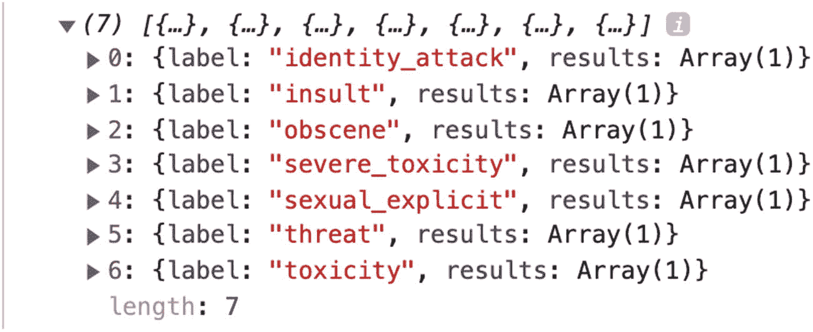

图 4-1

前面代码示例返回的预测结果数组

起初，你可能会认为这意味着句子 “this is really the most useless talk I have ever watched” 被预测属于 “identity_attack” 标签；然而，事实并非如此。

这个特定模型返回预测结果的方式是：以一个对象数组的形式呈现，其中包含每个标签的数据，并按字母顺序排列。

这可能会有点令人困惑，因为 TensorFlow.js 使用的其他模型通常按分数高低返回预测结果。

为了更好地理解，让我们更深入地看看之前记录的预测结果数组。

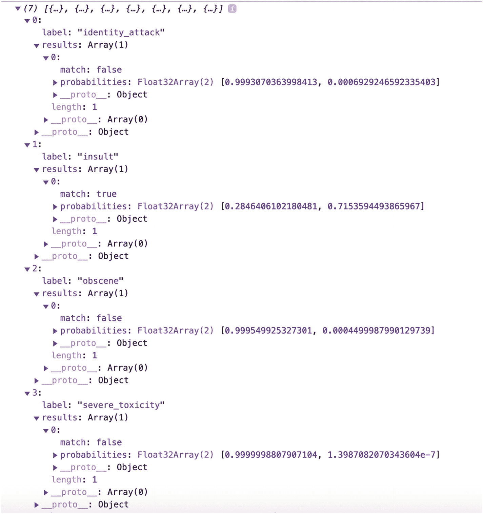

图 4-2

前面代码示例返回的预测结果数组的详细视图

这张截图展示了预测结果数组中的前四个条目。正如我们所见，它们按标签的字母顺序排列。

要理解哪个标签对于输入文本是正确的，我们需要查看 “probabilities” 数组和 “match” 值。

“probabilities” 数组包含两个值，第一个值代表标签为假（即输入文本未被分类为该标签）的概率，第二个值代表标签为真（即输入文本被分类为此类有害内容）的概率。

“match” 值则是一种更直接的表示。如果其值为 “true”，表示文本与该标签对应；如果为 “false”，则表示不对应。

有时，“match” 的值会被设置为 “null”。当两个预测值均未超过提供的阈值时，就会发生这种情况。

默认情况下，此阈值并非必需，其值为 0.85。但是，可以将其设置为其他值，并作为参数传递给模型，如下所示。

```
const threshold = 0.7;
toxicity.load(threshold).then((model) => {
const sentences = [
"This is really the most useless talk I have ever watched.",
];
model.classify(sentences).then((predictions) => {
return predictions;
});
});
代码清单 4-17
将阈值作为参数传递给模型
```

此阈值用于确定 “match” 属性的值。

如果 “probabilities” 数组中的第一个值超过阈值，则 “match” 设置为 “false”；如果第二个值超过阈值，则 “match” 设置为 “true”。并且，如前所述，如果两个概率值均未超过阈值，则 “match” 设置为 “null”。

如果你只关心某些特定标签，而不是全部 7 个，也可以将标签作为另一个参数传递给模型。

例如，如果我们只想检测会被分类为 “identity_attack” 标签的文本，我们也需要传递这个标签。

```
const threshold = 0.7;
// 即使只传递一个标签，也必须以数组形式传递。
toxicity.load(threshold, ["identity_attack"]).then((model) => {
const sentences = [
"This is really the most useless talk I have ever watched.",
];
model.classify(sentences).then((predictions) => {
return predictions;
});
});
代码清单 4-18
将标签作为参数传递给模型
```

仅提供你感兴趣的标签将返回过滤后的预测结果。

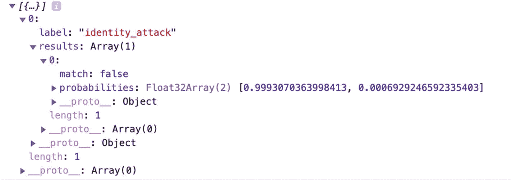

图 4-3

传递特定标签后返回的预测结果数组

与本章前一节构建的情感分类器类似，预测的准确性在很大程度上取决于用于训练模型的数据。

TensorFlow.js 的有害内容模型是在一个包含约 200 万条用户生成的在线新闻评论的数据集上训练的，这些评论发布于 2015 年至 2017 年。

有趣的一点是，数据集通常最初由人工标注，这意味着人们需要遍历所有条目，并根据提供的一组标签，为每个条目打上相应的标签。

就用于有害内容模型的数据而言，这意味着人们需要处理 200 万条文本，并根据 “identity_attack”、“insult”、“obscene”、“severe_toxicity”、“sexual_explicit”、“threat” 和 “toxicity” 这些标签，为每条文本打上他们认为最接近该评论所属有害类型的标签。

这样做的一个潜在问题是，不同的人对于什么可以归类为 “insult” 或不是 “insult”，或者什么应该标记为 “toxicity” 而不是 “severe_toxicity” 有不同的看法，这给将要用于训练模型的数据增加了一定程度的偏差。

因此，预测的准确性不仅取决于收集到的数据（在线评论）的质量，还取决于这些数据是如何被标注的。

如果你有机会检查应用程序中使用的模型所训练的数据，我强烈建议你这样做。

现在，我们已经了解了几个使用 TensorFlow.js 进行情感分析的示例，接下来让我们看看一些潜在的应用。

## 4.4 应用

我们产生和分享的很多内容都是文本内容。从新闻文章、博客文章到评论、聊天机器人交互、社交媒体更新等等，这些海量的文本数据如果与机器学习结合使用，可以提供一些非常有趣的新机遇。


### 4.4.1 认知助手与计算机疗法

无论是聊天机器人还是像 Siri 这样的语音助手，某些对话代理都能从集成情感分析中受益。

在过去几年中，一些公司尝试开发以聊天机器人形式提供心理帮助和指导的系统。

这些公司专注于提供量身定制的建议和支持，旨在让人们能够进行某种形式的自助式认知行为疗法（CBT）。

CBT 使用结构化练习来鼓励人们质疑并改变他们的思维习惯。这种逐步推进的格式似乎非常适合聊天机器人。

像 Orexo、Woebot、Pear 和 Wysa 这样的公司，会根据每个人对问题的回答来个性化他们的服务。

Orexo 专注于通过询问一系列关于当前行为模式的问题，并根据所提供的答案定制一个计划，来帮助用户改变饮酒习惯。

Woebot 是一个基于斯坦福大学研究成果构建的聊天机器人，旨在通过提供由专家精心打造的工具，让你在需要时了解自己并改善情绪，从而使心理健康服务惠及每一个人。

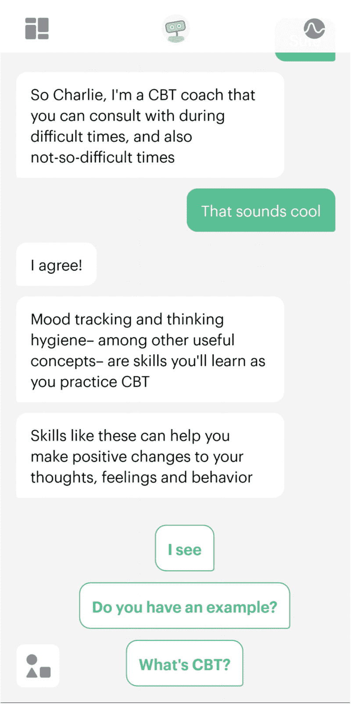

图 4-4

Woebot 应用程序截图

Pear Therapeutics 是一家处于生物学与软件交叉领域的公司，旨在创造下一代疗法。它已经发布了名为 reSET 和 reSET-0 的两项数字服务，旨在为物质滥用障碍患者提供支持和 CBT。

Wysa 是一款基于人工智能的“高情商”聊天机器人，它提供按主题打包的自助练习，帮助处理诸如管理情绪、克服孤独、改善睡眠等问题。与其他应用程序不同，它还让你有机会在应用内付费预约专业治疗师进行真实的咨询。


图 4-6

Wysa 应用程序中的自助练习包截图


图 4-5

Wysa 应用程序主屏幕截图

其中一些应用程序甚至获得了美国食品药品监督管理局（FDA）的批准。

另一个例子是 Akili Interactive 公司开发的一款名为 EndeavorRx 的游戏，试验表明它可以帮助患有注意力缺陷多动障碍（ADHD）的儿童提高注意力水平。这款游戏基于研究构建，通过提供感觉和运动刺激，有选择性地靶向并激活大脑中特定的认知神经系统。

尽管这些应用程序无法取代与治疗师面对面的交流，但它们的一个优势在于随时可用。每天与真正的医生进行咨询既昂贵又耗时；然而，手机上的数字医生可以让你更容易地追踪自己的进展，并在紧急时刻提供帮助。

此外，可能没有足够的临床医生来帮助所有有需要的人。例如，聊天机器人 Woebot 每周与人们交换约 470 万条信息；根本没有足够的从业者来处理这些需求。

尽管这些自助数字服务潜力巨大，但务必记住，技术并非完美无缺。

随着机器学习算法在分析和理解我们交流方式中包含的所有信息方面变得更好，未来只会不断改进，但就目前而言，许多这类应用程序的能力有限，使用时应当牢记这一点。

如果你对这个领域感兴趣，我强烈建议你尝试其中一些应用程序，以便更好地了解当前可用的功能和交互方式。

### 4.4.2 社交媒体监控

另一个有趣的机会是通过提供某种监控工具来改善用户在社交媒体上的互动。

如果你经常使用像 Facebook 或 Twitter 这样的社交媒体平台，你可能对用户决定分享的一些内容（无论是状态更新还是对你帖子的评论）中的有害性很熟悉。

这种有害的互动会对人们产生负面的心理影响，而使用情感分析可以避免这种情况。

目前，如果在某个平台上有人以有害的方式与你互动，你实际上没有选择来避免它。你可能会决定忽略它，但只有在至少看过一次内容之后，而这往往已经对你产生了负面影响。

然而，如果每一条分享的内容都首先由机器学习模型运行以检测其有害程度，社交媒体平台就可以对用户即将看到的内容发出警告，并让他们决定是否查看。

就像被描述为“成人内容”的内容通常隐藏在某种警告后面一样，平台可以赋予用户自己做决定的权利。

最近，Twitter 对被认为可能传播关于 COVID-19 疾病错误信息的推文发布了警告。

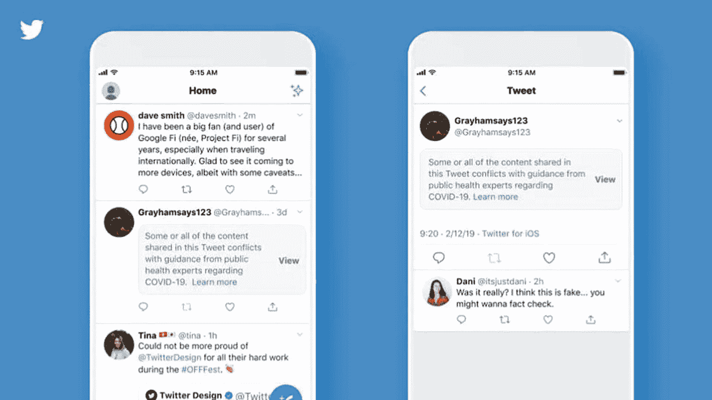

图 4-7

在可能传播错误信息的推文上显示的警告示例。来源：[www.​vox.​com/​recode/​2020/​5/​11/​21254889/​twitter-coronavirus-covid-misinformation-warnings-labels](https://www.vox.com/recode/2020/5/11/21254889/twitter-coronavirus-covid-misinformation-warnings-labels)

如果用户想阅读内容，仍然可以点击“查看”，但会收到警告，提示该内容可能有害，因为它违背了公共卫生专家的指导。

此外，这项技术也可以用来尝试通过向即将发布内容的人发出警告来防止有害内容的分享。

在使用社交媒体平台时，你可以想象在通常的“添加表情符号”或“添加图片”图标旁边有一个图标，如果用户即将发送的推文或即将分享的帖子被归类为有害，该图标就会进入激活状态。这不会阻止任何人分享，但会为人们提供一个机会，让他们退一步，三思而后行，考虑自己的言论对他人的影响。

这两种机会都不能完全解决互联网上的有害内容问题，但可以利用机器学习和情感分析作为辅助，让网络变得更安全。


### 4.4.3 自动化工具

在我们的职业生涯中，有些任务仍然需要手动完成，而这些任务本可以使用情感分析实现自动化，从而腾出时间专注于更有趣的挑战。一个例子是关于客户对产品的反馈。

如果你在一家产品公司工作，你可能熟悉向客户征求对你正在构建的产品的反馈。

这些反馈通常以电子表格的形式存储，保存在 Google Sheets、数据库或其他平台中。

然后，公司的员工通常会浏览所有这些数据，以了解客户的需求、投诉等。这些任务可能会花费大量时间；然而，情感分析可用于对数据进行初步筛选，并根据反馈是正面、负面还是中性进行分组。

人们仍然需要手动阅读数据，以更好地理解客户的想法，但这可以让你对产品的整体情感倾向有一个大致了解。

另一种可以使用这种方法的调查类型是公司内部调查。

当公司领导层想了解员工对工作、文化或整体体验的感受时，会分享一份调查问卷来收集反馈。

有些调查相当简单，主要是复选框，人们通过选择“非常同意”、“同意”、“不同意”或“非常不同意”来回答问题或陈述；然而，另一些调查则给员工提供了用自己的话进一步表达的机会。

后者将是情感分析的一个很好的用例。在收集了所有人的反馈后，所有数据都可以输入情感分析模型，以确定员工对公司的整体感受。

与之前的产品调查示例类似，反馈仍然需要手动阅读和分析，但对数据进行初步洞察可能会影响最初的决策。如果预测结果过于负面，那么尽快根据反馈采取行动可能很重要，以避免发展到员工决定离开公司的地步。

最后，情感分析可用于自动化的另一个场景是，帮助支持团队根据客户投诉的毒性程度对工单进行分类。这种方法也可以用于开发者体验团队，他们通常需要跟踪社交媒体上关于公司的言论。

使用毒性分类器或情感分析分类器对数据进行初步检查，有助于确定哪些客户的反馈需要更紧急地处理。

总而言之，将情感分析用作自动化工具并不能完全取代人们应该做的工作，它只是提供帮助，以便获得一些早期洞察并指导决策。

除了情感分析之外，还有其他类型的技术可用于更深入地理解文本数据。

## 4.5 其他类型的文本分类工具

尽管情感分析提供了关于所收集数据的一些有用信息，但它也可以与其他类型的文本分类工具结合使用，以生成更好的预测并提取更有意义的见解。

### 4.5.1 意图分析

意图分析，也称为意图分类，更进一步，它试图分析和理解用户信息背后的**意图**，并识别其是否与意见、新闻、营销、查询、投诉、建议等相关。它还有助于按主题（如购买、降级、演示请求等）对客户意图进行分类。

为此，需要使用从用户那里收集的现有数据来训练模型，并用我们希望在将来预测中使用的不同意图进行标记。

它的工作方式与我本章前面提到的毒性分类器有些相似，但模型不是使用“严重毒性”或“威胁”等标签进行训练，而是使用“购买”、“需要信息”、“取消”等标签进行训练。

将来自真实客户评论、请求和投诉的这些标记数据输入算法，将使其能够找到人们在表达类似意图时使用的词汇模式、语义以及句子中单词的排列方式。

### 4.5.2 命名实体识别

命名实体识别（NER），也称为实体识别、实体分块或实体提取，从文本中提取人物、地点、组织和日期等实体。

例如，如果我们从罗莎·帕克斯的维基百科页面中选取以下示例段落：

> *罗莎·路易丝·麦考利·帕克斯（1913 年 2 月 4 日 – 2005 年 10 月 24 日）是美国*[民权运动](https://en.wikipedia.org/wiki/Civil_rights_movement)*中的一位*[活动家](https://en.wikipedia.org/wiki/Activism)*，以其在*[蒙哥马利巴士抵制运动](https://en.wikipedia.org/wiki/Montgomery_bus_boycott)*中的关键作用而闻名。*[美国国会](https://en.wikipedia.org/wiki/United_States_Congress)*称她为“民权第一夫人”和“自由运动之母”。*
> 
> ——引用来源：[`https://en.wikipedia.org/wiki/Rosa_Parks`](https://en.wikipedia.org/wiki/Rosa_Parks)

命名实体识别将使我们能够提取并分类以下术语：

*   **人物**：罗莎·路易丝·麦考利·帕克斯

*   **地点**：蒙哥马利，美国

*   **日期**：1913 年 2 月 4 日，2005 年 10 月 24 日

*   **组织**：美国国会

NER 模型具有广泛的应用，包括自动总结简历，旨在通过自动扫描大量文档并根据其中找到的术语筛选候选人，从而简化招聘流程。

### 4.5.3 文本摘要

顾名思义，文本摘要是一种通常用于创建准确摘要的技术，该摘要能捕捉较长文本中的主要信息。

这些摘要通过减少阅读时间并帮助筛选研究文档，使人们能够更有效地浏览内容。

该技术的目的不仅仅是捕捉文档中的主要词语并生成较短的句子，而是要创建一种读起来流畅、可作为独立新内容的东西。它应该产生一个与人类撰写的摘要同样出色的摘要。

我们日常熟悉的文本摘要示例包括：

*   新闻标题

*   会议记录

*   剧情简介

*   传记

对于使用机器学习的自动文本摘要，存在两种方法：**抽取式**和**生成式**。

**抽取式文本摘要**是从源文档中选择短语以生成摘要的过程。它涉及对源文档中短语的相关性进行排序，并仅选择那些与文档含义最相关的短语。

**生成式文本摘要**涉及生成全新的短语，以传达源文档中最关键的信息。它使用先进的自然语言处理技术来解释和检查文本，并以新的方式生成更短的句子。

### 4.5.4 使用 TensorFlow.js 进行问答

问答是自然语言处理领域中的一个学科，涉及构建能够自动回答人类用自然语言提出的问题的系统。

机器学习模型将一段文本和一个问题作为输入，并能够返回该文本中可能回答所提问题的一个片段作为输出。

在接下来的几页中，我们将使用 MobileBERT 模型（来自 Google 的 BERT（来自 Transformer 的双向编码器表示）模型的轻量级版本）来构建一个系统，该系统能够基于一组段落回答人类提交的问题。


#### 导入模型

要设置我们的项目，首先需要导入 TensorFlow.js 和模型。

```
const qna = require('@tensorflow-models/qna');
代码清单 4-20
在 JavaScript 文件中将 TensorFlow.js 和 QNA 模型作为包导入
```

```

或者
代码清单 4-19
在 HTML 文件中导入 TensorFlow.js 和 QNA 模型
```

如果你决定将其作为 NPM 模块使用，则无需导入 `@tensorflow/tfjs` 库；但是，你需要确保已安装 `tfjs-core` 和 `tfjs-converter` 的对等依赖项。

#### 加载模型

导入模型后，我们需要在应用程序中加载它。有两种方式可以实现这一点。

首先，你可以在不提供配置对象的情况下加载它。

```
const model = await qna.load();
代码清单 4-21
加载模型的默认方式
```

如果你想使用托管在 Google Cloud Platform (GCP) 上的 Google 问答模型，这可能是你应该使用的加载方式。

如果你所在的地区或国家无法访问托管在 GCP 上的模型，你可以提供一个配置对象，其中包含托管在你自己服务器上的模型的自定义 URL。

```
const config = { modelUrl: "https://yourown-server/qna/model.json" };
const customModel = await qna.load(config);
代码清单 4-22
使用自定义配置加载模型
```

这两种加载模型的方式都会返回一个模型对象，我们可以调用其方法来预测答案。

#### 预测

生成答案是使用模型对象上的 `findAnswers()` 方法完成的。该方法接受两个参数：第一个是用户想要提出的问题，第二个是需要从中提取内容的关联段落。

```
const answers = await model.findAnswers(question, passage);
代码清单 4-23
生成预测
```

**这两个参数必须是字符串。**

用于保存预测结果的 `answers` 变量将是一个包含以下格式元素的数组：

```
[
{
text: "Angela Davis",
startIndex: 1143,
endIndex: 1156,
score: 0.8380282521247864
}
]
```

`text` 属性代表用户所提问题的答案。`score` 是预测的置信度。分数越高，模型对这个答案正确的信心就越大。`startIndex` 和 `endIndex` 分别代表在段落中找到该表达式的起始和结束字符的索引。

#### 完整示例

让我们将所有代码示例整合在一起，复用前面章节中的一个示例，并就罗莎·帕克斯提出问题。

```
const init = async () => {
const passage = "Rosa Louise McCauley Parks (February 4, 1913 – October 24, 2005) was an American activist in the civil rights
movement best known for her pivotal role in the Montgomery bus boycott. The United States Congress has called her 'the first lady of civil rights' and 'the mother of the freedom movement'";
const question = "When was Rosa born?";
const model = await qna.load();
const answers = await model.findAnswers(question, passage);
console.log(answers);
};
init();
代码清单 4-25
index.js 文件中的 JavaScript 代码
```

```

问答

代码清单 4-24
HTML 代码
```

这段代码将在浏览器的控制台中输出以下结果。

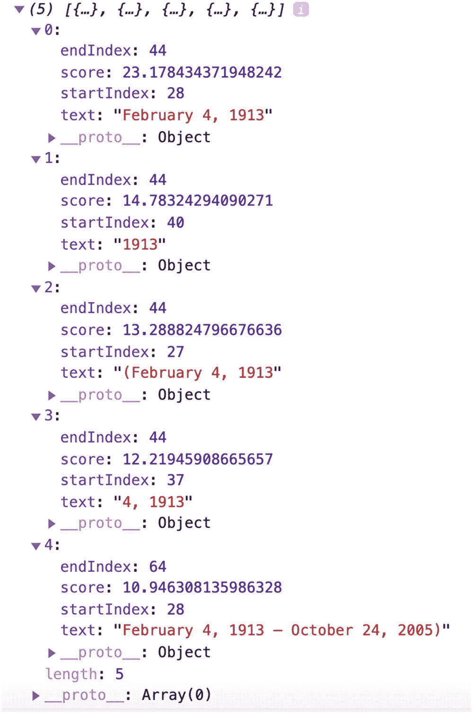

图 4-8

浏览器控制台中针对问题“罗莎是什么时候出生的？”的预测输出

正如我们在上面的截图中看到的，答案以包含五个元素的数组形式返回。得分最高的是“1913 年 2 月 4 日”，这正是问题“罗莎是什么时候出生的？”的正确回答！

此外，如果我们观察后续的预测，它们也都有些正确，因为它们包含了出生日期的一部分或出生和死亡日期。

我们可能会想，也许只是这次运气好，那么让我们再试一个问题，例如：“罗莎·帕克斯是谁？”

当提出这个问题时，我们得到以下答案。

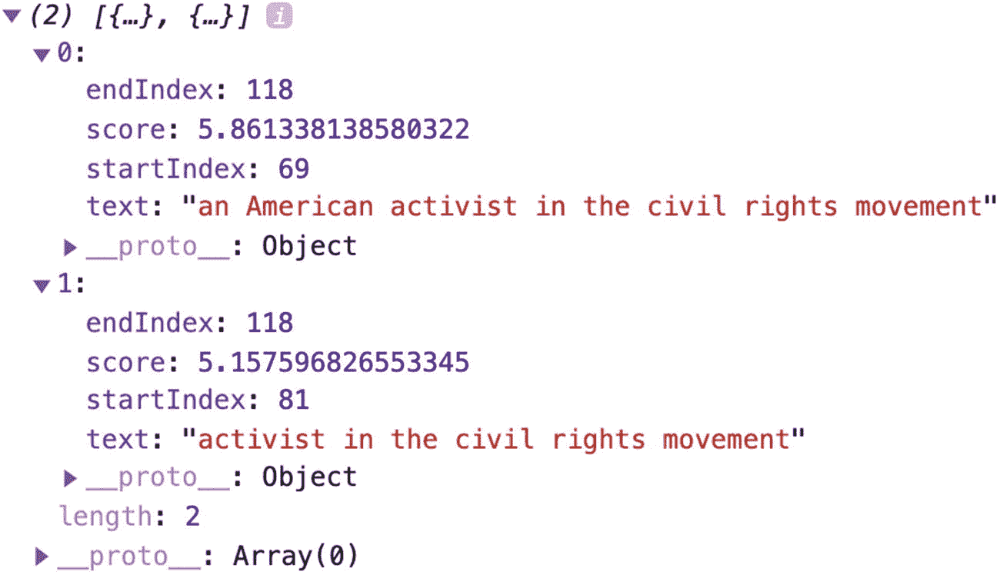

图 4-9

浏览器控制台中针对问题“罗莎·帕克斯是谁？”的预测输出

这一次，我们的答案数组只包含两个对象。然而，这些预测是正确的！

有趣的一点是，我们的问题提到了“罗莎·帕克斯”，而我们的段落提到了她的全名“罗莎·路易丝·麦考利·帕克斯”，但模型仍然能够理解我们的问题指的是谁。

这相当令人印象深刻，并且具有巨大的潜力，但是，与每个机器学习模型一样，它也有其局限性。

例如，当将问题改为“罗莎·帕克斯被称为什么？”，期望得到“民权第一夫人”或“自由运动之母”的答案时，预测数组返回为空，这意味着模型无法在段落中找到这个问题的答案。

然而，当稍微修改问题使其更精确时（“美国国会称罗莎·帕克斯为什么？”），模型成功提供了正确的答案——第一个答案如下所示。

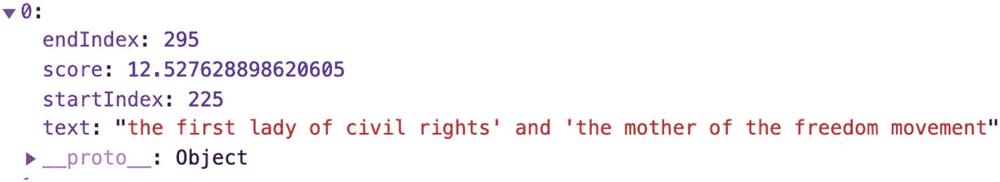

图 4-10

浏览器控制台中针对问题“美国国会称罗莎·帕克斯为什么？”的第一个预测输出

不幸的是，以这种方式提问可能要求用户具备一定的知识。一个不熟悉罗莎·帕克斯生平细节的人很可能会以类似于“罗莎·帕克斯被称为什么？”的格式提问，而这个问题没有返回任何答案。

#### 构建一个交互式教育工具

在前面的代码示例中，我们仅使用此模型将结果记录在浏览器的开发者工具中。然而，让我们利用这段代码来构建一个交互式教育工具，用户可以通过问答来了解历史人物。

为了使这个项目更简单，我们将把一些预选人物的数据以 JSON 文件的形式存储在代码库中。如果你不熟悉 JSON，它代表 JavaScript 对象表示法，是一种用于存储数据的文件格式。

如果你想更进一步，可以尝试使用 MediaWiki API，让用户请求他们想了解的任何公众人物，并动态获取数据。

以下应用程序将包含三位历史人物的信息，让用户决定他们想进一步了解哪一位，并提供一个输入框来提出不同的问题，以显示机器学习模型预测出的概率最高的答案。

这个项目的最终状态将包含三个屏幕，看起来像这样。


图 4-13

用于提问并显示预测最佳答案的页面


图 4-12

用于选择要深入了解的公众人物的页面

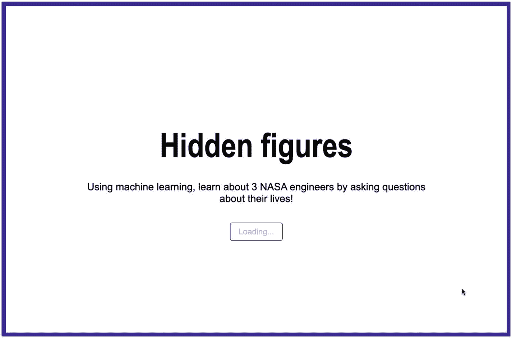

图 4-11

项目的主页

你可能已经注意到，我保持了非常简约的设计，因为我希望专注于功能。这个项目的重要收获是如何使用问答模型快速创建一个用户界面。

现在你已经对我们即将构建的内容有了更好的了解，让我们深入探讨不同的功能和代码示例。


##### 步骤 1：加载页面

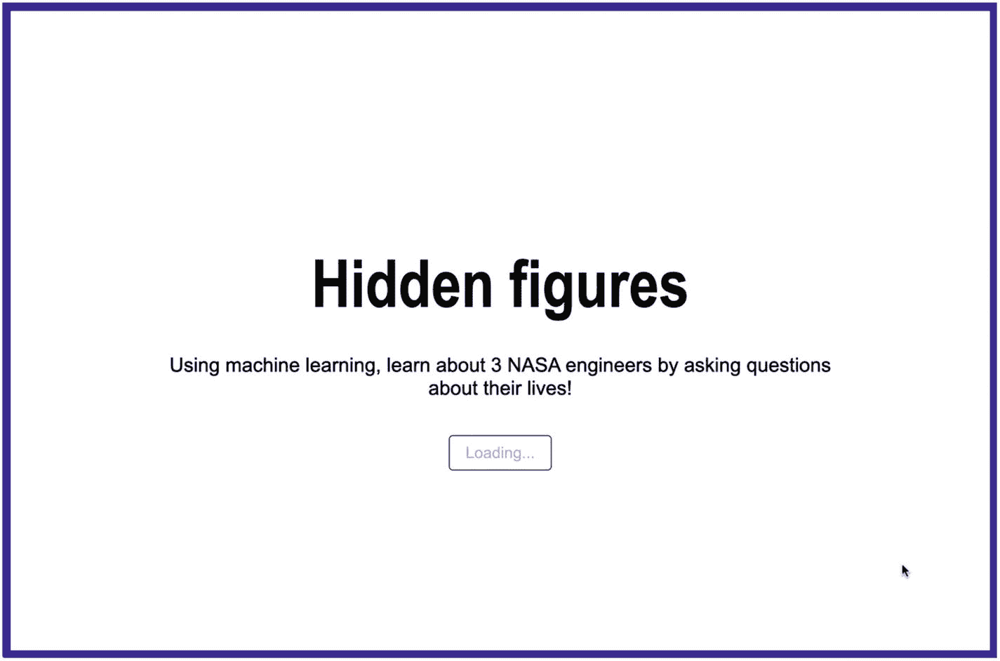

图 4-14

项目主页

将预训练的机器学习模型加载到应用程序中总会对性能产生影响，因为这类模型通常体积较大。因此，提前思考要创建何种用户体验来提升感知性能至关重要。

这可以包括尽早将模型加载到后台，以便当用户开始体验时，模型已加载完毕并可供使用；或者提供加载动画，提示用户需要等待界面可用。

后者并非最佳选择，因为用户显然被迫等待才能与体验进行交互；然而，就本项目而言，我们将采用这种方法，因为应用程序的唯一功能就是与模型进行交互。

为了显示这种加载状态，我们在 HTML 文件中设置了一个按钮元素，其默认状态为禁用，以防止用户在模型可用之前尝试运行预测。

```
隐藏人物

通过机器学习，提问了解三位 NASA 工程师的生平！

加载中...

代码清单 4-26
展示一些介绍文本和一个初始加载状态按钮的 HTML 代码示例
```

然后，在 JavaScript 文件中，我们可以在页面加载后立即开始加载模型，并在模型就绪后更改按钮的状态。

```
let model;
const loadModel = async () => await qna.load();
const init = async () => {
model = await loadModel();
const startButton = document.querySelector(".intro button");
startButton.removeAttribute("disabled");
startButton.innerHTML = "开始";
};
init();
代码清单 4-27
加载模型并在模型加载完成后更新按钮状态的 JavaScript 代码示例
```

上述代码示例显示，一旦 `loadModel` 函数完成模型加载，我们就移除按钮的禁用状态使其可交互，并将其内容更改为“开始”，以提示用户可以开始体验。

在此阶段，一旦用户点击开始按钮，我们将隐藏此内容，以显示三个可用选项。

##### 步骤 2：选择页面

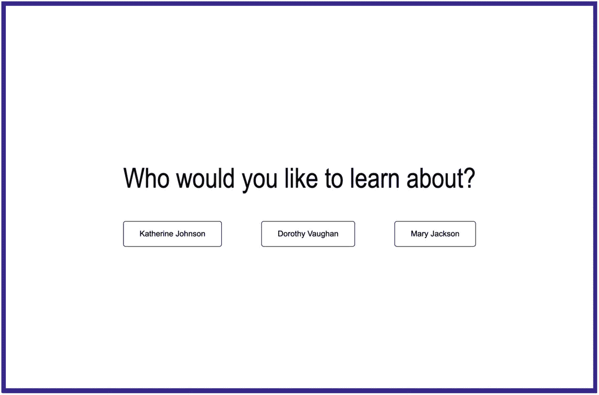

图 4-15

选择要深入了解的工程师页面

为了这个小型演示的目的，我在 HTML 文件的按钮元素中硬编码了三位工程师的名字；但是，如果你要构建包含更多条目的内容，或者这些条目是动态生成的，你也可以在 JavaScript 中动态替换按钮的内容。

```
你想了解谁？

凯瑟琳·约翰逊
多萝西·沃恩
玛丽·杰克逊

代码清单 4-28
包含三位 NASA 工程师名字按钮的 HTML 代码示例
```

在我们的 JavaScript 文件中，我们需要为这些按钮的点击事件添加事件监听器，并获取 JSON 数据。

为了避免一次性加载所有内容，我为每个人创建了一个 JSON 文件，这样代码将只获取用户请求的数据。

因此，我创建了三个 JSON 文件，分别命名为：

*   dorothyVaughan.json

*   katherineJohnsons.json

*   maryJackson.json

这样，当用户点击三个按钮之一时，以下代码将执行数据获取，并为接下来的预测页面做准备。

```
const engineers = {
"Katherine Johnson": "katherineJohnson",
"Dorothy Vaughan": "dorothyVaughan",
"Mary Jackson": "maryJackson",
};
figureButtons.forEach(button => {
button.onclick = e => {
const dataFile = engineers[e.target.textContent];
fetch(`${window.location.href}${dataFile}.json`)
.then(response => response.json())
.then(data => {
figureData = data;
const label = document.getElementsByTagName("label")[0];
label.innerHTML = `你想了解关于 ${e.target.textContent} 的什么？`;
});
};
});
代码清单 4-29
点击其中一个按钮时获取数据的 JavaScript 代码
```

在上述代码示例中，我首先创建了一个对象，用于将 UI 中显示的名字映射到关联 JSON 文件的名称。

然后，对于这三个按钮中的每一个，我监听点击事件，查看被点击按钮的内容以获取 JSON 文件的名称，并使用 `fetch` 函数获取数据并将其存储在 `figureData` 变量中。

我还使用用户选择的人名，将其显示在标题“你想了解关于……的什么？”中。

在页面切换过程中，还有一些与显示和隐藏 HTML 元素相关的代码，但我将在本章末尾分享此项目的完整代码。

现在，我们已经知道用户对哪个人物感兴趣，并且已经获取了相关数据，让我们进入预测页面。


##### 步骤 3：预测

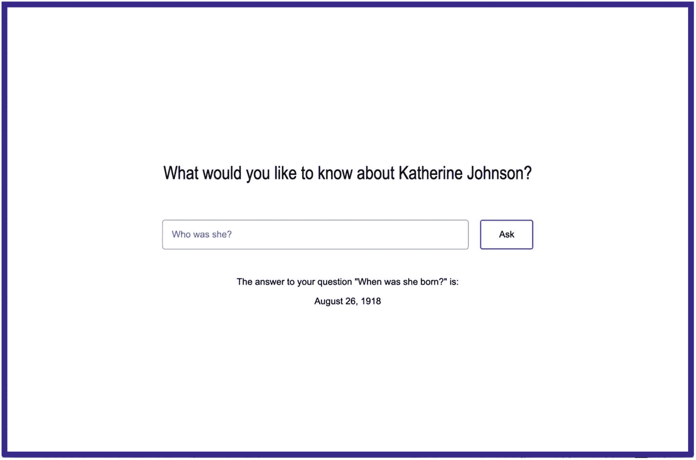

图 4-16

用于提问并显示最佳预测答案的页面

***代码清单 4-31.*** 获取输入字符串、将其输入模型并显示输出的 JavaScript 代码示例

我们的最终页面包含一个输入字段、一个用于运行预测的按钮，以及一个输出答案的段落。

```

提问

代码清单 4-30
用于显示输入字段和预测显示区域的 HTML 代码示例
```

在我们的 JavaScript 文件中，我们需要监听按钮的点击事件，获取用户输入的文本值，将其与之前获取的数据一起作为参数传递给从模型获取答案的方法，并在页面上显示第一个答案。

以下是实现此功能的代码示例。

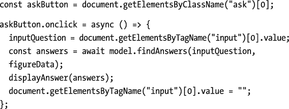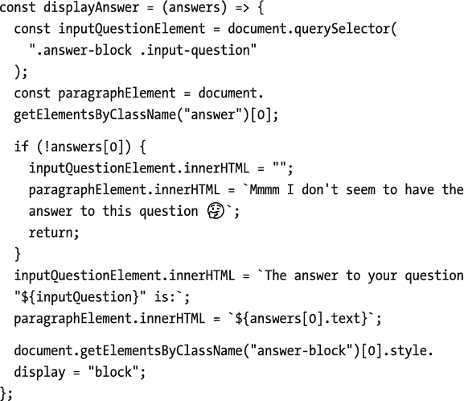

***代码清单 4-31.*** 获取输入字符串、将其输入模型并显示输出的 JavaScript 代码示例

在上述代码的第一部分，我们监听点击事件，获取输入的问题，并调用 `findAnswers` 方法，传入问题以及我们在上一节中用于存储从 JSON 文件获取的数据的 `figureData` 变量。

然后，我们调用一个名为 `displayAnswer` 的函数，将模型返回的答案传递给它，以便在页面上显示。

正如本章前面提到的，有时模型无法找到问题的答案，会返回一个空数组。我们需要先处理这种情况，这里我们显示一条通用消息。

然后，如果模型找到了答案，我们显示数组中的第一个答案，因为它是最有可能正确的答案。

就是这样！

用不到 100 行的 JavaScript 代码，你就可以创建一个小的交互式项目，让用户能够提问，并通过机器学习了解不同的主题！

如果你想要完整的代码示例，可以在下面的代码清单中找到 HTML 和 JavaScript 代码。

```
"多萝西·约翰逊·沃恩（1910 年 9 月 20 日－2008 年 11 月 10 日）是一位美国数学家和人工计算机，曾为位于弗吉尼亚州汉普顿兰利研究中心的美国国家航空咨询委员会（NACA）和美国国家航空航天局（NASA）工作。1949 年，她成为西区计算部门的代理主管，是该中心第一位监督员工群体的非裔美国女性。后来她正式晋升为该职位。在她 28 年的职业生涯中，沃恩为 20 世纪 60 年代初计算机的引入做好了准备，她自学并教授员工 Fortran 编程语言。后来，她领导了兰利分析与计算部门（ACD）的编程小组。沃恩是玛戈特·李·谢特利历史著作《隐藏人物：帮助赢得太空竞赛的非裔美国女性的故事》（2016 年）中重点介绍的女性之一。该书被改编为同名传记电影，也于 2016 年上映。2019 年，沃恩被追授国会金质奖章。"
代码清单 4-33
文件 katherineJohnson.json 的示例 JSON 数据
```

```

互动教育工具

隐藏人物

使用机器学习，通过提问了解三位 NASA 工程师的生平！

加载中...

你想了解谁？

凯瑟琳·约翰逊
多萝西·沃恩
玛丽·杰克逊

提问

代码清单 4-32
完整的 HTML 代码
```

```
"多萝西·约翰逊·沃恩（1910 年 9 月 20 日－2008 年 11 月 10 日）是一位美国数学家和人工计算机，曾为位于弗吉尼亚州汉普顿兰利研究中心的美国国家航空咨询委员会（NACA）和美国国家航空航天局（NASA）工作。1949 年，她成为西区计算部门的代理主管，是该中心第一位监督员工群体的非裔美国女性。后来她正式晋升为该职位。在她 28 年的职业生涯中，沃恩为 20 世纪 60 年代初计算机的引入做好了准备，她自学并教授员工 Fortran 编程语言。后来，她领导了兰利分析与计算部门（ACD）的编程小组。沃恩是玛戈特·李·谢特利历史著作《隐藏人物：帮助赢得太空竞赛的非裔美国女性的故事》（2016 年）中重点介绍的女性之一。该书被改编为同名传记电影，也于 2016 年上映。2019 年，沃恩被追授国会金质奖章。"
代码清单 4-35
文件 dorothyVaughan.json 的示例 JSON 数据
```

```
"玛丽·杰克逊（本姓温斯顿，1921 年 4 月 9 日－2005 年 2 月 11 日）是一位美国数学家和航空航天工程师，曾为美国国家航空咨询委员会（NACA）工作，该委员会于 1958 年被美国国家航空航天局（NASA）取代。她职业生涯的大部分时间都在弗吉尼亚州汉普顿的兰利研究中心度过。1951 年，她开始在实行种族隔离的西区计算部门担任计算机。她参加了高级工程课程，并于 1958 年成为 NASA 第一位黑人女性工程师。在 NASA 工作 34 年后，杰克逊获得了最高级别的工程师头衔。她意识到如果不成为主管，就无法获得进一步晋升。她接受降职，成为联邦女性计划（隶属于 NASA 平等机会计划办公室）和肯定性行动计划的经理。在这个职位上，她致力于影响 NASA 科学、工程和数学领域女性的招聘和晋升。杰克逊的故事出现在 2016 年的非虚构书籍《隐藏人物：美国梦与帮助赢得太空竞赛的黑人女性不为人知的故事》中。她是同年上映的电影改编版《隐藏人物》中的三位主角之一。2019 年，杰克逊被追授国会金质奖章。2020 年，NASA 位于华盛顿特区的总部更名为玛丽·W·杰克逊 NASA 总部。"
代码清单 4-34
文件 maryJackson.json 的示例 JSON 数据
```

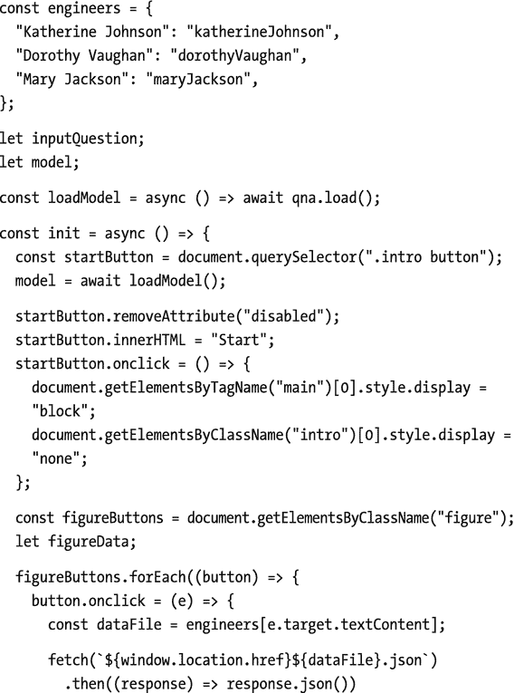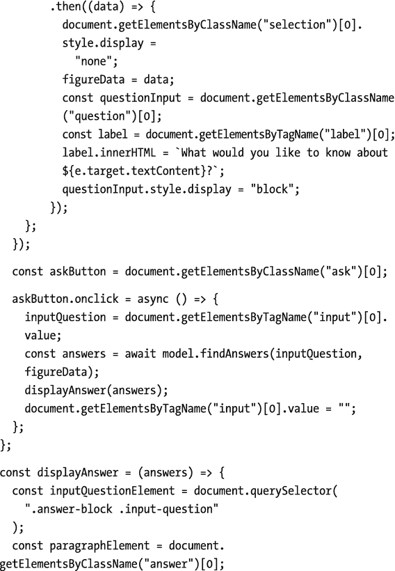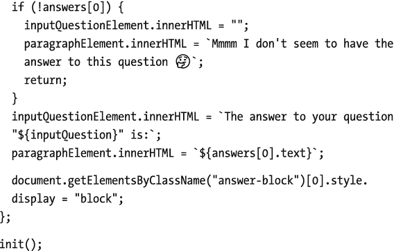

***代码清单 4-36.*** 完整的 JavaScript 代码

在我们刚刚浏览的代码示例中，问题是通过用户必须手动输入的输入字段捕获的。然而，还有其他方法可以使用另一个 Web API 来获取相同类型的信息。

在我们刚刚浏览的代码示例中，问题是通过用户必须手动输入的输入字段捕获的。然而，还有其他方法可以使用另一个 Web API 来获取相同类型的信息。


##### 从 Web Speech API 获取输入数据

要让这个项目更具交互性，一种方法是允许人们通过语音提问，而不是在键盘上打字。

支持语音识别的 Web API 是 Web Speech API。使用这个 API，我们可以为项目添加语音转文字功能，甚至如果需要答案也被朗读出来，还可以通过 SpeechSynthesis 添加文字转语音功能。

添加此功能所需的代码量相对较少。考虑到我们已经完成了应用程序的核心部分，它只会影响捕获用户输入的部分。

要开始使用 Web Speech API，你需要在 JavaScript 文件中包含以下几行代码。

```
var SpeechRecognition = SpeechRecognition || webkitSpeechRecognition;
var SpeechRecognitionEvent = SpeechRecognitionEvent || webkitSpeechRecognitionEvent;
清单 4-37
使用 Web Speech API 的初始设置
```

这些代码行将允许你访问语音识别接口。

然后，要开始使用这个接口，你需要使用以下代码创建一个语音识别实例。

```
const recognition = new SpeechRecognition();
清单 4-38
实例化一个新的 SpeechRecognition 实例
```

在开始识别之前，你可以在识别实例上设置一些参数。就我个人而言，我设置了以下参数。

```
recognition.continuous = false;
recognition.lang = "en-US";
recognition.interimResults = false;
清单 4-39
可选参数
```

第一个参数表示监听和识别不是连续的，这意味着每次你想听取用户的提问时，都需要用户进行交互。将其设置为 `false` 允许你仅在用户想要与界面交互时才进行监听，而不是持续不断地监听。

第二个设置是请求识别的语言。如果未设置，它将默认使用 HTML 文档根元素中 `lang` 属性定义的语言。

目前，可用于 SpeechRecognition API 的语言列表包括

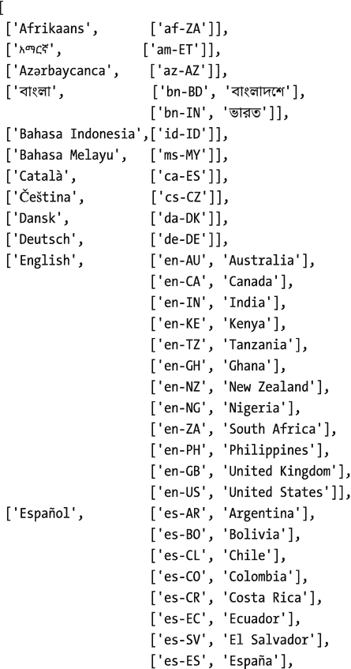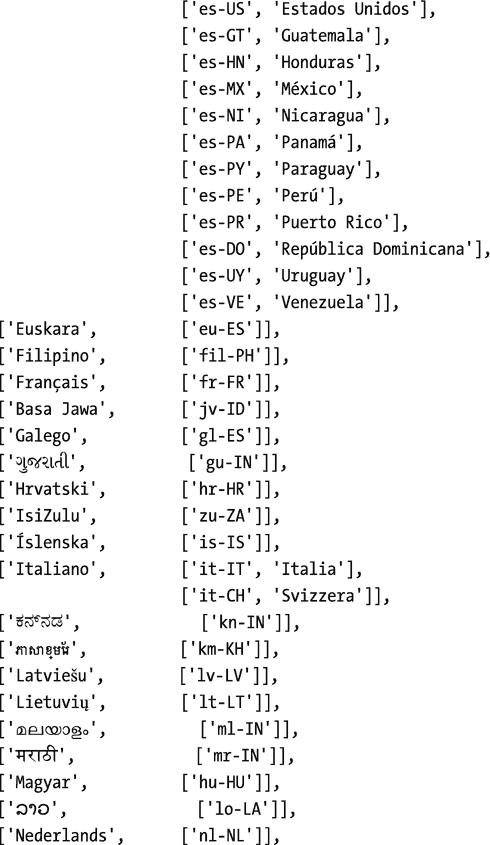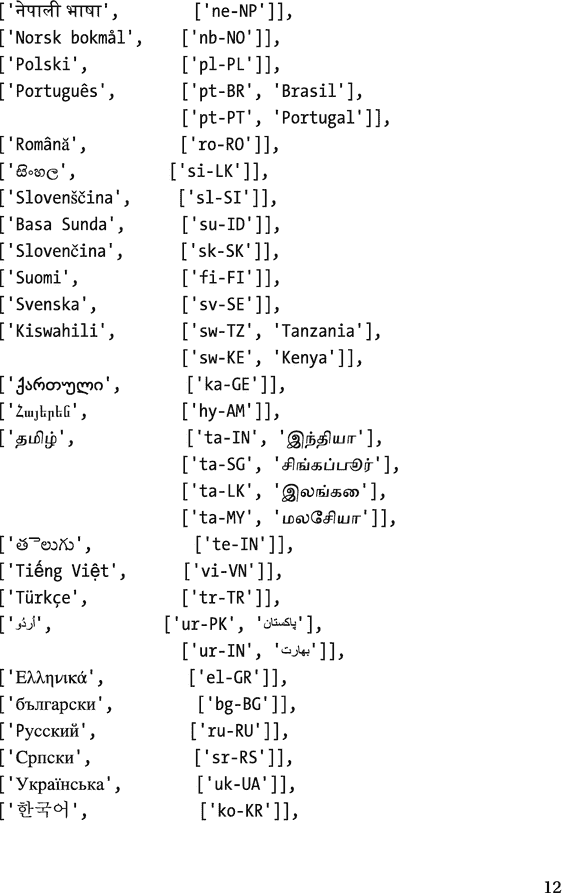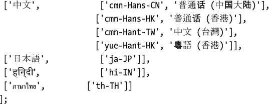

最后，第三个设置 `interimResults` 设置为 `false` 表示我只对获取识别的最终结果感兴趣，而不是我说话时的所有中间结果。

设置完这些属性后，我们可以使用 `recognition.start()` 开始识别。

如果你尚未在网页上启用麦克风，系统会提示你启用，否则麦克风将开始监听输入。

要访问识别结果，你需要调用 `onresult` 方法，如下所示。

```
recognition.onresult = function (event) {
if (event.results[0][0]){
var result = event.results[0][0].transcript;
}
console.log("result", result);
};
清单 4-40
从 Web Speech API 获取结果
```

调用 `onresult` 会返回一个回调函数，其中包含一个具有以下结构的事件对象。

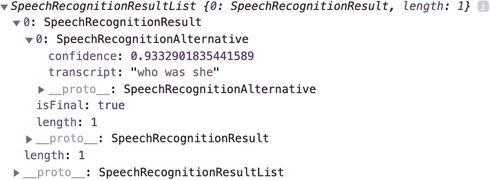

图 4-17

调用 onresult 方法的输出

查看这个输出有助于理解我们在前面代码示例中设置 `result` 变量的方式：`event.results[0][0].transcript`。

另一个我们可以调用的有用方法是 `onspeechend`。

**onspeechend** 在检测到语音停止时触发。为了避免在不必要时运行识别，我们可以使用 `onspeechend` 来完全停止识别。

```
recognition.onspeechend = function () {
recognition.stop();
};
清单 4-41
当 API 检测到用户已停止说话时停止识别的代码示例
```

综合起来，语音识别的代码示例如下：

```
var SpeechRecognition = SpeechRecognition || webkitSpeechRecognition;
var SpeechRecognitionEvent =
SpeechRecognitionEvent || webkitSpeechRecognitionEvent;
var recognition = new SpeechRecognition();
const startSpeechRecognition = () => {
recognition.continuous = false;
recognition.lang = "en-US";
recognition.interimResults = false;
recognition.onspeechend = () => recognition.stop();
recognition.onresult = function (event) {
if (event.results[0][0]) var result = event.results[0][0].transcript;
console.log("result", result);
};
recognition.start();
};
startSpeechRecognition();
```

仅用 20 行 JavaScript 代码，一个 Web 应用程序就可以监听用户的语音命令！

如果你想将其添加到我们之前构建的项目中，可以在我们为“提问”按钮添加点击事件监听器的地方实现。

你可以点击按钮时触发语音识别，监听用户的语音输入，并将其输入到模型中，而不是使用输入字段中写入的输入，就像我们发送书面输入字符串一样。

假设你已经从之前的代码示例中添加了 SpeechRecognition 实例的基本设置，那么你需要对项目代码进行的唯一更改就是在监听 `askButton` 元素点击事件的函数中。

```
askButton.onclick = async () => {
recognition.start();
recognition.onresult = async (event) => {
if (event.results[0][0]) {
var result = event.results[0][0].transcript;
}
inputQuestion = result;
const answers = await model.findAnswers(inputQuestion, figureData);
displayAnswer(answers);
document.getElementsByTagName("input")[0].value = "";
};
};
清单 4-42
使用 QNA 模型的用户语音命令
```

当用户点击按钮时，此代码启动语音识别，并在获得结果时，将最终转录文本存储在 `inputQuestion` 变量中。这个变量在项目的原始代码中已经被发送到 `findAnswers` 方法，但现在它包含了来自用户语音命令的输入。

需要对 UI 进行一些更改以反映此功能变化（例如，输入字段可能不再需要），但总的来说，从书面输入到语音输入所需的更改只需几行代码！

最后，如果你想更进一步，让输出在屏幕上显示的同时还能被朗读给用户听，你可以使用以下三行代码来实现。

```
let speechSynth = window.speechSynthesis;
var result = new SpeechSynthesisUtterance(answers[0].text);
speechSynth.speak(result);
清单 4-43
使用 SpeechSynthesis Web API 将输出预测朗读出来的代码示例
```

这三行代码创建了一个 `speechSynthesis` 实例，执行一个传递模型答案的语音请求，并调用 `speak` 方法让语音服务将信息朗读出来。

默认的语音听起来相当机械，但可以设置一些参数来改变这一点。我在这里不详细说明，但请随意查阅 MDN Web 文档中关于 Web Speech API 的更多信息。

如果你想进一步探索这个 API，最后要记住的一点是，**浏览器支持并非 100%**。目前，它在 Chrome 和 Edge 上支持良好，但在 Safari 和 Firefox 上则不然。

尽管它仍然相当实验性，但如果你感兴趣，我鼓励你去研究一下。

本章包含了很多信息。


我们探讨了自然语言处理的基础知识、不同类型的文本分类工具、各种应用场景，以及如何使用 TensorFlow.js 实现情感分析、毒性分类和问答系统，还尝试了通过语音命令获取文本数据来运行预测。

如果这是你第一次接触机器学习，这些信息量可能会让你感到有些不知所措。然而，正如任何新事物都需要时间去理解一样，你可以随时休息一下，如果想的话，稍后再回来阅读本章。

下一章将深入探讨如何将机器学习应用于其他类型的数据输入。

