# 5. 输入数据实验

在前几章中，我们探讨了如何将机器学习与图像和文本数据结合，用于目标检测与分类，以及情感分析、毒性分类和问答系统。

这些可能是机器学习最常见的应用示例。然而，这个列表并不详尽，还有更多类型的输入数据可以使用。

在本章中，我们将探索不同类型的数据输入，并构建几个实验性项目，以理解如何将机器学习应用于音频和硬件数据，以及使用专注于身体和动作识别的模型。

## 5.1 音频数据

当你第一次读到“音频数据”这个词时，你可能会认为本书的这一部分将专注于音乐；然而，我将更广泛地探讨声音的使用。

我们通常不会经常思考这一点，但我们周围有很多东西会发出声音，这些声音为我们提供了关于环境背景的信息。

例如，雷声能让你无需看窗外就知道天气可能不好，或者你可以在看到飞机之前就识别出它飞过的声音，甚至听到海浪声表明你可能靠近海洋，等等。

在不知不觉中，识别和理解这些声音的含义影响着我们的日常生活和行动。听到敲门声表明可能有人在门外等你开门，或者做饭时听到水沸腾的声音表明水已经准备好让你往里面倒东西了。

利用声音数据和机器学习可以帮助我们利用声音的丰富特性来识别某些人类活动，并增强现有的智能系统，如 `Siri`、`Alexa` 等。

这就是所谓的 **声学活动识别**。

考虑到我们周围许多设备都配备了麦克风，这项技术有着广阔的应用前景。

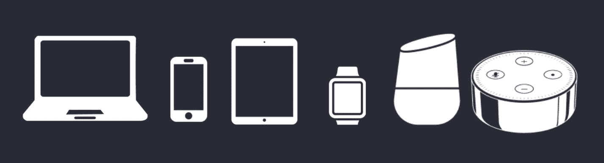

图 5-1：配备麦克风的个人设备示意图

到目前为止，我们中有些人可能正在使用的智能系统能够识别单词来触发命令，但它们对周围发生的事情一无所知；你的手机不知道你在浴室里，你的 `Alexa` 设备不知道你可能在厨房里，等等。然而，它们本可以做到这一点，并且这可以用来创造更个性化、更有用的数字体验。

在我们深入本章的实践部分，并了解如何使用 `TensorFlow.js` 在 JavaScript 中构建此类系统之前，先了解声音的基本原理以及它如何被转换成我们可以在代码中使用的数据，会很有帮助。

### 5.1.1 什么是声音？

声音是空气分子的振动。

如果你曾经把扬声器的音量开得很大，你可能会注意到它们会随着音乐来回移动。这种运动推动空气粒子，改变气压，从而产生声波。

说话时也会发生同样的现象。当你说话时，你的声带振动，扰动周围的空气分子，改变气压，从而产生声波。

下图可以说明这一现象。

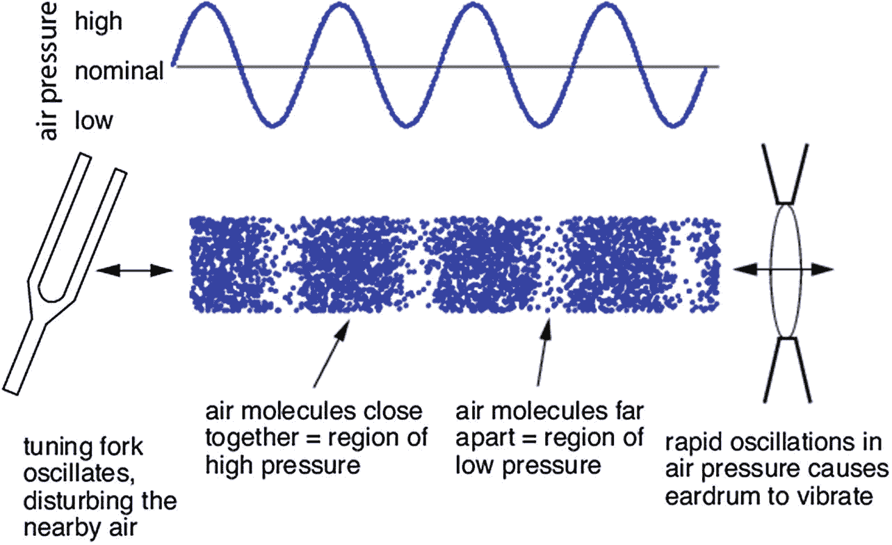

图 5-2：声波工作原理示意图。来源：`http://www.researchgate.net/figure/Sound-as-a-pressure-wave-The-peaks-represent-times-when-air-molecules-are-clustered_fig2_215646583`

当你敲击音叉时，它会开始振动。这种来回运动将改变周围的气压。向前运动会产生高压，向后运动则会产生低压区域。这种运动的重复会产生波。

在接收端，我们的耳膜随着气压的变化而振动，这种振动随后被转换成电信号发送到大脑。

那么，如果声音是气压的变化，我们如何将声波转换成可以在设备上使用的数据呢？

为了能够解释声音数据，我们的设备使用麦克风。

存在不同类型的麦克风，但总的来说，这些设备都有一个振膜或薄膜，当受到声波引起的气压变化时，它会振动。

这些振动会移动麦克风内部线圈附近的磁铁，从而产生微小的电流。然后，你的计算机会将这个信号转换成代表音量和频率的数字。

### 5.1.2 访问音频数据

在 JavaScript 中，允许开发者访问计算机麦克风数据的 Web API 是 `Web Audio API`。

如果你从未使用过此 API，完全没关系；我们将介绍你需要设置好一切的主要步骤。

首先，我们需要访问全局 `window` 对象上的 `AudioContext` 接口，并确保能够通过 `getUserMedia` 获取访问音频和视频输入设备的权限。

```
window.AudioContext = window.AudioContext || window.webkitAudioContext;
navigator.getUserMedia = navigator.getUserMedia || navigator.webkitGetUserMedia;
清单 5-1
在 JavaScript 中设置使用 Web Audio API
```

这段代码示例考虑了跨浏览器兼容性。

然后，要开始监听来自麦克风的输入，我们需要等待用户在页面上的操作，例如点击。

一旦用户与网页交互，我们就可以实例化一个音频上下文，允许访问计算机的音频输入设备，并使用一些 `Web Audio API` 内置方法来创建音源和分析器，并将两者连接起来以开始获取数据。

```
document.body.onclick = async () => {
  const audioctx = new window.AudioContext();
  const stream = await navigator.mediaDevices.getUserMedia({ audio: true });
  const source = audioctx.createMediaStreamSource(stream);
  analyser = audioctx.createAnalyser();
  analyser.smoothingTimeConstant = 0;
  source.connect(analyser);
  analyser.fftSize = 1024;
  getAudioData();
};
清单 5-2
在点击时设置音频上下文的 JavaScript 代码示例
```

在上面的代码示例中，我们使用 `navigator.mediaDevices.getUserMedia` 来获取麦克风的访问权限。如果你之前构建过使用音频或视频输入设备的应用程序，你可能对编写 `navigator.getUserMedia()` 很熟悉；然而，这已被弃用，你现在应该使用 `navigator.mediaDevices.getUserMedia()`。

使用旧方式编写仍然有效，但不推荐，因为它可能在未来几年内不再被支持。

基本设置完成后，`getAudioData` 函数会过滤来自设备的原始数据，仅获取频率数据。

```
const getAudioData = () => {
  const freqdata = new Uint8Array(analyser.frequencyBinCount);
  analyser.getByteFrequencyData(freqdata);
  console.log(freqdata);
  requestAnimationFrame(getAudioData);
};
清单 5-3
过滤原始数据以获取我们将使用的频率数据的函数
```

我们还调用了 `requestAnimationFrame` 来持续调用此函数，并用实时数据更新我们记录的数据。

总而言之，你可以在不到 25 行 JavaScript 代码中访问来自麦克风的实时数据！

```
window.AudioContext = window.AudioContext || window.webkitAudioContext;
navigator.getUserMedia = navigator.getUserMedia || navigator.webkitGetUserMedia;
let analyser;
document.body.onclick = async () => {
const audioctx = new `window.AudioContext`();
const stream = await `navigator.mediaDevices.getUserMedia`({ audio: true });
const source = `audioctx.createMediaStreamSource`(stream);
analyser = `audioctx.createAnalyser`();
analyser.smoothingTimeConstant = 0;
source.connect(analyser);
analyser.fftSize = 1024;
getAudioData();
};
const getAudioData = () => {
const freqdata = new `Uint8Array`(`analyser.frequencyBinCount`);
`analyser.getByteFrequencyData`(freqdata);
console.log(freqdata);
requestAnimationFrame(getAudioData);
};
清单 5-4
在 JavaScript 中从麦克风获取输入数据的完整代码示例
```

这段代码的输出是一个我们记录在浏览器控制台中的原始数据数组。

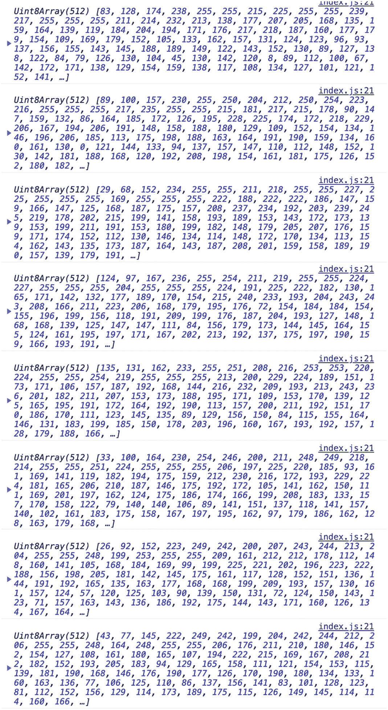
图 5-3
上述代码示例返回的数据截图

这些数组代表了构成计算机麦克风所录制声音的频率。默认采样率为 44,100Hz，这意味着我们每秒获得约 44,000 个数据样本。

在之前展示的格式（整数数组）中，寻找模式以识别某种活动类型似乎相当困难。我们实际上无法区分说话、大笑、播放音乐等之间的差异。

为了帮助理解这些原始频率数据，我们可以将其转化为可视化内容。

### 5.1.3 音频数据可视化

声音的可视化有多种方式。你可能熟悉的两种方式是波形图或频率图。

波形可视化器表示声波随时间变化的位移。

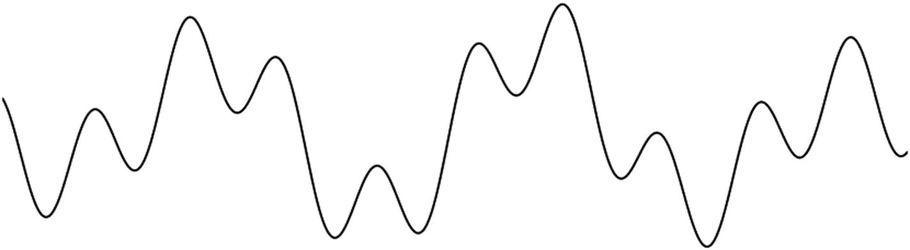
图 5-4
波形可视化示意图。来源：[*https://css-tricks.com/making-an-audio-waveform-visualizer-with-vanilla-javascript/*](https://css-tricks.com/making-an-audio-waveform-visualizer-with-vanilla-javascript/)

x 轴（水平轴）是时间单位，y 轴（垂直轴）是频率。声音在特定时间段内发生，并由多个频率组成。

这种声音可视化方式过于简单，难以识别模式。正如你在上图中看到的，构成声音的所有频率都被缩减为一条单线。

频率图是一种可视化方式，它表示波形在给定时间内重复的次数。

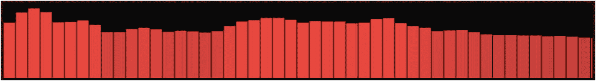
图 5-5
频率图可视化示意图

你可能对这种音频可视化方式很熟悉，因为它可能是最常见的一种。

这种可视化方式或许能让你对节拍有所了解，因为它能显示重复次数，或者通过 y 轴显示音量来了解声音的响度，但也仅此而已。

这种可视化方式无法提供足够的信息来识别和分类我们正在可视化的声音。

另一种更有用的可视化类型称为`声谱图`。

声谱图就像声音的图片。它显示了构成声音的频率从低到高的变化，以及它们如何随时间变化。它是信号频谱的可视化表示，有点像声音的热力图。

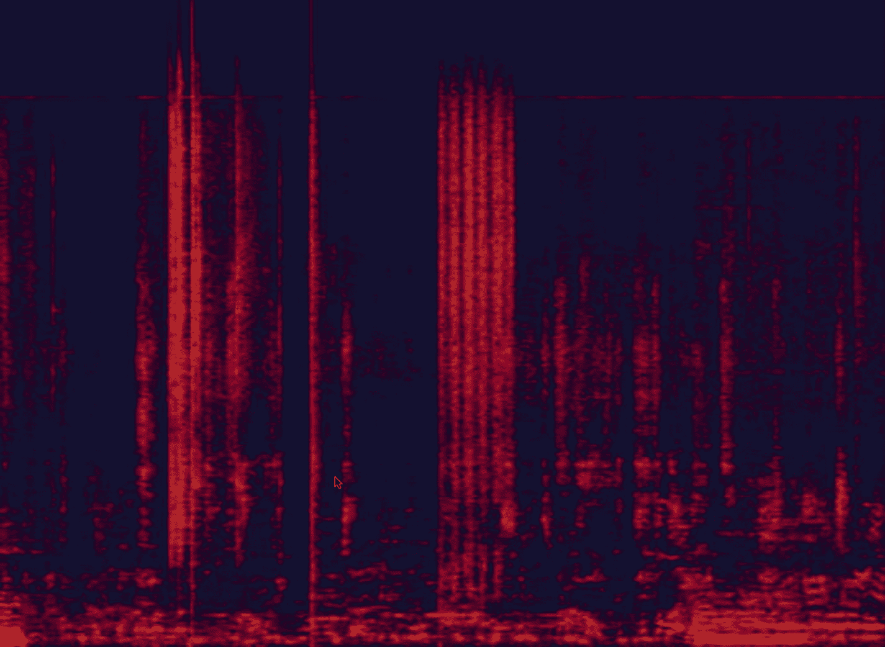
图 5-6
声谱图示意图

y 轴是频率范围，x 轴是时间长度。这些轴看起来与我们之前提到的另外两种可视化类型相似，但不同的是，我们不再将所有频率表示为一条单线，而是表示整个频谱。

在声谱图中，第三个轴也很有用，即`振幅`。声音的振幅可以理解为音量。颜色越亮，声音越响。

将声音可视化为声谱图，对于寻找有助于我们识别和分类声音的模式要有效得多。

例如，下面是我说话时声谱图输出的截图。

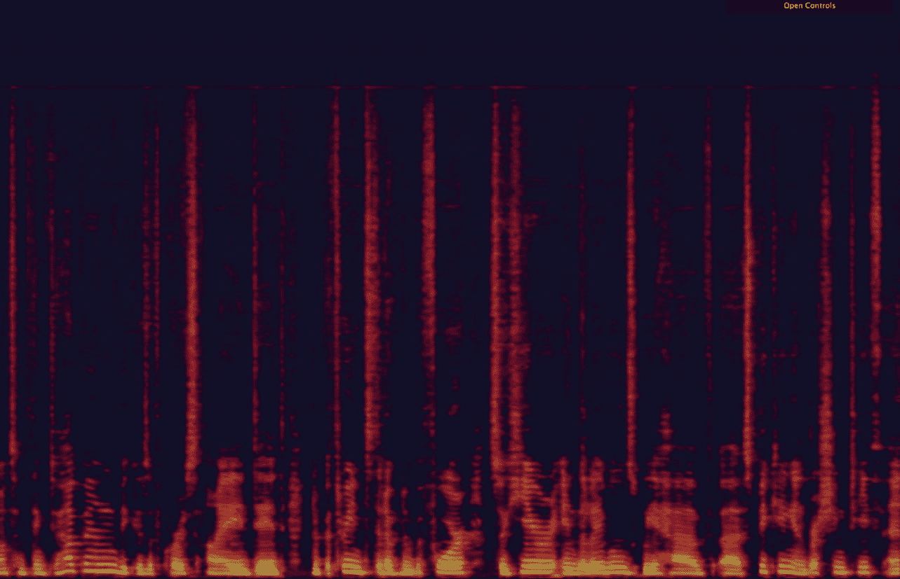
图 5-7
说话时拍摄的声谱图示意图

仅凭这一点，可能还无法让你理解为什么声谱图是更有用的可视化方式。下面是我拍手三次时拍摄的另一张声谱图截图。

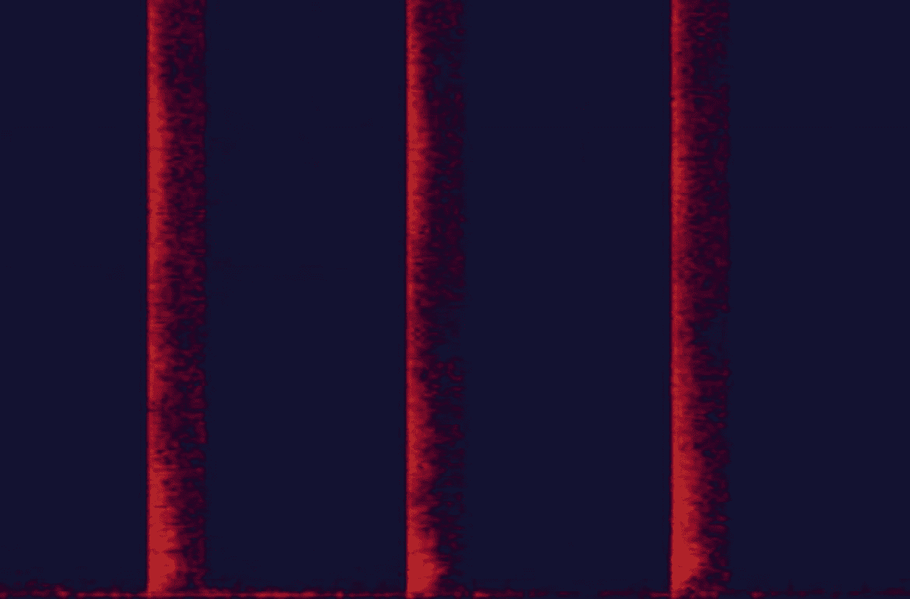
图 5-8
拍手三次时拍摄的声谱图示意图

希望这开始变得更有意义了！如果你比较这两张声谱图，可以清楚地区分两种活动：说话和拍手。

如果你愿意，可以尝试可视化更多声音，比如咳嗽声、电话铃声、马桶冲水声等等。

总的来说，主要结论是：声谱图帮助我们更清晰地看到各种声音的特征，并区分不同的活动。

如果我们能通过查看声谱图截图做出这种区分，那么我们有理由相信，将这些数据用于机器学习算法，也能在寻找模式和分类这些声音方面发挥作用，从而构建一个活动分类器。

一个更广泛的利用声谱图进行活动分类的例子，来自美国卡内基梅隆大学发表的一篇研究论文。在他们题为“Ubicoustics: Plug-and-Play Acoustic Activity Recognition”（无处不在的声学：即插即用的声学活动识别）的论文中，他们为从使用电锯到附近车辆行驶等各种活动创建了声谱图。

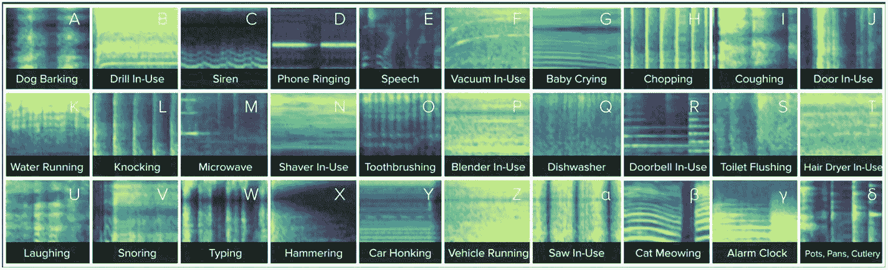
图 5-9
卡内基梅隆大学研究中收集的声谱图。来源：[*http://www.gierad.com/projects/ubicoustics/*](http://www.gierad.com/projects/ubicoustics/)

因此，在深入探讨将声音与机器学习结合使用之前，我们先来了解一下如何将使用 `Web API` 记录在控制台中的麦克风实时数据转换为声谱图。

#### 创建频谱图

在我们之前编写的代码示例中，我们创建了一个 `getAudioData` 函数，该函数从原始数据中获取频率数据，并将其记录到浏览器的控制台中。

```
const getAudioData = () => {
const freqdata = new Uint8Array(analyser.frequencyBinCount);
analyser.getByteFrequencyData(freqdata);
console.log(freqdata);
requestAnimationFrame(getAudioData);
};
清单 5-5
从原始数据中获取频率数据的 getAudioData 函数
```

在我们编写 `console.log` 语句的位置，我们将添加用于创建可视化的代码。

为此，我们将使用 Canvas API，因此我们需要先在 HTML 文件中添加一个 `canvas` 元素，如下所示。

```
清单 5-6
在 HTML 文件中添加 canvas 元素
```

在我们的 JavaScript 中，我们将能够访问这个元素，并使用 Canvas API 中的一些方法来绘制我们的可视化。

```
var canvas = document.getElementById("canvas");
var ctx = canvas.getContext("2d");
清单 5-7
在 JavaScript 中获取 canvas 元素及其上下文
```

此可视化的主要概念是绘制随时间变化的频谱，因此我们需要获取当前的 `canvas`，并在每次获取到新的实时数据时重新绘制它。
```

```
imagedata = ctx.getImageData(1, 0, canvas.width - 1, canvas.height);
ctx.putImageData(imagedata, 0, 0);
清单 5-8
从 canvas 元素获取图像数据并重新绘制
```

然后，我们需要遍历从 Web Audio API 获取的频率数据，并将它们绘制到 `canvas` 上。

```
for (var i = 0; i < freqdata.length; i++) {
let value = (2 * freqdata[i]) / 255;
ctx.beginPath();
ctx.strokeStyle = `rgba(${Math.max(0, 255 * value)}, ${Math.max(
0,
255 * (value - 1)
)}, 54, 255)`;
ctx.moveTo(canvas.width - 1, canvas.height - i * (canvas.height / freqdata.length));
ctx.lineTo(
canvas.width - 1,
canvas.height -
(i * (canvas.height / freqdata.length) +
canvas.height / freqdata.length)
);
ctx.stroke();
}
清单 5-9
遍历频率数据并将其绘制到 canvas 上
```

在这个 for 循环内部，我们使用 `beginPath` 方法来指示我们将要在 `canvas` 上开始绘制某些内容。

然后，我们调用 `strokeStyle` 并传入一个动态值，该值将代表用于显示声音振幅的颜色。

之后，我们调用 `moveTo` 将可视化内容向左移动 1 个像素，为在屏幕最右侧绘制新的输入数据留出空间，该绘制通过 `lineTo` 完成。

最后，我们调用 `stroke` 方法来绘制线条。

总的来说，我们的 `getAudioData` 函数应该如下所示。

```
const getAudioData = () => {
freqdata = new Uint8Array(analyser.frequencyBinCount);
analyser.getByteFrequencyData(freqdata);
console.log(freqdata);
imagedata = ctx.getImageData(1, 0, canvas.width - 1, canvas.height);
ctx.putImageData(imagedata, 0, 0);
for (var i = 0; i < freqdata.length; i++) {
let value = (2 * freqdata[i]) / 255;
ctx.beginPath();
ctx.strokeStyle = `rgba(${Math.max(0, 255 * value)}, ${Math.max(
0,
255 * (value - 1)
)}, 54, 255)`;
ctx.moveTo(
canvas.width - 1,
canvas.height - i * (canvas.height / freqdata.length)
);
ctx.lineTo(
canvas.width - 1,
canvas.height -
(i * (canvas.height / freqdata.length) +
canvas.height / freqdata.length)
);
ctx.stroke();
}
requestAnimationFrame(getAudioData);
};
清单 5-10
完整的 getAudioData 函数
```

你可能会想，理解如何创建频谱图为什么重要。主要原因在于，它正是用于机器学习算法训练数据的内容。

我们不是像在浏览器控制台中记录的那样使用原始数据，而是使用生成的频谱图图片，将声音问题转化为图像问题。

过去几年中，图像识别和分类技术取得了长足的进步，并且与图像数据一起使用的算法已被证明性能非常出色。

此外，将声音数据转化为图像意味着我们可以用更少的数据量来训练模型，从而缩短所需的时间。

实际上，Web Audio API 的默认采样率是 44KHz，这意味着它每秒收集 44,000 个数据样本。

如果我们录制 2 秒的音频，单个样本就有 88,000 个数据点。

可以想象，随着我们需要录制更多的样本，最终输入到机器学习算法的数据量会非常庞大，训练时间也会很长。

另一方面，作为图片提取的频谱图可以轻松地调整为更小的尺寸，例如最终可能只有 28x28 像素的图像，这样对于一个 2 秒的音频片段，就只对应 784 个数据点。

现在，我们已经介绍了如何在 JavaScript 中从麦克风访问实时数据，以及如何将其转换为频谱图可视化，从而让我们看到不同的声音如何产生视觉上不同的模式。接下来，让我们探讨如何训练一个机器学习模型来创建一个分类器。

### 5.1.4 训练分类器

我们不会为此创建自定义机器学习算法，而是使用一个专门处理声音数据的 **Teachable Machine** 实验。你可以在 [`https://teachablemachine.withgoogle.com/train/audio`](https://teachablemachine.withgoogle.com/train/audio) 找到它。

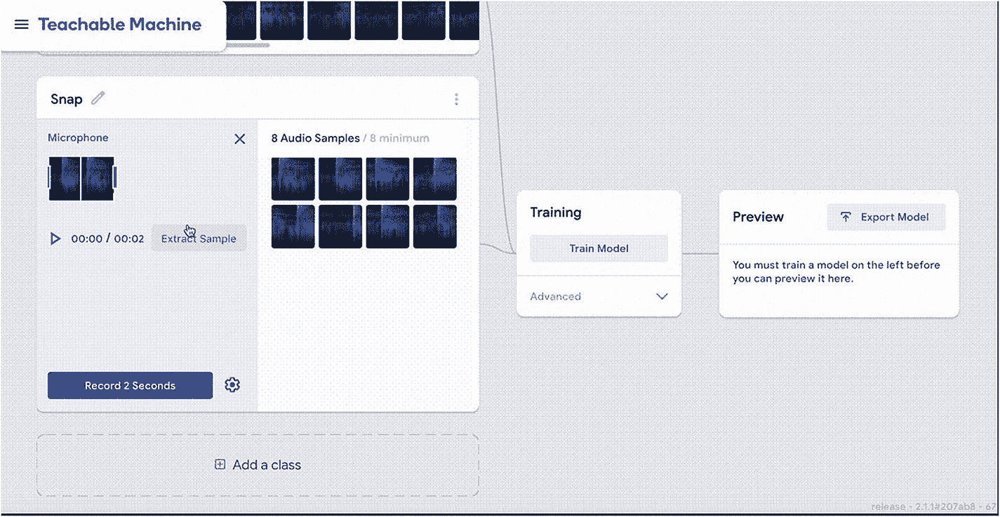

**图 5-10**  

Teachable Machine 界面

该项目允许我们在一个界面内、在浏览器中录制声音数据样本、为其添加标签、训练机器学习算法、测试输出结果并导出模型！

首先，我们需要使用下图中红色高亮区域录制 20 秒的背景噪音。

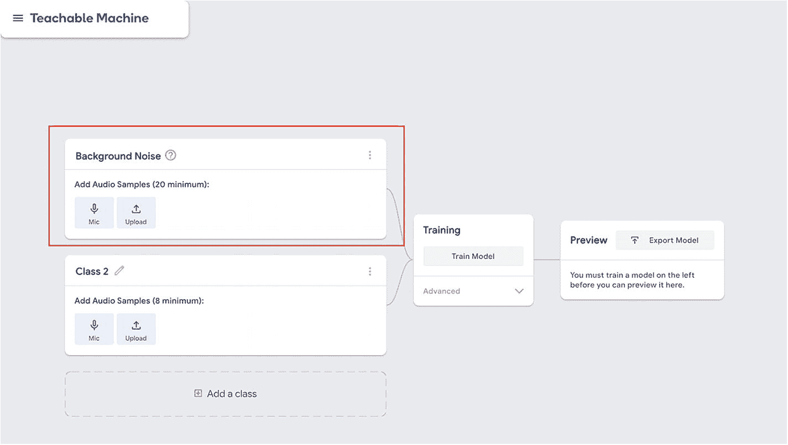

**图 5-11**  

背景噪音部分高亮显示的 Teachable Machine 界面

然后，我们可以开始为希望模型后续识别的任何声音录制一些样本。

最少需要录制 8 个样本，每个样本时长 2 秒。

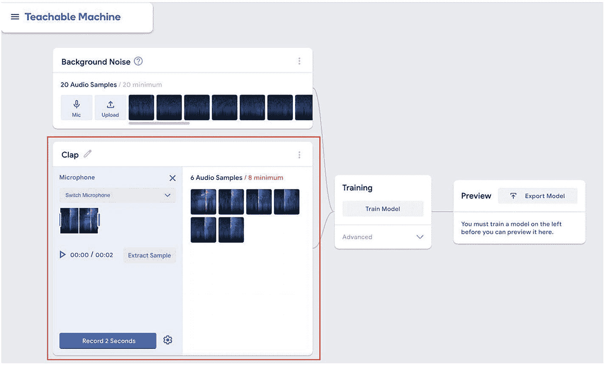

**图 5-12**  

自定义部分高亮显示的 Teachable Machine 界面

由于该实验使用迁移学习来快速重新训练一个已经用声音数据训练过的模型，我们需要使用与原始模型训练时相同的格式。

8 个样本是最低要求，但如果你愿意，可以录制更多样本。样本越多越好。不过，别忘了这也会影响训练所需的时间。

录制好样本并添加标签后，你可以在浏览器中开始实时训练，并确保不要关闭浏览器窗口。

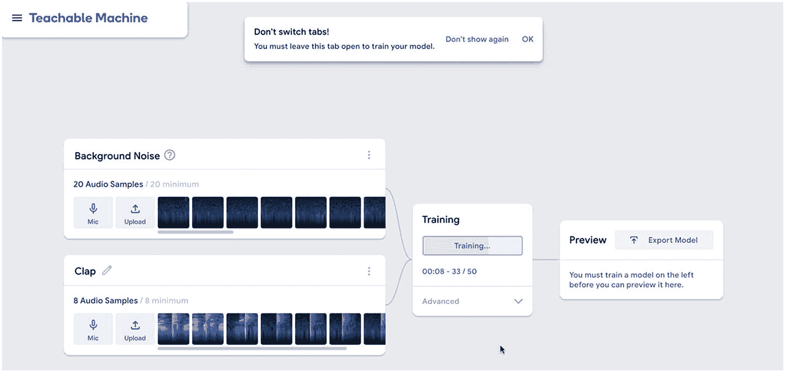

**图 5-13**  

Teachable Machine 界面 – 训练模型

完成此步骤后，你应该能在实验的最后一步看到一些实时预测结果。在导出模型之前，你可以尝试重复你录制的声音来验证预测的准确性。如果觉得准确度不够，可以录制更多样本并重新开始训练。

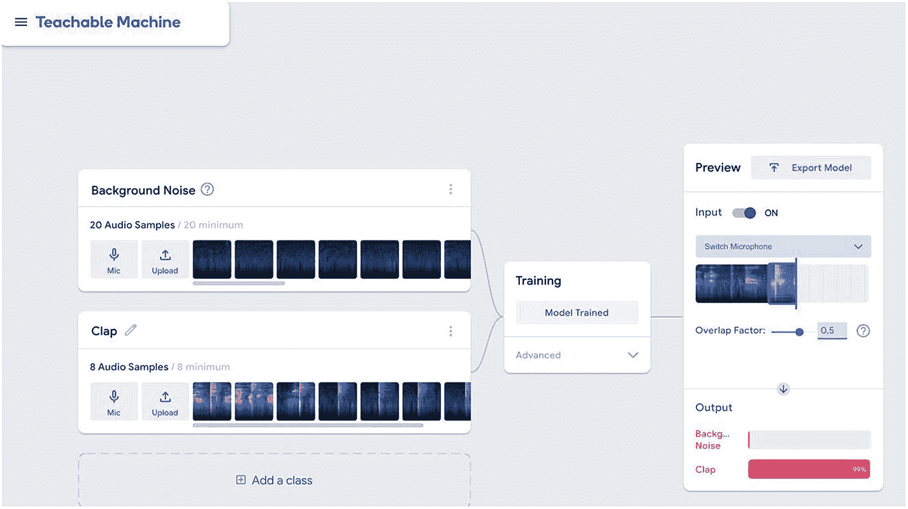

**图 5-14**  

Teachable Machine 界面 – 运行实时预测

如果你准备继续，可以将模型上传到 Google 的某些服务器并获得一个链接，或者下载已创建的机器学习模型。

如果你想更深入地了解其后台工作原理、机器学习模型是如何创建的等，我建议查看 GitHub 上的源代码！

尽管我非常喜欢像 Teachable Machine 这样的界面，因为它们能让任何人快速上手和实验，但查看源代码可以揭示一些重要的细节。例如，下图就是我如何意识到该项目使用了迁移学习。

在浏览代码以了解机器学习模型是如何创建以及训练是如何进行的过程中，我注意到了以下代码片段。

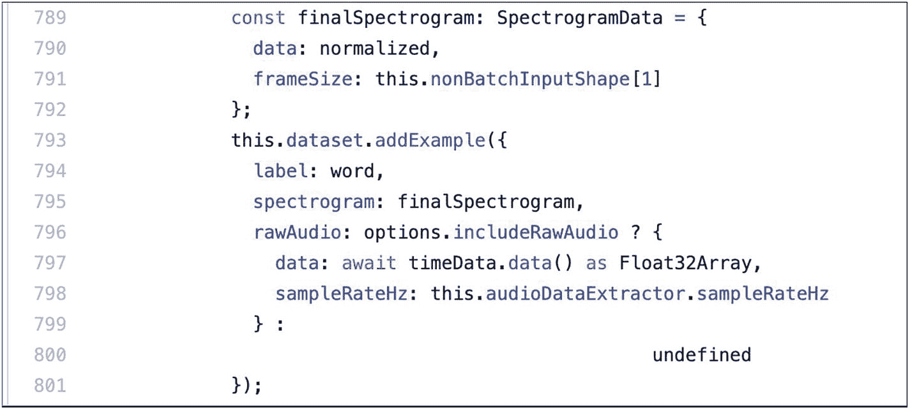

**图 5-15**  

Teachable Machine 开源 GitHub 仓库中的代码示例

在第 793 行，我们可以看到调用了 `addExample` 方法。这与本书专门讨论图像识别的章节中使用的方法相同，当时我们利用迁移学习，用新的输入图像快速训练了一个图像分类模型。

如果你决定不通过`Teachable Machine`界面，而是自行尝试重新创建这个模型，注意到这些细节非常重要。

现在我们已经完成了训练过程，可以编写代码来生成预测了。

### 5.1.5 预测

在开始编写代码之前，我们需要导入`TensorFlow.js`和语音指令模型。

```
清单 5-11
在 HTML 文件中导入 TensorFlow.js 和语音指令模型
```

正如我之前提到的，这个实验使用了迁移学习，因此我们需要导入一个已经用音频数据训练好的语音指令模型，以便更简单、更快速地入门。

该语音指令模型最初是为了识别和分类口语词汇（如“是”、“否”、“上”、“下”）而训练的。然而，在这里，我们将其用于活动产生的声音，因此其准确性可能不如在样本中使用口语词汇时那么高。

`在阅读其余代码示例之前，请确保你已从 Teachable Machine 平台下载了训练好的模型，解压缩后，将其添加到你的应用程序文件夹中。`

`以下代码示例将假设你的模型存储在应用程序根目录下名为 activities-model 的文件夹中。`

总的来说，你的文件结构应该类似于这样：

*   `activities-model/`

    *   `metadata.json`

*   `model.json`

*   `weights.bin`

*   `index.html`

*   `index.js`

在我们的 JavaScript 文件中，我们需要创建一个函数来加载模型并开始实时预测，但在此之前，我们可以创建两个变量来保存模型和元数据文件的路径。

```
let URL = "http://localhost:8000/activities-model/";
const modelURL = `${URL}/model.json`;
const metadataURL = `${URL}metadata.json`;
清单 5-12
引用模型及其元数据的变量
```

你可能已经注意到，我在前面的代码中使用了`localhost:8000`；不过，你可以随意更改端口，并且如果决定将应用程序发布到生产环境，请务必更新此地址。

然后，我们需要加载模型，并确保在继续之前模型已加载完成。

```
const model = window.speechCommands.create(
"BROWSER_FFT",
undefined,
modelURL,
metadataURL
);
await model.ensureModelLoaded();
清单 5-13
加载模型
```

模型准备就绪后，我们可以通过调用模型上的`listen`方法来运行实时预测。

```
model.listen(
(prediction) => {
predictionCallback(prediction.scores);
},
modelParameters
);
清单 5-14
实时预测
```

总的来说，`setupModel`函数应该如下所示。

```
async function setupModel(URL, predictionCB) {
predictionCallback = predictionCB;
const modelURL = `${URL}/model.json`;
const metadataURL = `${URL}metadata.json`;
model = window.speechCommands.create(
"BROWSER_FFT",
undefined,
modelURL,
metadataURL
);
await model.ensureModelLoaded();
const modelParameters = {
invokeCallbackOnNoiseAndUnknown: true, // 即使只检测到背景噪音也运行
includeSpectrogram: true,
overlapFactor: 0.5, // 每秒采样音频的频率，0.5 表示每秒两次
};
model.listen(
(prediction) => {
predictionCallback(prediction.scores);
},
modelParameters
);
}
清单 5-15
完整代码示例
```

调用此函数时，每次模型有预测结果时，都会在回调中包含预测数据。

```
document.body.onclick = () => {
setupModel(URL, (data) => {
console.log(data)
});
}
清单 5-16
调用函数
```

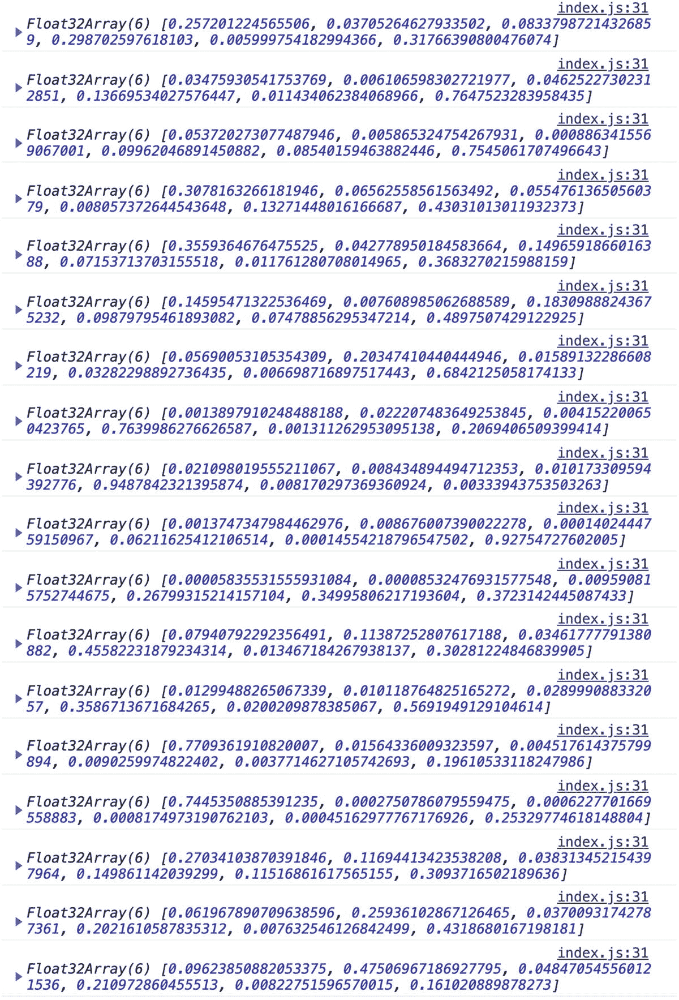

图 5-16

调用函数时返回的数据示例

这个包含预测结果的数组按使用的标签排序。在前面的示例中，我使用了六个不同的标签来训练模型，因此返回的每个数组都包含六个值。

在每个数组中，最接近 1 的值代表预测的标签。

为了将预测的数据与正确的标签匹配，我们可以创建一个包含训练时所用标签的数组，并在调用`setupModel`函数时使用它。

```
const labels = [
"Coughing",
"Phone ringing",
"Speaking",
"_background_noise_",
];
let currentPrediction;
document.body.onclick = () => {
setupModel(URL, (data) => {
let maximum = Math.max(...data);
if (maximum > 0.7) {
let maxIndex = data.indexOf(maximum);
currentPrediction = labels[maxIndex];
console.log(currentPrediction);
}
});
}
清单 5-17
将分数映射到标签
```

用不到 100 行的 JavaScript 代码，我们就能够加载并运行一个可以对实时音频输入进行分类的机器学习模型！

```
let model, predictionCallback;
let URL = "http://localhost:8000/activities-model/";
const labels = [
"Coughing",
"Phone ringing",
"Speaking",
"_background_noise_",
];
let currentPrediction, previousPrediction;
currentPrediction = previousPrediction;
document.body.onclick = () => {
setupModel(URL, (data) => {
let maximum = Math.max(...data);
if (maximum > 0.7) {
let maxIndex = data.indexOf(maximum);
currentPrediction = labels[maxIndex];
console.log(currentPrediction);
}
});
};
async function setupModel(URL, predictionCB) {
const modelURL = `${URL}/model.json`;
const metadataURL = `${URL}metadata.json`;
model = window.speechCommands.create(
"BROWSER_FFT",
undefined,
modelURL,
metadataURL
);
await model.ensureModelLoaded();
// 这告诉模型在监听音频时如何运行
const modelParameters = {
invokeCallbackOnNoiseAndUnknown: true, // 即使只检测到背景噪音也运行
includeSpectrogram: true, // 让我们访问数值音频数据
overlapFactor: 0.5, // 每秒采样音频的频率，0.5 表示每秒两次
};
model.listen(
(prediction) => {
predictionCallback(prediction.scores);
},
modelParameters
);
}
清单 5-18
完整代码示例
```

### 5.1.6 迁移学习 API

在上一节中，为了简单起见，我们介绍了如何使用 Teachable Machine 实验录制声音样本并训练模型。但是，如果你想在自己的应用程序中实现此功能，并让用户自己运行相同的过程，则可以使用迁移学习 API。

此 API 允许你构建自己的界面，并调用 API 端点来录制样本、训练模型以及运行实时预测。

#### 录制样本

让我们想象一个非常简单的网页界面，上面有几个按钮。

# 5.1.7 应用

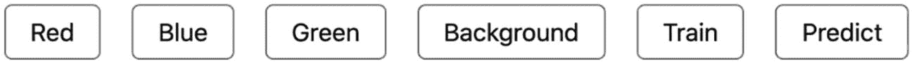

图 5-17：包含几个按钮元素的网页界面。

其中一些按钮用于收集样本数据，一个按钮用于开始训练，最后一个按钮用于触发实时预测。

首先，我们需要一个包含这六个按钮的 HTML 文件，以及两个用于导入 TensorFlow.js 和语音指令模型的脚本标签。

```
语音识别

红色
蓝色
绿色
背景
训练
预测
```

列表 5-19：HTML 文件。

在 JavaScript 文件中，在能够运行这些操作之前，我们需要创建模型，确保其已加载，并向我们的模型传递一个主标签，以创建一个包含我们音频样本的集合。

```javascript
const init = async () => {
const baseRecognizer = speechCommands.create("BROWSER_FFT");
await baseRecognizer.ensureModelLoaded();
transferRecognizer = baseRecognizer.createTransfer("colors");
};
```

列表 5-20：设置识别器。

然后，我们可以在按钮上添加事件监听器，以便在点击时收集样本。为此，我们需要在识别器上调用 `collectExample` 方法，并向其传递一个我们希望用于标记样本的字符串。

```javascript
const redButton = document.getElementById("red");
redButton.onclick = async () => await transferRecognizer.collectExample("red");
```

列表 5-21：收集样本。

要开始训练，我们在识别器上调用 `train` 方法。

```javascript
const trainButton = document.getElementById("train");
trainButton.onclick = async () => {
await transferRecognizer.train({
epochs: 25,
callback: {
onEpochEnd: async (epoch, logs) => {
console.log(`Epoch ${epoch}: loss=${logs.loss}, accuracy=${logs.acc}`);
},
},
});
};
```

列表 5-22：训练。

最后，要在训练后对实时音频输入进行分类，我们调用 `listen` 方法。

```javascript
const predictButton = document.getElementById("predict");
predictButton.onclick = async () => {
await transferRecognizer.listen(
(result) => {
const words = transferRecognizer.wordLabels();
for (let i = 0; i < words.length; ++i) {
console.log(`score for word '${words[i]}' = ${result.scores[i]}`);
}
},
{ probabilityThreshold: 0.75 }
);
};
```

列表 5-23：预测。

总而言之，这个代码示例看起来如下所示。

```javascript
let transferRecognizer;
const init = async () => {
const baseRecognizer = speechCommands.create("BROWSER_FFT");
await baseRecognizer.ensureModelLoaded();
transferRecognizer = baseRecognizer.createTransfer("colors");
};
init();
const redButton = document.getElementById("red");
const backgroundButton = document.getElementById("background");
const trainButton = document.getElementById("train");
const predictButton = document.getElementById("predict");
redButton.onclick = async () => await transferRecognizer.collectExample("red");
backgroundButton.onclick = async () =>
await transferRecognizer.collectExample("_background_noise_");
trainButton.onclick = async () => {
await transferRecognizer.train({
epochs: 25,
callback: {
onEpochEnd: async (epoch, logs) => {
console.log(`Epoch ${epoch}: loss=${logs.loss}, accuracy=${logs.acc}`);
},
},
});
};
predictButton.onclick = async () => {
await transferRecognizer.listen(
(result) => {
const words = transferRecognizer.wordLabels();
for (let i = 0; i < words.length; ++i) {
console.log(`score for word '${words[i]}' = ${result.scores[i]}`);
}
},
{ probabilityThreshold: 0.75 }
);
};
```

列表 5-24：完整代码示例。

尽管我目前用于代码示例的例子（说话和咳嗽）可能看起来很简单，但这项技术当前的使用方式展示了它有多么有趣。

#### 健康

2020 年 7 月，苹果公司宣布发布其 `watchOS` 的新版本，其中包含一个应用程序，当用户洗手时会触发倒计时。根据公共卫生官员关于避免 COVID-19 传播的建议，该应用程序使用手表的麦克风检测流水声，并触发 20 秒倒计时。

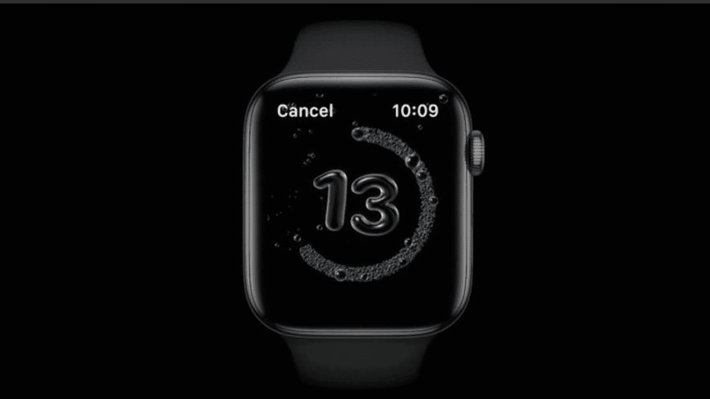

图 5-19：Apple Watch 上的倒计时界面。

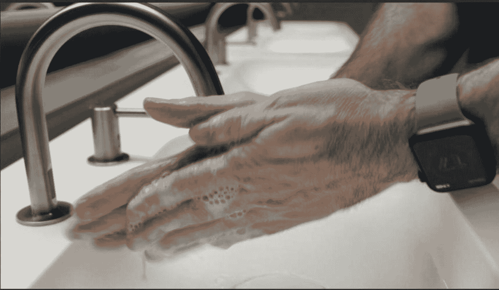

图 5-18：用户洗手时触发的倒计时。

根据前几页展示的代码示例，可以使用 `JavaScript` 和 `TensorFlow.js` 构建类似的应用程序。

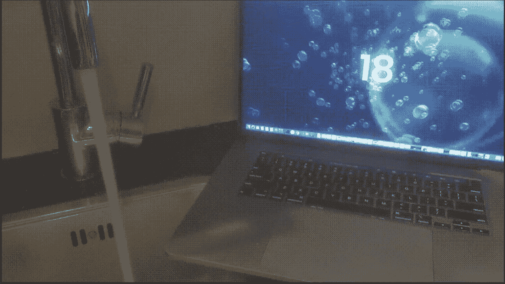

图 5-20：使用 `TensorFlow.js` 构建的类似倒计时界面原型。

#### 生物多样性研究与保护

这项技术我最喜欢的应用之一是在生物多样性研究和濒危物种保护方面。

这方面一个很好的例子是“雨林连接”组织。

该组织利用旧手机及其内置麦克风来检测森林中电锯的声音，并提醒护林员注意潜在的非法砍伐活动。

通过使用太阳能电池板并将设备安装在树上，他们可以持续监控周围发生的情况并进行实时预测。

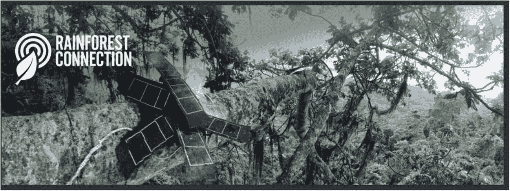

图 5-21：由太阳能电池板和二手手机组成的安装实例。来源：[https://www.facebook.com/RainforestCx/](https://www.facebook.com/RainforestCx/)。

如果你对这个项目感兴趣，他们还有一个名为“雨林连接”的移动应用程序，如果你想去看看，可以在其中实时聆听来自森林的自然之声！

这项技术的另一个用途是保护虎鲸。谷歌、雨林连接组织和加拿大渔业与海洋部 (DFO) 合作，利用生物声学监测来追踪、监控和观察萨利希海中动物的行为。

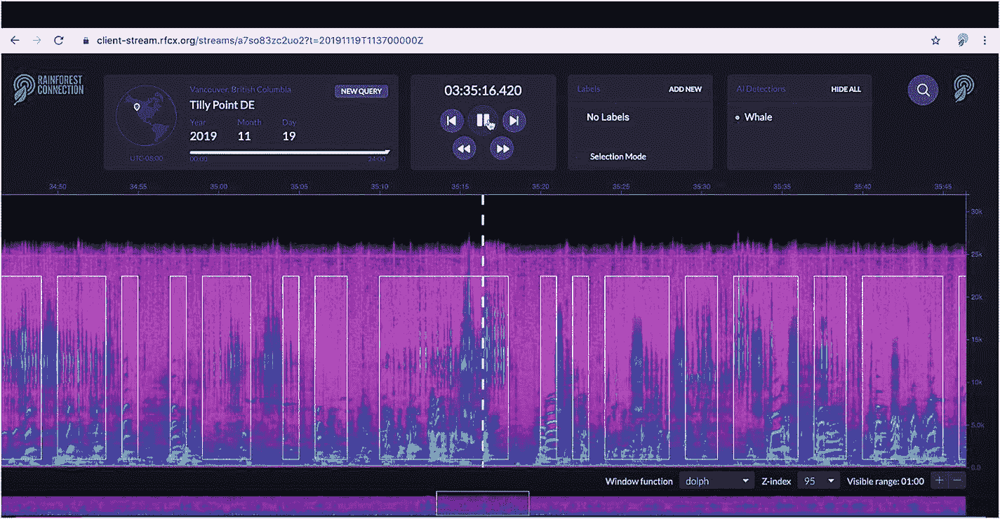

图 5-22

追踪虎鲸的网页界面。来源：[`https://venturebeat.com/2020/01/28/googles-ai-powers-real-time-orca-tracking-in-vancouver-bay/`](https://venturebeat.com/2020/01/28/googles-ai-powers-real-time-orca-tracking-in-vancouver-bay/)

## 网页无障碍

你可能尚未注意到，另一项应用已在你熟悉的某个服务中实现。事实上，如果你正在使用 YouTube，你可能遇到过**实时环境声音字幕**。

如果你曾在 YouTube 视频上开启过字幕，你可能会知道，视频底部会叠加显示说话内容。

然而，视频中包含的信息远不止转录文本所能呈现的内容。

事实上，对于没有听力障碍的人来说，他们也能从视频中获取额外信息，例如背景音乐或雨声等环境声音。

如果字幕只显示说话内容，对于有听力障碍的人来说，可能会遗漏大量信息。

大约三年前，也就是 2017 年，YouTube 推出了实时环境声音字幕功能。该功能利用声音识别技术，将视频音轨中检测到的环境声音细节添加到字幕中。

以下是一个示例。


图 5-23

YouTube 上的实时环境声音字幕示例

上述截图来自 Janelle Monae 和 Pharrell Williams 的一次访谈，其中字幕功能已开启。

说话内容按预期显示，但我们也能看到诸如 [掌声] 这样的环境声音。

现在，有听力障碍的人有机会获得比单纯对话更多的视频信息。

目前，YouTube 视频中可检测到的环境声音包括：

- 掌声
- 音乐播放
- 笑声

这看起来可能不算多，但同样，如果我们从未考虑过一些残障人士在这些平台上的体验，我们就会认为这是理所当然的。

此外，考虑到这项功能大约在三年前就已实现，这表明像谷歌这样的科技巨头一直在积极探索利用机器学习处理音频数据的潜力，并致力于寻找有用的应用场景。

### 5.1.8 局限性

现在我们已经介绍了如何在 JavaScript 中尝试声音活动识别以及一些不同的应用，了解此类技术的一些局限性对于更好地理解其真正的机遇至关重要。

#### 数据的质量与数量

如果你决定从头开始构建一个类似的声音活动识别系统，并且在不使用迁移学习和 `TensorFlow.js` 的语音指令模型的情况下编写自己的模型，那么你将需要收集比使用 `Teachable Machine` 时所需的最少 8 个样本多得多的声音样本。

要收集大量样本，你可以选择自己录制，或者从专业音频库购买。

另一个要点是务必检查所录制数据的质量。例如，如果你想检测吸尘器运行的声音，请确保没有背景噪音，并且吸尘器的声音在音轨中清晰可辨。

从单个样本生成多个数据样本的一个技巧是，使用音频编辑软件更改单个音频源的某些参数，以创建其多个版本。例如，你可以修改混响、音高等。

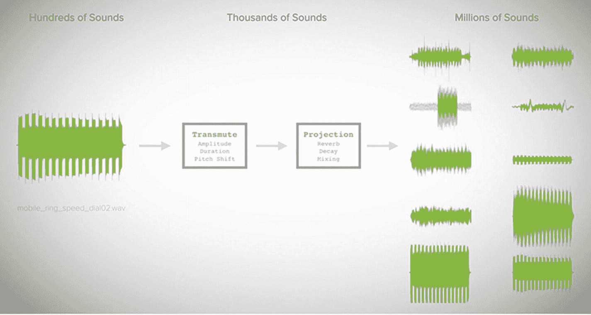

图 5-24

声音转换。Gierad Laput, Karan Ahuja, Mayank Goel, and Chris Harrison. 2018. Ubicoustics: Plug-and-Play Acoustic Activity Recognition. In The 31st Annual ACM Symposium on User Interface Software and Technology (UIST '18). ACM, New York, NY, USA, 213-224. DOI: [`https://doi.org/10.1145/3242587.3242609`](https://doi.org/10.1145/3242587.3242609)

#### 单一活动

目前，这项技术似乎能有效识别单一声音。

例如，如果你训练模型识别某人说话的声音以及流水的声音，并且你将系统放置在厨房中，用户一边说话一边洗碗，那么系统预测的活动将只是返回结果中得分最高的那个。

然而，由于系统持续运行，它可能会在这两种活动之间感到困惑。它可能会在“说话”和“流水”之间交替，直到其中一种活动停止。

如果你构建的应用需要检测可能同时发生的活动所产生的声音，这无疑会成为一个问题。

例如，假设你通常一边淋浴一边播放音乐，并且你构建了一个能检测两种活动的应用：淋浴流水声和说话声。

你希望每当检测到淋浴流水声时就能触发一个计时器，这样你就可以避免长时间淋浴以节约用水。

你还希望当检测到有人在浴室说话时，能降低扬声器的音量。

由于这两种活动可能同时发生（你可以在淋浴时说话），系统可能会在这两种活动之间感到困惑，前一秒检测到淋浴流水声，下一秒又检测到有人在说话。

结果就是，扬声器会启动一秒又停止一秒，计时器也会启动一秒又停止一秒。这肯定不会带来理想的体验。

然而，这并不意味着利用声音活动识别构建应用没有潜力，只是意味着我们需要设法克服这一局限性。

此外，目前正在进行一些研究，旨在开发能够同时处理多种活动检测的系统。我们将在接下来的几页中探讨这一点。

#### 用户体验

谈到用户体验，像这样的新技术总会带来一些挑战。

首先，是**隐私**问题。

让设备持续监听用户，总会引发一些担忧：数据存储在哪里？如何使用？是否安全？等等。

考虑到一些发布物联网设备的公司并不总是将安全性放在首位，这些担忧非常正常。

因此，消费者对这些设备的采用速度可能会慢于预期。

隐私和安全不仅应该内置于这些系统中，还应该以清晰的方式传达给用户，以安抚他们，并让他们感到对自己的数据有掌控力。

其次，另一个挑战在于教会用户**新的交互方式**。

例如，尽管大多数现代手机都内置了语音助手，但通过询问 `Siri` 或 `Google` 来获取信息并非主要的交互方式。

这可能是由于多种原因造成的，包括隐私问题、技术本身的局限性，但人们也有难以改变的习惯。

此外，考虑到这项技术目前尚不完善，当用户尝试几次后没有得到预期的回应时，他们很容易放弃。

缓解这个问题的一个方法是发布小型应用程序来分析用户的反应并进行调整。苹果在其新的 watchOS 中实现的水检测功能就是一个例子。

最后，创建自定义声学活动识别系统的一大挑战在于**样本数据的收集和用户的训练**。

尽管你可以构建并发布一个能检测水龙头流水声的应用程序，因为大多数家庭中水龙头产生的声音很可能相似，但其他一些声音并不那么常见。

因此，让用户能够使用这项技术，就需要让他们录制自己的样本并训练模型，这样他们才有机会拥有一个定制化的应用程序。

然而，由于机器学习算法需要用大量数据进行训练才能有机会产生准确的预测，这需要用户付出大量努力，并且很可能不会成功。

幸运的是，一些研究人员正在试验解决这些问题的方案。

现在，尽管这项技术存在一些限制，但解决方案也开始出现。

例如，在保护用户隐私方面，Bjørn Karmann 开发的一个名为 Project Alias 的开源项目试图为语音助手用户赋能。

该项目是一个 DIY 附加组件，由树莓派微控制器、扬声器和麦克风模块组成，全部封装在一个 3D 打印的外壳中，旨在阻止 Amazon Alexa 和 Google Home 等语音助手持续监听用户。

通过一个移动应用程序，用户可以训练 Alias 对自定义的唤醒词或声音做出反应。一旦训练完成，Alias 就可以控制家庭助手并为你激活它。当你不使用时，这个附加组件会通过向助手的麦克风发出白噪音来阻止其监听。

由于 Alias 的神经网络在本地运行，用户的隐私得到了保护。

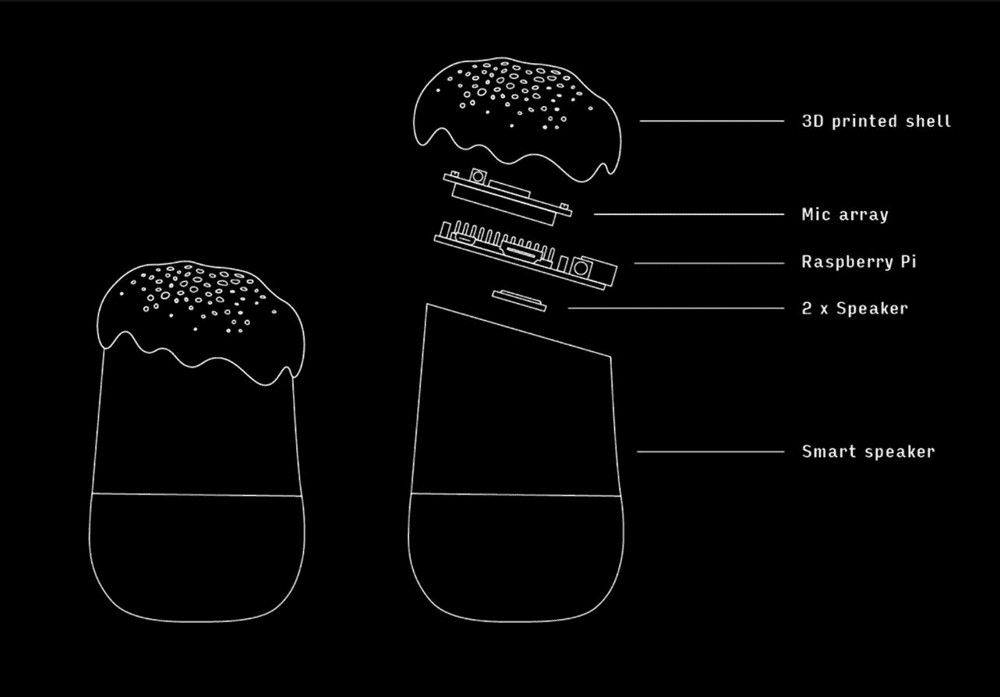

图 5-26

Project Alias 组件。来源：[`https://bjoernkarmann.dk/project_alias`](https://bjoernkarmann.dk/project_alias)

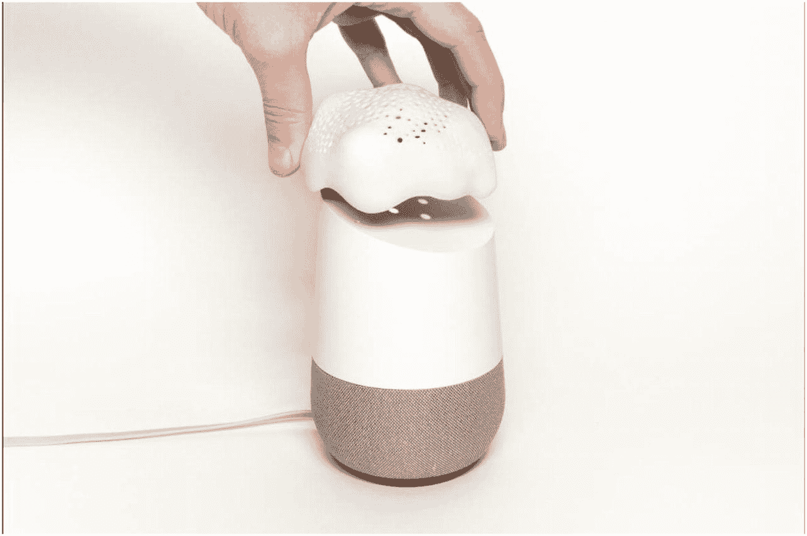

图 5-25

Project Alias。来源：[`https://bjoernkarmann.dk/project_alias`](https://bjoernkarmann.dk/project_alias)

另一个名为 Synthetic Sensors 的项目，旨在创建一个能够同时准确预测多种声音的系统。

该项目由卡内基梅隆大学的一个研究团队开发，涉及一个由多个传感器组成的定制硬件，包括加速度计、麦克风、温度传感器、运动传感器和颜色传感器。

# 声学传感与身体追踪

## 声学传感

利用从这些传感器收集的原始数据，研究人员创建了多个堆叠的声谱图，并训练算法来检测多种活动产生的模式，例如：
- 微波炉门关闭
- 电锯运行
- 水壶开启
- 水龙头流水
- 马桶冲水

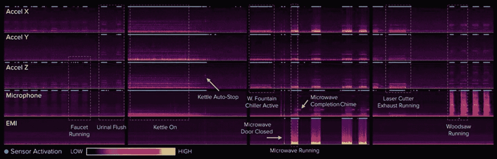
图 5-28 Project Synthetic Sensors 的声谱图与活动识别示例。Gierad Laput, Yang Zhang, and Chris Harrison. 2017. Synthetic Sensors: Towards General-Purpose Sensing. In *Proceedings of the 2017 CHI Conference on Human Factors in Computing Systems (CHI '17)*. ACM, New York, NY, USA, 3986-3999. DOI: [`https://doi.org/10.1145/3025453.3025773`](https://doi.org/10.1145/3025453.3025773)

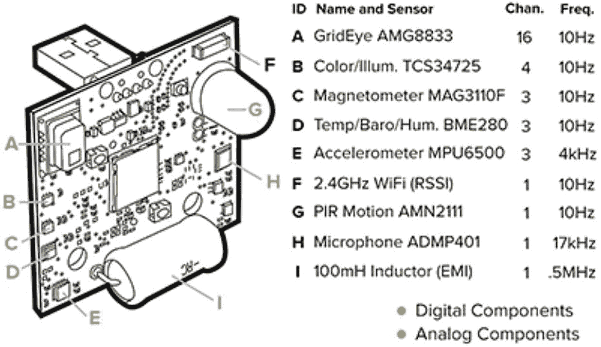
图 5-27 Project Synthetic Sensors 硬件。Gierad Laput, Yang Zhang, and Chris Harrison. 2017. Synthetic Sensors: Towards General-Purpose Sensing. In *Proceedings of the 2017 CHI Conference on Human Factors in Computing Systems (CHI '17)*. ACM, New York, NY, USA, 3986-3999. DOI: [`https://doi.org/10.1145/3025453.3025773`](https://doi.org/10.1145/3025453.3025773).

最后，在用户体验方面，一个名为 Listen Learner 的研究项目旨在让用户能够以最小的努力收集数据并训练模型来识别自定义声音。该项目的全称是 Listen Learner: Automatic Class Discovery and One-Shot Interaction for Activity Recognition（活动识别的自动类别发现与一次性交互）。它旨在提供高分类准确率，同时最大限度地减少用户负担。其方法是持续监听环境中的声音，按相似声音的聚类进行分类，并在收集到足够多的相似样本后询问用户这是什么声音。研究结果表明，该系统能够准确、自动地学习声学事件（例如，97% 的精确率，87% 的召回率），同时遵循用户对非侵入式交互行为的偏好。

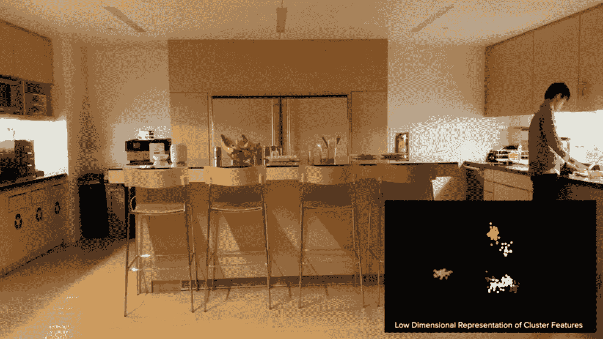
图 5-29 Wu, J., Harrison, C., Bigham, J. and Laput, G. 2020. Automated Class Discovery and One-Shot Interactions for Acoustic Activity Recognition. In *Proceedings of the 38th Annual SIGCHI Conference on Human Factors in Computing Systems. CHI '20*. ACM, New York, NY. 来源：[`www.chrisharrison.net/index.php/Research/ListenLearner`](https://www.chrisharrison.net/index.php/Research/ListenLearner)

## 5.2 身体与运动追踪

在了解了如何将机器学习应用于音频数据之后，让我们来看看另一种输入类型，即身体追踪。在本节中，我们将使用来自网络摄像头的身体运动数据，并借助三个不同的 TensorFlow.js 模型进行处理。

### 5.2.1 面部网格模型

我们将要实验的第一个模型叫做面部网格模型。这是一个专注于人脸识别的机器学习模型，能够预测用户面部 486 个 3D 面部特征点的位置，并返回这些点的 x、y、z 坐标。

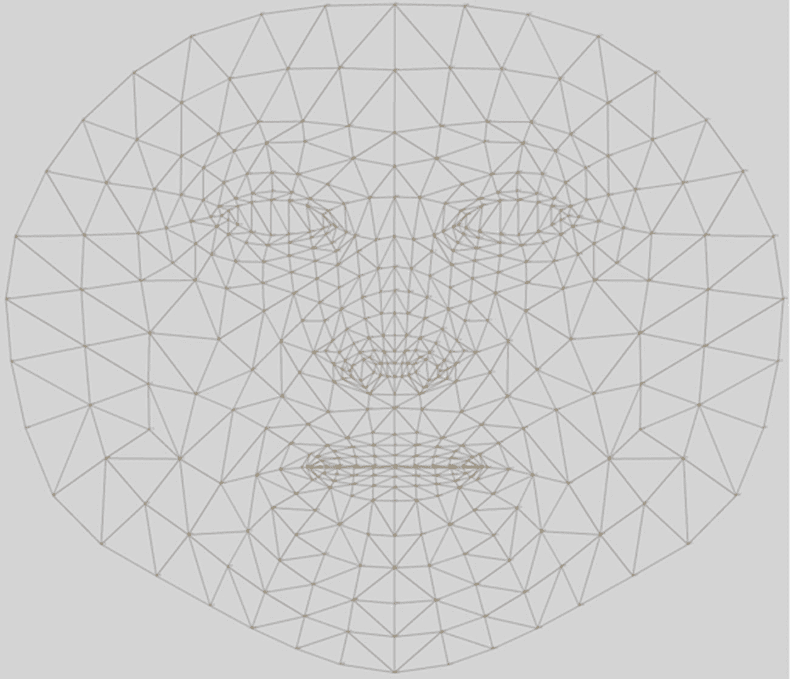
图 5-31 关键点映射图。来源：[`https://github.com/tensorflow/tfjs-models/tree/master/facemesh`](https://github.com/tensorflow/tfjs-models/tree/master/facemesh)

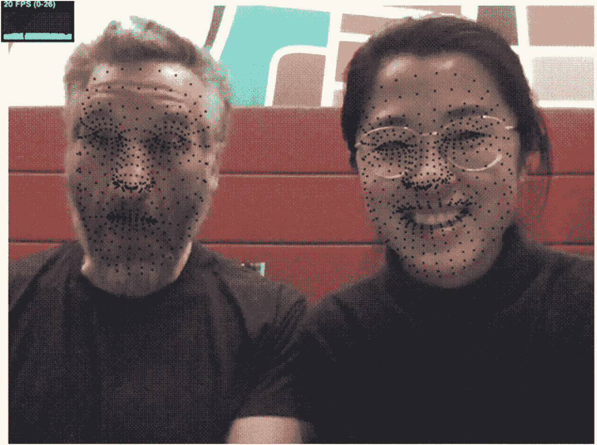
图 5-30 使用面部网格模型进行面部追踪的可视化示例。来源：[`https://github.com/tensorflow/tfjs-models/tree/master/facemesh`](https://github.com/tensorflow/tfjs-models/tree/master/facemesh)

这个人脸识别模型与其他面部追踪 JavaScript 库（如 `face-tracking.js`）的主要区别在于，TensorFlow.js 模型旨在近似人脸的表面几何形状，而不仅仅是某些关键点的 2D 位置。该模型在 3D 环境中提供坐标，从而能够近似面部特征的深度，并且即使在用户三维旋转面部时也能追踪关键点的位置。

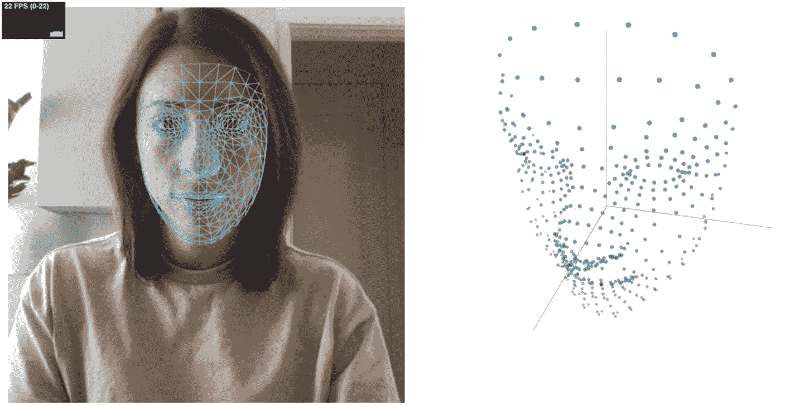
图 5-32 使用网络摄像头和 3D 可视化的关键点。来源：[`https://storage.googleapis.com/tfjs-models/demos/facemesh/index.html`](https://storage.googleapis.com/tfjs-models/demos/facemesh/index.html)

#### 加载模型

要开始使用该模型，我们需要在 HTML 文件中使用以下两行代码来加载它。

```
清单 5-25 在 HTML 文件中导入 TensorFlow.js 和面部网格模型
```

由于我们将使用网络摄像头的视频流来检测人脸，我们还需要在文件中添加一个视频元素。总而言之，你所需的最基本的 HTML 代码如下所示。

```
面部网格模型
清单 5-26 所需的核心 HTML 代码
```

然后，在你的 JavaScript 代码中，你需要使用以下代码加载模型和网络摄像头视频流。

```markdown
# 加载模型与视频流

首先，我们需要加载模型并设置网络摄像头视频流。

```javascript
let model;
let video;
const init = async () => {
model = await facemesh.load();
video = await loadVideo();
main(); // 该函数将在下一个代码示例中声明。
}
const loadVideo = async () => {
const video = await setupCamera();
video.play();
return video;
};
const setupCamera = async () => {
if (!navigator.mediaDevices || !navigator.mediaDevices.getUserMedia) {
throw new Error(
"浏览器 API navigator.mediaDevices.getUserMedia 不可用"
);
}
video = document.querySelector("video");
video.width = window.innerWidth;
video.height = window.innerHeight;
const stream = await navigator.mediaDevices.getUserMedia({
audio: false,
video: {
facingMode: "user",
width: window.innerWidth,
height: window.innerHeight,
},
});
video.srcObject = stream;
return new Promise(
(resolve) => (video.onloadedmetadata = () => resolve(video))
);
};
```

清单 5-27：加载模型并设置网络摄像头视频流

## 预测

一旦模型和视频准备就绪，我们就可以调用`main`函数来查找输入流中的面部特征点。

```javascript
async function main() {
const predictions = await model.estimateFaces(
document.querySelector("video")
);
if (predictions.length > 0) {
console.log(predictions);
for (let i = 0; i < predictions.length; i++) {
const keypoints = predictions[i].scaledMesh;
// 记录面部关键点。
for (let i = 0; i < keypoints.length; i++) {
const [x, y, z] = keypoints[i];
console.log(`关键点 ${i}: [${x}, ${y}, ${z}]`);
}
}
}
}
```

清单 5-28：查找面部特征点的函数

在浏览器控制台中，此代码示例的输出如下所示。


图 5-34：控制台中循环语句的输出


图 5-33：控制台中特征点的输出

正如我们在前面两张截图中看到的，返回的预测结果包含了大量信息。

注释按特征点区域组织，按字母顺序排列，并包含 x、y、z 坐标的数组。

边界框包含两个主要键，`bottomRight`和`topLeft`，用于指示视频流中检测到的人脸位置的边界。这两个属性包含一个只有 x 和 y 两个坐标的数组，因为 z 轴在这种情况下没有用处。

最后，`mesh`和`scaledMesh`属性包含了所有特征点的坐标，对于在屏幕上渲染 3D 空间中的所有点非常有用。

## 完整代码示例

总而言之，用于设置模型、视频流并开始预测特征点位置的 JavaScript 代码应如下所示。

```javascript
let video;
let model;
const init = async () => {
video = await loadVideo();
await tf.setBackend("webgl");
model = await facemesh.load();
main();
};
const loadVideo = async () => {
const video = await setupCamera();
video.play();
return video;
};
const setupCamera = async () => {
if (!navigator.mediaDevices || !navigator.mediaDevices.getUserMedia) {
throw new Error(
"浏览器 API navigator.mediaDevices.getUserMedia 不可用"
);
}
video = document.querySelector("video");
video.width = window.innerWidth;
video.height = window.innerHeight;
const stream = await navigator.mediaDevices.getUserMedia({
audio: false,
video: {
facingMode: "user",
width: window.innerWidth,
height: window.innerHeight,
},
});
video.srcObject = stream;
return new Promise(
(resolve) => (video.onloadedmetadata = () => resolve(video))
);
};
init();
async function main() {
const predictions = await model.estimateFaces(
document.querySelector("video")
);
if (predictions.length > 0) {
console.log(predictions);
for (let i = 0; i < predictions.length; i++) {
const keypoints = predictions[i].scaledMesh;
// 记录面部关键点。
for (let i = 0; i < keypoints.length; i++) {
const [x, y, z] = keypoints[i];
console.log(`关键点 ${i}: [${x}, ${y}, ${z}]`);
}
}
}
requestAnimationFrame(main);
}
```

清单 5-29：完整的 JavaScript 代码示例

## 项目实践

为了将这段代码示例付诸实践，我们来构建一个快速原型，让用户能够通过前后倾斜头部来滚动页面。

我们将能够复用之前编写的大部分代码，并做一些小修改，利用检测到的某些关键点来触发滚动。

我们用来检测头部运动的具体关键点是`lipsLowerOuter`，更准确地说，是其 z 轴。

查看注释对象中所有可用的属性，`lipsLowerOuter`是最接近下巴的一个，因此我们可以观察该区域 z 坐标的预测变化，来判断头部是向后倾斜（下巴前移）还是向前倾斜（下巴后移）。

为此，在我们的`main`函数中，一旦获得预测结果，我们可以添加以下代码行。

```javascript
if (predictions[0].annotations.lipsLowerOuter) {
let zAxis = predictions[0].annotations.lipsLowerOuter[9][2];
if (zAxis > 5) {
// 向下滚动
window.scrollTo({
top: (scrollPosition += 10),
left: 0,
behavior: "smooth",
});
} else if (zAxis < -5) {
// 向上滚动
window.scrollTo({
top: (scrollPosition -= 10),
left: 0,
behavior: "smooth",
});
}
}
```

代码清单 5-30：当 z 轴变化时触发滚动

在这段代码示例中，我声明了一个名为`zAxis`的变量，用于存储我想要追踪的 z 坐标值。为了获取这个值，我查看了注释对象的`lipsLowerOuter`属性中包含的坐标数组。

根据返回的注释对象，我们可以看到`lipsLowerOuter`属性包含 10 个数组，每个数组有 3 个值。
```

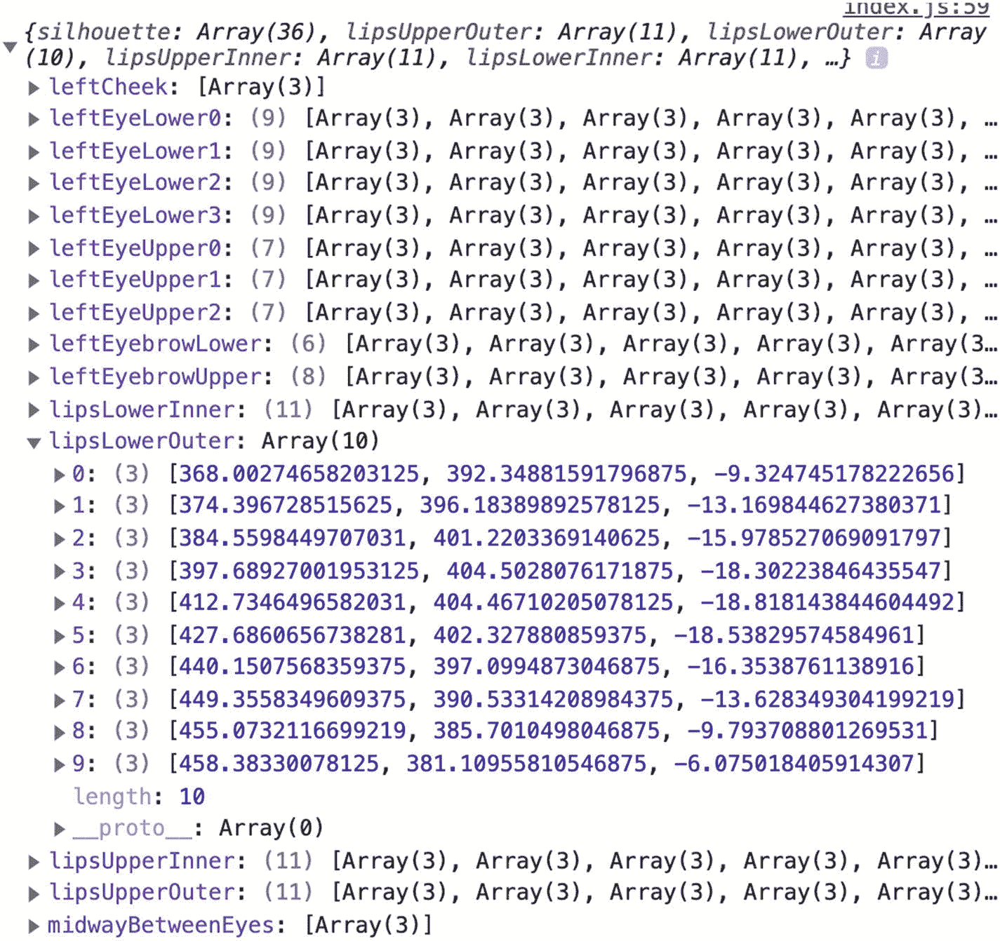

图 5-35

返回的注释及其 `lipsLowerOuter` 值

这就是为什么前面的代码示例使用 `predictions[0].annotations.lipsLowerOuter[9][2]` 来访问 z 坐标。

我决定访问 `lipsLowerOuter` 属性的最后一个元素（[9]）及其第三个值（[2]），即该部分的 z 坐标。

值 5 是通过反复试验并观察哪个阈值适用于这个特定项目而选定的。这并不是一个每次使用 Facemesh 模型都必须采用的标准值。相反，我是在记录了 `zAxis` 变量，并在浏览器控制台中观察到我前后倾斜头部时其值的变化后，才决定将其作为适合我的正确阈值。

然后，假设你在代码中更早地声明了 `scrollPosition` 并为其设置了一个值（我个人将其设为 0），那么当你向后倾斜头部时，将触发“向上滚动”事件；当你向前倾斜头部时，将触发“向下滚动”事件。

最后，我将 `behavior` 属性设置为 `"smooth"`，以实现平滑滚动，在我看来，这能创造更好的体验。

如果你没有向 HTML 文件中添加任何内容，那么你还看不到任何效果，所以别忘了添加足够的文本或图片，以便测试一切是否正常！

在不到 75 行的 JavaScript 代码中，我们加载了一个人脸识别模型，设置了视频流，运行预测以获取面部关键点的 3D 坐标，并编写了一些逻辑，以便在向后或向前倾斜头部时触发向上或向下滚动！

```javascript
let video;
let model;
const init = async () => {
video = await loadVideo();
await tf.setBackend("webgl");
model = await facemesh.load();
main();
};
const loadVideo = async () => {
const video = await setupCamera();
video.play();
return video;
};
const setupCamera = async () => {
if (!navigator.mediaDevices || !navigator.mediaDevices.getUserMedia) {
throw new Error(
"浏览器 API navigator.mediaDevices.getUserMedia 不可用"
);
}
video = document.querySelector("video");
video.width = window.innerWidth;
video.height = window.innerHeight;
const stream = await navigator.mediaDevices.getUserMedia({
audio: false,
video: {
facingMode: "user",
width: window.innerWidth,
height: window.innerHeight,
},
});
video.srcObject = stream;
return new Promise(
(resolve) => (video.onloadedmetadata = () => resolve(video))
);
};
init();
let scrollPosition = 0;
async function main() {
const predictions = await model.estimateFaces(
document.querySelector("video")
);
if (predictions.length > 0) {
if (predictions[0].annotations.lipsLowerOuter) {
zAxis = predictions[0].annotations.lipsLowerOuter[9][2];
if (zAxis > 5) {
// 向下滚动
window.scrollTo({
top: (scrollPosition += 10),
left: 0,
behavior: "smooth",
});
} else if (zAxis < -5) {
// 向上滚动
window.scrollTo({
top: (scrollPosition -= 10),
left: 0,
behavior: "smooth",
});
}
}
}
requestAnimationFrame(main);
}
```

代码清单 5-31
完整的 JavaScript 代码

这个模型专门用于检测面部关键点。接下来，我们将研究另一个模型，用于检测用户手部的关键点。

### 5.2.2 Handpose

我们要尝试的第二个模型叫做 Handpose。该模型专门用于识别用户手部 21 个 3D 关键点的位置。

以下是该模型输出结果的一个示例，该结果使用 Canvas API 在屏幕上可视化。

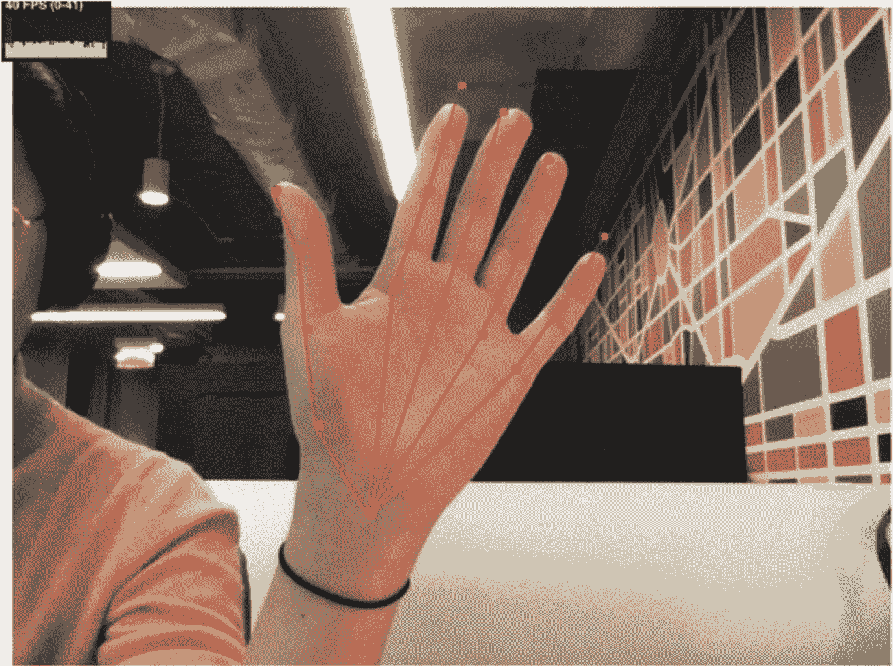

图 5-37

Handpose 可视化的关键点。来源：[`https://github.com/tensorflow/tfjs-models/tree/master/handpose`](https://github.com/tensorflow/tfjs-models/tree/master/handpose)

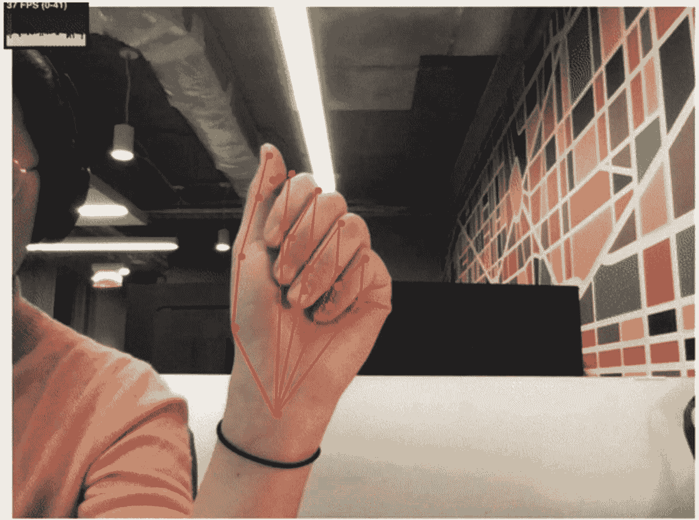

图 5-36

Handpose 可视化的关键点。来源：[`https://github.com/tensorflow/tfjs-models/tree/master/handpose`](https://github.com/tensorflow/tfjs-models/tree/master/handpose)

要实现这一点，如果你阅读过上一节，代码行会看起来非常熟悉。

#### 加载模型

我们需要从引入 TensorFlow.js 和 Handpose 模型开始：

```javascript
代码清单 5-32
导入 TensorFlow.js 和 Handpose 模型
```

与 Facemesh 模型的工作方式类似，我们将使用视频流作为输入，因此我们还需要在主 HTML 文件中添加一个视频元素。

然后，在你的 JavaScript 文件中，我们可以使用之前编写的相同函数来设置摄像头和加载模型。唯一需要更改的一行是调用模型 `load` 方法的行。

由于我们使用的是 Handpose 而不是 Facemesh，我们需要将 `facemesh.load()` 替换为 `handpose.load()`。

因此，总的来说，你的 JavaScript 文件的基础部分应包含以下代码。

### 代码清单 5-33 设置加载模型和视频输入的代码

```javascript
let video;
let model;
const init = async () => {
  video = await loadVideo();
  await tf.setBackend("webgl");
  model = await handpose.load();
};
const loadVideo = async () => {
  const video = await setupCamera();
  video.play();
  return video;
};
const setupCamera = async () => {
  if (!navigator.mediaDevices || !navigator.mediaDevices.getUserMedia) {
    throw new Error(
      "浏览器 API navigator.mediaDevices.getUserMedia 不可用"
    );
  }
  video = document.querySelector("video");
  video.width = window.innerWidth;
  video.height = window.innerHeight;
  const stream = await navigator.mediaDevices.getUserMedia({
    audio: false,
    video: {
      facingMode: "user",
      width: window.innerWidth,
      height: window.innerHeight,
    },
  });
  video.srcObject = stream;
  return new Promise(
    (resolve) => (video.onloadedmetadata = () => resolve(video))
  );
};
init();
```

### 预测关键点
模型加载完毕且网络摄像头画面就绪后，当手出现在摄像头前时，我们就可以运行预测并检测关键点了。
为此，我们可以复制使用 Facemesh 时创建的 `main()` 函数，但需将表达式 `model.estimateFaces` 替换为 `model.estimateHands`。
因此，主函数应如下所示。

```javascript
async function main() {
  const predictions = await model.estimateHands(
    document.querySelector("video")
  );
  if (predictions.length > 0) {
    console.log(predictions);
  }
  requestAnimationFrame(main);
}
```

#### 代码清单 5-34 运行预测并记录输出
这段代码的输出将在浏览器控制台中记录以下数据。

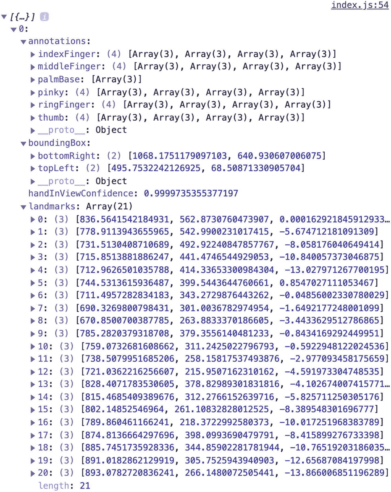

图 5-38 检测手部时的输出
我们可以看到，这些数据的格式与使用 Facemesh 模型时非常相似！
这使得实验更加简单快捷，因为你可以重用其他项目中编写的代码示例。它允许开发者快速上手，专注于探索利用此类模型可以构建哪些应用的可能性，而无需在配置上花费过多时间。
可以注意到的主要区别在于注释中定义的属性、额外的 `handInViewConfidence` 属性，以及缺少 `mesh` 和 `scaledMesh` 数据。
`handInViewConfidence` 属性表示手部存在的概率。它是一个介于 0 和 1 之间的浮点值。该值越接近 1，模型就越确信在视频流中检测到了手部。
在撰写本书时，该模型一次只能检测一只手。因此，你无法构建需要用户同时使用双手作为交互方式的应用程序。

### 完整代码示例
为了检查一切是否正常工作，以下是测试你的设置所需的完整 JavaScript 代码示例。

```javascript
let video;
let model;
const init = async () => {
  video = await loadVideo();
  await tf.setBackend("webgl");
  model = await handpose.load();
  main();
};
const loadVideo = async () => {
  const video = await setupCamera();
  video.play();
  return video;
};
const setupCamera = async () => {
  if (!navigator.mediaDevices || !navigator.mediaDevices.getUserMedia) {
    throw new Error(
      "浏览器 API navigator.mediaDevices.getUserMedia 不可用"
    );
  }
  video = document.querySelector("video");
  video.width = window.innerWidth;
  video.height = window.innerHeight;
  const stream = await navigator.mediaDevices.getUserMedia({
    audio: false,
    video: {
      facingMode: "user",
      width: window.innerWidth,
      height: window.innerHeight,
    },
  });
  video.srcObject = stream;
  return new Promise(
    (resolve) => (video.onloadedmetadata = () => resolve(video))
  );
};
init();
async function main() {
  const predictions = await model.estimateHands(
    document.querySelector("video")
  );
  if (predictions.length > 0) {
    console.log(predictions);
  }
  requestAnimationFrame(main);
}
```

#### 代码清单 5-35 完整代码示例

### 项目
为了尝试使用此模型可以构建的应用程序类型，我们将构建一个小的“石头剪刀布”游戏。
为了理解我们将如何识别这三种手势，让我们看看下面的可视化图，以了解每种手势的关键点位置。

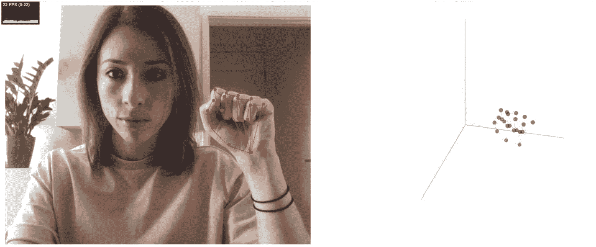

图 5-39 “石头”手势可视化
上面的截图代表了“石头”手势。正如我们所见，所有手指都弯曲了，因此每个手指指尖的 z 轴位置应该比其第一指节骨末端的关键点更远。
否则，我们也可以认为指尖的 y 坐标应该高于主要指关节的 y 坐标，请记住屏幕顶部等于 0，关键点越靠下，y 值越大。
我们可以通过操作注释对象中返回的数据来验证这一点是否准确，并可用于检测“石头”手势。

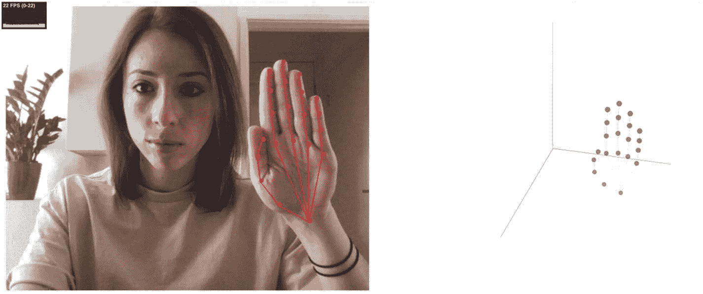

图 5-40 “布”手势可视化
在“布”手势中，所有手指都是伸直的，因此我们主要可以使用不同手指的 y 坐标。例如，我们可以检查每根手指最后一个点（指尖）的 y 值是否小于手掌或每根手指根部的 y 值。

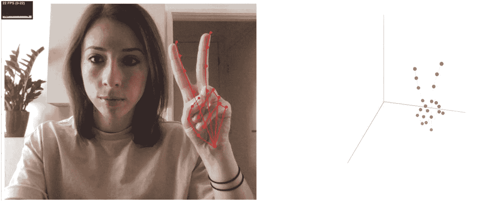

图 5-41 “剪刀”手势可视化
最后，“剪刀”手势可以通过观察食指和中指在 x 轴上的间距以及其他手指的 y 坐标来识别。
如果无名指和小指指尖的 y 值低于其根部，则它们可能是弯曲的。
重用我们在前面章节中介绍的代码示例，让我们看看如何编写逻辑来识别和区分这些手势。
如果我们从`“石头”手势`开始，以下是如何检查每根手指的 y 坐标是否高于其基部指关节的 y 坐标。

```javascript
let indexBase = predictions[0].annotations.indexFinger[0][1];
let indexTip = predictions[0].annotations.indexFinger[3][1];
if (indexTip > indexBase) {
  console.log("食指弯曲");
}
```

#### 代码清单 5-36 检查食指是否弯曲的逻辑
我们可以先声明两个变量，一个用于存储食指根部的 y 位置，另一个用于存储同一根手指指尖的 y 位置。

回顾当手指出现在屏幕上时来自注释对象的数据，我们可以看到，对于食指，我们得到一个包含 4 个数组的数组，这些数组代表每个关键点的 `x`、`y` 和 `z` 坐标。

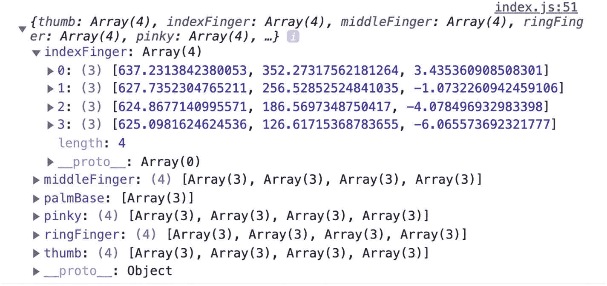

图 5-42

检测到手部时的输出数据

第一个数组中的 `y` 坐标值约为 352.27，最后一个数组中的 `y` 坐标值约为 126.62，后者更小，因此我们可以推断第一个数组代表食指根部的位置，最后一个数组代表该手指指尖的关键点。

我们可以通过编写前面显示的 `if` 语句来测试此信息是否正确，如果 `indexTip` 的值高于 `indexBase` 的值，该语句会记录消息“食指弯曲”。

而且它有效！

如果你将手放在摄像头前测试这段代码，并在伸直食指和弯曲食指之间切换，你应该会看到控制台中记录了这条消息！

如果我们想保持快速且简单，可以就此打住，并认定仅凭这一项检查就能确定“石头”手势。然而，如果我们希望对手势识别更有把握，可以对中指、无名指和小指重复同样的过程。

拇指会稍有不同，因为其折叠方式，我们需要检查 `x` 坐标的差值，而不是 `y` 坐标。

对于“布”手势，由于所有手指都伸展，我们可以检查每根手指的指尖 `y` 坐标是否都小于其指根 `y` 坐标。

以下代码可用于验证这一点。

```
let indexBase = predictions[0].annotations.indexFinger[0][1];
let indexTip = predictions[0].annotations.indexFinger[3][1];
let thumbBase = predictions[0].annotations.thumb[0][1];
let thumbTip = predictions[0].annotations.thumb[3][1];
let middleBase = predictions[0].annotations.middleFinger[0][1];
let middleTip = predictions[0].annotations.middleFinger[3][1];
let ringBase = predictions[0].annotations.ringFinger[0][1];
let ringTip = predictions[0].annotations.ringFinger[3][1];
let pinkyBase = predictions[0].annotations.pinky[0][1];
let pinkyTip = predictions[0].annotations.pinky[3][1];
let indexExtended = indexBase > indexTip ? true : false;
let thumbExtended = thumbBase > thumbTip ? true : false;
let middleExtended = middleBase > middleTip ? true : false;
let ringExtended = ringBase > ringTip ? true : false;
let pinkyExtended = pinkyBase > pinkyTip ? true : false;
if (indexExtended && thumbExtended && middleExtended && ringExtended &&
pinkyExtended) {
console.log("paper gesture!");
} else {
console.log("other gesture");
}
```

清单 5-37 检查每个手指的 `y` 坐标以识别“布”手势

我们首先将感兴趣的坐标存储到变量中，然后比较它们的值，将伸展状态设置为 `true` 或 `false`。

如果所有手指都伸展，我们记录消息 `"paper gesture!"`。

如果一切正常，你应该能够将手放在摄像头前，所有手指伸展，并在浏览器的控制台中看到日志。

如果你切换到其他手势，则应记录消息 `"other gesture"`。

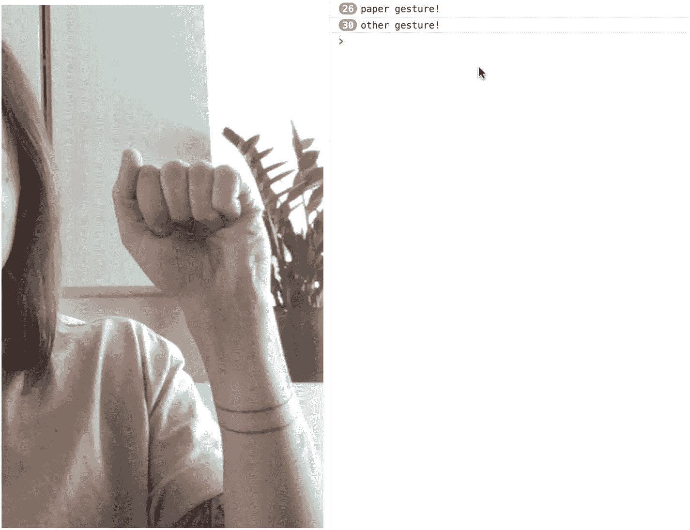

图 5-44 网络摄像头画面中检测到手，控制台记录其他手势的截图

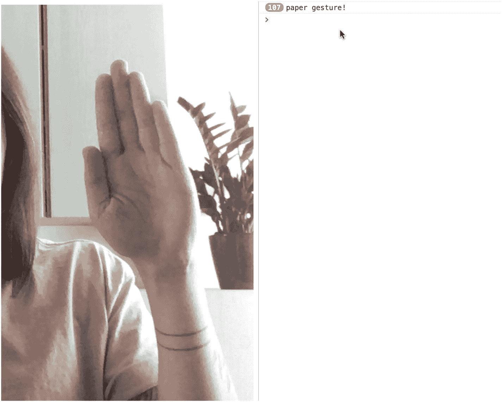

图 5-43 网络摄像头画面中检测到手，控制台记录布手势的截图

最后，检测“剪刀”手势可以通过观察食指和中指指尖 `x` 坐标的变化，同时确保其他手指没有伸展来实现。

```
let indexTipX = predictions[0].annotations.indexFinger[3][0];
let middleTipX = predictions[0].annotations.middleFinger[3][0];
let diffFingersX =
indexTipX > middleTipX ? indexTipX - middleTipX : middleTipX - indexTipX;
console.log(diffFingersX);
```

清单 5-38 检查食指和中指指尖的 `x` 坐标差值

以下是使用此代码示例返回的数据的两张截图。

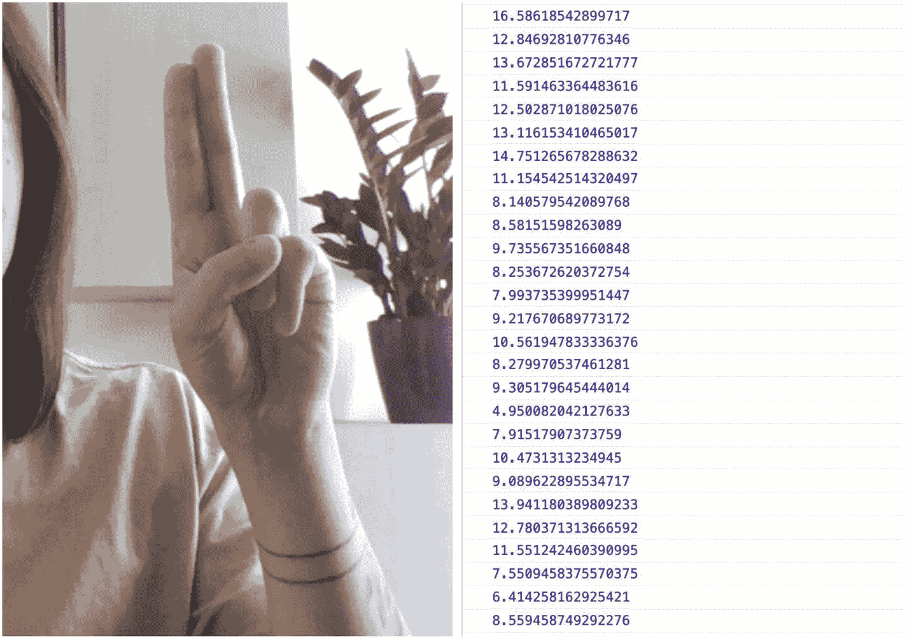

图 5-46 执行其他手势时的输出数据

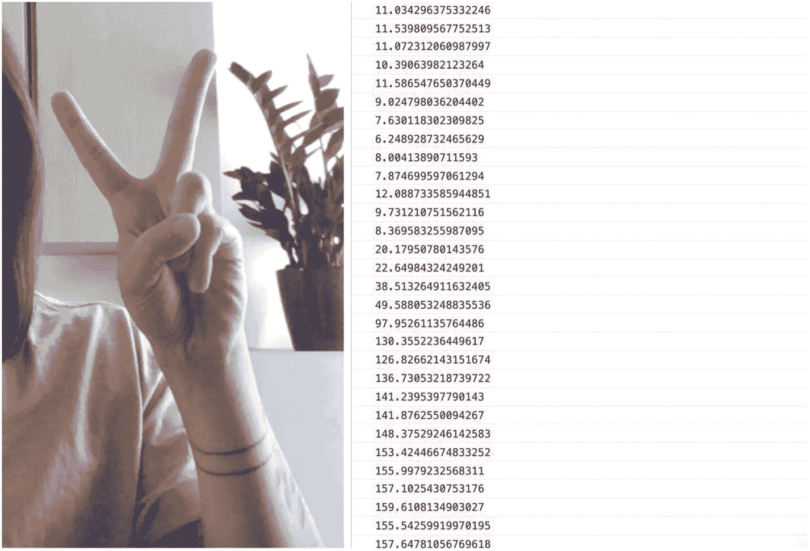

图 5-45 执行“剪刀”手势时的输出数据

我们可以看到，当我们做“剪刀”手势时，`diffFingersX` 变量的值远高于两根手指并拢时的值。

根据这些数据，我们可以将阈值设定为 100。如果 `diffFingersX` 的值大于 100，并且无名指和小指是弯曲的，那么该手势是“剪刀”的可能性非常高。

因此，总的来说，我们可以使用以下代码示例来检查这个手势。

```
let ringBase = predictions[0].annotations.ringFinger[0][1];
let ringTip = predictions[0].annotations.ringFinger[3][1];
let pinkyBase = predictions[0].annotations.pinky[0][1];
let pinkyTip = predictions[0].annotations.pinky[3][1];
let ringExtended = ringBase > ringTip ? true : false;
let pinkyExtended = pinkyBase > pinkyTip ? true : false;
let indexTipX = predictions[0].annotations.indexFinger[3][0];
let middleTipX = predictions[0].annotations.middleFinger[3][0];
let diffFingersX =
indexTipX > middleTipX ? indexTipX - middleTipX : middleTipX - indexTipX;
if (diffFingersX > 100 && !ringExtended && !pinkyExtended) {
console.log("scissors gesture!");
}
```

清单 5-39 检测“剪刀”手势

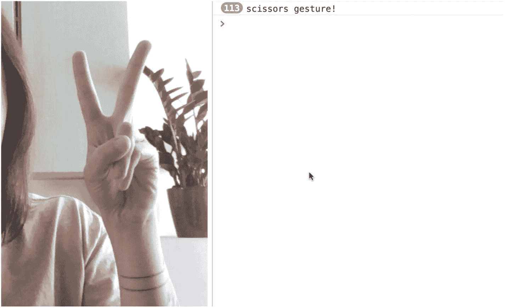

图 5-47 “剪刀”手势检测成功的截图

现在我们已经分别编写了检测手势的逻辑，让我们将它们整合在一起。

## 手势检测逻辑实现

### 清单 5-40 检测所有手势的逻辑

```javascript
let indexBase = predictions[0].annotations.indexFinger[0][1];
let indexTip = predictions[0].annotations.indexFinger[3][1];
let thumbBase = predictions[0].annotations.thumb[0][1];
let thumbTip = predictions[0].annotations.thumb[3][1];
let middleBase = predictions[0].annotations.middleFinger[0][1];
let middleTip = predictions[0].annotations.middleFinger[3][1];
let ringBase = predictions[0].annotations.ringFinger[0][1];
let ringTip = predictions[0].annotations.ringFinger[3][1];
let pinkyBase = predictions[0].annotations.pinky[0][1];
let pinkyTip = predictions[0].annotations.pinky[3][1];
let indexExtended = indexBase > indexTip ? true : false;
let thumbExtended = thumbBase > thumbTip ? true : false;
let middleExtended = middleBase > middleTip ? true : false;
let ringExtended = ringBase > ringTip ? true : false;
let pinkyExtended = pinkyBase > pinkyTip ? true : false;
if (
indexExtended &&
thumbExtended &&
middleExtended &&
ringExtended &&
pinkyExtended
) {
console.log("paper gesture!");
}
/* 石头手势 */
if (!indexExtended && !middleExtended && !ringExtended && !pinkyExtended) {
console.log("rock gesture!");
}
/* 剪刀手势 */
let indexTipX = predictions[0].annotations.indexFinger[3][0];
let middleTipX = predictions[0].annotations.middleFinger[3][0];
let diffFingersX =
indexTipX > middleTipX ? indexTipX - middleTipX : middleTipX - indexTipX;
if (diffFingersX > 100 && !ringExtended && !pinkyExtended) {
console.log("scissors gesture!");
}
```

如果一切正常，当你做出每个手势时，应该会在控制台中看到正确的消息被记录！

一旦你验证了逻辑有效，就可以不再使用`console.log()`，转而用它来构建游戏，或者将这些手势用作界面的控制器，等等。

最重要的是理解模型的工作原理，熟悉使用坐标构建逻辑，以便探索各种可能性，并意识到一些局限性。

## PoseNet 姿态检测模型

### 5.2.3 PoseNet

最后，我们要介绍的最后一个身体追踪模型叫做 PoseNet。

PoseNet 是一个姿态检测模型，可以估计图像或视频中的单一人体姿态或多个人体姿态。

与 Facemesh 和 Handpose 模型类似，PoseNet 追踪用户身体关键点的位置。

以下是这些关键点可视化的示例。

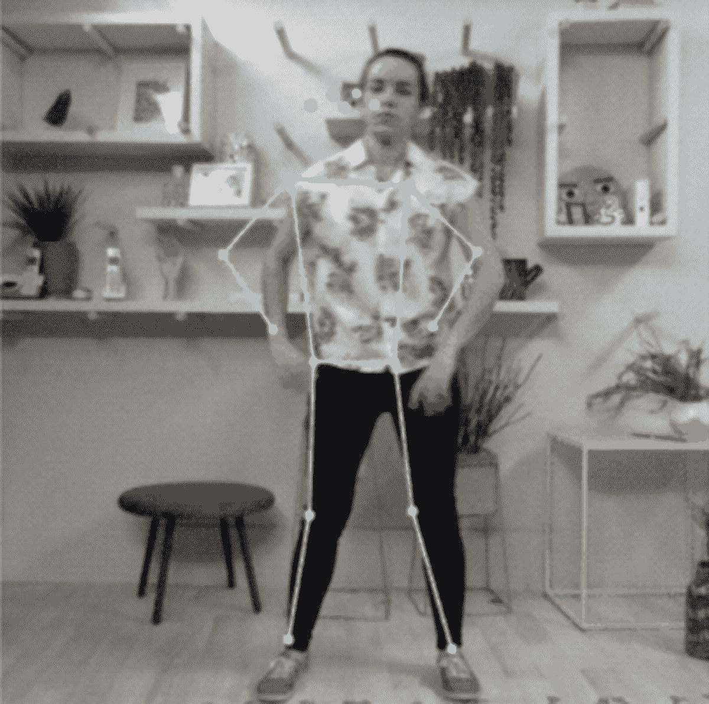

图 5-48 PoseNet 检测到的关键点可视化。来源：[`https://github.com/tensorflow/tfjs-models/tree/master/posenet`](https://github.com/tensorflow/tfjs-models/tree/master/posenet)

该身体追踪模型可以检测 17 个关键点及其二维坐标，并通过部位 ID 进行索引。

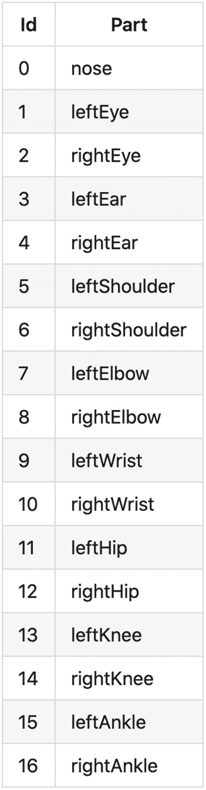

图 5-49 关键点列表及其 ID。来源：[`https://github.com/tensorflow/tfjs-models/tree/master/posenet`](https://github.com/tensorflow/tfjs-models/tree/master/posenet)

尽管该模型也专门用于通过网络摄像头输入追踪人体，但在代码中使用它的方式与我们之前章节介绍的两个模型略有不同。

### 导入和加载模型

导入和加载模型的方式与本书中大多数代码示例遵循相同的标准。

### 代码清单 5-41 在 HTML 中导入 TensorFlow.js 和 PoseNet 模型

```html
<script src="https://cdn.jsdelivr.net/npm/@tensorflow/tfjs"></script>
<script src="https://cdn.jsdelivr.net/npm/@tensorflow-models/posenet"></script>
```

### 代码清单 5-42 在 JavaScript 中加载模型

```javascript
const net = await posenet.load();
```

这种加载 PoseNet 的默认方式使用了一个基于 `MobileNetV1` 架构的更快、更小的模型。速度提升的代价是精度降低。

如果你想尝试调整参数，也可以这样加载模型。

### 代码清单 5-43 加载模型的其他方式

```javascript
const net = await posenet.load({
architecture: 'MobileNetV1',
outputStride: 16,
inputResolution: { width: 640, height: 480 },
multiplier: 0.75
});
```

如果你想尝试第二种可用的配置，可以指定使用基于 `ResNet50` 架构的另一个模型，该模型精度更高，但模型更大，因此加载时间会更长。

### 代码清单 5-44 使用 `ResNet50` 架构加载模型

```javascript
const net = await posenet.load({
architecture: 'ResNet50',
outputStride: 32,
inputResolution: { width: 257, height: 200 },
quantBytes: 2
});
```

如果你对这些不同的参数感到有些困惑，不用担心，在入门阶段，使用提供的默认参数是完全可行的。如果你想了解更多关于它们的信息，可以在 TensorFlow 官方文档中找到更详细的说明。

模型加载完成后，你就可以专注于进行姿态预测了。

### 预测

要从模型获取预测结果，你主要需要调用模型上的 `estimateSinglePose()` 方法。

### 代码清单 5-45 预测单一人体姿态

```javascript
const pose = await net.estimateSinglePose(image, {
flipHorizontal: false
});
```

`image` 参数可以是某些 `imageData`、一个 HTML 图像元素、一个 HTML 画布元素或一个 HTML 视频元素。它代表你想要进行预测的输入图像。

`flipHorizontal` 参数指示你是否希望水平翻转/镜像姿态。默认情况下，其值设置为 `false`。

如果你正在使用视频，并且视频默认是水平翻转的（例如，使用网络摄像头时），则应将其设置为 `true`。

上述代码示例会将变量 `pose` 设置为一个单一姿态对象，该对象包含一个置信度分数和一个检测到的关键点数组，每个关键点包含其二维坐标、身体部位名称以及一个概率分数。

以下是返回的对象示例。

# 代码清单

## 代码清单 5-46

作为预测结果返回的完整对象。

```json
{
"score": 0.32371445304906,
"keypoints": [
{
"position": {
"y": 76.291801452637,
"x": 253.36747741699
},
"part": "nose",
"score": 0.99539834260941
},
{
"position": {
"y": 71.10383605957,
"x": 253.54365539551
},
"part": "leftEye",
"score": 0.98781454563141
},
{
"position": {
"y": 71.839515686035,
"x": 246.00454711914
},
"part": "rightEye",
"score": 0.99528175592422
},
{
"position": {
"y": 72.848854064941,
"x": 263.08151245117
},
"part": "leftEar",
"score": 0.84029853343964
},
{
"position": {
"y": 79.956565856934,
"x": 234.26812744141
},
"part": "rightEar",
"score": 0.92544466257095
},
{
"position": {
"y": 98.34538269043,
"x": 399.64068603516
},
"part": "leftShoulder",
"score": 0.99559044837952
},
{
"position": {
"y": 95.082359313965,
"x": 458.21868896484
},
"part": "rightShoulder",
"score": 0.99583911895752
},
{
"position": {
"y": 94.626205444336,
"x": 163.94561767578
},
"part": "leftElbow",
"score": 0.9518963098526
},
{
"position": {
"y": 150.2349395752,
"x": 245.06030273438
},
"part": "rightElbow",
"score": 0.98052614927292
},
{
"position": {
"y": 113.9603729248,
"x": 393.19735717773
},
"part": "leftWrist",
"score": 0.94009721279144
},
{
"position": {
"y": 186.47859191895,
"x": 257.98034667969
},
"part": "rightWrist",
"score": 0.98029226064682
},
{
"position": {
"y": 208.5266418457,
"x": 284.46710205078
},
"part": "leftHip",
"score": 0.97870296239853
},
{
"position": {
"y": 209.9910736084,
"x": 243.31219482422
},
"part": "rightHip",
"score": 0.97424703836441
},
{
"position": {
"y": 281.61965942383,
"x": 310.93188476562
},
"part": "leftKnee",
"score": 0.98368924856186
},
{
"position": {
"y": 282.80120849609,
"x": 203.81164550781
},
"part": "rightKnee",
"score": 0.96947449445724
},
{
"position": {
"y": 360.62716674805,
"x": 292.21047973633
},
"part": "leftAnkle",
"score": 0.8883239030838
},
{
"position": {
"y": 347.41177368164,
"x": 203.88229370117
},
"part": "rightAnkle",
"score": 0.8255187869072
}
]
}
```

如果你希望检测多个人体姿态，或者你预期图像或视频中包含多个人，你可以将调用的方法改为如下形式。

## 代码清单 5-47

预测多个人体姿态。

```javascript
const poses = await net.estimateMultiplePoses(image, {
    flipHorizontal: false,
    maxDetections: 5,
    scoreThreshold: 0.5,
    nmsRadius: 20
});
```

我们可以看到传入了一些额外的参数。

- `maxDetections` 表示我们希望检测的最大姿态数量。默认值为 5，但你可以根据需要增加或减少。
- `scoreThreshold` 表示只有当对象根部的分数值高于设定值时，才返回该实例。默认值为 0.5。
- `nmsRadius` 代表非极大值抑制，表示检测到的多个姿态之间应间隔的像素数量。该值必须严格为正数，默认为 20。

使用此方法会将变量 `poses` 的值设置为一个姿态对象数组，如下所示。

## 代码清单 5-48

检测多个人体姿态时的输出数组。

```json
[
  // 姿态 1
  {
    // 姿态分数
    "score": 0.42985695206067,
    "keypoints": [
      {
        "position": {
          "x": 126.09371757507,
          "y": 97.861720561981
        },
        "part": "nose",
        "score": 0.99710708856583
      },
      {
        "position": {
          "x": 132.53466176987,
          "y": 86.429876804352
        },
        "part": "leftEye",
        "score": 0.99919074773788
      },
      ...
    ],
  },
  // 姿态 2
  {
    // 姿态分数
    "score": 0.13461434583673,
    "keypoints": [
      {
        "position": {
          "x": 116.58444058895,
          "y": 99.772533416748
        },
        "part": "nose",
        "score": 0.0028593824245036
      },
      {
        "position": {
          "x": 133.49897611141,
          "y": 79.644590377808
        },
        "part": "leftEye",
        "score": 0.99919074773788
      },
      ...
    ],
  }
]
```

## 完整代码示例

以下是在图像中设置姿态预测的完整代码示例。

### 代码清单 5-49

用于检测图像中姿态的 HTML 代码。

```html

```

### 代码清单 5-50

JavaScript 代码。

```javascript
const imageElement = document.getElementsByTagName("img")[0];
posenet
  .load()
  .then(function (net) {
    const pose = net.estimateSinglePose(imageElement, {
      flipHorizontal: true,
    });
    return pose;
  })
  .then(function (pose) {
    console.log(pose);
  })
  .catch((err) => console.log(err));
```

对于来自网络摄像头的视频流，代码应如下所示。

## 可视化关键点

到目前为止，我们主要使用`console.log`来查看模型返回的结果。但是，您可能希望将它们可视化在页面上，以确保身体追踪正常工作，并且关键点位于正确的位置。

为此，我们将使用`Canvas API`。

我们需要先在`HTML`文件中添加一个`HTML canvas`元素。然后，我们可以创建一个函数来访问该元素及其上下文，检测姿态，并绘制关键点。

通过以下代码行访问`canvas`元素及其上下文。

```javascript
const canvas = document.getElementById("output");
const ctx = canvas.getContext("2d");
canvas.width = window.innerWidth;
canvas.height = window.innerHeight;
// 清单 5-53
// 访问 canvas 元素
```

然后，我们可以创建一个函数，该函数将调用`estimateSinglePose`方法开始检测，在`canvas`上绘制视频，并遍历找到的关键点以在`canvas`元素上渲染它们。

```javascript
async function poseDetectionFrame() {
    const pose = await net.estimateSinglePose(video, {
        flipHorizontal: true
    });
    ctx.clearRect(0, 0, videoWidth, videoHeight);
    ctx.save();
    ctx.scale(-1, 1);
    ctx.translate(-videoWidth, 0);
    ctx.drawImage(video, 0, 0, window.innerWidth, window.innerHeight);
    ctx.restore();
    drawKeypoints(pose.keypoints, 0.5, ctx);
    drawSkeleton(pose.keypoints, 0.5, ctx);
    requestAnimationFrame(poseDetectionFrame);
}
// 清单 5-54
// 开始检测，在 canvas 元素上绘制网络摄像头视频流，并渲染关键点
```

`drawKeypoints`和`drawSkeleton`函数使用了一些`Canvas API`方法，在检测到的关键点坐标处绘制圆和线段。

```javascript
const color = "aqua";
const lineWidth = 2;
const toTuple = ({ y, x }) => [y, x];
function drawPoint(ctx, y, x, r, color) {
    ctx.beginPath();
    ctx.arc(x, y, r, 0, 2 * Math.PI);
    ctx.fillStyle = color;
    ctx.fill();
}
function drawSegment([ay, ax], [by, bx], color, scale, ctx) {
    ctx.beginPath();
    ctx.moveTo(ax * scale, ay * scale);
    ctx.lineTo(bx * scale, by * scale);
    ctx.lineWidth = lineWidth;
    ctx.strokeStyle = color;
    ctx.stroke();
}
function drawSkeleton(keypoints, minConfidence, ctx, scale = 1) {
    const adjacentKeyPoints = posenet.getAdjacentKeyPoints(
        keypoints,
        minConfidence
    );
    adjacentKeyPoints.forEach((keypoints) => {
        drawSegment(
            toTuple(keypoints[0].position),
            toTuple(keypoints[1].position),
            color,
            scale,
            ctx
        );
    });
}
function drawKeypoints(keypoints, minConfidence, ctx, scale = 1) {
    for (let i = 0; i < keypoints.length; i++) {
        const keypoint = keypoints[i];
        if (keypoint.score < minConfidence) {
            continue;
        }
        const { y, x } = keypoint.position;
        drawPoint(ctx, y * scale, x * scale, 3, color);
    }
}
// 清单 5-55
// 一些用于在 canvas 元素上绘制关键点的辅助函数
```

`poseDetectionFrame`函数应在视频和模型加载完成后调用。

综上所述，完整的代码示例如下所示。

```javascript
let video;
let model;
const init = async () => {
    video = await loadVideo();
    model = await posenet.load();
    main();
};
const loadVideo = async () => {
    const video = await setupCamera();
    video.play();
    return video;
};
const setupCamera = async () => {
    if (!navigator.mediaDevices || !navigator.mediaDevices.getUserMedia) {
        throw new Error(
            "浏览器 API navigator.mediaDevices.getUserMedia 不可用"
        );
    }
    video = document.querySelector("video");
    video.width = window.innerWidth;
    video.height = window.innerHeight;
    const stream = await navigator.mediaDevices.getUserMedia({
        audio: false,
        video: {
            facingMode: "user",
            width: window.innerWidth,
            height: window.innerHeight,
        },
    });
    video.srcObject = stream;
    return new Promise(
        (resolve) => (video.onloadedmetadata = () => resolve(video))
    );
};
init();
const main = () => {
    const pose = model
        .estimateSinglePose(video, {
            flipHorizontal: true,
        })
        .then((pose) => {
            console.log(pose);
        });
    requestAnimationFrame(main);
};
// 清单 5-52
// 用于检测网络摄像头视频中姿态的 JavaScript 代码
```

```
<!-- 清单 5-51
用于检测视频中姿态的 HTML 代码
-->
```

### 清单 5-58：在 `utils.js` 中可视化关键点的 JavaScript 代码
```javascript
const color = "aqua";
const lineWidth = 2;
function toTuple({ y, x }) {
    return [y, x];
}
export function drawPoint(ctx, y, x, r, color) {
    ctx.beginPath();
    ctx.arc(x, y, r, 0, 2 * Math.PI);
    ctx.fillStyle = color;
    ctx.fill();
}
export function drawSegment([ay, ax], [by, bx], color, scale, ctx) {
    ctx.beginPath();
    ctx.moveTo(ax * scale, ay * scale);
    ctx.lineTo(bx * scale, by * scale);
    ctx.lineWidth = lineWidth;
    ctx.strokeStyle = color;
    ctx.stroke();
}
export function drawSkeleton(keypoints, minConfidence, ctx, scale = 1) {
    const adjacentKeyPoints = posenet.getAdjacentKeyPoints(
        keypoints,
        minConfidence
    );
    adjacentKeyPoints.forEach((keypoints) => {
        drawSegment(
            toTuple(keypoints[0].position),
            toTuple(keypoints[1].position),
            color,
            scale,
            ctx
        );
    });
}
export function drawKeypoints(keypoints, minConfidence, ctx, scale = 1) {
    for (let i = 0; i < keypoints.length; i++) {
        const keypoint = keypoints[i];
        if (keypoint.score < minConfidence) {
            continue;
        }
        const { y, x } = keypoint.position;
        drawPoint(ctx, y * scale, x * scale, 3, color);
    }
}
```

### 清单 5-57：在 `index.js` 中可视化关键点的 JavaScript 代码
```javascript
import { drawKeypoints, drawSkeleton } from "./utils.js";
const videoWidth = window.innerWidth;
const videoHeight = window.innerHeight;
async function setupCamera() {
    if (!navigator.mediaDevices || !navigator.mediaDevices.getUserMedia) {
        throw new Error(
            "浏览器 API navigator.mediaDevices.getUserMedia 不可用"
        );
    }
    const video = document.getElementById("video");
    video.width = videoWidth;
    video.height = videoHeight;
    const stream = await navigator.mediaDevices.getUserMedia({
        audio: false,
        video: {
            facingMode: "user",
            width: videoWidth,
            height: videoHeight,
        },
    });
    video.srcObject = stream;
    return new Promise((resolve) => {
        video.onloadedmetadata = () => {
            resolve(video);
        };
    });
}
async function loadVideo() {
    const video = await setupCamera();
    video.play();
    return video;
}
function detectPoseInRealTime(video, net) {
    const canvas = document.getElementById("output");
    const ctx = canvas.getContext("2d");
    const flipPoseHorizontal = true;
    canvas.width = videoWidth;
    canvas.height = videoHeight;
    async function poseDetectionFrame() {
        let minPoseConfidence;
        let minPartConfidence;
        const pose = await net.estimateSinglePose(video, {
            flipHorizontal: flipPoseHorizontal,
        });
        minPoseConfidence = 0.1;
        minPartConfidence = 0.5;
        ctx.clearRect(0, 0, videoWidth, videoHeight);
        ctx.save();
        ctx.scale(-1, 1);
        ctx.translate(-videoWidth, 0);
        ctx.drawImage(video, 0, 0, videoWidth, videoHeight);
        ctx.restore();
        drawKeypoints(pose.keypoints, minPartConfidence, ctx);
        drawSkeleton(pose.keypoints, minPartConfidence, ctx);
        requestAnimationFrame(poseDetectionFrame);
    }
    poseDetectionFrame();
}
let net;
export async function init() {
    net = await posenet.load();
    let video;
    try {
        video = await loadVideo();
    } catch (e) {
        throw e;
    }
    detectPoseInRealTime(video, net);
}
navigator.getUserMedia =
    navigator.getUserMedia ||
    navigator.webkitGetUserMedia ||
    navigator.mozGetUserMedia;
init();
```

### 清单 5-56：可视化关键点的完整 HTML 代码
```html
<!DOCTYPE html>
<html lang="zh-CN">
<head>
    <meta charset="UTF-8">
    <title>PoseNet</title>
</head>
<body>
    <video id="video" playsinline></video>
    <canvas id="output"></canvas>
    <script src="https://cdn.jsdelivr.net/npm/@tensorflow-models/posenet"></script>
    <script type="module" src="./index.js"></script>
</body>
</html>
```

此代码的输出应如下所示可视化关键点。

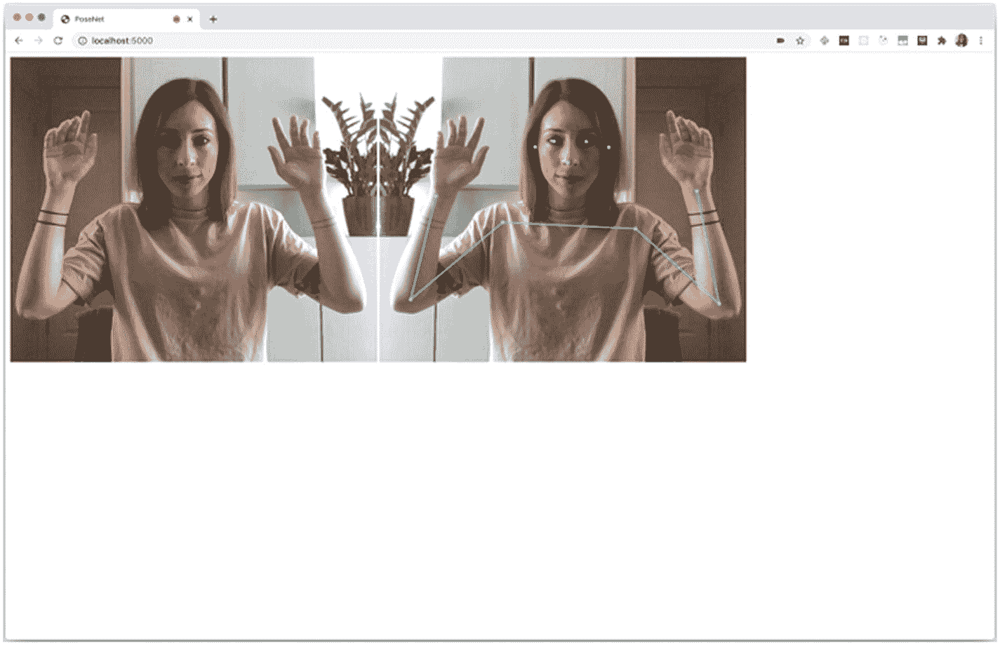
**图 5-51** 完整代码示例的输出

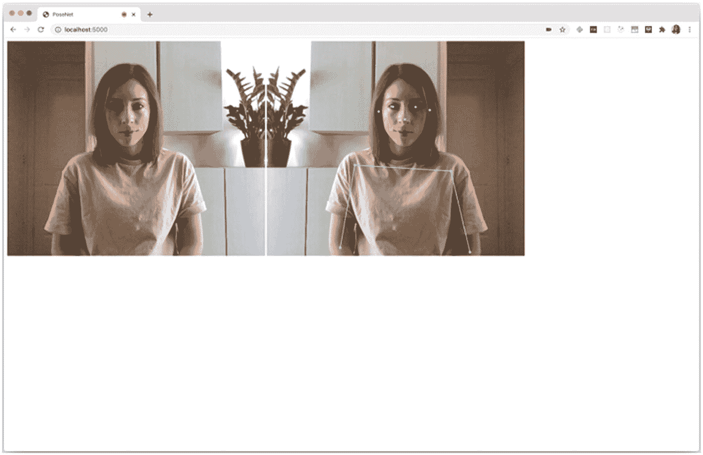
**图 5-50** 完整代码示例的输出

现在我们已经了解了检测姿态、访问身体不同部位的坐标以及在画布上可视化它们的代码，您可以随意使用这些数据进行实验，创建探索新交互的项目。

## 5.3 硬件数据
作为本章的最后一部分，也是本书包含代码示例的最后一部分，我们将探讨一些更高级和实验性的内容。接下来的几页将重点介绍如何使用硬件生成的数据，并构建一个自定义机器学习模型来检测手势。

通常，在处理硬件时，我会使用 `Arduino` 或 `Raspberry Pi` 等微控制器；然而，为了让可能没有此类设备的读者也能轻松上手，下一节将使用另一种内置硬件组件的设备——您的手机！

这假设您拥有一部至少配备加速度计和陀螺仪的现代手机。

为了在 JavaScript 中访问这些数据，我们将使用**通用传感器 API**。

这个 API 相当新且具有实验性，目前仅在 Chrome 浏览器中得到支持，因此如果您决定编写以下代码示例，请确保使用 Chrome 作为浏览器。

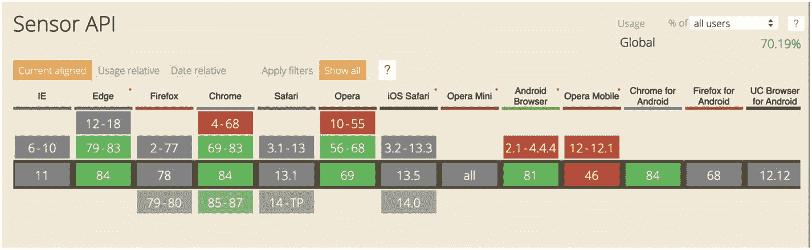
**图 5-52** 通用传感器 API 的浏览器支持情况。来源：[`https://caniuse.com/#search=sensor%20api`](https://caniuse.com/#search=sensor%2520api)

# 实现手势分类器

为了构建我们的手势分类器，我们将访问并记录手机中加速度计和陀螺仪的数据，将这些数据保存到项目中的文件中，创建一个机器学习模型，对其进行训练，并对新的实时数据进行预测。

为了实现这一点，我们需要一点 Node.js、使用 `socket.io` 的 Web 套接字、通用传感器 API 和 TensorFlow.js。如果您不熟悉其中某些技术，请不要担心，我将解释每个部分并提供您可以跟随的代码示例。

### 5.3.1 Web 传感器 API

由于本节使用硬件数据，我们需要做的第一件事是验证我们能否访问正确的数据。如前所述，我们需要记录陀螺仪和加速度计的数据。陀螺仪提供有关设备方向及其角速度的详细信息，而加速度计则专注于提供加速度数据。即使我们只需要使用其中一个传感器，但我认为结合陀螺仪和加速度计的数据可以提供更精确的运动信息，并且对手势识别很有帮助。

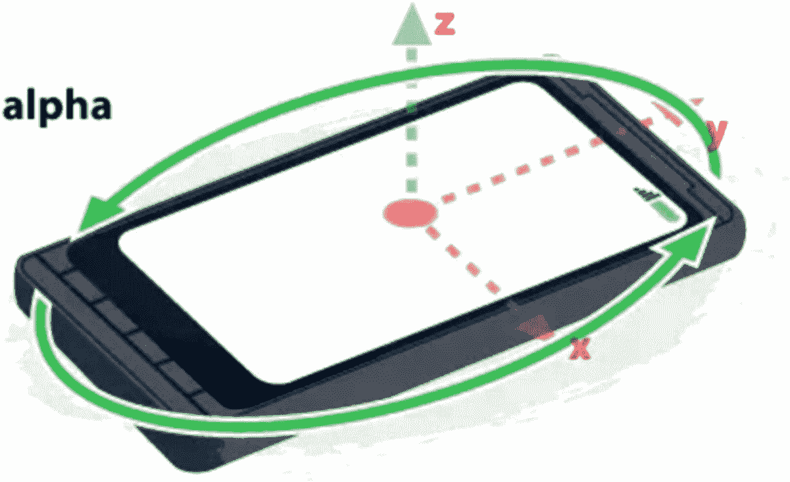
图 5-54 手机上的陀螺仪轴。来源：[`https://www.sitepoint.com/using-device-orientation-html5/`](https://www.sitepoint.com/using-device-orientation-html5/)


图 5-53 手机上的加速度计轴。来源：[`https://developers.google.com/web/fundamentals/native-hardware/device-orientation`](https://developers.google.com/web/fundamentals/native-hardware/device-orientation)

### 5.3.2 访问传感器数据

要使用通用传感器 API 访问数据，我们首先需要声明几个变量：一个用于引用 `requestAnimationFrame` 语句以便稍后取消它，另外两个用于存储陀螺仪和加速度计的数据。

```javascript
let dataRequest;
let gyroscopeData = {
  x: '',
  y: '',
  z: ''
}
let accelerometerData = {
  x: '',
  y: '',
  z: ''
}
```
代码清单 5-59 在 `index.js` 中。声明用于存储硬件数据的变量

然后，要访问手机传感器数据，你需要实例化一个新的 `Gyroscope` 和 `Accelerometer` 接口，使用 `reading` 事件监听器获取设备运动的 x、y、z 坐标，并调用 `start` 方法开始追踪。

```javascript
function initSensors() {
  let gyroscope = new Gyroscope({frequency: 60});
  gyroscope.addEventListener('reading', e => {
    gyroscopeData.x = gyroscope.x;
    gyroscopeData.y = gyroscope.y;
    gyroscopeData.z = gyroscope.z;
  });
  gyroscope.start();

  let accelerometer = new Accelerometer({frequency: 60});
  accelerometer.addEventListener('reading', e => {
    accelerometerData.x = accelerometer.x;
    accelerometerData.y = accelerometer.y;
    accelerometerData.z = accelerometer.z;
  });
  accelerometer.start();
}
```
代码清单 5-60 在 `index.js` 中。获取加速度计和陀螺仪数据

最后，由于我们只对执行特定手势时记录数据感兴趣，因此我们只需要在用户通过 `touchstart` 事件按压手机屏幕时调用上述函数。我们还应该在 `touchend` 事件中取消它。

```javascript
function getData() {
  let data = {
    xAcc: accelerometerData.x,
    yAcc: accelerometerData.y,
    zAcc: accelerometerData.z,
    xGyro: gyroscopeData.x,
    yGyro: gyroscopeData.y,
    zGyro: gyroscopeData.z,
  };
  document.body.innerHTML = JSON.stringify(data);
  dataRequest = requestAnimationFrame(getData);
}

window.onload = function () {
  initSensors();
  document.body.addEventListener("touchstart", (e) => {
    getData();
  });
  document.body.addEventListener("touchend", (e) => {
    cancelAnimationFrame(dataRequest);
  });
};
```
代码清单 5-61 在 `index.js` 中。使用 `touchstart` 事件监听器开始显示数据

此时，如果你想检查这段代码的输出，你需要使用像 `ngrok` 这样的工具在手机上访问页面，例如，创建一个到本地主机的隧道。你应该看到的是，当你按下屏幕时，实时的加速度计和陀螺仪数据会显示在屏幕上，当你松开手指时，数据将不再更新。

此时，我们将数据显示在页面上，以便我们可以再次确认一切按预期工作。然而，我们真正需要的是在记录手势时将这些数据存储到文件中。为此，我们将需要使用 Web Socket 将数据从前端发送到后端服务器，后端服务器将负责将数据写入我们应用程序文件夹中的文件。

### 5.3.3 设置 Web Socket

为了设置 Web Socket，我们将使用 `socket.io`。到目前为止，在之前的所有示例中，我们只使用了 HTML 和 JavaScript 文件，没有任何后端。如果你之前从未编写过任何 Node.js 代码，你需要安装它以及 `npm` 或 `yarn`，以便能够安装包。

设置好这两个工具后，在你的项目文件夹根目录下的终端中，输入 `npm init` 来生成一个 `package.json` 文件，该文件将包含有关项目的一些详细信息。生成 `package.json` 文件后，在终端中输入 `npm install socket.io` 来安装该包。

完成后，在你的 HTML 文件中添加以下 script 标签。

```html
<!-- 代码清单 5-62 在 HTML 文件中导入 socket.io 脚本 -->
```

现在，你应该能够在前端使用 `socket.io` 了。在你的 JavaScript 文件中，首先使用 `const socket = io()` 实例化它。如果你在设置包时遇到任何问题，请随时参考官方文档。

然后，在我们的 `touchstart` 事件监听器中，我们可以使用 `socket.io` 通过以下数据向服务器发送数据。

```javascript
socket.emit("motion data", `${accelerometerData.x} ${accelerometerData.y} ${accelerometerData.z} ${gyroscopeData.x} ${gyroscopeData.y} ${gyroscopeData.z}`);
```
代码清单 5-63 通过 Web Socket 发送运动数据

我们将运动数据作为字符串发送，因为我们希望将这些值写入文件。在 `touchend` 事件中，我们需要发送另一个事件，指示我们想要停止数据发送，使用 `socket.emit('end motion data')`。

总的来说，我们的第一个 JavaScript 文件应该如下所示。

```
const socket = io();
let gyroscopeData = {
x: "",
y: "",
z: "",
};
let accelerometerData = {
x: "",
y: "",
z: "",
};
let dataRequest;
function initSensors() {
let gyroscope = new Gyroscope({ frequency: 60 });
gyroscope.addEventListener("reading", (e) => {
gyroscopeData.x = gyroscope.x;
gyroscopeData.y = gyroscope.y;
gyroscopeData.z = gyroscope.z;
});
gyroscope.start();
let accelerometer = new Accelerometer({ frequency: 60 });
accelerometer.addEventListener("reading", (e) => {
accelerometerData.x = accelerometer.x;
accelerometerData.y = accelerometer.y;
accelerometerData.z = accelerometer.z;
});
accelerometer.start();
}
function getData() {
dataRequest = requestAnimationFrame(getData);
socket.emit(
"motion data",
`${accelerometerData.x} ${accelerometerData.y} ${accelerometerData.z} ${gyroscopeData.x} ${gyroscopeData.y} ${gyroscopeData.z}`
);
}
window.onload = function () {
initSensors();
document.body.addEventListener("touchstart", (e) => {
getData();
});
document.body.addEventListener("touchend", (e) => {
socket.emit("end motion data");
cancelAnimationFrame(dataRequest);
});
};
```

代码清单 5-64 `index.js` 文件中的完整 JavaScript 代码

现在，让我们实现这个项目的服务器端，以提供我们的前端文件、接收数据并将其存储到文本文件中。

首先，我们需要创建一个新的 JavaScript 文件。我个人将其命名为 `server.js`。

为了提供我们的前端文件，我们将使用 `express` npm 包。要安装它，请在终端中输入 `npm install express —-save`。

安装完成后，编写以下代码来创建一个 `'/record'` 路由，该路由将提供我们的 `index.html` 文件。

```
const express = require("express");
const app = express();
var http = require("http").createServer(app);
app.use("/record", express.static(__dirname + '/'));
http.listen(process.env.PORT || 3000);
```

代码清单 5-65 `server.js` 文件的初始设置

你应该能够在终端中输入 `node server.js`，在浏览器中访问 `http://localhost:3000/record`，它应该会提供我们之前创建的 `index.html` 文件。

现在，让我们通过引入 `socket.io` 包并编写将从前端接收消息的后端代码来测试我们的 Web Socket 连接。

在 `server.js` 文件的顶部，使用 `const io = require('socket.io')(http)` 引入该包。

然后，使用以下数据设置连接并监听事件。

```
io.on("connection", function (socket) {
socket.on("motion data", function (data) {
console.log(data);
});
socket.on("end motion data", function () {
console.log('end');
});
});
```

代码清单 5-66 在 `server.js` 中。Web 套接字连接

现在，重启服务器，在手机上访问 `/record` 页面，当你触摸手机屏幕时，应该会在终端中看到运动数据被记录下来。

如果没有任何显示，请仔细检查你的页面是否通过 `https` 提供服务。

至此，我们知道 Web 套接字连接已正确建立，下一步是将这些数据保存到应用程序的文件中，以便我们能够用它来训练机器学习算法。

为了保存文件，我们将使用 Node.js 的文件系统模块，因此我们需要先通过 `const fs = require('fs');` 来引入它。

然后，我们将编写一些代码，用于处理启动服务器时传入的参数，这样我们就可以轻松地记录新的样本。

例如，如果我们想记录三个手势：一个在空中比划字母 A，第二个比划字母 B，第三个比划字母 C，我们希望可以输入 `node server.js letterA 1` 来表明我们当前正在为字母 A 手势（`letterA` 参数）记录数据，并且这是第一个样本（`1` 参数）。

下面的代码将处理这两个参数，将它们存储在变量中，并用它们来命名新创建的文件。

```
let stream;
let sampleNumber;
let gestureType;
let previousSampleNumber;
process.argv.forEach(function (val, index, array) {
gestureType = array[2];
sampleNumber = parseInt(array[3]);
previousSampleNumber = sampleNumber;
stream = fs.createWriteStream(
`data/sample_${gestureType}_${sampleNumber}.txt`,
{ flags: "a" }
);
});
```

代码清单 5-67 在 `server.js` 中。处理传入参数以动态生成文件名的代码

现在，启动服务器时，你需要传入这两个参数（手势类型和样本编号）。

为了将前端的数据实际写入这些文件，我们需要编写以下几行代码。

```
socket.on("motion data", function (data) {
/* 下面这行代码允许我们记录新文件，而无需启动/停止服务器。在运动结束时，我们递增 sampleNumber 变量，这样当接收到新数据时，我们推断它与一个新手势相关，并使用正确的样本编号创建一个文件。 */
if (sampleNumber !== previousSampleNumber) {
stream = fs.createWriteStream(
`./data/sample_${gestureType}_${sampleNumber}.txt`,
{ flags: "a" }
);
}
stream.write(`${data}\r\n`);
});
socket.on("end motion data", function () {
stream.end();
sampleNumber += 1;
});
```

代码清单 5-68 在 `server.js` 中。接收数据时创建文件和流的代码

我们还会在接收到 `end motion data` 事件时关闭流，这样当用户停止触摸手机屏幕时，我们就停止写入运动数据，因为这表示他们已经停止执行我们想要记录的手势。

要测试这个设置，首先在你的应用程序中创建一个名为 `data` 的空文件夹，然后在终端中输入 `node server.js letterA 1`，在手机上重新访问网页，并在按住屏幕的同时在空中执行字母 A 的手势，松开手指后，你应该会在 `data` 文件夹中看到一个名为 `sample_letterA_1.text` 的新文件，并且它应该包含手势数据！

至此，我们能够获取加速度计和陀螺仪数据，通过 Web 套接字将其发送到服务器，并将其保存到应用程序的文件中。


```
const express = require("express");
const app = express();
const http = require("http").createServer(app);
const io = require('socket.io')(http);
const fs = require('fs');
let stream;
let sampleNumber;
let gestureType;
let previousSampleNumber;
app.use("/record", express.static(__dirname + '/'));
process.argv.forEach(function (val, index, array) {
  gestureType = array[2];
  sampleNumber = parseInt(array[3]);
  previousSampleNumber = sampleNumber;
  stream = fs.createWriteStream(
    `data/sample_${gestureType}_${sampleNumber}.txt`,
    { flags: "a" }
  );
});
io.on("connection", function (socket) {
  socket.on("motion data", function (data) {
    if (sampleNumber !== previousSampleNumber) {
      stream = fs.createWriteStream(
        `./data/sample_${gestureType}_${sampleNumber}.txt`,
        { flags: "a" }
      );
    }
    stream.write(`${data}\r\n`);
  });
  socket.on("end motion data", function () {
    stream.end();
    sampleNumber += 1;
  });
});
http.listen(process.env.PORT || 3000);
```
代码清单 5-69
`server.js` 文件中的完整代码示例

在继续编写负责格式化数据和创建机器学习模型的代码之前，请确保为我们的三个手势各记录几个数据样本；样本越多越好，但我建议每个手势至少记录 20 个样本。

### 5.3.4 数据处理

对于本节，我建议创建一个新的 JavaScript 文件。我个人将其命名为 `train.js`。

在这个文件中，我们将读取上一步记录的文本文件，将数据从字符串转换为张量，并创建和训练我们的模型。以下部分代码示例与 TensorFlow.js 没有直接关系（读取文件夹和文件，以及将数据格式化为多维数组），因此我不会深入探讨它们。

第一步是遍历我们的数据文件夹，获取每个样本和手势的数据，并将其组织成特征和标签的数组。

为此，我使用了 `line-reader` npm 包，因此我们需要使用 `npm install line-reader` 来安装它。

我们还需要使用 `npm install @tensorflow/tfjs-node` 来安装 TensorFlow。

然后，我创建了两个函数 `readDir` 和 `readFile`，用于遍历数据文件夹中的所有文件，并针对每个文件，逐行遍历，将字符串转换为数字，并返回一个包含该手势标签和特征的对象。

```
const lineReader = require("line-reader");
var fs = require("fs");
const tf = require("@tensorflow/tfjs-node");
const gestureClasses = ["letterA", "letterB", "letterC"];
let numClasses = gestureClasses.length;
let numSamplesPerGesture = 20; // 每个手势记录的次数。
let totalNumDataFiles = numSamplesPerGesture * numClasses;
let numPointsOfData = 6; // 加速度计和陀螺仪的 x、y 和 z 值
let numLinesPerFile = 100; // 文件可能具有不同的行数，因此我们需要一个值来截断，以确保所有样本具有相同的长度。
let totalNumDataPerFile = numPointsOfData * numLinesPerFile;
function readFile(file) {
  let allFileData = [];
  return new Promise((resolve, reject) => {
    fs.readFile(`data/${file}`, "utf8", (err, data) => {
      if (err) {
        reject(err);
      } else {
        lineReader.eachLine(`data/${file}`, function (line) {
          // 将每一行转换为浮点数数组。
          let dataArray = line
            .split(" ")
            .map((arrayItem) => parseFloat(arrayItem));
          allFileData.push(...dataArray);
          let concatArray = [...allFileData];
          if (concatArray.length === totalNumDataPerFile) {
            // 从文件名中获取标签
            let label = file.split("_")[1];
            let labelIndex = gestureClasses.indexOf(label);
            // 返回一个包含特征数据和标签索引的对象
            resolve({ features: concatArray, label: labelIndex });
          }
        });
      }
    });
  });
}
const readDir = () =>
  new Promise((resolve, reject) =>
    fs.readdir(`data/`, "utf8", (err, data) =>
      err ? reject(err) : resolve(data)
    )
  );
(async () => {
  const filenames = await readDir();
  let allData = [];
  filenames.map(async (file) => {
    let originalContent = await readFile(file);
    allData.push(originalContent);
    if (allData.length === totalNumDataFiles) {
      console.log(allData);
    }
  });
})();
```
代码清单 5-70
在 `train.js` 中。遍历文件，将原始数据转换为特征和标签的对象

我不会深入探讨前面的代码示例，但我添加了一些内联注释来提供帮助。

如果你使用 `node train.js` 运行此代码，你应该会得到类似于下图的输出。


图 5-55

格式化数据的示例输出

此时，我们的变量 `allData` 保存了每个手势样本的所有特征和标签，但我们还没有完成。在将这些数据输入机器学习算法之前，我们需要将其转换为张量，这是 TensorFlow.js 处理的数据类型。

接下来的代码示例会更复杂，因为我们需要进一步格式化数据，创建张量，将它们分成训练集和测试集以验证我们未来的预测，然后生成模型。

我添加了内联注释来尝试解释每一步。

因此，在上面的代码中我们写 `console.log(allData)` 的地方，将其替换为 `format(allData)`，下面将展示此函数的实现。


```
let justFeatures = [];
let justLabels = [];
const format = (allData) => {
  // 按标签对所有数据进行排序，得到 [{label: 0, features: ...}, {label: 1, features: ...}];
  let sortedData = allData.sort((a, b) => (a.label > b.label ? 1 : -1));
  // Tensorflow 处理的是数组而不是对象，因此我们需要将标签和张量分开。
  sortedData.map((item) => {
    createMultidimentionalArrays(justLabels, item.label, item.label);
    createMultidimentionalArrays(justFeatures, item.label, item.features);
  });
};

function createMultidimentionalArrays(dataArray, index, item) {
  !dataArray[index] && dataArray.push([]);
  dataArray[index].push(item);
}
```
代码清单 5-71 在 `train.js` 中。排序和格式化数据

运行此代码后，`justFeatures` 和 `justLabels` 将分别成为包含特征和标签索引的多维数组。

例如，`justLabels` 应该看起来像 `[ [ 0, 0, 0, 0, 0, 0, 0, 0, 0, 0, 0, 0, 0, 0, 0, 0, 0, 0, 0, 0 ], [ 1, 1, 1, 1, 1, 1, 1, 1, 1, 1, 1, 1, 1, 1, 1, 1, 1, 1, 1, 1 ], [ 2, 2, 2, 2, 2, 2, 2, 2, 2, 2, 2, 2, 2, 2, 2, 2, 2, 2, 2, 2 ] ]`。

现在我们离 TensorFlow 可以处理的格式越来越近了，但我们仍然需要将这些多维数组转换为张量。为此，让我们首先创建一个名为 `transformToTensor` 的函数。

```
const [
  trainingFeatures,
  trainingLabels,
  testingFeatures,
  testingLabels,
] = transformToTensor(justFeatures, justLabels);

const transformToTensor = (features, labels) => {
  return tf.tidy(() => {
    // 准备将数据集拆分为训练集和测试集。
    const featureTrainings = [];
    const labelTrainings = [];
    const featureTests = [];
    const labelTests = [];
    // 对于每个训练过的手势，将数据转换为张量，并将其存储在训练集和测试集中。
    for (let i = 0; i < gestureClasses.length; ++i) {
      const [
        featureTrain,
        labelTrain,
        featureTest,
        labelTest,
      ] = convertToTensors(features[i], labels[i], 0.2);
      featureTrainings.push(featureTrain);
      labelTrainings.push(labelTrain);
      featureTests.push(featureTest);
      labelTests.push(labelTest);
    }
    // 返回所有连接后的数据
    return [
      tf.concat(featureTrainings, 0),
      tf.concat(labelTrainings, 0),
      tf.concat(featureTests, 0),
      tf.concat(labelTests, 0),
    ];
  });
};
```
代码清单 5-72 在 `train.js` 中。将多维数组转换为张量

上面的代码调用了一个名为 `convertToTensors` 的函数，让我们来定义它。

```
const convertToTensors = (featuresData, labelData, testSplit) => {
  if (featuresData.length !== labelData.length) {
    throw new Error(
      "特征集和标签集的样本数量不同"
    );
  }
  // 打乱数据，以避免模型习惯于样本的顺序。
  const [shuffledFeatures, shuffledLabels] = shuffleData(
    featuresData,
    labelData
  );
  // 创建张量
  const featuresTensor = tf.tensor2d(shuffledFeatures, [
    numSamplesPerGesture,
    totalNumDataPerFile,
  ]);
  // 创建一个一维 `tf.Tensor` 来保存标签，并将集合 {0, 1, 2} 中的数字标签转换为独热编码（例如，0 --> [1, 0, 0]）。
  const labelsTensor = tf.oneHot(
    tf.tensor1d(shuffledLabels).toInt(),
    numClasses
  );
  // 将所有数据拆分为训练集和测试集并返回。
  return split(featuresTensor, labelsTensor, testSplit);
};
```
代码清单 5-73 在 `train.js` 中。将数据转换为张量

此函数调用了另外两个函数，`shuffleData` 和 `split`。

```
const split = (featuresTensor, labelsTensor, testSplit) => {
  // 根据 `testSplit` 将数据拆分为训练集和测试集。
  const numTestExamples = Math.round(numSamplesPerGesture * testSplit);
  const numTrainExamples = numSamplesPerGesture - numTestExamples;
  const trainingFeatures = featuresTensor.slice(
    [0, 0],
    [numTrainExamples, totalNumDataPerFile]
  );
  const testingFeatures = featuresTensor.slice(
    [numTrainExamples, 0],
    [numTestExamples, totalNumDataPerFile]
  );
  const trainingLabels = labelsTensor.slice(
    [0, 0],
    [numTrainExamples, numClasses]
  );
  const testingLabels = labelsTensor.slice(
    [numTrainExamples, 0],
    [numTestExamples, numClasses]
  );
  return [trainingFeatures, trainingLabels, testingFeatures, testingLabels];
};
```
清单 5-75 在 `train.js` 中。将数据拆分为训练集和测试集

```
const shuffleData = (features, labels) => {
  const indices = [...Array(numSamplesPerGesture).keys()];
  tf.util.shuffle(indices);
  const shuffledFeatures = [];
  const shuffledLabels = [];
  features.map((featuresArray, index) => {
    shuffledFeatures.push(features[indices[index]]);
    shuffledLabels.push(labels[indices[index]]);
  });
  return [shuffledFeatures, shuffledLabels];
};
```
清单 5-74 在 `train.js` 中。打乱数据

此时，如果你在代码中添加一条 `console.log` 语句来记录 `format` 函数中的 `trainingFeatures` 变量，你应该会得到一个张量作为输出。

```
Tensor {
  kept: false,
  isDisposedInternal: false,
  shape: [ 12, 600 ],
  dtype: 'float32',
  size: 7200,
  strides: [ 600 ],
  dataId: {},
  id: 70,
  rankType: '2',
  scopeId: 0
}
```
清单 5-76 输出张量示例

## 数据处理和模型训练

`shape`数组中的值将根据你训练的数据样本数量和每个文件的行数而有所不同。

总的来说，从`format`函数开始的代码示例应如下所示。

```
const format = (allData) => {
let sortedData = allData.sort((a, b) => (a.label > b.label ? 1 : -1));
sortedData.map((item) => {
createMultidimentionalArrays(justLabels, item.label, item.label);
createMultidimentionalArrays(justFeatures, item.label, item.features);
});
const [
trainingFeatures,
trainingLabels,
testingFeatures,
testingLabels,
] = transformToTensor(justFeatures, justLabels);
};
function createMultidimentionalArrays(dataArray, index, item) {
!dataArray[index] && dataArray.push([]);
dataArray[index].push(item);
}
const transformToTensor = (features, labels) => {
return tf.tidy(() => {
const featureTrainings = [];
const labelTrainings = [];
const featureTests = [];
const labelTests = [];
for (let i = 0; i  {
if (featuresData.length !== labelData.length) {
throw new Error(
"features set and labels set have different numbers of examples"
);
}
const [shuffledFeatures, shuffledLabels] = shuffleData(
featuresData,
labelData
);
const featuresTensor = tf.tensor2d(shuffledFeatures, [
numSamplesPerGesture,
totalNumDataPerFile,
]);
const labelsTensor = tf.oneHot(
tf.tensor1d(shuffledLabels).toInt(),
numClasses
);
return split(featuresTensor, labelsTensor, testSplit);
};
const shuffleData = (features, labels) => {
const indices = [...Array(numSamplesPerGesture).keys()];
tf.util.shuffle(indices);
const shuffledFeatures = [];
const shuffledLabels = [];
features.map((featuresArray, index) => {
shuffledFeatures.push(features[indices[index]]);
shuffledLabels.push(labels[indices[index]]);
});
return [shuffledFeatures, shuffledLabels];
};
const split = (featuresTensor, labelsTensor, testSplit) => {
const numTestExamples = Math.round(numSamplesPerGesture * testSplit);
const numTrainExamples = numSamplesPerGesture - numTestExamples;
const trainingFeatures = featuresTensor.slice(
[0, 0],
[numTrainExamples, totalNumDataPerFile]
);
const testingFeatures = featuresTensor.slice(
[numTrainExamples, 0],
[numTestExamples, totalNumDataPerFile]
);
const trainingLabels = labelsTensor.slice(
[0, 0],
[numTrainExamples, numClasses]
);
const testingLabels = labelsTensor.slice(
[numTrainExamples, 0],
[numTestExamples, numClasses]
);
return [trainingFeatures, trainingLabels, testingFeatures, testingLabels];
};
```

清单 5-77
在`train.js`中。格式化数据的完整代码示例

如果你刚接触机器学习和 TensorFlow.js，这些内容可能有点难以消化，但我们快完成了。我们的数据已经格式化并拆分为训练集和测试集，因此最后一步是创建模型并进行训练。

### 5.3.5 创建并训练模型

这部分代码有些随意，因为创建模型和选择参数值有多种方法。不过，你可以复制以下代码作为起点，稍后尝试不同的值，看看它们如何影响模型的准确率。

```
const createModel = async (featureTrain, labelTrain, featureTest, labelTest) => {
const params = { learningRate: 0.1, epochs: 40 };
// 实例化一个顺序模型
const model = tf.sequential();
// 添加几个层
model.add(
tf.layers.dense({
units: 10,
activation: "sigmoid",
inputShape: [featureTrain.shape[1]],
})
);
model.add(tf.layers.dense({ units: numClasses, activation: "softmax" }));
model.summary();
const optimizer = tf.train.adam(params.learningRate);
model.compile({
optimizer: optimizer,
loss: "categoricalCrossentropy",
metrics: ["accuracy"],
});
// 使用我们的特征和标签训练模型
await model.fit(featureTrain, labelTrain, {
epochs: params.epochs,
validationData: [featureTest, labelTest],
});
// 将模型保存到我们的文件系统中。
await model.save("file://model");
return model;
};
```

清单 5-78
在`train.js`中。创建、训练并保存模型

在`format`函数的末尾，使用`createModel(trainingFeatures, trainingLabels, testingFeatures, testingLabels)`调用此`createModel`函数。

现在，如果一切正常，你在终端中运行`node train.js`，应该会看到模型正在训练，并在你的应用程序中找到一个`model`文件夹！

如果某些地方没有按预期工作，以下是完整的`train.js`文件应有的样子。


```javascript
const lineReader = require("line-reader");
var fs = require("fs");
const tf = require("@tensorflow/tfjs-node");
let justFeatures = [];
let justLabels = [];
const gestureClasses = ["letterA", "letterB", "letterC"];
let numClasses = gestureClasses.length;
let numSamplesPerGesture = 5;
let totalNumDataFiles = numSamplesPerGesture * numClasses;
let numPointsOfData = 6;
let numLinesPerFile = 100;
let totalNumDataPerFile = numPointsOfData * numLinesPerFile;
function readFile(file) {
let allFileData = [];
return new Promise((resolve, reject) => {
fs.readFile(`data/${file}`, "utf8", (err, data) => {
if (err) {
reject(err);
} else {
lineReader.eachLine(`data/${file}`, function (line) {
let dataArray = line
.split(" ")
.map((arrayItem) => parseFloat(arrayItem));
allFileData.push(...dataArray);
let concatArray = [...allFileData];
if (concatArray.length === totalNumDataPerFile) {
let label = file.split("_")[1];
let labelIndex = gestureClasses.indexOf(label);
resolve({ features: concatArray, label: labelIndex });
}
});
}
});
});
}
const readDir = () =>
new Promise((resolve, reject) =>
fs.readdir(`data/`, "utf8", (err, data) =>
err ? reject(err) : resolve(data)
)
);
(async () => {
const filenames = await readDir();
let allData = [];
filenames.map(async (file) => {
let originalContent = await readFile(file);
allData.push(originalContent);
if (allData.length === totalNumDataFiles) {
format(allData);
}
});
})();
const format = (allData) => {
let sortedData = allData.sort((a, b) => (a.label > b.label ? 1 : -1));
sortedData.map((item) => {
createMultidimentionalArrays(justLabels, item.label, item.label);
createMultidimentionalArrays(justFeatures, item.label, item.features);
});
const [trainingFeatures, trainingLabels, testingFeatures, testingLabels] = transformToTensor(justFeatures, justLabels);
createModel(trainingFeatures, trainingLabels, testingFeatures, testingLabels);
};
function createMultidimentionalArrays(dataArray, index, item) {
!dataArray[index] && dataArray.push([]);
dataArray[index].push(item);
}
const transformToTensor = (features, labels) => {
return tf.tidy(() => {
const featureTrainings = [];
const labelTrainings = [];
const featureTests = [];
const labelTests = [];
for (let i = 0; i  {
if (featuresData.length !== labelData.length) {
throw new Error(
"特征集和标签集的样本数量不一致"
);
}
const [shuffledFeatures, shuffledLabels] = shuffleData(
featuresData, labelData);
const featuresTensor = tf.tensor2d(shuffledFeatures, [
numSamplesPerGesture,
totalNumDataPerFile,
]);
const labelsTensor = tf.oneHot(
tf.tensor1d(shuffledLabels).toInt(),
numClasses
);
return split(featuresTensor, labelsTensor, testSplit);
};
const shuffleData = (features, labels) => {
const indices = [...Array(numSamplesPerGesture).keys()];
tf.util.shuffle(indices);
const shuffledFeatures = [];
const shuffledLabels = [];
features.map((featuresArray, index) => {
shuffledFeatures.push(features[indices[index]]);
shuffledLabels.push(labels[indices[index]]);
});
return [shuffledFeatures, shuffledLabels];
};
const split = (featuresTensor, labelsTensor, testSplit) => {
const numTestExamples = Math.round(numSamplesPerGesture * testSplit);
const numTrainExamples = numSamplesPerGesture - numTestExamples;
const trainingFeatures = featuresTensor.slice(
[0, 0],
[numTrainExamples, totalNumDataPerFile]
);
const testingFeatures = featuresTensor.slice(
[numTrainExamples, 0],
[numTestExamples, totalNumDataPerFile]
);
const trainingLabels = labelsTensor.slice(
[0, 0],
[numTrainExamples, numClasses]
);
const testingLabels = labelsTensor.slice(
[numTrainExamples, 0],
[numTestExamples, numClasses]
);
return [trainingFeatures, trainingLabels, testingFeatures, testingLabels];
};
const createModel = async (xTrain, yTrain, xTest, yTest) => {
const params = { learningRate: 0.1, epochs: 40 };
const model = tf.sequential();
model.add(
tf.layers.dense({
units: 10,
activation: "sigmoid",
inputShape: [xTrain.shape[1]],
})
);
model.add(tf.layers.dense({ units: numClasses, activation: "softmax" }));
model.summary();
const optimizer = tf.train.adam(params.learningRate);
model.compile({
optimizer: optimizer,
loss: "categoricalCrossentropy",
metrics: ["accuracy"],
});
await model.fit(xTrain, yTrain, {
epochs: params.epochs,
validationData: [xTest, yTest],
});
await model.save("file://model");
return model;
};
```

## 清单 5-79

`train.js` 中的完整代码示例


你在终端中看到的训练步骤应如下图所示。


图 5-56 训练步骤的示例输出

模型的输出显示，训练的最后一步准确率达到了 0.9，这非常棒！

现在，为了用实时数据进行测试，让我们进入本项目的最后一步——使用我们的模型生成预测。

### 5.3.6 实时预测

在最后一步中，让我们创建一个名为`predict.js`的新 JavaScript 文件。

我们将创建一个名为`/predict`的新端点，提供我们的`index.html`文件，使用类似的 Web Socket 代码将手机的运动数据发送到服务器，并运行实时预测。

第一个小修改是在前端代码的初始`index.js`文件中。我们需要将运动数据以字符串形式发送，替换为以下数据。

```
let data = {
  xAcc: accelerometerData.x,
  yAcc: accelerometerData.y,
  zAcc: accelerometerData.z,
  xGyro: gyroscopeData.x,
  yGyro: gyroscopeData.y,
  zGyro: gyroscopeData.z,
};
socket.emit("motion data", data);
```

代码清单 5-80 在`index.js`中。更新通过 Web Socket 发送的运动数据的格式

由于实时数据需要输入到模型中，因此发送一个数字对象比重复我们在训练过程中使用的格式化方式更简单。

然后，我们的`predict.js`文件将与`server.js`文件非常相似，只是多了一个`predict`函数，该函数将实时数据输入模型并生成关于手势的预测。

```
const tf = require("@tensorflow/tfjs-node");
const express = require("express");
const app = express();
var http = require("http").createServer(app);
const io = require("socket.io")(http);
let liveData = [];
let predictionDone = false;
let model;
const gestureClasses = ["letterA", "letterB", "letterC"];

// 创建新端点
app.use("/predict", express.static(__dirname + "/"));
io.on("connection", async function (socket) {
  // 加载模型
  model = await tf.loadLayersModel("file://model/model.json");
  socket.on("motion data", function (data) {
    predictionDone = false;
    // 这确保数据与训练时使用的形状相同。600 代表 6 个值（加速度计和陀螺仪的 x、y、z），采集 100 次。
    if (liveData.length < 600) {
      liveData.push(data.xAcc, data.yAcc, data.zAcc, data.xGyro, data.yGyro, data.zGyro);
    }
    if (liveData.length === 600 && !predictionDone) {
      predictionDone = true;
      predict();
      liveData = [];
    }
  });
  function predict() {
    tf.tidy(() => {
      const inputData = liveData;
      // 从实时数据创建张量
      const input = tf.tensor2d([inputData], [1, 600]);
      const predictOut = model.predict(input);
      // 获取最高概率
      const winner = gestureClasses[predictOut.argMax(-1).dataSync()[0]];
      console.log(winner);
    });
  }
});

http.listen(process.env.PORT || 3000);
```

代码清单 5-81 在`predict.js`中。`predict.js`文件的完整代码

如果你使用`node predict.js`运行上述代码示例，在手机上访问`/predict`页面，并执行我们训练过的三个手势之一。按住屏幕时，一旦松开屏幕，你应该会在终端中看到一个预测结果！

运行实时预测时，你可能会遇到以下错误。当手势执行过快，采集的数据量低于我们的 600 个值时，就会发生这种情况，这意味着数据的形状不正确，模型无法使用。如果稍微慢一点重试，应该就能正常工作。


图 5-57 手势执行过快时可能出现的错误

现在我们的实时预测已经可以工作，你可以继续修改用于创建模型的一些参数，看看它们如何影响预测结果，或者训练不同的手势，甚至使用 Web Socket 将预测结果发送回前端，以创建一个交互式应用程序。本节的最后部分的主要目标是涵盖创建自己的机器学习模型所涉及的步骤。

在过去的几页中，我们学习了如何使用通用传感器 API 访问硬件数据，设置服务器和 Web Socket 进行通信和共享数据，将运动数据保存到文件中，处理和转换数据，以及创建、训练和使用模型来预测实时手势！

希望这能让你更好地了解机器学习和 TensorFlow.js 所提供的所有可能性。

然而，如果你是新手，这包含了很多新信息，尤其是最后这一部分相当高级且具有实验性，所以我不期望你完全理解并感到完全舒适。

如果你感兴趣，可以随时回顾代码示例，慢慢来，并尝试构建一些小原型。