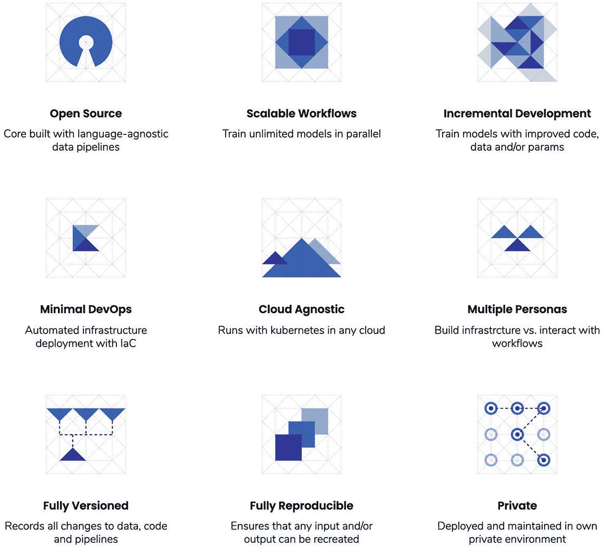
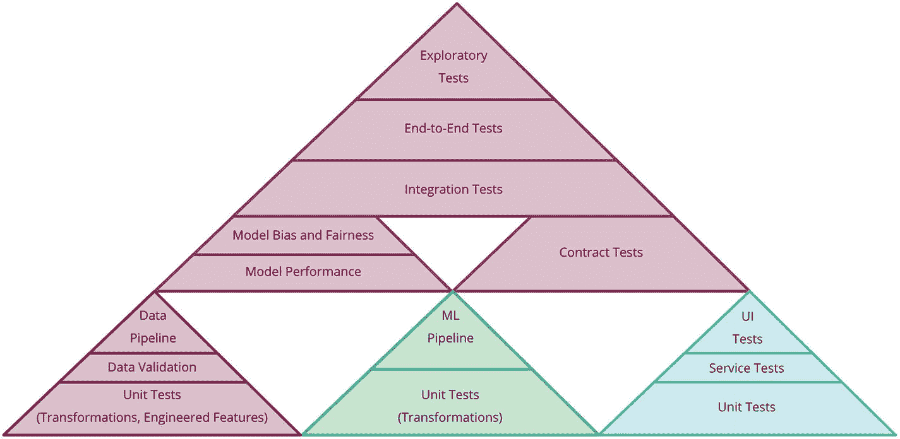
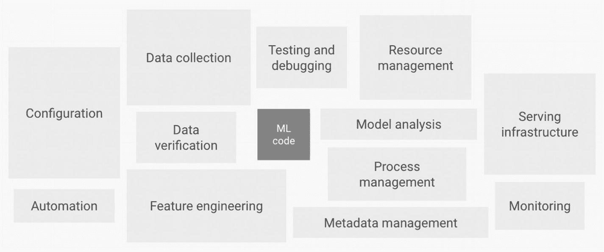
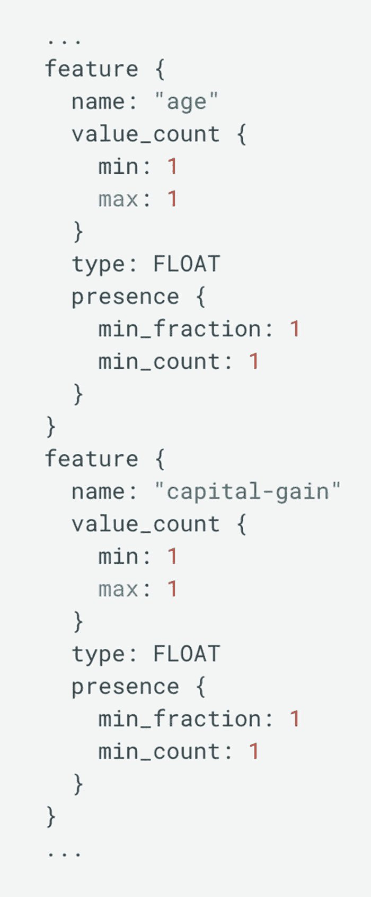
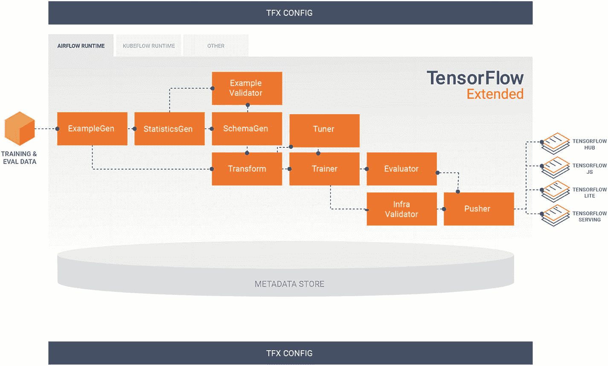
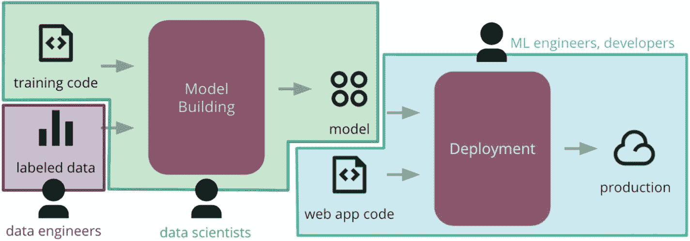
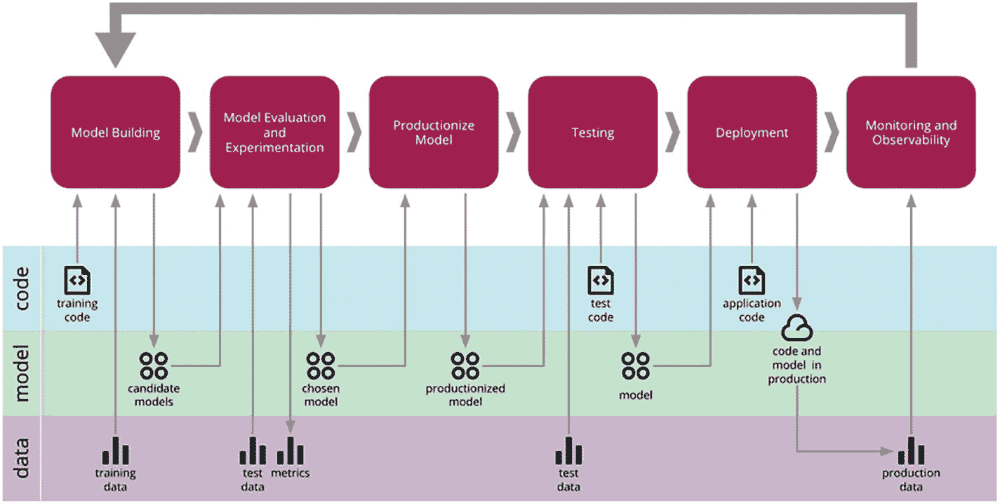

# 6. 生产环境中的机器学习

现在，希望你对于使用机器学习和构建基于不同模型与输入的应用程序感到更加得心应手，接下来让我们讨论将机器学习模型和系统投入生产环境所涉及的不同方面。

图 6-8

`kaos` 的功能。来源：[`ki-labs.com/kaos/#features`](https://ki-labs.com/kaos/%2523features)

图 6-7

测试金字塔示例。来源：[`martinfowler.com/articles/cd4ml.html`](https://martinfowler.com/articles/cd4ml.html)

图 6-6

机器学习系统的组件。来源：[`cloud.google.com/solutions/machine-learning/mlops-continuous-delivery-and-automation-pipelines-in-machine-learning`](https://cloud.google.com/solutions/machine-learning/mlops-continuous-delivery-and-automation-pipelines-in-machine-learning)

图 6-5

示例模式。来源：[`www.tensorflow.org/tfx/guide/schemagen`](https://www.tensorflow.org/tfx/guide/schemagen)

图 6-4

标准 `TFX` 流水线

图 6-3

机器学习系统的组件。来源：[`cloud.google.com/solutions/machine-learning/mlops-continuous-delivery-and-automation-pipelines-in-machine-learning`](https://cloud.google.com/solutions/machine-learning/mlops-continuous-delivery-and-automation-pipelines-in-machine-learning)

图 6-2

每个阶段的工程师类型。

图 6-1

机器学习持续交付的阶段。来源：[`martinfowler.com/articles/cd4ml.html`](https://martinfowler.com/articles/cd4ml.html)

在开始之前，重要的是要知道本章不会深入探讨如何使用 `Kubernetes` 集群、配置负载均衡器等来设置你自己的机器学习流水线，因为这通常是 DevOps 或基础设施团队的任务。然而，理解将机器学习模型投入生产环境所面临的挑战非常重要，因此我们将解释其中一些挑战，并介绍一些不同的工具，如果你没有机会与专门的团队合作，这些工具应该能帮助你将机器学习添加到生产应用程序中。

## 6.1 挑战

将机器学习投入生产环境会带来一系列与我们之前可能遇到的不同的挑战。

在本书中构建的个人项目中，我们是唯一的用户，并且所有内容都在本地运行。我们更多地处于概念验证阶段。在生产环境中，应用程序不仅会被数百、数千甚至数百万用户使用，而且还会由多个团队构建。因此，你的系统必须能够适应并处理更多的挑战。

### 6.1.1 可扩展性

将机器学习模型投入生产的目的，是使其成为用户日常交互的应用程序的一部分。因此，它必须能够处理潜在的大量请求。

无论是初创公司还是大型企业，运行机器学习模型都需要大量的 CPU、GPU 和内存，这意味着你必须确保系统能够支持为所有用户运行模型。

### 6.1.2 高可用性

你曾经参与过以及将要参与的大多数 Web 应用程序，都期望能够 7x24 小时可用，以响应用户请求。

如果你决定在这些系统中加入机器学习模型，那么这些模型也需要具备高可用性。

无论你是决定更新模型、将其扩展到更广泛的用户群体，还是测试新工具，在实验过程中确保模型仍能正常运行都至关重要。

### 6.1.3 可观测性

我们工作的系统非常不稳定。很多事情都可能以多种方式快速变化。用户界面会随着新功能的发布而改变，不同地理位置可能出现用户访问高峰，第三方服务商可能发生故障，等等。

这种不稳定性意味着需要密切监控模型及其预测结果。这不仅是要验证模型能否成功生成预测，还需要定期检查输入和输出是否正确。

### 6.1.4 可复用性

根据你在应用程序中构建和运行的模型，有时考虑其可复用性非常重要。

例如，Booking.com 公司在生产环境中运行着多个模型，其中包括一个用于判断酒店是否适合家庭入住的模型。

基于不同的标准，该模型既可以在酒店详情页中突出显示适合家庭入住的酒店，也可以在搜索结果页面中作为筛选条件。就像前端应用程序中不同的 UI 组件可以复用一样，构建模型使其能够在不同页面上复用，可以确保你最大限度地利用它们。

创建和测试机器学习模型是一项耗时的任务，模型复用可以使这项投入更具成效。

此外，可复用性确保了模型可以在面临类似问题的不同团队之间共享，从而避免浪费时间从头开始重新创建模型。

现在，我们简要介绍了将机器学习模型产品化所面临的一些挑战，接下来让我们看看机器学习项目的生命周期。

## 6.2 机器学习生命周期

下图是 Martin Fowler 推广的“机器学习持续交付”（`CD4ML`）概念的直观指南。

在此图中，我们可以看出六个不同的阶段：

**模型构建** 涉及理解问题、准备数据、提取特征以及编写创建模型的初始代码。

**模型评估与实验** 涉及特征选择、超参数调优、算法比较以及针对不同解决方案进行整体实验。

**模型产品化** 是从实验或研究阶段过渡到为部署做准备的一步。

**测试** 侧重于确保我们即将部署到生产环境的模型和代码按预期运行，并且其结果与第二阶段（评估与实验）中观察到的结果一致。

**部署** 是将模型投入生产环境。

最后，**监控与可观测性** 旨在确保模型在生产环境中按预期运行。

标准软件项目生命周期与机器学习项目的主要区别之一，在于这些阶段重复的方式。

正如从最后一个阶段（监控与可观测性）指回第一个阶段（模型构建）的箭头所示，我们应该根据模型在生产环境中的表现所收集到的信息，来做出关于模型的决策。

**模型应根据这些信息进行更新或弃用。**

根据你的应用程序，模型需要定期用新数据进行重新训练，以避免过时。

例如，像 AutoScout24 这样帮助用户在线出售车辆的平台，会使用机器学习根据品牌、生产年份和型号等参数，预测人们出售汽车的价格范围。

如果他们不定期用真实用户数据重新训练模型，其预测很快就会过时，无法代表用户车辆在市场上的真实价值。结果，人们可能会因为价格未根据当前市场调整而低价出售车辆，或者难以售出。

这种用新数据重新训练模型的循环可以手动或自动完成。

此外，并非所有这些阶段都必须由同一位工程师执行。

模型构建和实验的前两个阶段可以（并且/或者应该）由数据科学家或机器学习工程师完成。后续阶段应由 DevOps 工程师或具有将应用程序部署到生产环境经验的软件工程师负责，如下图所示。

看到生命周期中不同部分由不同类型的工程师负责，这引出了我们接下来要讨论的机器学习系统。

## 6.3 机器学习系统

在本书中，我们讨论了很多关于如何使用预训练模型和生成预测的内容；然而，机器学习系统由更多的组件构成。

例如，如果你找不到适合你应用的预训练模型，并决定自己创建，那么你还需要考虑数据收集、验证、特征提取和监控，如下图所示。

在生产环境中使用机器学习模型需要你设置特定的流水线。

你的模型不仅需要被提供服务，还需要考虑如何收集新数据并重新训练模型，使其不会过时，以及监控什么和如何监控等。

幸运的是，你不需要自己构建所有这些组件。像 `TensorFlow Extended (TFX)` 这样的平台提供了用于部署生产级 ML 流水线的端到端解决方案。

`TFX` 包含不同的组件，可以帮助你设置机器学习流水线，例如 `TensorFlow Data Validation` 帮助你理解数据，`TensorFlow Transform` 帮助你预处理数据并根据需要转换格式，以及 `TensorFlow Serving` 支持模型版本管理并确保高并发模型的高性能。

使用此类平台的好处是，你的大部分 ML 流水线可以在一个平台上设置，从而降低设置和维护的复杂性，并且能够利用 Google 专业团队的工作成果，让你对系统的性能和可靠性更有信心。

以下是一个典型的 `TFX` 流水线示例。

为了更好地理解 `TFX` 的功能，让我们逐一了解这些组件：

- 首先，`ExampleGen` 是初始输入组件，它消费外部文件并将数据导入流水线。
- `StatisticsGen` 负责计算数据集的统计信息，这些信息将用于生成模式。
- `SchemaGen` 生成包含输入数据信息的模式，例如每个特征的数据类型，或者该特征是否必须每次都存在。下图展示了一个模式可能的样子。
- `ExampleValidator` 用于识别训练数据中的异常。
- `Transform` 将实际使用 `SchemaGen` 组件生成的模式，对 `ExampleGen` 发出的数据进行特征工程，生成一个 `SavedModel` 实例，供后续组件使用。
- `Trainer` 使用 Python TensorFlow API 来训练模型。
- `Tuner` 进行超参数调优，即为模型选择一组最优参数。
- `Evaluator` 对模型结果进行分析，确保模型适合推送到生产环境。
- `InfraValidator` 负责在模型服务基础设施中验证模型。它会启动一个沙盒化的模型服务器，并检查模型是否可以加载和查询。
- `Pusher` 是将经过验证的模型推送到部署目标的组件。

如果这看起来有点复杂，这完全正常。正如我在本章开头提到的，我不期望任何阅读本书的人能立刻理解机器学习流水线中所需的所有组件。

由于你不太可能需要自己搭建一个这样的流水线，这里提供这些信息主要是为了让你了解，在部署自定义模型时，设置系统所涉及的组件。

现在我们已经简要了解了标准 `TFX` 流水线的样子，让我们回过头来更广泛地讨论流水线。构建流水线的必要性是什么？

如果我们回顾本节开头的图片，创建模型的机器学习代码实际上只代表了系统的一小部分。

其余部分由数据收集、自动化、测试、分析等元素组成，你需要将 DevOps 原则应用于 ML 系统。

这类系统的工作方式类似于软件系统，你需要它可靠且开发周期短，但在以下方面有所不同：

**技能多样性**：如果你在一个使用机器学习模型的生产应用上工作，你的团队可能包括数据科学家，他们需要与系统交互，但可能没有软件实践的经验或知识。你的系统必须考虑到这一点，提供 ML 研究人员可以使用的组件。

**模型服务**：在生产环境中服务模型似乎有三种不同的方式。可以是`嵌入式模型`，将其视为与应用程序打包在一起的依赖项；`模型即服务 (MAAS)`，将模型封装在可以独立部署和更新的单独服务中；以及`模型即数据`，模型也是独立的，但在运行时作为数据被摄入。

**实验追踪**：机器学习模型在推送到生产环境之前会经历大量实验，导致大量代码被丢弃且从未部署。因此，追踪正在进行的各种实验以避免重复非常重要。

**监控**：尽管标准软件项目通常也会使用监控和日志系统，但监控机器学习模型略有不同。我们不仅需要监控模型在接收到输入数据时是否生成预测，还需要使用以下指标捕获关于模型行为的数据——`模型输入`（追踪输入模型的数据）、`输出的可解释性`（理解模型如何做出预测）、模型输出本身，以及`模型公平性`（分析输出是否存在偏见）。

**测试**：可以在机器学习工作流中引入不同类型的测试。我们可以通过查看错误率和准确率来测试模型质量，通过与生成的模式进行比较来测试数据的有效性，甚至尝试测试模型偏见和公平性。以下是机器学习系统的测试金字塔示例。

尽管这类系统可能由基础设施团队负责，但作为开发者，你仍然应该参与设置应用程序与模型交互的方式。

因此，你需要问自己以下问题：

- 如何编写一个能从模型生成预测的 API？
- 如何最好地将该 API 部署到生产环境？
- 需要收集什么样的数据？
- API 应该返回什么信息？

现在我们已经简要介绍了机器学习系统的不同组件，让我们来看看目前可用的一些工具，这些工具可以让你更轻松地在生产环境中使用机器学习。

## 6.4 工具

在最后一节中，我们将快速介绍一些工具，如果你希望在生产应用中添加机器学习功能，但又不想设置复杂的系统，可以使用这些工具。

### 6.4.1 预训练模型

希望你在完成本书中的项目后，已经熟悉了如何在 `TensorFlow.js` 中使用预训练模型。

到目前为止，我们使用了 `MobileNet` 图像分类模型、`PoseNet`、毒性分类器、语音命令、`Facemesh`、`Handpose` 以及问答模型；不过，还有更多模型可供探索。

事实上，如果你决定进一步探索，你会发现还存在面部地标检测模型、目标检测模型、人体分割模型等。

然而，预训练模型并不一定需要由 `TensorFlow.js` 团队开发才能用于 `TensorFlow.js`。

通常使用 Python 创建的 Keras 模型可以保存为不同格式，并转换为 `TensorFlow.js` 的 Layers 格式，以便通过该框架加载。

因此，如果你找到一个感兴趣的开源模型，可以随时检查它是否能转换为与 `TensorFlow.js` 兼容的格式，以便在 JavaScript 应用程序中加载。

### 6.4.2 API

为了让开发者更容易在生产应用中实现机器学习，像亚马逊、谷歌和微软这样的科技公司一直在开发以 API 形式提供的机器学习服务。

例如，亚马逊目前拥有多个 API，用于图像和视频分析、个性化推荐、实时翻译、高级文本分析、聊天机器人和欺诈预防等服务。

例如，亚马逊目前提供的 API 包括：

- `Comprehend`：用于高级文本分析
- `CodeGuru`：用于自动化代码审查
- `Lex`：用于聊天机器人
- `Textract`：用于文档分析
- `Detector`：用于欺诈预防
- `Recognition`：用于图像和视频分析
- `Polly`：用于文本转语音

谷歌云提供的 API 包括：

- `Vision AI`：用于获取图像洞察、检测目标、人脸和文本
- `Video Intelligence API`：用于识别存储和流式视频中的目标、地点和动作
- `Speech-to-Text API`：用于将语音准确转换为文本

微软则拥有一套名为认知服务的工具，其 API 包括内容审核服务、`QnA Maker`、说话人识别服务（可根据音频识别和验证说话人身份），以及围绕图像和文本识别的类似 API。

### 6.4.3 服务平台

最后，如果你更倾向于构建和提供自定义模型，这里有一些旨在简化此过程的工具。

谷歌云 AI 平台、亚马逊云服务以及微软都提供了更完整的解决方案，用于部署你的自定义机器学习项目；不过，还有其他模型服务平台可供选择，例如开源项目 `BentoML`、`Seldon` 或 `KI labs` 的 `kaos`。

尽管团队可能倾向于依赖谷歌、微软或亚马逊的工具，但这些平台通常无法提供你在选择工具时所需的自由度。它们会优化自身产品的使用，有时还会使与其他第三方工具的集成变得复杂。

此外，根据你的应用规模，使用这些平台可能会造成过度设计。

总的来说，在将机器学习模型投入生产时，有多种选择。然而，由于大多数公司尚未涉足这一领域，相关标准尚未确立，并且很可能会不断演变。因此，如果你对这个领域感兴趣并想了解更多，绝对应该进行一些额外的研究和实验。