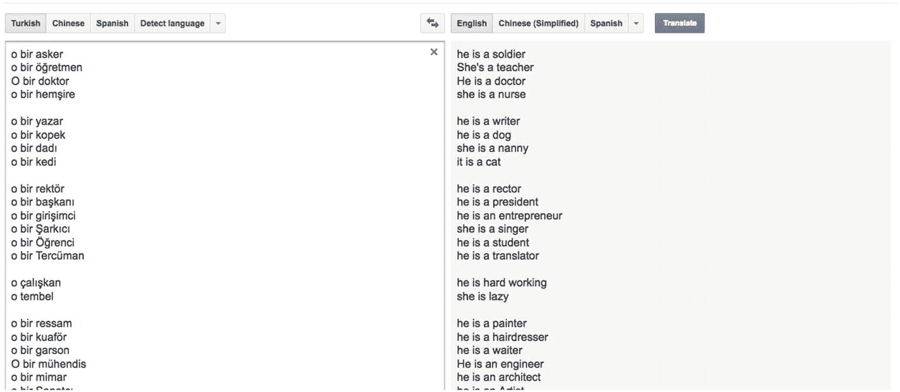
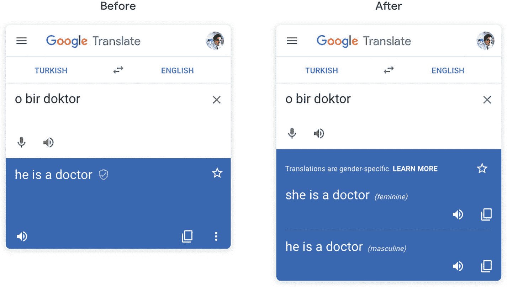
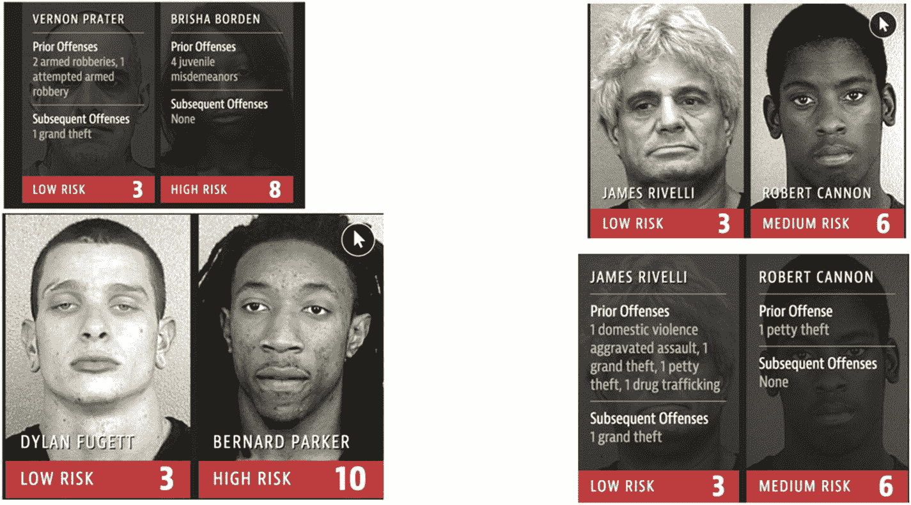

# 7. 机器学习中的偏见

在我看来，如果不提及机器学习中的偏见这个话题，这本书就不算完整。

当我们赋予计算机生成预测的能力，并依赖这些预测来构建人们会与之交互的生产应用时，花时间思考使用这项技术的后果和影响至关重要。

在最后一章中，我们将讨论不同类型的偏见、为什么这是一个问题，以及如何在我们的机器学习系统中将其最小化。

## 7.1 什么是偏见？

如果我们参考牛津词典的定义，偏见是：

> *一种强烈支持或反对某一群体或某一方的感觉，通常并非基于公正的判断。*
> 
> ——引用来源：[`www.oxfordlearnersdictionaries.com/definition/english/bias_1?q=bias`](http://www.oxfordlearnersdictionaries.com/definition/english/bias_1%253Fq%253Dbias)

在数据科学领域，可能存在不同类型的偏见，包括：

*   **确认偏误**：当执行数据分析的人想要证明一个预设的假设，并故意从分析中排除特定变量，直到得出想要的结论时，就可能发生这种情况。

*   **选择偏误或样本偏误**：当所使用的数据样本不能很好地反映总体情况时，就会发生这种情况。

*   **偏见偏误**：由受文化或其他刻板印象影响的训练数据导致的结果。例如，如果我们根据网上找到的图像训练一个算法来识别工作中的人，很多图像显示男性在编程，而女性在厨房。结果，模型会预测男性更可能是程序员，而女性是厨师，这是不正确的，并且复制了网上存在的偏见。

如果你不熟悉机器学习中的偏见这个话题，你可能会想知道为什么这是一个问题。

人类在许多方面都存在偏见；我们可能对人或情况做出毫无根据的假设，从而导致歧视。然而，当这种偏见进入我们日常生活中使用的、旨在为我们做出决策或关于我们做出决策的产品或系统时，可能会产生不应被忽视的、可怕的广泛后果。

让我们看一些例子。

## 7.2 机器学习中偏见的例子

在接下来的几页中，我们将看两个在真实应用中使用有偏见机器学习模型的例子。

### 7.2.1 性别偏见

几年前，谷歌翻译因其翻译结果揭示了算法的性别偏见而登上新闻。当将一些土耳其语单词翻译成英语时，土耳其语中涵盖所有单数第三人称的代词“o”被翻译成了英语中带有性别区分的代词，导致了以下有偏见的结果。

图 7-1

谷歌翻译显示有偏见的结果

如上图所示，尽管土耳其语没有为每个术语指定特定性别，但谷歌翻译猜测了一个特定性别，导致了刻板印象，例如将“医生”一词与代词“他”匹配，将“护士”与“她”匹配。

谷歌现已更新其算法，通过为单个单词同时显示女性和男性的翻译，来试图防止此类偏见的发生。

图 7-2

谷歌翻译显示包含多个代词的结果

尽管这是一种改进，但错误不一定在于算法本身，而很可能是由于用于训练它的数据可能包含有偏见的信息。

此外，同时显示“她”和“他”代词并没有考虑到使用“他们”代词的人群，而为了达到更好的公平性，应该将其包含在内。

### 7.2.2 种族偏见

过去几年中，有偏见的机器学习算法最具影响力的例子之一，是一款名为 COMPAS 的 AI 驱动软件。

法官在法庭上使用该软件，根据对 137 项调查问题的回答，生成风险评估并预测哪些罪犯最有可能再次犯罪。

使用该算法的问题在于，人们发现，当它的预测出错时，对黑人和白人罪犯显示的结果是不同的。

黑人罪犯被标记为高风险，即使他们再次犯罪的可能性较低；而白人罪犯被标记为低风险，即使他们再次犯罪的可能性更高。

图 7-3

COMPAS 软件结果

这种错误预测被用于司法系统本身已经是一个严重的问题，但其使用规模之大更令人担忧。

考虑到美国每年监禁大量人口，人们只能想象错误定罪的数量之多。

此外，由于 COMPAS 背后的公司 Northpointe 拒绝披露其算法的细节，研究人员无法评估其不公正的程度。

以上只是机器学习算法中可能引入偏见的两个例子。不幸的是，还有更多此类情况，我建议深入探讨这个主题。

## 7.3 潜在解决方案

尽管机器学习中的偏见无法完全根除，但仍有一些方法可以将其最小化。

### 7.3.1 界定问题

在构建模型和生成预测之前，数据科学家需要确定他们试图解决什么问题。正是在这个阶段，就可能发现一些偏见。如果你正在为一家希望自动评估人们“信用度”的信贷公司构建模型，那么关于“值得获得信贷的人”的定义本身，就可能已经包含了某些不公和歧视。

例如，一家公司可以决定要最大化其利润率，这意味着信用度将基于客户的富裕程度，因为他们可能会申请更大的贷款。或者，它也可以决定更侧重于最大化贷款合同的数量，无论客户是否负担得起。

总的来说，问题在于这些决策是出于商业目标，而非公平性，尽管它们最终会以多种方式影响真实的人。

如果算法预测发放次级贷款是最大化利润的有效方式，那么即使这不是公司的直接意图，它最终也会陷入掠夺性行为。

### 7.3.2 收集数据

这可能是偏见进入机器学习模型更常见的例子，并且可能以两种方式出现。

#### 对现实的不正确呈现

你可能听说过这样的案例：收集的数据不能代表现实，导致机器学习模型产生错误的预测。

例如，在人脸识别中，如果算法训练时使用的浅肤色人脸图像多于深肤色人脸图像，那么生成的模型必然更擅长识别浅肤色人脸。

为了尝试防止这种歧视，在将数据输入算法之前对其进行分析，可以让你了解其质量以及生成更公平预测的潜力。

通常，如果你决定使用预训练模型，应该有一个文档化的链接供你查看所使用的数据集。如果找不到，我会向分享该模型的公司或个人索取。

如果你无法验证数据的质量，我建议寻找其他模型。

如果你找到了原始数据集，并注意到它缺乏多样性，不能很好地代表现实，你可以选择不使用基于这些数据训练的模型，或者你也可以选择利用它，收集一些额外的、更多样化的数据，并应用迁移学习来生成一个新的、偏见更少的模型，用于你的应用程序。

如果你选择自己收集数据，而不是依赖现有模型，我建议你首先分析在你的特定情况下多样性意味着什么，你的模型要解决什么问题，它将用于哪些人群，你计划使用哪些来源来收集数据，这些来源是否能代表现实，等等。

分析工作对于尽早发现潜在问题或担忧，并构建一个能最大限度减少偏见持续存在的模型至关重要。

#### 反映现有偏见

收集数据时的第二个问题在于使用了包含现有偏见的数据。

一些公司使用其内部的历史数据来训练机器学习模型，以实现任务自动化。

例如，在几年前（2018 年），亚马逊意识到其内部的 AI 招聘工具对女性存在偏见。

他们使用过去 10 年收集的求职申请数据，对新候选人进行 0 到 5 星的评分。然而，由于亚马逊雇佣的大多数人是男性，模型推断出男性候选人更受青睐。

通过查看历史招聘数据并分析数千份简历，该模型的逻辑是亚马逊不喜欢简历中出现“女性”这个词。

结果，任何包含这个词的简历，例如“女子队队长”或“就读于女子学院”，其评分都低于未提及该词的简历。

尽管这在 2018 年成为了新闻，但亚马逊早在 2015 年就意识到其新系统并非以性别中立的方式对候选人进行评分。

防止此类歧视的一种方法与前面章节相关，即分析你正在使用的数据。数据是内部的并不意味着它没有偏见。然而，考虑到这些数据是过去 10 年收集的，我们同意手动分析的数据量可能太大。我仍然建议收集一组随机样本，并让人们评估其公平性和多样性。

此外，当使用模型执行像招聘这样重要的任务时，我希望在使用之前已经对模型进行了一些测试。招聘中的偏见是一个众所周知的问题，并且可能以多种形式出现。因此，如果你决定构建或使用依赖机器学习的招聘软件，我建议针对不同的偏见进行测试，从性别到教育背景，再到种族等等。

### 7.3.3 数据准备

另一个可能引入偏见的地方是数据准备阶段。即使你已经分析过数据，并确保其具有多样性且能反映实际应用环境的真实情况，准备阶段同样需要关注。

这一阶段涉及选择你希望算法在学习与生成预测时考虑的属性，与其说是一门科学，不如说更像一门艺术。

通常，需要对属性和参数进行一些实验来微调模型。

然而，你也需要确保在追求高准确率的同时不会引入偏见。虽然调整属性对准确率的影响是可衡量的，但对偏见的影响却并非如此。

以亚马逊的招聘工具为例，属性可能包括候选人的性别、教育水平、工作年限、编程语言、地理位置等。

例如，在招聘工程师时，一个人的性别根本不应成为考量因素，因此应将其排除在模型训练属性之外。

一个人的地理位置只有在公司无法提供签证赞助以支持其搬迁时才有意义。

因此，为了最大限度地实现公平，用于对候选人进行排名的模型应考虑影响其技能水平的属性，包括工作年限和编程语言。

它也可以使用教育水平，但这可能会对有机会接受高等教育的人产生偏见。

在科技行业，许多非常优秀的开发者并没有走计算机科学学位这条路，因此将教育水平作为属性可能会导致这些人排名较低，而实际上他们拥有合适的技能，会成为出色的员工。

希望这个例子能说明数据准备阶段的重要性，无论你是否已经花时间确保所使用的数据集具有多样性。

### 7.3.4 团队多样性

最后，减少机器学习中的偏见也取决于开发模型的团队构成。

我们每个人都有偏见，而弥补多样性不足的一个有效方法就是提高团队的多样性。

你可以想象，如果开发人脸识别模型的团队中有更多非白人成员，那么该模型中发现的问题本可以避免。

这不仅有助于测试模型的预测结果，确保其在多样化的面孔中保持高准确率，还能改进整个流程。

在之前的问题定义、数据收集和准备阶段，拥有不同背景、生活经历等的人将带来益处。潜在问题可以及早提出，并在追求高准确率的同时，影响更公平模型的开发。

这不仅是伦理挑战，也是技术挑战。一个人脸识别模型如果主要对浅肤色人群准确，那它到底有多好？如果机器学习的目标是开发具有最高准确率的模型，那么真正的技术挑战在于在多样化的样本中实现高准确率。

## 7.4 挑战

不幸的是，尽管上一节提到了一些减少机器学习偏见的潜在解决方案，但这个问题很难解决，并且可能仍会持续存在一段时间。

在本节中，我们将探讨减少偏见所面临的几个挑战。

**未知因素**

偏见是在系统的哪个环节引入的，有时并不明确。即使你使用了多样化的数据集，并确保使用的属性不会改变预测的公平性，有时也很难理解模型是如何得出某个结果的。

以亚马逊及其存在性别偏见的招聘工具为例，一旦他们意识到模型会通过“女性”等词语来降低候选人排名，他们就更新了模型以忽略明确的性别词汇；然而，这还不够。他们后来发现，更新后的系统仍然会捕捉到男性简历中更常见的隐含性别词汇，例如“执行”和“捕获”，并据此做出决策。

**公平是相对的**

机器学习偏见方面的另一个挑战是，并非所有人都认同什么是公平或不公平。不幸的是，在人工智能领域，技术方面的工作比伦理方面的工作要多，因此在设计合乎伦理的人工智能应用时，目前还没有真正的标准、法规和政策。

像谷歌这样的公司正在分享他们在开发人工智能解决方案时的原则，其他公司也可以决定采纳；然而，这些不应被视为法规。例如，到目前为止，谷歌的人工智能原则包括以下针对人工智能应用的目标：

*   对社会有益
*   避免制造或强化不公平的偏见
*   为安全而构建和测试
*   对人们负责
*   融入隐私设计原则
*   坚持高标准的科学卓越性
*   其用途应符合这些原则

尽管这是一个好的开端，但我们希望政府能尽快出台关于机器学习模型开发和使用以及如何评估其公平性的真正法规，这样我们才有希望避免有偏见的系统被广泛部署。

在本章中，我们简要介绍了一些存在偏见的机器学习模型被使用的例子及其后果，以及一些可能的解决方案。

如果你有兴趣了解更多关于这个话题的内容，我强烈推荐你阅读凯西·奥尼尔的《数学杀伤性武器》和萨菲亚·诺布尔的《算法压迫》，作者在这些书中更深入地探讨了这个引人入胜的主题。

索引 A 抽象式文本摘要 应用程序编程接口（API） 人工智能 注意缺陷多动障碍（ADHD） 音频数据 数据访问 声学活动识别 生物多样性研究/保护 健康 局限性 数据质量 交互 单一活动 用户体验 含义 麦克风 个人设备 预测 回调函数 文件结构 加载元数据文件 `setupModel`函数 源代码 语音指令模型 迁移学习 API 录制样本 HTML 文件 `listen`方法 源代码 `train`方法 网页界面 声音 Teachable Machine 界面 背景噪音部分 浏览器窗口 自定义部分 实验 开源 GitHub 预测 可视化 频率图 频谱图 波形图 网页无障碍 自动化工具 B 偏见 AI 目标 COMPAS 软件结果 确认数据准备 谷歌翻译 含义 减轻偏见 潜在解决方案 信用度 现有偏见 错误表述 开发模型的团队 偏见 种族偏见 选择/样本偏差 基于 Transformer 的双向编码器表示（BERT）模型 身体/运动追踪 facemesh 完整 JavaScript 代码 加载 预测 项目代码 可视化 Handpose 模型 导入 JavaScript 代码 关键点 论文 手势 预测 项目截图 剪刀 PoseNet `drawSkeleton`函数 HTML 代码 导入和加载 含义 `poseDetectionFrame`函数 预测 可视化 C 认知行为疗法（CBT） 公司 EndeavorRx reSET Woebot 应用 Wysa 截图 卷积神经网络（CNN） D 深度学习 E, F 抽取式文本摘要 G 谷歌云平台（GCP） H 硬件 数据 浏览器输出 数据处理 `convertToTensors`函数 格式化数据 多维数组 输出张量 `readDir`和`readFile`函数 `shuffleData`函数 排序/格式化数据 `train.js`文件 陀螺仪/加速度计数据 JavaScript 代码 含义 模型创建/训练 运动数据 `predict.js`文件 `server.js`文件 设置 WebSocket 网络传感器 医疗保健 超参数调优 I, J 互动教育工具 代码构建 `dorothyVaughan.json`文件 主页 `katherineJohnson.json`文件 加载项目 `maryJackson.json`文件 预测页面 公众人物 问题/展示 选择页面 Web Speech API 输入数据 语言识别 `onresult`方法 `onspeechend`代码 可选参数 QNA 模型 `SpeechRecognition`实例 `SpeechSynthesis`代码 K, L K 近邻算法（KNN） M 机器学习算法 ConvNet K 近邻 朴素贝叶斯 艺术建模 人工智能 偏见 类别 CT 扫描 深度学习 医疗保健 家庭自动化 标记数据 含义 模型 神经网络 强化学习 表征学习 半监督学习 社会公益 监督学习 训练过程 无监督学习 N, O 朴素贝叶斯算法 命名实体识别（NER） 自然语言处理（NLP） 词袋模型 概念 家庭自动化 停用词 文本词形还原/词干提取 分词 词汇表/语料库 神经网络 P, Q 偏见偏见 预训练模型 分类 `classify()`方法 更清晰的背景 公司/机构 控制台输出 `dispose`方法 前端框架 HTML 文件 超参数调优 图像捕获 图像分类项目 输入 属性 JavaScript 代码 实时对象分类 加载函数 含义 mobilenet 模型 模块 预测结果 仓库 模型 迁移学习 参见迁移学习 脚本标签 网络摄像头 对象 生产应用 API 挑战 高可用性 生命周期 构建/实验 持续交付 部署 评估/实验 模型构建 监控/可观测性 测试 机器学习系统组件 实验追踪 模型服务 监控/日志系统 结果 模式 输出标准 TFX 流水线 TensorFlow Extended（TFX） 测试 可观测性 预训练模型 可复用性 可扩展性 服务平台 波动性 伪标签 R 雨林连接项目 强化学习 S 选择/样本偏差 半监督学习 句子分词 情感分析 自动化工具 类别 认知辅助/计算机疗法 含义 NLP 参见自然语言处理（NLP） 社交媒体监控 TensorFlow.js 类别 固定长度向量 HTML 标签 导入模型 JavaScript 代码 `loadModel`函数 元数据文件 预测 源代码 文本分类 参见文本分类 工具 毒性 参见毒性分类器 社交媒体监控工具 垃圾短语 *vs.* 非垃圾短语 频谱图 振幅 频率数据 `getAudioData`函数 HTML 文件 图像数据 JavaScript 含义 输出 监督学习 T TensorFlow.js 数据访问 创建 创建/训练模型 特征 扁平数组 迭代 内存 多维张量 操作 预测 预训练模型 情感分析 文本分类 工具 `tidy`方法 迁移学习 可视化表示 文本分类工具 意图分析 命名实体识别 TensorFlow.js 浏览器控制台 `config`对象 自定义配置 `findAnswers()`方法 HTML 代码 导入代码 `index.js`文件 互动教育工具 MobileBERT 模型 预测 文本摘要 文本词形还原/词干提取 毒性分类器 不同标签 HTML 文件/脚本标签 导入 预测数组 `classify()`方法 详细视图 `identity_attack`标签 匹配值 潜在问题 概率数组 返回值 迁移学习 `addExample`函数 按钮 元素 `conv_preds` HTML 代码 HTML 元素 K 近邻分类器 输出 控制台 `predictClass`方法 `runPredictions`函数 变量实例化 网络摄像头输入 U, V 无监督学习 W, X, Y, Z 单词分词
