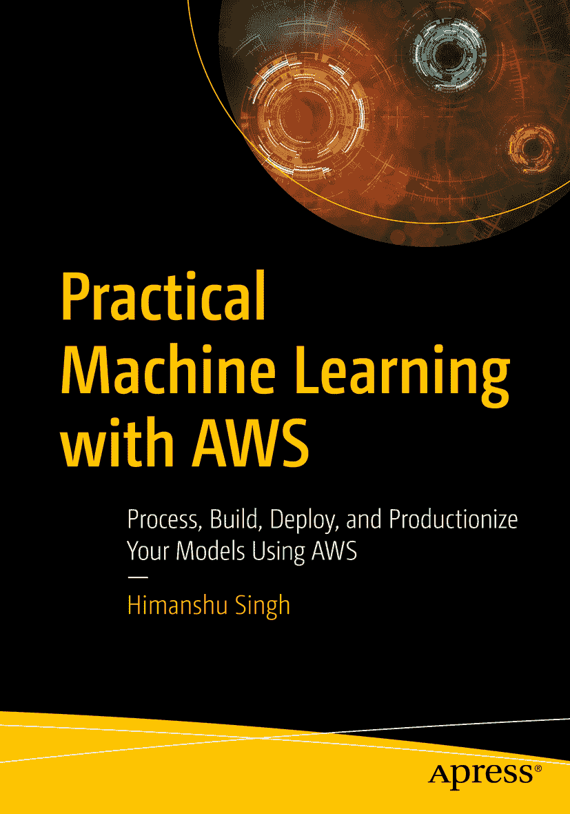

ISBN 978-1-4842-6221-4 e-ISBN 978-1-4842-6222-1 [`doi.org/10.1007/978-1-4842-6222-1`](https://doi.org/10.1007/978-1-4842-6222-1) © Himanshu Singh 2021 Apress Standard

本出版物中通用描述性名称、注册商标、商标、服务标记等的使用，即使未作特别声明，也不意味着这些名称不受相关保护性法律和法规的约束，因此可自由通用。出版商、作者和编辑可以假定，本书中的建议和信息在出版之日是真实准确的。出版商和作者或编辑均不对本书所含材料或可能存在的任何错误或遗漏提供明示或暗示的担保。出版商对已出版地图中的管辖权主张和机构归属保持中立。

本书通过 `Springer Science+Business Media New York` 在全球图书贸易中发行，地址：1 New York Plaza, Suite 4600, New York, NY 10004-1562, USA。电话：1-800-SPRINGER，传真：(201) 348-4505，电子邮件：orders-ny@springer-sbm.com，或访问 www.springeronline.com。`Apress Media, LLC` 是一家加利福尼亚有限责任公司，其唯一成员（所有者）是 `Springer Science + Business Media Finance Inc (SSBM Finance Inc)`。`SSBM Finance Inc` 是一家特拉华州公司。

## 引言

本书分为三个部分。第一部分涵盖云计算的概念，并概述 `AWS` 的工作原理。第二部分详细讲解 `AWS`，涵盖 `SageMaker`、`Step Functions`、`S3` 存储桶、`ECR` 等内容。最后一部分讨论 `AWS` 服务的使用案例。此处将讨论 `Amazon Comprehend` 和 `Extract` 等不同服务。

具体来说，第一部分首先介绍云术语。它帮助您理解使用 `AWS` 所需的云概念。然后，本书讨论 `Amazon` 提供的各种 `AWS` 服务，以及它们如何以不同方式帮助用户。它讨论了 `AWS` 的不同功能，这些功能按存储型、计算型、安全型等进行分类。通过本部分各章节的学习，您将对 `AWS` 的工作原理有一个概览。

第二部分详细讨论 `SageMaker`。本部分从在 `SageMaker` 中运行一个基本的预处理脚本开始，以在其中构建一个完整的端到端机器学习流水线结束。它涵盖了 `SageMaker` 如何与 `ECR`、`S3`、`Step Functions` 等不同服务交互，以构建最终模型。

第三部分讨论了使用 `AWS` 其他一些服务的三个机器学习用例。本书讨论了如何使用 `Amazon Textract` 提取文本、如何使用 `Amazon Comprehend`，以及如何使用 `Amazon Forecast` 构建时间序列模型。

本书旨在为熟悉 `Python` 和机器学习的人提供一些 `AWS` 使用经验。它教您如何利用 `AWS` 的强大功能来构建您的重型模型，以及 `AWS` 如何为您提供服务来构建超级模型或部署您的自定义代码，并同样获得 `AWS` 的支持。

## 致谢

我要感谢我的父母和兄弟给予我无条件的支持，以及 `Apress-Springer` 团队。

## 关于作者 关于技术审校者