# 1. 云计算与 AWS

本章涵盖云计算和 Amazon Web Services (AWS) 的不同组成部分。阅读本章后，您将了解 AWS 的不同重要组件，这将使您更容易理解 AWS 的机器学习组件。

## 什么是云？

那么，什么是云？如果您看看互联网上分享的梗图，您可能会认为云不过是别人的计算机，您可以从自己的计算设备上访问它，用于个人用途。那么问题来了，既然我们有自己的计算机，为什么还需要别人的计算机呢？这是因为我们的计算机可能没有其他系统所拥有的东西。也许您购买系统时的预算比别人少，因此他拥有更多的计算能力可供使用。因此，与其购买一个计算能力更强的新系统，不如暂时访问其他系统，然后再回到自己的系统。这就是云提供的好处。而且，顺便说一句，我们都知道其他系统并非普通的系统。云系统由 Amazon 和 Google 等大公司提供。因此，即使您试图购买一个计算能力与云系统相当的新系统，您也负担不起。

正式地说，*云*是一种特定的计算服务，位于不同的远程位置，我们可以通过网络或互联网进行访问。云服务可能包括存储服务、基础设施服务、软件服务或您需要的任何其他特定服务。图 1-1 展示了不同设备如何连接到远程位置的云系统。

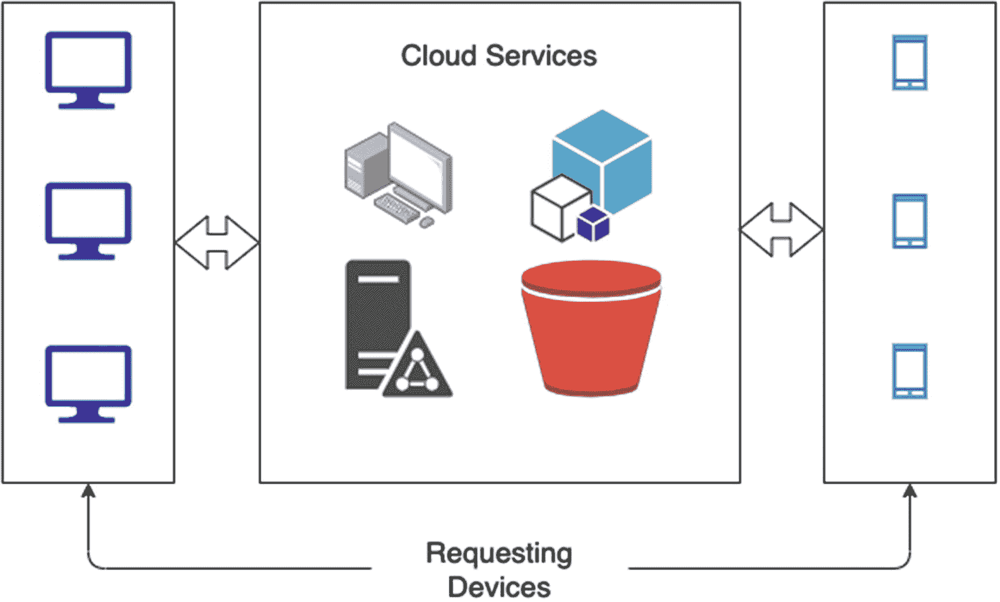

图 1-1

不同设备如何连接到远程位置的云系统

如果我们能够通过互联网或网络访问远程位置的任何服务，那么我们将此称为*云计算*。

## 云系统的控制

显然，如果有人允许通过互联网访问其个人系统，那么他们可能希望以某种方式限制访问。或者，他们可能希望一组人拥有完全访问权限，而另一组人拥有有限访问权限。这样做是为了避免安全问题，并且不暴露系统中存在的漏洞。为了解决这个问题，云计算分为四种类型。

*   公有云

*   私有云

*   混合云

*   社区云

### 公有云

当整个云基础设施对公众开放使用时，则称为*公有云*。例如，Google 或 Yahoo 提供的电子邮件服务。

### 私有云

当只有特定群体可以访问云提供的服务时，则称为*私有云*。例如，组织内的人员可以访问组织云中的资源，但组织外的人员无法访问相同的资源。

### 社区云

当云服务可供一组组织访问时，则称为*社区云*。例如，不同的组织可以通过注册来访问 AWS 或 Google Cloud Platform 的服务。因此，所有已付费的组织都可以使用相同的服务，但其他组织则不能。

### 混合云

当云服务同时提供两种选项（即公有云和私有云的服务）时，则称为*混合云*。例如，使用 AWS 的两种服务。当我们使用 SageMaker 训练来训练模型时，这对特定组织来说是私有任务，因为它包含敏感数据和其他内容；但是，当我们训练模型然后公开共享端点时，它就是公有云，因为任何拥有链接的人都可以访问该端点。（您将在后续章节中了解更多关于 SageMaker 的信息。）

## 云服务

现在您已经了解了访问云的不同方式，让我们深入探讨云平台可能提供的服务。我们可以将这些服务分为四个领域。

*   基础设施即服务 (IaaS)

*   平台即服务 (PaaS)

*   软件即服务 (SaaS)

*   一切即服务 (XaaS)

### 基础设施即服务（IaaS）

顾名思义，当云服务提供商允许用户访问其构建的基础设施时，这便被视为 IaaS。例如，云提供商可能提供对虚拟机、物理机、存储设备等的访问。比如，我们可以使用 Google Drive 将信息存储在云端，因为谷歌将其硬盘作为服务提供。AWS 还提供了名为 EC2 实例的机器，个人可以使用它们来执行需要更高计算能力的操作。

### 平台即服务（PaaS）

有时，我们不需要整个基础设施，而只需要一个特定的开发运行时环境，以便编写代码、制作游戏或网站。这样，构建整个基础设施的成本就可以降低。这种类型的服务就是 PaaS。例如，我们可以使用 Google Colaboratory 来编写 Python 或 R 代码。此外，我们还可以使用 AWS SageMaker 来训练机器学习模型并将其投入生产。还有其他服务提供商，如 Microsoft Azure、Google Cloud Platform、IBM Cloud 等。

### 软件即服务（SaaS）

当我们不需要运行时环境，但想使用带有内置运行时的特定软件应用程序时，我们就不需要 PaaS（它会提供运行时环境以及我们需要安装的依赖项和软件）。因此，存在一些云服务，它们为特定用途提供特定软件，称为 SaaS。SaaS 的例子包括用于数据管理的 Amazon Ground Truth 和微软的 Office 365。

### 一切皆服务（XaaS）

前三种服务类型已在市场上存在相当长的时间，但现在，由于技术的进步，云服务提供商几乎将一切事物都作为云服务来提供。例如，我们现在可以绘制网页草图并将其交给 Azure，Azure 会将其转换为 HTML 页面。此外，你可以通过与连接到 AWS 的 Alexa 对话来播放在线歌曲。所有这些都归入 XaaS 的范畴。

现在，让我们深入了解一个特定的云服务提供商——亚马逊网络服务（AWS）。

## 亚马逊网络服务简介

AWS 在许多国家提供全球云计算服务，目前负责处理许多公司（包括小型和大型企业）的基础设施。根据 AWS 文档，目前 AWS 为 190 个国家的数十万家企业提供服务。

AWS 提供超过 150 种可按需使用并根据使用时间付费的服务。目前，AWS 在许多区域都设有数据服务器，你可以选择仅使用离用户最近的一个区域服务器。以下是全球数据服务器列表：

*   **北美**
    *   俄亥俄州（美国东部）

    *   俄勒冈州（美国西部）

    *   北加利福尼亚（美国西部）

    *   北弗吉尼亚（美国西部）

    *   GovCloud（美国东部和美国西部）

    *   加拿大（中部）

*   **南美**
    *   圣保罗

*   **欧洲/中东/非洲**
    *   伦敦（欧洲）

    *   斯德哥尔摩（欧洲）

    *   法兰克福（欧洲）

    *   巴黎（欧洲）

    *   巴林（中东）

    *   爱尔兰（欧洲）

*   **亚太地区**
    *   新加坡（亚太地区）

    *   北京（中国大陆）

    *   悉尼（亚太地区）

    *   东京（亚太地区）

    *   首尔（亚太地区）

    *   宁夏（中国大陆）

    *   大阪（亚太地区）

    *   孟买（亚太地区）

    *   香港（亚太地区）

正如我所提到的，AWS 拥有超过 150 种服务。问题是，你如何访问它们？是否有一个集中的地方可以访问它们？嗯，是的！这个地方叫做 AWS 管理控制台。让我们看看这个控制台的一些特性，以及它如何真正对用户有帮助。

## AWS 管理控制台

使用 AWS 管理控制台（AMC），你不仅可以访问服务，它还提供了一些其他很酷的功能。其中一些如下：

*   一旦你在 AWS 上创建了账户并登录到 AMC，你的会话将仅保持 12 小时的活动状态。之后，你需要重新登录。显然，这个时间限制是可定制的。提供此功能是出于安全原因。

*   你不仅可以从 Web 访问 AMC，还可以使用移动应用程序。AMC 应用程序在 iOS 和 Android 设备上都有。

*   AMC 提供对不同学习资源、文章、文档、视频等的访问，这有助于我们理解 AWS 的不同服务。

*   你甚至可以根据你的使用情况和需求自定义和个性化 AMC。

登录 AWS 后，你将看到以下功能：

*   用于查找特定服务的搜索按钮

*   用户最近访问的服务

*   所有服务的列表

*   自动化工作流程的链接

*   学习资源的链接

图 1-2、1-3、1-4 和 1-5 展示了 AMC 的不同界面。

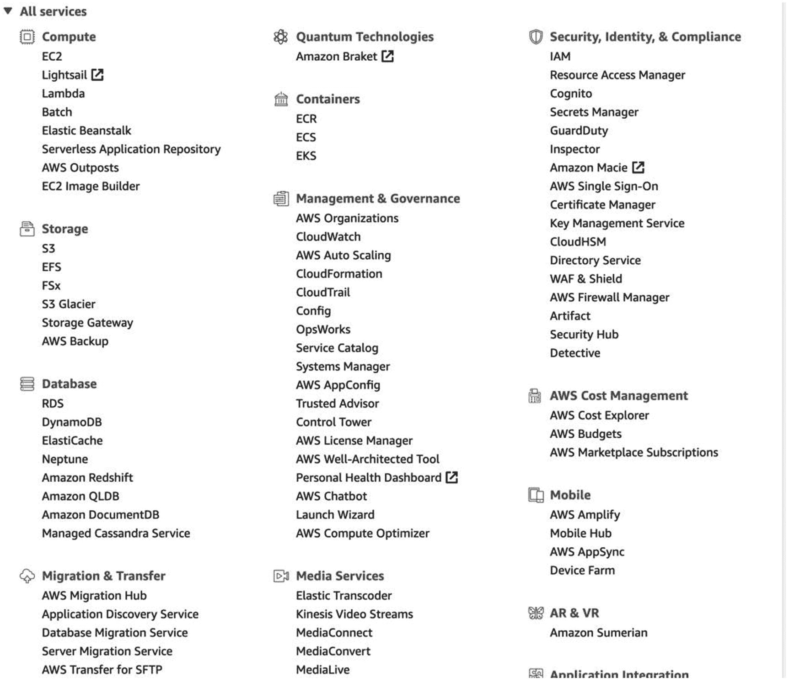

图 1-5

AMC 上的所有服务列表

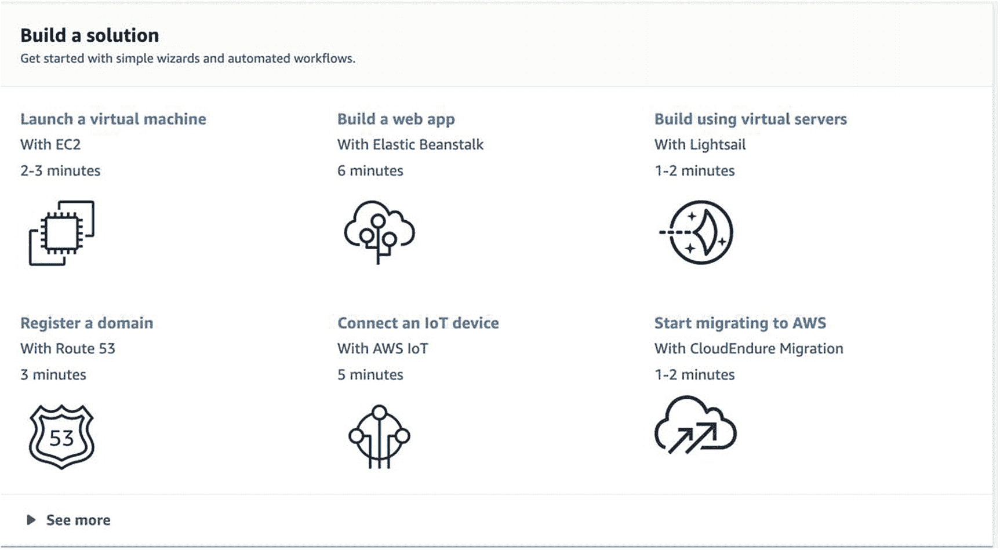

图 1-4

AMC 上的自动化

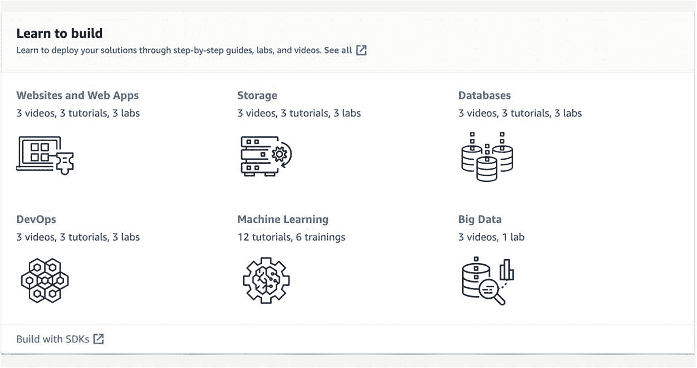

图 1-3

AMC 上的学习资源

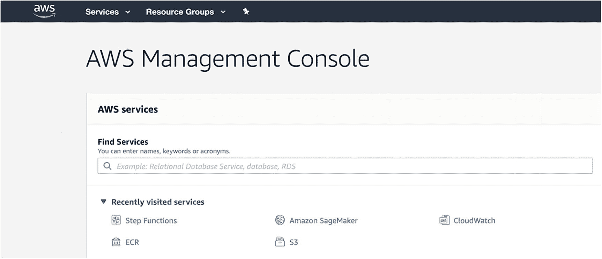

图 1-2

AMC 上的查找服务功能和最近访问的服务

我们将在下一节关于机器学习的内容中详细查看如何登录 AWS 并访问 AMC。现在，让我们进入 AWS 的下一个功能，称为 AWS 命令行界面（AWS CLI）。

## AWS 命令行界面

如果说 AMC 为你提供了访问 AWS 服务的可视化界面，那么 CLI 则赋予你通过控制台访问相同服务的更高级能力。它由那些已经使用 AWS 一段时间的高级开发人员使用。你只需下载一个工具，然后就可以用它来控制不同的服务、编写脚本，并控制服务的自动化。

AWS 提供了大量资源，如参考文档、GitHub 仓库、论坛等，用于理解 AWS CLI。虽然你可以从默认控制台（如 Windows 的命令提示符或 Linux 和 Mac 的终端）使用 AWS CLI，但还有一个专用的 AWS Shell，它提供了一些高级功能。其中一些如下：

*   自动补全支持

*   命令的内联文档

*   操作系统 Shell 命令，也可以从同一个 Shell 中执行

当我们详细讲解机器学习时，会大量使用 CLI。因此，我们将在该部分直接探讨其实际应用。

由于 AWS 提供了如此多的服务，在一本书中涵盖所有内容是不可能的。此外，这本书是关于机器学习的，因此在这里涵盖每一项服务也没有意义。但是，我们将讨论我认为非常重要且常用的三项服务。以下是我们将要讨论的服务：

*   AWS 存储服务

*   AWS 计算服务

*   AWS 网络和内容分发服务

让我们从第一个服务——存储服务开始讨论。

## AWS 存储服务

当我们在云平台上工作并使用其服务时，显然会根据需求产生大量数据。例如，如果我们正在构建一个网站，那么我们将需要存储图像、视频和许多其他内容。如果我们有一个机器学习模型，那么我们将需要处理数 TB 的数据。这些数据可以是结构化的，也可以是非结构化的。同样，出于业务目的，我们可能拥有多个 Excel 表格或演示文稿。所有这些数据类型都必须存储在云中的某个位置，而云平台应提供此功能。

AWS 提供了多种数据存储选项，本节我们将讨论其中三种。

*   Amazon S3

*   Amazon 弹性文件系统 (EFS)

*   AWS Storage Gateway

### Amazon S3

AWS 最常用的服务之一是 Amazon Simple Storage System (S3)。它为您提供了一个界面，您可以像在本地文件系统中存储数据一样存储数据。您可以创建文件夹和多个子目录来组织数据。以下是 Amazon S3 提供的一些基本功能：

*   它提供可扩展性，目前在行业中处于领先地位。

*   它提供实时数据可用性。

*   它提供安全性和优化的性能。

*   其持久性高达 99.9999999…%（11 个 9）。

S3 使用起来非常简单。首先，让我们了解一些 Amazon S3 使用的命名约定。

#### 存储桶

*存储桶*就像本地文件系统中的一个文件夹。它是一个用于存储文件的容器。

#### 对象

您在 S3 中存储的文件称为*对象*。所有对象都存储在存储桶内。

#### 键

您存储的每个对象都会被赋予一个称为*键*的唯一标识符。此外，不仅对象，存储桶也具有唯一的键。

S3 是否如其名称所示仅提供简单的存储？我的回答是既是也不是。说是，因为它的主要用途仅仅是存储，而且确实非常简单。说不是，因为它围绕存储功能还有许多其他特性，使其成为每个客户的首选服务。让我们看看是哪些特性让 S3 如此强大。

*   根据数据使用的频率，S3 提供不同类型的存储类别。
    *   **S3 STANDARD**：需要频繁访问的数据

    *   **S3 STANDARD_IA**：需要较少访问的数据

    *   **S3 GLACIER**：我们希望归档的数据

*   没有安全性的存储毫无意义。AWS 为您创建的存储桶提供访问控制。您可以使用*策略*来实现这一点。以下是我们可以应用的基于策略的三个控制级别：
    *   谁可以访问哪个存储桶？

    *   可以从哪个网络访问存储桶？

    *   应该在什么时间访问存储桶？

*   您还可以创建对象的版本。例如，如果同一个 Excel 表格被更新了五次，那么可以创建它的五个版本。

在整本书中，Amazon S3 是我们将随机器学习服务持续使用的服务。我们将在下一节详细讨论这些服务。

### Amazon 弹性文件系统

Amazon 弹性文件系统 (EFS) 是一个弹性网络文件系统，与大多数 AWS 云服务兼容。它被称为*弹性*，是因为它既可扩展也可收缩。如果您上传的数据量较小，它会缩小其大小以适应这些数据。但如果您上传的数据量较大，它可以扩展其大小。扩展规模可达 PB 级。EFS 与最新版本的 NFS（即 NFSv4.1）配合使用。因此，它几乎与您想要开发的任何东西兼容。

提示

使用网络文件系统 (NFS)，您可以像在本地系统中执行操作一样，进行存储、编辑、删除和其他操作。它是一种使用*网络附加存储* (NAS) 的分布式文件系统。当前版本的 NFS 提供了高级功能，例如强身份验证、文件缓存以及对 Windows 文件系统的支持。现在可以在全球广域网上访问 NFS。

与 S3 类似，EFS 提供两种文件存储类型。

*   标准访问

*   不频繁访问

当我们想要频繁访问数据时，我们使用标准访问，而不常使用的数据可以存储在 EFS 的不频繁访问中。此外，与 S3 一样，您可以在 EFS 中对数据进行身份验证和授权，并进一步对其进行加密。最后，您可以像 S3 一样添加策略，以维护访问控制。

### AWS Storage Gateway

AWS Storage Gateway 是 AWS 提供的一种混合基础设施。如果您希望使用本地基础设施来满足所有存储需求，但又希望获得一些功能，以便能够使用 AWS 的云存储服务，那么 Storage Gateway 是最佳解决方案。

Storage Gateway 提供三种解决方案。

*   文件网关

*   卷网关

*   磁带网关

#### 文件网关

使用此服务，所有文件都存储在 S3 中。它为您提供一个虚拟应用程序，您可以使用它来管理 S3 中的所有文件。检索/存储文件是通过网络文件系统或服务器消息块等协议完成的。我们所说的虚拟软件不过是一个用于管理文件的虚拟机。这可以基于 VMware ESXi 或 Microsoft Hyper-V。

#### 卷网关

您可以直接将卷存储在云中，而不是文件，之后可以将其挂载为 Internet 小型计算机系统接口 (iSCSI)。同样，部署在本地的软件是一个虚拟机。支持以下类型的卷：

*   缓存卷

*   存储卷

拥有缓存卷意味着将数据完全存储在 S3 中，然后经常使用的数据被缓存在本地系统中。图 1-6 显示了 AWS 提供的缓存卷网关架构。

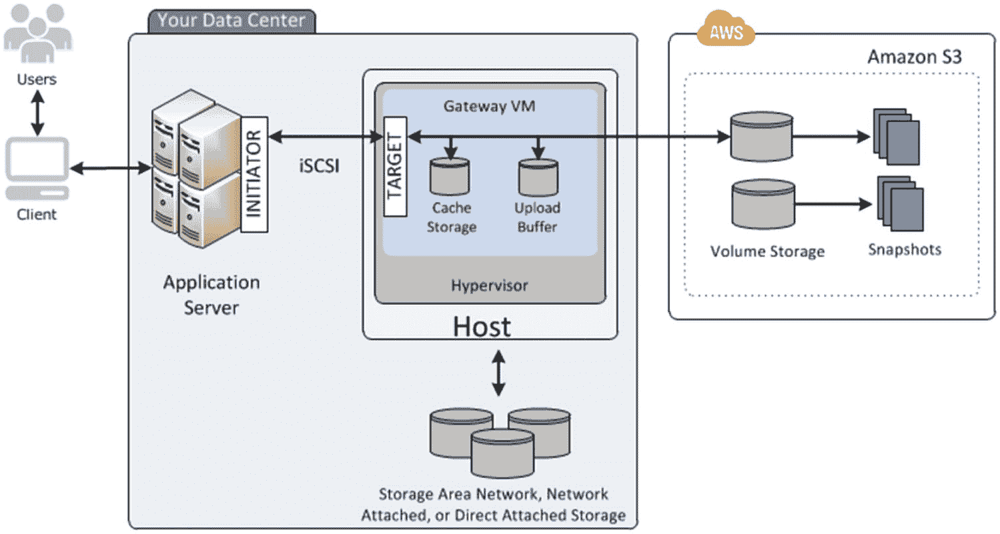

图 1-6

缓存卷，Storage Gateway 架构

图 1-6 分为三个部分。左侧部分显示了使用本地架构的实际用户。中间组件是组织的本地基础设施。右侧组件具有用于数据备份的 S3 连接。

当您将整个数据存储在本地，然后将这些数据的快照版本备份到云端时，这就是卷网关的存储卷支持。我们可以在灾难恢复的情况下使用它。例如，如果您丢失了本地数据，您可以从云端下载最新的快照。同样，我们在这里使用 S3 作为存储服务。图 1-7 显示了存储卷的架构。

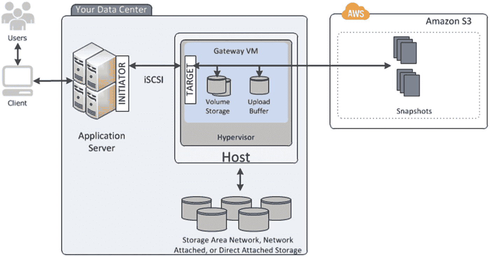

图 1-7

存储卷，Storage Gateway 架构

图 1-7 中的架构与图 1-6 几乎相同，但不同之处在于，我们不是存储整个数据，而是仅存储本地保存数据的快照。

#### 磁带网关

此服务用于数据归档。为此，我们可以使用 Amazon S3 Glacier 或 Deep Archive 作为存储服务。它也可以使用虚拟机在本地部署。图 1-8 所示的架构展示了磁带网关的工作原理。

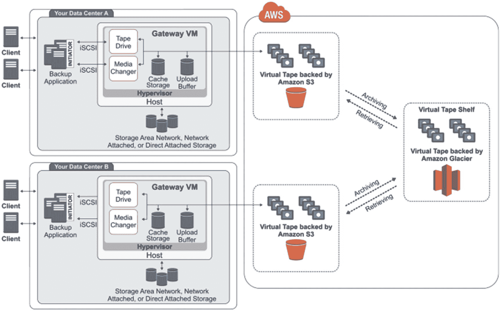

图 1-8

磁带网关，存储网关架构

在架构中可以看到，不同的基础设施将数据存储到各自的 S3 存储桶中。随后，所有 S3 存储桶的数据被合并，然后存储到 Amazon S3 Glacier 中。虚拟磁带本质上只是一种存储数据的方式。就像物理磁带在未使用时是空的，使用时才被填充数据一样，虚拟磁带也可以是空白的，并可根据需要填充数据。

现在我们已经了解了 AWS 存储服务的运作方式并查看了不同的服务，接下来让我们继续探索计算服务。

## AWS 计算服务

在上一节中，您学习了如何使用 AWS 服务存储数据。在本节中，我们将介绍 AWS 提供的一些计算服务。当我们运行应用程序、玩游戏或开发某些东西时，我们需要系统的计算能力。我们通过 RAM、处理器、显卡等来衡量计算能力。有时我们可能有较大的系统需求，但由于资金或资源不足而无法满足。这就是 Amazon 为所有计算需求提供不同类型服务的原因。在本节中，我们将讨论以下 AWS 计算服务：

*   Amazon EC2

*   Amazon ECR

### Amazon EC2

弹性计算云 (EC2) 减轻了用户在硬件需求上投资的负担。无论需求如何，EC2 都允许您创建相应数量的虚拟服务器，以便立即处理工作。此外，它不是静态的基础设施，而是动态的。这意味着，如果计算需求突然激增，EC2 会自动扩展，而不会中断正在进行的进程。

以下是 EC2 为其用户提供的一些功能：

*   它提供了一个环境，我们可以在其中进行计算密集型工作。这是在 AWS 称之为*实例*的虚拟计算环境中完成的。
*   无论您的软件或硬件需求是什么，您都可以使用 Amazon 系统映像 (AMI) 服务进行配置。
*   它为您启动的所有实例提供安全性。它还提供安全组，帮助用户配置防火墙、端口、IP 范围等。

此外，还有许多其他服务可以帮助用户进行日常编码和开发工作。

EC2 提供的实例类型可以分为以下几类：

*   通用型
*   计算优化型
*   内存优化型
*   存储优化型
*   加速计算型

#### 通用型

这些类型提供了计算能力、存储和网络之间的平衡。它们进一步分为以下几组：

*   A1
*   T3
*   T2
*   M6g
*   M5
*   M5a
*   M5n
*   M4

#### 计算优化型

当工作需要高计算使用率并需要强大处理器时，您可以使用计算优化型实例。它们可用于媒体任务、科学任务、快速 Web 服务器甚至游戏服务器。它们可以分为以下类型：

*   C5
*   C5n
*   C4

您可以在 [`https://aws.amazon.com/ec2/instance-types/`](https://aws.amazon.com/ec2/instance-types/) 找到有关这些组的更多信息。

#### 内存优化型

如果工作需要处理大型数据集，您需要内存优化型实例。它们分为以下类型：

*   R
*   R5a
*   R5n
*   R4
*   X1e
*   X1
*   高内存
*   z1d

#### 加速计算型

对于所有机器学习和深度学习应用，首选这类实例。这些系统速度非常快，精度也非常高。它们可以分为以下类型：

*   P3
*   P2
*   Inf1
*   G4
*   G3
*   F1

#### 存储优化型

如果您想处理海量数据集，并希望以更低的延迟实现更快的读写操作，那么这种类型是最佳选择。它们可以分为以下类型：

*   I3
*   I3en
*   D2
*   H1

您可以在 [`https://aws.amazon.com/ec2/instance-types/`](https://aws.amazon.com/ec2/instance-types/) 找到关于每种实例类型的详细信息。

### 其他服务

AWS 还提供与大多数前述实例类型配合使用的其他服务。这样做是为了根据您的使用情况为您提供经济上的优惠。这些服务包括：

*   按需实例
*   预留实例
*   竞价型实例

如果您认为您的工作不会花费很长时间，比如几天或几个月，那么您可以选择*按需实例*。这些实例按小时计费。无论您需要多大的计算、内存和存储容量，都可以使用，但费用将根据使用的小时数计算。

*预留实例*适用于长期使用，因此用户可获得的折扣高达按需实例价格的 75%。这还提供了更改类型的选项。

有时会有大量 EC2 实例未被使用。*竞价型实例*让您能够利用这些实例，与使用按需实例相比，使用竞价型实例可获得高达 90% 的折扣。

## Amazon Elastic Container Registry

近年来，Docker 席卷了整个行业。它允许公司将其基础设施与代码分离。简而言之，Docker 为您提供了一个平台，您可以在该平台上高效地开发和交付代码，而无需担心底层架构。Amazon ECR 是一个存储库，用于存放您希望在 AWS 中运行的所有 Docker 镜像。

一旦您启动了一个 EC2 实例，您就可以选择在该实例上运行任何 Docker 镜像。AWS 有自己的预构建 Docker 镜像可供您导入，或者您也可以将自己定制的 Docker 镜像上传到 ECR，然后导入到 EC2 实例中。

Amazon ECR 包含以下组件：

*   注册表
*   身份验证令牌
*   存储库
*   策略
*   镜像

注册表就像一个普通的登记簿，您需要为您上传到 ECR 的每个镜像进行登记。为了确保只有合适的人才能访问 ECR 上传镜像，会使用身份验证令牌。存储库是实际存储您的 Docker 镜像的地方。镜像就是您实际的 Docker 文件。这些是您创建的包含所有依赖项的文件。您使用镜像将它们存储在 ECR 中，并导入到 EC2 中。

在后续章节介绍 SageMaker 时，您将详细了解 ECR 的操作。

## AWS 网络和内容分发服务

在本节中，我们将讨论 AWS 在该领域的三个重要服务。

*   Amazon VPC
*   Amazon API Gateway
*   Amazon CloudFront

### Amazon VPC

Amazon Virtual Private Cloud（VPC）是一种我们创建的虚拟网络，用于将特定内容与整个用户域隔离开来。它的运作方式类似于普通云，但并非拥有独立的基础设施，而是只有一个云基础设施，并在其上构建多个虚拟云。例如，我们可以为市场部、财务部和运营部分别创建独立的虚拟云。只有各自部门的用户知道每个云中发生了什么，但实际上所有存储的文件都位于同一存储空间，由所有部门共享。因此，每个云都可以拥有自己的安全策略、访问级别等。

Amazon VPC 也是如此，只不过它还提供了可扩展的 AWS 架构。Amazon VPC 包含以下组件：

*   *子网*：每个虚拟私有云只能由一组 IP 地址访问。来自列表之外地址的任何请求都将被拒绝访问。这个列表称为*子网*。

*   *路由表*：如前所述，虚拟私有云与本地云共享相同的基础设施。但 AWS 也提供了自己的功能。其中一项功能是负载均衡，这意味着如果服务器负载变得非常高，我们可以将流量转移到备用服务器。一旦我们在 VPC 中工作，就必须知道流量需要被导向的路由。这些路由存储在路由表中。

*   *互联网网关*：通过互联网网关，您的所有虚拟私有云都能够与底层的 EC2 实例通信。

*   *端点*：如果我们想将虚拟私有云连接到 AWS 提供的任何服务，只需使用 Amazon VPC 提供的 VPC 端点服务即可。

图 1-9 展示了一个使用互联网进行 VPC 访问的架构。

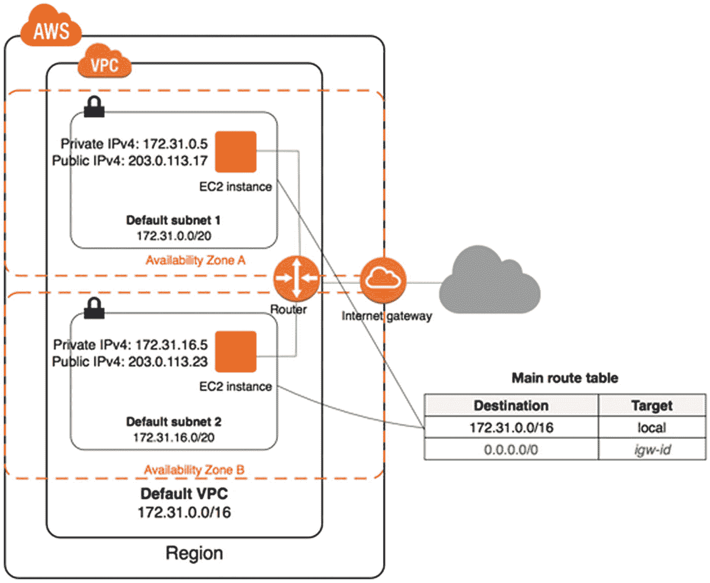

图 1-9

Amazon VPC 架构

如果你查看图 1-9 中的架构，可以看到在 VPC 内部有两个 EC2 实例，每个实例都有一个公有 IP 地址和一个私有 IP 地址。如果你想从 VPC 外部访问服务，则使用公有 IP 地址；而从 VPC 内部访问相同服务时，则使用私有 IP 地址。你可以看到有一个路由器，它使用路由表来了解不同的路由，然后通过互联网网关进行访问。VPC 还有一个 IP 地址和端口号（在图 1-9 中，IP 地址是 172.31.0.0，端口号是 16）。

### Amazon API Gateway

在理解 API Gateway 之前，我先简要介绍一下应用程序编程接口（API）。API 是一种服务，用于让两个或多个应用程序相互通信。例如，当我们使用 Facebook 上传图片或视频时，我们使用的是 Facebook 的上传 API；而当我们点赞、评论或分享时，我们使用的是 Facebook 的另一个 API。因此，在当前的开发场景中，每个小服务都被开发出来，然后转换为 API（REST API 是使用最广泛的 API 类型之一），之后便可以通过网络协议来使用。Amazon API Gateway 为您提供了有效管理这些 API 的服务。

Amazon API Gateway 可用于创建、发布、维护、监控和保护不同类型的 API，例如 REST、HTTP 或 WebSocket API。这些 API 不仅可以拥有自己的应用程序，还可以访问和使用不同的 AWS 服务。

图 1-10 展示了 API Gateway 的架构。

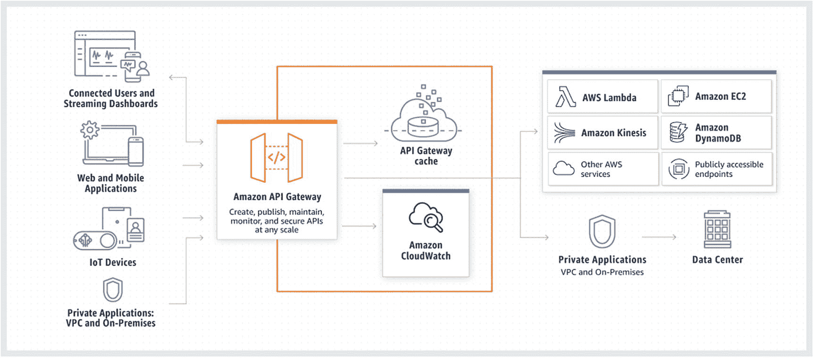

图 1-10

API Gateway 架构

在图 1-10 中，Amazon CloudWatch 用于监控当前状态下 AWS 和 API Gateway 提供的任何服务的日志。API Gateway 缓存通过存储最常用的组件来降低延迟。所有 API 也可以连接到 AWS 的不同服务，例如 AWS Lambda、EC2、Kinesis（用于实时数据分析）、DynamoDB（云数据库）等。它也可以被任何第三方应用程序使用。

### Amazon CloudFront

网络上有很多服务为我们提供了构建网站并将其提供给最终用户的多种选择。AWS 可以算作其中之一，但它提供了其他服务所不具备的功能。AWS 提供了低延迟的选项。为了稍微详细地理解延迟，想象一下你正在打开一个网站，其服务器位于印度，而你却在朝鲜（假设该国为其公民提供互联网）。由于服务器距离很远，使用该网站提供的任何服务都需要很长时间。但是，如果该网站部署在 AWS 上，那么用户就可以使用位于韩国的服务器，而不是印度的服务器。因为服务器离该国更近，页面加载速度会更快。

AWS 是如何做到这一点的？答案是其名为 CloudFront 的服务。CloudFront 又是如何做到的呢？它通过使用 AWS 提供的边缘站点来实现。当你创建一个网站时，它包含静态和动态内容，例如 HTML 页面、CSS 和 JavaScript 等。因此，如果来自你服务器所在位置之外的请求要使用该网站，CloudFront 会将网站的所有内容分发到离请求发起位置最近的边缘站点。因此，由于内容是从最近的服务器交付的，现在打开网站的速度会更快。要了解更多关于边缘站点的信息，请访问此链接：[`https://aws.amazon.com/cloudfront/features/`](https://aws.amazon.com/cloudfront/features/)。

在图 1-11 中，你可以看到 CloudFront 如何用于这种分发。让我们看看图中的每一步代表什么。

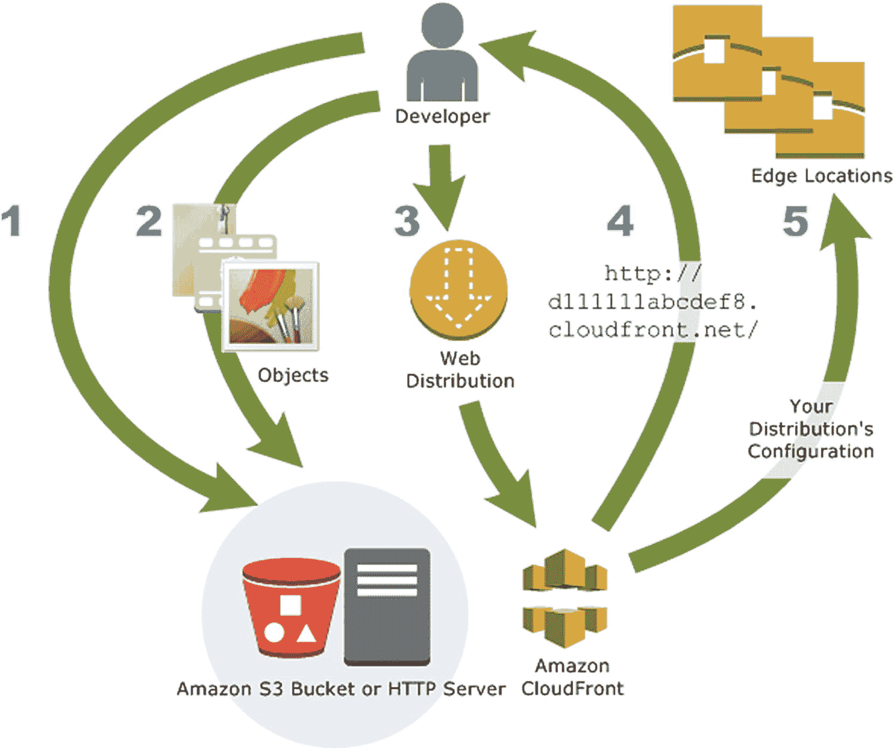

图 1-11

Amazon CloudFront 服务

1.  你的网站将要使用的所有文件都存储在 AWS 服务（如 S3）中，或者也可以是你自己的 HTTP 服务器。（步骤 1 和 2。）

2.  现在，你通过提供 S3 或 HTTP 服务器的链接来启动 CloudFront 分发。（步骤 3。）

3.  一个特定于 CloudFront 的域名会被分配给你的分发。该域名也可以更改。（步骤 4。）

4.  CloudFront 将刚刚创建的分发配置发送到全球所有的边缘站点。在这里，你的文件缓存被创建。（步骤 5。）

## 结论

至此，我们完成了关于云计算和亚马逊云版本 AWS 的基本介绍。在本章中，你了解了与云计算相关的不同概念，并学习了 AWS 的不同组件。我们并未涵盖 AWS 的所有服务，因为其数量超过 150 个。一本书无法涵盖所有内容，但就本书而言，我们已经涵盖了所有重要的服务。

在下一章中，我们将探讨 AWS 的安全方面以及为保护应用程序安全而提供的不同类型的服务。

